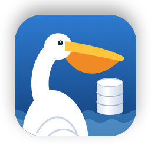
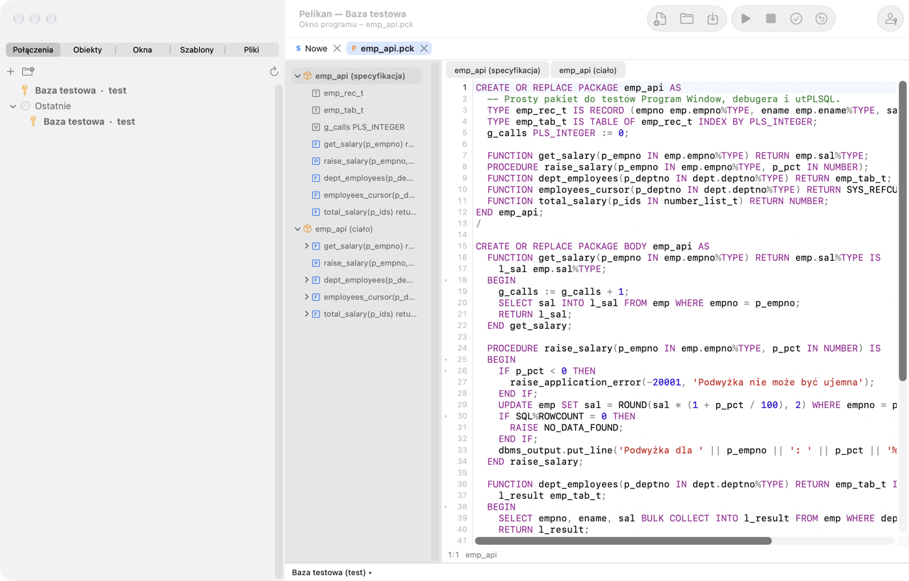
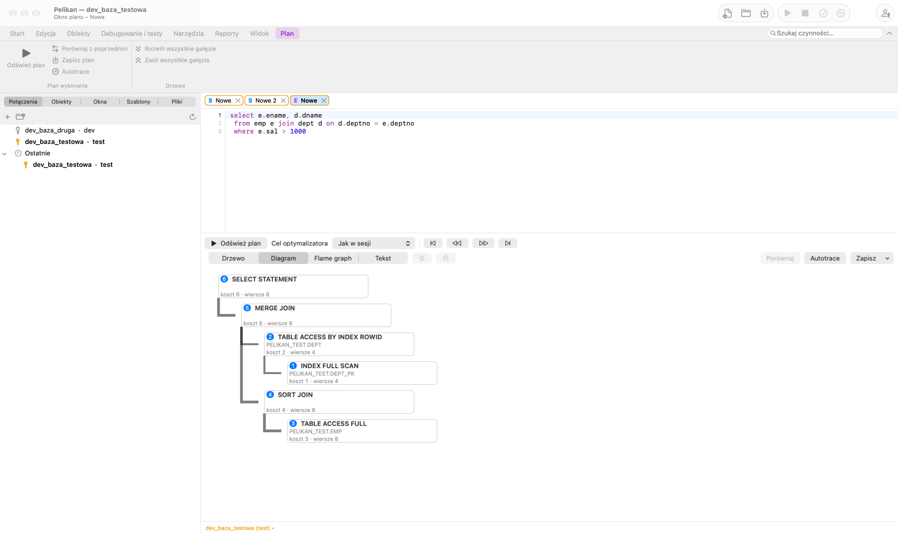
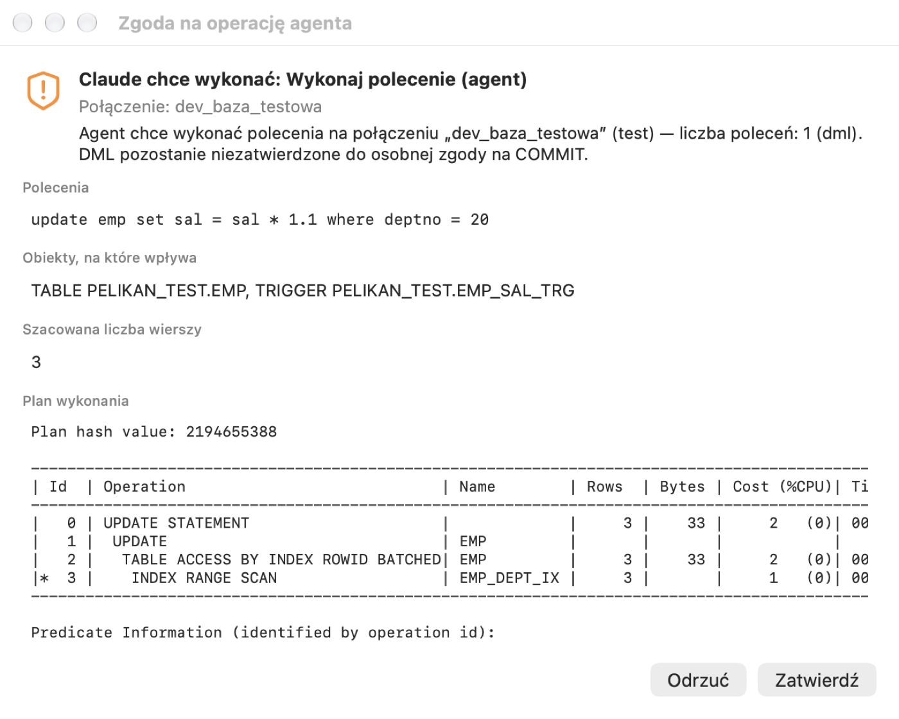

# Pelikan

Natywne IDE dla baz Oracle (SQL, PL/SQL) na macOS z Apple Silicon. Układ i sposób pracy wzorowane na klasycznych IDE
dla PL/SQL, z wbudowanymi testami jednostkowymi utPLSQL, wybranymi funkcjami z innych narzędzi bazodanowych (tylko
w zakresie Oracle) i bezpiecznym API dla agentów AI (Claude Code, Codex CLI, Grok CLI, Antigravity) przez lokalny
serwer MCP.

> **Wersja 1.0.** Pierwsze wydanie stabilne, po becie na prawdziwych bazach (wersje 7.9–10.5). Jak przy każdym IDE
> pracującym na bazie: zmiany na produkcji zatwierdzaj świadomie. Błędy zgłaszaj w
> [Issues](https://github.com/andrzejoles/Pelikan/issues).



## Co potrafi

- **Połączenia** — EZConnect, TNS, Oracle Wallet i magazyn haseł (SEPS), tunel SSH (klucz albo hasło), proxy, edycje
  (EBR), środowiska z kolorami (produkcja tylko do odczytu), hasła wyłącznie w Pęku kluczy, opcjonalnie Touch ID.
  Dwa sterowniki: Oracle Instant Client (ODPI-C, domyślny) i thin (bez Instant Client).
- **Okno SQL i siatka wyników** — wykonywanie poleceń i skryptów, edycja wyników z zatwierdzaniem, Query By Example,
  eksport (CSV, TSV, Excel, HTML, XML, SQL), wykresy, plan wykonania jako drzewo, diagram i flame graph.
- **Okno poleceń** — polecenia SQL\*Plus (bufor, BREAK/COMPUTE, SPOOL, zmienne podstawienia) i wybrane z SQLcl.
- **Programy** — okno programu z konspektem, kompilacja z błędami w linii, formater, analiza kodu i nazw na żywo,
  refaktoryzacja, historia lokalna, porównania ze schematem albo innym połączeniem.
- **Okno testu i debuger** — zmienne, punkty przerwania z warunkami i komunikatami (logpointy), obserwowane wyrażenia,
  stos, profiler.
- **utPLSQL** — uruchamianie zestawów, pokrycie kodu w marginesie edytora, generowanie szkieletów testów.
- **Object Browser i edytory obiektów** — tabele (także partycje), widoki, sekwencje, synonimy, użytkownicy, role,
  kolejki, zadania; diagramy ER; porównanie i synchronizacja schematów, koszyk wdrożenia.
- **Narzędzia** — raporty (style, grupy, sumy) i raporty predefiniowane, notatniki SQL z wykresami, sesje, Scheduler,
  panel DBA, eksport i import danych, Real-Time SQL Monitoring (z ostrzeżeniem o licencji Tuning Pack).
- **Agenci AI** — terminal agenta w oknie, MCP tylko dla bieżącej sesji, macierz uprawnień narzędzi, okno zgody bez
  przycisku domyślnego, DML agenta niezatwierdzony do Twojej zgody, dziennik każdej operacji. Agent nie ma dostępu
  do terminala, okna poleceń, debugera ani haseł.
- **Pro\*C przez SSH** — zdalny build i wdrożenie na serwerze, konsola, historia wdrożeń, wycofanie binarki.



## Instalacja

1. Pobierz `Pelikan-X.Y.Z.dmg` z [Wydań](https://github.com/andrzejoles/Pelikan/releases) i przeciągnij aplikację do
   Aplikacji (albo uruchom `Pelikan-X.Y.Z.pkg`).
2. Aplikacja jest podpisana własnym certyfikatem, ale nie jest notaryzowana: przy pierwszym uruchomieniu otwórz
   Ustawienia systemowe › Prywatność i ochrona i wybierz „Otwórz mimo to”.
3. Sterownik domyślny potrzebuje Oracle Instant Client dla macOS ARM64 (pobierasz go sam ze strony Oracle — licencja
   nie pozwala dołączyć go do instalatora). Bez niego działa sterownik thin; wybierasz go w definicji połączenia.
4. Kolejne wersje Pelikan pobiera i instaluje sam (Sparkle, podpis EdDSA).

Wymagania: macOS 27 na Apple Silicon (arm64).

Pełna instrukcja jest w aplikacji (Pomoc › Instrukcja Pelikana) i w [`docs/manual`](docs/manual).



## Bezpieczeństwo i prywatność

- Hasła baz, SSH i kluczy tylko w Pęku kluczy macOS — nigdy w plikach, logach, argumentach procesów ani zmiennych
  środowiskowych. Szczegóły: [`docs/SECURITY.md`](docs/SECURITY.md).
- Pelikan nie wysyła niczego poza połączeniami, które sam skonfigurujesz (bazy, SSH, aktualizacje z GitHuba).
- Agent AI widzi połączenia tylko przez alias, pracuje we własnej sesji i nie zatwierdza zmian bez Twojej zgody.

## Budowanie ze źródeł

```sh
make generate build run   # XcodeGen + xcodebuild (Xcode 27, Swift 6)
make test-unit            # testy bez bazy
make testdb test          # lokalna baza testowa w kontenerze (Colima) i wszystkie testy
```

Dokumentacja projektu: wymagania [`docs/PROMPT.md`](docs/PROMPT.md), plan [`docs/PLAN.md`](docs/PLAN.md), macierz
funkcji [`docs/FEATURES.md`](docs/FEATURES.md), architektura [`docs/ARCHITECTURE.md`](docs/ARCHITECTURE.md), decyzje
[`docs/DECISIONS.md`](docs/DECISIONS.md), wydania [`docs/WYDANIA.md`](docs/WYDANIA.md).

## In English

Pelikan is a native macOS (Apple Silicon) IDE for Oracle SQL and PL/SQL: SQL and command windows, program and test
windows with a debugger and profiler, utPLSQL, object browser and editors, schema compare, reports, notebooks, and a
secure MCP API for AI coding agents. The UI is available in Polish, English, German, Spanish and Ukrainian. Version 1.0 is the
first stable release after the public beta (7.9–10.5); please report issues on GitHub.

Pelikan nie jest produktem Oracle ani Allround Automations i nie jest z nimi powiązany. Nazwy „Oracle” i „PL/SQL” są
znakami towarowymi Oracle Corporation; używamy ich wyłącznie do opisu zgodności.

## Autor i licencja

Andrzej Oleś w kooperacji z Claude AI · licencja MIT ([`LICENSE`](LICENSE))
