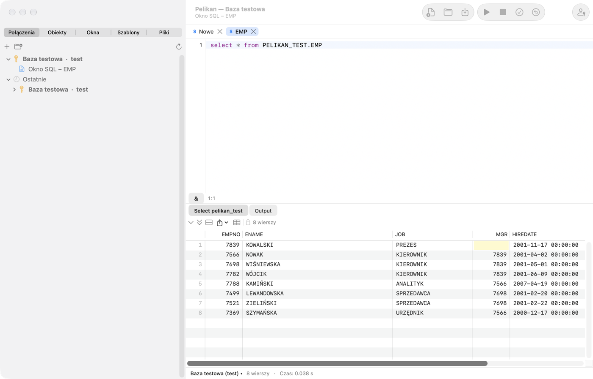

# Einführung und erster Start

Pelikan ist eine native macOS-Umgebung für die Arbeit mit Oracle-Datenbanken: zum Schreiben und Ausführen von SQL, zum
Erstellen, Testen und Debuggen von PL/SQL-Code, zum Durchsuchen und Bearbeiten von Datenbankobjekten, für utPLSQL-Tests
sowie für Werkzeuge zum Vergleichen, Exportieren und Administrieren. Fensteraufbau und Tastenkürzel entsprechen PL/SQL
Developer, sodass dessen Benutzer vertraute Fenster wiederfinden: **SQL Window**, **SQL*Plus-Konsole**, **Program
Window**, **Test Window**, **Explain Plan Window** und **Object Browser** (Tab **Objekte**).

Die vollständige Liste der Befehle mit ihren aktuellen Tastenkürzeln steht im letzten Kapitel,
**Tastaturkurzbefehle**, das von der Anwendung erzeugt wird.

## So verwenden Sie diese Anleitung

Die Anleitung ist so geschrieben, dass auch jemand, der gerade erst mit Oracle beginnt, ihr folgen kann. Jede Funktion
ist im selben Aufbau beschrieben:

- **Wozu es dient** — welche Aufgabe sie löst und welche Begriffe Sie kennen müssen;
- **Wann verwenden** — typische Situationen aus der täglichen Arbeit;
- **Übung Schritt für Schritt** — nummerierte Schritte; nach jedem Schritt sagt *Ergebnis:*, was Sie sehen sollten.
  Sehen Sie etwas anderes, halten Sie an und gehen Sie zum vorigen Schritt zurück;
- **Achtung** — typische Fehler und ihre Folgen (mit ⚠️ markiert).

Die Übungen verwenden das **Übungsschema** — einige Tabellen und ein Paket, die Sie mit dem Skript aus dem Abschnitt
**Übungsschema** weiter unten anlegen. Lesen Sie die Kapitel am besten der Reihe nach: 1 (dieses), 2 (Verbindungen),
3 (SQL Window), danach nach Bedarf. Ein unbekanntes Wort finden Sie unter **Grundbegriffe** oder im Glossar am Ende von
Kapitel 15.

## Grundbegriffe

Einige Wörter, die in der ganzen Anleitung vorkommen:

| Begriff | Was er bedeutet |
|---|---|
| **Datenbank** (Oracle-Instanz) | Der Server, der Daten speichert und Befehle ausführt. Sie verbinden sich über das Netzwerk mit ihm. |
| **Benutzer** und **Schema** | Ein Konto in der Datenbank (z. B. `SCOTT`). Von einem Benutzer angelegte Objekte gehören zum gleichnamigen Schema. |
| **Objekt** | Etwas, das in einem Schema lebt: Tabelle, View, Index, Sequenz, Paket, Prozedur, Funktion, Trigger, Typ … |
| **Tabelle** | Daten in Zeilen und Spalten, z. B. `PEL_EMPLOYEES`. |
| **View** | Eine gespeicherte Abfrage, die man wie eine Tabelle lesen kann. |
| **SQL** | Die Befehlssprache der Datenbank: `SELECT` (Lesen), `INSERT`, `UPDATE`, `DELETE`, `MERGE` (Daten ändern), `CREATE`, `ALTER`, `DROP` (Objekte ändern — DDL). |
| **PL/SQL** | Die Programmiersprache von Oracle: Blöcke `BEGIN … END`, Variablen, Schleifen, Ausnahmen. In der Datenbank gespeicherter PL/SQL-Code ist ein **Programm** (Paket, Prozedur, Funktion, Trigger). |
| **Paket** | Eine Sammlung zusammengehöriger Prozeduren und Funktionen: **Spezifikation** (was es anbietet) und **Body** (wie es das tut). |
| **Sitzung** | Eine Verbindung zur Datenbank. Pelikan kann mehrere Sitzungen gleichzeitig haben (Kapitel 13, *Sitzungsmodus*). |
| **Transaktion** | Datenänderungen in einer Sitzung, die noch nicht dauerhaft sind. **COMMIT** macht sie dauerhaft (andere sehen sie), **ROLLBACK** macht sie rückgängig. DDL-Befehle (`CREATE`, `ALTER`, `DROP`) schreiben die offene Transaktion selbst fest. |
| **Kompilierung** | Speichern eines PL/SQL-Programms in der Datenbank und seine Prüfung durch Oracle. Ein Programm mit Fehler hat den Zustand *INVALID*. |
| **Verbindung** (in Pelikan) | Ein gespeicherter Satz von Anmeldedaten: Benutzer, Datenbank, Umgebung. |
| **Umgebung** | Die Kennzeichnung einer Datenbank: Entwicklung, Test, Produktion. Davon hängen Farben und Warnungen ab. |

> ⚠️ **Die wichtigste Regel:** Üben und experimentieren Sie nur auf einer **Entwicklungs-** oder **Testdatenbank**. Auf
> der Produktion (echte Daten des Unternehmens) führen Sie nur aus, was Sie verstehen und was abgesprochen ist.

## Voraussetzungen

- Ein Mac mit Apple-Prozessor (M1 oder neuer) und macOS 27 oder neuer.
- Oracle Instant Client für macOS (ARM64) — das Paket Basic oder Basic Light. Pelikan enthält ihn nicht (die
  Oracle-Lizenz erlaubt das nicht), daher laden Sie ihn selbst von der Oracle-Website herunter. Ohne Instant Client
  funktioniert der *Thin*-Treiber mit Einschränkungen (siehe unten).
- Eine Oracle-Datenbank. Pelikan wird auf Oracle Database 26ai Free entwickelt und getestet; die
  Data-Dictionary-Abfragen haben Varianten für die Versionen 19c, 21c und 23ai. Auf älteren Versionen können einige
  Ordner und Funktionen fehlen.

## Installation

1. Laden Sie das neueste Release von der Projektseite herunter:
   [github.com/andrzejoles/Pelikan/releases](https://github.com/andrzejoles/Pelikan/releases) — eine `.dmg`-Datei oder
   ein `.pkg`-Installationsprogramm.
2. Ziehen Sie **Pelikan** aus dem `.dmg`-Image auf den Ordner **Programme (Applications)**. Das
   `.pkg`-Installationsprogramm erledigt das selbst.
3. Starten Sie Pelikan aus dem Ordner „Programme“.

### Gatekeeper-Warnung beim ersten Start

Pelikan ist mit dem eigenen Zertifikat des Autors („Pelikan Self-Signed“) signiert, aber nicht von Apple notarisiert
(dafür wäre ein kostenpflichtiges Entwicklerkonto nötig). Deshalb blockiert macOS die Anwendung beim ersten Start und
zeigt eine Warnung an. So öffnen Sie sie:

1. Schließen Sie das Warnfenster.
2. Öffnen Sie **Systemeinstellungen › Datenschutz & Sicherheit**, scrollen Sie zum Abschnitt **Sicherheit** und klicken
   Sie bei der Meldung zu Pelikan auf **Dennoch öffnen**.
3. Bestätigen Sie mit Ihrem Passwort oder mit Touch ID.

Das ist nur einmal nötig. Die gleichbleibende Signatur sorgt außerdem dafür, dass macOS nach einem Update nicht erneut
nach dem Zugriff von Pelikan auf die Passwörter im Schlüsselbund fragt.

## Oracle Instant Client

Laden Sie „Instant Client for macOS (ARM64)“, Paket **Basic** oder **Basic Light**, von
[oracle.com](https://www.oracle.com/database/technologies/instant-client/macos-arm64-downloads.html) herunter und
installieren Sie ihn gemäß der Anleitung von Oracle. Pelikan sucht die Bibliothek `libclntsh.dylib` in dieser
Reihenfolge:

1. das unter **Einstellungen › Oracle › Oracle Instant Client** angegebene Verzeichnis;
2. `/opt/homebrew/lib`, `/usr/local/lib`, `/usr/local/oracle/instantclient` und die Verzeichnisse
   `/opt/oracle/instantclient*`;
3. Verzeichnisse `instantclient_*` in Ihren Ordnern **Downloads** und **Programme** (neueste Version zuerst).

Beim Durchsuchen des Ordners „Downloads“ kann macOS fragen, ob Pelikan darauf zugreifen darf — das ist eine gewöhnliche
Datenschutzabfrage des Systems. Wenn Sie sie vermeiden möchten, geben Sie das Client-Verzeichnis von Hand an: **Pelikan
› Einstellungen …** (⌘,), Tab **Oracle**, Schaltfläche **Auswählen …**. Eine Änderung des Verzeichnisses wirkt nach
einem Neustart von Pelikan.

Ohne Instant Client können Sie sich mit dem *Thin*-Treiber verbinden (Auswahl in der Verbindungsdefinition, siehe
Kapitel *Verbindungen*). Thin unterstützt keine TCPS-Verbindungen und kein Oracle Wallet, keine externe
Authentifizierung, kein Ändern eines abgelaufenen Passworts und kein Unterbrechen der Ausführung (**Unterbrechen**).

## Erste Schritte

### Wozu es dient

Bevor Sie mit der Arbeit beginnen, muss Pelikan wissen, mit welcher Datenbank es sich verbinden soll. Diese kurze
Einführung führt Sie vom leeren Programm zum ersten Abfrageergebnis. Vom Administrator oder einem Teamkollegen brauchen
Sie: einen **Benutzernamen**, ein **Passwort** und die **Adresse der Datenbank** — in der Form `host:port/dienst`
(z. B. `dbdev.firma.local:1521/DEVPDB`) oder einen **Alias** aus der Datei `tnsnames.ora` (z. B. `DEV`).

### Übung: erste Verbindung und erste Abfrage

1. Klicken Sie in der linken Spalte des Fensters auf den Tab **Verbindungen** und dann auf **+** (oder wählen Sie
   **Sitzung › Verbindungen › Neue Verbindung …**).
   *Ergebnis:* Das Fenster **Neue Verbindung** öffnet sich.
2. Geben Sie im Feld **Name** einen Namen ein, an dem Sie die Datenbank erkennen, z. B. `dev_meine_db`. Geben Sie
   **Benutzer**, **Passwort** und **Datenbank** (Adresse oder Alias) ein. Als **Umgebung** wählen Sie **Entwicklung**.
3. Klicken Sie auf **Testen**.
   *Ergebnis:* eine Meldung „Verbunden:“ mit einer Beschreibung der Datenbankversion. Sehen Sie einen Fehler, prüfen Sie
   die Angaben — die häufigsten Ursachen und Lösungen stehen in Kapitel 15 (`ORA-01017` — falsches Passwort oder falscher
   Benutzer, `ORA-12154` — unbekannter Alias, `ORA-12541` — falscher Host oder Port).
4. Haken Sie **Passwort im Schlüsselbund sichern** an, wenn Sie das Passwort nicht bei jeder Verbindung eingeben
   möchten — es kommt in den macOS-Schlüsselbund, nicht in eine Datei. Klicken Sie auf **Speichern**.
   *Ergebnis:* Die Verbindung steht in der Liste.
5. Doppelklicken Sie auf die Verbindung in der Liste.
   *Ergebnis:* Der Name der Verbindung ist fett — sie ist jetzt die **Hauptverbindung**. Neue Fenster verwenden sie. Ihr
   Name steht auch im Titel des Pelikan-Fensters.
6. Öffnen Sie ein neues SQL Window: **Datei › Neu › SQL Window** oder **⌘N**.
   *Ergebnis:* ein neuer Tab mit dem Buchstaben **S** und einem leeren Editor. Die Statusleiste unter dem Editor zeigt den
   Namen der Verbindung.
7. Geben Sie die Abfrage ein:

   ```sql
   SELECT sysdate, user FROM dual;
   ```

8. Drücken Sie **F8** (oder **⌘↩**).
   *Ergebnis:* Unter dem Editor erscheint ein Ergebnis-Tab mit einer Zeile: das aktuelle Datum und die Uhrzeit des
   Servers sowie Ihr Benutzername. Die Statusleiste zeigt die Zahl der Zeilen und die Ausführungszeit.

Fertig — Sie können sich verbinden und eine Abfrage ausführen. Nächster Schritt: das Übungsschema anlegen.



## Übungsschema

### Wozu es dient

Die Übungen der Anleitung arbeiten mit einigen kleinen Objekten: der Abteilungstabelle `PEL_DEPARTMENTS`, der
Mitarbeitertabelle `PEL_EMPLOYEES`, der View `PEL_EMP_DETAILS` und dem Paket `PEL_EMP_API` (Gehalt, Erhöhung, Einstellung,
Liste der Mitarbeiter einer Abteilung). Das Präfix `PEL_` macht sie leicht von Ihren Objekten unterscheidbar und nach dem
Lernen leicht zu entfernen. Die Beispieldaten (Namen von Abteilungen und Mitarbeitern) sind polnisch — die Übungen
beziehen sich genau so darauf.

> ⚠️ Das Skript legt Objekte im Schema des Benutzers an, mit dem Sie angemeldet sind. Führen Sie es auf **Ihrem eigenen
> Entwicklungs- oder Testschema** aus — nie auf der Produktion oder auf einem mit anderen geteilten Schema ohne Zustimmung
> des Teams. Zum Anlegen der Objekte brauchen Sie die Rechte `CREATE TABLE`, `CREATE VIEW` und `CREATE PROCEDURE` sowie
> Platz in einem Tablespace (auf einem Entwicklungsschema haben Sie sie meist).

### Übung: das Übungsschema anlegen

1. Verbinden Sie sich mit der Entwicklungsdatenbank (vorige Übung) und öffnen Sie ein neues SQL Window (**⌘N**).
2. Kopieren Sie das ganze Skript unten in das Fenster.
3. Markieren Sie den ganzen Text (**⌘A**) und drücken Sie **F8**.
   *Ergebnis:* Pelikan führt die Befehle nacheinander aus, und der Tab **Output** unter dem Editor zeigt zu jedem eine
   Meldung. Befehle trennt das Semikolon, Pakete ein Schrägstrich `/` in einer eigenen Zeile.
4. Prüfen Sie das Ergebnis mit der Abfrage:

   ```sql
   SELECT * FROM pel_emp_details;
   ```

   *Ergebnis:* 9 Zeilen — Mitarbeiter mit Abteilungsname und Stadt. Ewa Woźniak hat keine Abteilung, deshalb sind diese
   Spalten leer.
5. Öffnen Sie in der linken Spalte den Tab **Objekte** und klappen Sie den Ordner **Tabellen** auf.
   *Ergebnis:* Sie sehen `PEL_DEPARTMENTS` und `PEL_EMPLOYEES`.

Das Skript schreibt die Daten selbst fest (COMMIT nach INSERT), daher sind sie auch in anderen Fenstern sichtbar.

```sql
-- Übungsschema der Pelikan-Anleitung.
-- Auf IHREM EIGENEN Entwicklungs- oder Testschema ausführen — nie auf der Produktion.
CREATE TABLE pel_departments (
  dept_id  NUMBER(4)    CONSTRAINT pel_departments_pk PRIMARY KEY,
  name     VARCHAR2(50) NOT NULL,
  city     VARCHAR2(50)
);

CREATE TABLE pel_employees (
  emp_id      NUMBER(6) GENERATED BY DEFAULT AS IDENTITY (START WITH 100)
              CONSTRAINT pel_employees_pk PRIMARY KEY,
  first_name  VARCHAR2(30) NOT NULL,
  last_name   VARCHAR2(30) NOT NULL,
  email       VARCHAR2(60) CONSTRAINT pel_employees_email_uk UNIQUE,
  hire_date   DATE DEFAULT SYSDATE NOT NULL,
  salary      NUMBER(8,2) CONSTRAINT pel_employees_salary_ck CHECK (salary > 0),
  dept_id     NUMBER(4) CONSTRAINT pel_employees_dept_fk REFERENCES pel_departments,
  manager_id  NUMBER(6) CONSTRAINT pel_employees_mgr_fk REFERENCES pel_employees
);

CREATE INDEX pel_employees_dept_ix ON pel_employees (dept_id);

CREATE OR REPLACE VIEW pel_emp_details AS
  SELECT e.emp_id, e.first_name || ' ' || e.last_name AS full_name, e.salary,
         d.name AS department, d.city
    FROM pel_employees e
    LEFT JOIN pel_departments d ON d.dept_id = e.dept_id;

INSERT INTO pel_departments VALUES (10, 'Księgowość', 'Warszawa');
INSERT INTO pel_departments VALUES (20, 'Informatyka', 'Kraków');
INSERT INTO pel_departments VALUES (30, 'Sprzedaż', 'Gdańsk');
INSERT INTO pel_departments VALUES (40, 'Kadry', NULL);

INSERT INTO pel_employees VALUES (1, 'Anna', 'Nowak', 'anna.nowak@example.com', DATE '2019-03-01', 12000, 20, NULL);
INSERT INTO pel_employees VALUES (2, 'Piotr', 'Kowalski', 'piotr.kowalski@example.com', DATE '2020-06-15', 9500, 20, 1);
INSERT INTO pel_employees VALUES (3, 'Maria', 'Wiśniewska', 'maria.wisniewska@example.com', DATE '2021-01-10', 8700, 20, 1);
INSERT INTO pel_employees VALUES (4, 'Tomasz', 'Wójcik', 'tomasz.wojcik@example.com', DATE '2018-09-03', 11000, 10, NULL);
INSERT INTO pel_employees VALUES (5, 'Katarzyna', 'Kamińska', 'katarzyna.kaminska@example.com', DATE '2022-02-14', 7200, 10, 4);
INSERT INTO pel_employees VALUES (6, 'Michał', 'Lewandowski', 'michal.lewandowski@example.com', DATE '2017-11-20', 13500, 30, NULL);
INSERT INTO pel_employees VALUES (7, 'Agnieszka', 'Zielińska', 'agnieszka.zielinska@example.com', DATE '2023-04-01', 6800, 30, 6);
INSERT INTO pel_employees VALUES (8, 'Paweł', 'Szymański', NULL, DATE '2024-07-08', 6500, 30, 6);
INSERT INTO pel_employees VALUES (9, 'Ewa', 'Woźniak', 'ewa.wozniak@example.com', DATE '2025-01-02', 7000, NULL, NULL);
COMMIT;

CREATE OR REPLACE PACKAGE pel_emp_api AS
  -- Gehalt eines Mitarbeiters; kein solcher Mitarbeiter — NO_DATA_FOUND.
  FUNCTION get_salary(p_emp_id IN NUMBER) RETURN NUMBER;
  -- Erhöhung um p_percent Prozent; negativer Prozentsatz — Fehler -20001. Ohne COMMIT.
  PROCEDURE raise_salary(p_emp_id IN NUMBER, p_percent IN NUMBER);
  -- Neuer Mitarbeiter; gibt seine Kennung zurück. Ohne COMMIT.
  FUNCTION hire(p_first_name IN VARCHAR2, p_last_name IN VARCHAR2, p_salary IN NUMBER,
                p_dept_id IN NUMBER) RETURN NUMBER;
  -- Listet die Mitarbeiter einer Abteilung über DBMS_OUTPUT.
  PROCEDURE print_department(p_dept_id IN NUMBER);
END pel_emp_api;
/

CREATE OR REPLACE PACKAGE BODY pel_emp_api AS
  FUNCTION get_salary(p_emp_id IN NUMBER) RETURN NUMBER IS
    l_salary pel_employees.salary%TYPE;
  BEGIN
    SELECT salary INTO l_salary FROM pel_employees WHERE emp_id = p_emp_id;
    RETURN l_salary;
  END get_salary;

  PROCEDURE raise_salary(p_emp_id IN NUMBER, p_percent IN NUMBER) IS
  BEGIN
    IF p_percent < 0 THEN
      raise_application_error(-20001, 'Podwyżka nie może być ujemna');
    END IF;
    UPDATE pel_employees
       SET salary = ROUND(salary * (1 + p_percent / 100), 2)
     WHERE emp_id = p_emp_id;
    IF SQL%ROWCOUNT = 0 THEN
      RAISE NO_DATA_FOUND;
    END IF;
  END raise_salary;

  FUNCTION hire(p_first_name IN VARCHAR2, p_last_name IN VARCHAR2, p_salary IN NUMBER,
                p_dept_id IN NUMBER) RETURN NUMBER IS
    l_emp_id pel_employees.emp_id%TYPE;
  BEGIN
    INSERT INTO pel_employees (first_name, last_name, salary, dept_id)
    VALUES (p_first_name, p_last_name, p_salary, p_dept_id)
    RETURNING emp_id INTO l_emp_id;
    RETURN l_emp_id;
  END hire;

  PROCEDURE print_department(p_dept_id IN NUMBER) IS
    l_total NUMBER := 0;
  BEGIN
    FOR r IN (SELECT first_name, last_name, salary
                FROM pel_employees
               WHERE dept_id = p_dept_id
               ORDER BY last_name) LOOP
      dbms_output.put_line(r.last_name || ' ' || r.first_name || ': ' || r.salary);
      l_total := l_total + r.salary;
    END LOOP;
    dbms_output.put_line('Razem: ' || l_total);
  END print_department;
END pel_emp_api;
/
```

Für die Übungen mit Tests (Kapitel 8) wird auch ein utPLSQL-Testpaket gebraucht. Legen Sie es erst an, wenn das
Framework utPLSQL in der Datenbank installiert ist (Kapitel 8, *utPLSQL in der Datenbank installieren*):

```sql
CREATE OR REPLACE PACKAGE pel_emp_api_test AS
  --%suite(Testy pakietu pel_emp_api)

  --%test(get_salary zwraca pensję pracownika)
  PROCEDURE get_salary_returns_salary;

  --%test(raise_salary podnosi pensję o 10%)
  PROCEDURE raise_salary_ten_percent;

  --%test(Ujemna podwyżka zgłasza błąd -20001)
  --%throws(-20001)
  PROCEDURE raise_salary_negative;
END pel_emp_api_test;
/

CREATE OR REPLACE PACKAGE BODY pel_emp_api_test AS
  PROCEDURE get_salary_returns_salary IS
  BEGIN
    ut.expect(pel_emp_api.get_salary(1)).to_equal(12000);
  END get_salary_returns_salary;

  PROCEDURE raise_salary_ten_percent IS
  BEGIN
    pel_emp_api.raise_salary(2, 10);
    ut.expect(pel_emp_api.get_salary(2)).to_equal(10450);
  END raise_salary_ten_percent;

  PROCEDURE raise_salary_negative IS
  BEGIN
    pel_emp_api.raise_salary(2, -5);
  END raise_salary_negative;
END pel_emp_api_test;
/
```

### Übungsschema entfernen

Wenn Sie mit dem Lernen fertig sind, entfernen Sie die Übungsobjekte (der erste Befehl meldet einen Fehler, wenn Sie das
Testpaket nicht angelegt haben — das schadet nicht):

```sql
DROP PACKAGE pel_emp_api_test;
DROP PACKAGE pel_emp_api;
DROP VIEW pel_emp_details;
DROP TABLE pel_employees PURGE;
DROP TABLE pel_departments PURGE;
```

## Hauptfenster

Pelikan hat ein Hauptfenster:

- **Linke Spalte** mit den Tabs **Verbindungen** (Verbindungsliste mit Ordnern und zuletzt verwendeten Verbindungen),
  **Objekte** (Object Browser), **Fenster** (Liste der offenen Fenster), **Templates** und **Dateien** (File Browser).
  Die Spalte (der linke Bereich) wird durch Ziehen ihres Rands breiter; ein- und ausblenden lässt sie sich mit der
  Seitenleisten-Taste am linken Ende der Titelleiste (direkt nach den Fenstertasten), mit **Ansicht › Linken
  Bereich ein-/ausblenden** oder mit **⌃⌘S**. Zustand und Breite bleiben im Fensterlayout (Fensterlayout speichern, automatisches Speichern des Layouts).
- **Dokument-Tabs** in der Mitte — jedes SQL-, Programm-, Test- oder Planfenster hat einen eigenen Tab mit einem
  farbigen Typbuchstaben: S — SQL Window, P — Program Window, T — Test Window, C — SQL*Plus-Konsole, E — Explain Plan
  Window, R — Report Window, D — Diagrammfenster, N — SQL-Notizbuch. Ein Mittelklick auf einen Tab schließt das Fenster;
  das Tab-Menü schließt die übrigen Fenster oder die Fenster links bzw. rechts.
- **Symbolleiste** mit den häufigsten Aktionen (neues Fenster, öffnen, speichern, ausführen, unterbrechen, COMMIT,
  ROLLBACK, anmelden) und der Gruppe **Schnellzugriff**. Den Aufbau ändern Sie über **Ansicht › Symbolleiste anpassen …**.
- **Statusleiste** des Fensters: die Verbindung des Fensters (mit Umgebungsfarbe, Anheften 📌 und Kennzeichnung „nur
  Lesen“), der Transaktionsstatus („● Transaktion offen“), Zeilenzahl und Ausführungszeit, Cursorposition sowie der
  Git-Branch der Datei. Ein Klick auf den Verbindungsnamen ermöglicht es, die Verbindung des Fensters zu wechseln.
- **Werkzeugbereiche** rechts und unten — Werkzeuge (Sitzungen, Datenbankobjekte suchen, To-Do-Einträge,
  Zwischenablage-Verlauf, diese Anleitung, Tabelleneditoren, Export und Import, Berichte und mehr) öffnen sich
  standardmäßig im rechten Bereich, jedes in einem eigenen Tab. Ziehen Sie einen Tab in den anderen Bereich oder aus
  den Bereichen heraus — das Werkzeug erhält dann ein eigenes Fenster an der Ablagestelle; dasselbe tun das Tab-Menü
  und die Tasten im Kopf des Bereichs. Ein Werkzeugfenster kehrt mit der Taste in seiner Titelleiste in einen Bereich
  zurück. Pelikan merkt sich den Ort jeder Werkzeugart. Ein eingeklappter Bereich mit Werkzeugen zeigt in der
  Statusleiste eine Taste mit ihrer Anzahl. Die Befehle stehen unter **Ansicht › Werkzeugbereiche**; unter
  **Einstellungen › Allgemein › Werkzeugbereiche** wählen Sie den Ort neuer Werkzeuge (auch eigene Fenster) und das
  automatische Ausblenden. Die Kurzbefehle eines angedockten Werkzeugs (Return, Esc) wirken nur, solange der Cursor in
  diesem Werkzeug steht.
- **Agentenbereich** rechts (standardmäßig eingeklappt) — das Terminal des KI-Agenten mit einer Liste seiner Aktionen.
  Er wird über **Ansicht › Agentenbereich** angezeigt (siehe Kapitel *KI-Agenten*).

Der Fenstertitel zeigt die Hauptverbindung und das aktive Workset, der Untertitel das aktuelle Fenster.

**Branch in der Statusleiste:** Ein Klick auf den Git-Branch (rechte untere Ecke) öffnet ein Menü mit **Übrige im Branch
geänderte Dateien öffnen** (auch **Werkzeuge › Git** und Menüband **Werkzeuge › Git**). Pelikan öffnet die im Branch des
Repositorys des aktiven Fensters geänderten Code-Dateien: committet seit der Abzweigung vom Standard-Branch des Remotes
(`origin/HEAD`, ohne ihn `origin/main` oder `master`; ohne Remote — seit dem Upstream-Branch), nicht committet und nicht
verfolgt. Gelöschte, binäre, ignorierte und bereits geöffnete Dateien werden übersprungen; ein Paar `.pks`/`.pkb` öffnet
sich als ein Fenster. Bei mehr als 30 Dateien fragt Pelikan nach; das aktuelle Fenster bleibt aktiv.

## Tabgruppen

Bei vielen offenen Fenstern teilt Pelikan die Tabs in **Gruppen** auf, und die Tableiste zeigt nur die Tabs der
aktuellen Gruppe. Die Gruppen erscheinen als **Kapseln** in der Titelleiste, zwischen Fenstertitel und Schaltflächen:
in der ersten Zeile der Gruppenname, in der zweiten ein Detail und die Anzahl der Fenster (z. B. „main · 7“,
„5 Fenster“). Ein Klick auf eine Kapsel zeigt die Tabs der Gruppe und aktiviert ihr zuletzt verwendetes Fenster; die
aktuelle Gruppe ist umrandet. Passen die Kapseln nicht, öffnet die letzte — **»** — eine Liste aller Gruppen. Bei nur
einer Gruppe gibt es keine Kapseln. Ist die Symbolleiste ausgeblendet oder das Fenster im Vollbild, steht eine kleine
Kapsel der aktuellen Gruppe am Anfang der Tableiste.

Ein Fenster kommt nach diesen Regeln in eine Gruppe, der Reihe nach:

1. **Manuelle Gruppe** — wenn du das Fenster in eine verschoben hast (Vorrang vor den übrigen Regeln).
2. **Projekt** — ein Fenster mit einer Datei des geöffneten Pelikan-Projekts.
3. **Repository · Branch** — eine Datei in einem Git-Repository mit Remote; ein Worktree mit anderem Branch ist eine
   eigene Gruppe, und nach einem Branchwechsel (z. B. `git checkout`) wandern die Fenster in die Gruppe des neuen
   Branches, sobald du zu Pelikan zurückkehrst. Repositorys ohne Remote — weiter nach Verbindung.
4. Die **Verbindung** des Fensters; Fenster ohne Verbindung — die Gruppe **Ohne Verbindung** am Ende.
5. Verwenden alle übrigen Fenster **eine Datenbank**, ersetzen Gruppen nach Fenstertyp die Verbindungsgruppen:
   **SQL-Fenster**, **Programme**, **Tests**, **SQL*Plus-Konsolen** und **Weitere Fenster**. Zu Verbindungsgruppen wechselt
   Pelikan erst, wenn die zweite Datenbank mehr als ein Fenster hat — ein einzelnes Fenster auf einer anderen Datenbank
   ordnet nicht die ganze Leiste um.

Die Reihenfolge der Kapseln ist fest: manuelle Gruppen (in Erstellungsreihenfolge), Projekt, Repositorys und
Verbindungen alphabetisch (oder Fenstertypen), „Ohne Verbindung“ am Ende. Tabs in einer Gruppe stehen in
Öffnungsreihenfolge.

Ein von irgendwoher aktiviertes Fenster (Object Browser, Fehlerliste, Fensterliste, Debugger, Öffnen einer Datei, Agent)
wechselt die Gruppe von selbst. **⌃Tab** und **⌃⇧Tab** (Nächstes / Vorheriges Fenster) gehen durch die Fenster der
aktuellen Gruppe und nach dem letzten zum ersten Fenster der nächsten Gruppe (jedes Fenster ist erreichbar),
**⌃⌘]** und **⌃⌘[** — **Nächste Tabgruppe** / **Vorherige Tabgruppe**, und **Fenster › Tabgruppe
zeigen …** wählt eine Gruppe aus einer Liste. **Fenster › Tabs aller Gruppen** (auch im Kapselmenü und in der
**»**-Liste) zeigt die Tabs aller Gruppen in der Leiste. Die Fensterliste (Tab **Fenster** der linken Spalte,
**Ansicht › Fensterliste**) zeigt die Fenster in einem Baum nach Gruppen; ein Klick auf eine Gruppe zeigt sie.

**Manuelle Gruppen:** Tabmenü › **In Gruppe bewegen › Neue Gruppe …** oder eine vorhandene Gruppe; **Aus manueller
Gruppe entfernen** gibt das Fenster an die automatischen Gruppen zurück. Das Kapselmenü einer manuellen Gruppe hat
**Umbenennen …** und **Gruppierung aufheben**. Manuelle Gruppen und Verbindungsfarben werden im Workset gespeichert.
Tabs werden nicht auf Kapseln gezogen — dafür gibt es das Tabmenü.

**Tabs** haben zwei Zeilen: den Punkt der Umgebungsfarbe, den Typbuchstaben, den Titel und die Schließen-Taste (ein
Punkt — ungesicherte Änderungen), darunter immer die Verbindung des Fensters (Fenster ohne Verbindung — graues „Keine
Verbindung“); der volle Name steht im Tooltip. Der Tabhintergrund hat die Palettenfarbe der Verbindung (siehe
*Verbindungen › Umgebungen und Schutz vor Fehlern*): der aktive Tab hat einen kräftigeren Hintergrund, eine dicke
Unterstreichung in der Verbindungsfarbe und einen fetten Titel. Passen die Tabs nicht in eine Zeile, erscheinen an den
Seiten der Leiste die Tasten **‹** und **›**; die Leiste blätterst du auch mit dem Mausrad oder einer Trackpad-Geste,
und der aktive Tab ist immer sichtbar.

## Menüband und „Aktionen suchen“

Unter der Symbolleiste liegt das **Menüband** — jede Aktion mit einem Klick, ohne Suchen in Menüs und ohne Tastenkürzel
zu merken. Die festen Registerkarten sind **Start** (neue Fenster, Dateien, Ausführung, COMMIT und ROLLBACK, Verbindung,
Suche), **Bearbeiten**, **Objekte**, **Debuggen und Testen**, **Werkzeuge**, **Berichte** und **Ansicht**. Bei einem
Programm-, Ergebnis-, Diagramm-, Berichts-, Notizbuch-, Planfenster oder einer SQL*Plus-Konsole erscheint eine farbige
**Kontextregisterkarte** (z. B. **Programm** mit Kompilierung, Einheiten, Vergleich mit der Quelle in der Datenbank und
Tests). Das Menüband merkt sich die gewählte Registerkarte je Fensterart und kehrt beim Fensterwechsel dorthin zurück.

Häufige Aktionen haben große Schaltflächen, andere kleine; seltenere stehen in den Auswahllisten der Gruppen (mit ▾).
Der Tooltip einer Schaltfläche zeigt Beschreibung und Tastenkürzel, so lernen Sie die Kürzel nebenbei. Rechtsklick auf
eine Schaltfläche fügt den Befehl zum Schnellzugriff hinzu. Doppelklick auf eine Registerkarte oder der Pfeil rechts
reduziert das Menüband auf die Registerkarten; **Ansicht › Menüband** blendet es aus (auch unter **Einstellungen ›
Allgemein › Menüband**). Ist das Fenster schmal und passt eine Menüband-Registerkarte nicht hinein, erscheinen seitlich
die Schaltflächen **‹ ›** — sie blättern bis zur Grenze der nächsten Gruppe; Mausrad und Trackpad blättern ebenfalls.
Die Zeile der Menüband-Registerkarten blättert genauso, wenn sie neben dem Suchfeld keinen Platz hat.

Das Feld **Aktionen suchen…** rechts neben den Registerkarten findet jeden Befehl — tippen Sie ein paar Buchstaben:
„plan“, „export tabel“, ein Wort ohne polnische Sonderzeichen oder einen englischen Namen aus PL/SQL Developer, z. B.
„beautifier“, „compile invalid“. Die Treffer zeigen, wo der Befehl im Menüband liegt, sein Tastenkürzel und ob er gerade
verfügbar ist; Eingabe oder ein Klick führt ihn aus.

## Befehlspalette

Jede Aktion in Pelikan ist ein Befehl: Er hat einen Menüeintrag, ein optionales Tastenkürzel und eine Beschreibung
seiner Auswirkungen. Die **Befehlspalette** (**Ansicht › Befehlspalette …**, ⇧⌘P) sucht Befehle nach Namen und zeigt, in
welchem Menü sie stehen und welches Tastenkürzel sie haben. So finden Sie am schnellsten eine Funktion, deren Platz im
Menü Sie nicht mehr wissen.

## Tastaturprofile

Pelikan hat zwei Kurzbefehlprofile: **PL/SQL Developer** (F- und Ctrl-Tasten — z. B. F8 führt aus, F9 startet das
Debuggen) und **macOS** (Kurzbefehle mit ⌘). In beiden Profilen funktionieren die ⌘-Entsprechungen, z. B. führt ⌘↩ einen
Befehl aus. Das Profil wählen Sie unter **Einstellungen › Tastatur**. Wenn die Tasten F1–F12 Helligkeit oder Lautstärke
steuern, aktivieren Sie in den Systemeinstellungen die Option, sie als Standard-Funktionstasten zu verwenden, oder
drücken Sie sie zusammen mit der fn-Taste.

## Updates

Pelikan prüft einmal täglich, ob es ein neues Release gibt, und bietet die Installation an. Sie können auch manuell
prüfen: **Pelikan › Nach Updates suchen …**. Jedes Release ist mit dem Schlüssel des Autors signiert — die Anwendung
akzeptiert keine Datei aus einer anderen Quelle. Einstellungen, Verbindungen und Passwörter bleiben unverändert.

## Sprachen

Die Oberfläche ist auf Polnisch, Englisch, Deutsch, Spanisch und Ukrainisch verfügbar. Die Sprache wählen Sie unter
**Einstellungen › Allgemein › Sprache der Benutzeroberfläche**; die Änderung wirkt nach einem Neustart. Die Namen
einiger Fenster und Werkzeuge (z. B. Explain Plan, Large Data Editor, Query Builder) bleiben in ihrer Originalform.

## Wo Pelikan seine Daten speichert

Verbindungsdefinitionen (ohne Passwörter), Einstellungen, Verlauf, Worksets, der lokale Dateiverlauf, das
Agentenprotokoll und weitere Anwendungsdaten liegen im Verzeichnis `~/Library/Application Support/Pelikan`. Passwörter
liegen ausschließlich im macOS-Schlüsselbund — siehe Kapitel *Sicherheit und Datenschutz*.

## Hilfe

- **Hilfe › Pelikan-Hilfe** (⇧⌘/) öffnet diese Anleitung.
- **F1** im Editor öffnet die Oracle-Dokumentation zum Wort unter dem Cursor (Fehlercode, Paket, Dictionary-View,
  SQL-Befehl).
- **Hilfe › Oracle-Dokumentation …** durchsucht die Oracle-Handbücher der gewählten Version.

## Über Pelikan

Pelikan ist ein offenes Projekt unter der MIT-Lizenz:
[github.com/andrzejoles/Pelikan](https://github.com/andrzejoles/Pelikan). Autor: Andrzej Oleś w kooperacji z Claude AI.
Die Lizenzen der verwendeten Bibliotheken stehen in der Datei „Licencje zewnętrzne“ (Lizenzen Dritter), die der
Anwendung beiliegt.
