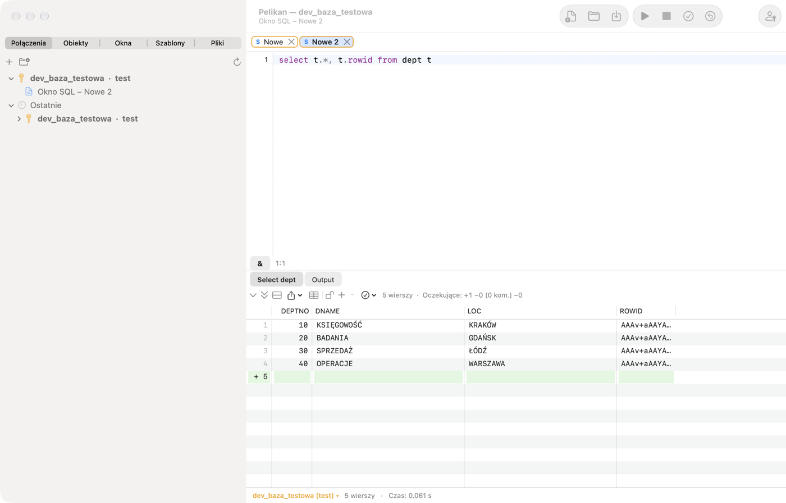
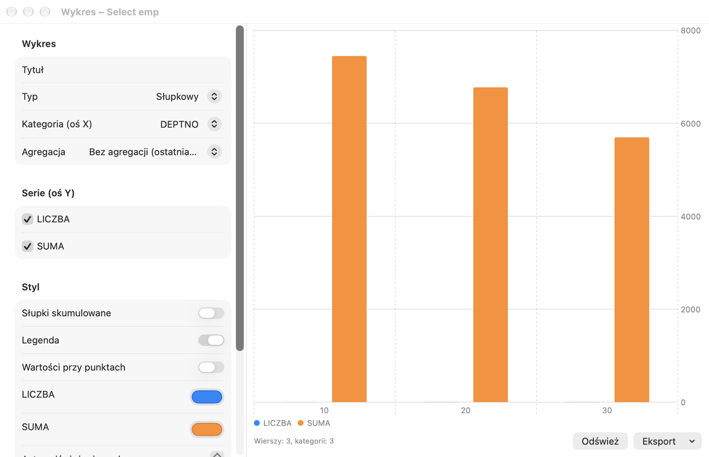

# SQL Window und Ergebnisraster

## Wozu es dient

Im **SQL Window** sprechen Sie mit der Datenbank: Sie geben einen SQL-Befehl ein (z. B. eine `SELECT`-Abfrage), führen
ihn aus und sehen sich das Ergebnis an. Es ist das meistgenutzte Fenster von Pelikan — darin prüfen Sie Daten,
korrigieren eine Zeile, bereiten einen Bericht vor oder führen ein Rollout-Skript aus.

**Wann verwenden:** immer, wenn Sie SQL oder einen kurzen PL/SQL-Block ausführen möchten. Zum Schreiben von Paketen und
Prozeduren dient das Program Window (Kapitel 6), zum Testen von Programmen mit Parametern das Test Window (Kapitel 7) und
für SQL*Plus-Skripte mit `SET`, `SPOOL`, `PROMPT` die SQL*Plus-Konsole (Kapitel 4).

Die Übungen dieses Kapitels verwenden das Übungsschema aus Kapitel 1.

Das SQL Window dient zum Ausführen von Abfragen und Skripten. Das Ergebnis jeder Abfrage erscheint in einem eigenen Tab
unter dem Editor, Datenbankmeldungen und die DBMS_OUTPUT-Ausgabe im Tab **Output**. Ein neues Fenster öffnen Sie über
**Datei › Neu › SQL Window** (⌘N); das Fenster arbeitet auf der Hauptverbindung oder auf der in der Statusleiste
gewählten Verbindung.

## Befehle ausführen

| Aktion | Kurzbefehl | Menü |
|---|---|---|
| Auswahl oder Befehl unter dem Cursor ausführen | F8, ⌘↩ | Sitzung › Ausführen |
| Umgekehrt zu AutoSelect ausführen (z. B. das ganze Skript) | ⌃F8, ⇧⌘↩ | Sitzung › Ausführen (umgekehrt zu AutoSelect) |
| Ausführung oder Abruf unterbrechen | ⇧⎋, ⌘. | Sitzung › Unterbrechen |
| Transaktion festschreiben | F10, ⌥⌘↩ | Sitzung › Festschreiben (COMMIT) |
| Transaktion zurückrollen | ⇧F10, ⌥⌘⌫ | Sitzung › Zurückrollen (ROLLBACK) |
| Vorheriger / nächster Befehl des Fensters | ⌥⌘↑, ⌥⌘↓ | Sitzung › Fensterverlauf |

Standardmäßig ist **AutoSelect** aktiviert: Ohne Auswahl führt F8 nur den Befehl aus, in dem der Cursor steht, sodass
Sie nicht versehentlich das ganze Skript starten. Markierter Text wird vollständig ausgeführt. Befehle werden wie in
SQL*Plus getrennt: Ein Semikolon beendet einen SQL-Befehl, ein PL/SQL-Block und ein `CREATE` mit Rumpf werden durch
einen Schrägstrich `/` in einer eigenen Zeile beendet. Jede Abfrage eines Skripts erhält einen eigenen Ergebnis-Tab.

Hinweis: Unter macOS ist der Kurzbefehl ⌃F8 standardmäßig vom System belegt (Fokus auf die Statusmenüs) — verwenden Sie
⇧⌘↩ oder deaktivieren Sie den Systemkurzbefehl unter **Systemeinstellungen › Tastatur › Tastaturkurzbefehle**.

Während der Ausführung ist das Fenster für die Bearbeitung gesperrt, und die Statusleiste zeigt „Wird ausgeführt …“.
Nach dem Ende sehen Sie Zeilenzahl und Dauer; eine Dauer über 100 Sekunden wird als hh:mm:ss angezeigt. Nach einer
langen Abfrage kann Pelikan einen Ton abspielen und das Symbol im Dock hüpfen lassen. Wenn **Unterbrechen** nicht wirkt
(manche Datenbankoperationen reagieren nicht auf eine Unterbrechung), verwenden Sie **Sitzung › Fenstersitzung beenden
(Kill)**.

Pelikan schreibt Änderungen nie automatisch fest (die Option **AutoCommit für SQL-Befehle** unter **Einstellungen › SQL
Window** ist standardmäßig deaktiviert). Eine offene Transaktion zeigt die Statusleiste an („● Transaktion offen“).

> **Übung: ein Befehl oder das ganze Skript.**
> 1. Öffnen Sie ein neues SQL Window (⌘N) und geben Sie drei Abfragen ein, jede in einer eigenen Zeile:
>
>    ```sql
>    SELECT * FROM pel_departments;
>    SELECT * FROM pel_employees WHERE dept_id = 20;
>    SELECT COUNT(*) FROM pel_employees;
>    ```
>
> 2. Klicken Sie in die zweite Zeile und drücken Sie **F8**.
>    *Ergebnis:* Nur die zweite Abfrage läuft — ein Ergebnis-Tab mit den drei Mitarbeitern der Abteilung 20 (AutoSelect).
> 3. Drücken Sie **⇧⌘↩** (entgegen AutoSelect ausführen).
>    *Ergebnis:* Alle drei Abfragen laufen; unter dem Editor sind drei Ergebnis-Tabs.
> 4. Markieren Sie mit der Maus die ersten beiden Zeilen und drücken Sie **F8**.
>    *Ergebnis:* Die zwei markierten Abfragen laufen — eine Markierung hat immer Vorrang vor AutoSelect.
>
> ⚠️ **Achtung.** Bei ausgeschaltetem AutoSelect führt F8 ohne Markierung das ganze Skript aus — auch `DELETE`- oder
> `DROP`-Befehle, die „für später“ im Fenster liegen. Lassen Sie im Fenster nur, was Sie ausführen wollen.

## Codeinhalt

Links vom Editor zeigt der **Codeinhalt** die Struktur des ganzen Skripts: SQL-Anweisungen (erstes Wort und Anfang
der Anweisung, bis etwa 1000 Zeichen mit Zeilenumbrüchen im Tooltip), Prozeduren, Funktionen, Pakete und Trigger aus `CREATE` sowie
anonyme Blöcke mit ihren Deklarationen. Klick oder Enter setzt den Cursor auf die Anweisung, der Baum verfolgt den
Cursor, und das Feld über dem Baum filtert auch nach dem Text der Anweisung (z. B. einem Tabellennamen). Den
Bereich blenden Sie in diesem Fenster über **Ansicht › Codeinhalt** oder die Taste mit der eingerückten Liste am linken Ende
der Fensterleiste ein und aus; die Auswahl bleibt im Fenster, den Standard für neue Fenster legen Sie unter
**Einstellungen › Editor › Codeinhalt standardmäßig sichtbar** fest. Die SQL*Plus-Konsole hat diesen Bereich nicht. In einem Skript mit mehr als 5000 SQL-Anweisungen zeigt der Bereich
nur PL/SQL-Einheiten und -Blöcke (mit einem Hinweis auf die Anzahl der Anweisungen).

In anonymen Blöcken und Einheiten des Skripts zeigt der Bereich auch **Kontrollstrukturen** (IF, Schleifen, CASE,
Ausnahmebehandlungen — siehe Kapitel zum Programmfenster); die Verzweigungs-Taste neben dem Filter blendet sie aus.

## Variablen

- **Substitutionsvariablen** `&name` und `&&name` — vor der Ausführung zeigt Pelikan das Fenster **Variablen** mit
  Feldern für die Werte. Im SQL Window bedeutet `&&` im Text ein gewöhnliches Zeichen `&` (z. B. `'R&&D'`); im Command
  Window wirkt `&&` wie in SQL*Plus (die Variable wird gemerkt).
- **Bindevariablen** `:name` — landen ebenfalls im Variablenfenster (`:new` und `:old` in Triggern werden übersprungen).
- **JasperReports-Berichtsparameter** `$P{…}`, `$P!{…}` und `$X{IN, spalte, parameter}` — Pelikan erkennt sie und fragt
  nach den Werten, sodass Sie eine Abfrage aus einem Bericht ohne Umschreiben ausführen.
- Die erweiterte Syntax `&<name="…" type="…" list="…" default="…" required="…">` beschreibt eine Variable: Typ,
  Werteliste (auch aus einer Abfrage, die von anderen Variablen abhängt), Standardwert, Pflichtfeld und weitere
  Optionen.

Die Variablenwerte werden im Fenster gemerkt. Die Schaltfläche **&** in der Leiste unter dem Editor (**Sitzung ›
Variablenersetzung**) schaltet die Ersetzung ab, wenn der Text die Zeichen `&` und `:` in anderer Bedeutung enthält.

**Wozu es dient:** Mit einer Variable schreiben Sie eine Abfrage einmal und führen sie mit verschiedenen Werten aus — ohne
die Bedingung umzuschreiben. **Bindevariablen** (`:name`) sind außerdem sicherer und für die Datenbank schneller, als
Werte in den Text einzufügen.

> **Übung: eine Abfrage mit Parameter.**
> 1. Geben Sie in einem SQL Window ein und führen Sie aus (F8):
>
>    ```sql
>    SELECT first_name, last_name, salary FROM pel_employees WHERE dept_id = :dzial;
>    ```
>
>    *Ergebnis:* Das Fenster **Variablen** erscheint mit einem Feld `dzial`.
> 2. Geben Sie `30` ein und bestätigen Sie.
>    *Ergebnis:* drei Zeilen — die Mitarbeiter der Abteilung Sprzedaż (Vertrieb).
> 3. Führen Sie die Abfrage erneut aus.
>    *Ergebnis:* Das Fenster Variablen merkt sich den Wert `30`; ändern Sie ihn auf `10` — Sie sehen die Abteilung
>    Księgowość (Buchhaltung).

## Direktiven in Kommentaren

Ein Kommentar direkt vor einem Befehl kann das Ergebnis steuern:

| Direktive | Wirkung |
|---|---|
| `-- Tab=Mitarbeiter` | Titel des Ergebnis-Tabs; `&Count` fügt die Zeilenzahl ein |
| `-- Records=all` | wie viele Zeilen sofort abgerufen werden: eine Zahl, `page` oder `all` |
| `-- Totals=sum:SAL;count:EMPNO` | Summen und andere Funktionen unter dem Raster |
| `-- AltRowColor=…` | Farbe der abwechselnden Zeilen |
| `-- Excel=bericht_%date%.xlsx` | das ganze Ergebnis in eine Excel-Datei speichern |
| `-- CSV=%dbuser%_%time%.csv` | das ganze Ergebnis in eine CSV-Datei speichern |

In Dateinamen funktionieren `%dbuser%`, `%dbname%`, `%date%`, `%time%` und `%&variable%`. Ein relativer Pfad gilt ab dem
Verzeichnis der Datei des Fensters.

Beispiel — ein Ergebnis-Tab mit Namen und der Gehaltssumme unter dem Raster:

```sql
-- Tab=Mitarbeiter (&Count)
-- Totals=sum:SALARY
SELECT first_name, last_name, salary FROM pel_employees;
```

## Ergebnisraster



Direkt über dem Ergebnis liegt die **Ergebnisleiste** — Symbole für alle Aktionen am Ergebnis, gruppiert wie auf der
Menüband-Registerkarte **Ergebnis**: Abrufen, Datenbearbeitung, Filter und QBE, Kopieren und Export, Analyse
(Diagramm, Summen, Datensatz, Wertebereich) und Ergebnisregisterkarten; Auswahllisten haben einen Pfeil ▾. Der Tooltip
eines Symbols zeigt Name, Beschreibung und Tastenkürzel. Passt die Leiste nicht, stehen die übrigen Aktionen im Menü
**»**; rechts steht die Zeilenzahl.

Das Raster ruft Zeilen portionsweise ab (die Anzahl legen Sie unter **Einstellungen › SQL Window › Zeilen pro Seite**
fest) und lädt beim Scrollen weitere nach. Der Hinweis „(mehr …)“ bei der Zeilenzahl bedeutet, dass das Ergebnis nicht
vollständig ist. **Nächste Seite** (⌘⇟) und **Letzte Seite (alle abrufen)** (⇧⌘⇟) stehen im Menü **Sitzung › Ergebnis**
und in der Leiste über dem Raster. Bei sehr großen Ergebnissen fragt Pelikan, bevor das Größenlimit aus den
Einstellungen überschritten wird.

- **Sortieren** — Klick auf den Spaltenkopf (aufsteigend, absteigend, unsortiert) auf den abgerufenen Zeilen.
- **Auswählen** — Zeilen, Spalten und Zellblöcke (Klick, dann ⇧+Klick).
- **NULL** hat einen farbigen Hintergrund; Zahlen werden mit voller Oracle-Genauigkeit angezeigt.
- **CLOB, BLOB, XML, lange Texte** — die Schaltfläche in der Zelle oder **Bearbeiten › Ergebnis › Large Data Editor …**
  (⌥⌘L) öffnet den Editor für große Daten mit den Ansichten Text, XML, JSON, HTML, Bild, PDF und Hex, mit
  JSON/XML-Formatierung und Speichern in eine Datei.
- Der **Wertebereich** (**Ansicht › Wertebereich**, ⌥⌘V) zeigt neben dem Raster die aktuelle Zelle als Text, JSON, XML,
  HTML, Bild oder Hex. Ein CLOB wird vollständig geladen (auch aus Abfragen ohne ROWID: Sichten, Joins, Funktionen);
  ein Binärwert (BLOB) nur auf Anforderung: **Alles laden** oder in Datei speichern. Schaltflächen des Bereichs und
  Kontextmenü des Rasters: **Zellwert in Datei speichern…** (vollständiger Wert, stückweise aus der Datenbank) und
  **Zellwert in externer Anwendung öffnen** (Text im externen Editor aus den Einstellungen, z. B. BBEdit; Änderungen
  gelangen nicht zurück).
- Die **Einzeldatensatzansicht** zeigt die aktuelle Zeile senkrecht mit den Typen und Kommentaren der Spalten. Die
  Schaltfläche in der Leiste über dem Raster oder **Datensatz** auf dem Menüband-Tab **Ergebnis** schaltet sie ein und
  aus; jeder Ergebnis-Tab merkt sich seinen Zustand.
- Ein **verschachtelter Cursor** (`CURSOR(…)` in einer Abfrage) öffnet sich in einem neuen Ergebnis-Tab.
- **Spaltenfilter …** blendet Spalten nach Name, Typ, Pflichtangabe und Schlüsseln aus; ausgeblendete Spalten werden
  beim Kopieren und Exportieren übergangen.
- **Nach Zellenwert filtern**, **Filter mit Ausdruck …** (`=`, `<>`, `<`, `>`, `LIKE`, `IS NULL`, `AND`, `OR`) und
  **Nach Spalte gruppieren** (mit Zählern; Doppelklick filtert) arbeiten lokal auf den abgerufenen Zeilen.
- **Spaltensummen …** berechnen unter dem Raster Summe, Anzahl, Durchschnitt, Minimum und Maximum und merken sie sich
  über eine erneute Ausführung hinweg.
- **Datensätze vergleichen** stellt die ausgewählten Zeilen Spalte für Spalte gegenüber, **Ergebnisse vergleichen** zwei
  Ergebnis-Tabs.
- **Verknüpfte Abfragen …** öffnen die über- und untergeordneten Tabellen der aktuellen Zeile (aus Fremdschlüsseln) in
  einem neuen Fenster.
- **Ergebnis aktualisieren** (⇧⌘R) führt den Befehl des Tabs erneut aus, **Automatische Aktualisierung …** alle
  angegebenen Sekunden.
- **Ergebnis anheften** behält den Tab bei der nächsten Ausführung (auch ⇧+Klick auf den Tab).
- Die Schriftgröße des Rasters ändern Sie unter **Ansicht › Raster**.

Die meisten dieser Aktionen finden Sie im Kontextmenü des Rasters und unter **Bearbeiten › Ergebnis** oder **Sitzung ›
Ergebnis**.

> **Übung: mit einem Ergebnis arbeiten.**
> 1. Führen Sie `SELECT * FROM pel_emp_details;` aus.
>    *Ergebnis:* 9 Zeilen.
> 2. Klicken Sie zweimal auf die Spaltenüberschrift **SALARY**.
>    *Ergebnis:* Der erste Klick sortiert aufsteigend, der zweite absteigend; oben steht Michał Lewandowski (13500).
> 3. Klicken Sie mit der rechten Maustaste auf die Zelle `Informatyka` in der Spalte **DEPARTMENT** und wählen Sie **Nach
>    Zellenwert filtern**.
>    *Ergebnis:* Die drei Zeilen der Abteilung Informatyka (IT) bleiben. Der Filter wirkt auf die abgerufenen Zeilen, ohne
>    die Datenbank erneut abzufragen; Sie entfernen ihn in der Leiste über dem Raster.
> 4. Klicken Sie mit der rechten Maustaste auf die Spalte **SALARY**, wählen Sie **Spaltensummen …** und haken Sie Summe
>    und Durchschnitt an.
>    *Ergebnis:* Unter dem Raster stehen Summe und Durchschnitt der Gehälter der sichtbaren Zeilen.
> 5. Markieren Sie einige Zeilen, drücken Sie **⇧⌘C** (mit Überschrift kopieren) und fügen Sie in Numbers oder Excel ein.
>    *Ergebnis:* die Daten in Spalten, mit Überschriften.
>
> ⚠️ **Achtung.** Sortieren, Filter und Summen wirken auf die **abgerufenen** Zeilen. Zeigt das Ergebnis „(mehr …)“, sind
> noch nicht alle Zeilen abgerufen — rufen Sie alle ab (⇧⌘⇟) oder ergänzen Sie die Abfrage um eine Bedingung.

## Daten im Raster bearbeiten

Damit ein Ergebnis bearbeitet werden kann, muss die Abfrage die Spalte `ROWID` liefern, z. B.:

```
select t.*, t.rowid from dept t
```

Am einfachsten verwenden Sie **Daten bearbeiten** aus dem Menü der Tabelle im Object Browser — Pelikan bereitet eine
solche Abfrage selbst vor.

1. Klicken Sie auf das Schloss über dem Raster oder wählen Sie **Sitzung › Ergebnis › Daten bearbeiten** (⌥⌘E).
2. Ändern Sie Zellen, fügen Sie Zeilen hinzu (**Datensatz einfügen**, ⌥⌘I) und löschen Sie sie (**Datensatz löschen**,
   ⇧⌘⌫). Ausstehende Änderungen sind im Zeilenkopf (+, ~, −) und farbig markiert; der Zähler über dem Raster zeigt ihre
   Anzahl. Spalten mit Alias und Ausdrücke sind schreibgeschützt. Für DATE-Spalten steht ein **Kalender…** zur
   Verfügung, für Spalten mit einer Einschränkung `CHECK … IN` oder einem Fremdschlüssel auf eine kleine Tabelle eine
   **Werteliste …**.
3. **SQL der Änderungen kopieren** zeigt die Befehle, die ausgeführt werden.
4. **Änderungen übernehmen (Post)** (⌥⌘S) sendet die Änderungen an die Datenbank — ohne COMMIT. Nach einem Fehler
   springt der Cursor in die betroffene Zelle. **Änderungen verwerfen** verwirft alle ausstehenden Änderungen.
5. Schreiben Sie die Transaktion fest (F10, ⌥⌘↩) oder rollen Sie sie zurück.

Auf einer Produktionsverbindung erfordert das Speichern eine Bestätigung, auf einer schreibgeschützten Verbindung ist es
gesperrt.

> **Übung: eine Abteilung über das Raster hinzufügen.**
> 1. Führen Sie `SELECT t.*, t.rowid FROM pel_departments t;` aus.
>    *Ergebnis:* 4 Abteilungen.
> 2. Klicken Sie auf das Schloss über dem Raster (oder ⌥⌘E).
>    *Ergebnis:* Das Schloss ist offen, die Zellen lassen sich bearbeiten.
> 3. Wählen Sie **Datensatz einfügen** (⌥⌘I) und geben Sie `50`, `Logistyka`, `Poznań` ein.
>    *Ergebnis:* Die neue Zeile hat ein **+** in ihrer Kopfzeile, und der Zähler über dem Raster zeigt 1 ausstehende
>    Änderung.
> 4. Wählen Sie **SQL der Änderungen kopieren**.
>    *Ergebnis:* In der Zwischenablage steht ein Befehl `INSERT INTO … PEL_DEPARTMENTS …` — so wird Pelikan die Änderung
>    speichern.
> 5. Drücken Sie **⌥⌘S** (Änderungen übernehmen).
>    *Ergebnis:* Das **+** verschwindet und die Statusleiste zeigt „● Transaktion offen“ — die Änderung ist in der
>    Datenbank, aber noch nicht festgeschrieben.
> 6. Drücken Sie **⇧F10** (ROLLBACK) und dann **⇧⌘R** (Ergebnis aktualisieren).
>    *Ergebnis:* Abteilung 50 ist weg — die Änderung wurde zurückgerollt. Um sie zu behalten, drücken Sie F10 (COMMIT)
>    statt ROLLBACK.

## Kopieren und Exportieren

- **Bearbeiten › Ergebnis › Mit Überschrift kopieren** (⇧⌘C), **Überschrift kopieren**, **Als Ausdrucksliste kopieren**
  (für `IN (…)`), **Nach Excel kopieren**, im Kontextmenü des Rasters außerdem **Kopieren als** (gewähltes Format).
- **Datei › Ergebnis exportieren …** speichert die Auswahl oder das ganze abgerufene Ergebnis als CSV, TSV, HTML, XML,
  SQL (INSERT), Ausdrucksliste oder Excel (xlsx).
- **Sitzung › Ergebnis › Abfrage in Datei exportieren …** führt den Befehl unter dem Cursor aus und speichert das
  Ergebnis direkt in eine Datei, ohne es anzuzeigen — praktisch bei großen Ergebnissen.
- **Datei › Ergebnisexport › Spalte in Dateien …** speichert den Wert einer Spalte (z. B. BLOB) für jede Zeile in eine
  eigene Datei.
- **SQL aus Zeilen generieren …** erzeugt INSERT-, UPDATE-, DELETE- oder MERGE-Befehle für die ausgewählten Zeilen in
  einem neuen SQL Window, ohne sie auszuführen.
- **Datei › Drucken …** (⌘P) druckt den Code des Fensters mit Syntaxfarben und das Raster (ausgewählte oder alle
  abgerufenen Zeilen).

> **Übung: Export nach Excel.**
> 1. Führen Sie `SELECT * FROM pel_emp_details;` aus.
> 2. Wählen Sie **Datei › Ergebnis exportieren …**, das Format Excel (xlsx) und speichern Sie die Datei auf dem
>    Schreibtisch.
>    *Ergebnis:* Die Datei öffnet sich in Excel oder Numbers; Gehälter sind Zahlen (man kann sie summieren), die
>    Überschriften sind die Spaltennamen.

## Diagramme

**Sitzung › Ergebnis › Diagramm …** öffnet ein Diagrammfenster mit dem aktuellen Ergebnis-Tab. Wählen Sie den Typ
(Balken, Linie, Fläche, Punkte oder Kreis), die Kategoriespalte (X-Achse), die Reihen (Y-Achse) und gegebenenfalls eine
Aggregation; legen Sie Farben, Legende und Werte an den Punkten fest. Eine Diagrammvorlage können Sie speichern und das
Diagramm als PNG, PDF oder in die Zwischenablage exportieren. **Aktualisieren** führt die Abfrage des SQL Window erneut
aus.



> **Übung: Gehälter nach Abteilung als Diagramm.**
> 1. Führen Sie aus:
>
>    ```sql
>    SELECT department, SUM(salary) AS total FROM pel_emp_details GROUP BY department;
>    ```
>
> 2. Wählen Sie **Sitzung › Ergebnis › Diagramm …**, Typ Balken, Kategorie **DEPARTMENT**, Reihe **TOTAL**.
>    *Ergebnis:* ein Balken für jede Abteilung; den höchsten hat Informatyka.

## Query By Example

**Sitzung › Ergebnis › Query By Example …** (⇧⌘E) schränkt ein Ergebnis ein, ohne dass Sie WHERE schreiben: Geben Sie
unter den Spaltennamen Kriterien ein — einen Wert, ein Muster mit `%`, einen Operator (`>`, `<>` …), `in (…)`, `between
… and …` oder `null` — und Pelikan führt die Abfrage mit den Bedingungen erneut aus. Der Textvergleich unterscheidet
keine Groß-/Kleinschreibung, Datumswerte werden ohne Uhrzeit verglichen. **Query By Example löschen** stellt die
ursprüngliche Abfrage wieder her.

> **Übung: QBE.**
> 1. Führen Sie `SELECT * FROM pel_employees;` aus und drücken Sie **⇧⌘E**.
> 2. Geben Sie unter der Spalte **SALARY** `> 10000` ein, unter **LAST_NAME** — `%ski`.
>    *Ergebnis:* Nach dem Bestätigen bleibt eine Zeile — Michał Lewandowski (13500). Piotr Kowalski endet auch auf „ski“,
>    verdient aber 9500. QBE hat beide Bedingungen gleichzeitig zur Abfrage hinzugefügt (mit AND verbunden).
> 3. Wählen Sie **Query By Example löschen**.
>    *Ergebnis:* wieder alle Zeilen.

Wie QBE Texte und Datumswerte vergleicht, stellen Sie unter **Einstellungen › SQL Window › Query By Example** ein
(Kapitel 13).

## Statistiken und Plan

Nach Aktivierung unter **Einstellungen › SQL Window › Statistiken** zeigt der Tab **Statistiken** die Änderung der
Sitzungsstatistiken (V$MYSTAT) jeder Ausführung. **Werkzeuge › Explain Plan** (F5) zeigt den Plan des Befehls unter dem
Cursor, **Werkzeuge › Autotrace** führt ihn aus und zeigt den tatsächlichen Plan — siehe Kapitel *Ausführungsplan,
Sitzungen und Administration*.

## Dateien und Verlauf

- **Datei › Speichern** (⌘S) speichert das Fenster in einer `.sql`-Datei; Dateien behalten ihre Kodierung und
  Zeilenenden.
- **Bearbeiten › Befehlsverlauf …** (⇧⌘H, im Profil PL/SQL Developer ⌃E) zeigt alle ausgeführten Befehle aus allen
  Fenstern (ohne Befehle mit Passwörtern) mit einem Filter; ausgewählte fügen Sie in den Editor ein.
- **Datei › Als neues SQL Window einfügen** erstellt ein Fenster mit dem Inhalt der Zwischenablage.
- Der lokale Verlauf einer Datei (**Datei › Lokaler Verlauf**) wird im Kapitel *Werkzeuge* beschrieben.
