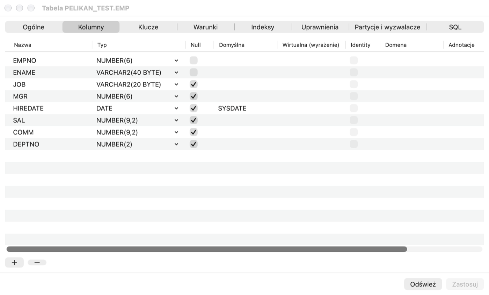
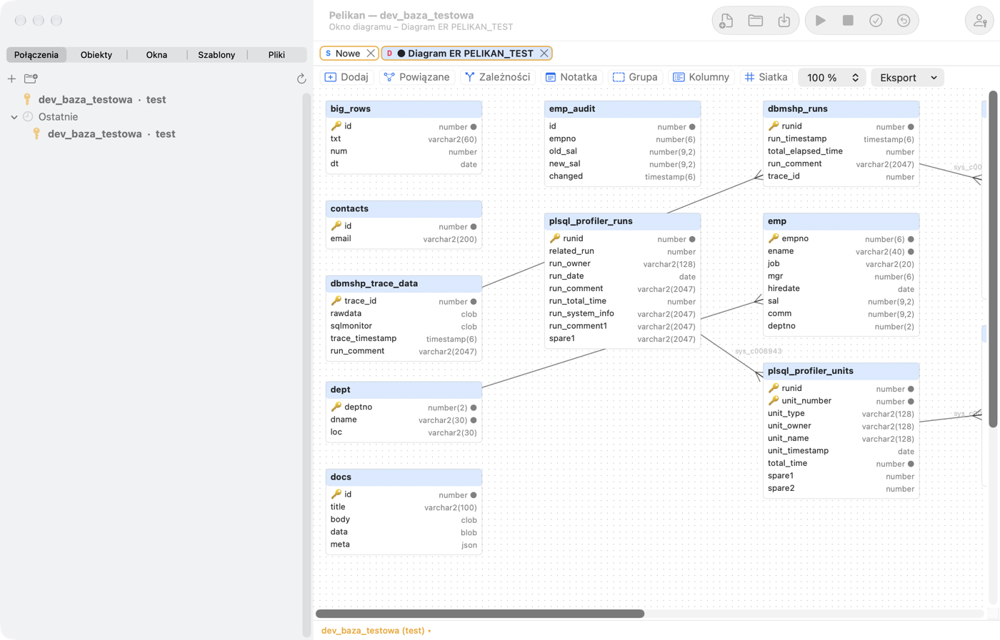

# Object Browser und Objekteditoren

## Wozu es dient

Eine Datenbank enthält Hunderte oder Tausende Objekte: Tabellen, Views, Pakete, Indizes. Der **Object Browser** zeigt sie
in einem Baum, wie der Finder Dateien — Sie können sie durchsehen, suchen, zum Bearbeiten öffnen, ihre Daten und Struktur
ansehen. Mit **Objekteditoren** legen Sie Objekte in einem Formular an und ändern sie, ohne `CREATE`- und `ALTER`-Befehle
von Hand zu schreiben — Pelikan zeigt das erzeugte SQL vor der Ausführung, sodass Sie nebenbei die Syntax lernen.

**Wann verwenden:** wenn Sie prüfen möchten, welche Spalten eine Tabelle hat, wer ein Paket verwendet, welche Objekte
nach einem Rollout ungültig sind, oder um eine Spalte oder einen Index hinzuzufügen.

## Object Browser

Der Tab **Objekte** in der linken Spalte zeigt die Datenbankobjekte der geöffneten Verbindungen in Ordnern nach Typ:
**Funktionen**, **Prozeduren**, **Pakete**, **Package Bodies**, **Typen**, **Trigger**, **Java-Quellen**,
**Bibliotheken**, **Tabellen**, **Views**, **Materialized Views**, **Sequenzen**, **Synonyme**, **Indizes**,
**Datenbank-Links**, **Queues**, **Jobs (Scheduler)**, **Benutzer**, **Rollen**, **Profile**, **Verzeichnisse** und
weitere. Auf Datenbanken 23ai und 26ai kommen **MLE-Module**, **MLE-Umgebungen**, **Domänen**, **Property Graphs**,
**Annotationen** und **Assertions** hinzu. Ordner erscheinen nur, wenn die Datenbankversion und Ihre Berechtigungen es
zulassen.

Auf der obersten Ebene des Baums stehen die **geöffneten Verbindungen** — wie in DBeaver. Die Verbindungen sind
alphabetisch sortiert; die Hauptverbindung ist mit Stern markiert, fett und mit „Haupt“ beschriftet; die anderen
erscheinen nach dem Verbinden (z. B. über ein Fenster auf einer anderen Verbindung oder **Verbinden** in der
Verbindungsliste) und verschwinden nach dem Trennen. Jede Verbindung hat eigene Ordner, **Zuletzt** und eine eigene
Benutzerauswahl. Aktionen an einem Objekt (Daten anzeigen, Bearbeiten, DDL, Neu kompilieren, Ziehen in den Editor …)
wirken auf die Verbindung des Zweigs, und Fenster für ein Objekt einer anderen als der Hauptverbindung sind an sie
angeheftet. Das Verbindungsmenü im Baum: **Als Hauptverbindung festlegen**, **Neues SQL-Fenster auf dieser
Verbindung**, **Aktualisieren**, **Verbindung bearbeiten …** und **Trennen**. Die Hauptverbindung gilt nur dann, wenn
sich aus dem Kontext keine andere ergibt — ein neues Fenster aus dem Menü, ein Werkzeug ohne aktives Fenster.

Am Ende der Ordner jeder Verbindung stehen **DBA** — Data-Dictionary-Objekte mit dem Präfix `DBA_` — und **DBMS** —
Objekte mit dem Präfix `DBMS_`, vor allem Oracle-Pakete. Sie zeigen nur Objekte, für die Sie Berechtigungen haben
(direkt, über eine Rolle oder an PUBLIC erteilt); öffentliche Synonyme werden ausgelassen, Objekte des Schemas SYS
ohne das Präfix „SYS.“ angezeigt. Die Objekte lassen sich wie in den anderen Ordnern aufklappen und öffnen, auch der
Namensfilter gilt. Das Ändern eines Objekts eines von Oracle verwalteten Schemas (SYS, XDB …) — Neukompilieren,
Debug-Information hinzufügen, Löschen, Umbenennen, Aktivieren oder Kompilieren im Programmfenster — erfordert immer
eine eigene Bestätigung (standardmäßig **Abbrechen**), weil es Objekte in der gesamten Datenbank ungültig machen kann.

- **Benutzerauswahl** über dem Baum (für jede Verbindung getrennt):
  - *Aktueller Benutzer* — Objekte Ihres Schemas sowie öffentliche Datenbank-Links und öffentliche Synonyme von
    Anwendungsobjekten (ohne die Tausenden Synonyme auf Oracle-Systemschemas);
  - *Zugängliche Objekte* — alles, was Sie verwenden können: eigene Objekte, Objekte anderer Schemas mit erteilten
    Rechten und öffentliche (mit dem Eigentümer vor dem Namen);
  - *Alle Benutzer* — Objekte aller Schemas (mit DBA-Views, wenn Sie Zugriff darauf haben, auch private
    Datenbank-Links anderer Schemas — Letztere auch, wenn Sie nur `DBA_DB_LINKS`
    lesen dürfen; ein privater Link eines anderen Schemas ist für Sie nicht „zugänglich“, weil nur sein Eigentümer
    ihn verwenden kann);
  - ein bestimmtes Schema.
  Der Ordner **Verzeichnisse** (Oracle-Verzeichnisse haben keinen Schema-Eigentümer) zeigt bei Zugriff auf DBA-Views in
  jedem Modus alle Verzeichnisse, sonst die mit erteilten Rechten.
  Den Umfang nach dem Verbinden legen Sie unter **Einstellungen › Object Browser › Nach dem Verbinden anzeigen** fest.
- **Filter** unter der Benutzerauswahl: ein Namensteil (an beliebiger Stelle — `emp` findet `EMP` und `T_EMP_HIST`),
  ein Muster mit `%` (z. B. `EMP%` — nur der Namensanfang; das Verhalten ohne `%` ändern Sie unter **Einstellungen ›
  Object Browser**), mehrere Muster durch Komma getrennt, `status=invalid`
  (nur ungültige Objekte) oder `source=text` (Objekte, deren Quelltext den Text enthält).
- Das Aufklappen eines Objekts zeigt seine Elemente: Spalten mit Typen, Constraints, Indizes, Trigger, Partitionen,
  Unterprogramme, Attribute sowie Abhängigkeiten (**Hängt ab von**, **Verwendet von**).
- Der Ordner **Zuletzt** enthält die zuletzt geöffneten Objekte.
- Ungültige Objekte haben eine rote Markierung.
- **Aktualisieren** im Menü (oder **Werkzeuge › Objekt › Object Browser aktualisieren**) leert den Dictionary-Cache und
  lädt den Baum neu.

Der Baum arbeitet auch in Schemata mit Zehntausenden von Objekten flüssig — das Dictionary wird im Hintergrund gelesen.

> **Übung: die Übungstabelle kennenlernen.**
> 1. Klicken Sie in der linken Spalte auf den Tab **Objekte**.
>    *Ergebnis:* ein Baum mit der Hauptverbindung oben und darunter den Ordnern der Objekttypen.
> 2. Geben Sie im Feld **Filter** `pel` ein.
>    *Ergebnis:* In den Ordnern bleiben nur Objekte mit „PEL“ im Namen.
> 3. Klappen Sie **Tabellen › PEL_EMPLOYEES** auf.
>    *Ergebnis:* Sie sehen die Spalten mit Typen, die Constraints (Primärschlüssel `PEL_EMPLOYEES_PK`, eindeutige
>    E-Mail, CHECK des Gehalts, Fremdschlüssel), Indizes und Abhängigkeiten.
> 4. Klappen Sie **Verwendet von** auf.
>    *Ergebnis:* die View `PEL_EMP_DETAILS` und das Paket `PEL_EMP_API` — die Objekte, die nicht mehr funktionieren, wenn
>    Sie diese Tabelle löschen oder ändern.
> 5. Geben Sie im Feld **Filter** `status=invalid` ein.
>    *Ergebnis:* die Liste der ungültigen Objekte — direkt nach dem Anlegen des Übungsschemas sollte sie leer sein.

### Objektmenü

Klicken Sie mit der rechten Maustaste auf ein Objekt (oder mit ⌃). Je nach Objekttyp enthält das Menü:

- **Daten anzeigen** — ein SQL Window mit einer Abfrage der Daten der Tabelle oder View; **Standardabfragen** — Ihre
  gespeicherten Abfragevorlagen für Tabellen;
- **Daten bearbeiten** — Tabellendaten mit `ROWID` im Bearbeitungsmodus;
- **Bearbeiten** — den Quelltext eines Programms im Program Window, eine View im SQL Window, eine Tabelle, Sequenz, ein
  Synonym, einen Index, Benutzer oder eine Rolle im Objekteditor;
- **DDL** (ein Skript aus DBMS_METADATA in einem neuen Fenster), **Beschreibung** (Spalten, Parameter, Paketelemente),
  **Eigenschaften**;
- **Testen** — ein Test Window mit einem Aufruf der Prozedur oder Funktion (siehe Kapitel *Test Window, Debugger und
  Profiler*) und **Standardtest …**;
- **Quelltext zum Editor hinzufügen** — fügt den Quelltext oder die DDL an der Cursorposition des aktiven Fensters ein;
- **Rekompilieren**, **Aktivieren** / **Deaktivieren** (Trigger, Constraints), **Flags der bedingten Kompilierung …**,
  **Umbenennen …**, **Duplizieren…** (ein Kopierskript in einem neuen Fenster, ohne Ausführung), **Objekt löschen …**
  (nach Bestätigung);
- **Code generieren** — SELECT, INSERT, UPDATE, DELETE mit Spalten oder ein Prozeduraufruf, auch als Java-JDBC- oder
  Python-Fragment;
- **Namen kopieren**.

Auf einer Spalte oder einem Constraint einer Tabelle hat das Menü **Element umbenennen…**. Wenn Sie mehrere Objekte
auswählen (⌘+Klick oder ⇧+Klick), bietet das Menü gemeinsame Aktionen an: **Namen kommagetrennt kopieren** (auch ⌘C),
**DDL der ausgewählten**, **Ausgewählte neu kompilieren** und **Ausgewählte löschen…**.

> **Übung: Daten, DDL und fertiger Code aus dem Menü.**
> 1. Klicken Sie mit der rechten Maustaste auf **PEL_DEPARTMENTS** und wählen Sie **Daten anzeigen**.
>    *Ergebnis:* ein neues SQL Window mit Abfrage und Ergebnis — 4 Abteilungen.
> 2. Klicken Sie mit der rechten Maustaste auf **PEL_EMPLOYEES** und wählen Sie **DDL**.
>    *Ergebnis:* ein neues Fenster mit dem Befehl `CREATE TABLE`, der die Tabelle neu anlegt — so prüfen Sie die genaue
>    Definition eines Objekts.
> 3. Klicken Sie mit der rechten Maustaste auf **PEL_EMPLOYEES** und wählen Sie **Code generieren › INSERT**.
>    *Ergebnis:* ein INSERT-Befehl mit allen Spalten erscheint — Sie müssen nur die Werte ergänzen.
>
> ⚠️ **Achtung.** **Objekt löschen …** und **Rekompilieren** wirken sofort auf die Datenbank (nach Bestätigung). Das
> Löschen einer Tabelle lässt sich nicht mit ROLLBACK rückgängig machen — helfen kann nur der Papierkorb (unten), wenn er
> in der Datenbank aktiviert ist.

Weitere Operationen mit dem ausgewählten Objekt stehen im Menü **Werkzeuge › Objekt**: u. a. **Debug-Informationen
hinzufügen**, **Tabellendefinition bearbeiten**, **Sichteditor**, **Mit aktivem Fenster vergleichen**, **Mit Objekt in
einer anderen Datenbank vergleichen…**, **Materialisierte Sicht aktualisieren**, **Datenbank-Link testen**, **Job
ausführen**, **Warteschlange starten** / **Warteschlange anhalten**, **Zu Ordner hinzufügen …** und **utPLSQL-Tests
ausführen**.

### Ziehen

Ziehen Sie ein Objekt in den Editor, um seinen Namen einzufügen. Mit der Taste ⌃ (oder wenn in den Einstellungen
„Fragen“ gewählt ist) erscheint nach dem Ablegen ein Menü: Name, Name mit Eigentümer, Spaltenliste, SELECT, INSERT,
UPDATE, DELETE, Aufruf oder DDL. Das Ablegen eines Objekts auf der leeren Fensterfläche führt die Aktion aus
**Einstellungen › Object Browser** aus (z. B. Bearbeiten oder Daten anzeigen). Das Ziehen eines Ordners fügt die Namen
seiner Objekte durch Kommas getrennt ein.

### Filter und eigene Ordner

Unter **Einstellungen › Object Browser** legen Sie fest:

- sichtbare Ordner und ihre Reihenfolge sowie die Doppelklick-Aktion für jeden Typ;
- **Benannte Filter** — eine `WHERE`-Bedingung und `ORDER BY` auf der Objektsicht (Alias `o`, Variablen `:browser_user`
  und `&browser_filter`), optional für einen bestimmten Benutzer und als Standardfilter. Einen Filter wenden Sie über
  **Werkzeuge › Object Browser › Benannter Filter …** an;
- **Benutzerordner** — eigene Objektgruppen aus einer Liste oder einer Abfrage (Spalten `OWNER`, `OBJECT_NAME`,
  `OBJECT_TYPE`), mit Farbe, übergeordnetem Ordner und einem Muster der Verbindungen, auf denen sie sichtbar sein
  sollen.

## Objekte suchen und kompilieren

- **Werkzeuge › Datenbankobjekte suchen …** (⇧⌘O) durchsucht PL/SQL-Quelltexte (auch MLE-Module), View-Abfragen,
  Tabellendefinitionen und Objektnamen. Unterstützt reguläre Ausdrücke, ganze Wörter und Groß-/Kleinschreibung, läuft im
  Hintergrund und lässt sich unterbrechen. Ein Doppelklick auf ein Ergebnis öffnet das Objekt in der Zeile mit dem
  Treffer. Die Kriterien können Sie speichern und das Ergebnis als CSV exportieren.
- **Werkzeuge › Ungültige Objekte kompilieren …** zeigt die ungültigen Objekte des Schemas und kompiliert sie in
  Abhängigkeitsreihenfolge, bis sich nichts mehr ändert; Kompilierungsfehler stehen in der Liste.

> **Übung: Wer verwendet die Spalte SALARY?**
> 1. Drücken Sie **⇧⌘O** (Datenbankobjekte suchen), geben Sie `salary` ein und starten Sie die Suche.
>    *Ergebnis:* eine Liste der Stellen in Quellen und Definitionen, an denen das Wort `salary` vorkommt — unter anderem
>    der Body des Pakets `PEL_EMP_API`.
> 2. Doppelklicken Sie auf den Treffer in `PEL_EMP_API`.
>    *Ergebnis:* ein Program Window mit dem Body des Pakets, der Cursor in der Zeile mit dem Treffer.
>
> So prüfen Sie vor der Änderung einer Spalte, welcher Code angepasst werden muss.

## Tabelleneditor

Eine neue Tabelle legen Sie über **Datei › Neu › Tabelle …** an, eine vorhandene öffnen Sie mit **Bearbeiten** aus dem
Menü der Tabelle (oder **Werkzeuge › Objekt › Tabellendefinition bearbeiten**).

Tabs des Editors:

- **Allgemein** — Name, Tablespace (eine Änderung verschiebt die Tabelle und baut die Indizes neu auf),
  Speicherparameter, Komprimierung, Logging, Cluster, temporäre Tabelle, Indexorganisation (IOT) oder externe Tabelle,
  Row Archival, Kommentar. Änderungen, die einen Neuaufbau erfordern, führt **Recreate table** aus, mit Übernahme der
  Daten, Trigger und der Fremdschlüssel anderer Tabellen.
- **Spalten** — Name, Typ (mit Vorschlägen), NULL, Standardwert (auch `ON NULL`), virtuelle Spalte, Identity,
  unsichtbare Spalte, Kommentar; auf 23ai auch Domäne und Annotationen. Eine Schaltfläche fügt Fremdschlüsselspalten
  anhand des Primärschlüssels einer angegebenen Tabelle hinzu.
- **Schlüssel** (Primär-, Unique-, Fremdschlüssel mit `ON DELETE`), **Bedingungen** (CHECK) und **Indizes** (normal,
  unique, Bitmap, funktionsbasiert, absteigend, komprimiert, Reverse, unsichtbar, lokal).
- **Berechtigungen** — Empfänger, Berechtigung und Weitergaberecht; Pelikan leitet aus den Unterschieden GRANT- und
  REVOKE-Befehle ab.
- **Partitionen und Trigger** — beim Anlegen Partitionierung RANGE (auch mit INTERVAL), LIST und HASH sowie
  HASH-Subpartitionen; in einer vorhandenen Tabelle Hinzufügen, Umbenennen und Löschen von Partitionen. Eine Änderung
  der Partitionierungsmethode erfordert Recreate. Die Trigger der Tabelle können Sie hier aktivieren und deaktivieren.
- **SQL** — die DDL-Befehle, die sich aus den Änderungen ergeben. Sie können sie kopieren oder in einem SQL Window
  öffnen.

**Anwenden** führt die Änderungen als `ALTER` aus und hält beim ersten Fehler an; **Aktualisieren** lädt die Definition
erneut aus der Datenbank. Auf einer Produktionsverbindung ist eine Bestätigung nötig.

> **Übung: eine Spalte im Tabelleneditor hinzufügen.**
> 1. Klicken Sie mit der rechten Maustaste auf **PEL_EMPLOYEES** und wählen Sie **Bearbeiten**.
>    *Ergebnis:* der Tabelleneditor im Tab **Allgemein**.
> 2. Wechseln Sie zum Tab **Spalten** und fügen Sie die Spalte `PHONE` vom Typ `VARCHAR2(20)` hinzu, die NULL erlaubt.
> 3. Wechseln Sie zum Tab **SQL**.
>    *Ergebnis:* der Befehl `ALTER TABLE … ADD (PHONE VARCHAR2(20))` — genau das, was Pelikan ausführen wird.
> 4. Klicken Sie auf **Anwenden**.
>    *Ergebnis:* Die Spalte ist in der Tabelle; im Object Browser (nach **Aktualisieren**) steht sie in der Spaltenliste.
>
> ⚠️ **Achtung.** DDL (ALTER) schreibt die offene Transaktion fest und lässt sich nicht mit ROLLBACK rückgängig machen.
> Änderungen, die **Recreate table** erfordern, bauen die Tabelle samt Daten neu auf — bei einer großen Tabelle dauert das
> lange und sperrt sie. Stimmen Sie Strukturänderungen auf einer gemeinsamen Datenbank mit dem Team ab.

## Weitere Objekteditoren

Unter **Datei › Neu** finden Sie die Editoren **Sequenz …**, **Synonym …**, **Index …**, **Sicht (Editor)…** (Abfrage,
FORCE, READ ONLY, CHECK OPTION, Kommentar), **View …** (eine Vorlage im SQL Window), **Benutzer …**, **Rolle …**,
**Profil…**, **Datenbank-Link…**, **Bibliothek…**, **Verzeichnis…**, **Job…**, **Warteschlange…** und auf neueren
Datenbanken **Domäne …** und **Assertion…**. Jeder Editor zeigt vor der Ausführung eine DDL-Vorschau; vorhandene Objekte
öffnen Sie mit **Bearbeiten** aus dem Object Browser.

- **Benutzer** — Passwort (maskiert), Tablespaces, Profil, Kontosperre, Rollen, System- und Objektberechtigungen, Quoten
  in Tablespaces. **Rolle** — Berechtigungen; **Profil** — Limits.
- **Datenbank-Link** — das Passwort des Links ist maskiert und erscheint nicht in der DDL-Vorschau.
- **Job** legt einen DBMS_SCHEDULER-Job an (der Scheduler hat das ältere DBMS_JOB abgelöst).
- **Warteschlange** legt eine Advanced-Queuing-Warteschlange samt Queue-Tabelle an; die Warteschlange können Sie starten
  und anhalten.

In den Benutzer- und Link-Editoren eingegebene Passwörter liegen nur im Speicher des Fensters — sie gelangen weder in
Dateien noch in den Verlauf.

## Papierkorb

**Werkzeuge › Papierkorb** zeigt gelöschte Tabellen (USER_RECYCLEBIN). **Papierkorb › Aus Papierkorb wiederherstellen
…** stellt ein Objekt unter dem alten oder einem neuen Namen wieder her, **Papierkorb › Papierkorb leeren …** löscht
Objekte endgültig (nach Bestätigung).

**Wozu es dient:** In Oracle löscht `DROP TABLE` ohne `PURGE` die Tabelle nicht sofort, sondern verschiebt sie in den
Papierkorb (wenn er in der Datenbank aktiviert ist — Parameter `RECYCLEBIN`). So lässt sich eine versehentlich gelöschte
Tabelle samt Daten wiederherstellen.

## Diagramme

- **Werkzeuge › Diagramm › ER-Diagramm aus Schema …** zeichnet die Tabellen des Schemas (oder die zu einer Maske
  passenden) mit Fremdschlüsseln und automatischem Schichtenlayout.
- **Datei › Neu › Diagrammfenster** legt ein leeres Diagramm an; Objekte fügen Sie hinzu, indem Sie sie aus dem Object
  Browser ziehen oder mit dem Befehl **Werkzeuge › Diagramm › Zum Diagramm hinzufügen**.

**Wozu es dient:** Ein ER-Diagramm (Entitäten und Beziehungen) zeigt Tabellen als Rechtecke und Fremdschlüssel als Linien
dazwischen. Es ist der schnellste Weg, ein unbekanntes Schema zu verstehen.

> **Übung: Diagramm des Übungsschemas.**
> 1. Wählen Sie **Werkzeuge › Diagramm › ER-Diagramm aus Schema …**. In der ersten Frage lassen Sie das vorgeschlagene
>    Schema (Ihres), in der zweiten — **Maske für Tabellennamen (LIKE)** — geben Sie `PEL%` ein.
>    *Ergebnis:* ein Diagramm mit den Tabellen `PEL_DEPARTMENTS` und `PEL_EMPLOYEES`, verbunden durch eine
>    Fremdschlüssellinie, und einer Linie von `PEL_EMPLOYEES` zu sich selbst (der Vorgesetzte eines Mitarbeiters).

Im Diagrammfenster: **Verknüpft** fügt über Fremdschlüssel verbundene Tabellen hinzu, **Abhängigkeiten**
Abhängigkeitslinien, **Notiz** und **Gruppe** ordnen die Zeichnung, **Spalten** blendet Spalten ein oder aus, **Raster**
schaltet das Einrasten an einem 8-px-Raster ein, und den Zoom ändern Sie von 10 bis 200 %. Ein Doppelklick auf eine
Linie fügt einen Knickpunkt hinzu, ⌥+Klick entfernt ihn. Das Diagramm speichern Sie als `.pdd`-Datei, aktualisieren es
aus der Datenbank (**Aus Datenbank aktualisieren**), drucken es oder exportieren es als PNG oder PDF.

## Oracle 23ai und 26ai

- **Werkzeuge › JSON Duality Views** — eine Liste der JSON-relationalen Duality Views mit Dokumenten und Struktur (Data
  Guide); **Neue Duality View …** erzeugt DDL aus einer Haupttabelle und untergeordneten Tabellen.
- **Werkzeuge › MLE-Module und -Umgebungen** — JavaScript-Module und Umgebungen; **JavaScript-Modul importieren …** legt
  ein Modul aus einer `.js`-Datei an. Ein Modul bearbeiten Sie im Program Window (mit JavaScript-Hervorhebung und
  Kompilierungsfehlern).
- **Werkzeuge › REST (ORDS)** — REST-Module und Skripte, die REST für ein Schema oder Objekt aktivieren (erfordert ORDS
  in der Datenbank).
- Domänen und Spaltenannotationen bearbeiten Sie im Tabelleneditor, und der Ordner **Annotationen** zeigt, wo eine
  Annotation verwendet wird.
