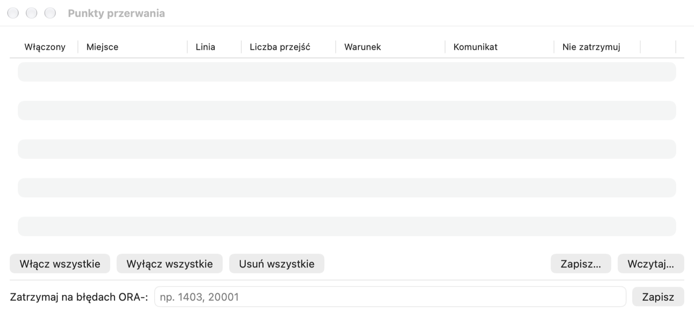

# Test Window, Debugger und Profiler

## Wozu es dient

Ein Programm zu schreiben ist die halbe Arbeit — Sie müssen noch prüfen, ob es funktioniert. Das **Test Window** ruft
eine Prozedur oder Funktion mit gewählten Parametern auf und zeigt, was sie zurückgegeben hat. Der **Debugger** führt ein
Programm Zeile für Zeile aus und zeigt die Werte der Variablen — der beste Weg, fremden Code zu verstehen oder die Ursache
eines Fehlers zu finden. Der **Profiler** misst, wie viel Zeit jede Zeile braucht — er zeigt, wo ein Programm langsam ist.

**Wann verwenden:** das Test Window — nach jeder Änderung eines Programms; den Debugger — wenn ein Programm ein falsches
Ergebnis liefert und Sie nicht wissen, warum; den Profiler — wenn ein Programm richtig, aber zu langsam arbeitet.

## Test Window

Das Test Window führt einen PL/SQL-Block mit Bindevariablen aus und ermöglicht es, ihn zu debuggen und zu profilieren.
Am einfachsten öffnen Sie es aus dem Object Browser: Menü der Prozedur oder Funktion › **Testen**. Pelikan bereitet
einen Block mit einem Aufruf in benannter Notation vor (für ein Paketunterprogramm mit der richtigen Überladung) sowie
Variablen für die Parameter und das Funktionsergebnis. Ein leeres Fenster öffnen Sie über **Datei › Neu › Test Window**.

1. Geben Sie im Tab **Variablen** unter dem Block die Werte der Eingabeparameter ein. Variablen `:name` aus dem Block
   werden automatisch erkannt; den Typ können Sie ändern (Integer, Float, String, Date, Timestamp, Boolean, CLOB, BLOB,
   Cursor und weitere).
2. Drücken Sie F8 (⌘↩). Nach der Ausführung erscheinen die Ausgabewerte in der Tabelle, geänderte Werte sind gelb
   hervorgehoben. Die Statusleiste zeigt die Ausführungszeit.
3. Schreiben Sie die Änderungen fest oder rollen Sie sie zurück: F10 / ⇧F10 (die Option **AutoCommit nach Ausführung des
   Testfensters** unter **Einstellungen › SQL Window** schreibt automatisch fest).

> **Übung: eine Funktion und eine Prozedur testen.**
> 1. Klappen Sie im Object Browser das Paket **PEL_EMP_API** auf, klicken Sie mit der rechten Maustaste auf die Funktion
>    **GET_SALARY** und wählen Sie **Testen**.
>    *Ergebnis:* ein Test Window (Buchstabe **T**) mit dem Block `begin :result := ….pel_emp_api.get_salary(p_emp_id =>
>    :p_emp_id); end;` und einer Tabelle der Variablen `result` und `p_emp_id`.
> 2. Geben Sie in der Variablentabelle `1` als Wert von `p_emp_id` ein und drücken Sie **F8**.
>    *Ergebnis:* `result` = 12000, gelb hervorgehoben (der Wert hat sich geändert).
> 3. Geben Sie `999` ein und drücken Sie erneut **F8**.
>    *Ergebnis:* der Fehler `ORA-01403` — keine Daten gefunden (Ausnahme NO_DATA_FOUND), und der Tab **Fehlerstack** zeigt
>    die Zeile im Paket, in der er auftrat.
> 4. Öffnen Sie auf dieselbe Weise **Testen** für die Prozedur **RAISE_SALARY**, geben Sie `p_emp_id` = 2,
>    `p_percent` = 10 ein und drücken Sie **F8**.
>    *Ergebnis:* kein Fehler; die Statusleiste zeigt eine offene Transaktion. Das SQL Window (eine eigene Sitzung) sieht
>    noch das alte Gehalt von Mitarbeiter 2 — das neue sieht es erst nach COMMIT im Test Window.
> 5. Drücken Sie **⇧F10** (ROLLBACK), um die Änderung nicht in der Datenbank zu lassen.

Die übrigen Tabs:

- **Ausgabe** — DBMS_OUTPUT; der Schalter **HTP-Ausgabe** zeigt die mit den Paketen HTP/OWA erzeugte Seite (nach
  Aktivieren von **HTP bei der Ausführung erfassen**).
- **Fehlerstack** — bei einem Ausführungsfehler: der Aufrufstack mit Zeilen; ein Klick öffnet die Einheit in der
  Fehlerzeile.
- **Ergebnisse** — mit `DBMS_SQL.RETURN_RESULT` zurückgegebene Ergebnismengen.
- **Profiler**, **Statistiken** und **Trace** — unten beschrieben.

Wird der Zustand eines Pakets nach dessen Rekompilierung zurückgesetzt (ORA-04068 und verwandte Fehler), zeigt die
Statusleiste eine Warnung; eine erneute Ausführung funktioniert normal.

Einen Test speichern Sie als `.tst`-Datei (Block, Variablen und beobachtete Ausdrücke des Debuggers). **Datei › Test als
SQL*Plus-Skript speichern** erstellt ein Skript zur Ausführung außerhalb von Pelikan. **Debuggen › Als Standardtest
speichern …** speichert das Fenster als Vorlage (mit dem Platzhalter `%CALL%` an der Stelle des Aufrufs), die Sie später
für eine beliebige Prozedur über **Standardtest …** im Objektmenü wählen.

Zum Ausführen vieler Tests mit erwarteten Ergebnissen dient **Werkzeuge › Test Manager** (Kapitel *Werkzeuge*), für
Unit-Tests utPLSQL (Kapitel *utPLSQL-Tests*).

Neben dem Block steht wie im Program Window der **Codeinhalt** (Deklarationen, lokale Unterprogramme, Blöcke) —
Sie blenden ihn in diesem Fenster über **Ansicht › Codeinhalt** oder die Taste am linken Ende der Leiste unter dem
Block ein und aus.

## Debugger

Der Debugger verwendet das Oracle-Paket DBMS_DEBUG und arbeitet auf Datenbanken 19c–26ai.

### Vorbereitung

- Der Benutzer benötigt die Berechtigungen `DEBUG CONNECT SESSION` sowie `DEBUG ANY PROCEDURE` oder `DEBUG` auf
  bestimmten Objekten. **Debuggen › Debugger-Privilegien …** öffnet ein SQL Window mit fertigen GRANT-Befehlen, die ein
  Administrator ausführt.
- Code, den Sie schrittweise ausführen möchten, muss mit Debug-Informationen kompiliert sein: **Werkzeuge › Objekt ›
  Debug-Informationen hinzufügen** oder automatisch beim Kompilieren im Program Window (**Einstellungen › Oracle ›
  Debugger**; dort auch Listen von Objekten und Verbindungen, für die die Informationen immer oder nie hinzugefügt
  werden, z. B. `*@prod*`).

### Schrittweise Ausführung

1. Setzen Sie Haltepunkte: Klicken Sie im Program oder Test Window auf den Rand mit den Zeilennummern oder drücken Sie
   ⌃B (**Debuggen › Haltepunkt umschalten**).
2. Wählen Sie im Test Window **Debuggen › Debuggen starten** (F9). Das Fenster **Debugger** mit Aufrufstack, Variablen
   und beobachteten Ausdrücken öffnet sich, und der Cursor hält in der ersten Zeile an.
3. Gehen Sie schrittweise vor:

| Aktion | Kurzbefehl |
|---|---|
| Fortfahren (bis zum nächsten Haltepunkt) | ⌃R |
| Hineinspringen (in ein Unterprogramm, auch in einen Trigger) | ⌃N |
| Überspringen (nächste Zeile) | ⌃O |
| Herausspringen (aus einem Unterprogramm) | ⌃T |
| Bis zum Cursor / bis zur Ausnahme ausführen | Menü Debuggen |
| Debuggen beenden | ⇧F9 |

Der Fokus bleibt im Hauptfenster, sodass Sie mit Kurzbefehlen schrittweise vorgehen und dabei auf den Code schauen
können.

> **Übung: eine Schleife im Debugger verfolgen.**
>
> Erfordert das Privileg `DEBUG CONNECT SESSION` (prüfen Sie **Debuggen › Debugger-Privilegien …**).
>
> 1. Markieren Sie im Object Browser das Paket **PEL_EMP_API** und wählen Sie **Werkzeuge › Objekt ›
>    Debug-Informationen hinzufügen**.
>    *Ergebnis:* Das Paket wird mit Debug-Informationen neu kompiliert.
> 2. Klicken Sie mit der rechten Maustaste auf **PRINT_DEPARTMENT**, wählen Sie **Testen** und geben Sie
>    `p_dept_id` = 20 ein.
> 3. Wählen Sie **Debuggen › Debuggen starten** (F9).
>    *Ergebnis:* Das Fenster **Debugger** öffnet sich, und die Ausführung hält in der ersten Zeile des Blocks an.
> 4. Drücken Sie **⌃N** (hineinspringen).
>    *Ergebnis:* Der Debugger springt in den Body des Pakets, in die Prozedur `print_department`.
> 5. Drücken Sie mehrmals **⌃O** (überspringen) und beobachten Sie den Tab **Variablen**.
>    *Ergebnis:* Mit jedem Schleifendurchlauf wächst `l_total`, und der Record `r` zeigt den nächsten Mitarbeiter. Fahren
>    Sie mit der Maus über `l_total` im Code — ein Tooltip zeigt den Wert.
> 6. Klicken Sie auf den Rand neben der Zeile `dbms_output.put_line('Razem: ' || l_total);` (ein Haltepunkt) und
>    drücken Sie **⌃R** (fortsetzen).
>    *Ergebnis:* Der Debugger hält in dieser Zeile an; `l_total` = 30200.
> 7. Drücken Sie noch einmal **⌃R**.
>    *Ergebnis:* Das Programm endet, und der Tab **Ausgabe** des Test Window zeigt die Liste der Mitarbeiter und die
>    Summe.
>
> ⚠️ **Achtung.** Die debuggte Sitzung ist angehalten — sie hält Sperren und eine offene Transaktion. Lassen Sie den
> Debugger auf einer gemeinsamen Datenbank nicht lange angehalten; beenden Sie ihn mit **⇧F9**. Debuggen Sie nicht auf
> der Produktion.

### Variablen, beobachtete Ausdrücke, Stack

- **Variablen** — lokale, Parameter, globale Paketvariablen (private und öffentliche), Records, Collections und Objekte
  als Baum, `SELF` in Typmethoden. Zeigen Sie im Editor mit der Maus auf eine Variable, wird ihr Wert angezeigt.
- **Wert setzen …** ändert den Wert einer skalaren Variablen (ein PL/SQL-Literal oder Text; `NULL` — leerer Wert),
  **Wert kopieren** kopiert ihn in die Zwischenablage.
- **Beobachtet** — geben Sie einen Ausdruck ein (z. B. `v`, `r.feld`, `t(3)`) und klicken Sie auf **Beobachten**.
- **Aufrufstack** — ein Klick auf einen Frame zeigt seine Variablen und die Stelle im Code.
- **SQL in der debuggten Sitzung ausführen …** führt eine Abfrage (die ersten 100 Zeilen) oder einen PL/SQL-Block in der
  Sitzung aus, die Sie debuggen — sie sieht deren nicht festgeschriebene Änderungen.
- DBMS_OUTPUT wird bei jedem Halt gelesen.

In Triggern sind die Werte von `:new` und `:old` nicht verfügbar (Einschränkung von DBMS_DEBUG) — der Debugger zeigt
dann einen Hinweis statt des Werts. Standardmäßig überspringt die schrittweise Ausführung die Paketinitialisierung und
SYS-Objekte (**Einstellungen › Oracle › Debugger**).

### Haltepunkte, Bedingungen und Logpoints

**Debuggen › Haltepunkte …** öffnet die Liste aller Haltepunkte:

- **Aktiviert** — ein Haltepunkt lässt sich deaktivieren, ohne ihn zu löschen.
- **Anzahl Durchläufe** — Halt erst beim n-ten Durchlauf.
- **Bedingung** — ein Ausdruck, z. B. `l_sal > 1000`; der Debugger hält nur an, wenn er wahr ist.
- **Meldung** — ein beim Durchlauf ausgegebener Text; `{variable}` fügt den Wert der Variablen ein.
- **Nicht anhalten** — erzeugt zusammen mit einer Meldung einen **Logpoint**: Der Debugger gibt die Meldung aus und
  läuft weiter.
- **Bei ORA-Fehlern anhalten** — Fehlercodes, bei denen der Debugger anhalten soll (z. B. `1403, 20001`).
- **Alle aktivieren**, **Alle deaktivieren**, **Alle löschen**, **Speichern …** und **Laden…** (JSON-Datei).

Ein Haltepunkt, den die Datenbank nicht angenommen hat (z. B. in einer Zeile ohne Code), hat am Rand eine leere
Markierung. In einer Zeile kann es einen Haltepunkt geben.

Auch utPLSQL-Tests lassen sich debuggen: **Debuggen › utPLSQL: Test unter dem Cursor debuggen**.

> **Übung: ein bedingter Haltepunkt.**
> 1. Wählen Sie im Fenster **Debuggen › Haltepunkte …** den Haltepunkt aus der vorigen Übung (oder setzen Sie einen neuen
>    in der Zeile `l_total := l_total + r.salary;`) und geben Sie in der Spalte **Bedingung** `r.salary > 10000` ein.
> 2. Starten Sie das Debuggen (F9) und drücken Sie **⌃R**.
>    *Ergebnis:* Der Debugger hält nur bei Anna Nowak (12000) an — die anderen Mitarbeiter überspringt er.

## Profiler

1. Wählen Sie im Tab **Profiler** des Test Window im Feld **Profiler bei Ausführung** die Art: **Linear
   (DBMS_PROFILER)** oder **Hierarchisch (DBMS_HPROF)**. Der Befehl **Debuggen › Profiler bei Ausführung** schaltet den
   linearen Profiler ein und aus.
2. Führen Sie den Block aus (F8).
3. Der Tab **Profiler** zeigt den Bericht: beim linearen Profiler Zeit, Anzahl der Ausführungen und Anteil jeder Zeile
   mit einem Balkendiagramm; beim hierarchischen Funktionen mit Eigenzeit und Zeit inklusive Aufrufen sowie den
   Aufrufbaum. Zeiteinheit und Anteilsschwelle legen Sie in diesem Tab fest.

**So lesen Sie den Bericht:** Die Zeilen mit dem größten Zeitanteil lohnen eine Beschleunigung. Oft sind es SQL-Abfragen,
die in einer Schleife ausgeführt werden — statt tausend einzelner Abfragen ist eine Abfrage für alle Zeilen besser.

Das Menü **Läufe** im Tab (sowie **Debuggen › Profiler-Läufe**) öffnet die Berichte früherer Läufe. Fehlende
Profiler-Tabellen legt Pelikan in Ihrem Schema an (auf einer Produktionsverbindung nach Bestätigung, auf einer
schreibgeschützten Verbindung gar nicht). Die Daten eines Laufs des linearen Profilers bleiben in der Transaktion des
Fensters — schreiben Sie sie fest, wenn Sie sie behalten möchten.

## Statistiken, Trace und SQL Trace

- Der Tab **Statistiken** zeigt die Änderung der Sitzungsstatistiken (V$MYSTAT) der letzten Ausführung und die Summe für
  das Fenster, mit Filter und Export nach CSV. Die Auswahl der Statistiken steht unter **Einstellungen › SQL Window**.
  Erfordert Zugriff auf V$MYSTAT.
- **Debuggen › DBMS_TRACE bei Ausführung** zeichnet den Ablauf (Aufrufe, Ausnahmen, SQL, Zeilen) im Tab **Trace** auf;
  die Historie der Läufe steht unter **DBMS_TRACE-Laufhistorie**. Erfordert die Trace-Tabellen, die ein Administrator
  mit dem Skript `tracetab.sql` installiert.
- **Sitzung › SQL Trace** schaltet SQL Trace der Sitzung des Fensters ein und aus; Pelikan zeigt den Namen der
  Trace-Datei.
