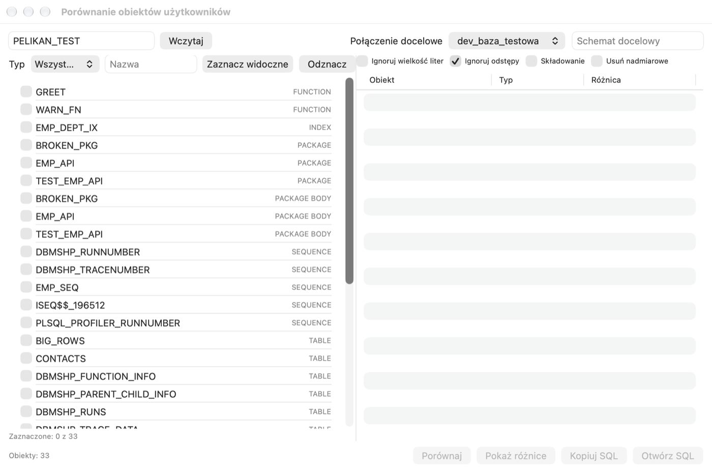
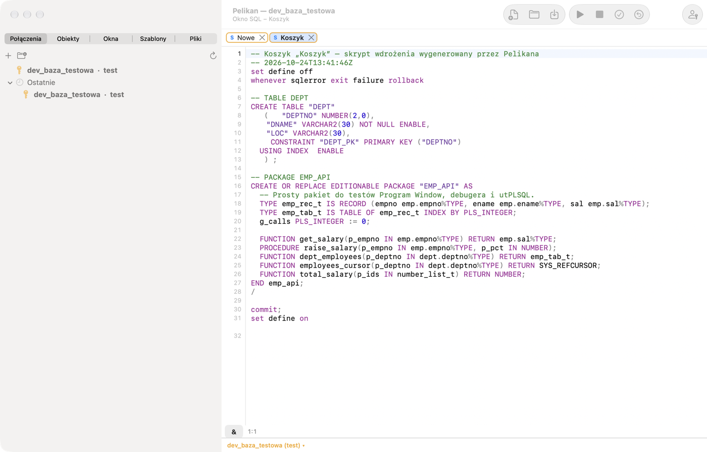
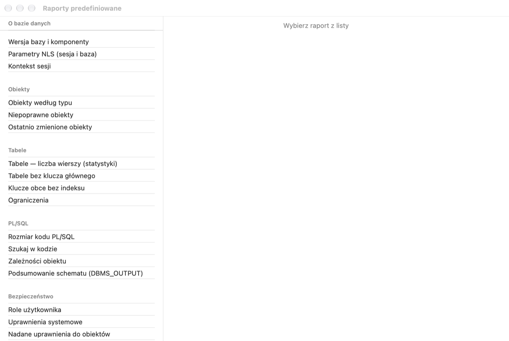
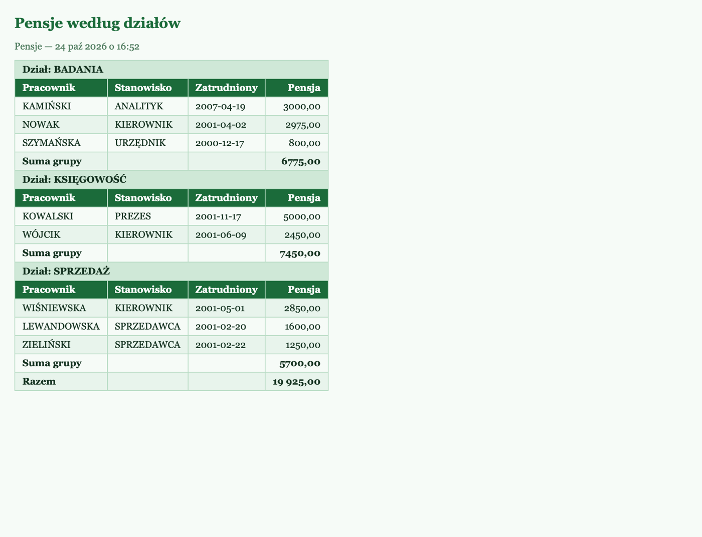
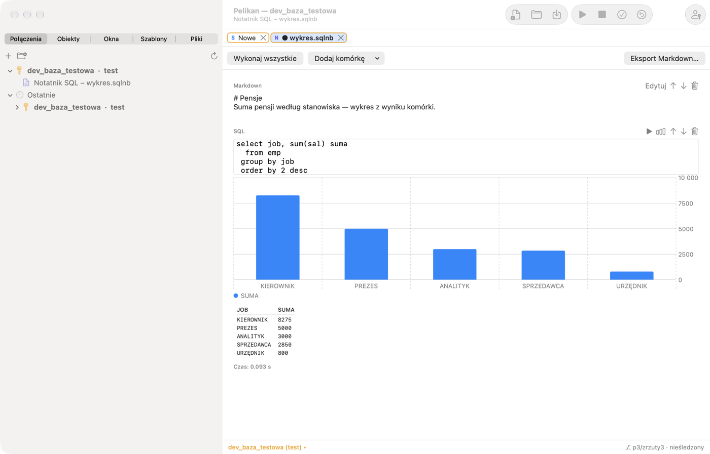
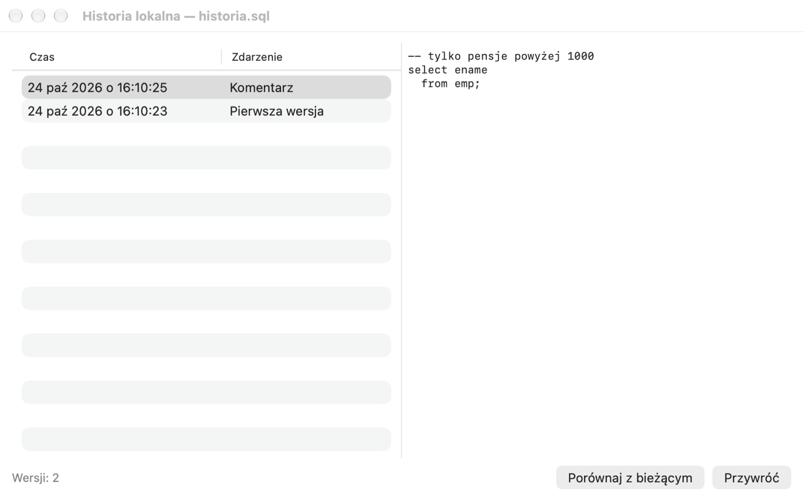

# Werkzeuge

Dieses Kapitel beschreibt die Werkzeuge aus den Menüs **Werkzeuge**, **Berichte**, **Projekt** und **Datei**:
Vergleichen und Ausrollen von Änderungen, Export und Import, Berichte, Notizbücher, Projekte und Dateien. Die Werkzeuge
für Performance und Administration beschreibt das Kapitel *Ausführungsplan, Sitzungen und Administration*.

Sie müssen nicht alle Werkzeuge sofort kennen. Am Anfang sind am nützlichsten: **Lokaler Verlauf** (eine frühere Version
von Code zurückholen), **Export der Benutzerobjekte** (eine Kopie des Codes in Dateien), **Textimport** (eine CSV-Datei
laden) und **Benutzerobjekte vergleichen** (was sich zwischen Entwicklungs- und Testdatenbank unterscheidet). Jeder
Abschnitt beginnt mit einer Erklärung, wozu das Werkzeug dient.

## Schemata vergleichen und Änderungen ausrollen

### Benutzerobjekte vergleichen

**Wozu es dient:** Änderungen nehmen Sie zuerst auf der Entwicklungsdatenbank vor, danach müssen sie auf die Test- und
Produktionsdatenbank. Der Vergleich zeigt, welche Objekte sich unterscheiden, und erzeugt ein Skript, das die
Zieldatenbank angleicht.

**Werkzeuge › Benutzerobjekte vergleichen …** vergleicht die DDL der Objekte eines Schemas mit einem Zielschema — auf
derselben oder einer anderen Verbindung (z. B. `dev_test` mit der Datenbank für Abnahmetests).



1. Geben Sie das Quellschema ein und klicken Sie auf **Laden**. Wählen Sie die Objekte aus (Typ- und Namensfilter,
   **Sichtbare auswählen**).
2. Wählen Sie die **Zielverbindung** und optional das **Zielschema**. Legen Sie die Optionen fest:
   **Groß-/Kleinschreibung ignorieren**, **Leerzeichen ignorieren**, **Storage** (Speicherparameter vergleichen),
   **Überzählige entfernen** (das Skript löscht Objekte, die es in der Quelle nicht gibt).
3. Klicken Sie auf **Vergleichen**. Die Liste zeigt Objekte nur in der Quelle, abweichende und nur im Ziel, in
   Abhängigkeitsreihenfolge.
4. **Unterschiede anzeigen** öffnet die Vergleichsansicht, **SQL kopieren** und **SQL öffnen** liefern ein Skript, das
   das Ziel an die Quelle angleicht. Das Skript wird nicht automatisch ausgeführt — prüfen Sie es und führen Sie es
   bewusst aus.

### Database Diff und Deployment-Korb

**Werkzeuge › Database Diff …** vergleicht Schemata nach Objekttypen (auch zwischen Verbindungen); für Tabellen erzeugt
es `ALTER TABLE`-Befehle, die Spalten hinzufügen, ändern und löschen. Ausgewählte Unterschiede fügen Sie mit der
Schaltfläche **In den Korb** hinzu.

**Werkzeuge › Deployment-Korb …** sammelt Objekte (DDL) und Tabellendaten (mit WHERE-Filter) zu einem Änderungspaket.
Es ist Ihre „Liste der auszurollenden Änderungen“ — Sie fügen während der Arbeit Objekte hinzu und erhalten am Ende ein
Skript.
Das im Object Browser ausgewählte Objekt fügen Sie über **Werkzeuge › Korb › Objekt in den Korb legen** hinzu, und
**Korb › Deployment-Skript des Korbs** erzeugt ein Skript in Abhängigkeitsreihenfolge in einem neuen SQL Window — mit
`WHENEVER SQLERROR EXIT` und `COMMIT` am Ende.



### Tabellendaten vergleichen

**Werkzeuge › Tabellendaten vergleichen …** vergleicht Daten nach Primärschlüssel (neue, abweichende und überzählige
Zeilen) mit einer Tabelle in einem anderen Schema oder auf einer anderen Verbindung. Das Ergebnis ist ein Skript oder
eine direkte Aktualisierung des Ziels mit `COMMIT` alle n Zeilen.

### Vergleichsansicht

Alle Textvergleiche (Fenster mit Datei, Objekt mit Datenbank, lokaler Verlauf, **Werkzeuge › Dateien vergleichen …**)
verwenden die eingebaute Vergleichsansicht: zwei Spalten, Änderungsübersicht, Sprung zum nächsten und vorherigen
Unterschied, Unterschiede innerhalb einer Zeile, Ignorieren von Groß-/Kleinschreibung, Leerzeichen und Kommentaren,
Seitentausch und **Reload**. Stattdessen können Sie ein eigenes Programm verwenden — **Einstellungen › Werkzeuge ›
Externe Vergleichsanzeige** (Argumente `%1`, `%2` — Dateien, `%3`, `%4` — Titel).

## Export und Import

| Werkzeug | Wofür |
|---|---|
| Werkzeuge › Export der Benutzerobjekte … | DDL ausgewählter Objekte in eine Datei (Skript mit „/“) oder eine Datei pro Objekt — Spezifikation und Body von Paketen und Typen in getrennten Dateien `.pks`/`.pkb` und `.tps`/`.tpb` (Erweiterungen aus den Einstellungen) ohne „/“, außer Sie aktivieren **Einheiten mit / abschließen**; **Spezifikation und Body in einer Datei** ergibt `.pck`/`.typ` mit „/“; Objektdateien enthalten nur CREATE — Berechtigungen in einer eigenen Datei `name.grants.sql` oder ausgelassen (**Berechtigungen bei Datei pro Objekt**), ein deaktivierter Trigger erhält `DISABLE` in `CREATE TRIGGER`, ein Kommentar mit Datum nur mit **Kopfzeile mit Exportdatum**; mit Storage, in ausführbarer Reihenfolge |
| Werkzeuge › Tabellenexport … | Tabellendaten als INSERT-Skript (mit DROP/CREATE, TRUNCATE/DELETE, Deaktivieren von Triggern und Fremdschlüsseln, COMMIT alle n, WHERE-Bedingung), im eigenen (komprimierten) Format von Pelikan oder über Data Pump |
| Werkzeuge › Import von Tabellen … | Import eines INSERT-Skripts oder des eigenen Formats mit Tabellenauswahl; Data-Pump-Import mit REMAP_SCHEMA |
| Werkzeuge › Textimport … | CSV- und Textdateien: Erkennung von Trennzeichen, Kopfzeile und Kodierung, Zuordnung von Feldern zu Spalten, Umwandlungsfunktionen, Filter, Behandlung von Duplikaten, CREATE TABLE aus der Datei |
| Werkzeuge › Import aus Excel … | .xlsx-Dateien (ohne Excel und ODBC): Arbeitsblatt, Kopfzeile, Bereich, Zuordnung |
| Werkzeuge › Datenimport-Assistent … | ein schrittweiser Assistent für CSV, Dateien mit fester Breite und XLSX, in eine neue oder vorhandene Tabelle, mit Speichern des Profils |
| Werkzeuge › Schema kopieren … | Objekte und Daten in ein anderes Schema oder auf eine andere Verbindung (Tabellen, Daten, Objekte, Fremdschlüssel, Trigger) |
| Werkzeuge › Datenübertragung … | eine Tabelle oder Abfrage in eine Tabelle auf derselben oder einer anderen Verbindung, mit Spaltenzuordnung und Modus Anhängen / TRUNCATE / DELETE; Definitionen lassen sich speichern und im Hintergrund ausführen |
| Werkzeuge › Data Generator … | Testdaten nach Mustern, Listen, Abfragen und Datensätzen (Vornamen, Firmen, Adressen, E-Mails), mit Master/Detail-Beziehung |
| Werkzeuge › Schemadokumentation … | HTML-Dokumentation: Tabellen mit Spalten und Kommentaren, Schlüssel, Indizes, Views, Programme mit Parametern |

Ein Data-Pump-Export schreibt die Dateien auf der Serverseite (Verzeichnis `DATA_PUMP_DIR`), nicht auf den Mac.
Werkzeuge, die in die Datenbank schreiben, durchlaufen dieselben Schutzmechanismen wie das SQL Window: Auf einer
Produktionsverbindung fragen sie nach einer Bestätigung, auf einer schreibgeschützten Verbindung sind sie gesperrt.
Keine gespeicherte Definition (einer Übertragung, eines Jobs, eines Imports) enthält Passwörter.

> **Übung: eine Kopie des Codes in Dateien und ein CSV-Import.**
> 1. Wählen Sie **Werkzeuge › Export der Benutzerobjekte …**, markieren Sie die Objekte mit dem Präfix `PEL_` und wählen
>    Sie das Speichern „eine Datei pro Objekt“ in einen neuen Ordner.
>    *Ergebnis:* Im Ordner liegen `.sql`-Dateien mit den Tabellen und der View sowie das Paar `pel_emp_api.pks` /
>    `pel_emp_api.pkb` — Code, bereit für git.
> 2. Bereiten Sie in einem Texteditor die Datei `abteilungen.csv` vor:
>
>    ```
>    dept_id;name;city
>    60;Marketing;Wrocław
>    70;Prawny;Łódź
>    ```
>
> 3. Wählen Sie **Werkzeuge › Textimport …**, zeigen Sie auf die Datei und wählen Sie `PEL_DEPARTMENTS` als Zieltabelle.
>    *Ergebnis:* Pelikan hat das Trennzeichen `;` und die Kopfzeile erkannt und die Felder den gleichnamigen Spalten
>    zugeordnet.
> 4. Starten Sie den Import und führen Sie dann in einem SQL Window `SELECT * FROM pel_departments;` aus.
>    *Ergebnis:* 6 Abteilungen.
>
> ⚠️ **Achtung.** Der Import läuft in einer eigenen Sitzung und **schreibt** die Zeilen **selbst fest** (COMMIT alle
> angegebene Anzahl Zeilen und am Ende) — ROLLBACK im SQL Window macht ihn nicht rückgängig. Fehlerhafte Zeilen (z. B. ein
> doppelter Schlüssel) kommen in den Importbericht. Die neuen Abteilungen entfernen Sie mit
> `DELETE FROM pel_departments WHERE dept_id IN (60, 70);` und COMMIT.

## Berichte

### Vordefinierte Berichte

**Berichte › Vordefinierte Berichte …** öffnet eine Sammlung fertiger Berichte über die Datenbank — Sie müssen die Views
des Data Dictionary nicht kennen, um z. B. die größten Tabellen oder ungültige Objekte zu prüfen. Die Berichte liegen in
den Kategorien
*Über die Datenbank*, *Objekte*, *Tabellen*, *PL/SQL*, *Sicherheit* und weiteren. Ein Bericht kann ein Raster, ein
Diagramm oder eine DBMS_OUTPUT-Ausgabe zeigen, nach Variablen fragen und Zeilendetails haben. **Bericht im SQL Window
öffnen** ermöglicht es, die Abfrage anzupassen; das Ergebnis exportieren Sie als CSV, HTML oder XLSX.



Das Menü **Berichte** enthält außerdem Schnellberichte: **Kompilierungsfehler**, **Ungültige Objekte**, **Zuletzt
geänderte Objekte**, **Tabellengrößen**, **Tabellenspalten**, **Benutzerberechtigungen** und **Sitzungen**.

### Eigene Berichte

1. Öffnen Sie **Datei › Neu › Report Window** und geben Sie eine Abfrage ein. Variablen (`&<name="…">`, `:name`,
   JasperReports-Parameter) funktionieren wie im SQL Window.
2. Führen Sie den Bericht aus (F8). Das Ergebnis ist ein HTML-Dokument.
3. Legen Sie im Tab **Layout** für die Spalten Titel, Ausrichtung, Zahlenformat (z. B. `#,##0.00`) und Datumsformat (z.
   B. `yyyy-MM-dd`) fest, Ausblenden, **Gruppe** (Gruppierung mit Gruppenkopf, Master/Detail) und **Summe**
   (Gruppensummen und Gesamtsumme).
4. Wählen Sie einen **Stil** aus der Bibliothek (*Standard*, *Grün*, *Kompakt*) und optional **Zusätzliches CSS**; unter
   **Optionen** — eine Kopfzeile mit Variablen (`#title`, `#date`, `#user`, `#connection`, `#variable`), die Verbindung
   des Berichts, ein Formularlayout statt einer Tabelle, eine neue Seite nach jeder Gruppe und den Hintergrund.
5. Speichern Sie den Bericht als `.rep`-Datei. **Bericht › Bericht zum Menü Berichte hinzufügen** legt ihn unter
   **Berichte › Meine Berichte** ab.



> **Übung: ein Bericht der Gehälter nach Abteilung.**
> 1. Öffnen Sie **Datei › Neu › Report Window** und geben Sie ein:
>
>    ```sql
>    SELECT department, full_name, salary FROM pel_emp_details ORDER BY department, full_name
>    ```
>
> 2. Drücken Sie **F8**.
>    *Ergebnis:* eine HTML-Tabelle mit den Mitarbeitern.
> 3. Haken Sie im Tab **Layout** für die Spalte **DEPARTMENT** **Gruppe** an und für **SALARY** — **Summe** und das Format
>    `#,##0.00`.
> 4. Führen Sie den Bericht erneut aus.
>    *Ergebnis:* Mitarbeiter nach Abteilungen gruppiert, mit der Gehaltssumme unter jeder Abteilung und einer
>    Gesamtsumme.

**Bericht › Bericht als HTML speichern …**, **Berichtsdaten exportieren …** (CSV, TSV, XML, Excel) und **Bericht drucken
…** (auch als PDF) geben das Ergebnis weiter. **Berichtsdefinition sperren** verbirgt Abfrage und Layout — der Bericht
kann dann nur noch ausgeführt werden (bis zur Entsperrung).

## SQL-Notizbuch

Ein Notizbuch (**Datei › Neu › SQL-Notizbuch**) verbindet SQL/PL/SQL-Zellen mit Markdown-Zellen — gut geeignet für
Analysen und Schritt-für-Schritt-Anleitungen.



- **Zelle hinzufügen** fügt eine SQL- oder Markdown-Zelle ein; die Pfeile verschieben Zellen, der Papierkorb löscht sie.
- ▶ führt eine Zelle aus, **Alle ausführen** alle nacheinander (hält bei einem Fehler an).
- Die Diagrammschaltfläche erstellt ein Diagramm aus dem Ergebnis der Zelle (Pelikan schlägt Kategorie und Reihen vor).
- Ergebnisse und Diagramme werden in der `.sqlnb`-Datei gespeichert, sodass sie nach dem Öffnen ohne erneute Ausführung
  sichtbar sind.
- **Markdown-Export …** (**Datei › Notizbuch › Notizbuch als Markdown exportieren …**) speichert das Notizbuch samt
  Ergebnissen als Markdown-Dokument.

## Query Builder

**Werkzeuge › Query Builder …** erstellt eine Abfrage visuell: Ziehen Sie Tabellen hinein (auch Synonyme und
Unterabfragen), Pelikan fügt Joins aus Fremdschlüsseln hinzu (die Join-Art können Sie ändern), wählen Sie Spalten aus,
legen Sie Aliase, WHERE- und HAVING-Bedingungen, GROUP BY, ORDER BY und DISTINCT fest. Die Abfrage landet im Editor. Ein
ausgewähltes einfaches SELECT öffnen Sie zur Bearbeitung im Query Builder.

## Tests mit vielen Fällen und Lasttests

- **Werkzeuge › Test Manager** — Test-Sets (`.pts`): Blöcke mit Eingabe- und erwarteten Werten (`=`, `LIKE`, `IN`,
  `NULL`, `NOT NULL`), globale Variablen, DBMS_OUTPUT und Zeitlimit. Die von den Tests vorgenommenen Änderungen werden
  zurückgerollt. Einen fehlgeschlagenen Test öffnen Sie zum Debuggen in einem Test Window.
- **Werkzeuge › Lasttest …** führt SQL/PL/SQL-Schritte in vielen Sitzungen parallel aus (Variablen `:thread` und
  `:iteration`), mit Live-Ergebnissen (Zeiten, Fehler, Durchsatz) und Speichern nach Excel.
- **Werkzeuge › Event Monitor …** empfängt in einer separaten Sitzung DBMS_ALERT-Alerts und DBMS_PIPE-Nachrichten.

## Suchen

- **Bearbeiten › In Editoren und Dateien suchen …** (⌥⇧⌘F) sucht im aktuellen Editor, in allen offenen Fenstern oder in
  Skriptdateien in Verzeichnissen (standardmäßig an den Orten des File Browser), mit Groß-/Kleinschreibung, ganzen
  Wörtern und regulären Ausdrücken. Ein Klick auf ein Ergebnis öffnet die Datei in der Zeile mit dem Treffer.
- **Werkzeuge › Datenbankobjekte suchen …** (⇧⌘O) durchsucht den Code in der Datenbank — siehe Kapitel *Object Browser*.
- **Projekt › Im Projekt suchen …** sucht in den Dateien, Objektquelltexten und Notizen des Projekts.

## Lokaler Verlauf

**Wozu es dient:** Er ist die „Zeitmaschine“ Ihres Codes. Auch wenn Sie kein git verwenden und eine Prozedur kaputt
gemacht und kompiliert haben, finden Sie die vorige Version im lokalen Verlauf.

Pelikan speichert bei jedem Speichern, Kompilieren, Refactoring und Wiederherstellen eine Version der Datei oder des
Objekts — unabhängig von Git und ohne Datenbankverbindung. **Datei › Lokaler Verlauf › Lokaler Verlauf** zeigt die
Versionen des aktiven Fensters; **Mit aktuellem vergleichen** öffnet die Unterschiede, **Wiederherstellen** fügt die
alte Version ein (der aktuelle Text bleibt im Verlauf). **Version im Verlauf speichern** fügt eine Version manuell mit
Beschreibung hinzu. Der Verlauf speichert bis zu 50 Versionen der letzten 30 Tage.



> **Übung: die vorige Version zurückholen.**
> 1. Öffnen Sie **Bearbeiten** auf dem Paket **PEL_EMP_API** und ändern Sie im Tab des Bodys einen beliebigen Kommentar.
>    Kompilieren Sie (F8).
> 2. Wählen Sie **Datei › Lokaler Verlauf › Lokaler Verlauf**.
>    *Ergebnis:* eine Liste der Versionen mit Datum — die neueste ist Ihre Kompilierung.
> 3. Markieren Sie eine frühere Version und klicken Sie auf **Mit aktuellem vergleichen**.
>    *Ergebnis:* Die Vergleichsanzeige zeigt den geänderten Kommentar.
> 4. Klicken Sie auf **Wiederherstellen** und kompilieren Sie dann (F8).
>    *Ergebnis:* In der Datenbank ist wieder die vorige Version; die Version mit dem Kommentar bleibt auch im Verlauf.

## Projekte, Worksets und Dateien

- Ein **Projekt** gruppiert Dateien und Datenbankobjekte (mit Notizen und Gruppen) in einer `.prj`-Datei. **Projekt ›
  Projekt bauen** kompiliert alles in der Reihenfolge der Elemente, **Projekt-Make** nur die seit dem letzten Bauen
  geänderten Dateien und ungültige Objekte. Zu den Projektoptionen gehören u. a. die Verbindung, das Anhalten nach dem
  ersten Fehler und die Formatierung. **Projekt-Desktop speichern** merkt sich die offenen Fenster.
- Ein **Workset** — wie eine „Arbeitssitzung“ an einer Aufgabe — merkt sich die offenen Fenster — auch mit nicht gespeicherten Änderungen und Variablenwerten — und
  stellt sie beim nächsten Start wieder her (**Datei › Workset**: neu, öffnen, speichern, wiederherstellen, schließen,
  vergleichen, automatisch speichern). Das Layout des Hauptfensters speichern Sie mit **Ansicht › Fensterlayout
  speichern**.
- Beim Beenden mit aktivem **Autospeichern des Worksets** (Standard; **Einstellungen › Allgemein › Dateien › Fenster nach
  Neustart wiederherstellen** oder **Datei › Workset › Workset automatisch speichern**) fragt Pelikan nicht nach dem
  Speichern — alle offenen Fenster (SQL, Programm, Test, Befehle, Plan, Diagramm, Notizbuch, Bericht und
  Verbindungskonsolen) kehren beim nächsten Start in derselben Reihenfolge und mit demselben aktiven Fenster zurück. Ein
  Fenster ohne Datei kehrt mit seinem Text als Fenster ohne Datei zurück, als nicht gespeichert markiert.
- Der **File Browser** (Tab **Dateien**) zeigt ausgewählte Verzeichnisse (Orte mit Filter und Farbe) mit einem Menü:
  öffnen als, umbenennen, neue Datei oder neues Verzeichnis, in den Papierkorb legen, im Finder zeigen. Der Filter
  arbeitet nach Name, Status, Git-Status, Größe und Datum.
- **Git**: Branch und Status der Datei stehen in der Statusleiste, im File Browser und im Projekt. **Werkzeuge › Git**
  bietet den Dateistatus, den Vergleich mit HEAD, `git add`, `git commit` und den Verlauf der Datei.

## Weiteres

- **Werkzeuge › Benutzerwerkzeuge …** — eigene Werkzeuge: externe Programme mit Variablen (`#file`, `#object`,
  `#selection`, `#connection` …) oder SQL-Blöcke für Sitzungen. Programme werden ohne Shell gestartet, und die Variablen
  enthalten nie Passwörter.
- **Werkzeuge › Lokale Jobs …** — Skripte, Exporte und Datenübertragungen, die regelmäßig ausgeführt werden (alle n
  Minuten, täglich, an ausgewählten Tagen), solange Pelikan läuft. Die Definitionen enthalten keine Passwörter; das
  Protokoll zeigt das Ergebnis jedes Laufs.
- **Ansicht › Hintergrundaufgaben** — eine Liste langer Operationen (Autotrace, Exporte, Dokumentation) mit Status, Zeit
  und Abbruchmöglichkeit.
- **Werkzeuge › Dokumente …** — Ihre Dokumente und http(s)-Adressen aus der Liste unter **Einstellungen › Werkzeuge**.
- macOS-Dienste (Menü **Dienste** in jeder Anwendung): **Pelikan: SQL formatieren** formatiert den ausgewählten Text an Ort
  und Stelle, **Pelikan: Im SQL Window öffnen** überträgt den ausgewählten Text in ein neues SQL Window von Pelikan.
