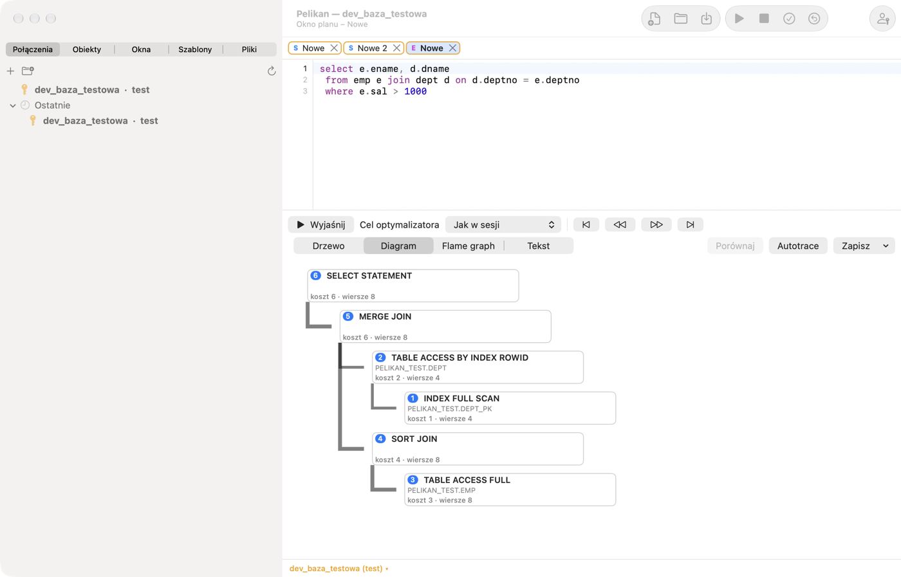
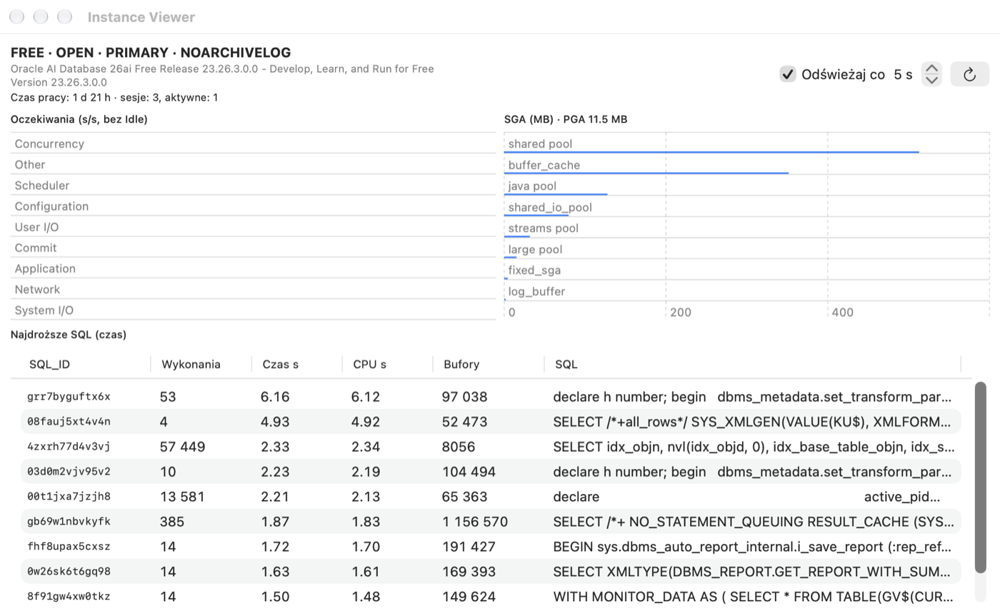

# Ausführungsplan, Sitzungen und Administration

## Wozu es dient

Bevor Oracle eine Abfrage ausführt, wählt der **Optimierer** die Art der Ausführung: welche Tabelle zuerst gelesen wird,
ob ein Index verwendet wird, wie Tabellen verbunden werden. Diese Art ist der **Ausführungsplan**. Zwei Abfragen mit
demselben Ergebnis können Pläne haben, deren Laufzeit sich tausendfach unterscheidet. Die Werkzeuge dieses Kapitels
zeigen den Plan (Explain Plan), messen die tatsächliche Ausführung (Autotrace) und lassen sehen, was in der Datenbank
geschieht (Sitzungen, Instance Viewer).

**Wann verwenden:** wenn eine Abfrage langsam läuft, bevor Sie einen Index hinzufügen, und wenn etwas „hängt“ — um zu
prüfen, wer Zeilen sperrt oder was die Datenbank tut.

## Ausführungsplan (Explain Plan)

Setzen Sie den Cursor auf einen Befehl (oder wählen Sie ihn aus) und drücken Sie F5 (**Werkzeuge › Explain Plan**).
Pelikan öffnet ein Planfenster mit dem Plan aus PLAN_TABLE. In PL/SQL-Code werden Variablen durch Bindevariablen ersetzt
und `INTO` wird übergangen, sodass Sie den Plan einer Abfrage aus einer Prozedur ohne Umschreiben erhalten. Ein leeres
Planfenster öffnen Sie über **Datei › Neu › Explain Plan Window**; eine fehlende PLAN_TABLE kann Pelikan anlegen.

- **Plan aktualisieren** berechnet den Plan für den Text im Editor des Planfensters neu, **Optimizer-Ziel** (*Wie in der Sitzung*,
  ALL_ROWS oder FIRST_ROWS_n) fügt einen Hint hinzu.
- Ein neuer Plan erscheint vollständig ausgeklappt. Die Pfeile **Alle Zweige ausklappen** und **Alle Zweige
  einklappen** neben der Ansichtsauswahl über dem Planbaum (auch auf der Menüband-Registerkarte **Plan**) klappen alle
  Zweige auf einmal aus oder bis auf die Wurzel ein.
- Ansichten: **Baum** (Operationen mit Kosten, Zeilenzahl, Bytes, Zeit, Ausführungsreihenfolge sowie Zugriffs- und
  Filterprädikaten), **Diagramm** (ein Knoten je Operation mit Kosten, Kardinalität und Schrittnummer), **Flame Graph**
  (Kosten der Operationen im Verhältnis zum Elternknoten) und **Text** (DBMS_XPLAN).
- Die Navigationsschaltflächen gehen die Operationen in Ausführungsreihenfolge durch: erster, vorheriger, nächster und
  letzter Schritt.
- **Vergleichen** stellt den Plan dem vorherigen Plan des Fensters oder dem Plan in einem zweiten Planfenster gegenüber:
  Es ordnet die Operationen einander zu und zeigt Unterschiede bei Kosten, Kardinalität, Reihenfolge und Prädikaten.
- **Speichern** speichert den Plan als Text, HTML oder XML (DBMS_XPLAN).

Der Plan wird in einer separaten Werkzeugsitzung berechnet und beeinflusst daher die Transaktion des Fensters nicht.

**So lesen Sie einen Plan (für Einsteiger):**

- Lesen Sie ihn **ab der am tiefsten eingerückten Operation** nach oben — was am tiefsten steht, läuft zuerst.
- `TABLE ACCESS FULL` — Oracle liest die ganze Tabelle. Bei einer kleinen Tabelle ist das gut; bei einer Tabelle mit
  Millionen Zeilen, aus der Sie wenige brauchen — meist ein Zeichen, dass ein Index fehlt oder die Bedingung ihn nicht
  nutzt.
- `INDEX RANGE SCAN` / `INDEX UNIQUE SCAN` — Oracle sucht über einen Index, wie über das Register eines Buchs.
- Die **Kosten** (Cost) sind eine Schätzung des Optimierers — eine relative Zahl, nützlich zum Vergleich zweier Pläne
  derselben Abfrage, keine Zeit in Sekunden.
- Die **Kardinalität** (Rows) ist die geschätzte Zeilenzahl. Weicht sie stark von der tatsächlichen ab (prüfen Sie es in
  Autotrace), hat der Optimierer schlechte Statistiken und wählt womöglich einen schlechten Plan.

> **Übung: ein Index im Plan.**
> 1. Geben Sie in einem SQL Window `SELECT * FROM pel_employees WHERE emp_id = 3;` ein, setzen Sie den Cursor darauf und
>    drücken Sie **F5**.
>    *Ergebnis:* das Planfenster; im Baum eine Operation `INDEX UNIQUE SCAN` auf `PEL_EMPLOYEES_PK` — eine Suche über den
>    Primärschlüssel.
> 2. Ändern Sie die Abfrage in `SELECT * FROM pel_employees WHERE last_name = 'Nowak';` und drücken Sie **Plan
>    aktualisieren**.
>    *Ergebnis:* `TABLE ACCESS FULL` — auf der Spalte `LAST_NAME` gibt es keinen Index.
> 3. Schalten Sie die Ansicht auf **Diagramm** und dann auf **Text**.
>    *Ergebnis:* derselbe Plan als Zeichnung und als DBMS_XPLAN-Text (so, wie ihn der Administrator sieht).
> 4. Markieren Sie die Abfrage im SQL Window und wählen Sie **Werkzeuge › Autotrace**.
>    *Ergebnis:* der tatsächliche Plan mit den Spalten **E-Rows** (geschätzt) und **A-Rows** (tatsächliche Zeilen) — hier
>    stimmen sie überein.
>
> ⚠️ **Achtung.** Bei einer so kleinen Tabelle ist das vollständige Lesen am schnellsten, und der Optimierer wählt es zu
> Recht — ein Index hilft bei großen Tabellen. Fügen Sie keine Indizes „auf Vorrat“ hinzu: Jeder Index verlangsamt
> INSERT, UPDATE und DELETE. Autotrace **führt** den Befehl wirklich **aus** (DML wird danach zurückgerollt) — führen Sie
> darin während der Arbeitszeit keine langen Abfragen auf der Produktion aus.

## Autotrace

**Werkzeuge › Autotrace** (oder die Schaltfläche **Autotrace** im Planfenster) führt den Befehl mit Messung aus und
zeigt den tatsächlichen Plan: Starts, geschätzte (E-Rows) und tatsächliche (A-Rows) Zeilenzahlen mit Hervorhebung großer
Abweichungen, Zeiten, Puffer und Lesevorgänge sowie die Änderung der Sitzungsstatistiken vor und nach der Ausführung.
DML-Befehle werden nach der Messung zurückgerollt. Autotrace erfordert kein Tuning Pack.

Nach Variablen im Befehl fragt Autotrace wie das SQL-Fenster: Bindevariablen (`:name`) erhalten Werte aus dem Fenster
**Variablen** (im Fenster gespeichert), Substitutionsvariablen (`&name`) nur bei eingeschalteter Substitution des
Fensters; bei ausgeschalteter bleibt `&` ohne Nachfrage im Text.

## Oracle Diagnostics und Tuning Pack

Das Menü **Werkzeuge › Performance (Oracle-Packs)** enthält Werkzeuge, die kostenpflichtige Oracle-Packs nutzen:

| Befehl | Pack | Was er tut |
|---|---|---|
| AWR-Bericht | Diagnostics | HTML-Bericht aus AWR-Snapshots |
| ASH-Bericht | Diagnostics | HTML-Bericht der aktiven Sitzungen der letzten Minuten |
| ADDM-Bericht | Diagnostics | ADDM-Empfehlungen |
| SQL Monitor | Tuning | Liste der überwachten Abfragen (V$SQL_MONITOR) mit Bericht für die ausgewählte |
| SQL-Monitor-Bericht | Tuning | HTML-Bericht einer überwachten Abfrage |
| SQL Tuning Advisor | Tuning | Empfehlungen für den Befehl unter dem Cursor; die Advisor-Aufgabe wird anschließend gelöscht |

**Wichtig — Lizenzen.** Verwenden Sie diese Funktionen nur, wenn die Datenbank für das entsprechende Pack lizenziert ist
(das Tuning Pack setzt auch das Diagnostics Pack voraus). Bei der ersten Verwendung fragt Pelikan, welche Lizenz die
Datenbank hat, und merkt sich die Antwort in der Verbindungsdefinition (Tab **Erweitert** ›
**Diagnostics/Tuning-Pack-Lizenz**). Ohne angegebene Lizenz oder wenn der Datenbankparameter
`CONTROL_MANAGEMENT_PACK_ACCESS` den Wert `NONE` hat (oder `DIAGNOSTIC` für Funktionen des Tuning Pack), startet die
Funktion nicht. KI-Agenten haben keinen Zugriff auf diese Werkzeuge. Die Berichte speichern Sie als HTML.

## Leistungsberichte

**Wozu es dient:** Wenn die Datenbank oder eine Abfrage langsam läuft, bittet der Administrator meist um einen AWR-, ASH-
oder SQL-Monitor-Bericht. Das Fenster **Leistungsberichte der Datenbank** bündelt alle diese Berichte an einem Ort, mit
Wahl von Zeitraum und Format.

- **Leistung › Alle Leistungsberichte…** öffnet ein Fenster mit einer Liste von Berichten (**Bericht wählen**): AWR, ASH,
  ADDM, Performance Hub, SQL Monitor, Pläne und Statistiken. Für den gewählten Bericht stellen Sie den **Zeitraum** ein
  (z. B. **Letzte Stunde**, einen Bereich **Von** – **Bis** in Datenbankzeit oder **AWR-Snapshots**), die **Instanz** (in
  RAC auch **Alle RAC-Instanzen**) und das **Ausgabeformat** und klicken dann auf **Bericht ausführen**.
- **Leistung › Berichte für SQL_ID…** tut dasselbe für eine Abfrage — aus der markierten Zeile einer Tabelle (z. B. der
  Sitzungsliste oder der teuersten Abfragen), einer Zelle mit SQL_ID oder dem Befehl unter dem Cursor. Die Schaltfläche
  **Prüfen** zeigt, wo die Abfrage verfügbar ist: im Cursor-Cache, in ASH, in AWR und im SQL Monitor — Berichte ohne Daten
  zur Abfrage sind mit einer Erklärung gesperrt.
- Ein Bericht, dem ein Privileg (z. B. EXECUTE auf dem Paket `DBMS_WORKLOAD_REPOSITORY`) oder eine Lizenz fehlt, ist in
  der Liste mit dem Grund und einem fertigen GRANT-Befehl für den Administrator gesperrt.

> **Übung: die SQL_ID Ihrer Abfrage finden.**
> 1. Führen Sie in einem SQL Window `SELECT /* meine_uebung */ COUNT(*) FROM pel_emp_details;` aus.
> 2. Setzen Sie den Cursor auf diesen Befehl und wählen Sie **Leistung › Berichte für SQL_ID…**.
>    *Ergebnis:* das Berichtsfenster mit der SQL_ID der Abfrage, im Cursor-Cache über ihren Text gefunden („Befehl unter
>    dem Cursor“).
> 3. Klicken Sie auf **Prüfen**, wählen Sie den Planbericht aus dem Cursor-Cache und **Bericht ausführen**.
>    *Ergebnis:* der Plan, nach dem die Datenbank die Abfrage tatsächlich ausgeführt hat, mit der Zahl der Ausführungen.

## Datenbanksitzungen

**Werkzeuge › Sitzungen** zeigt die Sitzungen der Datenbank (V$SESSION):

- **Filter** wählt die Abfrage der Liste (z. B. *Benutzersitzungen*); **Aktualisieren alle** n Sekunden schaltet die
  automatische Aktualisierung ein.
- Detail-Tabs der ausgewählten Sitzung: **Aktuelles SQL**, **Offene Cursor**, **Sperren**, **Statistiken**, **Warten**.
- **Sitzung beenden** und **Sofort beenden** beenden die Sitzung (`ALTER SYSTEM KILL SESSION`) nach Bestätigung.
- **Aktionen** — u. a. das Aktivieren von SQL Trace für die Sitzung (DBMS_MONITOR).
- **Abfragen …** ermöglicht eigene Filter (WHERE-Bedingung), Detail-Tabs (mit `:sid`, `:serial#`) und Aktionen.

Die Sitzungen von Pelikan haben in der Spalte MODULE den Wert „Pelikan“, die Sitzungen von KI-Agenten „Pelikan agent“.

> **Übung: Wer sperrt eine Zeile?**
>
> Erfordert Rechte zum Lesen von V$SESSION und V$LOCK (meist die Rolle SELECT_CATALOG_ROLE).
>
> 1. Führen Sie in SQL Window A `UPDATE pel_employees SET salary = salary WHERE emp_id = 1;` aus und schreiben Sie
>    **nicht** fest.
> 2. Führen Sie in SQL Window B denselben Befehl aus.
>    *Ergebnis:* Fenster B „hängt“ — es wartet, bis die Sitzung von Fenster A die Zeilensperre freigibt.
> 3. Öffnen Sie **Werkzeuge › Sitzungen**, suchen Sie die Sitzungen mit MODULE „Pelikan“ und markieren Sie die wartende.
>    *Ergebnis:* Der Tab **Warten** zeigt das Sperrereignis (`enq: TX - row lock contention`), der Tab **Sperren** — die
>    blockierende Sitzung.
> 4. Gehen Sie zurück zu Fenster A und drücken Sie **⇧F10** (ROLLBACK).
>    *Ergebnis:* Fenster B beendet das UPDATE sofort. Rollen Sie auch Fenster B zurück (**⇧F10**).
>
> ⚠️ **Achtung.** **Sitzung beenden** unterbricht fremde Arbeit und rollt deren Transaktion zurück. Beenden Sie auf einer
> gemeinsamen Datenbank nur Ihre eigenen Sitzungen oder mit Zustimmung des Administrators.

## DBA-Bereich und Instance Viewer

**Ansicht › DBA-Bereich** sammelt administrative Informationen: Tablespaces mit Belegung, Datendateien, Instanzparameter,
Benutzer, Rollen, Sitzungen und Sperren. In der Parameterliste führt **Wert ändern …** `ALTER SYSTEM SET … SCOPE=BOTH`
aus, in der Benutzerliste ändern **Sperren** und **Entsperren** den Kontostatus — immer nach Bestätigung und mit
denselben Schutzmechanismen wie das SQL Window. Bereiche, für die Ihnen die Berechtigungen fehlen, zeigen eine Meldung
statt der Daten.

**Werkzeuge › Instance Viewer** ist ein Dashboard der Instanz: Version und Zustand der Datenbank, Laufzeit, Anzahl der
Sitzungen, Warteklassen (Zuwachs pro Sekunde), die teuersten Abfragen (V$SQL) sowie SGA und PGA, mit automatischer
Aktualisierung.

## DBMS Scheduler

**Werkzeuge › DBMS Scheduler** zeigt die Objekte des Schedulers in einem Baum: Fenster und Fenstergruppen, Job-Klassen,
Zeitpläne, Programme, Ketten, Jobs, File Watcher und Anmeldedaten, mit einer SQL-Vorschau (View SQL) des ausgewählten
Objekts.

- **Neuer Job …** legt einen Job mit eingebettetem (z. B. `FREQ=DAILY;BYHOUR=3`) oder benanntem Zeitplan an, mit Klasse,
  Kommentar und E-Mail-Benachrichtigungen. Einen vorhandenen Job ändern Sie mit **Bearbeiten …**, löschen ihn nach
  Bestätigung.
- **Läufe** zeigt die Ausführungshistorie mit Berichten (alle, fehlgeschlagene, eigene Bedingungen) und Farbregeln.
- **Laufend** zeigt die laufenden Jobs; **Anhalten** und **Anhalten (Force)** unterbrechen sie.
