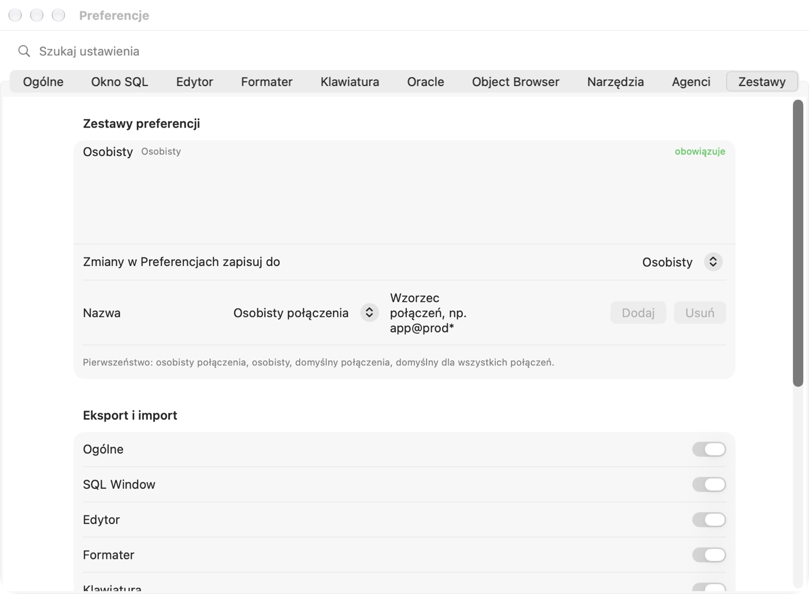

# Einstellungen und Tastaturkurzbefehle

Dieses Kapitel beschreibt **jede Option** des Fensters „Einstellungen“: was sie bewirkt, welchen Standardwert sie hat,
was passiert, wenn Sie sie ein- oder ausschalten (oder einen anderen Eintrag aus einer Liste wählen), wann die Änderung
wirkt und worauf Sie achten sollten. Sie müssen es nicht von vorne bis hinten lesen — die Standardwerte sind so gewählt,
dass Sie sicher mit der Arbeit beginnen können. Kommen Sie hierher zurück, wenn sich etwas anders verhält, als Sie
möchten.

## Fenster „Einstellungen“

### Wozu es dient

Die Einstellungen bestimmen, wie Pelikan sich mit der Datenbank verbindet, wie es Befehle ausführt, wie der Editor
aussieht und wie Code formatiert wird. Jeder Entwickler hat etwas andere Gewohnheiten — hier passen Sie das Programm an
Ihre an.

### Öffnen und eine Option finden

1. Wählen Sie **Pelikan › Einstellungen …** oder drücken Sie **⌘,** (Befehlstaste und Komma).
   *Ergebnis:* Ein Fenster mit Tabs oben öffnet sich: Allgemein, SQL Window, Editor, Formatierer, Tastatur, Oracle,
   Object Browser, Werkzeuge, Agenten, Sets.
2. Sie wissen nicht, in welchem Tab die Option steht? Geben Sie einen Teil ihres Namens in das Feld **Einstellungen
   suchen** über den Tabs ein, z. B. `commit`.
   *Ergebnis:* Statt der Tabs erscheint eine Liste passender Einstellungen, rechts der Name des Tabs.
3. Klicken Sie auf einen Eintrag der Liste.
   *Ergebnis:* Das Suchfeld wird geleert und der richtige Tab öffnet sich.

### Wann eine Änderung wirkt

- **Änderungen werden sofort gespeichert** — es gibt keine Schaltfläche „Anwenden“ oder „OK“, wie in den
  macOS-Einstellungen. Das Schließen des Fensters macht nichts rückgängig.
- Die meisten Optionen wirken sofort in allen Fenstern.
- Optionen, die **Datenbanksitzungen** betreffen (z. B. NLS-Einstellungen, Sitzungsmodus), gelten für **neue
  Sitzungen** — trennen Sie die Verbindung und verbinden Sie sich erneut, damit sie auch für bereits geöffnete Fenster
  gelten.
- Drei Optionen erfordern einen **Neustart von Pelikan**: das Verzeichnis des Oracle Instant Client, die Verzeichnisse
  von Oracle Net und Oracle Wallet sowie die Sprache der Benutzeroberfläche. Pelikan weist unter jeder von ihnen darauf
  hin.

> **Tipp.** Sie möchten für eine Datenbank andere Einstellungen (z. B. strengere für die Produktion)? Ändern Sie sie
> nicht bei jedem Wechsel von Hand — verwenden Sie **Einstellungssets** (Tab **Sets**, beschrieben am Ende des
> Kapitels).

Die Beschreibung jeder Option hat denselben Aufbau: der Name der Option wie im Fenster, der Standardwert, die Wirkung
jeder Möglichkeit und — wo nötig — eine Warnung ⚠️.

## Tab „Allgemein“

### Sitzungen

Eine **Sitzung** ist eine Verbindung zur Oracle-Datenbank auf der Serverseite. In einer Sitzung leben Ihre
**Transaktion** (Datenänderungen, die noch nicht mit COMMIT festgeschrieben sind), Paketvariablen und mit ALTER SESSION
gesetzte Einstellungen. Wie viele Sitzungen Pelikan öffnet, hat echte Folgen.

**Sitzungsmodus** — *Standard: Multi*.

| Auswahl | Was passiert | Folgen |
|---|---|---|
| **Multi — eigene Sitzung für jedes Fenster** | Jedes SQL-, Test- und Konsolenfenster hat eine eigene Sitzung; die Kompilierung hat eine weitere. | Eine lange Abfrage in einem Fenster blockiert die anderen nicht. Die Transaktionen der Fenster sind unabhängig: Eine Änderung in Fenster A ist in Fenster B bis zum COMMIT unsichtbar. Mehr Sitzungen auf dem Server (der Administrator kann ein Limit haben). **Empfohlen.** |
| **Dual — gemeinsame Sitzung und Kompilierungssitzung** | Die Fenster einer Verbindung teilen sich eine Sitzung; die Kompilierung hat eine eigene. | Weniger Sitzungen. Die Fenster sehen gegenseitig ihre nicht festgeschriebenen Änderungen und teilen die Transaktion — COMMIT in einem Fenster schreibt die Änderungen aller fest. Während ein Fenster eine Abfrage ausführt, warten die anderen. |
| **Single — eine Sitzung** | Alles, auch die Kompilierung, in einer Sitzung (der Debugger hat trotzdem seine eigene Überwachungssitzung). | Die wenigsten Sitzungen. ⚠️ In Oracle **schreibt die Kompilierung (CREATE OR REPLACE) die offene Transaktion fest** — das Kompilieren eines Pakets im Program Window schreibt die nicht festgeschriebenen Änderungen aus dem SQL Window fest. Nur verwenden, wenn die Datenbank nur eine Sitzung zulässt. |

*Wirkt:* für neue Sitzungen — trennen Sie nach der Änderung die Verbindung und verbinden Sie sich erneut.

**Abmelden mit offener Transaktion** — *Standard: Fragen*. Was geschehen soll, wenn Sie ein Fenster schließen, es auf
eine andere Verbindung umschalten oder sich abmelden, während die Sitzung nicht festgeschriebene Änderungen hat.

- **Fragen** — Pelikan zeigt ein Fenster mit COMMIT, ROLLBACK oder Abbrechen. **Empfohlen** — Sie wissen immer, was mit
  Ihren Änderungen geschieht.
- **Festschreiben (COMMIT)** — Änderungen werden ohne Rückfrage festgeschrieben. ⚠️ Eine „nur zum Ausprobieren“
  gemachte Änderung wird leicht dauerhaft.
- **Zurückrollen (ROLLBACK)** — Änderungen werden ohne Rückfrage zurückgerollt. ⚠️ Ein vergessenes COMMIT bedeutet
  verlorene Arbeit.

**Verbindung prüfen alle … s (0 — deaktiviert)** — *Standard: 60 s*, Schritt 30 s. Alle so viele Sekunden sendet
Pelikan eine sehr leichte Abfrage an die Datenbank, um zu prüfen, ob die Hauptsitzungen und die Sitzungen von Fenstern
mit offener Transaktion noch leben (z. B. ob Netzwerk oder VPN abgebrochen sind). Wenn eine Sitzung verloren ist, meldet
Pelikan das sofort und entfernt die Markierung der offenen Transaktion aus den betroffenen Fenstern — **nicht
festgeschriebene Änderungen einer verlorenen Sitzung sind in der Datenbank zurückgerollt**.

- Ein kleinerer Wert (mindestens 15 s) — Sie erfahren schneller von einer abgebrochenen Verbindung, auf Kosten häufigerer
  Abfragen.
- **0** — Pelikan prüft die Verbindung nicht; von einem Abbruch erfahren Sie erst beim nächsten Befehl.
- Die Änderung wirkt sofort.

**Verbindung neuer Fenster anheften** — *Standard: aus*. Die **Hauptverbindung** ist die, die Sie in der Symbolleiste
wählen; neue Fenster erhalten sie.

- Aus — wenn Sie die Hauptverbindung ändern, wechseln Fenster ohne Anheftung mit (sie fragen vorher nach einer offenen
  Transaktion).
- Ein — jedes neue SQL-, Programm-, Test- und Konsolenfenster erhält eine **angeheftete** Verbindung (📌 in der
  Statusleiste) und behält sie, auch wenn Sie die Hauptverbindung ändern. Nützlich, wenn Sie parallel auf mehreren
  Datenbanken arbeiten und nicht möchten, dass ein Fenster auf eine andere „springt“.

### Verbindungsindikatoren

Eine Verbindungsfarbe hilft, eine Testdatenbank nicht mit einer Produktionsdatenbank zu verwechseln. Die Farbe setzen Sie
in der Verbindungsdefinition (Tab **Umgebung**), hier entscheiden Sie, wo sie sichtbar ist.

**Editorhintergrund in Verbindungsfarbe** — *Standard: aus*. Ein — der Editorhintergrund ist leicht in der
Verbindungsfarbe des Fensters getönt. So sieht man sehr deutlich, dass man „auf der Produktion“ tippt. Aus — die Farbe
ist nur auf den Fenster-Tabs und in der Fensterliste.

**Regeln Benutzer@Datenbank** — eine Liste von Regeln mit Muster und Farbe, standardmäßig leer. Die Schaltfläche **Regel
hinzufügen** fügt eine Regel `*@*` in Rot hinzu; ändern Sie Muster und Farbe. Das Muster hat die Form `benutzer@datenbank`,
`*` bedeutet eine beliebige Zeichenfolge, `?` ein Zeichen. Beispiele: `sys@*` — jede Anmeldung als SYS, `*@prod*` —
jeder Benutzer auf Datenbanken, deren Name mit „prod“ beginnt. Eine Regel **hat Vorrang** vor der Farbe der Verbindung und
der Umgebung und gilt für Tabs, Fensterliste und Hintergrund. Die Schaltfläche ⊖ entfernt eine Regel.

> **Übung: SYS-Anmeldungen rot markieren.**
> 1. Klicken Sie im Tab **Allgemein** auf **Regel hinzufügen**. *Ergebnis:* Eine Zeile `*@*` in Rot erscheint.
> 2. Geben Sie in das Musterfeld `sys@*` ein. Lassen Sie die Farbe rot.
> 3. Schalten Sie **Editorhintergrund in Verbindungsfarbe** ein.
> 4. Verbinden Sie sich als SYS mit einer Testdatenbank und öffnen Sie ein SQL Window. *Ergebnis:* Der Fenster-Tab und
>    der Editorhintergrund sind rot.

### Darstellung

**Modus** — *Standard: Wie System*. **Wie System** — Pelikan ist hell oder dunkel zusammen mit macOS (auch wenn macOS in
der Dämmerung wechselt). **Hell** / **Dunkel** — immer so, unabhängig vom System. Die Änderung wirkt sofort.

### Oberflächenschrift

Gilt für Beschriftungen, Listen, das Menüband, Fenster-Tabs, die Statusleiste, Werkzeugfenster und die Einstellungen.
Menüs und Fenstertitel zeichnet macOS — diese ändert Pelikan nicht. Unter den Optionen sehen Sie einen Beispieltext in
der gewählten Schrift.

- **Schriftart** — *Standard: System (SF Pro)*. Die Liste enthält die auf dem Mac installierten Schriften.
- **Stil** — *Standard: normal*. Von leicht bis fett.
- **Größe** — *Standard: 13 pt*, von 10 bis 20 pt. Hilfstext (Beschriftungen, Beschreibungen) ist immer 2 pt kleiner.
  Eine größere Schrift bedeutet Lesbarkeit auf Kosten des Platzes — ab 16 pt werden auf einem kleinen Bildschirm einige
  Leisten schmaler.

Die Schriften des Code-Editors und des Ergebnisrasters stellen Sie getrennt im Tab **Editor** ein.

### Menüband

Das **Menüband** ist die Leiste mit Aktions-Tabs (Start, SQL, Programm, Werkzeuge …) unter der Symbolleiste — wie in
Büroprogrammen.

- **Menüband mit Aktionsregisterkarten anzeigen** — *Standard: ein*. Aus — das Menüband verschwindet und der Editor
  erhält mehr Platz; Befehle bleiben in den Menüs, in der Befehlspalette (⇧⌘P) und unter ihren Kurzbefehlen.
- **Menüband nur auf Registerkarten reduzieren** — *Standard: aus*, nur bei sichtbarem Menüband verfügbar. Ein — nur die
  Namen der Tabs sind sichtbar. Ein Klick auf einen Tab klappt das Menüband auf, ein Doppelklick auf einen Tab klappt es
  dauerhaft zu oder auf. Ein guter Kompromiss auf einem kleinen Bildschirm.

Das Feld **Aktionen suchen** im Menüband findet jeden Befehl nach Namen, auch ohne Sonderzeichen und nach dem englischen
Namen aus PL/SQL Developer.

### Werkzeugbereiche

Werkzeuge (z. B. Object Browser, Sitzungen, Testergebnisse) öffnen sich im rechten Bereich, im unteren Bereich oder in
einem eigenen Fenster.

- **Neue Werkzeuge öffnen in** — *Standard: Rechter Bereich*. **Rechter Bereich**, **Unterer Bereich** oder **Eigenes
  Fenster**. Gilt für Werkzeuge, die Sie noch nicht verschoben haben — Pelikan merkt sich den Ort jeder Werkzeugart
  einzeln.
- **Bereiche automatisch ausblenden, wenn die Arbeit zum Editor zurückkehrt** — *Standard: aus*. Ein — wenn Sie in den
  Editor klicken, werden die Werkzeugbereiche ausgeblendet und der Editor erhält die volle Breite; ein Bereich kehrt
  zurück, wenn Sie ein Werkzeug öffnen oder auswählen. Aus — die Bereiche bleiben an ihrem Platz.
- **Standardorte wiederherstellen** — vergisst die Orte, an die Sie Werkzeuge verschoben haben (der Zähler daneben zeigt,
  wie viele es sind). Werkzeuge öffnen sich wieder gemäß **Neue Werkzeuge öffnen in**.

Ein Werkzeug verschieben Sie, indem Sie seinen Tab in den anderen Bereich oder außerhalb der Bereiche ziehen (eigenes
Fenster), über das Tab-Menü oder mit der Schaltfläche in der Titelleiste des Werkzeugs.

### Sprache der Benutzeroberfläche

**Sprache** — *Standard: Wie System*. Polski, English, Deutsch, Español oder Українська. **Wie System** — die Sprache
aus den macOS-Einstellungen. Die Änderung wirkt **nach einem Neustart von Pelikan**. Die Sprache ändert keine
Oracle-Meldungen (z. B. `ORA-00942`) — diese hängen von NLS_LANGUAGE im Tab **Oracle** ab.

### Startordner und Dateiendungen

**SQL-Skripte**, **Programme**, **Tests**, **Berichte** — der Ordner, den der Öffnen- und Sichern-Dialog für eine Datei
dieser Art zeigt. *Standardmäßig leer:* der Projektordner oder, ohne Projekt, der zuletzt verwendete. Geben Sie einen
Pfad ein, wählen Sie aus der Liste (Projektordner, Ordner zuletzt verwendeter Dateien, Dokumente, Benutzerordner) oder
klicken Sie auf die Schaltfläche zum Durchsuchen.

**Zusätzliche Programmendungen** und **Zusätzliche Testendungen** — *standardmäßig leer*. Pelikan erkennt die Art einer
Datei an ihrer Endung: `.sql` öffnet im SQL Window; `.pck`, `.pks`, `.pkb`, `.prc`, `.fnc` … im Program Window; `.tst`
im Test Window. Wenn Programme in Ihrem Team eine andere Endung haben (z. B. `.plsql`), tragen Sie sie hier ein (mehrere
durch Kommas getrennt) — solche Dateien öffnen sich dann im Program oder Test Window statt im SQL Window.

### Spezifikation und Body in getrennten Dateien

Ein PL/SQL-Paket besteht aus der **Spezifikation** (was das Paket anbietet) und dem **Body** (wie es das tut). Viele Teams
halten sie in zwei Dateien, z. B. `emp_api.pks` und `emp_api.pkb`.

- **Paar aus Spezifikation und Body in einem Fenster öffnen** — *Standard: ein*. Ein — das Öffnen von `emp_api.pks`
  öffnet im selben Program Window auch `emp_api.pkb` aus demselben Ordner (zwei Tabs). Aus — nur die gewählte Datei
  öffnet sich.
- **Erweiterung für Paketspezifikation** (*pks*), **Erweiterung für Paket-Body** (*pkb*), **Erweiterung für
  Typspezifikation** (*tps*), **Erweiterung für Typ-Body** (*tpb*). Ein Program Window mit Spezifikation und Body
  speichert jede Einheit in ihre Datei; **Speichern unter** erzeugt ein Dateipaar; der Objektexport „eine Datei pro
  Objekt“ verwendet diese Endungen. Die Endung der Spezifikation muss sich von der des Bodys unterscheiden und darf keine
  reservierte sein (`sql`, `tst`, `pck`, `typ`, `rep`, `pdd`, `sqlnb`, `txt`). Bei einem ungültigen Eintrag zeigt
  Pelikan einen roten Hinweis und verwendet bis zur Korrektur die Standardwerte.

### Dateien

- **Fenster nach Neustart wiederherstellen (auch nicht gespeicherte)** — *Standard: ein*. Ein — beim Beenden merkt sich
  Pelikan die offenen Fenster samt ungespeichertem Text und öffnet sie beim Start wieder. Aus — Pelikan startet mit
  einem leeren Fensterbereich.
- **Fensterlayout automatisch speichern** — *Standard: ein*. Pelikan merkt sich die Größe des Hauptfensters, die Lage
  der Bereiche und ihre Breiten. Aus — nach dem Start kehrt das Layout zum Standard zurück.
- **Beim Schließen neuer Fenster nach dem Speichern fragen** — *Standard: ein*. Gilt für Fenster, die noch keine Datei
  haben (z. B. ein neues SQL Window mit einer eingetippten Abfrage). Aus — ein solches Fenster schließt ohne Rückfrage und
  der Text geht verloren. ⚠️ Schalten Sie es nur aus, wenn Sie neue Fenster als Notizzettel verwenden.
- **Änderungen von Dateien auf der Festplatte erkennen** — *Standard: ein*. Wenn ein anderes Programm (git, ein anderer
  Editor, ein KI-Agent) eine in Pelikan geöffnete Datei ändert, bemerkt Pelikan das bei der Rückkehr zum Fenster und
  bietet an, die neue Version zu laden. Aus — Pelikan prüft das nicht, und Speichern aus Pelikan überschreibt fremde
  Änderungen. ⚠️ Lassen Sie es eingeschaltet, wenn Sie git verwenden.
- **Extern geänderte Dateien ohne Rückfrage neu laden, wenn das Fenster keine Änderungen hat** — *Standard: aus*, nur bei
  eingeschalteter Erkennung verfügbar. Ein — hat das Fenster keine ungespeicherten Änderungen, wird die neue Version ohne
  Rückfrage geladen (praktisch nach `git pull`). Hat das Fenster ungespeicherte Änderungen, fragt Pelikan immer.

### Dateistandard

Legt fest, in welchem Format Pelikan **neue** Codedateien speichert.

- **Kodierung** — *Standard: UTF-8*. Die Art, wie Zeichen (z. B. Umlaute) gespeichert werden. UTF-8 ist der Standard
  moderner Werkzeuge und von git. Wählen Sie eine andere Kodierung (z. B. Windows-1252) nur, wenn Ihr Projekt es
  verlangt.
- **Bytereihenfolge-Markierung (BOM) am Dateianfang (UTF-8)** — *Standard: aus*. Die BOM sind unsichtbare Bytes am
  Dateianfang, die einige alte Windows-Programme benötigen. Die meisten Werkzeuge (git, SQL*Plus unter Linux)
  funktionieren ohne sie besser.
- **Programmdateien ohne „/“-Zeilen (weder am Ende noch in der Mitte)** — *Standard: ein*. Eine Zeile mit nur `/` sagt
  SQL*Plus „führe das Obige aus“. In Dateien mit Paketcode (die von Werkzeugen ausgerollt werden) stört eine solche Zeile
  oft. Ein — das Program Window speichert Einheiten ohne `/`. Aus — Sie können Einheiten mit `/` abschließen (Option im
  Tab **Oracle › Debugger**). SQL-Skripte behalten `/` immer, weil sie vom Befehlsfenster ausgeführt werden.
- **Beim Öffnen einer Datei in anderem Format nach Konvertierung fragen** — *Standard: ein*. Beim Öffnen einer Datei in
  anderer Kodierung, mit BOM oder mit `/` bietet Pelikan die Konvertierung zum Standard an. Die Konvertierung ändert nur
  das Fenster — die Datei auf der Festplatte ändert sich erst beim Speichern. Aus — die Datei öffnet sich, wie sie ist.
- **Standard wiederherstellen (UTF-8, ohne BOM, ohne „/“)** — setzt diesen Abschnitt auf die Standardwerte zurück.

### Anwendungsprotokoll

Das Protokoll zeichnet auf, was Pelikan tut — nützlich, wenn Sie einen Fehler melden. **Das Protokoll enthält nie
Passwörter, den Text von SQL-Befehlen oder Daten aus der Datenbank.**

- **Protokollieren** — *Standard: Ereignisse (empfohlen)*. **Warnungen und Fehler** — nur Probleme (die wenigsten
  Einträge). **Ereignisse** — auch gewöhnliche Aktionen (Verbinden, Ausführen, Kompilieren). **Details — Diagnose** —
  viele Einträge; schalten Sie es für eine Weile ein, wenn Sie die Ursache eines Fehlers suchen, und danach wieder aus.
- **Verbindungs- und Objektnamen sowie Dateipfade anzeigen** — *Standard: aus*. Aus — Namen von Verbindungen und Servern
  sind im Protokoll durch einen Hashwert ersetzt, sodass man das Protokoll gefahrlos versenden kann. Ein — die echten
  Namen sind sichtbar (das Protokoll ist leichter zu verstehen, aber überlegen Sie, bevor Sie es jemandem schicken).
- **Protokoll anzeigen** und **Protokoll exportieren…** — öffnen das Protokoll oder speichern es in einer Datei.

## Tab „SQL Window“

### Ausführung

**AutoSelect — ohne Auswahl den Befehl unter dem Cursor ausführen** — *Standard: ein*. Ein SQL Window enthält meist
mehrere Abfragen untereinander.

- Ein — **F8** (oder ⌘↩) führt **einen** Befehl aus, den, in dem der Cursor steht. Um das ganze Skript auszuführen,
  markieren Sie es (⌘A) oder verwenden Sie **Entgegen AutoSelect ausführen** (⌃F8, ⇧⌘↩).
- Aus — F8 führt **alle** Befehle im Fenster nacheinander aus, einen einzelnen nur, wenn er markiert ist.
- Wenn Sie etwas markieren, wird immer die Markierung ausgeführt.

**AutoCommit für SQL-Befehle** — *Standard: aus*.

- Aus — nach INSERT, UPDATE oder DELETE existieren die Änderungen nur in Ihrer Sitzung. Sie schreiben sie mit **COMMIT**
  (F10) fest oder machen sie mit **ROLLBACK** (⇧F10) rückgängig. Die Statusleiste zeigt die offene Transaktion.
  **Empfohlen.**
- Ein — jeder datenändernde Befehl wird sofort festgeschrieben. ⚠️ Ein Fehler (z. B. UPDATE ohne WHERE) lässt sich nicht
  mit ROLLBACK rückgängig machen.

**Statistiken nach der Ausführung** — *standardmäßig leer (alle ungleich null)*. Eine Liste von Namen der
Sitzungsstatistiken für den Tab **Statistiken** (z. B. `consistent gets`, `physical reads`), mehrere durch Kommas
getrennt. Leer — alle, die sich geändert haben. Wirkt bei eingeschaltetem Tab Statistiken (Abschnitt unten).

**AutoCommit nach Ausführung des Testfensters** — *Standard: aus*. Wie AutoCommit, aber für das Test Window: ein — nach
dem Ausführen des Testskripts werden die Änderungen festgeschrieben. Aus — Sie entscheiden selbst (nützlich: testen,
Daten prüfen, ROLLBACK).

**COMMIT und ROLLBACK bestätigen** — *Standard: aus*. Ein — vor dem Festschreiben oder Zurückrollen fragt Pelikan „sind
Sie sicher“. Schützt vor versehentlichem Drücken von F10; die Frage hat ein Feld **Nicht mehr fragen**.

**Ändernde Anweisungen auf Produktionsverbindungen bestätigen** — *Standard: ein*. Gilt für Verbindungen mit der
Umgebung **Produktion** (in der Verbindungsdefinition gesetzt). Vor jedem Befehl, der Daten oder Objekte ändert (INSERT,
UPDATE, DELETE, MERGE, DDL …), fragt Pelikan, ob er wirklich ausgeführt werden soll. ⚠️ Diese Frage lässt sich nicht mit
„Nicht mehr fragen“ abschalten — nur mit dieser Option. Lassen Sie sie eingeschaltet.

### Ergebnisse

**Zeilen pro Seite** — *Standard: Automatisch (Seite)*. Wie viele Ergebniszeilen Pelikan sofort abruft. Eine Abfrage
kann Millionen Zeilen liefern — alle abzurufen würde lange dauern und Speicher belegen.

- **Automatisch (Seite)** — 100 Zeilen, weitere werden beim Blättern nachgeladen.
- **100**, **500**, **1000** — so viele Zeilen auf einmal.
- **Alle** — das ganze Ergebnis sofort. ⚠️ Bei großen Tabellen kann das lange dauern und viel Speicher belegen.

„(mehr …)“ neben der Zeilenzahl bedeutet, dass das Ergebnis noch nicht vollständig ist.

**Maximale Ergebnisgröße** — *Standard: 512 MB*, von 16 bis 8192 MB. Überschreitet das abgerufene Ergebnis diese Größe,
hält Pelikan den Abruf an und fragt: **Weiter abrufen** oder **Anhalten**. Das schützt den Mac davor, dass eine Abfrage
den ganzen Speicher belegt.

**Zahlenformat** — *Standard: Rechts*. Wie das Raster Zahlen zeigt: **Rechts** (wie in einer Tabellenkalkulation —
Einerstellen untereinander), **Links**, **Formatiert (regionales Trennzeichen)** (Dezimaltrennzeichen gemäß
macOS-Einstellungen), **Mit Tausendertrennzeichen** (z. B. 1.234.567). Gilt nur für die Anzeige — Kopieren und Export
behalten den genauen Wert.

**Zeilennummer beim Kopieren und Exportieren** — *Standard: aus*. Ein — das kopierte und exportierte Ergebnis hat eine
erste Spalte mit der Zeilennummer.

**LOBs bei Bedarf abrufen (Vorschau der ersten 4000 Bytes)** — *Standard: ein*. Ein LOB (CLOB, BLOB) ist eine Spalte mit
großem Text oder einer Datei. Ein — das Raster zeigt den Anfang des Werts, das Ganze wird erst abgerufen, wenn Sie es
öffnen (Large Data Editor). Abfragen sind schneller. Aus — ganze Werte werden sofort abgerufen.

**Spalten nach der gespeicherten Vorlage der Abfrage ausrichten** — *Standard: ein*. Wenn Sie für eine Abfrage
Spaltenbreiten und Ausrichtung speichern (Rastermenü), ordnet Pelikan die Spalten beim erneuten Ausführen derselben
Abfrage genauso an. Aus — Vorlagen werden ignoriert.

**Benachrichtigen, wenn eine Ausführung länger als … s dauert** — *Standard: 10 s*, Schritt 5 s, 0 — keine
Benachrichtigung. Dauert ein Befehl länger, spielt Pelikan nach dem Ende einen Ton ab (bei einem Fehler einen anderen),
und wenn Sie in einem anderen Programm arbeiten, hüpft das Pelikan-Symbol im Dock.

**Large Data Editor: Auto Format (JSON, XML)** — *Standard: aus*. Ein — beim Öffnen eines JSON- oder XML-Werts im Large
Data Editor wird der Text sofort schön formatiert (Einrückungen, Zeilen). Ändert nur die Ansicht, sofern Sie den Wert
nicht speichern.

### Query By Example

**Query By Example** (QBE) ist eine Zeile über dem Raster, in die Sie Werte eingeben, und Pelikan fügt der Abfrage eine
WHERE-Bedingung hinzu. Diese Optionen bestimmen, wie der eingegebene Wert verglichen wird.

- **Groß-/Kleinschreibung ignorieren** — *Standard: ein*. Ein — `kowalski` findet auch `KOWALSKI`. Aus — die Schreibweise
  muss übereinstimmen.
- **Text ohne Platzhalter als „enthält“** — *Standard: aus*. Ein — `kow` sucht Werte, die „kow“ enthalten (wie
  `LIKE '%kow%'`). Aus — `kow` sucht Werte gleich „kow“; „enthält“ erreichen Sie mit `%kow%`.
- **Datum ohne Uhrzeit (Tag vergleichen)** — *Standard: ein*. Ein — `2026-11-05` findet alle Zeilen dieses Tages, zu
  jeder Uhrzeit. Aus — nur Mitternacht dieses Tages.

### Statistiken

**Registerkarte Statistiken: Sitzungsstatistiken jeder Ausführung (erfordert Zugriff auf V$MYSTAT)** — *Standard: aus*.
Ein — nach jeder Ausführung hat das SQL Window einen Tab **Statistiken** mit der Zahl der Lesevorgänge, Sortierungen,
rekursiven Aufrufe usw. Nützlich beim Tuning von Abfragen. Erfordert Lesezugriff auf die Views `V$MYSTAT` und
`V$STATNAME` (fragen Sie den Administrator).

### DBMS_OUTPUT

`DBMS_OUTPUT.PUT_LINE` ist die Art, wie PL/SQL-Code Text „ausgibt“ — das Gegenstück zu `print`.

- **Aktiviert** — *Standard: ein*. Pelikan aktiviert den DBMS_OUTPUT-Puffer in der Sitzung und zeigt den Text nach der
  Ausführung im Tab **Output** des SQL Window (im Test Window — **Ausgabe**). Aus — Text aus PUT_LINE geht verloren.
- **Vor Ausführung leeren** — *Standard: ein*. Ein — der Tab wird vor jeder Ausführung geleert. Aus — neue Zeilen werden
  an die alten angehängt.
- **Puffergröße** — *Standard: unbegrenzt (0)*, Schritt 10.000 Bytes. Eine Grenze für die Textmenge im Puffer. Wird sie
  überschritten, meldet Oracle den Fehler `ORU-10027`. Unbegrenzt — der Fehler tritt nicht auf.

### Datumsformate

**DATE** — *Standard: `YYYY-MM-DD HH24:MI:SS`*, **TIMESTAMP** — *Standard: `YYYY-MM-DD HH24:MI:SS.FF6`*. Wie das Raster
Datumswerte und Zeitstempel zeigt. Geben Sie ein eigenes Format in Oracle-Notation ein oder wählen Sie eines aus der
Liste. Gilt für die Anzeige im Raster; wie die **Datenbank** in Abfragen Text in ein Datum umwandelt, stellen Sie mit
NLS_DATE_FORMAT ein (Tab **Oracle**).

## Tab „Editor“

### Schrift

- **Schrift** — *Standard: SF Mono*. Die Liste enthält Schriften mit fester Zeichenbreite (Code ist leichter zu lesen,
  wenn die Spalten gleich sind).
- **Stil** — *Standard: normal*.
- **Größe** — *Standard: 13 pt*, von 8 bis 40 pt.
- **Ligaturen (z. B. Fira Code, JetBrains Mono)** — *Standard: ein*. Manche Schriften verbinden die Zeichen `<>`, `>=`,
  `=>` zu einem Symbol. Wirkt nur bei solchen Schriften; bei SF Mono ändert es nichts. Schalten Sie es aus, wenn Sie jedes
  Zeichen einzeln sehen möchten.

### Ergebnisraster und Object Browser

Eine eigene Schrift für das Ergebnisraster (*Standard: System mit fester Breite, 12 pt*, von 8 bis 24 pt) und für den
Object Browser (*Standard: wie die Oberfläche*; der Wert 0 pt — wie die Oberfläche).

### Schriftfarben

Für **Editor**, **Ergebnisraster** und **Object Browser** können Sie die Farbe von **Text** und **Hintergrund** wählen.
*Standard:* Systemfarben, die sich mit hellem und dunklem Modus ändern. Eine eigene Farbe gilt in beiden Modi — wählen
Sie eine, die hell und dunkel lesbar ist. **System** stellt die Systemfarben wieder her. Die Syntaxhervorhebung
(Schlüsselwörter, Texte, Kommentare) bleibt.

### Code Assistant (Codevervollständigung)

Code Assistant ist die Vorschlagsliste, die beim Tippen erscheint: Namen von Tabellen, Spalten, Paketen, Prozeduren.

- **Automatisch nach einem Punkt** — *Standard: ein*. Nach Eingabe von `emp.` erscheint die Spaltenliste der Tabelle EMP
  von selbst. Aus — Sie öffnen die Liste von Hand: **⌃Leertaste**.
- **Verzögerung** — *Standard: 400 ms*, von 0 bis 2000 ms. Wie lange Code Assistant nach dem Punkt wartet. Kürzer —
  schneller, aber die Liste kann erscheinen, wenn Sie sie nicht wollen.
- **Abgleich** — *Standard: Beginnt mit*. **Beginnt mit** — `sal` schlägt `SALARY` vor. **Enthält** — `sal` schlägt auch
  `BASE_SALARY` vor (mehr Einträge in der Liste).
- **Groß-/Kleinschreibung** — *Standard: Wie eingegeben*. In welcher Form ein Vorschlag in den Code kommt: **Wie
  eingegeben** (Sie tippen klein — er fügt klein ein), **GROSS**, **klein**, **Erster Buchstabe groß**, **Original** (wie
  im Datenbankkatalog, meist groß).
- **Mindestzeichen für Objekte und Schlüsselwörter** — *Standard: 1*, von 1 bis 5. Nach wie vielen getippten Buchstaben
  (ohne Punkt) Vorschläge für Objektnamen und Schlüsselwörter erscheinen. Mehr — weniger störend, hilft aber später.
- **SQL-Standardfunktionen** — *Standard: ein*. Ein — die Liste enthält auch integrierte Funktionen (`NVL`, `TO_CHAR`,
  `SUBSTR` …).
- **„(alle)“: jedes Element in einer eigenen Zeile** — *Standard: aus*. Der Eintrag „(alle)“ in der Spaltenliste fügt alle
  Spalten auf einmal ein. Aus — in einer Zeile, durch Kommas getrennt. Ein — jede Spalte in einer eigenen Zeile.
- **„(alle)“: Komma am Zeilenanfang** — *Standard: aus*, mit der vorigen Option verfügbar. Ein — `, spalte` statt
  `spalte,`.

### AutoReplace (Textkürzel)

Sie tippen ein kurzes Kürzel und ein Leerzeichen (oder ein anderes Abschlusszeichen), und Pelikan ersetzt es durch
längeren Text. *Standardmäßig gibt es zwei:* `sf` → `SELECT * FROM ` und `dbo` → `dbms_output.put_line(|);`. Das Zeichen
`|` in der Ersetzung markiert die Cursorposition nach der Ersetzung. **Kürzel hinzufügen** fügt eine leere Zeile hinzu, ⊖
entfernt ein Kürzel.

> **Übung: ein eigenes Kürzel.**
> 1. Klicken Sie auf **Kürzel hinzufügen**, geben Sie im Feld **Kurzbefehl** `cnt` und im Feld **Ersetzung (| — Cursor)**
>    `SELECT COUNT(*) FROM |;` ein.
> 2. Öffnen Sie ein neues SQL Window (⌘N), tippen Sie `cnt` und ein Leerzeichen. *Ergebnis:* `SELECT COUNT(*) FROM ;`
>    erscheint und der Cursor steht vor dem Semikolon — tippen Sie den Tabellennamen.

### Analyse und Fenster

- **Codeanalyse beim Tippen** — *Standard: ein*. Pelikan unterstreicht laufend unbekannte Namen (mithilfe des
  Datenbankkatalogs) und verdächtige Stellen im Code. Aus — die Unterstreichungen verschwinden; Fehler sehen Sie erst beim
  Kompilieren oder Ausführen.
- **Vor Bezeichnern länger als … Bytes warnen** — *Standard: 30*, 0 — aus. Ältere Oracle-Versionen (bis 12.1) erlauben
  Namen bis 30 Bytes; ein Umlaut belegt 2 Bytes. Stellen Sie 128 ein, wenn Sie nur mit Oracle 12.2 und neuer arbeiten.
- **Zustand der Dateifenster merken (Cursor, Lesezeichen, Markierungen, Variablen)** — *Standard: ein*. Beim erneuten
  Öffnen einer Datei kehren Sie an dieselbe Stelle zurück, mit Lesezeichen und Variablenwerten. Aus — die Datei öffnet
  sich am Anfang.

### Schreiben

- **Schreibweise der Schlüsselwörter** — *Standard: Keine Änderungen*. **GROSS** / **klein** / **Erster Buchstabe groß** —
  beim Tippen ändert Pelikan Schlüsselwörter (SELECT, FROM, BEGIN …) in die gewählte Form. Namen, Text in Apostrophen und
  Kommentare ändert es nicht.
- **Aktuelle Zeile hervorheben** — *Standard: ein*. Die Zeile mit dem Cursor hat einen leicht anderen Hintergrund.
- **Vorkommen des Namens unter dem Cursor und des markierten Worts hervorheben** — *Standard: ein*. Der Cursor auf der
  Variable `l_total` hebt alle ihre Verwendungen hervor — so sieht man leicht, wo sie geändert wird.
- **COMMIT-, ROLLBACK- und SAVEPOINT-Anweisungen hervorheben** — *Standard: ein*. Befehle, die eine Transaktion beenden,
  haben eine deutliche Farbe — man übersieht sie im Code schwerer.
- **Zeilenstatus (geändert und neu seit Öffnen oder Speichern)** — *Standard: ein*. Am Rand neben den Zeilennummern zeigt
  ein farbiger Balken die seit dem Öffnen oder letzten Speichern geänderten und hinzugefügten Zeilen.
- **Zeilen umbrechen** — *Standard: aus*. Ein — eine lange Zeile wird auf dem Bildschirm umbrochen (ohne Textänderung).
  Aus — eine lange Zeile scrollen Sie horizontal.
- **Nummer jeder Zeile / Nummer jede … Zeile** — *Standard: jede Zeile*, bis jede zehnte.
- **Vertikaler Rand in Spalte …** — *Standard: keiner*, Schritt 10. Eine senkrechte Linie in der angegebenen Spalte (z. B.
  100) hilft, kurze Zeilen zu schreiben.
- **Sonderzeichen anzeigen (Leerzeichen, Tabulatoren, Zeilenenden)** — *Standard: aus*. Ein — Leerzeichen sind Punkte,
  Tabulatoren Pfeile. Nützlich, wenn Sie die Ursache einer seltsamen Einrückung suchen.
- **Codeinhalt standardmäßig sichtbar** — *Standard: ein*. Der Bereich **Codeinhalt** neben dem Editor zeigt die
  Struktur des Codes (Prozeduren, Funktionen, Befehle). Die Option gilt für Fenster, in denen Sie den Bereich nicht von
  Hand umgeschaltet haben (**Ansicht › Codeinhalt**).
- **Kontrollstrukturen im Codeinhalt** — *Standard: ein*. Ein — der Baum zeigt auch IF, Schleifen, CASE und
  Ausnahmebehandlung (standardmäßig zugeklappt). Aus — nur Unterprogramme und Blöcke.
- **Reihenfolge im Codeinhalt** — *Standard: Wie in der Quelle*. Oder **Alphabetisch** oder **Nach Art**.

### Einrückung

- **Einrückung neuer Zeilen** — *Standard: Automatisch (wie vorherige Zeile)*. **Keine** — Enter beginnt die Zeile in
  Spalte 1. **Automatisch** — die neue Zeile hat die Einrückung der vorigen. **Intelligent (PL/SQL-Struktur)** — nach
  `BEGIN`, `LOOP`, `THEN` wächst die Einrückung, `END` kehrt zur Ebene des Blocks zurück.
- **Rücktaste entfernt Einrückung** — *Standard: ein*. Die Rücktaste am Anfang einer eingerückten Zeile geht eine
  Einrückungsebene zurück statt eines Leerzeichens.
- **Tabulatorbreite** — *Standard: 2*, von 1 bis 8. Wie viele Leerzeichen Tab und eine Einrückungsebene ergeben.
- **Tabulator statt Leerzeichen einfügen** — *Standard: aus*. Ein — Tab fügt ein Tabulatorzeichen ein. Achtung: In
  anderen Programmen kann ein Tabulator eine andere Breite haben, sodass der Code „auseinanderfällt“. Die meisten Teams
  verwenden Leerzeichen.

## Tab „Farben“

Das **Farbschema** bestimmt, wie der Editor Code einfärbt. Es legt die Farben von Schlüsselwörtern, Zeichenketten,
Kommentaren und Funktionsnamen fest, außerdem Hintergrund, Auswahl, Cursor, aktuelle Zeile und Zeilennummern. Pelikan
hat 98 integrierte Schemata. Standard ist **Pelikan** in einer hellen und einer dunklen Version. Dazu kommt
**Klassisch** im Stil früherer Oracle-Werkzeuge: weißer Hintergrund, dunkelblaue Schlüsselwörter, rote Zeichenketten
und grüne Kommentare. Die übrigen 95 sind bekannte Editor-Schemata, u. a. Solarized, Gruvbox, Dracula, Monokai, Nord,
One Dark, GitHub, Catppuccin und Tokyo Night. Ihre Paletten stammen aus dem Projekt tinted-theming (MIT-Lizenz).

Dieselben Farben gelten im SQL-Fenster, Programmfenster, Testfenster und in der Konsole sowie in den Codevorschauen der
Werkzeugfenster (Sitzungen, Berichte, Query Builder). Druck und die Quick-Look-Vorschau im Finder behalten die hellen
Farben von Pelikan, weil Papier und Finder einen weißen Hintergrund haben.

### Liste der Schemata

Links gibt es zwei Gruppen: **Hell** (heller Hintergrund) und **Dunkel** (dunkler Hintergrund). Das farbige Rechteck
neben dem Namen zeigt den Hintergrund des Schemas und drei seiner Farben: Schlüsselwort, Zeichenkette und Kommentar.
Ein ✓ markiert ein verwendetes Schema. **eigenes** markiert ein Schema, das Sie selbst gespeichert haben. Das Feld
**Schemata filtern** schränkt die Liste auf passende Namen oder Autoren ein.

### Im hellen Modus verwenden / Im dunklen Modus verwenden

macOS hat einen hellen und einen dunklen Modus (Systemeinstellungen › Erscheinungsbild oder **Allgemein › Darstellung**
in Pelikan). Pelikan merkt sich **für jeden Modus ein eigenes Schema**. *Standard:* Pelikan hell und Pelikan dunkel.
Wechselt das System den Modus (z. B. abends im automatischen Modus), wechselt der Editor von selbst zum anderen
Schema. Die Farben ändern sich sofort in allen offenen Fenstern, ohne Dateien neu zu öffnen.

Sie können auch für den hellen Modus ein dunkles Schema wählen und umgekehrt. Der Editor hat dann einen eigenen
Hintergrund, unabhängig vom übrigen Fenster. Die Zeile unter den Schaltflächen zeigt, welches Schema in jedem Modus
verwendet wird.

### Vorschau

Der Umschalter **SQL / PL/SQL / Pro*C** zeigt Beispielcode in den Farben des ausgewählten Schemas. Das Schema muss
nicht verwendet werden. So können Sie Schemata vergleichen, bevor Sie eines wählen.

### Farbkategorien

Ein Schema weist jeder Kategorie eine Farbe zu (und bei Bedarf Fett- oder Kursivschrift):

- **Normaler Text** — Namen von Tabellen, Spalten und Variablen.
- **Schlüsselwörter** — `SELECT`, `BEGIN`, `IF`, `create or replace`; in Pro*C auch `EXEC SQL`, `END-EXEC` und
  C-Schlüsselwörter (`if`, `return`).
- **Datentypen** — `VARCHAR2`, `NUMBER`, `DATE`, `BOOLEAN`; in Pro*C `int`, `char`, `VARCHAR`.
- **Integrierte Funktionen** — `NVL`, `TO_CHAR`, `COUNT` und andere Oracle-Funktionen, wenn auf den Namen eine Klammer
  folgt; in Pro*C jeder Funktionsaufruf (`printf(`).
- **Mitgelieferte Datenbankpakete** — `DBMS_OUTPUT`, `UTL_FILE`, `APEX_…`, wenn auf den Namen ein Punkt folgt.
- **Zeichenketten** — `'Text'`, `q'[…]'`; in Pro*C auch `"Text"`.
- **Zahlen** — `100`, `2.5`, `1e6`.
- **Kommentare** — `-- …` und `/* … */`.
- **Optimizer-Hints** — `/*+ INDEX(e) */`.
- **Bindevariablen und Ersetzungen** — `:x`, `&name`; in Pro*C Hostvariablen `:ename`.
- **Bezeichner in Anführungszeichen** — `"Abteilungsname"`.
- **Operatoren und Satzzeichen** — `:=`, `||`, `(`, `;`.
- **Kompilierungs- und Präprozessordirektiven** — `$IF … $END` in PL/SQL und `#include`, `#define` in Pro*C.

Die integrierten Schemata haben Farben, die gut lesbar sind: normaler Text hat zum Hintergrund einen Kontrast von
mindestens 4,5:1, jede Kategorie mindestens 3:1. Zu blasse Farben der ursprünglichen Paletten (meist Kommentare)
verwendet Pelikan nicht — es verschiebt sie in Richtung der Textfarbe.

### Als eigenes speichern…

Integrierte Schemata lassen sich nicht ändern, damit Sie immer zu ihnen zurückkehren können. Sie möchten andere Farben?
Wählen Sie das Schema, das Ihren Wünschen am nächsten kommt, und klicken Sie auf **Als eigenes speichern…**. Geben Sie
einen Namen ein (*Standard:* „Name (Kopie)“). Die Kopie erscheint mit **eigenes** in der Liste und kann sofort
bearbeitet werden. Das Original bleibt unverändert.

### Eigenes Schema bearbeiten

Unter der Vorschau eines eigenen Schemas steht eine Tabelle:

- **Name** und **Dunkles Schema** — der Name in der Liste und die Gruppe (**Hell** oder **Dunkel**). Die Gruppe schränkt
  die Auswahl nicht ein: Sie können das Schema in jedem Modus verwenden.
- **Kategorie** — für jede Kategorie der Liste oben: **Farbe**, **Fett** und **Kursiv**. Ein Klick auf das Farbfeld
  öffnet die Farbauswahl des Systems. Die Änderung ist sofort in der Vorschau zu sehen und in den Editoren, wenn das
  Schema verwendet wird. Der Pfeil ↺ neben einer Farbe stellt die Standardfarbe wieder her: die Farbe des normalen Texts
  für Kategorien, die Systemfarbe für Editorelemente.
- **Hintergrund**, **Text**, **Auswahl**, **Aktuelle Zeile**, **Zeilennummern**, **Cursor** — Farben des Editors selbst.
  **Aktuelle Zeile** ist der Balken unter der Zeile mit dem Cursor (wenn im Tab **Editor** das Hervorheben der aktuellen
  Zeile eingeschaltet ist).

Änderungen werden sofort gespeichert, ohne Schaltfläche **Speichern**. **Löschen** entfernt ein eigenes Schema. War es
in Verwendung, kehrt der Modus zum Schema Pelikan zurück.

> **Hinweis.** Die unter **Editor › Schriftfarben** eingestellten Farben für **Text** und **Hintergrund** haben Vorrang
> vor dem Schema. Ändert sich der Hintergrund nach der Wahl eines Schemas nicht, prüfen Sie, ob dort eine eigene Farbe
> eingestellt ist (die Schaltfläche **System** entfernt sie).

### Importieren … und Exportieren …

**Importieren …** lädt ein Schema aus einer Datei als eigenes Schema. Unterstützte Formate:

- ein Pelikan-Schema (`.json` aus **Exportieren …**),
- base16 und base24 (`.yaml`) — Hunderte Paletten aus dem Projekt tinted-theming,
- Xcode (`.xccolortheme`; Benutzerschemata liegen in `~/Library/Developer/Xcode/UserData/FontAndColorThemes`),
- TextMate und Sublime Text (`.tmTheme`),
- Visual Studio Code (`.json` aus einer Theme-Erweiterung, die Datei im Ordner `themes`).

Beim Import aus Xcode, TextMate und VS Code ordnet Pelikan die SQL-Kategorien den Farben des Schemas zu. Das Ergebnis
entspricht nicht immer dem Original-Editor, weil diese Schemata andere Sprachen beschreiben. Passen Sie die Farben dann
in der Bearbeitungstabelle an.

**Exportieren …** speichert das ausgewählte Schema (auch ein integriertes) in einer `.json`-Datei, z. B. um es auf einen
anderen Computer zu übertragen oder einem Kollegen zu geben. Eigene Schemata überträgt auch der Export der
Einstellungen (**Werkzeuge › Einstellungen › Einstellungen exportieren …**, Abschnitt **Editor**).

> **Übung: eigenes Schema mit deutlichen Kommentaren.**
> 1. Öffnen Sie **Pelikan › Einstellungen …** (⌘,) und den Tab **Farben**.
> 2. Wählen Sie in der Gruppe **Hell** das Schema **Solarized Light**. *Ergebnis:* Die Vorschau zeigt Code auf cremefarbenem
>    Hintergrund.
> 3. Klicken Sie auf **Im hellen Modus verwenden**. *Ergebnis:* Neben dem Namen erscheint ✓, und das offene SQL-Fenster
>    ändert die Farben.
> 4. Klicken Sie auf **Als eigenes speichern…**, geben Sie `Mein Solarized` ein und klicken Sie auf **Speichern**.
>    *Ergebnis:* In der Liste steht **Mein Solarized** mit **eigenes**, unter der Vorschau eine Farbtabelle.
> 5. Klicken Sie in der Zeile **Kommentare** auf das Farbfeld und wählen Sie ein dunkles Grün. Schalten Sie **Kursiv** aus.
>    *Ergebnis:* Kommentare in der Vorschau sind grün und aufrecht.
> 6. Klicken Sie auf **Im hellen Modus verwenden**. *Ergebnis:* Das SQL-Fenster verwendet jetzt Ihr Schema, **Solarized
>    Light** ist unverändert.
> 7. Um zum Standardaussehen zurückzukehren, wählen Sie **Pelikan** in der Gruppe **Hell** und klicken Sie auf **Im hellen
>    Modus verwenden**.

## Tab „Formatierer“

Der **Formatierer** (⇧⌘F) ordnet PL/SQL- und SQL-Code nach Regeln an: Einrückung, Umbruch von Listen, Groß- und
Kleinschreibung. So hat das ganze Team Code im selben Stil. Der Tab hat zwei Teile: links die Regeln, rechts eine
**Vorschau** mit Beispielen (**PL/SQL**, **Abfragen**, **DML**, **DDL**). Nach jeder Änderung werden die betroffenen
Zeilen 5 Sekunden lang hervorgehoben, ein roter Strich markiert entfernte Zeilen und eine senkrechte Linie den rechten
Rand. Ist eine Änderung im aktuellen Beispiel nicht sichtbar, wechselt die Vorschau von selbst zu einem, in dem sie zu
sehen ist.

> **Am einfachsten lernen Sie den Formatierer kennen,** indem Sie jeweils eine Option ändern und die hervorgehobenen
> Zeilen der Vorschau beobachten.

### Layout

- **Einrückung** — *Standard: 2*, von 1 bis 8 Leerzeichen pro Ebene.
- **Einrückung mit Tabulatoren** — *Standard: aus*.
- **Rechter Rand** — *Standard: 100*, von 40 bis 250. Bis zu dieser Spalte bringt der Formatierer Elemente in einer Zeile
  unter; längere werden umbrochen.
- **Leerzeilen beibehalten** — *Standard: ein*. Ein — Leerzeilen, mit denen Sie Codeteile trennen, bleiben (höchstens
  **Maximal aufeinanderfolgende Leerzeilen**, *Standard 1*, bis 5). Aus — der Formatierer entfernt Leerzeilen.
- **Leerzeile vor jedem Unterprogramm** — *Standard: aus*. Ein — Prozeduren und Funktionen im Paket sind durch eine
  Leerzeile getrennt.

### Listen und Kommas

Jede Liste kann eines dieser Layouts haben: **Element in der Zeile** (jedes Element in einer eigenen Zeile), **Bis zum
Rand** / **In einer Zeile, wenn es passt** (Elemente in einer Zeile, erst am Rand umbrochen).

- **SELECT-, INTO-, FROM-Listen** — *Standard: Element in der Zeile*.
- **UPDATE … SET** und **GROUP BY, ORDER BY** — *Standard: Wie SELECT-Listen*.
- **Parameterdeklarationen**, **Aufrufparameter**, **INSERT-Listen (Spalten, VALUES)**, **Listen in Klammern (IN,
  Funktionsargumente)** — *Standard: In einer Zeile, wenn es passt*.
- **Tabellenspalten, Record- und Typfelder** — *Standard: Element in der Zeile*.
- **Komma am Zeilenanfang** — *Standard: aus*. Ein — `, spalte` statt `spalte,`; das letzte Element lässt sich dann
  leichter auskommentieren.

### SQL-Klauseln und Bedingungen

- **Klauselwörter (FROM, WHERE…)** — *Standard: Rechts (Fluss)*. **Links, Elemente in einer Spalte** — Klauselwörter
  beginnen in einer Spalte. **Rechts (Fluss)** — Klauselwörter sind rechtsbündig, sodass zwischen ihnen und den Elementen
  ein senkrechter „Fluss“ aus Leerraum entsteht. **In eigener Zeile, Elemente eingerückt** — das Wort in seiner Zeile, die
  Elemente darunter eingerückt.
- **AND / OR** — *Standard: Am Zeilenanfang*. Wo AND/OR steht, wenn eine Bedingung umbrochen wird.
- **JOIN … ON: Bedingung in neuer Zeile** — *Standard: ein*.
- **IF … THEN: THEN in neuer Zeile** — *Standard: aus*.
- **CASE-Ausdruck** — *Standard: In eigenen Zeilen, kurze in einer*. Oder **In einer Zeile** oder **WHEN, ELSE, END in
  eigenen Zeilen**. Bei der automatischen Wahl passt ein CASE mit einem WHEN-Zweig in eine Zeile bis **… Zeichen**
  (*Standard 50*, von 20 bis 120).
- **Unterabfragen und CTEs** — *Standard: Eingerückt, „)“ in eigener Zeile*. Oder **Nach der Klammer**.
- **Lange Ausdrücke: Operator (||, +, -)** — *Standard: Am Zeilenanfang*. Wo der Operator beim Umbruch eines langen
  Ausdrucks steht.

### AND-/OR-Bedingungen

Regeln für den Umbruch von Bedingungen getrennt für jeden Ort. Wählen Sie zuerst den **Ort der Bedingung**: WHERE,
HAVING, JOIN … ON, MERGE … ON, START WITH / CONNECT BY, CASE … WHEN, IF / ELSIF, WHILE, EXIT / CONTINUE WHEN, WHEN eines
Triggers, CHECK oder verschachtelte Klammern. Stellen Sie dann ein:

- **Umbruch vor AND / OR** — **Jeweils in eigener Zeile**, **Nur wenn die Bedingung nicht passt** oder **Nicht
  umbrechen**.
- **Position von AND / OR** — **Wie AND / OR allgemein**, **Am Zeilenanfang** oder **Am Zeilenende**.
- **Ausrichtung von AND / OR** — **Am Schlüsselwort (Fluss)**, **Unter der ersten Bedingung** oder **Unter der ersten
  Bedingung, eingerückt**.

*Standard:* jedes AND/OR in einer eigenen Zeile, am Schlüsselwort ausgerichtet; CHECK und verschachtelte Klammern — nur
umbrochen, wenn sie nicht passen, unter der ersten Bedingung. Das AND in `BETWEEN … AND` wird nie umbrochen.

### Spaltenausrichtung

Die Ausrichtung sorgt dafür, dass ähnliche Elemente untereinander stehen:

```sql
l_name     VARCHAR2(100);
l_salary   NUMBER := 0;
```

- **Deklarationen: Typen und := / DEFAULT** — *Standard: ein*.
- **Parameter: Modus (IN/OUT), Typ, DEFAULT** — *Standard: aus*.
- **Benannte Parameter: =>** — *Standard: aus*.
- **Aufeinanderfolgende Zuweisungen: :=** — *Standard: ein*.
- **Aliasse in SELECT und FROM** — *Standard: aus*.
- **UPDATE … SET: =** — *Standard: aus*.
- **Tabellenspalten und Recordfelder: Typ, DEFAULT, NOT NULL** — *Standard: ein*.
- **Kommentare am Ende aufeinanderfolgender Zeilen** — *Standard: aus*.

Der Nachteil der Ausrichtung: Die Änderung eines Namens verschiebt die Nachbarzeilen — git zeigt dann mehr geänderte
Zeilen.

### Abstände

- **Leerzeichen um Operatoren (=, <>, +, ||…)** — *Standard: ein*. `a = b` statt `a=b`.
- **Leerzeichen nach Komma** — *Standard: ein*.
- **Leerzeichen innerhalb von Klammern** — *Standard: aus*. `f( x )` statt `f(x)`.

### Groß- und Kleinschreibung

Jede Option: **Keine Änderungen**, **GROSS**, **klein**, **Erster Buchstabe groß**.

- **Schlüsselwörter** — *Standard: GROSS*.
- **Bezeichner** (Namen von Tabellen, Spalten, Variablen) — *Standard: Keine Änderungen*.
- **Datentypen (NUMBER, VARCHAR2…)** — *Standard: Wie Schlüsselwörter*.
- **Integrierte Funktionen (NVL, TO_CHAR…)** und **Oracle-Pakete (DBMS_…, UTL_…)** — *Standard: Wie Bezeichner*.
- **Sonderschreibweisen (durch Komma getrennt)** — *standardmäßig leer*. Wörter, die immer genau so geschrieben werden,
  wie Sie sie hier eingeben, z. B. `DBMS_Output, UTL_File`.

Literale in Apostrophen, Bezeichner in Anführungszeichen und Kommentare werden nie geändert.

### Beim Tippen und automatische Formatierung

- **Zeile bei Enter formatieren** — *Standard: ein*. Enter im SQL, Program und Test Window formatiert die Zeile, die Sie
  verlassen (wenn Sie sie seit dem Öffnen oder Speichern geändert haben): Schreibweise, Abstände, Ausrichtung der
  Klauseln — und rückt die neue Zeile nach den Regeln des Formatierers ein. Code, den Sie nicht bearbeitet haben, bleibt
  unberührt. Das erste **⌘Z** macht nur die Formatierung rückgängig. Der Schalter ist auch in der Symbolleiste und im Menü
  **Bearbeiten**.
- **Nach dem Öffnen der Quelle aus der Datenbank** — *Standard: aus*. Ein — aus der Datenbank geöffneter Code wird sofort
  formatiert. ⚠️ Nach der Kompilierung liegt in der Datenbank der formatierte, also ein anderer Code als vorher —
  Versionsvergleiche zeigen viele Änderungen.
- **Vor der Kompilierung** — *Standard: aus*. Ein — der Code wird vor jeder Kompilierung formatiert.
- **Vor dem Schreiben in die Datei** — *Standard: aus*. Ein — der Code wird vor jedem Speichern formatiert.
- **Standard wiederherstellen** — kehrt zu den Standardregeln zurück. Pelikan fragt, ob die Sonderschreibweisen erhalten
  bleiben sollen; die Optionen der automatischen Formatierung bleiben unverändert.

## Tab „Tastatur“

**Kurzbefehlsprofil** — *Standard: PL/SQL Developer*.

- **PL/SQL Developer** — Kurzbefehle wie im PL/SQL Developer unter Windows: Funktionstasten (F8 — ausführen, F10 —
  COMMIT) und ⌃ statt Strg. Gut, wenn Sie dieses Programm kennen oder in einem Team arbeiten, das es verwendet.
- **macOS** — für den Mac typische Kurzbefehle mit ⌘ (z. B. ⌘↩ — ausführen). Die Kurzbefehle mit Funktionstasten
  funktionieren zusätzlich weiter.

Unter dem Profil steht die Liste aller Befehle mit ihren Kurzbefehlen und ein Feld **Befehl suchen**.

- **Kurzbefehl hinzufügen …** — wählen Sie einen Befehl, klicken Sie und drücken Sie den neuen Kurzbefehl (Esc bricht
  ab). Gehörte der Kurzbefehl zu einem anderen Befehl, verschiebt Pelikan ihn und sagt, von welchem.
- **Kurzbefehle des Befehls entfernen** — der Befehl bleibt ohne Kurzbefehl (er funktioniert weiter aus Menü und
  Palette).
- **Standard für den Befehl** — stellt die Kurzbefehle des gewählten Befehls wieder her.
- **Alle Standardwerte wiederherstellen** — macht alle Ihre Änderungen an Kurzbefehlen rückgängig.

Das Menü zeigt einen Kurzbefehl eines Befehls, aber alle seine Kurzbefehle funktionieren.

> **Übung: ein Kurzbefehl für die Formatierung.**
> 1. Geben Sie im Feld **Befehl suchen** `format` ein. *Ergebnis:* In der Liste bleiben Befehle mit „format“ im Namen.
> 2. Wählen Sie **PL/SQL-Code formatieren** und klicken Sie auf **Kurzbefehl hinzufügen …**. *Ergebnis:* Die
>    Schaltfläche zeigt „Kurzbefehl drücken … (Esc — abbrechen)“.
> 3. Drücken Sie ⌃⌥F. *Ergebnis:* In der Spalte **Kurzbefehle** erscheint ⌃⌥F neben ⇧⌘F — beide funktionieren.

## Tab „Oracle“

### Oracle Instant Client

Instant Client ist die Oracle-Bibliothek, über die Pelikan mit der Datenbank spricht (der Standardtreiber). *Standard:*
automatisch erkannt (Homebrew, `/opt/oracle`, der Ordner Downloads). **Auswählen …** — zeigen Sie auf den Ordner mit der
Datei `libclntsh.dylib`; **Automatisch** — zurück zur Erkennung. Die Änderung wirkt **nach einem Neustart**. Pelikan
enthält den Instant Client nicht (Oracle-Lizenz) — Sie laden ihn von der Oracle-Website (Kapitel 1).

### NLS-Einstellungen der Sitzung

NLS (National Language Support) sind die Einstellungen, nach denen die **Datenbank** Datumswerte und Zahlen in Text
umwandelt, Texte sortiert und vergleicht und die Sprache der Meldungen wählt. Pelikan führt in jeder neuen Sitzung
`ALTER SESSION SET …` aus. Ein leeres Feld — es gilt die Servereinstellung.

| Parameter | Worauf er wirkt | Beispiel |
|---|---|---|
| NLS_DATE_FORMAT | wie `TO_CHAR(datum)` und die implizite Umwandlung von Text in ein Datum Datumswerte behandeln | `YYYY-MM-DD` |
| NLS_TIMESTAMP_FORMAT | dasselbe für TIMESTAMP | `YYYY-MM-DD HH24:MI:SS.FF` |
| NLS_NUMERIC_CHARACTERS | Dezimalzeichen und Tausendertrennzeichen | `,.` oder `.,` |
| NLS_LANGUAGE | Sprache der Oracle-Meldungen und der Tages-/Monatsnamen | `GERMAN`, `AMERICAN` |
| NLS_TERRITORY | regionale Standardformate, erster Tag der Woche | `GERMANY` |
| NLS_SORT | wie Texte sortiert werden (ORDER BY) | `GERMAN`, `BINARY` |
| NLS_COMP | wie Texte verglichen werden (=, LIKE) | `BINARY`, `LINGUISTIC` |

⚠️ Eine Änderung von NLS kann das Ergebnis von Code ändern, der sich auf implizite Umwandlung verlässt (z. B.
`WHERE datum = '2026-11-05'`). Wirkt in **neuen Sitzungen**.

**Sitzungen von Fenstern schließen, die länger als … min inaktiv sind (ohne offene Transaktion)** — *Standard: nicht
schließen (0)*, Schritt 15 min. Pelikan schließt die Sitzungen von Fenstern, die Sie länger als die angegebene Zeit nicht
verwendet haben — vorausgesetzt, sie haben keine offene Transaktion und führen nichts aus. Bei der nächsten Ausführung
verbindet sich das Fenster erneut. Nützlich, wenn der Administrator die Zahl der Sitzungen begrenzt. ⚠️ Eine neue Sitzung
hat nicht den Zustand der alten: Paketvariablen, temporäre Sitzungsdaten und Einstellungen aus ALTER SESSION gehen
verloren.

### Oracle-Dokumentation (F1)

- **Dokumentationsversion** — *Standard: die neueste unterstützte*. 19c, 21c, 23ai oder 26ai. **F1** auf einem Wort im
  Editor öffnet die Dokumentation dieser Version. Wählen Sie die Version Ihrer Datenbank.
- **Lokale Dokumentation von einem MCP-Server** — *Standard: aus*. Haben Sie auf dem Mac einen Server der
  Oracle-Dokumentation (z. B. `oracle-docs`), suchen F1 und **Hilfe › Oracle-Dokumentation …** zuerst dort — schneller
  und ohne Internet. Nach dem Einschalten: **Adresse des MCP-Servers** (nur HTTPS oder HTTP auf diesem Computer:
  `127.0.0.1`, `localhost`), **Version der lokalen Dokumentation** und die Schaltfläche **Verbindung prüfen**. Pelikan
  sendet an den Server nur die gesuchten Wörter.

### Verbindungspasswörter

**Vor Verwendung eines gespeicherten Passworts Touch ID oder Mac-Passwort verlangen** — *Standard: aus*. Mit **Sichern**
gespeicherte Passwörter liegen im macOS-Schlüsselbund. Ein — vor der ersten Verwendung eines gespeicherten Passworts
während Pelikan läuft fragt macOS nach Touch ID oder dem Mac-Passwort (einmal pro Verbindung, auch wenn ein KI-Agent die
Verbindung verwendet). Schützt die Datenbanken, wenn sich jemand an Ihren entsperrten Mac setzt. Nicht verfügbar, wenn
der Mac weder Touch ID noch ein Anmeldepasswort hat.

### Oracle Net und Oracle Wallet

- **Oracle-Net-Konfiguration (tnsnames.ora, sqlnet.ora)** — *Standard: TNS_ADMIN oder die Standardorte*. Der Ordner mit
  der Datei `tnsnames.ora`, in der die **Aliasse** der Datenbanken stehen (kurze Namen statt voller Adressen). Zeigen Sie
  darauf, wenn Sie diese Datei vom Administrator bekommen haben.
- **Oracle Wallet (Passwortspeicher)** — *Standard: keins — Anmeldung mit Passwort*. Ein Wallet ist eine verschlüsselte
  Datei mit Passwörtern, mit der Sie sich ohne Passworteingabe verbinden (Verbindung im Modus „Oracle Wallet“,
  `/@alias`). Unter dem Pfad zeigt Pelikan den Zustand: grün — ein Wallet mit automatischer Anmeldung (`cwallet.sso`),
  orange — nur `ewallet.p12` (Sie müssen `cwallet.sso` mit `orapki` oder `mkstore` erzeugen), rot — kein Wallet.

Beide Änderungen wirken **nach einem Neustart**. Passwörter aus dem Wallet gelangen nie zu Pelikan.

### Compiler

Diese Parameter setzt Pelikan in der Kompilierungssitzung vor dem Kompilieren. Ein leeres Feld oder **Wie Server** — der
Parameter wird nicht geändert.

- **Warnungen PLSQL_WARNINGS** — *Standard: `ENABLE:ALL`*. Der Compiler meldet auch Warnungen (z. B. eine unbenutzte
  Variable, unerreichbaren Code), nicht nur Fehler. Für Einsteiger sehr hilfreich — lassen Sie es so. `DISABLE:ALL`
  schaltet Warnungen ab.
- **Optimierungsstufe PLSQL_OPTIMIZE_LEVEL** — *Standard: Wie Server*. 0–3; höher — schnellerer Code. Die Stufen 0–1
  werden manchmal beim Debuggen verwendet.
- **Codetyp PLSQL_CODE_TYPE** — *Standard: Wie Server*. **INTERPRETED** oder **NATIVE** (Kompilierung in Maschinencode —
  schneller bei Berechnungen).
- **PL/Scope PLSCOPE_SETTINGS** — *standardmäßig leer*. `IDENTIFIERS:ALL` sammelt in der Datenbank Informationen über
  Bezeichner (wer wo eine Variable verwendet) — nützlich für Codeanalyse-Werkzeuge.
- **Flags für bedingte Kompilierung PLSQL_CCFLAGS** — *standardmäßig leer*. Z. B. `debug:TRUE` — der Code in
  `$IF $$debug $THEN` wird mitkompiliert.

Werte mit Apostroph oder Semikolon werden übergangen (Schutz vor eingeschleusten Befehlen).

### Debugger

- **Beim Kompilieren im Program Window Debug-Informationen hinzufügen** — *Standard: aus*. Der Debugger (Kapitel 7)
  braucht Debug-Informationen im kompilierten Code. Ein — jede Kompilierung aus dem Program Window fügt sie hinzu. Aus —
  Sie fügen sie von Hand hinzu: **Werkzeuge › Objekt › Debug-Informationen hinzufügen**.
- **Immer mit Debug-Informationen** / **Nie mit Debug-Informationen** — *standardmäßig leer*. Muster von Verbindungen
  (`scott@dev*`) oder Objekten (`HR.PKG_*`), mehrere durch Kommas getrennt. „Nie“ ist nützlich für die Produktion
  (`*@prod*`) — Debug-Informationen verlangsamen Code etwas.
- **Schreibgeschützte Dateien kompilieren** — *Standard: aus*. Aus — Code aus einer schreibgeschützten Datei (z. B. aus
  einem für die Bearbeitung gesperrten Repository) lässt sich nicht kompilieren. Ein — er lässt sich kompilieren.
- **Einheiten im Programmfenster mit „/“ abschließen (Text aus der Datenbank, neue Einheiten)** — *Standard: aus*;
  gesperrt, wenn in **Allgemein › Dateistandard** „ohne /-Zeilen“ eingeschaltet ist.
- **Compiler-Hinweise (Codeprüfungen nach dem Kompilieren; „-- Ignore“ schaltet eine Zeile stumm)** — *Standard: ein*.
  Nach der Kompilierung zeigt Pelikan zusätzliche Hinweise (z. B. unbenutzte Variable, WHEN OTHERS ohne RAISE). Der
  Kommentar `-- Ignore` am Zeilenende schaltet den Hinweis in dieser Zeile stumm.
- **Namenskonventionen prüfen** — *Standard: aus*. Ein — die Compiler-Hinweise prüfen auch Präfixe von Namen. Es
  erscheinen Felder: **IN-Parameter**, **OUT-Parameter**, **IN-OUT-Parameter**, **Lokale Variablen**, **Paketvariablen
  (Body)**, **Paketvariablen (Spezifikation)**, **Konstanten**, **Cursor**, **Typen** — in jedem mehrere Präfixe durch
  Kommas getrennt (z. B. `p_, i_`); leer — keine Prüfung. Die Schaltfläche **RMS-Konvention** trägt die Konvention aus
  RMS-Paketen ein (`I_`, `O_`, `IO_`, `L_`, `LP_`/`GP_`, `C_`).
- **Paketinitialisierung beim Schrittbetrieb überspringen** — *Standard: ein*. Beim Hineinspringen in ein Paket hält der
  Debugger nicht in dessen Initialisierungsabschnitt an.
- **SYS-Objekte beim Schrittbetrieb überspringen** — *Standard: ein*. Der Debugger springt nicht in Oracle-Pakete
  (DBMS_…).

### Data Dictionary

**DBA_-Views verwenden, falls verfügbar** — *Standard: ein*. Das Data Dictionary besteht aus Views, die die Objekte der
Datenbank beschreiben: `USER_` (Ihre), `ALL_` (für Sie zugängliche) und `DBA_` (alle — für Administratoren). Ein — wenn
Sie Zugriff auf `DBA_` haben, verwendet Pelikan diese (vollständigere Informationen, manchmal schneller). Aus — immer
`ALL_`.

## Tab „Object Browser“

### Ordner

Eine Liste von Objektarten (Tabellen, Views, Pakete …). Haken Sie die an, die Sie sehen möchten, und legen Sie die
Reihenfolge mit den Pfeilen fest. *Standardmäßig nichts angehakt* — alle sind in der Standardreihenfolge sichtbar. Weniger
Ordner — Sie finden Ihre Objekte schneller.

### Verhalten

- **Zuletzt verwendete Objekte** — *Standard: 20*, von 5 bis 100. Wie viele Objekte der Ordner der zuletzt verwendeten
  sich merkt.
- **Neukompilierung bestätigen** — *Standard: aus*. Ein — vor **Rekompilieren** fragt Pelikan.
- **Nach dem Verbinden anzeigen** — *Standard: Objekte des aktuellen Benutzers (mit öffentlichen Links und Synonymen)*.
  Oder **Zugängliche Objekte (auch aus anderen Schemas)** — alles, wofür Sie Rechte haben (längere Listen).
- **Namensfilter ohne %** — *Standard: enthält den Text (%name%)*. Die Eingabe `emp` im Filter zeigt auch `DEPT_EMP`.
  Oder **beginnt mit dem Text (name%)** — nur Namen, die mit `EMP` beginnen.
- **Doppelklick: Tabellen / Views / Pakete / Prozeduren / Funktionen** — was ein Doppelklick auf ein Objekt dieser Art
  tut: **Bearbeiten**, **Daten anzeigen**, **Beschreibung** oder **DDL**.

### Drag & Drop

- **Ablegen im Editor** — *Standard: Name*. Was in den Editor kommt, wenn Sie ein Objekt aus dem Browser ziehen: **Fragen
  (Menü)**, **Name**, **Name mit Eigentümer**, **Spaltenliste**, ein fertiges **SELECT** / **INSERT** / **UPDATE** /
  **DELETE**, **Programmaufruf** oder **DDL / Quelltext**.
- **Ablegen im Fensterbereich** — *Standard: Bearbeiten*. Was passiert, wenn Sie ein Objekt außerhalb eines Editors ablegen:
  **Bearbeiten**, **Daten anzeigen**, **DDL**, **Beschreibung** oder **Eigenschaften**.

### Benannte Filter und Benutzerordner

Ein **benannter Filter** ist eine gespeicherte WHERE-Bedingung, die die Objektliste einschränkt (Alias `o`;
`:browser_user` — der aktuelle Benutzer, `&browser_filter` — der Text aus dem Filterfeld), mit optionalem ORDER BY und
Datenbankbenutzer. Der **Standard**-Filter wird nach dem Verbinden angewendet. Ein **Benutzerordner** ist ein eigener
Ordner mit Objekten, die mit **Zu Ordner hinzufügen** im Objektmenü oder aus einer Abfrage (OWNER, OBJECT_NAME,
OBJECT_TYPE) hinzugefügt werden, mit Farbe, Verbindungsmuster und übergeordnetem Ordner. Änderungen in diesem Teil
speichert erst die Schaltfläche **Filter und Ordner speichern** — anders als der Rest der Einstellungen.

## Tab „Werkzeuge“

### Im Web suchen

Die Liste der Suchmaschinen im Editormenü **Im Web suchen**. *Standard:* Google, Oracle-Dokumentation, Stack Overflow. In
der Adresse ersetzt `%s` den markierten Text oder das Wort unter dem Cursor; nur `http`- und `https`-Adressen sind
erlaubt. **Suche hinzufügen**, ⊖ und **Standard wiederherstellen** ändern die Liste.

### Externer Editor

**Anwendung** — *standardmäßig leer: das der Datei zugeordnete Programm*. Der Befehl **In externem Editor öffnen** öffnet
die Datei des Fensters in dieser Anwendung (z. B. Visual Studio Code). Bei der Rückkehr zu Pelikan werden die Änderungen
ins Fenster geladen. Ein Fenster ohne Datei kommt in eine temporäre Datei.

### Externe Vergleichsanzeige

**Programm** — *standardmäßig leer: die eingebaute Anzeige*. Z. B. `/usr/bin/opendiff` (FileMerge aus Xcode).
**Argumente** — `%1` und `%2` sind die linke und rechte Datei, `%3` und `%4` ihre Titel. Das Programm wird ohne Shell
gestartet.

### Dokumente

Ihre Dokumente (Dateien oder http/https-Adressen) im Menü **Werkzeuge › Dokumente** — z. B. der Codierstandard Ihres
Teams. **Adresse hinzufügen**, **Datei hinzufügen …**, ⊖.

### Sicherungskopien und Wiederherstellung

- **Vorherige Version beim Sichern kopieren (datei.~ext)** — *Standard: aus*. Ein — vor dem Überschreiben einer Datei
  behält Pelikan die vorherige Version daneben, z. B. `emp_api.~pkb`. Nützlich ohne git.
- **Nicht gesicherte Fenster zur Wiederherstellung nach unerwartetem Beenden aufbewahren** — *Standard: ein*. Alle **… s**
  (*Standard 60*, von 15 bis 600) speichert Pelikan eine Momentaufnahme der nicht gesicherten Fenster. Nach einem Absturz
  oder Stromausfall bietet es ihre Wiederherstellung an (auch später: **Datei › Fenster wiederherstellen …**). ⚠️
  Ausschalten bedeutet den Verlust ungesicherter Arbeit nach einem Absturz.
- **Momentaufnahme auch vor jeder Ausführung (F8, Kompilierung, Test)** — *Standard: aus*. Ein — eine zusätzliche
  Momentaufnahme vor jeder Ausführung (falls die Ausführung das Programm hängen lässt).

### Fragen mit „Nicht mehr fragen“

Manche Fragen (z. B. die Bestätigung von COMMIT, das Verschieben in den Papierkorb) haben ein Feld **Nicht mehr fragen** —
Pelikan merkt sich dann die Antwort. Hier sehen Sie die Liste gemerkter Antworten; **Wieder anzeigen** stellt eine Frage
wieder her, **Alle anzeigen** — alle. Bestätigungen von Änderungen auf der Produktion und Zustimmungen für KI-Agenten
lassen sich so nicht abschalten.

## Tab „Agenten“

Die Arbeit mit KI-Agenten beschreibt Kapitel 11. Hier stellen Sie ein:

- **Agenten (CLI)** — Agentenprogramme im Menü **Agenten**. *Standard:* Claude Code (`claude`), Codex CLI (`codex`), Grok
  CLI (`grok`), Antigravity (`agy`). Für jedes: **Name**, der **Befehl** (im PATH der Login-Shell gesucht) und
  **MCP-Konfiguration wie** — wie der Werkzeugserver von Pelikan an den Agenten übergeben wird (nur für eine Sitzung).
  **CLI hinzufügen**, ⊖, **Standard wiederherstellen**.
- **Strikter Modus — CLI ohne eigene Shell und Dateibearbeitung, nur Pelikan-Werkzeuge** — *Standard: ein*. Ein — der
  Agent kann keine Systembefehle selbst ausführen und keine Dateien auf der Festplatte ändern (sofern das Agentenprogramm
  das erlaubt); er arbeitet nur über Pelikan-Werkzeuge, die nach Zustimmung fragen. **Empfohlen.** Aus — der Agent hat
  auch eigene Werkzeuge.
- **Limit für Werkzeugaufrufe** — *Standard: 120 pro Minute*. Eine Bremse für einen Agenten, der „in eine Schleife
  geraten“ ist.
- **Agentenabfragen (run_query)** — **Höchstens Zeilen** (*500*), **Zeitlimit** (*30 s*), **Größtes Ergebnis**
  (*1000 kB*). Sie begrenzen, wie viele Daten der Agent mit einer Abfrage abrufen kann und wie lange sie laufen darf.

## Tab „Sets“

### Einstellungssets

Sets erlauben andere Einstellungen für verschiedene Verbindungen — z. B. ein anderes Datumsformat für eine Datenbank
oder strengere Regeln für die Produktion. Pelikan wendet Sets in dieser Reihenfolge an (das wichtigste zuerst):
**Persönlich (Verbindung)**, **Persönlich**, **Verbindungsstandard**, **Standard für alle Verbindungen**.
Verbindungssets haben ein Muster `benutzer@datenbank` oder einen Verbindungsnamen mit `*` und `%` (z. B. `app@prod*`) und
gelten, wenn die Hauptverbindung darauf passt. Das jetzt geltende Set ist grün markiert.



1. Ein Set hinzufügen: Art wählen, Namen und Verbindungsmuster eingeben, auf **Hinzufügen** klicken.
2. Wählen Sie im Feld **Änderungen in den Einstellungen speichern in** das Set, das Sie bearbeiten möchten. Von nun an
   gehen Änderungen in den anderen Tabs dorthin. ⚠️ Vergessen Sie nicht, danach zum Set **Persönlich** zurückzukehren —
   sonst landen weitere Änderungen ebenfalls im Verbindungsset.
3. Neben den Werten des Sets sehen Sie, ob sie gelten (✓) oder von einem Set mit höherem Vorrang überdeckt werden (↓);
   **Erben** entfernt den Wert aus dem Set.

> **Übung: strengere Einstellungen für die Produktion.**
> 1. Wählen Sie im Tab **Sets** die Art **Verbindungsstandard**, den Namen `Produktion` und das Muster `*@prod*`. Klicken
>    Sie auf **Hinzufügen**.
> 2. Wählen Sie im Feld **Änderungen in den Einstellungen speichern in** `Produktion`.
> 3. Gehen Sie zum Tab **SQL Window** und schalten Sie **COMMIT und ROLLBACK bestätigen** ein.
> 4. Kehren Sie zum Tab **Sets** zurück und wählen Sie unter **Änderungen in den Einstellungen speichern in** das
>    persönliche Set. *Ergebnis:* Die Werte des Sets `Produktion` zeigen einen Eintrag; die COMMIT-Bestätigung gilt nur
>    auf Datenbanken `prod*`.

### Export und Import

Haken Sie die Abschnitte der Einstellungen an und klicken Sie auf **Exportieren …** — sie werden in einer JSON-Datei
gespeichert (z. B. um sie auf einen anderen Mac zu bringen oder einem Kollegen zu geben). **Importieren …** lädt eine Datei
in das Set, das unter **Änderungen in den Einstellungen speichern in** gewählt ist. Die Datei enthält keine Passwörter
(sie liegen im Schlüsselbund) und keinen Dateiverlauf.

### Schnellzugriffsleiste

Die Gruppe **Schnellzugriff** in der Symbolleiste enthält gewählte Befehle (bis zu 20). Geben Sie einen Namen in das Feld
zum Suchen eines Befehls ein und wählen Sie den Befehl; ⊖ entfernt ihn. **Symbolleiste anpassen …** öffnet das
Standardfenster von macOS für das Layout der Symbolleiste.

## Die wichtigsten Kurzbefehle

| Aktion | Profil PL/SQL Developer | Profil macOS |
|---|---|---|
| Neues SQL Window / Program Window | ⌘N / ⇧⌘N | ⌘N / ⇧⌘N |
| Ausführen | F8, ⌘↩ | ⌘↩, F8 |
| Umgekehrt zu AutoSelect ausführen | ⌃F8, ⇧⌘↩ | ⇧⌘↩, ⌃F8 |
| Unterbrechen | ⇧⎋, ⌘. | ⌘. |
| Festschreiben (COMMIT) / Zurückrollen (ROLLBACK) | F10 / ⇧F10 (auch ⌥⌘↩ / ⌥⌘⌫) | ⌥⌘↩ / ⌥⌘⌫ (auch F10 / ⇧F10) |
| Explain Plan | F5 | F5 |
| Anmelden … | ⇧⌘L | ⇧⌘L |
| Codevorschlag | ⌃Leertaste | ⌥⎋, ⌃Leertaste |
| Zur Deklaration springen | ⌃⌥D, ⌃⌘J | ⌃⌘J |
| Befehlsverlauf | ⌃E, ⇧⌘H | ⇧⌘H |
| Suchen und Ersetzen / Gehe zu Zeile | ⌃F, ⌘F / ⌃G, ⌘L | ⌘F / ⌘L |
| Zeilenkommentar | ⌃−, ⌘/ | ⌘/ |
| PL/SQL-Code formatieren | ⇧⌘F | ⇧⌘F |
| In Editoren und Dateien suchen | ⌥⇧⌘F | ⌥⇧⌘F |
| Datenbankobjekte suchen | ⌃⇧O, ⇧⌘O | ⇧⌘O |
| Debugger: starten / beenden | F9 / ⇧F9 | F9 / ⇧F9 |
| Debugger: fortfahren, hineinspringen, überspringen, herausspringen | ⌃R, ⌃N, ⌃O, ⌃T | ⌃R, ⌃N, ⌃O, ⌃T |
| Haltepunkt | ⌃B | ⌃B |
| utPLSQL: alle Tests / Test unter dem Cursor | ⌃⇧U, ⇧⌘U / ⌃⌥U, ⌃⌘U | ⇧⌘U / ⌃⌘U |
| Makro: aufnehmen / abspielen | F11 / F12 | F11 / F12 |
| Nächstes / vorheriges Fenster | ⌃⇥ / ⌃⇧⇥ | ⇧⌘] / ⇧⌘[ |
| Befehlspalette | ⇧⌘P | ⇧⌘P |
| Oracle-Kontexthilfe / Anleitung | F1 / ⇧⌘/ | F1 / ⇧⌘/ |

Die vollständige Liste der Befehle mit ihren aktuellen Kurzbefehlen (einschließlich Ihrer Änderungen) enthält das letzte
Kapitel der Anleitung, **Tastaturkurzbefehle**. Die Tasten F1–F12 arbeiten als Funktionstasten, nachdem Sie diese Option
in den Systemeinstellungen von macOS aktiviert haben, oder zusammen mit der fn-Taste; einige Kurzbefehle mit ⌃ (z. B.
⌃F8, ⌃F2, ⌃F3) fängt macOS ab — verwenden Sie die Entsprechung mit ⌘ oder deaktivieren Sie den Systemkurzbefehl.

## Start mit Parametern

Pelikan lässt sich mit Parametern starten, z. B. aus dem Terminal:

```
open -a Pelikan --args connection=dev_test editobject=APP.EMP_API
```

Unterstützt werden u. a. `connection` (Name einer Verbindung oder `benutzer@datenbank`), `viewobject`, `editobject`,
`commandfile`, `project`, `workset`, `readonly` (Muster der Verbindungen, die bei diesem Start schreibgeschützt geöffnet
werden), `noloaddesktop` sowie Dateipfade. Auch die Adresse `pelikan://open?connection=…` funktioniert. Ein Passwort in
den Parametern wird nicht unterstützt — `userid=u/passwort@db` wird ohne Passwort und mit einer Warnung angenommen, und
das Passwort stammt aus dem Schlüsselbund oder aus einer Abfrage.

Eine `pelikan://`-Adresse kann jede Webseite oder Nachricht öffnen; sie akzeptiert daher nur das Öffnen (Verbindung,
Objekt, Datei, Workset, Projekt, `readonly`) – ein `commandfile`-Skript aus einer solchen Adresse führt Pelikan nie
aus.
