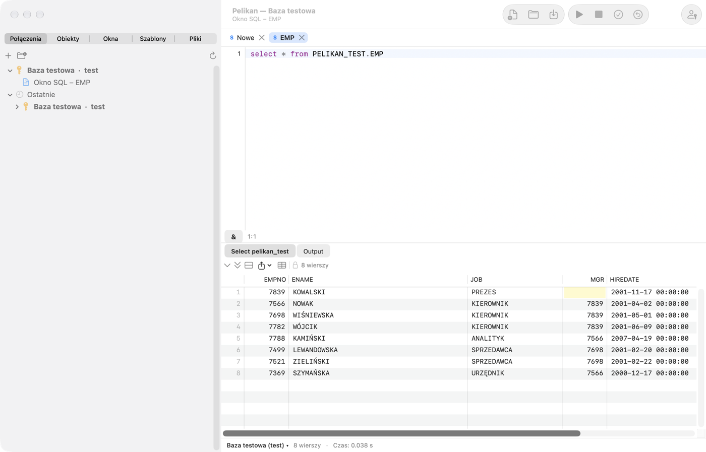

# Introduction and first launch

Pelikan is a native macOS environment for working with Oracle databases: writing and executing SQL, creating, testing
and debugging PL/SQL code, browsing and editing database objects, utPLSQL tests, and tools for comparison, export and
administration. The window layout and keyboard shortcuts follow PL/SQL Developer, so its users will find familiar
windows: **SQL Window**, **SQL*Plus Console**, **Program Window**, **Test Window**, **Explain Plan Window** and **Object
Browser** (the **Objects** tab).

The full list of commands with their current shortcuts is in the last chapter, **Keyboard shortcuts**, which is
generated by the application.

## How to use this manual

The manual is written so that even someone who is just starting to work with Oracle can follow it. Every feature is
described with the same layout:

- **What it is for** — what task it solves and which concepts you need to know;
- **When to use it** — typical situations from everyday work;
- **Step-by-step exercise** — numbered steps; after each step *Result:* tells you what you should see. If you see
  something else, stop and go back to the previous step;
- **Watch out** — typical mistakes and their consequences (marked ⚠️).

The exercises use the **practice schema** — a few tables and a package that you create with the script from the
**Practice schema** section below. It is best to read the chapters in order: 1 (this one), 2 (connections), 3 (SQL
Window), then as needed. Look up an unknown word in **Basic concepts** or in the glossary at the end of chapter 15.

## Basic concepts

A few words that appear throughout the manual:

| Concept | What it means |
|---|---|
| **Database** (Oracle instance) | The server that stores data and executes statements. You connect to it over the network. |
| **User** and **schema** | An account in the database (e.g. `SCOTT`). Objects created by a user belong to the schema of the same name. |
| **Object** | Something that lives in a schema: a table, view, index, sequence, package, procedure, function, trigger, type… |
| **Table** | Data in rows and columns, e.g. `PEL_EMPLOYEES`. |
| **View** | A saved query that can be read like a table. |
| **SQL** | The database's statement language: `SELECT` (reading), `INSERT`, `UPDATE`, `DELETE`, `MERGE` (changing data), `CREATE`, `ALTER`, `DROP` (changing objects — DDL). |
| **PL/SQL** | Oracle's programming language: `BEGIN … END` blocks, variables, loops, exceptions. PL/SQL code stored in the database is a **program** (package, procedure, function, trigger). |
| **Package** | A set of related procedures and functions: the **specification** (what it offers) and the **body** (how it does it). |
| **Session** | One connection to the database. Pelikan can have several sessions at once (chapter 13, *Session mode*). |
| **Transaction** | Data changes in a session that are not yet permanent. **COMMIT** makes them permanent (others see them), **ROLLBACK** undoes them. DDL statements (`CREATE`, `ALTER`, `DROP`) commit the open transaction by themselves. |
| **Compilation** | Storing a PL/SQL program in the database and having Oracle check it. A program with an error has the state *INVALID*. |
| **Connection** (in Pelikan) | A saved set of logon details: user, database, environment. |
| **Environment** | The label of a database: development, test, production. Colors and warnings depend on it. |

> ⚠️ **The most important rule:** practice and experiment only on a **development** or **test** database. On
> production (the company's real data) execute only what you understand and what has been agreed.

## Requirements

- A Mac with an Apple processor (M1 or newer) and macOS 27 or later.
- Oracle Instant Client for macOS (ARM64) — the Basic or Basic Light package. Pelikan does not include it (the Oracle
  license does not allow that), so you download it yourself from the Oracle website. Without Instant Client, the *Thin*
  driver works with limitations (see below).
- An Oracle database. Pelikan is developed and tested on Oracle Database 26ai Free; data dictionary queries have
  variants for versions 19c, 21c and 23ai. On older versions some folders and features may be unavailable.

## Installation

1. Download the latest release from the project page:
   [github.com/andrzejoles/Pelikan/releases](https://github.com/andrzejoles/Pelikan/releases) — a `.dmg` file or a
   `.pkg` installer.
2. From the `.dmg` image, drag **Pelikan** onto the **Applications** shortcut. The `.pkg` installer does this by itself.
3. Launch Pelikan from the Applications folder.

### Gatekeeper warning on first launch

Pelikan is signed with the author's own certificate (“Pelikan Self-Signed”), but it is not notarized by Apple (that
would require a paid developer account). Therefore, on first launch macOS blocks the application and shows a warning. To
open it:

1. Close the warning window.
2. Open **System Settings › Privacy & Security**, scroll to the **Security** section and click **Open Anyway** next to
   the message about Pelikan.
3. Confirm with your password or Touch ID.

You only do this once. The stable signature also means that after an update macOS does not ask again about Pelikan's
access to passwords in the Keychain.

## Oracle Instant Client

Download “Instant Client for macOS (ARM64)”, the **Basic** or **Basic Light** package, from
[oracle.com](https://www.oracle.com/database/technologies/instant-client/macos-arm64-downloads.html) and install it
according to Oracle's instructions. Pelikan looks for the `libclntsh.dylib` library in this order:

1. the directory set in **Settings › Oracle › Oracle Instant Client**;
2. `/opt/homebrew/lib`, `/usr/local/lib`, `/usr/local/oracle/instantclient` and the `/opt/oracle/instantclient*`
   directories;
3. `instantclient_*` directories in your **Downloads** and **Applications** folders (newest version first).

When searching the Downloads folder, macOS may ask whether to allow Pelikan to access it — this is an ordinary system
privacy prompt. If you prefer to avoid it, select the client directory manually: **Pelikan › Settings…** (⌘,), the
**Oracle** tab, the **Choose…** button. A directory change takes effect after Pelikan is restarted.

Without Instant Client you can connect using the *Thin* driver (selected in the connection definition, see the
*Connections* chapter). Thin does not support TCPS connections and Oracle Wallet, external authentication, changing an
expired password, or interrupting execution (**Break**).

## Getting started

### What it is for

Before you start working, Pelikan needs to know which database to connect to. This short tutorial takes you from an
empty program to your first query result. You need from the administrator or a teammate: a **user name**, a
**password** and the **database address** — in the form `host:port/service` (e.g. `dbdev.company.local:1521/DEVPDB`)
or an **alias** from the `tnsnames.ora` file (e.g. `DEV`).

### Exercise: first connection and first query

1. Click the **Connections** tab in the left column of the window, then the **+** button (or choose **Session ›
   Connections › New connection…**).
   *Result:* the **New connection** window opens.
2. In the **Name** field type a name by which you will recognize the database, e.g. `dev_my_db`. Enter the **User**,
   **Password** and **Database** (address or alias). As the **Environment** choose **Development**.
3. Click **Test**.
   *Result:* a “Connected:” message with a description of the database version. If you see an error, check the details
   — the most common causes and solutions are in chapter 15 (`ORA-01017` — wrong password or user, `ORA-12154` —
   unknown alias, `ORA-12541` — wrong host or port).
4. Check **Remember password in Keychain** if you do not want to type the password at every connection — it goes to the
   macOS Keychain, not to a file. Click **Save**.
   *Result:* the connection is in the list.
5. Double-click the connection in the list.
   *Result:* the connection name is shown in bold — it is now the **main connection**. New windows will use it. Its
   name is also in the title of the Pelikan window.
6. Open a new SQL Window: **File › New › SQL Window** or **⌘N**.
   *Result:* a new tab with the letter **S** and an empty editor. The status bar under the editor shows the connection
   name.
7. Type the query:

   ```sql
   SELECT sysdate, user FROM dual;
   ```

8. Press **F8** (or **⌘↩**).
   *Result:* a result tab with one row appears under the editor: the server's current date and time and your user
   name. The status bar shows the number of rows and the execution time.

Done — you can connect and execute a query. Next step: create the practice schema.



## Practice schema

### What it is for

The exercises in the manual work on a few small objects: the departments table `PEL_DEPARTMENTS`, the employees table
`PEL_EMPLOYEES`, the view `PEL_EMP_DETAILS` and the package `PEL_EMP_API` (salary, raise, hiring, list of a department's
employees). The `PEL_` prefix makes them easy to tell apart from your objects and to remove after learning. The sample
data (department and employee names) is in Polish — the exercises refer to it exactly as shown.

> ⚠️ The script creates objects in the schema of the user you are logged in as. Run it on **your own development or
> test schema** — never on production or on a schema shared with others without the team's consent. To create the
> objects you need the `CREATE TABLE`, `CREATE VIEW` and `CREATE PROCEDURE` privileges and space in a tablespace (you
> usually have them on a development schema).

### Exercise: creating the practice schema

1. Connect to the development database (previous exercise) and open a new SQL Window (**⌘N**).
2. Copy the whole script below into the window.
3. Select all the text (**⌘A**) and press **F8**.
   *Result:* Pelikan executes the statements one by one, and the **Output** tab under the editor shows a message about
   each of them. Statements are separated by semicolons, packages by a slash `/` on its own line.
4. Check the result with the query:

   ```sql
   SELECT * FROM pel_emp_details;
   ```

   *Result:* 9 rows — employees with their department name and city. Ewa Woźniak has no department, so those columns
   are empty.
5. Open the **Objects** tab in the left column and expand the **Tables** folder.
   *Result:* you see `PEL_DEPARTMENTS` and `PEL_EMPLOYEES`.

The script commits the data itself (COMMIT after INSERT), so it is visible in other windows too.

```sql
-- Practice schema of the Pelikan manual.
-- Run it on YOUR OWN development or test schema — never on production.
CREATE TABLE pel_departments (
  dept_id  NUMBER(4)    CONSTRAINT pel_departments_pk PRIMARY KEY,
  name     VARCHAR2(50) NOT NULL,
  city     VARCHAR2(50)
);

CREATE TABLE pel_employees (
  emp_id      NUMBER(6) GENERATED BY DEFAULT AS IDENTITY (START WITH 100)
              CONSTRAINT pel_employees_pk PRIMARY KEY,
  first_name  VARCHAR2(30) NOT NULL,
  last_name   VARCHAR2(30) NOT NULL,
  email       VARCHAR2(60) CONSTRAINT pel_employees_email_uk UNIQUE,
  hire_date   DATE DEFAULT SYSDATE NOT NULL,
  salary      NUMBER(8,2) CONSTRAINT pel_employees_salary_ck CHECK (salary > 0),
  dept_id     NUMBER(4) CONSTRAINT pel_employees_dept_fk REFERENCES pel_departments,
  manager_id  NUMBER(6) CONSTRAINT pel_employees_mgr_fk REFERENCES pel_employees
);

CREATE INDEX pel_employees_dept_ix ON pel_employees (dept_id);

CREATE OR REPLACE VIEW pel_emp_details AS
  SELECT e.emp_id, e.first_name || ' ' || e.last_name AS full_name, e.salary,
         d.name AS department, d.city
    FROM pel_employees e
    LEFT JOIN pel_departments d ON d.dept_id = e.dept_id;

INSERT INTO pel_departments VALUES (10, 'Księgowość', 'Warszawa');
INSERT INTO pel_departments VALUES (20, 'Informatyka', 'Kraków');
INSERT INTO pel_departments VALUES (30, 'Sprzedaż', 'Gdańsk');
INSERT INTO pel_departments VALUES (40, 'Kadry', NULL);

INSERT INTO pel_employees VALUES (1, 'Anna', 'Nowak', 'anna.nowak@example.com', DATE '2019-03-01', 12000, 20, NULL);
INSERT INTO pel_employees VALUES (2, 'Piotr', 'Kowalski', 'piotr.kowalski@example.com', DATE '2020-06-15', 9500, 20, 1);
INSERT INTO pel_employees VALUES (3, 'Maria', 'Wiśniewska', 'maria.wisniewska@example.com', DATE '2021-01-10', 8700, 20, 1);
INSERT INTO pel_employees VALUES (4, 'Tomasz', 'Wójcik', 'tomasz.wojcik@example.com', DATE '2018-09-03', 11000, 10, NULL);
INSERT INTO pel_employees VALUES (5, 'Katarzyna', 'Kamińska', 'katarzyna.kaminska@example.com', DATE '2022-02-14', 7200, 10, 4);
INSERT INTO pel_employees VALUES (6, 'Michał', 'Lewandowski', 'michal.lewandowski@example.com', DATE '2017-11-20', 13500, 30, NULL);
INSERT INTO pel_employees VALUES (7, 'Agnieszka', 'Zielińska', 'agnieszka.zielinska@example.com', DATE '2023-04-01', 6800, 30, 6);
INSERT INTO pel_employees VALUES (8, 'Paweł', 'Szymański', NULL, DATE '2024-07-08', 6500, 30, 6);
INSERT INTO pel_employees VALUES (9, 'Ewa', 'Woźniak', 'ewa.wozniak@example.com', DATE '2025-01-02', 7000, NULL, NULL);
COMMIT;

CREATE OR REPLACE PACKAGE pel_emp_api AS
  -- Salary of an employee; no such employee — NO_DATA_FOUND.
  FUNCTION get_salary(p_emp_id IN NUMBER) RETURN NUMBER;
  -- Raise by p_percent percent; a negative percent — error -20001. No COMMIT.
  PROCEDURE raise_salary(p_emp_id IN NUMBER, p_percent IN NUMBER);
  -- New employee; returns the new identifier. No COMMIT.
  FUNCTION hire(p_first_name IN VARCHAR2, p_last_name IN VARCHAR2, p_salary IN NUMBER,
                p_dept_id IN NUMBER) RETURN NUMBER;
  -- Lists the employees of a department through DBMS_OUTPUT.
  PROCEDURE print_department(p_dept_id IN NUMBER);
END pel_emp_api;
/

CREATE OR REPLACE PACKAGE BODY pel_emp_api AS
  FUNCTION get_salary(p_emp_id IN NUMBER) RETURN NUMBER IS
    l_salary pel_employees.salary%TYPE;
  BEGIN
    SELECT salary INTO l_salary FROM pel_employees WHERE emp_id = p_emp_id;
    RETURN l_salary;
  END get_salary;

  PROCEDURE raise_salary(p_emp_id IN NUMBER, p_percent IN NUMBER) IS
  BEGIN
    IF p_percent < 0 THEN
      raise_application_error(-20001, 'Podwyżka nie może być ujemna');
    END IF;
    UPDATE pel_employees
       SET salary = ROUND(salary * (1 + p_percent / 100), 2)
     WHERE emp_id = p_emp_id;
    IF SQL%ROWCOUNT = 0 THEN
      RAISE NO_DATA_FOUND;
    END IF;
  END raise_salary;

  FUNCTION hire(p_first_name IN VARCHAR2, p_last_name IN VARCHAR2, p_salary IN NUMBER,
                p_dept_id IN NUMBER) RETURN NUMBER IS
    l_emp_id pel_employees.emp_id%TYPE;
  BEGIN
    INSERT INTO pel_employees (first_name, last_name, salary, dept_id)
    VALUES (p_first_name, p_last_name, p_salary, p_dept_id)
    RETURNING emp_id INTO l_emp_id;
    RETURN l_emp_id;
  END hire;

  PROCEDURE print_department(p_dept_id IN NUMBER) IS
    l_total NUMBER := 0;
  BEGIN
    FOR r IN (SELECT first_name, last_name, salary
                FROM pel_employees
               WHERE dept_id = p_dept_id
               ORDER BY last_name) LOOP
      dbms_output.put_line(r.last_name || ' ' || r.first_name || ': ' || r.salary);
      l_total := l_total + r.salary;
    END LOOP;
    dbms_output.put_line('Razem: ' || l_total);
  END print_department;
END pel_emp_api;
/
```

The exercises with tests (chapter 8) also need a utPLSQL test package. Create it only when the utPLSQL framework is
installed in the database (chapter 8, *Installing utPLSQL in the database*):

```sql
CREATE OR REPLACE PACKAGE pel_emp_api_test AS
  --%suite(Testy pakietu pel_emp_api)

  --%test(get_salary zwraca pensję pracownika)
  PROCEDURE get_salary_returns_salary;

  --%test(raise_salary podnosi pensję o 10%)
  PROCEDURE raise_salary_ten_percent;

  --%test(Ujemna podwyżka zgłasza błąd -20001)
  --%throws(-20001)
  PROCEDURE raise_salary_negative;
END pel_emp_api_test;
/

CREATE OR REPLACE PACKAGE BODY pel_emp_api_test AS
  PROCEDURE get_salary_returns_salary IS
  BEGIN
    ut.expect(pel_emp_api.get_salary(1)).to_equal(12000);
  END get_salary_returns_salary;

  PROCEDURE raise_salary_ten_percent IS
  BEGIN
    pel_emp_api.raise_salary(2, 10);
    ut.expect(pel_emp_api.get_salary(2)).to_equal(10450);
  END raise_salary_ten_percent;

  PROCEDURE raise_salary_negative IS
  BEGIN
    pel_emp_api.raise_salary(2, -5);
  END raise_salary_negative;
END pel_emp_api_test;
/
```

### Removing the practice schema

When you finish learning, remove the practice objects (the first statement reports an error if you did not create the
test package — that does no harm):

```sql
DROP PACKAGE pel_emp_api_test;
DROP PACKAGE pel_emp_api;
DROP VIEW pel_emp_details;
DROP TABLE pel_employees PURGE;
DROP TABLE pel_departments PURGE;
```

## Main window

Pelikan has one main window:

- **Left column** with tabs: **Connections** (connection list with folders and recently used connections), **Objects**
  (Object Browser), **Windows** (list of open windows), **Templates** and **Files** (file browser).
  Drag its edge to widen the column (the left panel); hide and show it with the sidebar button at the left end of the
  title bar (right after the window buttons), with **View › Show or Hide Left Panel** or with **⌃⌘S**. Its state and
  width are kept in the window layout (**View › Save window layout**, layout autosave).
- **Document tabs** in the middle — each SQL, program, test or Explain Plan Window has its own tab with a colored type letter: S
  — SQL Window, P — Program Window, T — Test Window, C — SQL*Plus Console, E — Explain Plan Window, R — Report Window, D —
  diagram window, N — SQL notebook. A middle click on a tab closes the window; the tab menu closes the other windows or
  the windows to the left and right.
- **Toolbar** with the most frequent actions (new window, open, save, execute, break, COMMIT, ROLLBACK, log on) and the
  **Quick Access** group. You change the layout with **View › Customize Toolbar…**.
- The window's **status bar**: the window's connection (with the environment color, the 📌 pin and the “read only” mark),
  the transaction state (“● transaction open”), the number of rows and execution time, the cursor position and the
  file's Git branch. Clicking the connection name lets you change the window's connection.
- **Tool panels** on the right and at the bottom — tools (Sessions, Find Database Objects, To-Do Items, Clipboard
  History, this manual, table editors, export and import, reports and more) open in the right panel by default, each in
  its own tab. Drag a tab to the other panel or outside the panels — the tool then gets a separate window where you drop
  it; the tab menu and the buttons in the panel header do the same. A tool window goes back to a panel with the button
  in its title bar. Pelikan remembers the location of each kind of tool. A collapsed panel with tools shows a button
  with their number in the status bar. The commands are in **View › Tool Panels**; in **Settings › General › Tool
  Panels** you choose where new tools open (also separate windows) and turn on auto-hide. A docked tool's shortcuts
  (Return, Esc) work only while the cursor is in that tool.
- **Agent panel** on the right (collapsed by default) — the AI agent's terminal with a list of its actions. It is shown
  with **View › Agent panel** (see the *AI agents* chapter).

The window title shows the main connection and the active workset, and the subtitle shows the current window.

**Branch in the status bar:** clicking the Git branch (bottom right corner) opens a menu with **Open Other Files Changed
in Branch** (also **Tools › Git** and the ribbon **Tools › Git**). Pelikan opens the code files changed in the branch of
the active window's repository: committed since the fork point with the remote's default branch (`origin/HEAD`, without
it `origin/main` or `master`; without a remote — since the upstream branch), uncommitted and untracked. It skips deleted,
binary, ignored and already open files; a `.pks`/`.pkb` pair opens as one window. With more than 30 files it asks first;
the current window stays active.

## Tab groups

With many windows open, Pelikan divides the tabs into **groups**, and the tab bar shows only the tabs of the current
group. Groups appear as **capsules** in the title bar, between the window title and the buttons: the first line is the
group name, the second a detail and the number of windows (e.g. “main · 7”, “5 windows”). Clicking a capsule shows the
group's tabs and activates its most recently used window; the current group is outlined. When the capsules do not fit,
the last one — **»** — opens a list of all groups. With a single group there are no capsules. When the toolbar is
hidden or the window is in full screen, a small capsule of the current group sits at the start of the tab bar.

A window joins a group by these rules, in order:

1. **Manual group** — if you moved the window into one (it takes precedence over the other rules).
2. **Project** — a window with a file of the open Pelikan project.
3. **Repository · branch** — a file in a git repository that has a remote; a worktree with another branch is a separate
   group, and after a branch change (e.g. `git checkout`) the windows move to the new branch's group when you return to
   Pelikan. Repositories without a remote — by connection, as below.
4. The window's **connection**; windows without a connection — the **No connection** group at the end.
5. When all the remaining windows use **one database**, the connection groups are replaced by groups by window type:
   **SQL Windows**, **Programs**, **Tests**, **SQL*Plus Consoles** and **Other windows**. Pelikan switches to connection
   groups only when the second database has more than one window — a single window on another database does not
   rearrange the whole bar.

The order of the capsules is fixed: manual groups (in creation order), project, repositories and connections
alphabetically (or window types), “No connection” at the end. Tabs within a group are in opening order.

A window activated from anywhere (Object Browser, error list, Window List, debugger, opening a file, an agent) switches
the group by itself. **⌃Tab** and **⌃⇧Tab** (Next / Previous Window) move through the windows of the current group,
and after the last one to the first window of the next group (every window is reachable),
**⌃⌘]** and **⌃⌘[** — **Next Tab Group** / **Previous Tab Group**, and **Window › Show Tab Group…** picks a group from a
list. **Window › Tabs of All Groups** (also in the capsule menu and the **»** list) shows the tabs of all groups in the
bar. The Window List (the **Windows** tab of the left column, **View › Window List**) shows the windows in a tree by
group; clicking a group shows it.

**Manual groups:** tab menu › **Move to Group › New Group…** or an existing group; **Remove from Manual Group** returns
the window to the automatic groups. The capsule menu of a manual group has **Rename…** and **Ungroup**. Manual groups
and connection colors are saved in the workset. Tabs are not dragged onto capsules — use the tab menu.

**Tabs** have two lines: the environment color dot, the type letter, the title and the close button (a dot — unsaved
changes), and below them always the window's connection (a window without a connection — gray “No connection”); the full
name is in the tooltip. The tab background has the connection's palette color (see *Connections › Environments and
protection against mistakes*): the active tab has a stronger background, a thick underline in the connection color and a
bold title. When the tabs do not fit in one row, **‹** and **›** buttons appear at the sides of the bar; you also scroll
the bar with the mouse wheel or a trackpad gesture, and the active tab is always visible.

## Ribbon and “Search actions”

Below the toolbar is the **ribbon** — every action in one click, without searching menus or remembering shortcuts. The
standard tabs are **Start** (new windows, files, execution, COMMIT and ROLLBACK, connection, search), **Edit**,
**Objects**, **Debug and test**, **Tools**, **Reports** and **View**. With a program, query result, diagram, report,
notebook or plan window or the SQL*Plus Console a coloured **contextual tab** appears (e.g. **Program** with compilation, units,
comparison with the source in the database and tests). The ribbon remembers which tab you chose for each kind of window
and returns to it when you switch windows.

Frequent actions have large buttons, others small ones; rarer ones are in the groups' drop-down lists (marked ▾). A
button's tooltip shows its description and shortcut, so you learn shortcuts along the way. Right-click a button to add
the command to the quick access group. Double-click a tab or use the arrow on the right to collapse the ribbon to its
tabs; **View › Ribbon** hides it (also in **Settings › General › Ribbon**). When the window is narrow and a ribbon
tab does not fit, **‹ ›** buttons appear at its sides — they scroll to the edge of the next group; the mouse wheel and
trackpad scroll it too. The row of ribbon tabs scrolls the same way when it does not fit next to the search field.

The **Search actions…** field to the right of the tabs finds any command — type a few letters: “plan”, “export tables”,
a word without Polish diacritics, or an English name known from PL/SQL Developer, e.g. “beautifier”, “compile invalid”.
Results show where the command is on the ribbon, its shortcut and whether it is available now; Return or a click runs it.

## Command palette

Every action in Pelikan is a command: it has a menu item, an optional shortcut and a description of its effects. The
**command palette** (**View › Command palette…**, ⇧⌘P) searches commands by name and shows which menu they are in and
what shortcut they have. It is the fastest way to find a feature whose menu location you do not remember.

## Keyboard profiles

Pelikan has two shortcut profiles: **PL/SQL Developer** (F and Ctrl keys — e.g. F8 executes, F9 starts debugging) and
**macOS** (⌘ shortcuts). In both profiles the ⌘ equivalents work, e.g. ⌘↩ executes a statement. You choose the profile
in **Settings › Keyboard**. If the F1–F12 keys control brightness or volume, enable the option to use them as
standard function keys in System Settings, or press them together with the fn key.

## Updates

Once a day Pelikan checks whether there is a new release and offers to install it. You can also check manually:
**Pelikan › Check for updates…**. Every release is signed with the author's key — the application will not accept a file
from another source. Settings, connections and passwords stay unchanged.

## Languages

The interface is available in Polish, English, German, Spanish and Ukrainian. You choose the language in **Settings ›
General › Interface language**; the change takes effect after a restart. The names of some windows and tools (e.g.
Explain Plan, Large Data Editor, Query Builder) stay in their original form.

## Where Pelikan keeps its data

Connection definitions (without passwords), settings, history, worksets, local file history, the agent log and other
application data are in the `~/Library/Application Support/Pelikan` directory. Passwords are kept only in the macOS
Keychain — see the *Security and privacy* chapter.

## Help

- **Help › Pelikan Help** (⇧⌘/) opens this manual.
- **F1** in the editor opens the Oracle documentation for the word under the cursor (error code, package, dictionary
  view, SQL statement).
- **Help › Oracle Documentation…** searches the Oracle manuals of the selected version.

## About

Pelikan is an open project under the MIT license:
[github.com/andrzejoles/Pelikan](https://github.com/andrzejoles/Pelikan). Author: Andrzej Oleś w kooperacji z Claude AI.
The licenses of the libraries used are in the “Licencje zewnętrzne” (third-party licenses) file included with the
application.
