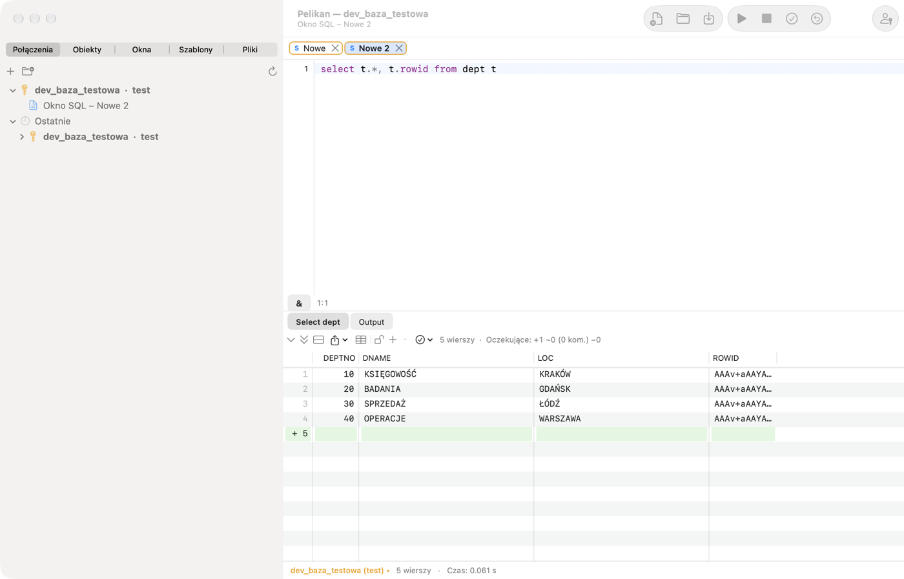
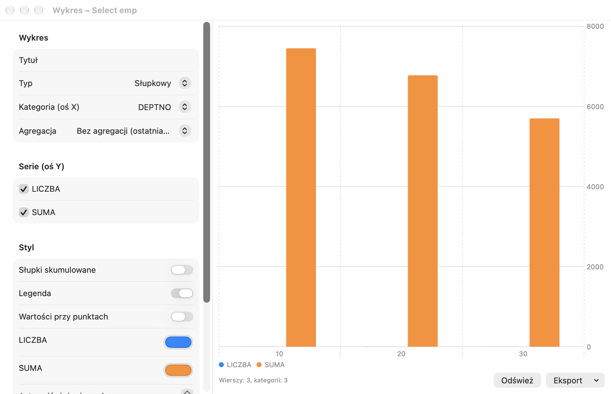

# SQL Window and result grid

## What it is for

The **SQL Window** is where you talk to the database: you type a SQL statement (e.g. a `SELECT` query), execute it and
look at the result. It is Pelikan's most used window — in it you check data, fix a row, prepare a report or run a
deployment script. The result of each query appears on a separate tab below the editor, and database messages and
DBMS_OUTPUT output on the **Output** tab. You open a new window with **File › New › SQL Window** (⌘N); the window works
on the main connection or on the connection selected in the status bar.

**When to use it:** whenever you want to execute SQL or a short PL/SQL block. For writing packages and procedures use
the Program Window (chapter 6), for testing programs with parameters — the Test Window (chapter 7), and for SQL*Plus
scripts with `SET`, `SPOOL`, `PROMPT` commands — the SQL*Plus Console (chapter 4).

The exercises in this chapter use the practice schema from chapter 1.

## Executing statements

| Action | Shortcut | Menu |
|---|---|---|
| Execute the selection or the statement under the cursor | F8, ⌘↩ | Session › Execute |
| Execute opposite to AutoSelect (e.g. the whole script) | ⌃F8, ⇧⌘↩ | Session › Execute (opposite of AutoSelect) |
| Break execution or fetching | ⇧⎋, ⌘. | Session › Break |
| Commit the transaction | F10, ⌥⌘↩ | Session › Commit (COMMIT) |
| Roll back the transaction | ⇧F10, ⌥⌘⌫ | Session › Rollback (ROLLBACK) |
| Previous / next statement of the window | ⌥⌘↑, ⌥⌘↓ | Session › Window history |

**AutoSelect** is enabled by default: without a selection, F8 executes only the statement the cursor is in, so you will
not run the whole script by accident. Selected text is executed as a whole. Statements are split as in SQL*Plus: a
semicolon ends an SQL statement, and a PL/SQL block or a `CREATE` with a body is ended by a slash `/` on a separate
line. Each query of a script gets its own result tab.

Note: on macOS the ⌃F8 shortcut is taken by the system by default (moving focus to the status menus) — use ⇧⌘↩ or turn
off the system shortcut in **System Settings › Keyboard › Keyboard Shortcuts**.

During execution the window is locked for editing, and the status bar shows “Executing…”. When it finishes, the number
of rows and the time are shown; a time longer than 100 seconds is formatted as hh:mm:ss. After a long query Pelikan can
play a sound and bounce its icon in the Dock. When **Break** does not work (some database operations do not respond to
interruption), use **Session › Terminate window session (Kill)**.

Pelikan never commits changes automatically (the **AutoCommit SQL statements** option in **Settings › SQL Window** is
off by default). An open transaction is indicated in the status bar (“● transaction open”).

> **Exercise: one statement or the whole script.**
> 1. Open a new SQL Window (⌘N) and type three queries, each on its own line:
>
>    ```sql
>    SELECT * FROM pel_departments;
>    SELECT * FROM pel_employees WHERE dept_id = 20;
>    SELECT COUNT(*) FROM pel_employees;
>    ```
>
> 2. Click in the second line and press **F8**.
>    *Result:* only the second query runs — one result tab with the three employees of department 20 (AutoSelect).
> 3. Press **⇧⌘↩** (execute opposite of AutoSelect).
>    *Result:* all three queries run; there are three result tabs under the editor.
> 4. Select the first two lines with the mouse and press **F8**.
>    *Result:* the two selected queries run — a selection always takes precedence over AutoSelect.
>
> ⚠️ **Watch out.** With AutoSelect off, F8 without a selection runs the whole script — including `DELETE` or `DROP`
> statements left in the window “for later”. Keep in the window only what you want to execute.

## Code Contents

On the left of the editor, **Code Contents** shows the structure of the whole script: SQL statements (the first
word and the beginning of the statement, up to about 1000 characters with line breaks in the tooltip), procedures, functions, packages and triggers
from `CREATE`, and anonymous blocks with their declarations. A click or Enter moves the cursor to the statement, the
tree tracks the cursor, and the field above the tree also filters by statement text (e.g. a table name). Show or
hide the panel in this window with **View › Code Contents** or the indented-list button at the left end of the window
bar; the choice stays with the window, and the default for new windows is **Settings › Editor › Code Contents visible by default**. The SQL*Plus console has no such panel. In a script with more than 5000 SQL statements, the panel shows only PL/SQL
units and blocks (with a note giving the number of statements).

In anonymous blocks and units of the script the panel also shows **control structures** (IF, loops, CASE,
exception handlers — see the program window chapter); the branch button next to the filter hides them.

## Variables

- **Substitution variables** `&name` and `&&name` — before execution Pelikan shows the **Variables** window with fields
  for the values. In the SQL Window `&&` in text means an ordinary `&` character (e.g. `'R&&D'`); in the SQL*Plus Console
  `&&` works as in SQL*Plus (the variable is remembered).
- **Bind variables** `:name` — also go to the variables window (`:new` and `:old` in triggers are skipped).
- **JasperReports report parameters** `$P{…}`, `$P!{…}` and `$X{IN, column, parameter}` — Pelikan recognizes them and
  asks for values, so you can execute a query from a report without rewriting it.
- The extended syntax `&<name="…" type="…" list="…" default="…" required="…">` lets you describe a variable: its type, a
  list of values (also from a query that depends on other variables), a default value, whether it is required, and other
  options.

Variable values are remembered in the window. The **&** button on the bar below the editor (**Session › Variable
substitution**) turns substitution off when the text contains `&` and `:` characters with another meaning.

**What it is for:** a variable lets you write a query once and run it with different values — without rewriting the
condition. **Bind variables** (`:name`) are also safer and faster for the database than pasting values into the text.

> **Exercise: a query with a parameter.**
> 1. In a SQL Window type and execute (F8):
>
>    ```sql
>    SELECT first_name, last_name, salary FROM pel_employees WHERE dept_id = :dzial;
>    ```
>
>    *Result:* the **Variables** window appears with a `dzial` field.
> 2. Type `30` and confirm.
>    *Result:* three rows — the employees of the Sprzedaż (sales) department.
> 3. Execute the query again.
>    *Result:* the Variables window remembers the value `30`; change it to `10` — you will see the Księgowość
>    (accounting) department.

## Directives in comments

A comment directly before a statement can control its result:

| Directive | Effect |
|---|---|
| `-- Tab=Employees` | title of the result tab; `&Count` inserts the number of rows |
| `-- Records=all` | how many rows to fetch at once: a number, `page` or `all` |
| `-- Totals=sum:SAL;count:EMPNO` | totals and other functions below the grid |
| `-- AltRowColor=…` | color of alternating rows |
| `-- Excel=report_%date%.xlsx` | save the whole result to an Excel file |
| `-- CSV=%dbuser%_%time%.csv` | save the whole result to a CSV file |

In file names you can use `%dbuser%`, `%dbname%`, `%date%`, `%time%` and `%&variable%`. A relative path is resolved from
the directory of the window's file.

Example — a result tab with a name and the salary total under the grid:

```sql
-- Tab=Employees (&Count)
-- Totals=sum:SALARY
SELECT first_name, last_name, salary FROM pel_employees;
```

## Result grid



Directly above the result is the **result action bar** — icons for every action on the result, grouped as on the
**Result** ribbon tab: fetching, data editing, filter and QBE, copy and export, analysis (graph, totals, record, value
panel) and result tabs; drop-down lists have a ▾ arrow. An icon's tooltip shows its name, description and shortcut.
When the bar does not fit, the remaining actions are in the **»** menu; the row count is on the right.

The grid fetches rows in batches (you set the number in **Settings › SQL Window › Rows per page**) and fetches more
while you scroll. The “(more…)” label next to the row count means that the result is not complete. **Next page** (⌘⇟)
and **Last page (fetch all)** (⇧⌘⇟) are in the **Session › Result** menu and on the bar above the grid. For very large
results Pelikan asks before the size limit from Settings is exceeded.

- **Sorting** — click a column header (ascending, descending, unsorted) on the fetched rows.
- **Selecting** — rows, columns and blocks of cells (click, then ⇧+click).
- **NULL** has a colored background; numbers are shown with full Oracle precision.
- **CLOB, BLOB, XML, long texts** — the button in the cell or **Edit › Result › Large Data Editor…** (⌥⌘L) opens the
  large data editor with text, XML, JSON, HTML, image, PDF and hex views, JSON/XML formatting and saving to a file.
- The **Value panel** (**View › Value panel**, ⌥⌘V) shows the current cell next to the grid as text, JSON, XML, HTML, an
  image or hex. A CLOB is fetched in full (also from queries without ROWID: views, joins, functions); a binary value
  (BLOB) only on request: **Fetch All** or save to file. Panel buttons and the grid context menu: **Save Cell Value to
  File…** (full value, read from the database in chunks) and **Open Cell Value in External Application** (text in the
  external editor from Preferences, e.g. BBEdit; changes are not written back). Binary data recognised by content (PDF, images, Office documents, archives) — **Preview** mode (Quick Look).
- **Single record view** shows the current row vertically with the column types and comments. The button in the bar
  above the grid or **Record** on the **Result** ribbon tab turns it on and off; each result tab keeps its own state.
- A **nested cursor** (`CURSOR(…)` in a query) opens in a new result tab.
- **Column Filter…** hides columns by name, type, nullability and keys; hidden columns are skipped when copying and
  exporting.
- **Filter by cell value**, **Filter by expression…** (`=`, `<>`, `<`, `>`, `LIKE`, `IS NULL`, `AND`, `OR`) and **Group
  by column** (with counts; a double-click filters) work locally, on the fetched rows.
- **Column Totals…** calculate the sum, count, average, minimum and maximum below the grid and remember them after
  re-execution.
- **Compare records** puts the selected rows side by side column by column, and **Compare results** — two result tabs.
- **Linked queries…** open the parent and child tables of the current row (from foreign keys) in a new window.
- **Refresh Result** (⇧⌘R) re-executes the tab's statement, and **Auto Refresh…** does it every given number of seconds.
- **Pin Result** keeps the tab at the next execution (also ⇧+click on the tab).
- You change the grid font size in **View › Grid**.

Most of these actions are in the grid's context menu and in **Edit › Result** or **Session › Result**.

> **Exercise: working with a result.**
> 1. Execute `SELECT * FROM pel_emp_details;`.
>    *Result:* 9 rows.
> 2. Click the **SALARY** column header twice.
>    *Result:* the first click sorts ascending, the second descending; Michał Lewandowski (13500) is at the top.
> 3. Right-click the `Informatyka` cell in the **DEPARTMENT** column and choose **Filter by cell value**.
>    *Result:* three rows of the Informatyka (IT) department remain. The filter works on the fetched rows, without
>    querying the database again; you remove it from the bar above the grid.
> 4. Right-click the **SALARY** column, choose **Column Totals…** and check sum and average.
>    *Result:* the sum and the average salary of the visible rows are shown under the grid.
> 5. Select a few rows, press **⇧⌘C** (copy with header) and paste into Numbers or Excel.
>    *Result:* the data in columns, with headers.
>
> ⚠️ **Watch out.** Sorting, filters and totals work on the **fetched** rows. If the result shows “(more…)”, some rows
> are not fetched yet — fetch all (⇧⌘⇟) or add a condition to the query.

## Editing data in the grid

To edit a result, the query must return the `ROWID` column, e.g.:

```
select t.*, t.rowid from dept t
```

The simplest way is **Edit data** from the table's menu in the Object Browser — Pelikan prepares such a query by itself.

1. Click the padlock above the grid or choose **Session › Result › Edit data** (⌥⌘E).
2. Change cells, add rows (**Insert record**, ⌥⌘I) and delete them (**Delete record**, ⇧⌘⌫). Pending changes are marked
   in the row header (+, ~, −) and with color; the counter above the grid shows their number. Columns with an alias and
   expressions are read-only. For DATE columns a **Calendar…** is available, and for columns with a `CHECK … IN`
   constraint or a foreign key to a small table — a **Value List…**.
3. **Copy change SQL** shows the statements that will be executed.
4. **Apply changes (Post)** (⌥⌘S) sends the changes to the database — without COMMIT. After an error, the cursor moves
   to the cell concerned. **Discard changes** throws away all pending changes.
5. Commit the transaction (F10, ⌥⌘↩) or roll it back.

On a production connection saving requires confirmation, and on a read-only connection it is blocked.

> **Exercise: add a department through the grid.**
> 1. Execute `SELECT t.*, t.rowid FROM pel_departments t;`.
>    *Result:* 4 departments.
> 2. Click the padlock above the grid (or ⌥⌘E).
>    *Result:* the padlock is open and the cells can be edited.
> 3. Choose **Insert record** (⌥⌘I) and type `50`, `Logistyka`, `Poznań`.
>    *Result:* the new row has a **+** mark in its header, and the counter above the grid shows 1 pending change.
> 4. Choose **Copy change SQL**.
>    *Result:* the clipboard holds an `INSERT INTO … PEL_DEPARTMENTS …` statement — this is how Pelikan will save the
>    change.
> 5. Press **⌥⌘S** (Apply changes).
>    *Result:* the **+** mark disappears and the status bar shows “● transaction open” — the change is in the database
>    but not committed yet.
> 6. Press **⇧F10** (ROLLBACK), then **⇧⌘R** (refresh result).
>    *Result:* department 50 is gone — the change was rolled back. To keep it, press F10 (COMMIT) instead of ROLLBACK.

## Copying and exporting

- **Edit › Result › Copy with header** (⇧⌘C), **Copy header**, **Copy as expression list** (for `IN (…)`), **Copy to
  Excel**, and in the grid's context menu also **Copy as** (a chosen format).
- **File › Export result…** saves the selection or the whole fetched result as CSV, TSV, HTML, XML, SQL (INSERT), an
  expression list or Excel (xlsx).
- **Session › Result › Export Query to File…** executes the statement under the cursor and saves the result directly to
  a file, without displaying it — convenient for large results.
- **File › Export result › Column to files…** saves a column's value (e.g. a BLOB) to a separate file for each row.
- **Generate SQL from rows…** creates INSERT, UPDATE, DELETE or MERGE statements for the selected rows in a new SQL
  Window, without executing them.
- **File › Print…** (⌘P) prints the window's code with syntax colors and the grid (the selected or all fetched rows).

> **Exercise: export to Excel.**
> 1. Execute `SELECT * FROM pel_emp_details;`.
> 2. Choose **File › Export result…**, pick the Excel (xlsx) format and save the file on the desktop.
>    *Result:* the file opens in Excel or Numbers; salaries are numbers (they can be summed), and the headers are the
>    column names.

## Charts

**Session › Result › Chart…** opens a chart window from the current result tab. Choose the type (bar, line, area,
scatter or pie), the category column (X axis), the series (Y axis) and an optional aggregation; set colors, the legend
and values next to the points. You can save a chart template, and export the chart to PNG, PDF or the clipboard.
**Refresh** re-executes the SQL Window's query.



> **Exercise: salaries by department as a chart.**
> 1. Execute:
>
>    ```sql
>    SELECT department, SUM(salary) AS total FROM pel_emp_details GROUP BY department;
>    ```
>
> 2. Choose **Session › Result › Chart…**, bar type, category **DEPARTMENT**, series **TOTAL**.
>    *Result:* a bar for each department; Informatyka has the highest.

## Query By Example

**Session › Result › Query By Example…** (⇧⌘E) lets you narrow down a result without writing WHERE: enter criteria under
the column names — a value, a pattern with `%`, an operator (`>`, `<>`…), `in (…)`, `between … and …` or `null` — and
Pelikan executes the query again with the conditions. Text comparison is case-insensitive, and dates are compared
without time. **Clear Query By Example** restores the original query.

> **Exercise: QBE.**
> 1. Execute `SELECT * FROM pel_employees;` and press **⇧⌘E**.
> 2. Under the **SALARY** column type `> 10000`, under **LAST_NAME** — `%ski`.
>    *Result:* after confirming one row remains — Michał Lewandowski (13500). Piotr Kowalski also ends in “ski”, but
>    earns 9500. QBE added both conditions to the query at once (joined with AND).
> 3. Choose **Clear Query By Example**.
>    *Result:* all rows again.

How QBE compares text and dates is set in **Settings › SQL Window › Query By Example** (chapter 13).

## Statistics and plan

When enabled in **Settings › SQL Window › Statistics**, the **Statistics** tab shows the change in session statistics
(V$MYSTAT) for each execution. **Tools › Explain Plan** (F5) shows the plan of the statement under the cursor, and
**Tools › Autotrace** executes it and shows the actual plan — see the *Execution plan, sessions and administration*
chapter.

## Files and history

- **File › Save** (⌘S) saves the window to a `.sql` file; files keep their encoding and line endings.
- **Edit › Command history…** (⇧⌘H, in the PL/SQL Developer profile ⌃E) shows all executed statements from all windows
  (without statements containing passwords) with a filter; you insert the chosen ones into the editor.
- **File › Paste as New SQL Window** creates a window with the clipboard contents.
- The local history of a file (**File › Local history**) is described in the *Tools* chapter.
