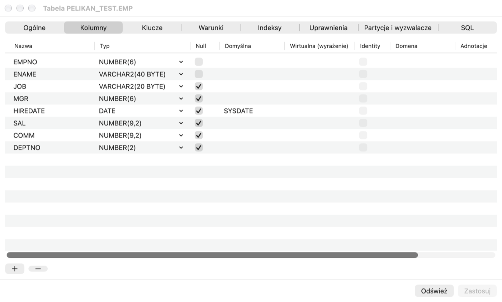
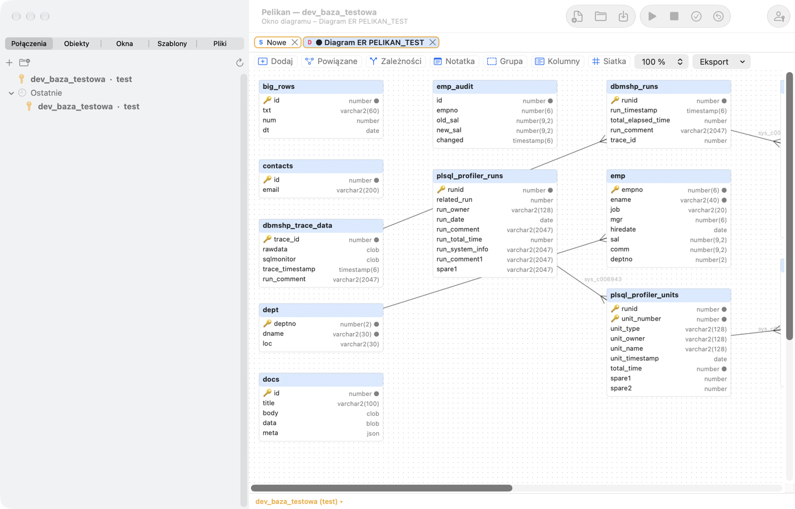

# Object Browser and object editors

## What it is for

A database contains hundreds or thousands of objects: tables, views, packages, indexes. The **Object Browser** shows
them in a tree, as Finder shows files — you can browse them, search, open them for editing, look at their data and
structure. **Object editors** let you create and change objects in a form, without writing `CREATE` and `ALTER`
statements by hand — Pelikan shows the generated SQL before executing it, so you learn the syntax along the way.

**When to use it:** when you want to check which columns a table has, who uses a package, which objects are invalid
after a deployment, or to add a column or an index.

## Object Browser

The **Objects** tab in the left column shows the database objects of the open connections in folders by type:
**Functions**, **Procedures**, **Packages**, **Package bodies**, **Types**, **Triggers**, **Java sources**,
**Libraries**, **Tables**, **Views**, **Materialized views**, **Sequences**, **Synonyms**, **Indexes**, **Database
links**, **Queues**, **Jobs (Scheduler)**, **Users**, **Roles**, **Profiles**, **Directories** and others. On 23ai and
26ai databases, **MLE modules**, **MLE environments**, **Domains**, **Property graphs**, **Annotations** and
**Assertions** are added. Folders appear only when the database version and your privileges allow it.

The top level of the tree shows the **open connections**, as in DBeaver. Connections are sorted alphabetically; the
main one is marked with a star, in bold and labelled “main”; the others appear once connected (for example through a
window on another connection or **Connect** in the connection list) and disappear when disconnected. Each connection
has its own folders, **Recent** and user selection. Actions on an object (Query Data, Edit, DDL, Recompile, dragging
into the editor…) work on the branch's connection, and windows opened for an object of a connection other than the
main one are pinned to it. The connection menu in the tree: **Set as Main Connection**, **New SQL Window on This
Connection**, **Refresh**, **Edit Connection…** and **Disconnect**. The main connection is the default only when the
context does not tell otherwise — a new window from the menu, a tool without an active window.

At the end of each connection's folders are **DBA** — dictionary objects prefixed `DBA_` — and **DBMS** — objects
prefixed `DBMS_`, mostly Oracle packages. They show only objects you have privileges on (granted directly, through a
role or to PUBLIC); public synonyms are left out, and objects of the SYS schema are shown without the “SYS.” prefix.
The objects expand and open as in the other folders, and the name filter applies too. Changing an object of an
Oracle-maintained schema (SYS, XDB…) — recompiling, adding debug information, dropping, renaming, enabling or
compiling in a program window — always requires a separate confirmation (**Cancel** by default), because it can
invalidate objects across the whole database.

- **User selection** above the tree (separately for each connection):
  - *Current user* — objects of your schema plus public database links and public synonyms of application objects
    (without the thousands of synonyms to Oracle's system schemas);
  - *Accessible objects* — everything you can use: your own objects, objects of other schemas you have privileges on
    and public ones (with the owner before the name);
  - *All users* — objects of all schemas (with DBA views when you have access to them, also private database links of other schemas — the latter also when you can read just
    `DBA_DB_LINKS`; another schema's private link is not “accessible” to you, because only its owner can use it);
  - a specific schema.
  The **Directories** folder (Oracle directories have no schema owner) shows all directories in every mode when you
  have access to DBA views, and otherwise those you have privileges on.
  Set the scope after connecting in **Settings › Object Browser › After connecting, show**.
- **Filter** below the user selection: part of a name (matched anywhere in the name — `emp` finds `EMP` and
  `T_EMP_HIST`), a pattern with `%` (e.g. `EMP%` — only the start of the name; change the behaviour without `%` in
  **Settings › Object Browser**), several comma-separated patterns, `status=invalid`
  (only invalid objects) or `source=text` (objects whose source contains the text).
- Expanding an object shows its elements: columns with types, constraints, indexes, triggers, partitions, subprograms,
  attributes, and also dependencies (**Depends on**, **Used by**).
- The **Recent** folder contains recently opened objects.
- Invalid objects have a red mark.
- **Refresh** in the menu (or **Tools › Object › Refresh Object Browser**) clears the dictionary cache and reloads the
  tree.

The tree works smoothly even in schemas with tens of thousands of objects — the dictionary is read in the background.

> **Exercise: get to know the practice table.**
> 1. Click the **Objects** tab in the left column.
>    *Result:* a tree with the main connection at the top and object type folders under it.
> 2. Type `pel` in the **Filter** field.
>    *Result:* only objects with “PEL” in the name remain in the folders.
> 3. Expand **Tables › PEL_EMPLOYEES**.
>    *Result:* you see the columns with their types, constraints (primary key `PEL_EMPLOYEES_PK`, unique e-mail, salary
>    CHECK, foreign keys), indexes and dependencies.
> 4. Expand **Used by**.
>    *Result:* the view `PEL_EMP_DETAILS` and the package `PEL_EMP_API` — the objects that stop working if you drop or
>    change this table.
> 5. Type `status=invalid` in the **Filter** field.
>    *Result:* the list of invalid objects — right after creating the practice schema it should be empty.

### Object menu

Right-click an object (or click with ⌃). Depending on the object type, the menu contains:

- **Show data** — a SQL Window with a query of the table or view data; **Standard queries** — your saved query templates
  for tables;
- **Edit data** — table data with `ROWID` in editing mode;
- **Edit** — a program's source in a Program Window, a view in a SQL Window, and a table, sequence, synonym, index, user
  or role — in an object editor;
- **DDL** (a script from DBMS_METADATA in a new window), **Description** (columns, parameters, package elements),
  **Properties**;
- **Test** — a Test Window with a call of the procedure or function (see the *Test Window, debugger and profiler*
  chapter) and **Standard Test…**;
- **Add source to editor** — inserts the source or DDL at the cursor position of the active window;
- **Recompile**, **Enable** / **Disable** (triggers, constraints), **Conditional compilation flags…**, **Rename…**,
  **Duplicate…** (a copy script in a new window, without executing it), **Drop object…** (after confirmation);
- **Generate code** — SELECT, INSERT, UPDATE, DELETE with columns or a procedure call, also as a Java JDBC or Python
  snippet;
- **Copy name**.

On a table column or constraint the menu has **Rename item…**. When you select several objects (⌘+click or ⇧+click), the
menu offers common actions: **Copy comma-separated names** (also ⌘C), **DDL of selected**, **Recompile selected** and
**Drop selected…**.

> **Exercise: data, DDL and ready code from the menu.**
> 1. Right-click **PEL_DEPARTMENTS** and choose **Show data**.
>    *Result:* a new SQL Window with a query and its result — 4 departments.
> 2. Right-click **PEL_EMPLOYEES** and choose **DDL**.
>    *Result:* a new window with the `CREATE TABLE` statement that recreates the table — this is how you check the
>    exact definition of an object.
> 3. Right-click **PEL_EMPLOYEES** and choose **Generate code › INSERT**.
>    *Result:* an INSERT statement with all columns appears — just fill in the values.
>
> ⚠️ **Watch out.** **Drop object…** and **Recompile** act on the database at once (after confirmation). Dropping a table
> cannot be undone with ROLLBACK — only the Recycle Bin (below) can help, if it is enabled in the database.

Other operations on the selected object are in the **Tools › Object** menu: among others **Add debug information**,
**Edit table definition**, **View editor**, **Compare with active window**, **Compare with object in another
database…**, **Refresh materialized view**, **Test database link**, **Run job**, **Start queue** / **Stop queue**, **Add
to Folder…** and **Run utPLSQL tests**.

### Dragging

Drag an object into the editor to insert its name. With the ⌃ key (or when “Ask” is selected in Settings), a menu
appears after dropping: name, name with owner, column list, SELECT, INSERT, UPDATE, DELETE, call or DDL. Dropping an
object on the empty window area performs the action from **Settings › Object Browser** (e.g. Edit or Show data).
Dragging a folder inserts the names of its objects separated by commas.

### Filters and custom folders

In **Settings › Object Browser** you set:

- visible folders and their order, and the double-click action for each type;
- **Named filters** — a `WHERE` condition and `ORDER BY` on the object view (alias `o`, variables `:browser_user` and
  `&browser_filter`), optionally for a selected user and as the default filter. You apply a filter with **Tools › Object
  Browser › Named Filter…**;
- **User folders** — your own groups of objects from a list or from a query (columns `OWNER`, `OBJECT_NAME`,
  `OBJECT_TYPE`), with a color, a parent folder and a pattern of the connections on which they should be visible.

## Searching for objects and compiling

- **Tools › Find database objects…** (⇧⌘O) searches PL/SQL sources (also MLE modules), view queries, table definitions
  and object names. It supports regular expressions, whole words and case sensitivity, runs in the background and can be
  interrupted. Double-clicking a result opens the object at the line of the match. You can save the criteria and export
  the result to CSV.
- **Tools › Compile invalid objects…** shows the invalid objects of the schema and compiles them in dependency order
  until nothing changes any more; compilation errors are in the list.

> **Exercise: who uses the SALARY column?**
> 1. Press **⇧⌘O** (Find database objects), type `salary` and start the search.
>    *Result:* a list of places in sources and definitions where the word `salary` appears — among others the body of
>    the `PEL_EMP_API` package.
> 2. Double-click the hit in `PEL_EMP_API`.
>    *Result:* a Program Window with the package body, the cursor on the line with the hit.
>
> This is how, before changing a column, you check which code will need fixing.

## Table editor

You create a new table with **File › New › Table…**, and open an existing one with **Edit** from the table's menu (or
**Tools › Object › Edit table definition**).

Editor tabs:

- **General** — name, tablespace (a change moves the table and rebuilds the indexes), storage parameters, compression,
  logging, cluster, temporary table, index organization (IOT) or external table, Row Archival, comment. Changes that
  require a rebuild are performed by **Recreate table**, with the transfer of data, triggers and other tables' foreign
  keys.
- **Columns** — name, type (with suggestions), NULL, default value (also `ON NULL`), virtual column, identity, invisible
  column, comment; on 23ai also domain and annotations. A button adds foreign key columns based on the primary key of a
  given table.
- **Keys** (primary, unique, foreign with `ON DELETE`), **Conditions** (CHECK) and **Indexes** (normal, unique, bitmap,
  function-based, descending, compressed, reverse, invisible, local).
- **Privileges** — grantee, privilege and grant option; Pelikan derives GRANT and REVOKE statements from the
  differences.
- **Partitions and Triggers** — when creating, RANGE (also with INTERVAL), LIST and HASH partitioning, and HASH
  subpartitions; in an existing table, adding, renaming and dropping partitions. Changing the partitioning method
  requires Recreate. You can enable and disable the table's triggers here.
- **SQL** — the DDL statements resulting from the changes. You can copy them or open them in a SQL Window.

**Apply** executes the changes as `ALTER` and stops at the first error; **Refresh** reloads the definition from the
database. On a production connection confirmation is required.

> **Exercise: add a column in the table editor.**
> 1. Right-click **PEL_EMPLOYEES** and choose **Edit**.
>    *Result:* the table editor on the **General** tab.
> 2. Go to the **Columns** tab and add the column `PHONE` of type `VARCHAR2(20)`, allowing NULL.
> 3. Go to the **SQL** tab.
>    *Result:* the statement `ALTER TABLE … ADD (PHONE VARCHAR2(20))` — exactly what Pelikan will execute.
> 4. Click **Apply**.
>    *Result:* the column is in the table; in the Object Browser (after **Refresh**) it is in the list of columns.
>
> ⚠️ **Watch out.** DDL (ALTER) commits the open transaction and cannot be undone with ROLLBACK. Changes that require
> **Recreate table** rebuild the table with its data — on a large table this takes long and locks it. On a shared
> database agree structure changes with the team.

## Other object editors

In **File › New** you will find editors: **Sequence…**, **Synonym…**, **Index…**, **View (editor)…** (query, FORCE, READ
ONLY, CHECK OPTION, comment), **View…** (a template in a SQL Window), **User…**, **Role…**, **Profile…**, **Database
link…**, **Library…**, **Directory…**, **Job…**, **Queue…**, and on newer databases **Domain…** and **Assertion…**. Each
editor shows a DDL preview before execution; you open existing objects with **Edit** from the Object Browser.

- **User** — password (masked), tablespaces, profile, account lock, roles, system and object privileges, tablespace
  quotas. **Role** — privileges; **Profile** — limits.
- **Database link** — the link password is masked and does not appear in the DDL preview.
- **Job** creates a DBMS_SCHEDULER job (the scheduler replaced the older DBMS_JOB).
- **Queue** creates an Advanced Queuing queue together with its queue table; you can start and stop the queue.

Passwords entered in the user and link editors are kept only in the window's memory — they never go to files or history.

## Recycle Bin

**Tools › Recycle Bin** shows dropped tables (USER_RECYCLEBIN). **Recycle Bin › Restore from Recycle Bin…** restores an
object under its old or a new name, and **Recycle Bin › Empty Recycle Bin…** removes objects permanently (after
confirmation).

**What it is for:** in Oracle `DROP TABLE` without `PURGE` does not remove the table at once but moves it to the recycle
bin (if the recycle bin is enabled in the database — the `RECYCLEBIN` parameter). Thanks to this, a table dropped by
mistake can be restored together with its data.

## Diagrams

- **Tools › Diagram › ER diagram from schema…** draws the tables of the schema (or those matching a mask) with foreign
  keys and an automatic layered layout.
- **File › New › Diagram window** creates an empty diagram; you add objects by dragging them from the Object Browser or
  with the **Tools › Diagram › Add to diagram** command.

**What it is for:** an ER (entity-relationship) diagram shows tables as rectangles and foreign keys as lines between
them. It is the fastest way to understand an unknown schema.

> **Exercise: diagram of the practice schema.**
> 1. Choose **Tools › Diagram › ER diagram from schema…**. In the first question leave the suggested schema (yours), in
>    the second — **Table name mask (LIKE)** — type `PEL%`.
>    *Result:* a diagram with the tables `PEL_DEPARTMENTS` and `PEL_EMPLOYEES` joined by a foreign key line, and a line
>    from `PEL_EMPLOYEES` to itself (the employee's manager).

In the diagram window: **Related** adds tables connected by foreign keys, **Dependencies** — dependency lines, **Note**
and **Group** organize the drawing, **Columns** shows or hides columns, **Grid** turns on snapping to an 8 px grid, and
you change the zoom from 10 to 200%. Double-clicking a line adds a bend point, ⌥+click removes it. You can save the
diagram as a `.pdd` file, update it from the database (**Update from database**), print it or export it to PNG or PDF.

## Oracle 23ai and 26ai

- **Tools › JSON duality views** — a list of JSON-relational duality views with documents and structure (Data Guide);
  **New duality view…** generates DDL from a root table and child tables.
- **Tools › MLE modules and environments** — JavaScript modules and environments; **Import JavaScript module…** creates
  a module from a `.js` file. You edit a module in a Program Window (with JavaScript highlighting and compilation
  errors).
- **Tools › REST (ORDS)** — REST modules and scripts that enable REST for a schema or object (requires ORDS in the
  database).
- You edit domains and column annotations in the table editor, and the **Annotations** folder shows where an annotation
  is used.
