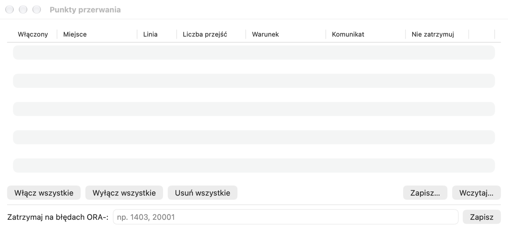

# Test Window, debugger and profiler

## What it is for

Writing a program is half the job — you still have to check that it works. The **Test Window** calls a procedure or
function with chosen parameters and shows what it returned. The **debugger** lets you execute a program line by line
and watch variable values — the best way to understand someone else's code or find the cause of a bug. The
**profiler** measures how much time each line takes — it shows where a program is slow.

**When to use it:** the Test Window — after every change of a program; the debugger — when a program gives a wrong
result and you do not know why; the profiler — when a program works correctly but too slowly.

## Test Window

The Test Window runs a PL/SQL block with bind variables and lets you debug and profile it. The simplest way to open it
is from the Object Browser: the procedure or function menu › **Test**. Pelikan prepares a block with a call in named
notation (for a package subprogram — with the right overload) and variables for the parameters and the function result.
You open an empty window with **File › New › Test Window**.

1. On the **Variables** tab below the block, enter the values of the input parameters. `:name` variables in the block
   are detected automatically; you can change the type (Integer, Float, String, Date, Timestamp, Boolean, CLOB, BLOB,
   Cursor and others).
2. Press F8 (⌘↩). After execution the output values appear in the table, and those that have changed are highlighted in
   yellow. The status bar shows the execution time.
3. Commit or roll back the changes: F10 / ⇧F10 (the **AutoCommit after Test Window execution** option in **Settings ›
   SQL Window** commits automatically).

> **Exercise: test a function and a procedure.**
> 1. In the Object Browser expand the **PEL_EMP_API** package, right-click the **GET_SALARY** function and choose
>    **Test**.
>    *Result:* a Test Window (letter **T**) with the block `begin :result := ….pel_emp_api.get_salary(p_emp_id =>
>    :p_emp_id); end;` and a table of the variables `result` and `p_emp_id`.
> 2. In the variables table type `1` as the value of `p_emp_id` and press **F8**.
>    *Result:* `result` = 12000, highlighted in yellow (the value changed).
> 3. Type `999` and press **F8** again.
>    *Result:* error `ORA-01403` — no data found (the NO_DATA_FOUND exception), and the **Error stack** tab shows the
>    line in the package where it occurred.
> 4. Open **Test** in the same way for the **RAISE_SALARY** procedure, type `p_emp_id` = 2, `p_percent` = 10 and press
>    **F8**.
>    *Result:* no error; the status bar shows an open transaction. The SQL Window (a separate session) still sees the
>    old salary of employee 2 — it will see the new one only after COMMIT in the Test Window.
> 5. Press **⇧F10** (ROLLBACK) so as not to leave the change in the database.

The other tabs:

- **Output** — DBMS_OUTPUT; the **HTP Output** switch shows the page generated by the HTP/OWA packages (after checking
  **Collect HTP on execution**).
- **Error stack** — on an execution error: the call stack with lines; a click opens the unit at the error line.
- **Results** — result sets returned by `DBMS_SQL.RETURN_RESULT`.
- **Profiler**, **Statistics** and **Trace** — described below.

When a package's state is cleared after its recompilation (ORA-04068 and related), the status bar shows a warning;
executing again works normally.

You save a test as a `.tst` file (the block, variables and debugger watches). **File › Save test as SQL*Plus script**
creates a script to run outside Pelikan. **Debug › Save as Standard Test…** saves the window as a template (with a
`%CALL%` marker in place of the call), which you can later choose for any procedure with **Standard Test…** in the
object menu.

**Tools › Test Manager** (the *Tools* chapter) is used to run many tests with expected results, and utPLSQL (the
*utPLSQL tests* chapter) for unit tests.

Next to the block, as in the Program Window, there is **Code Contents** (declarations, local subprograms, blocks) —
show or hide it in this window with **View › Code Contents** or the button at the left end of the bar below the
block.

## Debugger

The debugger uses the Oracle DBMS_DEBUG package and works on 19c–26ai databases.

### Preparation

- The user needs the `DEBUG CONNECT SESSION` privilege and `DEBUG ANY PROCEDURE` or `DEBUG` on specific objects.
  **Debug › Debugger Privileges…** opens a SQL Window with ready GRANT statements to be executed by an
  administrator.
- The code you want to step through must be compiled with debug information: **Tools › Object › Add debug information**
  or automatically when compiling a Program Window (**Settings › Oracle › Debugger**; there are also the lists of
  objects and connections for which the information is always or never added, e.g. `*@prod*`).

### Stepping

1. Set breakpoints: click the line number margin in a program or test window, or press ⌃B (**Debug › Toggle Breakpoint**).
2. In the Test Window choose **Debug › Start debugging** (F9). The **Debugger** window opens with the call stack,
   variables and watches, and the cursor stops at the first line.
3. Step:

| Action | Shortcut |
|---|---|
| Continue (to the next breakpoint) | ⌃R |
| Step Into (a subprogram, also a trigger) | ⌃N |
| Step Over (next line) | ⌃O |
| Step Out (of a subprogram) | ⌃T |
| Run to cursor / to exception | Debugging menu |
| Stop debugging | ⇧F9 |

Focus stays in the main window, so you can step with shortcuts while looking at the code.

> **Exercise: follow a loop in the debugger.**
>
> Requires the `DEBUG CONNECT SESSION` privilege (check **Debug › Debugger Privileges…**).
>
> 1. In the Object Browser select the **PEL_EMP_API** package and choose **Tools › Object › Add debug information**.
>    *Result:* the package is recompiled with debug information.
> 2. Right-click **PRINT_DEPARTMENT**, choose **Test** and type `p_dept_id` = 20.
> 3. Choose **Debug › Start debugging** (F9).
>    *Result:* the **Debugger** window opens and execution stops on the first line of the block.
> 4. Press **⌃N** (step into).
>    *Result:* the debugger enters the package body, the `print_department` procedure.
> 5. Keep pressing **⌃O** (step over) and watch the **Variables** tab.
>    *Result:* with each turn of the loop `l_total` grows, and the record `r` shows the next employee. Hover the mouse
>    over `l_total` in the code — a tooltip shows its value.
> 6. Click the margin next to the line `dbms_output.put_line('Razem: ' || l_total);` (a breakpoint) and press **⌃R**
>    (continue).
>    *Result:* the debugger stops on that line; `l_total` = 30200.
> 7. Press **⌃R** once more.
>    *Result:* the program ends, and the **Output** tab of the Test Window shows the list of employees and the total.
>
> ⚠️ **Watch out.** The debugged session is paused — it holds locks and an open transaction. Do not leave the debugger
> paused for long on a shared database; end it with **⇧F9**. Do not debug on production.

### Variables, watches, stack

- **Variables** — local, parameters, package globals (private and public), records, collections and objects as a tree,
  `SELF` in type methods. Hovering the mouse over a variable in the editor shows its value.
- **Set value…** changes the value of a scalar variable (a PL/SQL literal or text; `NULL` — an empty value), **Copy
  value** copies it to the clipboard.
- **Watches** — enter an expression (e.g. `v`, `r.field`, `t(3)`) and click **Watch**.
- **Call stack** — clicking a frame shows its variables and its place in the code.
- **Execute SQL in the debugged session…** executes a query (the first 100 rows) or a PL/SQL block in the session you
  are debugging — it sees that session's uncommitted changes.
- DBMS_OUTPUT is read at every stop.

In triggers the `:new` and `:old` values are not available (a DBMS_DEBUG limitation) — the debugger then shows a note
instead of the value. By default stepping skips package initialization and SYS objects (**Settings › Oracle ›
Debugger**).

### Breakpoints, conditions and logpoints

**Debug › Breakpoints…** opens the list of all breakpoints:

- **Enabled** — a breakpoint can be disabled without deleting it.
- **Pass count** — stops only at the n-th pass.
- **Condition** — an expression, e.g. `l_sal > 1000`; the debugger stops only when it is true.
- **Message** — text printed at each pass; `{variable}` inserts the variable's value.
- **Don't break** — together with a message creates a **logpoint**: the debugger prints the message and goes on.
- **Break on ORA- errors** — error codes at which the debugger should stop (e.g. `1403, 20001`).
- **Enable all**, **Disable all**, **Delete all**, **Save…** and **Load…** (a JSON file).

A breakpoint that the database did not accept (e.g. on a line without code) has an empty mark in the margin. There can
be one breakpoint per line.

utPLSQL tests can also be debugged: **Debug › utPLSQL: debug test under cursor**.

> **Exercise: a conditional breakpoint.**
> 1. In the **Debug › Breakpoints…** window select the breakpoint from the previous exercise (or set a new one on the
>    line `l_total := l_total + r.salary;`) and type `r.salary > 10000` in the **Condition** column.
> 2. Start debugging (F9) and press **⌃R**.
>    *Result:* the debugger stops only for Anna Nowak (12000) — it skips the other employees.

## Profiler

1. On the **Profiler** tab of the Test Window, choose the kind in the **Profiler on execution** field: **Line
   (DBMS_PROFILER)** or **Hierarchical (DBMS_HPROF)**. The **Debug › Profiler on execution** command turns the line
   profiler on and off.
2. Execute the block (F8).
3. The **Profiler** tab shows the report: for the line profiler — the time, number of executions and share of each line
   with a bar chart; for the hierarchical one — functions with their own time and time including calls, and the call
   tree. You set the time unit and the share threshold on this tab.

**How to read the report:** the lines with the largest share of time are the ones worth speeding up. Often they are SQL
queries executed in a loop — instead of a thousand single queries, one query for all rows is better.

The **Runs** menu on the tab (and **Debug › Profiler runs**) opens the reports of earlier runs. Pelikan creates
missing profiler tables in your schema (on a production connection after confirmation, on a read-only connection — not
at all). The data of a line profiler run stays in the window's transaction — commit it if you want to keep it.

## Statistics, trace and SQL Trace

- The **Statistics** tab shows the change in session statistics (V$MYSTAT) from the last execution and the total for the
  window, with a filter and export to CSV. The choice of statistics is in **Settings › SQL Window**. Requires access
  to V$MYSTAT.
- **Debug › DBMS_TRACE on Execution** records the run (calls, exceptions, SQL, lines) on the **Trace** tab; the
  history of runs is in **DBMS_TRACE Run History**. Requires the trace tables installed by an administrator with the
  `tracetab.sql` script.
- **Session › SQL Trace** turns SQL Trace of the window's session on and off; Pelikan shows the name of the trace file.
