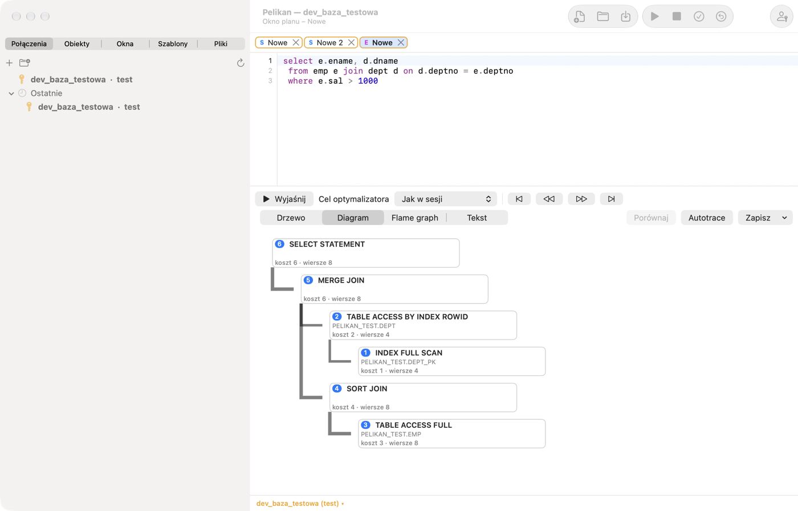
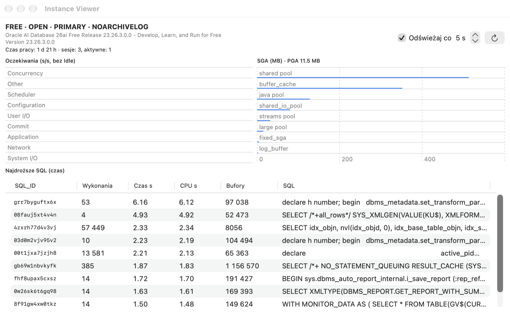

# Execution plan, sessions and administration

## What it is for

Before Oracle executes a query, the **optimizer** chooses how to execute it: which table to read first, whether to use
an index, how to join tables. This way is the **execution plan**. Two queries returning the same result can have plans
that differ in time a thousand times. The tools in this chapter show the plan (Explain Plan), measure the real
execution (Autotrace) and let you see what is happening in the database (Sessions, Instance Viewer).

**When to use it:** when a query runs slowly, before you add an index, and when something “hangs” — to check who locks
rows or what the database is doing.

## Execution plan (Explain Plan)

Place the cursor on a statement (or select it) and press F5 (**Tools › Explain Plan**). Pelikan opens a Explain Plan Window with
the plan from PLAN_TABLE. In PL/SQL code, variables are replaced with bind variables and `INTO` is skipped, so you get
the plan of a query from a procedure without rewriting it. You open an empty Explain Plan Window with **File › New › Explain
Plan Window**; Pelikan can create a missing PLAN_TABLE.

- **Refresh plan** recalculates the plan for the text in the Explain Plan Window's editor, and **Optimizer goal** (*Same as session*,
  ALL_ROWS or FIRST_ROWS_n) adds a hint.
- A new plan opens fully expanded. The **Expand all branches** and **Collapse all branches** arrows next to the view
  selector above the plan tree (also on the **Plan** ribbon tab) expand every branch at once or collapse the tree to
  its root.
- Views: **Tree** (operations with cost, number of rows, bytes, time, execution order, and access and filter
  predicates), **Diagram** (a node per operation with cost, cardinality and step number), **Flame graph** (the cost of
  operations proportional to the parent) and **Text** (DBMS_XPLAN).
- The navigation buttons move through the operations in execution order: first, previous, next and last step.
- **Compare** puts the plan side by side with the window's previous plan or with the plan in a second Explain Plan Window: it
  matches operations and shows differences in cost, cardinality, order and predicates.
- **Save** saves the plan as text, HTML or XML (DBMS_XPLAN).

The plan is calculated in a separate tool session, so it does not affect the window's transaction.

**How to read a plan (for beginners):**

- Read it **from the most indented operation** upwards — the deepest one runs first.
- `TABLE ACCESS FULL` — Oracle reads the whole table. For a small table that is fine; for a table with millions of
  rows from which you need a few — usually a sign that an index is missing or the condition does not use it.
- `INDEX RANGE SCAN` / `INDEX UNIQUE SCAN` — Oracle searches through an index, like through a book's index.
- **Cost** is the optimizer's estimate — a relative number, useful for comparing two plans of the same query, not a
  time in seconds.
- **Cardinality** (Rows) is the estimated number of rows. When it is very different from the real one (you check it in
  Autotrace), the optimizer has bad statistics and may choose a bad plan.

> **Exercise: an index in the plan.**
> 1. In a SQL Window type `SELECT * FROM pel_employees WHERE emp_id = 3;`, put the cursor on it and press **F5**.
>    *Result:* the plan window; the tree has an `INDEX UNIQUE SCAN` operation on `PEL_EMPLOYEES_PK` — a lookup by the
>    primary key.
> 2. Change the query to `SELECT * FROM pel_employees WHERE last_name = 'Nowak';` and press **Refresh plan**.
>    *Result:* `TABLE ACCESS FULL` — there is no index on the `LAST_NAME` column.
> 3. Switch the view to **Diagram**, then to **Text**.
>    *Result:* the same plan as a drawing and as DBMS_XPLAN text (as the administrator will see it).
> 4. Select the query in the SQL Window and choose **Tools › Autotrace**.
>    *Result:* the actual plan with the **E-Rows** (estimated) and **A-Rows** (actual rows) columns — here they agree.
>
> ⚠️ **Watch out.** On such a small table a full scan is the fastest and the optimizer rightly chooses it — an index
> helps with large tables. Do not add indexes “just in case”: every index slows down INSERT, UPDATE and DELETE.
> Autotrace really **executes** the statement (DML is rolled back afterwards) — do not run long queries in it on
> production during working hours.

## Autotrace

**Tools › Autotrace** (or the **Autotrace** button in the Explain Plan Window) executes the statement with measurement and shows
the actual plan: Starts, estimated (E-Rows) and actual (A-Rows) row counts with large discrepancies highlighted, times,
buffers and reads, as well as the change in session statistics before and after execution. DML statements are rolled
back after the measurement. Autotrace does not require the Tuning Pack.

Autotrace asks for variables in the statement like the SQL Window: bind variables (`:name`) get values from the
**Variables** window (remembered in the window), and substitution variables (`&name`) only when substitution is enabled
in the window; when it is disabled, `&` stays in the text without a question.

## Oracle Diagnostics and Tuning Packs

The **Tools › Performance (Oracle packs)** menu contains tools that use paid Oracle packs:

| Command | Pack | What it does |
|---|---|---|
| AWR report | Diagnostics | HTML report from AWR snapshots |
| ASH report | Diagnostics | HTML report of active sessions from the last minutes |
| ADDM report | Diagnostics | ADDM recommendations |
| SQL Monitor | Tuning | list of monitored queries (V$SQL_MONITOR) with a report for the selected one |
| SQL Monitor report | Tuning | HTML report of a monitored query |
| SQL Tuning Advisor | Tuning | recommendations for the statement under the cursor; the advisor task is deleted afterwards |

**Important — licenses.** Use these features only when the database is licensed for the corresponding pack (the Tuning
Pack also requires the Diagnostics Pack). On first use Pelikan asks which license the database has and remembers the
answer in the connection definition (the **Advanced** tab › **Diagnostics/Tuning Pack license**). Without a declared
license, or when the database parameter `CONTROL_MANAGEMENT_PACK_ACCESS` is `NONE` (or `DIAGNOSTIC` for Tuning Pack
features), the feature will not start. AI agents have no access to these tools. You can save the reports as HTML.

## Performance reports

**What it is for:** when the database or one query runs slowly, the administrator usually asks for an AWR, ASH or SQL
Monitor report. The **Database performance reports** window gathers all these reports in one place, with a choice of
period and format.

- **Performance › All performance reports…** opens a window with a list of reports (**Choose a report**): AWR, ASH,
  ADDM, Performance Hub, SQL Monitor, plans and statistics. For the chosen report you set the **Period** (e.g. **Last
  hour**, a **From** – **To** range in database time, or **AWR snapshots**), the **Instance** (in RAC also **All RAC
  instances**) and the **Output format**, and then click **Run report**.
- **Performance › Reports for SQL_ID…** does the same for one query — from the selected row of a table (e.g. the
  session list or the top queries), a cell with a SQL_ID or the statement under the cursor. The **Check** button shows
  where the query is available: in the cursor cache, in ASH, in AWR and in SQL Monitor — reports without data about the
  query are blocked with an explanation.
- A report that lacks a privilege (e.g. EXECUTE on the `DBMS_WORKLOAD_REPOSITORY` package) or a license is blocked in the
  list with the reason and a ready GRANT statement to pass to the administrator.

> **Exercise: find the SQL_ID of your query.**
> 1. In a SQL Window execute `SELECT /* my_exercise */ COUNT(*) FROM pel_emp_details;`.
> 2. Put the cursor on this statement and choose **Performance › Reports for SQL_ID…**.
>    *Result:* the reports window with the query's SQL_ID found in the cursor cache by its text (“statement under the
>    cursor”).
> 3. Click **Check**, choose the plan report from the cursor cache and **Run report**.
>    *Result:* the plan by which the database really executed the query, with the number of executions.

## Database sessions

**Tools › Sessions** shows the database sessions (V$SESSION):

- **Filter** selects the list query (e.g. *User sessions*); **Refresh every** n seconds turns on automatic refresh.
- Detail tabs of the selected session: **Current SQL**, **Open cursors**, **Locks**, **Statistics**, **Wait**.
- **Kill session** and **Kill immediately** end the session (`ALTER SYSTEM KILL SESSION`) after confirmation.
- **Actions** — among others enabling SQL Trace for the session (DBMS_MONITOR).
- **Queries…** lets you define your own filters (a WHERE condition), detail tabs (with `:sid`, `:serial#`) and actions.

Pelikan's sessions have the value “Pelikan” in the MODULE column, and AI agents' sessions — “Pelikan agent”.

> **Exercise: who is locking a row?**
>
> Requires privileges to read V$SESSION and V$LOCK (usually the SELECT_CATALOG_ROLE role).
>
> 1. In SQL Window A execute `UPDATE pel_employees SET salary = salary WHERE emp_id = 1;` and do **not** commit.
> 2. In SQL Window B execute the same statement.
>    *Result:* window B “hangs” — it waits until the session of window A releases the row lock.
> 3. Open **Tools › Sessions**, find the sessions with MODULE “Pelikan” and select the one that is waiting.
>    *Result:* the **Wait** tab shows the lock event (`enq: TX - row lock contention`), and the **Locks** tab — the
>    blocking session.
> 4. Go back to window A and press **⇧F10** (ROLLBACK).
>    *Result:* window B finishes the UPDATE at once. Roll back window B too (**⇧F10**).
>
> ⚠️ **Watch out.** **Terminate session** interrupts someone else's work and rolls back their transaction. On a shared
> database terminate only your own sessions or with the administrator's consent.

## DBA panel and Instance Viewer

**View › DBA panel** collects administrative information: tablespaces with usage, data files, instance parameters,
users, roles, sessions and locks. In the parameter list **Change value…** executes `ALTER SYSTEM SET … SCOPE=BOTH`, and
in the user list **Lock** and **Unlock** change the account state — always after confirmation and with the same
safeguards as the SQL Window. Parts you have no privileges for show a message instead of data.

**Tools › Instance Viewer** is an instance dashboard: database version and state, uptime, number of sessions, wait
classes (increase per second), the most expensive queries (V$SQL), and SGA and PGA, with automatic refresh.

## DBMS Scheduler

**Tools › DBMS Scheduler** shows the scheduler objects in a tree: windows and window groups, job classes, schedules,
programs, chains, jobs, file watchers and credentials, with an SQL preview (View SQL) of the selected object.

- **New job…** creates a job with an inline schedule (e.g. `FREQ=DAILY;BYHOUR=3`) or a named one, with a class, a
  comment and e-mail notifications. You change an existing job with **Edit…**, and delete it after confirmation.
- **Runs** shows the run history with reports (all, failed, custom conditions) and color rules.
- **Running** shows jobs in progress; **Stop** and **Stop (Force)** interrupt them.
