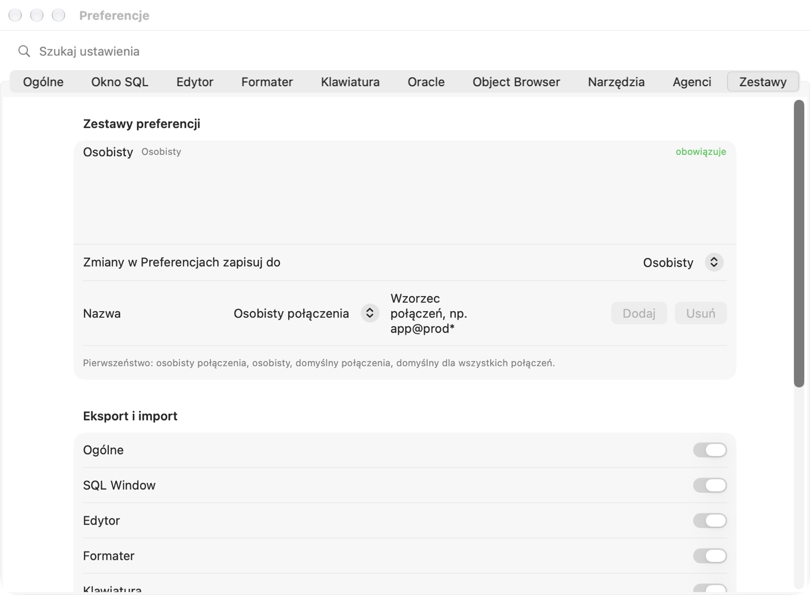

# Settings and keyboard shortcuts

This chapter describes **every option** of the Settings window: what it does, its default value, what happens when you
turn it on or off (or choose another item from a list), when the change takes effect and what to watch out for. You do
not have to read it from cover to cover — the defaults are chosen so that you can start working safely. Come back here
when something behaves differently from what you want.

## Settings window

### What it is for

Settings decide how Pelikan connects to the database, how it executes statements, what the editor looks like and how
code is formatted. Every developer has slightly different habits — this is where you adapt the program to yours.

### How to open it and find an option

1. Choose **Pelikan › Settings…** or press **⌘,** (Command and comma).
   *Result:* a window opens with tabs at the top: General, SQL Window, Editor, Formatter, Keyboard, Oracle, Object
   Browser, Tools, Agents, Presets.
2. Not sure which tab has the option? Type part of its name into the **Search settings** field above the tabs, e.g.
   `commit`.
   *Result:* instead of the tabs you see a list of matching settings with the tab name on the right.
3. Click an item in the list.
   *Result:* the search field is cleared and the right tab opens.

### When a change takes effect

- **Changes are saved immediately** — there is no “Apply” or “OK” button, as in macOS settings. Closing the window
  undoes nothing.
- Most options take effect at once in all windows.
- Options that concern **database sessions** (e.g. NLS settings, session mode) apply to **new sessions** — disconnect
  and connect again so that they cover windows that are already open.
- Three options require **restarting Pelikan**: the Oracle Instant Client directory, the Oracle Net and Oracle Wallet
  directories, and the interface language. Pelikan says so under each of them.

> **Tip.** Want different settings for one database (e.g. stricter ones for production)? Do not change them by hand
> every time you switch — use **settings presets** (the **Presets** tab, described at the end of the chapter).

The description of each option below has the same layout: the option name as shown in the window, the default value,
the effect of each possibility and — where needed — a warning ⚠️.

## General tab

### Sessions

A **session** is one connection to an Oracle database on the server side. Your **transaction** (data changes not yet
committed with COMMIT), package variables and settings issued with ALTER SESSION live in a session. How many sessions
Pelikan opens has real consequences.

**Session mode** — *default: Multi*.

| Choice | What happens | Consequences |
|---|---|---|
| **Multi — a separate session for each window** | Every SQL, test and console window has its own session; compilation has one more. | A long query in one window does not block the others. Window transactions are independent: a change in window A is invisible in window B until COMMIT. More sessions on the server (the administrator may have a limit). **Recommended.** |
| **Dual — shared session and compilation session** | The windows of one connection share one session; compilation has its own. | Fewer sessions. Windows see each other's uncommitted changes and share the transaction — COMMIT in one window commits the changes from all of them. While one window runs a query, the others wait. |
| **Single — one session** | Everything, compilation included, in one session (the debugger still has its own supervising session). | Fewest sessions. ⚠️ In Oracle, compilation (CREATE OR REPLACE) **commits the open transaction** — compiling a package in the Program Window commits the uncommitted changes from the SQL Window. Use it only when the database allows a single session. |

*Takes effect:* for new sessions — disconnect and connect again after the change.

**Logoff with an open transaction** — *default: Ask*. What to do when you close a window, switch it to another
connection or log off while the session has uncommitted changes.

- **Ask** — Pelikan shows a window with COMMIT, ROLLBACK or Cancel. **Recommended** — you always know what happens to
  your changes.
- **Commit (COMMIT)** — changes are committed without asking. ⚠️ It is easy to make permanent a change made “just to
  try”.
- **Rollback (ROLLBACK)** — changes are rolled back without asking. ⚠️ A forgotten COMMIT means lost work.

**Check connection every … s (0 — disabled)** — *default: 60 s*, step 30 s. Every so many seconds Pelikan sends a very
light query to the database to check whether the main sessions and the sessions of windows with an open transaction
are still alive (e.g. whether the network or VPN dropped). When a session is lost, Pelikan tells you at once and removes
the open-transaction mark from the windows concerned — **uncommitted changes in a lost session are rolled back in the
database**.

- A smaller value (at least 15 s) — you learn about a dropped connection sooner, at the cost of more frequent queries.
- **0** — Pelikan does not check the connection; you learn about a drop only with the next statement.
- The change takes effect at once.

**Pin the connection of new windows** — *default: off*. The **main** connection is the one you choose on the toolbar;
new windows get it.

- Off — when you change the main connection, windows without a pin switch along with it (asking first about an open
  transaction).
- On — every new SQL, program, test and console window gets a **pinned** connection (📌 on the status bar) and keeps
  it even when you change the main connection. Useful when you work on several databases in parallel and do not want a
  window to “jump” to another one.

### Connection indicators

A connection color helps you not confuse a test database with a production one. You set the color in the connection
definition (the **Environment** tab), and here you decide where it is visible.

**Editor background in connection color** — *default: off*. On — the editor background is lightly tinted with the
window's connection color. It makes it very obvious that you are typing “on production”. Off — the color is only on the
window tabs and in the window list.

**user@database rules** — a list of rules with a pattern and a color, empty by default. The **Add rule** button adds a
`*@*` rule in red; change the pattern and the color. The pattern has the form `user@database`, `*` means any string,
`?` one character. Examples: `sys@*` — every logon as SYS, `*@prod*` — every user on databases whose name starts with
“prod”. A rule **takes precedence** over the connection and environment color and applies to tabs, the window list and
the background. The ⊖ button removes a rule.

> **Exercise: mark SYS logons in red.**
> 1. In the **General** tab click **Add rule**. *Result:* a `*@*` row with red color appears.
> 2. Type `sys@*` in the pattern field. Leave the color red.
> 3. Turn on **Editor background in connection color**.
> 4. Connect as SYS to a test database and open a SQL Window. *Result:* the window tab and the editor background are
>    red.

### Appearance

**Mode** — *default: Same as system*. **Same as system** — Pelikan is light or dark together with macOS (also when macOS
switches at dusk). **Light** / **Dark** — always so, regardless of the system. The change takes effect at once.

### Interface font

Applies to labels, lists, the ribbon, window tabs, the status bar, tool windows and Settings. Menus and window titles
are drawn by macOS — Pelikan does not change those. Below the options you see sample text in the chosen font.

- **Typeface** — *default: System (SF Pro)*. The list contains the fonts installed on the Mac.
- **Style** — *default: regular*. From light to bold.
- **Size** — *default: 13 pt*, from 10 to 20 pt. Secondary text (captions, descriptions) is always 2 pt smaller. A larger
  font means readability at the cost of space — at 16 pt and more on a small screen some bars become narrower.

The fonts of the code editor and the result grid are set separately, in the **Editor** tab.

### Ribbon

The **ribbon** is the strip of action tabs (Start, SQL, Program, Tools…) under the toolbar — as in office programs.

- **Show the ribbon with action tabs** — *default: on*. Off — the ribbon disappears and the editor gets more room;
  commands are still in the menus, the command palette (⇧⌘P) and under their shortcuts.
- **Collapse the ribbon to tabs only** — *default: off*, available only with the ribbon visible. On — only the tab names
  are visible. Clicking a tab expands the ribbon, and double-clicking a tab collapses or expands it permanently. A good
  compromise on a small screen.

The **Search actions** field on the ribbon finds any command by name, also without Polish characters and by its
English name from PL/SQL Developer.

### Tool Panels

Tools (e.g. the Object Browser, Sessions, test results) open in the right panel, in the bottom panel or in a separate
window.

- **Open new tools in** — *default: Right panel*. **Right panel**, **Bottom panel** or **Separate window**. Applies to
  tools you have not moved yet — Pelikan remembers the location of each kind of tool separately.
- **Auto-hide panels when work returns to the editor** — *default: off*. On — when you click in the editor, the tool
  panels hide and the editor gets the full width; a panel comes back when you open or select a tool. Off — the panels
  stay in place.
- **Restore default locations** — forgets the locations you moved tools to (the counter next to it shows how many
  there are). Tools will open again according to **Open new tools in**.

You move a tool by dragging its tab to the other panel or outside the panels (separate window), from the tab menu, or
with the button on the tool's title bar.

### Interface language

**Language** — *default: Same as system*. Polski, English, Deutsch, Español or Українська. **Same as system** — the
language from macOS settings. The change takes effect **after restarting Pelikan**. The language does not change Oracle
messages (e.g. `ORA-00942`) — those depend on NLS_LANGUAGE in the **Oracle** tab.

### Start folders and extensions

**SQL scripts**, **Programs**, **Tests**, **Reports** — the folder shown by the open and save dialog for a file of that
kind. *Empty by default:* the project folder or, without a project, the last one used. Type a path, choose from the list
(project folder, folders of recent files, Documents, home folder) or click the browse button.

**Additional program extensions** and **Additional test extensions** — *empty by default*. Pelikan recognizes the kind
of a file by its extension: `.sql` opens in a SQL Window; `.pck`, `.pks`, `.pkb`, `.prc`, `.fnc`… in a Program Window;
`.tst` in a Test Window. If programs in your team have another extension (e.g. `.plsql`), add it here (several separated
by commas) — such files will open in a Program or Test Window instead of a SQL Window.

### Specification and body in separate files

A PL/SQL package consists of a **specification** (what the package offers) and a **body** (how it does it). Many teams
keep them in two files, e.g. `emp_api.pks` and `emp_api.pkb`.

- **Open the specification/body pair in one window** — *default: on*. On — opening `emp_api.pks` also opens
  `emp_api.pkb` from the same folder in the same Program Window (two tabs). Off — only the file you chose opens.
- **Package specification extension** (*pks*), **Package body extension** (*pkb*), **Type specification extension**
  (*tps*), **Type body extension** (*tpb*). A Program Window with a specification and a body saves each unit to its own
  file; **Save as** creates a pair of files; the “file per object” object export uses these extensions. The
  specification extension must differ from the body extension and cannot be a reserved one (`sql`, `tst`, `pck`, `typ`,
  `rep`, `pdd`, `sqlnb`, `txt`). On an invalid entry Pelikan shows a red note and uses the defaults until you fix it.

### Files

- **Restore windows after relaunch (also unsaved)** — *default: on*. On — when quitting, Pelikan remembers the open
  windows together with unsaved text and opens them again at launch. Off — Pelikan starts with an empty window area.
- **Autosave window layout** — *default: on*. Pelikan remembers the size of the main window, the position of the panels
  and their widths. Off — after launch the layout returns to the default.
- **Ask to save changes when closing new windows** — *default: on*. Applies to windows that do not have a file yet
  (e.g. a new SQL Window with a query typed in). Off — such a window closes without asking and the text is lost.
  ⚠️ Turn it off only if you treat new windows as scratch paper.
- **Detect file changes on disk** — *default: on*. When another program (git, another editor, an AI agent) changes a
  file open in Pelikan, Pelikan notices when you return to the window and offers to load the new version. Off — Pelikan
  does not check, and saving from Pelikan overwrites the other changes. ⚠️ Keep it on if you use git.
- **Reload files changed outside without asking when the window has no changes** — *default: off*, available with
  detection on. On — if the window has no unsaved changes, the new version is loaded without asking (handy after
  `git pull`). When the window has unsaved changes, Pelikan always asks.

### File standard

Determines the format in which Pelikan saves **new** code files.

- **Encoding** — *default: UTF-8*. The way characters (e.g. accented letters) are stored. UTF-8 is the standard of
  modern tools and git. Choose another encoding (e.g. Windows-1250) only if your project requires it.
- **Byte order mark (BOM) at the start of the file (UTF-8)** — *default: off*. The BOM is a few invisible bytes at the
  start of a file required by some old Windows programs. Most tools (git, SQL*Plus on Linux) work better without it.
- **Program files without “/” lines (neither at the end nor in the middle)** — *default: on*. A line with just `/`
  tells SQL*Plus “execute what is above”. In package code files (deployed by tools) such a line often gets in the way.
  On — the Program Window saves units without `/`. Off — you can end units with `/` (option in the **Oracle ›
  Debugger** tab). SQL scripts always keep `/`, because they are executed by the command window.
- **Ask about conversion when opening a file in a different format** — *default: on*. When you open a file in another
  encoding, with a BOM or with `/`, Pelikan offers to convert it to the standard. The conversion changes only the window —
  the file on disk changes only when you save. Off — the file opens as it is.
- **Restore defaults (UTF-8, no BOM, no “/”)** — returns this section to its defaults.

### Application Log

The log records what Pelikan does — useful when reporting a bug. **The log never contains passwords, the text of SQL
statements or data from the database.**

- **Log level** — *default: Events (recommended)*. **Warnings and errors** — problems only (fewest entries). **Events** —
  also ordinary actions (connect, execute, compile). **Details — diagnostics** — many entries; turn it on for a while
  when looking for the cause of a bug, and turn it off afterwards.
- **Show connection names, object names and file paths** — *default: off*. Off — connection and server names are
  replaced by a hash in the log, so the log can be sent safely. On — the real names are visible (easier to understand
  the log, but think twice before sending it to anyone).
- **Show Log** and **Export Log…** — open the log or save it to a file.

## SQL Window tab

### Execution

**AutoSelect — with no selection, execute the statement under the cursor** — *default: on*. A SQL Window usually holds
several queries one under another.

- On — **F8** (or ⌘↩) executes **one** statement, the one the cursor is in. To execute the whole script, select it (⌘A)
  or use **Execute opposite of AutoSelect** (⌃F8, ⇧⌘↩).
- Off — F8 executes **all** statements in the window one after another, and a single one only when selected.
- When you select something, the selection is always executed.

**AutoCommit SQL statements** — *default: off*.

- Off — after INSERT, UPDATE or DELETE the changes exist only in your session. You make them permanent with **COMMIT**
  (F10) or undo them with **ROLLBACK** (⇧F10). The status bar shows the open transaction. **Recommended.**
- On — every statement that changes data is committed at once. ⚠️ A mistake (e.g. UPDATE without WHERE) cannot be undone
  with ROLLBACK.

**Statistics after execution** — *empty by default (all non-zero)*. A list of session statistic names shown on the
**Statistics** tab (e.g. `consistent gets`, `physical reads`), several separated by commas. Empty — all that changed.
Works with the Statistics tab turned on (section below).

**AutoCommit after Test Window execution** — *default: off*. Like AutoCommit, but for the Test Window: on — after the
test script runs, the changes are committed. Off — you decide yourself (useful: test, check the data, ROLLBACK).

**Confirm COMMIT and ROLLBACK** — *default: off*. On — before committing or rolling back, Pelikan asks “are you sure”.
Protects against pressing F10 by accident; the question has a **Don’t ask again** box.

**Confirm modifying statements on production connections** — *default: on*. Applies to connections with the
**Production** environment (set in the connection definition). Before every statement that changes data or objects
(INSERT, UPDATE, DELETE, MERGE, DDL…) Pelikan asks whether to really execute it. ⚠️ This question cannot be turned off
with “Don’t ask again” — only with this option. Keep it on.

### Results

**Rows per page** — *default: Automatic (page)*. How many result rows Pelikan fetches at once. A query can return
millions of rows — fetching them all would take a long time and use memory.

- **Automatic (page)** — 100 rows; more are fetched as you scroll.
- **100**, **500**, **1000** — that many rows at a time.
- **All** — the whole result at once. ⚠️ On large tables this can take a long time and use a lot of memory.

“(more…)” next to the row count means the result is not complete yet.

**Maximum result size** — *default: 512 MB*, from 16 to 8192 MB. When the fetched result exceeds this size, Pelikan stops
fetching and asks: **Continue Fetching** or **Stop**. It protects the Mac from one query using up all memory.

**Number layout** — *default: Right*. How the grid shows numbers: **Right** (as in a spreadsheet — units digits under
each other), **Left**, **Formatted (regional separator)** (decimal separator according to macOS settings), **With
thousands separator** (e.g. 1,234,567). Applies only to display — copy and export keep the exact value.

**Row Number in Copy and Export** — *default: off*. On — the copied and exported result has a first column with the row
number.

**Fetch LOBs on demand (preview of the first 4000 bytes)** — *default: on*. A LOB (CLOB, BLOB) is a column with large
text or a file. On — the grid shows the beginning of the value, and the whole of it is fetched only when you open it
(Large Data Editor). Queries are faster. Off — whole values are fetched at once.

**Align columns using the query's saved template** — *default: on*. When you save column widths and alignment for a
query (grid menu), re-executing the same query lays out the columns the same way. Off — templates are ignored.

**Notify when an execution longer than … s finishes** — *default: 10 s*, step 5 s, 0 — no notification. When a statement
takes longer, Pelikan plays a sound when it finishes (a different one on error), and when you are working in another
program — Pelikan's icon bounces in the Dock.

**Large Data Editor: Auto Format (JSON, XML)** — *default: off*. On — when you open a JSON or XML value in the Large Data
Editor, the text is formatted nicely at once (indentation, lines). It changes only the view, unless you save the value.

### Query By Example

**Query By Example** (QBE) is a row above the grid where you type values and Pelikan adds a WHERE condition to the
query. These options decide how the typed value is compared.

- **Case-insensitive** — *default: on*. On — `kowalski` also finds `KOWALSKI`. Off — letter case must match.
- **Text without wildcards as “contains”** — *default: off*. On — `kow` looks for values containing “kow” (like
  `LIKE '%kow%'`). Off — `kow` looks for values equal to “kow”; you get “contains” by typing `%kow%`.
- **Dates without time (compare the day)** — *default: on*. On — `2026-11-05` finds all rows of that day, at any time.
  Off — only midnight of that day.

### Statistics

**Statistics tab: session statistics of every execution (requires access to V$MYSTAT)** — *default: off*. On — after
each execution the SQL Window has a **Statistics** tab with the number of reads, sorts, recursive calls and so on. Useful
when tuning queries. Requires read access to the `V$MYSTAT` and `V$STATNAME` views (ask the administrator).

### DBMS_OUTPUT

`DBMS_OUTPUT.PUT_LINE` is how PL/SQL code “prints” text — the equivalent of `print`.

- **Enabled** — *default: on*. Pelikan enables the DBMS_OUTPUT buffer in the session and after execution shows the text
  on the **Output** tab of the SQL Window (in the Test Window — **Output** as well). Off — text from PUT_LINE is lost.
- **Clear before executing** — *default: on*. On — the tab is cleared before each execution. Off — new lines are
  appended to the old ones.
- **Buffer size** — *default: unlimited (0)*, step 10,000 bytes. A limit on the amount of text in the buffer. When it is
  exceeded, Oracle raises error `ORU-10027`. Unlimited — the error does not occur.

### Date formats

**DATE** — *default: `YYYY-MM-DD HH24:MI:SS`*, **TIMESTAMP** — *default: `YYYY-MM-DD HH24:MI:SS.FF6`*. How the grid shows
dates and timestamps. Type your own format in Oracle notation or choose one from the list. Applies to display in the
grid; how the **database** converts text to a date in queries is set in NLS_DATE_FORMAT (the **Oracle** tab).

## Editor tab

### Font

- **Font** — *default: SF Mono*. The list contains fixed-width fonts (code is easier to read when the columns line up).
- **Style** — *default: regular*.
- **Size** — *default: 13 pt*, from 8 to 40 pt.
- **Ligatures (e.g. Fira Code, JetBrains Mono)** — *default: on*. Some fonts join the characters `<>`, `>=`, `=>` into one
  symbol. Works only with such fonts; with SF Mono it changes nothing. Turn it off if you prefer to see every character
  separately.

### Result grid and Object Browser

A separate font for the result grid (*default: system fixed-width, 12 pt*, from 8 to 24 pt) and for the Object Browser
(*default: same as the interface*; the value 0 pt — same as the interface).

### Font colors

For the **Editor**, the **Result grid** and the **Object Browser** you can choose the **Text** and **Background** color.
*Default:* system colors, which change with light and dark mode. A custom color applies in both modes — choose one that
is readable in both light and dark. **System** restores the system colors. Syntax coloring (keywords, strings,
comments) stays.

### Code Assistant (code completion)

Code Assistant is the list of suggestions that appears while you type: names of tables, columns, packages, procedures.

- **Automatically after a dot** — *default: on*. After typing `emp.` the list of columns of the EMP table appears by
  itself. Off — you open the list by hand: **⌃Space**.
- **Delay** — *default: 400 ms*, from 0 to 2000 ms. How long Code Assistant waits after the dot. Shorter — faster, but
  the list may appear when you do not want it.
- **Matching** — *default: Starts with*. **Starts with** — `sal` suggests `SALARY`. **Contains** — `sal` also suggests
  `BASE_SALARY` (more items in the list).
- **Letter case** — *default: As typed*. In which form a suggestion goes into the code: **As typed** (you type
  lowercase — it inserts lowercase), **UPPERCASE**, **lowercase**, **Initial capital**, **Original** (as in the database
  dictionary, usually uppercase).
- **Minimum characters for objects and keywords** — *default: 1*, from 1 to 5. After how many typed letters (without a
  dot) suggestions for object names and keywords appear. More — less intrusive, but helps later.
- **Standard SQL functions** — *default: on*. On — the list also contains built-in functions (`NVL`, `TO_CHAR`,
  `SUBSTR`…).
- **“(all)”: each item on its own line** — *default: off*. The “(all)” item in the column list inserts all columns at
  once. Off — on one line separated by commas. On — every column on its own line.
- **“(all)”: comma at the start of the line** — *default: off*, available with the previous option. On — `, column`
  instead of `column,`.

### AutoReplace (text abbreviations)

You type a short abbreviation and a space (or another terminating character), and Pelikan replaces it with longer text.
*There are two by default:* `sf` → `SELECT * FROM ` and `dbo` → `dbms_output.put_line(|);`. The `|` character in the
replacement marks the cursor position after the replacement. **Add abbreviation** adds an empty row, ⊖ removes one.

> **Exercise: your own abbreviation.**
> 1. Click **Add abbreviation**, type `cnt` in the **Shortcut** field and `SELECT COUNT(*) FROM |;` in the replacement
>    field.
> 2. Open a new SQL Window (⌘N), type `cnt` and a space. *Result:* `SELECT COUNT(*) FROM ;` appears and the cursor is
>    before the semicolon — type the table name.

### Analysis and windows

- **Code analysis while typing** — *default: on*. Pelikan continuously underlines unknown names (checking the database
  dictionary) and suspicious places in the code. Off — the underlines disappear; you will see errors only when
  compiling or executing.
- **Warn about identifiers longer than … bytes** — *default: 30*, 0 — off. Older Oracle versions (up to 12.1) allow names
  of up to 30 bytes; an accented letter takes 2 bytes. Set 128 if you work only on Oracle 12.2 and later.
- **Remember the state of file windows (cursor, bookmarks, marks, variables)** — *default: on*. When you reopen a file,
  you come back to the same place, with bookmarks and variable values. Off — the file opens at the beginning.

### Writing

- **Keyword case** — *default: No changes*. **UPPERCASE** / **lowercase** / **Initial capital** — while you type,
  Pelikan changes keywords (SELECT, FROM, BEGIN…) to the chosen form. It does not change names, text in quotes or
  comments.
- **Highlight current line** — *default: on*. The line with the cursor has a slightly different background.
- **Highlight occurrences of the name under the cursor and the selected word** — *default: on*. The cursor on the
  variable `l_total` highlights all its uses — it is easy to see where it is changed.
- **Highlight COMMIT, ROLLBACK and SAVEPOINT statements** — *default: on*. Statements that end a transaction have a
  distinct color — they are harder to overlook in code.
- **Line status (changed and new since opening or saving)** — *default: on*. In the margin next to the line numbers a
  colored bar shows lines changed and added since opening or the last save.
- **Wrap Lines** — *default: off*. On — a long line wraps on screen (the text does not change). Off — you scroll a long
  line horizontally.
- **Number every line / Number every … lines** — *default: every line*, up to every 10.
- **Vertical margin at column …** — *default: none*, step 10. A vertical line at the given column (e.g. 100) helps you
  write short lines.
- **Show special characters (spaces, tabs, line ends)** — *default: off*. On — spaces are dots, tabs are arrows. Useful
  when looking for the cause of strange indentation.
- **Code Contents visible by default** — *default: on*. The **Code Contents** panel next to the editor shows the
  structure of the code (procedures, functions, statements). The option applies to windows in which you have not toggled
  the panel by hand (**View › Code Contents**).
- **Control structures in Code Contents** — *default: on*. On — the tree also shows IF, loops, CASE and exception
  handling (collapsed by default). Off — only subprograms and blocks.
- **Code Contents order** — *default: As in source*. Or **Alphabetically**, or **By kind**.

### Indentation

- **New line indent** — *default: Automatic (like previous line)*. **None** — Enter starts the line at column 1.
  **Automatic** — the new line has the indentation of the previous one. **Smart (PL/SQL structure)** — after `BEGIN`,
  `LOOP`, `THEN` the indentation grows, and `END` returns to the block level.
- **Backspace unindents** — *default: on*. Backspace at the start of an indented line goes back one indentation level
  instead of one space.
- **Tab width** — *default: 2*, from 1 to 8. How many spaces Tab and one indentation level give.
- **Insert a tab character instead of spaces** — *default: off*. On — Tab inserts a tab character. Note: in other programs
  a tab may have a different width, so the code “falls apart”. Most teams use spaces.

## Colors tab

The **color theme** decides how the editor colors code. It sets the colors of keywords, strings, comments and function
names, as well as the background, selection, cursor, current line and line numbers. Pelikan has 98 built-in themes.
The default is **Pelikan**, in a light and a dark version. There is also **Classic**, styled after the Oracle tools of
the past: white background, navy keywords, red strings and green comments. The other 95 are well-known editor themes,
including Solarized, Gruvbox, Dracula, Monokai, Nord, One Dark, GitHub, Catppuccin and Tokyo Night. Their palettes come
from the tinted-theming project (MIT license).

The same colors apply in the SQL Window, Program Window, Test Window and console, and in the code previews of tool
windows (sessions, reports, Query Builder). Printing and the Quick Look preview in Finder keep Pelikan's light colors,
because paper and Finder have a white background.

### Theme list

On the left there are two groups: **Light** (light background) and **Dark** (dark background). The colored rectangle
next to a name shows the theme's background and three of its colors: keyword, string and comment. A ✓ marks a theme in
use. **custom** marks a theme you saved yourself. The **Filter themes** field narrows the list to names or authors that
match what you type.

### Use in Light Mode / Use in Dark Mode

macOS has a light and a dark mode (System Settings › Appearance, or **General › Appearance** in Pelikan). Pelikan
remembers **a separate theme for each mode**. **Clicking a theme in the list applies it at once in the mode the system
is in now** (the line under the buttons tells you which), so while browsing the list you see the colors in open
windows right away. **Use in Light Mode** and **Use in Dark Mode** assign the selected theme to a chosen mode — also the
one not visible now. *Default:* Pelikan light and Pelikan dark. When the system switches mode
(for example in the evening with automatic mode), the editor switches to the other theme by itself. Colors change at
once in all open windows, without reopening files.

You can also choose a dark theme for light mode, and the other way round. The editor then has its own background,
independent of the rest of the window. The line under the buttons shows which theme is in use in each mode.

### Preview

The **SQL / PL/SQL / Pro*C** switch shows sample code in the colors of the selected theme, including Pro*C code you
may not have open.

### Color categories

A theme assigns a color (and optionally bold or italic) to each category:

- **Plain text** — names of tables, columns and variables.
- **Keywords** — `SELECT`, `BEGIN`, `IF`, `create or replace`; in Pro*C also `EXEC SQL`, `END-EXEC` and C keywords
  (`if`, `return`).
- **Data types** — `VARCHAR2`, `NUMBER`, `DATE`, `BOOLEAN`; in Pro*C `int`, `char`, `VARCHAR`.
- **Built-in functions** — `NVL`, `TO_CHAR`, `COUNT` and other Oracle functions when a parenthesis follows the name;
  in Pro*C every function call (`printf(`).
- **Supplied database packages** — `DBMS_OUTPUT`, `UTL_FILE`, `APEX_…` when a dot follows the name.
- **Strings** — `'text'`, `q'[…]'`; in Pro*C also `"text"`.
- **Numbers** — `100`, `2.5`, `1e6`.
- **Comments** — `-- …` and `/* … */`.
- **Optimizer hints** — `/*+ INDEX(e) */`.
- **Bind variables and substitutions** — `:x`, `&name`; in Pro*C host variables `:ename`.
- **Quoted identifiers** — `"Department name"`.
- **Operators and punctuation** — `:=`, `||`, `(`, `;`.
- **Compilation and preprocessor directives** — `$IF … $END` in PL/SQL and `#include`, `#define` in Pro*C.

Built-in themes have colors chosen so that text is readable: plain text has a contrast of at least 4.5:1 with the
background, and every category at least 3:1. Pelikan does not use palette colors that are too pale (most often
comments) — it moves them towards the text color.

### Save as Custom…

Built-in themes cannot be changed, so you can always go back to them. Want different colors? Select the theme closest
to what you want and click **Save as Custom…**. Enter a name (*default:* “name (copy)”). The copy appears in the list
marked **custom** and can be edited right away. The original stays unchanged.

### Editing a custom theme

Under the preview of a custom theme there is a table:

- **Name** and **Dark theme** — the name in the list and the group (**Light** or **Dark**). The group does not limit the
  choice: you can use the theme in either mode.
- **Category** — for each category in the list above: **Color**, **Bold** and **Italic**. Click a color well to open the
  system color picker. The change shows at once in the preview, and in the editors if the theme is in use. The ↺ arrow
  next to a color restores the default color: plain text color for categories, system color for editor elements.
- **Background**, **Text**, **Selection**, **Current line**, **Line numbers**, **Cursor** — colors of the editor itself.
  **Current line** is the bar under the line with the cursor (if current line highlighting is on in the **Editor** tab).

Changes are saved at once, without a **Save** button. **Delete** removes a custom theme. If it was in use, that mode
returns to the Pelikan theme.

> **Note.** **Text** and **background** colors set in **Editor › Font colors** take precedence over the theme. If the
> background does not change after you choose a theme, check whether a custom color is set there (the **System** button
> removes it).

### Import… and Export…

**Import…** loads a theme from a file as a custom theme. Supported formats:

- a Pelikan theme (`.json` from **Export…**),
- base16 and base24 (`.yaml`) — hundreds of palettes from the tinted-theming project,
- Xcode (`.xccolortheme`; user themes are in `~/Library/Developer/Xcode/UserData/FontAndColorThemes`),
- TextMate and Sublime Text (`.tmTheme`),
- Visual Studio Code (`.json` from a theme extension, the file in its `themes` folder).

When importing from Xcode, TextMate and VS Code, Pelikan matches SQL categories to the theme's colors. The result is not
always the same as in the original editor, because those themes describe other languages. Adjust the colors in the
editing table if needed.

**Export…** saves the selected theme (also a built-in one) to a `.json` file, for example to move it to another computer
or give it to a colleague. Custom themes are also carried by exporting settings (**Tools › Settings › Export
Settings…**, **Editor** section).

> **Exercise: your own theme with clear comments.**
> 1. Open **Pelikan › Settings…** (⌘,) and the **Colors** tab.
> 2. In the **Light** group, select **Solarized Light**. *Result:* the preview shows code on a cream background.
> 3. Click **Use in Light Mode**. *Result:* a ✓ appears next to the name and the open SQL Window changes colors.
> 4. Click **Save as Custom…**, type `My Solarized` and click **Save**. *Result:* the list contains **My Solarized**
>    marked **custom**, and a table of colors is under the preview.
> 5. In the **Comments** row, click the color well and pick a dark green. Turn off **Italic**. *Result:* comments in the
>    preview are green and upright.
> 6. Click **Use in Light Mode**. *Result:* the SQL Window now uses your theme, and **Solarized Light** is unchanged.
> 7. To return to the default look, select **Pelikan** in the **Light** group and click **Use in Light Mode**.

## Formatter tab

The **formatter** (⇧⌘F) lays out PL/SQL and SQL code according to rules: indentation, list breaking, letter case. Thanks
to it the whole team has code in the same style. The tab has two parts: the rules on the left and a **preview** with
examples on the right (**PL/SQL**, **Queries**, **DML**, **DDL**). After every change the affected lines are highlighted
for 5 seconds, a red dash marks removed lines and a vertical line marks the right margin. If a change is not visible in
the current example, the preview switches by itself to one where it is.

> **The easiest way to learn the formatter:** change one option at a time and watch the highlighted lines of the
> preview.

### Layout

- **Indent** — *default: 2*, from 1 to 8 spaces per level.
- **Indent with tab characters** — *default: off*.
- **Right margin** — *default: 100*, from 40 to 250. Up to this column the formatter fits elements on a line; longer ones
  are broken.
- **Keep empty lines** — *default: on*. On — the empty lines you use to separate pieces of code stay (at most **Maximum
  consecutive blank lines**, *default 1*, up to 5). Off — the formatter removes empty lines.
- **Blank line before each subprogram** — *default: off*. On — procedures and functions in a package are separated by
  an empty line.

### Lists and commas

Each list can have one of these layouts: **Element in line** (each element on its own line), **To margin** / **On one
line if it fits** (elements on one line, broken only at the margin).

- **SELECT, INTO, FROM lists** — *default: Element in line*.
- **UPDATE … SET** and **GROUP BY, ORDER BY** — *default: As SELECT lists*.
- **Parameter declarations**, **Call parameters**, **INSERT lists (columns, VALUES)**, **Lists in parentheses (IN,
  function arguments)** — *default: On one line if it fits*.
- **Table columns, record and type fields** — *default: Element in line*.
- **Comma at the start of the line** — *default: off*. On — `, column` instead of `column,`; it is then easier to comment
  out the last element.

### SQL clauses and conditions

- **Clause keywords (FROM, WHERE…)** — *default: Right (river)*. **Left, items in a column** — clause keywords start in
  one column. **Right (river)** — clause keywords are right-aligned so that a vertical “river” of space forms between
  them and the elements. **On its own line, items indented** — the keyword on its line, the elements below it indented.
- **AND / OR** — *default: At line start*. Where AND/OR stands when a condition is broken.
- **JOIN … ON: condition on a new line** — *default: on*.
- **IF … THEN: THEN on a new line** — *default: off*.
- **CASE expression** — *default: On separate lines, short ones on one line*. Or **On one line**, or **WHEN, ELSE, END on
  separate lines**. With the automatic choice a CASE with one WHEN branch fits on one line up to **… characters**
  (*default 50*, from 20 to 120).
- **Subqueries and CTEs** — *default: Indented, “)” on its own line*. Or **After the parenthesis**.
- **Long expressions: operator (||, +, -)** — *default: At line start*. Where the operator stands when a long expression
  is broken.

### AND / OR conditions

Condition breaking rules separately for each place. First choose the **Condition location**: WHERE, HAVING, JOIN … ON,
MERGE … ON, START WITH / CONNECT BY, CASE … WHEN, IF / ELSIF, WHILE, EXIT / CONTINUE WHEN, trigger WHEN, CHECK or nested
parentheses. Then set:

- **Break before AND / OR** — **Each on its own line**, **Only when the condition does not fit** or **Do not break**.
- **AND / OR position** — **As AND / OR in general**, **At line start** or **At line end**.
- **AND / OR alignment** — **To the keyword (river)**, **Under the first condition** or **Under the first condition,
  indented**.

*Default:* each AND/OR on its own line, aligned to the keyword; CHECK and nested parentheses — broken only when they do
not fit, under the first condition. The AND in `BETWEEN … AND` is never broken.

### Column alignment

Alignment makes similar elements stand one under another:

```sql
l_name     VARCHAR2(100);
l_salary   NUMBER := 0;
```

- **Declarations: types and := / DEFAULT** — *default: on*.
- **Parameters: mode (IN/OUT), type, DEFAULT** — *default: off*.
- **Named arguments: =>** — *default: off*.
- **Consecutive assignments: :=** — *default: on*.
- **Aliases in SELECT and FROM** — *default: off*.
- **UPDATE … SET: =** — *default: off*.
- **Table columns and record fields: type, DEFAULT, NOT NULL** — *default: on*.
- **Trailing comments on consecutive lines** — *default: off*.

The downside of alignment is that changing one name moves the neighboring lines — git then shows more changed lines.

### Spacing

- **Spaces around operators (=, <>, +, ||…)** — *default: on*. `a = b` instead of `a=b`.
- **Space after comma** — *default: on*.
- **Spaces inside parentheses** — *default: off*. `f( x )` instead of `f(x)`.

### Letter case

Each option: **No changes**, **UPPERCASE**, **lowercase**, **Initial capital**.

- **Keywords** — *default: UPPERCASE*.
- **Identifiers** (names of tables, columns, variables) — *default: No changes*.
- **Data types (NUMBER, VARCHAR2…)** — *default: Like keywords*.
- **Built-in functions (NVL, TO_CHAR…)** and **Oracle packages (DBMS_…, UTL_…)** — *default: Like identifiers*.
- **Special spelling (comma-separated)** — *empty by default*. Words always written exactly as you type them here,
  e.g. `DBMS_Output, UTL_File`.

Literals in quotes, quoted identifiers and comments are never changed.

### While typing and automatic formatting

- **Format line on Enter** — *default: on*. Enter in the SQL, Program and Test Window formats the line you leave (if you
  changed it since opening or saving): letter case, spacing, clause alignment — and indents the new line according to
  the formatter rules. Code you have not edited is left alone. The first **⌘Z** undoes only the formatting. The toggle is
  also on the toolbar and in the **Edit** menu.
- **After opening source from the database** — *default: off*. On — code opened from the database is formatted at once.
  ⚠️ After compilation the database holds the formatted code, i.e. different from before — version comparisons will
  show many changes.
- **Before compilation** — *default: off*. On — the code is formatted before every compilation.
- **Before saving to file** — *default: off*. On — the code is formatted before every save.
- **Restore defaults** — returns to the default rules. Pelikan asks whether to keep the special spelling; the automatic
  formatting options stay unchanged.

## Keyboard tab

**Shortcut profile** — *default: PL/SQL Developer*.

- **PL/SQL Developer** — shortcuts as in PL/SQL Developer on Windows: function keys (F8 — execute, F10 — COMMIT) and ⌃
  in place of Ctrl. Good if you know that program or work in a team that uses it.
- **macOS** — shortcuts typical for the Mac, with ⌘ (e.g. ⌘↩ — execute). The function-key shortcuts still work as
  extra ones.

Below the profile is a list of all commands with their shortcuts and a **Search commands** field.

- **Add shortcut…** — select a command, click and press the new shortcut (Esc cancels). If the shortcut belonged to
  another command, Pelikan moves it and tells you from which one.
- **Remove command shortcuts** — the command is left without a shortcut (it still works from the menu and the palette).
- **Command defaults** — restores the shortcuts of the selected command.
- **Restore all defaults** — undoes all your shortcut changes.

The menu shows one shortcut of a command, but all its shortcuts work.

> **Exercise: a shortcut for formatting.**
> 1. Type `format` in the **Search commands** field. *Result:* the list keeps commands with “format” in the name.
> 2. Select **Format PL/SQL code** and click **Add shortcut…**. *Result:* the button text changes to “Press a
>    shortcut… (Esc — cancel)”.
> 3. Press ⌃⌥F. *Result:* ⌃⌥F appears in the **Shortcuts** column next to ⇧⌘F — both work.

## Oracle tab

### Oracle Instant Client

Instant Client is the Oracle library through which Pelikan talks to the database (the default driver). *Default:*
detected automatically (Homebrew, `/opt/oracle`, the Downloads folder). **Choose…** — point to the folder with the
`libclntsh.dylib` file; **Automatic** — go back to detection. The change takes effect **after a restart**. Pelikan does
not include Instant Client (Oracle license) — you download it from the Oracle website (chapter 1).

### Session NLS settings

NLS (National Language Support) are the settings by which the **database** converts dates and numbers to text, sorts
and compares text and chooses the language of messages. Pelikan issues `ALTER SESSION SET …` in every new session. An
empty field — the server setting applies.

| Parameter | What it affects | Example |
|---|---|---|
| NLS_DATE_FORMAT | how `TO_CHAR(date)` and implicit text-to-date conversion treat dates | `YYYY-MM-DD` |
| NLS_TIMESTAMP_FORMAT | the same for TIMESTAMP | `YYYY-MM-DD HH24:MI:SS.FF` |
| NLS_NUMERIC_CHARACTERS | decimal character and thousands separator | `,.` or `.,` |
| NLS_LANGUAGE | language of Oracle messages and of day/month names | `POLISH`, `AMERICAN` |
| NLS_TERRITORY | default regional formats, first day of the week | `POLAND` |
| NLS_SORT | how text is sorted (ORDER BY) | `POLISH`, `BINARY` |
| NLS_COMP | how text is compared (=, LIKE) | `BINARY`, `LINGUISTIC` |

⚠️ Changing NLS can change the result of code that relies on implicit conversion (e.g. `WHERE date_col = '2026-11-05'`).
Takes effect in **new sessions**.

**Close window sessions idle for more than … min (without an open transaction)** — *default: do not close (0)*, step 15
min. Pelikan closes the sessions of windows you have not used for longer than the given time — provided they have no
open transaction and are not executing anything. On the next execution the window connects again. Useful when the
administrator limits the number of sessions. ⚠️ A new session does not have the state of the old one: package
variables, session temporary data and ALTER SESSION settings are lost.

### Oracle Documentation (F1)

- **Documentation version** — *default: the newest supported*. 19c, 21c, 23ai or 26ai. **F1** on a word in the editor
  opens the documentation of this version. Choose the version of your database.
- **Local documentation from an MCP server** — *default: off*. If you have an Oracle documentation server on your Mac
  (e.g. `oracle-docs`), F1 and **Help › Oracle Documentation…** search it first — faster and without the internet. When
  on: **MCP server address** (HTTPS only, or HTTP on this computer: `127.0.0.1`, `localhost`), **Local documentation
  version** and the **Check connection** button. Pelikan sends only the searched words to the server.

### Connection passwords

**Require Touch ID or Mac password before using a saved password** — *default: off*. Passwords saved with **Remember**
are in the macOS Keychain. On — before the first use of a saved password while Pelikan is running, macOS asks for Touch
ID or the Mac password (once per connection, also when an AI agent uses the connection). It protects the databases
when someone sits down at your unlocked Mac. Unavailable when the Mac has neither Touch ID nor a login password.

### Oracle Net and Oracle Wallet

- **Oracle Net configuration (tnsnames.ora, sqlnet.ora)** — *default: TNS_ADMIN or the default locations*. The folder with
  the `tnsnames.ora` file, which holds database **aliases** (short names instead of full addresses). Point to it if you
  got this file from the administrator.
- **Oracle Wallet (password store)** — *default: none — password logon*. A wallet is an encrypted file with passwords
  that lets you connect without typing a password (connection in “Oracle Wallet” mode, `/@alias`). Under the path
  Pelikan shows its state: green — an auto-login wallet (`cwallet.sso`), orange — only `ewallet.p12` (you need to create
  `cwallet.sso` with `orapki` or `mkstore`), red — no wallet.

Both changes take effect **after a restart**. Passwords from the wallet never reach Pelikan.

### Compiler

Pelikan sets these parameters in the compilation session before compiling code. An empty field or **Server default** —
the parameter is not changed.

- **Warnings PLSQL_WARNINGS** — *default: `ENABLE:ALL`*. The compiler also reports warnings (e.g. an unused variable,
  unreachable code), not only errors. Very helpful for a beginner — keep it. `DISABLE:ALL` turns warnings off.
- **Optimization level PLSQL_OPTIMIZE_LEVEL** — *default: Server default*. 0–3; higher — faster code. Levels 0–1 are
  sometimes used for debugging.
- **Code type PLSQL_CODE_TYPE** — *default: Server default*. **INTERPRETED** or **NATIVE** (compilation to machine code —
  faster for computations).
- **PL/Scope PLSCOPE_SETTINGS** — *empty by default*. `IDENTIFIERS:ALL` collects information about identifiers in the
  database (who uses a variable where) — useful for code analysis tools.
- **Conditional compilation flags PLSQL_CCFLAGS** — *empty by default*. E.g. `debug:TRUE` — the code in
  `$IF $$debug $THEN` is compiled in.

Values with an apostrophe or semicolon are skipped (protection against statement injection).

### Debugger

- **Add debug information when compiling the Program Window** — *default: off*. The debugger (chapter 7) needs debug
  information in the compiled code. On — every compilation from the Program Window adds it. Off — you add it by hand:
  **Tools › Object › Add debug information**.
- **Always with debug information** / **Never with debug information** — *empty by default*. Connection patterns
  (`scott@dev*`) or object patterns (`HR.PKG_*`), several separated by commas. “Never” is useful for production
  (`*@prod*`) — debug information slows code down a little.
- **Compile read-only files** — *default: off*. Off — code from a read-only file (e.g. from a repository locked for
  editing) cannot be compiled. On — it can.
- **End program window units with “/” (text from the database, new units)** — *default: off*; locked when “no / lines”
  is on in **General › File standard**.
- **Compiler hints (code inspections after compilation; “-- Ignore” silences a line)** — *default: on*. After
  compilation Pelikan shows additional remarks (e.g. an unused variable, WHEN OTHERS without RAISE). The comment
  `-- Ignore` at the end of a line silences the remark on that line.
- **Check naming conventions** — *default: off*. On — compiler hints also check name prefixes. Fields appear: **IN
  parameters**, **OUT**, **IN OUT**, **Local variables**, **Package variables (body)**, **(specification)**, **Constants**,
  **Cursors**, **Types** — each with several prefixes separated by commas (e.g. `p_, i_`); empty — not checked. The **RMS
  convention** button fills in the convention from RMS packages (`I_`, `O_`, `IO_`, `L_`, `LP_`/`GP_`, `C_`).
- **Skip package initialization when stepping** — *default: on*. When stepping into a package, the debugger does not stop
  in its initialization section.
- **Skip SYS objects when stepping** — *default: on*. The debugger does not step into Oracle packages (DBMS_…).

### Data dictionary

**Use DBA_ views if available** — *default: on*. The data dictionary consists of views describing database objects:
`USER_` (yours), `ALL_` (accessible to you) and `DBA_` (all — for administrators). On — when you have access to `DBA_`,
Pelikan uses them (fuller information, sometimes faster). Off — always `ALL_`.

## Object Browser tab

### Folders

A list of object kinds (Tables, Views, Packages…). Check the ones you want to see and set the order with the arrows.
*Nothing checked by default* — all are visible in the default order. Fewer folders — you find your objects faster.

### Behavior

- **Recent objects** — *default: 20*, from 5 to 100. How many objects the recently used folder remembers.
- **Confirm recompilation** — *default: off*. On — Pelikan asks before **Recompile**.
- **After connecting, show** — *default: Objects of the current user (with public links and synonyms)*. Or **Accessible
  objects (also from other schemas)** — everything you have privileges for (longer lists).
- **Name filter without %** — *default: contains the text (%name%)*. Typing `emp` in the filter also shows `DEPT_EMP`. Or
  **starts with the text (name%)** — only names starting with `EMP`.
- **Double-click: Tables / Views / Packages / Procedures / Functions** — what a double-click on an object of that kind
  does: **Edit**, **Show data**, **Description** or **DDL**.

### Drag and drop

- **Drop in the editor** — *default: Name*. What goes into the editor when you drag an object from the browser: **Ask
  (menu)**, **Name**, **Name with owner**, **Column list**, a ready **SELECT** / **INSERT** / **UPDATE** / **DELETE**,
  **Program call** or **DDL / source**.
- **Drop on the window area** — *default: Edit*. What happens when you drop an object outside an editor: **Edit**, **Show
  data**, **DDL**, **Description** or **Properties**.

### Named filters and user folders

A **named filter** is a saved WHERE condition that narrows the list of objects (alias `o`; `:browser_user` — the current
user, `&browser_filter` — the text from the filter field), with an optional ORDER BY and database user. The **Default**
filter is applied after connecting. A **user folder** is your own folder with objects added with **Add to Folder** in the
object menu or from a query (OWNER, OBJECT_NAME, OBJECT_TYPE), with a color, a connection pattern and a parent folder.
Changes in this part are saved only by the **Save filters and folders** button — unlike the rest of Settings.

## Tools tab

### Web Search

The list of search engines in the editor's **Web Search** menu. *Default:* Google, Oracle documentation, Stack Overflow.
In the address `%s` is replaced by the selected text or the word under the cursor; only `http` and `https` addresses
are allowed. **Add search**, ⊖ and **Restore defaults** change the list.

### External editor

**Application** — *empty by default: the app associated with the file*. The **Open in External Editor** command opens
the window's file in this application (e.g. Visual Studio Code). When you return to Pelikan, the changes are loaded into
the window. A window without a file goes to a temporary file.

### External diff viewer

**Program** — *empty by default: built-in viewer*. E.g. `/usr/bin/opendiff` (FileMerge from Xcode). **Arguments** — `%1`
and `%2` are the left and right files, `%3` and `%4` — their titles. The program is started without a shell.

### Documents

Your documents (files or http/https addresses) in the **Tools › Documents** menu — e.g. your team's coding standard.
**Add address**, **Add File…**, ⊖.

### Backups and recovery

- **Back up the previous version on save (file.~ext)** — *default: off*. On — before overwriting a file, Pelikan keeps
  the previous version next to it, e.g. `emp_api.~pkb`. Useful without git.
- **Keep unsaved windows for recovery after an unexpected quit** — *default: on*. Every **… s** (*default 60*, from 15 to
  600) Pelikan saves a snapshot of unsaved windows. After a crash or power failure it offers to recover them (also later:
  **File › Recover Windows…**). ⚠️ Turning it off means losing unsaved work after a crash.
- **Snapshot also before every execution (F8, compile, test)** — *default: off*. On — an extra snapshot before every
  execution (in case the execution hangs the program).

### “Don’t ask again” questions

Some questions (e.g. COMMIT confirmation, moving to the Trash) have a **Don’t ask again** box — Pelikan then remembers
the answer. Here you see the list of remembered answers; **Show again** restores one question, **Show all** — all of
them. Confirmations of changes on production and consents for AI agents cannot be turned off this way.

## Agents tab

Working with AI agents is described in chapter 11. Here you set:

- **Agents (CLI)** — agent programs in the **Agents** menu. *Default:* Claude Code (`claude`), Codex CLI (`codex`), Grok
  CLI (`grok`), Antigravity (`agy`). For each: **Name**, the command (looked up in the login shell's PATH) and **MCP
  configuration as** — how Pelikan's tool server is passed to the agent (for one session only). **Add CLI**, ⊖,
  **Restore defaults**.
- **Strict mode — CLI without its own shell or file editing, Pelikan tools only** — *default: on*. On — the agent cannot
  run system commands or change files on disk by itself (where the agent program allows this); it works only through
  Pelikan tools, which ask for consent. **Recommended.** Off — the agent also has its own tools.
- **Tool call limit** — *default: 120 per minute*. A brake for an agent that “got into a loop”.
- **Agent queries (run_query)** — **Most rows** (*500*), **Timeout** (*30 s*), **Largest result** (*1000 kB*). They limit how
  much data the agent can fetch with one query and how long it may run.

## Presets tab

### Settings presets

Presets let you have different settings for different connections — e.g. another date format for one database or
stricter rules for production. Pelikan applies presets in this order (most important first): **Connection personal**,
**Personal**, **Connection default**, **default for all connections**. Connection presets have a
`user@database` pattern or a connection name with `*` and `%` (e.g. `app@prod*`) and apply when the main connection
matches them. The preset in effect now is marked in green.



1. Add a preset: choose its kind, type a name and a connection pattern, click **Add**.
2. In the **Save changes in Settings to** field choose the preset you want to edit. From now on, changes in the other
   tabs go to it. ⚠️ Do not forget to switch back to the **personal** preset when you are done — otherwise further
   changes also go to the connection preset.
3. Next to the preset values you can see whether they apply (✓) or are overridden by a preset with higher precedence
   (↓); **Inherit** removes the value from the preset.

> **Exercise: stricter settings for production.**
> 1. In the **Presets** tab choose the kind **Connection default**, the name `Production` and the pattern
>    `*@prod*`. Click **Add**.
> 2. In the **Save changes in Settings to** field choose `Production`.
> 3. Go to the **SQL Window** tab and turn on **Confirm COMMIT and ROLLBACK**.
> 4. Go back to the **Presets** tab and in **Save changes in Settings to** choose the personal preset. *Result:* the
>    values of the `Production` preset show one item; COMMIT confirmation works only on `prod*` databases.

### Export and import

Check the settings sections and click **Export…** — they are saved to a JSON file (e.g. to move them to another Mac or
give them to a colleague). **Import…** loads a file into the preset chosen in **Save changes in Settings to**. The file
contains no passwords (they are in the Keychain) and no file history.

### Quick Access Toolbar

The **Quick Access** group on the toolbar contains chosen commands (up to 20). Type a name in the **Add command —
search** field and pick the command; ⊖ removes it. **Customize Toolbar…** opens the standard macOS toolbar layout
window.

## Most important shortcuts

| Action | PL/SQL Developer profile | macOS profile |
|---|---|---|
| New SQL Window / Program Window | ⌘N / ⇧⌘N | ⌘N / ⇧⌘N |
| Execute | F8, ⌘↩ | ⌘↩, F8 |
| Execute opposite of AutoSelect | ⌃F8, ⇧⌘↩ | ⇧⌘↩, ⌃F8 |
| Break | ⇧⎋, ⌘. | ⌘. |
| Commit (COMMIT) / Rollback (ROLLBACK) | F10 / ⇧F10 (also ⌥⌘↩ / ⌥⌘⌫) | ⌥⌘↩ / ⌥⌘⌫ (also F10 / ⇧F10) |
| Explain Plan | F5 | F5 |
| Log on… | ⇧⌘L | ⇧⌘L |
| Code completion | ⌃Space | ⌥⎋, ⌃Space |
| Go to declaration | ⌃⌥D, ⌃⌘J | ⌃⌘J |
| Command history | ⌃E, ⇧⌘H | ⇧⌘H |
| Find and replace / go to line | ⌃F, ⌘F / ⌃G, ⌘L | ⌘F / ⌘L |
| Line comment | ⌃−, ⌘/ | ⌘/ |
| Format PL/SQL code | ⇧⌘F | ⇧⌘F |
| Search in Editors and Files | ⌥⇧⌘F | ⌥⇧⌘F |
| Find database objects | ⌃⇧O, ⇧⌘O | ⇧⌘O |
| Debugger: start / stop | F9 / ⇧F9 | F9 / ⇧F9 |
| Debugger: continue, step into, step over, step out | ⌃R, ⌃N, ⌃O, ⌃T | ⌃R, ⌃N, ⌃O, ⌃T |
| Breakpoint | ⌃B | ⌃B |
| utPLSQL: all tests / test under cursor | ⌃⇧U, ⇧⌘U / ⌃⌥U, ⌃⌘U | ⇧⌘U / ⌃⌘U |
| Macro: record / play | F11 / F12 | F11 / F12 |
| Next / previous window | ⌃⇥ / ⌃⇧⇥ | ⇧⌘] / ⇧⌘[ |
| Command palette | ⇧⌘P | ⇧⌘P |
| Oracle context help / manual | F1 / ⇧⌘/ | F1 / ⇧⌘/ |

The full list of commands with their current shortcuts (including your changes) is in the last chapter of the manual,
**Keyboard shortcuts**. The F1–F12 keys work as function keys after you enable this option in macOS System Settings, or
together with the fn key; some ⌃ shortcuts (e.g. ⌃F8, ⌃F2, ⌃F3) are intercepted by macOS — use the ⌘ equivalent or turn
off the system shortcut.

## Launching with parameters

Pelikan can be launched with parameters, e.g. from Terminal:

```
open -a Pelikan --args connection=dev_test editobject=APP.EMP_API
```

Supported parameters include `connection` (a connection name or `user@database`), `viewobject`, `editobject`,
`commandfile`, `project`, `workset`, `readonly` (patterns of the connections opened read-only in this launch),
`noloaddesktop` and file paths. The `pelikan://open?connection=…` address also works. A password in the parameters is
not supported — `userid=u/password@db` is accepted without the password and with a warning, and the password comes from
the Keychain or from a prompt.

Any web page or message can open a `pelikan://` address, so it only accepts opening (connection, object, file,
workset, project, `readonly`); Pelikan never runs a `commandfile` script from such an address.
