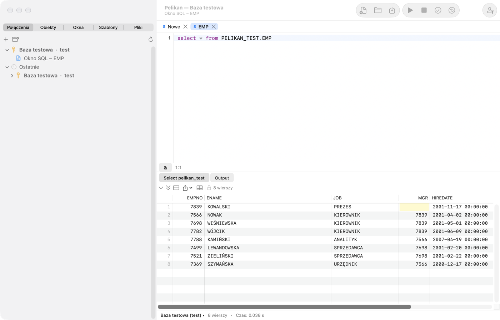

# Introducción y primer inicio

Pelikan es un entorno nativo de macOS para trabajar con bases de datos Oracle: escribir y ejecutar SQL, crear, probar y
depurar código PL/SQL, explorar y editar objetos de la base de datos, pruebas utPLSQL y herramientas de comparación,
exportación y administración. La disposición de las ventanas y los atajos de teclado siguen a PL/SQL Developer, así que
sus usuarios encontrarán ventanas conocidas: **SQL Window**, **Consola SQL*Plus**, **Program Window**, **Test Window**,
**Explain Plan Window** y **Object Browser** (pestaña **Objetos**).

La lista completa de comandos con sus atajos actuales está en el último capítulo, **Atajos de teclado**, que genera la
propia aplicación.

## Cómo usar este manual

El manual está escrito para que pueda seguirlo incluso quien acaba de empezar a trabajar con Oracle. Cada función se
describe con la misma estructura:

- **Para qué sirve**: qué tarea resuelve y qué conceptos necesitas conocer;
- **Cuándo usarla**: situaciones típicas del trabajo diario;
- **Ejercicio paso a paso**: pasos numerados; tras cada paso, *Resultado:* dice lo que deberías ver. Si ves otra cosa,
  detente y vuelve al paso anterior;
- **Atención**: errores típicos y sus consecuencias (marcados con ⚠️).

Los ejercicios usan el **esquema de práctica**: unas tablas y un paquete que creas con el script de la sección **Esquema
de práctica** más abajo. Lo mejor es leer los capítulos en orden: 1 (este), 2 (conexiones), 3 (SQL Window) y después
según lo necesites. Busca una palabra desconocida en **Conceptos básicos** o en el glosario al final del capítulo 15.

## Conceptos básicos

Algunas palabras que aparecen en todo el manual:

| Concepto | Qué significa |
|---|---|
| **Base de datos** (instancia de Oracle) | El servidor que guarda los datos y ejecuta las sentencias. Te conectas a él por la red. |
| **Usuario** y **esquema** | Una cuenta en la base de datos (p. ej. `SCOTT`). Los objetos creados por un usuario pertenecen al esquema del mismo nombre. |
| **Objeto** | Algo que vive en un esquema: tabla, vista, índice, secuencia, paquete, procedimiento, función, disparador, tipo… |
| **Tabla** | Datos en filas y columnas, p. ej. `PEL_EMPLOYEES`. |
| **Vista** | Una consulta guardada que se puede leer como una tabla. |
| **SQL** | El lenguaje de sentencias de la base: `SELECT` (lectura), `INSERT`, `UPDATE`, `DELETE`, `MERGE` (cambio de datos), `CREATE`, `ALTER`, `DROP` (cambio de objetos: DDL). |
| **PL/SQL** | El lenguaje de programación de Oracle: bloques `BEGIN … END`, variables, bucles, excepciones. El código PL/SQL guardado en la base es un **programa** (paquete, procedimiento, función, disparador). |
| **Paquete** | Un conjunto de procedimientos y funciones relacionados: la **especificación** (lo que ofrece) y el **cuerpo** (cómo lo hace). |
| **Sesión** | Una conexión con la base de datos. Pelikan puede tener varias sesiones a la vez (capítulo 13, *Modo de sesión*). |
| **Transacción** | Cambios de datos en una sesión que aún no son permanentes. **COMMIT** los hace permanentes (los demás los ven), **ROLLBACK** los deshace. Las sentencias DDL (`CREATE`, `ALTER`, `DROP`) confirman por sí solas la transacción abierta. |
| **Compilación** | Guardar un programa PL/SQL en la base y que Oracle lo compruebe. Un programa con un error tiene el estado *INVALID*. |
| **Conexión** (en Pelikan) | Un conjunto guardado de datos de inicio de sesión: usuario, base de datos, entorno. |
| **Entorno** | La etiqueta de una base de datos: desarrollo, pruebas, producción. De ella dependen los colores y las advertencias. |

> ⚠️ **La regla más importante:** practica y experimenta solo en una base de datos de **desarrollo** o de **pruebas**. En
> producción (los datos reales de la empresa) ejecuta solo lo que entiendes y lo que está acordado.

## Requisitos

- Un Mac con procesador Apple (M1 o posterior) y macOS 27 o posterior.
- Oracle Instant Client para macOS (ARM64): el paquete Basic o Basic Light. Pelikan no lo incluye (la licencia de Oracle
  no lo permite), así que lo descargas tú mismo del sitio web de Oracle. Sin Instant Client funciona el controlador
  *Thin*, con limitaciones (consulta más abajo).
- Una base de datos Oracle. Pelikan se desarrolla y prueba en Oracle Database 26ai Free; las consultas del diccionario
  de datos tienen variantes para las versiones 19c, 21c y 23ai. En versiones anteriores algunas carpetas y funciones
  pueden no estar disponibles.

## Instalación

1. Descarga la versión más reciente desde la página del proyecto:
   [github.com/andrzejoles/Pelikan/releases](https://github.com/andrzejoles/Pelikan/releases), un archivo `.dmg` o un
   instalador `.pkg`.
2. Desde la imagen `.dmg`, arrastra **Pelikan** al acceso directo **Aplicaciones (Applications)**. El instalador `.pkg`
   lo hace solo.
3. Abre Pelikan desde la carpeta Aplicaciones.

### Advertencia de Gatekeeper en el primer inicio

Pelikan está firmado con un certificado propio del autor («Pelikan Self-Signed»), pero no está notarizado por Apple
(para ello haría falta una cuenta de desarrollador de pago). Por eso, en el primer inicio macOS bloquea la aplicación y
muestra una advertencia. Para abrirla:

1. Cierra la ventana de advertencia.
2. Abre **Ajustes del Sistema › Privacidad y seguridad**, desplázate hasta la sección **Seguridad** y haz clic en
   **Abrir igualmente** junto al mensaje sobre Pelikan.
3. Confirma con tu contraseña o con Touch ID.

Solo tienes que hacerlo una vez. La firma estable hace además que, tras una actualización, macOS no vuelva a preguntar
por el acceso de Pelikan a las contraseñas del Llavero.

## Oracle Instant Client

Descarga «Instant Client for macOS (ARM64)», paquete **Basic** o **Basic Light**, de
[oracle.com](https://www.oracle.com/database/technologies/instant-client/macos-arm64-downloads.html) e instálalo según
las instrucciones de Oracle. Pelikan busca la biblioteca `libclntsh.dylib` en este orden:

1. el directorio indicado en **Ajustes › Oracle › Oracle Instant Client**;
2. `/opt/homebrew/lib`, `/usr/local/lib`, `/usr/local/oracle/instantclient` y los directorios
   `/opt/oracle/instantclient*`;
3. los directorios `instantclient_*` de tus carpetas **Descargas** y **Aplicaciones** (primero la versión más reciente).

Al buscar en la carpeta Descargas, macOS puede preguntar si permites que Pelikan acceda a ella; es una pregunta normal
de privacidad del sistema. Si prefieres evitarla, indica el directorio del cliente manualmente: **Pelikan › Ajustes…**
(⌘,), pestaña **Oracle**, botón **Elegir…**. El cambio de directorio surte efecto tras reiniciar Pelikan.

Sin Instant Client puedes conectarte con el controlador *Thin* (se elige en la definición de la conexión; consulta el
capítulo *Conexiones*). Thin no admite conexiones TCPS ni Oracle Wallet, autenticación externa, cambio de una contraseña
caducada ni interrupción de la ejecución (**Interrumpir**).

## Primeros pasos

### Para qué sirve

Antes de empezar a trabajar, Pelikan necesita saber con qué base de datos conectarse. Este breve tutorial te lleva desde
el programa vacío hasta el primer resultado de una consulta. Necesitas que el administrador o un compañero te dé: un
**nombre de usuario**, una **contraseña** y la **dirección de la base de datos**, con la forma `host:puerto/servicio`
(p. ej. `dbdev.empresa.local:1521/DEVPDB`) o un **alias** del archivo `tnsnames.ora` (p. ej. `DEV`).

### Ejercicio: primera conexión y primera consulta

1. Haz clic en la pestaña **Conexiones** de la columna izquierda de la ventana y luego en el botón **+** (o elige
   **Sesión › Conexiones › Conexión nueva…**).
   *Resultado:* se abre la ventana **Conexión nueva**.
2. En el campo **Nombre** escribe un nombre con el que reconozcas la base de datos, p. ej. `dev_mi_bd`. Escribe el
   **Usuario**, la **Contraseña** y la **Base de datos** (dirección o alias). Como **Entorno** elige **De desarrollo**.
3. Haz clic en **Probar**.
   *Resultado:* un mensaje «Conectado:» con la descripción de la versión de la base de datos. Si ves un error, revisa los
   datos: las causas y soluciones más comunes están en el capítulo 15 (`ORA-01017`: contraseña o usuario incorrectos,
   `ORA-12154`: alias desconocido, `ORA-12541`: host o puerto incorrectos).
4. Marca **Recordar la contraseña en el Llavero** si no quieres escribirla en cada conexión: va al Llavero de macOS, no a
   un archivo. Haz clic en **Guardar**.
   *Resultado:* la conexión está en la lista.
5. Haz doble clic en la conexión de la lista.
   *Resultado:* el nombre de la conexión aparece en negrita: ahora es la **conexión principal**. Las ventanas nuevas la
   usarán. Su nombre aparece también en el título de la ventana de Pelikan.
6. Abre una SQL Window nueva: **Archivo › Nuevo › SQL Window** o **⌘N**.
   *Resultado:* una pestaña nueva con la letra **S** y un editor vacío. La barra de estado bajo el editor muestra el
   nombre de la conexión.
7. Escribe la consulta:

   ```sql
   SELECT sysdate, user FROM dual;
   ```

8. Pulsa **F8** (o **⌘↩**).
   *Resultado:* bajo el editor aparece una pestaña de resultado con una fila: la fecha y hora actuales del servidor y tu
   nombre de usuario. La barra de estado muestra el número de filas y el tiempo de ejecución.

Listo: ya sabes conectarte y ejecutar una consulta. Siguiente paso: crear el esquema de práctica.



## Esquema de práctica

### Para qué sirve

Los ejercicios del manual trabajan con unos pocos objetos pequeños: la tabla de departamentos `PEL_DEPARTMENTS`, la
tabla de empleados `PEL_EMPLOYEES`, la vista `PEL_EMP_DETAILS` y el paquete `PEL_EMP_API` (salario, aumento,
contratación, lista de empleados de un departamento). El prefijo `PEL_` hace que sea fácil distinguirlos de tus objetos y
eliminarlos al terminar. Los datos de ejemplo (nombres de departamentos y empleados) están en polaco: los ejercicios se
refieren a ellos tal cual.

> ⚠️ El script crea objetos en el esquema del usuario con el que has iniciado sesión. Ejecútalo en **tu propio esquema de
> desarrollo o de pruebas**, nunca en producción ni en un esquema compartido sin el acuerdo del equipo. Para crear los
> objetos necesitas los privilegios `CREATE TABLE`, `CREATE VIEW` y `CREATE PROCEDURE` y espacio en un tablespace (en un
> esquema de desarrollo normalmente los tienes).

### Ejercicio: crear el esquema de práctica

1. Conéctate a la base de desarrollo (ejercicio anterior) y abre una SQL Window nueva (**⌘N**).
2. Copia en la ventana todo el script de abajo.
3. Selecciona todo el texto (**⌘A**) y pulsa **F8**.
   *Resultado:* Pelikan ejecuta las sentencias una a una, y la pestaña **Output** bajo el editor muestra un mensaje de
   cada una. Las sentencias se separan con punto y coma y los paquetes con una barra `/` en su propia línea.
4. Comprueba el resultado con la consulta:

   ```sql
   SELECT * FROM pel_emp_details;
   ```

   *Resultado:* 9 filas: empleados con el nombre del departamento y la ciudad. Ewa Woźniak no tiene departamento, así que
   esas columnas están vacías.
5. Abre la pestaña **Objetos** de la columna izquierda y despliega la carpeta **Tablas**.
   *Resultado:* ves `PEL_DEPARTMENTS` y `PEL_EMPLOYEES`.

El script confirma los datos él mismo (COMMIT tras INSERT), así que también se ven en otras ventanas.

```sql
-- Esquema de práctica del manual de Pelikan.
-- Ejecútalo en TU PROPIO esquema de desarrollo o de pruebas, nunca en producción.
CREATE TABLE pel_departments (
  dept_id  NUMBER(4)    CONSTRAINT pel_departments_pk PRIMARY KEY,
  name     VARCHAR2(50) NOT NULL,
  city     VARCHAR2(50)
);

CREATE TABLE pel_employees (
  emp_id      NUMBER(6) GENERATED BY DEFAULT AS IDENTITY (START WITH 100)
              CONSTRAINT pel_employees_pk PRIMARY KEY,
  first_name  VARCHAR2(30) NOT NULL,
  last_name   VARCHAR2(30) NOT NULL,
  email       VARCHAR2(60) CONSTRAINT pel_employees_email_uk UNIQUE,
  hire_date   DATE DEFAULT SYSDATE NOT NULL,
  salary      NUMBER(8,2) CONSTRAINT pel_employees_salary_ck CHECK (salary > 0),
  dept_id     NUMBER(4) CONSTRAINT pel_employees_dept_fk REFERENCES pel_departments,
  manager_id  NUMBER(6) CONSTRAINT pel_employees_mgr_fk REFERENCES pel_employees
);

CREATE INDEX pel_employees_dept_ix ON pel_employees (dept_id);

CREATE OR REPLACE VIEW pel_emp_details AS
  SELECT e.emp_id, e.first_name || ' ' || e.last_name AS full_name, e.salary,
         d.name AS department, d.city
    FROM pel_employees e
    LEFT JOIN pel_departments d ON d.dept_id = e.dept_id;

INSERT INTO pel_departments VALUES (10, 'Księgowość', 'Warszawa');
INSERT INTO pel_departments VALUES (20, 'Informatyka', 'Kraków');
INSERT INTO pel_departments VALUES (30, 'Sprzedaż', 'Gdańsk');
INSERT INTO pel_departments VALUES (40, 'Kadry', NULL);

INSERT INTO pel_employees VALUES (1, 'Anna', 'Nowak', 'anna.nowak@example.com', DATE '2019-03-01', 12000, 20, NULL);
INSERT INTO pel_employees VALUES (2, 'Piotr', 'Kowalski', 'piotr.kowalski@example.com', DATE '2020-06-15', 9500, 20, 1);
INSERT INTO pel_employees VALUES (3, 'Maria', 'Wiśniewska', 'maria.wisniewska@example.com', DATE '2021-01-10', 8700, 20, 1);
INSERT INTO pel_employees VALUES (4, 'Tomasz', 'Wójcik', 'tomasz.wojcik@example.com', DATE '2018-09-03', 11000, 10, NULL);
INSERT INTO pel_employees VALUES (5, 'Katarzyna', 'Kamińska', 'katarzyna.kaminska@example.com', DATE '2022-02-14', 7200, 10, 4);
INSERT INTO pel_employees VALUES (6, 'Michał', 'Lewandowski', 'michal.lewandowski@example.com', DATE '2017-11-20', 13500, 30, NULL);
INSERT INTO pel_employees VALUES (7, 'Agnieszka', 'Zielińska', 'agnieszka.zielinska@example.com', DATE '2023-04-01', 6800, 30, 6);
INSERT INTO pel_employees VALUES (8, 'Paweł', 'Szymański', NULL, DATE '2024-07-08', 6500, 30, 6);
INSERT INTO pel_employees VALUES (9, 'Ewa', 'Woźniak', 'ewa.wozniak@example.com', DATE '2025-01-02', 7000, NULL, NULL);
COMMIT;

CREATE OR REPLACE PACKAGE pel_emp_api AS
  -- Salario de un empleado; si no existe, NO_DATA_FOUND.
  FUNCTION get_salary(p_emp_id IN NUMBER) RETURN NUMBER;
  -- Aumento de p_percent por ciento; porcentaje negativo: error -20001. Sin COMMIT.
  PROCEDURE raise_salary(p_emp_id IN NUMBER, p_percent IN NUMBER);
  -- Empleado nuevo; devuelve su identificador. Sin COMMIT.
  FUNCTION hire(p_first_name IN VARCHAR2, p_last_name IN VARCHAR2, p_salary IN NUMBER,
                p_dept_id IN NUMBER) RETURN NUMBER;
  -- Lista los empleados de un departamento mediante DBMS_OUTPUT.
  PROCEDURE print_department(p_dept_id IN NUMBER);
END pel_emp_api;
/

CREATE OR REPLACE PACKAGE BODY pel_emp_api AS
  FUNCTION get_salary(p_emp_id IN NUMBER) RETURN NUMBER IS
    l_salary pel_employees.salary%TYPE;
  BEGIN
    SELECT salary INTO l_salary FROM pel_employees WHERE emp_id = p_emp_id;
    RETURN l_salary;
  END get_salary;

  PROCEDURE raise_salary(p_emp_id IN NUMBER, p_percent IN NUMBER) IS
  BEGIN
    IF p_percent < 0 THEN
      raise_application_error(-20001, 'Podwyżka nie może być ujemna');
    END IF;
    UPDATE pel_employees
       SET salary = ROUND(salary * (1 + p_percent / 100), 2)
     WHERE emp_id = p_emp_id;
    IF SQL%ROWCOUNT = 0 THEN
      RAISE NO_DATA_FOUND;
    END IF;
  END raise_salary;

  FUNCTION hire(p_first_name IN VARCHAR2, p_last_name IN VARCHAR2, p_salary IN NUMBER,
                p_dept_id IN NUMBER) RETURN NUMBER IS
    l_emp_id pel_employees.emp_id%TYPE;
  BEGIN
    INSERT INTO pel_employees (first_name, last_name, salary, dept_id)
    VALUES (p_first_name, p_last_name, p_salary, p_dept_id)
    RETURNING emp_id INTO l_emp_id;
    RETURN l_emp_id;
  END hire;

  PROCEDURE print_department(p_dept_id IN NUMBER) IS
    l_total NUMBER := 0;
  BEGIN
    FOR r IN (SELECT first_name, last_name, salary
                FROM pel_employees
               WHERE dept_id = p_dept_id
               ORDER BY last_name) LOOP
      dbms_output.put_line(r.last_name || ' ' || r.first_name || ': ' || r.salary);
      l_total := l_total + r.salary;
    END LOOP;
    dbms_output.put_line('Razem: ' || l_total);
  END print_department;
END pel_emp_api;
/
```

Para los ejercicios con pruebas (capítulo 8) también hace falta un paquete de pruebas utPLSQL. Créalo solo cuando el
framework utPLSQL esté instalado en la base (capítulo 8, *Instalar utPLSQL en la base de datos*):

```sql
CREATE OR REPLACE PACKAGE pel_emp_api_test AS
  --%suite(Testy pakietu pel_emp_api)

  --%test(get_salary zwraca pensję pracownika)
  PROCEDURE get_salary_returns_salary;

  --%test(raise_salary podnosi pensję o 10%)
  PROCEDURE raise_salary_ten_percent;

  --%test(Ujemna podwyżka zgłasza błąd -20001)
  --%throws(-20001)
  PROCEDURE raise_salary_negative;
END pel_emp_api_test;
/

CREATE OR REPLACE PACKAGE BODY pel_emp_api_test AS
  PROCEDURE get_salary_returns_salary IS
  BEGIN
    ut.expect(pel_emp_api.get_salary(1)).to_equal(12000);
  END get_salary_returns_salary;

  PROCEDURE raise_salary_ten_percent IS
  BEGIN
    pel_emp_api.raise_salary(2, 10);
    ut.expect(pel_emp_api.get_salary(2)).to_equal(10450);
  END raise_salary_ten_percent;

  PROCEDURE raise_salary_negative IS
  BEGIN
    pel_emp_api.raise_salary(2, -5);
  END raise_salary_negative;
END pel_emp_api_test;
/
```

### Eliminar el esquema de práctica

Cuando termines de aprender, elimina los objetos de práctica (la primera sentencia da error si no creaste el paquete de
pruebas; no pasa nada):

```sql
DROP PACKAGE pel_emp_api_test;
DROP PACKAGE pel_emp_api;
DROP VIEW pel_emp_details;
DROP TABLE pel_employees PURGE;
DROP TABLE pel_departments PURGE;
```

## Ventana principal

Pelikan tiene una única ventana principal:

- **Columna izquierda** con las pestañas **Conexiones** (lista de conexiones con carpetas y las usadas recientemente),
  **Objetos** (Object Browser), **Ventanas** (lista de ventanas abiertas), **Templates** y **Archivos** (explorador de
  archivos). Arrastra su borde para ensanchar la columna (el panel izquierdo); ocúltala y muéstrala con el botón de
  barra lateral del extremo izquierdo de la barra de título (justo después de los botones de la ventana), con
  **Vista › Mostrar u ocultar el panel izquierdo** o con **⌃⌘S**. Su estado y anchura se guardan en la
  disposición de la ventana (guardar la disposición, guardado automático de la disposición).
- **Pestañas de documentos** en el centro: cada ventana SQL, de programa, de prueba o de plan tiene su propia pestaña
  con una letra de tipo en color: S — SQL Window, P — Program Window, T — Test Window, C — consola SQL*Plus, E — Explain
  Plan Window, R — Report Window, D — ventana de diagrama, N — cuaderno SQL. Un clic central en una pestaña cierra la
  ventana; el menú de la pestaña cierra las demás ventanas o las ventanas a la izquierda y a la derecha.
- **Barra de herramientas** con las acciones más frecuentes (ventana nueva, abrir, guardar, ejecutar, interrumpir,
  COMMIT, ROLLBACK, iniciar sesión) y el grupo **Acceso rápido**. Cambias la disposición con **Vista › Personalizar
  barra de herramientas…**.
- **Barra de estado** de la ventana: la conexión de la ventana (con el color del entorno, la fijación 📌 y la marca «solo
  lectura»), el estado de la transacción («● transacción abierta»), el número de filas y el tiempo de ejecución, la
  posición del cursor y la rama Git del archivo. Al hacer clic en el nombre de la conexión puedes cambiar la conexión de
  la ventana.
- **Paneles de herramientas** a la derecha y abajo: las herramientas (Sesiones, Buscar objetos de la base de datos,
  Tareas To-Do, Historial del portapapeles, este manual, editores de tablas, exportación e importación, informes y
  otras) se abren por omisión en el panel derecho, cada una en su propia pestaña. Arrastra una pestaña al otro panel o
  fuera de los paneles: la herramienta pasa entonces a una ventana independiente donde la sueltes; lo mismo hacen el
  menú de la pestaña y los botones de la cabecera del panel. Una ventana de herramienta vuelve a un panel con el botón
  de su barra de título. Pelikan recuerda la ubicación de cada tipo de herramienta. Un panel contraído con herramientas
  muestra en la barra de estado un botón con su número. Los comandos están en **Vista › Paneles de herramientas**; en
  **Ajustes › General › Paneles de herramientas** eliges dónde se abren las herramientas nuevas (también en
  ventanas independientes) y la ocultación automática. Los atajos de una herramienta acoplada (Retorno, Esc) solo
  funcionan mientras el cursor está en esa herramienta.
- **Panel del agente** a la derecha (contraído por omisión): el terminal del agente de IA con la lista de sus acciones.
  Se muestra con **Vista › Panel del agente** (consulta el capítulo *Agentes de IA*).

El título de la ventana muestra la conexión principal y el conjunto de trabajo (workset) activo, y el subtítulo, la
ventana actual.

**Rama en la barra de estado:** un clic en la rama Git (esquina inferior derecha) abre un menú con **Abrir los demás
archivos modificados en la rama** (también **Herramientas › Git** y la cinta **Herramientas › Git**). Pelikan abre los
archivos de código modificados en la rama del repositorio de la ventana activa: confirmados desde el punto de bifurcación
con la rama predeterminada del remoto (`origin/HEAD`, sin ella `origin/main` o `master`; sin remoto — desde la rama
upstream), no confirmados y sin seguimiento. Omite los eliminados, binarios, ignorados y ya abiertos; un par
`.pks`/`.pkb` se abre en una sola ventana. Con más de 30 archivos pregunta antes; la ventana actual sigue activa.

## Grupos de pestañas

Con muchas ventanas abiertas, Pelikan divide las pestañas en **grupos** y la barra de pestañas muestra solo las del
grupo actual. Los grupos aparecen como **cápsulas** en la barra de título, entre el título de la ventana y los botones:
en la primera línea el nombre del grupo y en la segunda un detalle y el número de ventanas (p. ej. «main · 7»,
«5 ventanas»). Un clic en una cápsula muestra las pestañas del grupo y activa su ventana usada más recientemente; el
grupo actual aparece con contorno. Si las cápsulas no caben, la última — **»** — despliega la lista de todos los grupos.
Con un solo grupo no hay cápsulas. Si la barra de herramientas está oculta o la ventana está a pantalla completa, una
pequeña cápsula del grupo actual aparece al principio de la barra de pestañas.

Una ventana entra en un grupo según estas reglas, por orden:

1. **Grupo manual** — si moviste la ventana a uno (tiene prioridad sobre las demás reglas).
2. **Proyecto** — una ventana con un archivo del proyecto de Pelikan abierto.
3. **Repositorio · rama** — un archivo en un repositorio git con remoto; un worktree con otra rama es un grupo aparte,
   y tras un cambio de rama (p. ej. `git checkout`) las ventanas pasan al grupo de la nueva rama cuando vuelves a
   Pelikan. Los repositorios sin remoto — por conexión, como sigue.
4. La **conexión** de la ventana; las ventanas sin conexión — el grupo **Sin conexión** al final.
5. Si todas las demás ventanas usan **una sola base de datos**, en lugar de grupos de conexión hay grupos por tipo de
   ventana: **Ventanas SQL**, **Programas**, **Pruebas**, **Consolas SQL*Plus** y **Otras ventanas**. Pelikan pasa a los
   grupos de conexión solo cuando la segunda base de datos tiene más de una ventana: una sola ventana en otra base no
   reordena toda la barra.

El orden de las cápsulas es fijo: grupos manuales (en orden de creación), proyecto, repositorios y conexiones por orden
alfabético (o tipos de ventana), «Sin conexión» al final. Las pestañas de un grupo siguen el orden de apertura.

Una ventana activada desde cualquier sitio (Object Browser, lista de errores, Lista de ventanas, depurador,
apertura de un archivo, un agente) cambia de grupo por sí sola. **⌃Tab** y **⌃⇧Tab** (Ventana siguiente / anterior)
recorren las ventanas del grupo actual y, tras la última, pasan a la primera ventana del grupo siguiente (todas las
ventanas son accesibles), **⌃⌘]** y **⌃⌘[** — **Grupo de pestañas siguiente** / **Grupo de pestañas
anterior**, y **Ventana › Mostrar grupo de pestañas…** elige un grupo de una lista. **Ventana › Pestañas de todos los
grupos** (también en el menú de la cápsula y en la lista **»**) muestra en la barra las pestañas de todos los grupos. La
Lista de ventanas (pestaña **Ventanas** de la columna izquierda, **Vista › Lista de ventanas**) muestra las
ventanas en un árbol por grupos; un clic en un grupo lo muestra.

**Grupos manuales:** menú de la pestaña › **Mover al grupo › Nuevo grupo…** o un grupo existente; **Quitar del grupo
manual** devuelve la ventana a los grupos automáticos. El menú de la cápsula de un grupo manual tiene **Cambiar nombre…**
y **Desagrupar**. Los grupos manuales y los colores de las conexiones se guardan en el workset. Las pestañas no se
arrastran a las cápsulas: para eso está el menú de la pestaña.

**Las pestañas** tienen dos líneas: el punto del color del entorno, la letra del tipo, el título y el botón de cierre
(un punto — cambios sin guardar), y debajo siempre la conexión de la ventana (ventana sin conexión — «Sin conexión» en
gris); el nombre completo está en la ayuda emergente. El fondo de la pestaña tiene el color de la conexión de la paleta
(ver *Conexiones › Entornos y protección contra errores*): la pestaña activa tiene un fondo más intenso, un subrayado
grueso del color de la conexión y el título en negrita. Si las pestañas no caben en una fila, aparecen los botones
**‹** y **›** a los lados de la barra; también puedes desplazarla con la rueda del ratón o con un gesto del trackpad, y
la pestaña activa siempre queda visible.

## Cinta y «Buscar acciones»

Bajo la barra de herramientas está la **cinta**: cada acción con un clic, sin buscar en menús ni recordar atajos. Las
pestañas fijas son **Iniciar** (ventanas nuevas, archivos, ejecución, COMMIT y ROLLBACK, conexión, búsqueda),
**Edición**, **Objetos**, **Depuración y pruebas**, **Herramientas**, **Informes** y **Vista**. Con una ventana de
programa, resultado, diagrama, informe, cuaderno, plan o comandos aparece una **pestaña contextual** de color (p. ej.
**Programa** con compilación, unidades, comparación con el origen en la base de datos y pruebas). La cinta recuerda qué
pestaña eligió para cada tipo de ventana y vuelve a ella al cambiar de ventana.

Las acciones frecuentes tienen botones grandes y las demás pequeños; las menos usadas están en las listas desplegables
de los grupos (marcadas con ▾). La descripción emergente de un botón muestra su descripción y atajo, así aprende los
atajos sobre la marcha. Clic derecho en un botón añade el comando al acceso rápido. Doble clic en una pestaña o la
flecha de la derecha contrae la cinta a sus pestañas; **Vista › Cinta** la oculta (también en **Ajustes › General ›
Cinta**). Si la ventana es estrecha y una pestaña de la cinta no cabe, aparecen a los lados los botones **‹ ›**, que
la desplazan hasta el borde del grupo siguiente; también la desplazan la rueda del ratón y el trackpad. La fila de
pestañas de la cinta se desplaza igual cuando no cabe junto al campo de búsqueda.

El campo **Buscar acciones…** a la derecha de las pestañas encuentra cualquier comando: escriba unas letras, «plan»,
«eksport tabel», una palabra sin diacríticos polacos o un nombre en inglés conocido de PL/SQL Developer, p. ej.
«beautifier», «compile invalid». Los resultados muestran dónde está el comando en la cinta, su atajo y si está
disponible ahora; Intro o un clic lo ejecuta.

## Paleta de comandos

Cada acción de Pelikan es un comando: tiene una entrada de menú, un atajo opcional y una descripción de sus efectos. La
**paleta de comandos** (**Vista › Paleta de comandos…**, ⇧⌘P) busca comandos por nombre y muestra en qué menú están y
qué atajo tienen. Es la forma más rápida de encontrar una función cuya ubicación en el menú no recuerdas.

## Perfiles de teclado

Pelikan tiene dos perfiles de atajos: **PL/SQL Developer** (teclas F y Ctrl; p. ej., F8 ejecuta y F9 inicia la
depuración) y **macOS** (atajos con ⌘). En ambos perfiles funcionan los equivalentes con ⌘; p. ej., ⌘↩ ejecuta una
sentencia. El perfil se elige en **Ajustes › Teclado**. Si las teclas F1–F12 controlan el brillo o el volumen,
activa en Ajustes del Sistema la opción de usarlas como teclas de función estándar o púlsalas junto con la tecla fn.

## Actualizaciones

Una vez al día Pelikan comprueba si hay una versión nueva y propone instalarla. También puedes comprobarlo manualmente:
**Pelikan › Buscar actualizaciones…**. Cada versión está firmada con la clave del autor: la aplicación no acepta un
archivo de otra procedencia. Los ajustes, las conexiones y las contraseñas no cambian.

## Idiomas

La interfaz está disponible en polaco, inglés, alemán, español y ucraniano. El idioma se elige en **Ajustes ›
General › Idioma de la interfaz**; el cambio surte efecto tras reiniciar. Los nombres de algunas ventanas y herramientas
(p. ej., Explain Plan, Large Data Editor, Query Builder) se mantienen en su forma original.

## Dónde guarda Pelikan sus datos

Las definiciones de conexiones (sin contraseñas), los ajustes, el historial, los worksets, el historial local de
archivos, el registro de agentes y otros datos de la aplicación están en el directorio `~/Library/Application
Support/Pelikan`. Las contraseñas están únicamente en el Llavero de macOS; consulta el capítulo *Seguridad y
privacidad*.

## Ayuda

- **Ayuda › Ayuda de Pelikan** (⇧⌘/) abre este manual.
- **F1** en el editor abre la documentación de Oracle de la palabra bajo el cursor (código de error, paquete, vista del
  diccionario, sentencia SQL).
- **Ayuda › Documentación de Oracle…** busca en los manuales de Oracle de la versión elegida.

## Acerca de

Pelikan es un proyecto abierto con licencia MIT:
[github.com/andrzejoles/Pelikan](https://github.com/andrzejoles/Pelikan). Autor: Andrzej Oleś w kooperacji z Claude AI.
Las licencias de las bibliotecas utilizadas están en el archivo «Licencje zewnętrzne» (licencias de terceros) que
acompaña a la aplicación.
