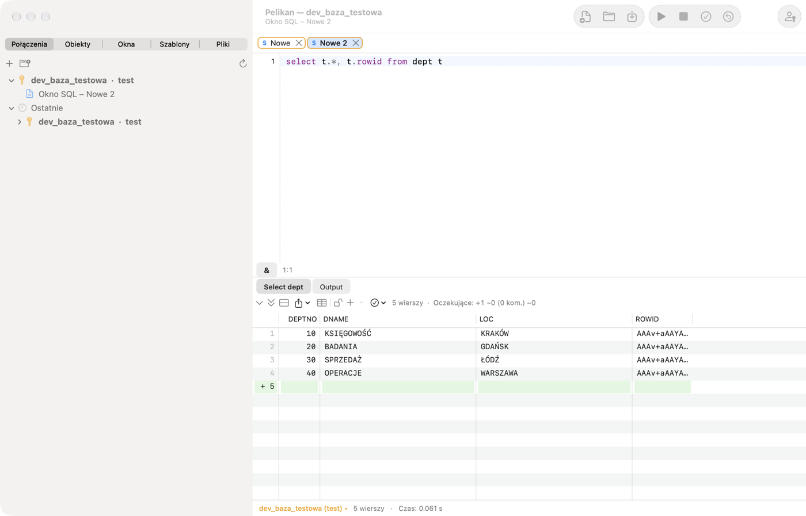
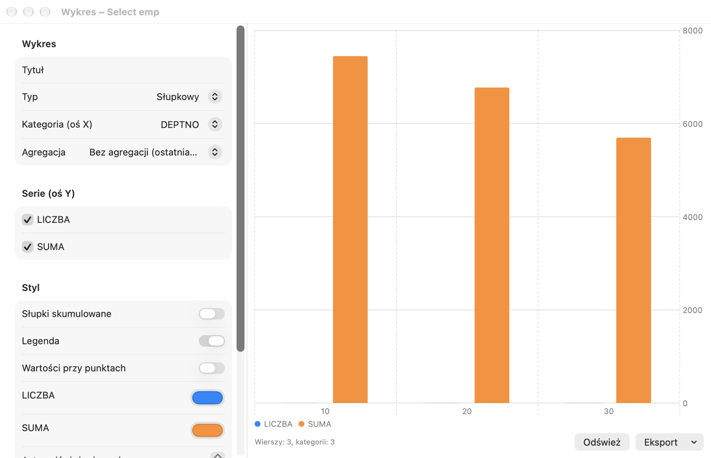

# SQL Window y cuadrícula de resultados

## Para qué sirve

En la **SQL Window** hablas con la base de datos: escribes una sentencia SQL (p. ej. una consulta `SELECT`), la ejecutas y
miras el resultado. Es la ventana más usada de Pelikan: en ella compruebas datos, corriges una fila, preparas un informe o
ejecutas un script de despliegue.

**Cuándo usarla:** siempre que quieras ejecutar SQL o un bloque PL/SQL corto. Para escribir paquetes y procedimientos
sirve la Program Window (capítulo 6), para probar programas con parámetros la Test Window (capítulo 7) y para scripts de
SQL*Plus con `SET`, `SPOOL`, `PROMPT` la consola SQL*Plus (capítulo 4).

Los ejercicios de este capítulo usan el esquema de práctica del capítulo 1.

La SQL Window sirve para ejecutar consultas y scripts. El resultado de cada consulta aparece en una pestaña aparte bajo
el editor, y los mensajes de la base de datos y la salida de DBMS_OUTPUT, en la pestaña **Output**. Abres una ventana
nueva con **Archivo › Nuevo › SQL Window** (⌘N); la ventana trabaja en la conexión principal o en la conexión elegida en
la barra de estado.

## Ejecutar sentencias

| Acción | Atajo | Menú |
|---|---|---|
| Ejecutar la selección o la sentencia bajo el cursor | F8, ⌘↩ | Sesión › Ejecutar |
| Ejecutar al contrario que AutoSelect (p. ej., todo el script) | ⌃F8, ⇧⌘↩ | Sesión › Ejecutar (al contrario que AutoSelect) |
| Interrumpir la ejecución o la obtención de filas | ⇧⎋, ⌘. | Sesión › Interrumpir |
| Confirmar la transacción | F10, ⌥⌘↩ | Sesión › Confirmar (COMMIT) |
| Revertir la transacción | ⇧F10, ⌥⌘⌫ | Sesión › Revertir (ROLLBACK) |
| Sentencia anterior / siguiente de la ventana | ⌥⌘↑, ⌥⌘↓ | Sesión › Historial de la ventana |

Por omisión está activado **AutoSelect**: sin selección, F8 ejecuta solo la sentencia en la que está el cursor, así que
no ejecutarás por accidente todo el script. El texto seleccionado se ejecuta completo. Las sentencias se separan como en
SQL*Plus: el punto y coma termina una sentencia SQL, y un bloque PL/SQL o un `CREATE` con cuerpo termina con una barra
`/` en una línea aparte. Cada consulta del script obtiene su propia pestaña de resultados.

Atención: en macOS el atajo ⌃F8 lo ocupa por omisión el sistema (mover el foco a los menús de estado); usa ⇧⌘↩ o
desactiva el atajo del sistema en **Ajustes del Sistema › Teclado › Funciones rápidas de teclado**.

Durante la ejecución la ventana queda bloqueada para la edición y la barra de estado muestra «Ejecutando…». Al terminar
se ven el número de filas y el tiempo; un tiempo de más de 100 segundos tiene el formato hh:mm:ss. Tras una consulta
larga, Pelikan puede reproducir un sonido y hacer rebotar su icono en el Dock. Si **Interrumpir** no funciona (algunas
operaciones de la base de datos no responden a la interrupción), usa **Sesión › Finalizar la sesión de la ventana
(Kill)**.

Pelikan nunca confirma cambios automáticamente (la opción **AutoCommit de sentencias SQL** de **Ajustes › SQL
Window** está desactivada por omisión). La barra de estado indica una transacción abierta («● transacción abierta»).

> **Ejercicio: una sentencia o todo el script.**
> 1. Abre una SQL Window nueva (⌘N) y escribe tres consultas, cada una en su línea:
>
>    ```sql
>    SELECT * FROM pel_departments;
>    SELECT * FROM pel_employees WHERE dept_id = 20;
>    SELECT COUNT(*) FROM pel_employees;
>    ```
>
> 2. Haz clic en la segunda línea y pulsa **F8**.
>    *Resultado:* solo se ejecuta la segunda consulta: una pestaña de resultado con los tres empleados del departamento
>    20 (AutoSelect).
> 3. Pulsa **⇧⌘↩** (ejecutar al contrario de AutoSelect).
>    *Resultado:* se ejecutan las tres consultas; bajo el editor hay tres pestañas de resultados.
> 4. Selecciona con el ratón las dos primeras líneas y pulsa **F8**.
>    *Resultado:* se ejecutan las dos consultas seleccionadas: la selección siempre tiene prioridad sobre AutoSelect.
>
> ⚠️ **Atención.** Con AutoSelect desactivado, F8 sin selección ejecuta todo el script, incluidas las sentencias
> `DELETE` o `DROP` que dejaste en la ventana «para luego». Deja en la ventana solo lo que quieres ejecutar.

## Contenido del código

A la izquierda del editor, el **Contenido del código** muestra la estructura de todo el script: sentencias SQL (la
primera palabra y el comienzo de la sentencia, hasta unos 1000 caracteres con saltos de línea en la ayuda emergente), procedimientos, funciones,
paquetes y disparadores de `CREATE`, y bloques anónimos con sus declaraciones. Un clic o Intro lleva el cursor a la
sentencia, el árbol sigue el cursor y el campo sobre el árbol filtra también por el texto de la sentencia (p. ej.
el nombre de una tabla). El panel se muestra u oculta en esta ventana con **Vista › Contenido del código** o con el
botón de lista con sangría en el extremo izquierdo de la barra de la ventana; la elección se mantiene en la ventana, y
el valor por defecto de las ventanas nuevas está en **Ajustes › Editor › Contenido del código visible por defecto**.
La consola SQL*Plus no tiene este panel. En un script con más de 5000 sentencias SQL, el panel muestra solo las
unidades y bloques PL/SQL (con una nota con el número de sentencias).

En los bloques anónimos y las unidades del script el panel muestra también **estructuras de control** (IF, bucles,
CASE, manejadores de excepciones — véase el capítulo de la ventana de programa); el botón de bifurcación
junto al filtro las oculta.

## Variables

- **Variables de sustitución** `&nombre` y `&&nombre`: antes de ejecutar, Pelikan muestra la ventana **Variables** con
  campos para los valores. En la SQL Window, `&&` en el texto significa un carácter `&` normal (p. ej., `'R&&D'`); en la
  consola SQL*Plus, `&&` funciona como en SQL*Plus (la variable se recuerda).
- **Variables de enlace** `:nombre`: también van a la ventana de variables (`:new` y `:old` en los disparadores se
  omiten).
- **Parámetros de informes de JasperReports** `$P{…}`, `$P!{…}` y `$X{IN, columna, parámetro}`: Pelikan los reconoce y
  pide sus valores, así que ejecutas la consulta de un informe sin reescribirla.
- La sintaxis ampliada `&<name="…" type="…" list="…" default="…" required="…">` permite describir una variable: tipo,
  lista de valores (también de una consulta que depende de otras variables), valor predeterminado, obligatoriedad y
  otras opciones.

Los valores de las variables se recuerdan en la ventana. El botón **&** de la barra bajo el editor (**Sesión ›
Sustitución de variables**) desactiva la sustitución cuando el texto contiene los caracteres `&` y `:` con otro
significado.

**Para qué sirve:** una variable permite escribir una consulta una vez y ejecutarla con valores distintos, sin reescribir
la condición. Las **variables de enlace** (`:nombre`) son además más seguras y rápidas para la base que pegar los valores
en el texto.

> **Ejercicio: una consulta con parámetro.**
> 1. En una SQL Window escribe y ejecuta (F8):
>
>    ```sql
>    SELECT first_name, last_name, salary FROM pel_employees WHERE dept_id = :dzial;
>    ```
>
>    *Resultado:* aparece la ventana **Variables** con un campo `dzial`.
> 2. Escribe `30` y confirma.
>    *Resultado:* tres filas: los empleados del departamento Sprzedaż (ventas).
> 3. Ejecuta la consulta otra vez.
>    *Resultado:* la ventana Variables recuerda el valor `30`; cámbialo a `10` y verás el departamento Księgowość
>    (contabilidad).

## Directivas en comentarios

Un comentario justo antes de una sentencia puede controlar su resultado:

| Directiva | Efecto |
|---|---|
| `-- Tab=Empleados` | título de la pestaña de resultados; `&Count` inserta el número de filas |
| `-- Records=all` | cuántas filas obtener de inmediato: un número, `page` o `all` |
| `-- Totals=sum:SAL;count:EMPNO` | sumas y otras funciones bajo la cuadrícula |
| `-- AltRowColor=…` | color de las filas alternas |
| `-- Excel=informe_%date%.xlsx` | guardar todo el resultado en un archivo Excel |
| `-- CSV=%dbuser%_%time%.csv` | guardar todo el resultado en un archivo CSV |

En los nombres de archivo funcionan `%dbuser%`, `%dbname%`, `%date%`, `%time%` y `%&variable%`. Una ruta relativa se
cuenta desde el directorio del archivo de la ventana.

Ejemplo: una pestaña de resultado con nombre y la suma de salarios bajo la cuadrícula:

```sql
-- Tab=Empleados (&Count)
-- Totals=sum:SALARY
SELECT first_name, last_name, salary FROM pel_employees;
```

## Cuadrícula de resultados



Justo encima del resultado está la **barra de acciones del resultado**: iconos de todas las acciones sobre el
resultado, agrupados como en la pestaña **Resultado** de la cinta: obtención, edición de datos, filtro y QBE, copia y
exportación, análisis (gráfico, totales, registro, panel de valor) y pestañas de resultados; las listas desplegables
llevan una flecha ▾. La descripción emergente de un icono muestra nombre, descripción y atajo. Si la barra no cabe, las
demás acciones están en el menú **»**; a la derecha se ve el número de filas.

La cuadrícula obtiene las filas por lotes (el número se ajusta en **Ajustes › SQL Window › Filas por página**) y
carga más al desplazarte. La indicación «(más…)» junto al número de filas significa que el resultado no está completo.
**Página siguiente** (⌘⇟) y **Última página (obtener todo)** (⇧⌘⇟) están en el menú **Sesión › Resultado** y en la barra
sobre la cuadrícula. Con resultados muy grandes, Pelikan pregunta antes de superar el límite de tamaño de Ajustes.

- **Ordenar**: clic en el encabezado de la columna (ascendente, descendente, sin orden) sobre las filas obtenidas.
- **Seleccionar**: filas, columnas y bloques de celdas (clic y luego ⇧+clic).
- **NULL** tiene fondo de color; los números se muestran con la precisión completa de Oracle.
- **CLOB, BLOB, XML, textos largos**: el botón de la celda o **Edición › Resultado › Large Data Editor…** (⌥⌘L) abre el
  editor de datos grandes con vistas de texto, XML, JSON, HTML, imagen, PDF y hexadecimal, formato JSON/XML y guardado
  en archivo.
- El **Panel de valores** (**Vista › Panel de valores**, ⌥⌘V) muestra junto a la cuadrícula la celda actual como texto,
  JSON, XML, HTML, imagen o hexadecimal.
- La **Vista de registro único** muestra la fila actual en vertical con los tipos y comentarios de las columnas. La
  activa y desactiva el botón de la barra sobre la cuadrícula o **Registro** en la pestaña **Resultado** de la cinta;
  cada pestaña de resultado recuerda su estado.
- Un **cursor anidado** (`CURSOR(…)` en una consulta) se abre en una pestaña de resultados nueva.
- **Filtro de columnas…** oculta columnas por nombre, tipo, obligatoriedad y claves; las columnas ocultas se omiten al
  copiar y exportar.
- **Filtrar por el valor de la celda**, **Filtrar por expresión…** (`=`, `<>`, `<`, `>`, `LIKE`, `IS NULL`, `AND`, `OR`)
  y **Agrupar por columna** (con contadores; el doble clic filtra) funcionan localmente, sobre las filas obtenidas.
- **Totales de columna…** calculan bajo la cuadrícula la suma, el recuento, la media, el mínimo y el máximo, y los
  recuerdan tras volver a ejecutar.
- **Comparar registros** compara las filas seleccionadas columna a columna, y **Comparar resultados**, dos pestañas de
  resultados.
- **Consultas relacionadas…** abren en una ventana nueva las tablas padre e hijas de la fila actual (según las claves
  ajenas).
- **Actualizar resultado** (⇧⌘R) vuelve a ejecutar la sentencia de la pestaña, y **Actualización automática…** lo hace
  cada cierto número de segundos.
- **Fijar resultado** conserva la pestaña en la siguiente ejecución (también ⇧+clic en la pestaña).
- El tamaño de fuente de la cuadrícula se cambia en **Vista › Cuadrícula**.

La mayoría de estas acciones están en el menú contextual de la cuadrícula y en **Edición › Resultado** o **Sesión ›
Resultado**.

> **Ejercicio: trabajar con un resultado.**
> 1. Ejecuta `SELECT * FROM pel_emp_details;`.
>    *Resultado:* 9 filas.
> 2. Haz clic dos veces en el encabezado de la columna **SALARY**.
>    *Resultado:* el primer clic ordena de forma ascendente y el segundo descendente; arriba está Michał Lewandowski
>    (13500).
> 3. Haz clic derecho en la celda `Informatyka` de la columna **DEPARTMENT** y elige **Filtrar por el valor de la celda**.
>    *Resultado:* quedan las tres filas del departamento Informatyka (informática). El filtro actúa sobre las filas
>    obtenidas, sin volver a consultar la base; lo quitas en la barra sobre la cuadrícula.
> 4. Haz clic derecho en la columna **SALARY**, elige **Totales de columna…** y marca suma y media.
>    *Resultado:* bajo la cuadrícula se ven la suma y la media de los salarios de las filas visibles.
> 5. Selecciona algunas filas, pulsa **⇧⌘C** (copiar con encabezado) y pega en Numbers o Excel.
>    *Resultado:* los datos en columnas, con encabezados.
>
> ⚠️ **Atención.** Ordenar, filtrar y los totales actúan sobre las filas **obtenidas**. Si el resultado muestra «(más…)»,
> parte de las filas aún no se ha obtenido: obténlas todas (⇧⌘⇟) o añade una condición a la consulta.

## Editar datos en la cuadrícula

Para editar un resultado, la consulta debe devolver la columna `ROWID`, p. ej.:

```
select t.*, t.rowid from dept t
```

Lo más sencillo es usar **Editar datos** del menú de la tabla en el Object Browser: Pelikan prepara esa consulta por sí
mismo.

1. Haz clic en el candado sobre la cuadrícula o elige **Sesión › Resultado › Editar datos** (⌥⌘E).
2. Modifica celdas, añade filas (**Insertar registro**, ⌥⌘I) y elimínalas (**Eliminar registro**, ⇧⌘⌫). Los cambios
   pendientes se marcan en el encabezado de la fila (+, ~, −) y con color; el contador sobre la cuadrícula muestra
   cuántos hay. Las columnas con alias y las expresiones son de solo lectura. Para las columnas DATE hay un
   **Calendario…**, y para las columnas con una restricción `CHECK … IN` o una clave ajena a una tabla pequeña, una
   **Lista de valores…**.
3. **Copiar SQL de los cambios** muestra las sentencias que se ejecutarán.
4. **Confirmar cambios (Post)** (⌥⌘S) envía los cambios a la base de datos, sin COMMIT. Tras un error, el cursor pasa a
   la celda afectada. **Descartar cambios** desecha todos los cambios pendientes.
5. Confirma la transacción (F10, ⌥⌘↩) o reviértela.

En una conexión de producción, guardar requiere confirmación, y en una conexión de solo lectura está bloqueado.

> **Ejercicio: añade un departamento desde la cuadrícula.**
> 1. Ejecuta `SELECT t.*, t.rowid FROM pel_departments t;`.
>    *Resultado:* 4 departamentos.
> 2. Haz clic en el candado sobre la cuadrícula (o ⌥⌘E).
>    *Resultado:* el candado está abierto y las celdas se pueden editar.
> 3. Elige **Insertar registro** (⌥⌘I) y escribe `50`, `Logistyka`, `Poznań`.
>    *Resultado:* la fila nueva tiene un **+** en su encabezado, y el contador sobre la cuadrícula muestra 1 cambio
>    pendiente.
> 4. Elige **Copiar SQL de los cambios**.
>    *Resultado:* en el portapapeles hay una sentencia `INSERT INTO … PEL_DEPARTMENTS …`: así guardará Pelikan el cambio.
> 5. Pulsa **⌥⌘S** (Confirmar cambios).
>    *Resultado:* el **+** desaparece y la barra de estado muestra «● transacción abierta»: el cambio está en la base,
>    pero aún sin confirmar.
> 6. Pulsa **⇧F10** (ROLLBACK) y después **⇧⌘R** (actualizar resultado).
>    *Resultado:* el departamento 50 ya no está: el cambio se ha revertido. Para conservarlo, pulsa F10 (COMMIT) en lugar
>    de ROLLBACK.

## Copiar y exportar

- **Edición › Resultado › Copiar con encabezado** (⇧⌘C), **Copiar encabezado**, **Copiar como lista de expresiones**
  (para `IN (…)`), **Copiar a Excel** y, en el menú contextual de la cuadrícula, también **Copiar como** (formato
  elegido).
- **Archivo › Exportar resultado…** guarda la selección o todo el resultado obtenido como CSV, TSV, HTML, XML, SQL
  (INSERT), lista de expresiones o Excel (xlsx).
- **Sesión › Resultado › Exportar consulta a archivo…** ejecuta la sentencia bajo el cursor y guarda el resultado
  directamente en un archivo, sin mostrarlo: práctico con resultados grandes.
- **Archivo › Exportar resultado › Columna a archivos…** guarda el valor de una columna (p. ej., BLOB) en un archivo
  aparte para cada fila.
- **Generar SQL a partir de filas…** crea sentencias INSERT, UPDATE, DELETE o MERGE para las filas seleccionadas en una
  SQL Window nueva, sin ejecutarlas.
- **Archivo › Imprimir…** (⌘P) imprime el código de la ventana con colores de sintaxis y la cuadrícula (las filas
  seleccionadas o todas las obtenidas).

> **Ejercicio: exportar a Excel.**
> 1. Ejecuta `SELECT * FROM pel_emp_details;`.
> 2. Elige **Archivo › Exportar resultado…**, el formato Excel (xlsx) y guarda el archivo en el escritorio.
>    *Resultado:* el archivo se abre en Excel o Numbers; los salarios son números (se pueden sumar) y los encabezados son
>    los nombres de las columnas.

## Gráficos

**Sesión › Resultado › Gráfico…** abre una ventana de gráfico a partir de la pestaña de resultados actual. Elige el tipo
(barras, líneas, áreas, dispersión o circular), la columna de categoría (eje X), las series (eje Y) y una agregación
opcional; ajusta los colores, la leyenda y los valores junto a los puntos. Puedes guardar una plantilla de gráfico y
exportar el gráfico a PNG, PDF o al portapapeles. **Actualizar** vuelve a ejecutar la consulta de la SQL Window.



> **Ejercicio: salarios por departamento en un gráfico.**
> 1. Ejecuta:
>
>    ```sql
>    SELECT department, SUM(salary) AS total FROM pel_emp_details GROUP BY department;
>    ```
>
> 2. Elige **Sesión › Resultado › Gráfico…**, tipo de barras, categoría **DEPARTMENT**, serie **TOTAL**.
>    *Resultado:* una barra por departamento; la más alta es la de Informatyka.

## Query By Example

**Sesión › Resultado › Query By Example…** (⇧⌘E) permite acotar un resultado sin escribir WHERE: escribe criterios bajo
los nombres de las columnas (un valor, un patrón con `%`, un operador (`>`, `<>`…), `in (…)`, `between … and …` o
`null`) y Pelikan vuelve a ejecutar la consulta con las condiciones. La comparación de texto no distingue mayúsculas de
minúsculas y las fechas se comparan sin la hora. **Borrar Query By Example** restaura la consulta original.

> **Ejercicio: QBE.**
> 1. Ejecuta `SELECT * FROM pel_employees;` y pulsa **⇧⌘E**.
> 2. Bajo la columna **SALARY** escribe `> 10000` y bajo **LAST_NAME**, `%ski`.
>    *Resultado:* al confirmar queda una fila: Michał Lewandowski (13500). Piotr Kowalski también termina en «ski», pero
>    gana 9500. QBE añadió ambas condiciones a la consulta a la vez (unidas con AND).
> 3. Elige **Borrar Query By Example**.
>    *Resultado:* de nuevo todas las filas.

Cómo compara QBE los textos y las fechas se ajusta en **Ajustes › SQL Window › Query By Example** (capítulo 13).

## Estadísticas y plan

Si se activan en **Ajustes › SQL Window › Estadísticas**, la pestaña **Estadísticas** muestra la variación de las
estadísticas de la sesión (V$MYSTAT) en cada ejecución. **Herramientas › Explain Plan** (F5) muestra el plan de la
sentencia bajo el cursor, y **Herramientas › Autotrace** la ejecuta y muestra el plan real; consulta el capítulo *Plan
de ejecución, sesiones y administración*.

## Archivos e historial

- **Archivo › Guardar** (⌘S) guarda la ventana en un archivo `.sql`; los archivos conservan su codificación y sus
  finales de línea.
- **Edición › Historial de comandos…** (⇧⌘H; en el perfil PL/SQL Developer, ⌃E) muestra todas las sentencias ejecutadas
  en todas las ventanas (sin las que contienen contraseñas) con un filtro; las elegidas se insertan en el editor.
- **Archivo › Pegar como nueva SQL Window** crea una ventana con el contenido del portapapeles.
- El historial local de un archivo (**Archivo › Historial local**) se describe en el capítulo *Herramientas*.
