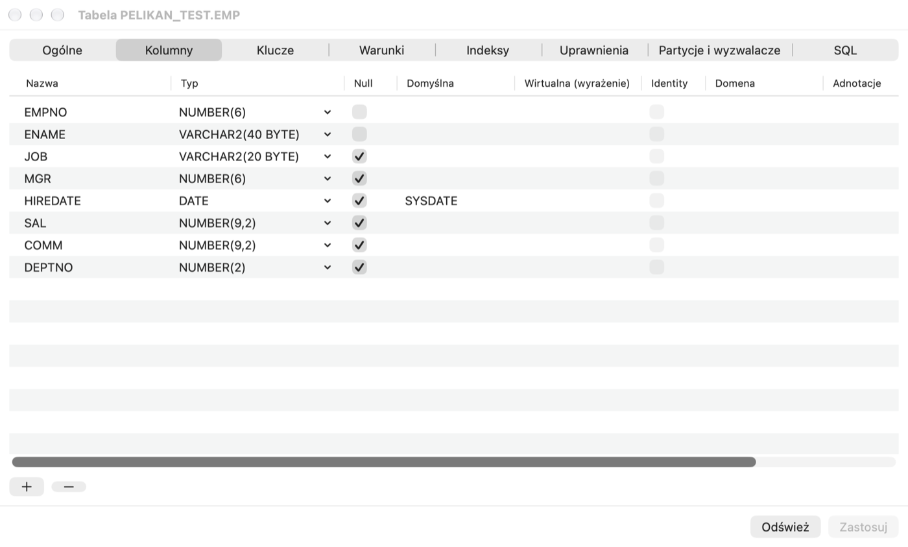
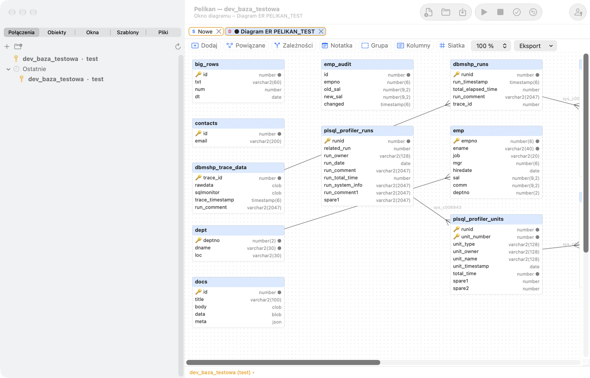

# Object Browser y editores de objetos

## Para qué sirve

Una base de datos contiene cientos o miles de objetos: tablas, vistas, paquetes, índices. El **Object Browser** los
muestra en un árbol, como el Finder muestra los archivos: puedes recorrerlos, buscarlos, abrirlos para editarlos y ver sus
datos y su estructura. Los **editores de objetos** permiten crear y modificar objetos con un formulario, sin escribir a
mano sentencias `CREATE` y `ALTER`: Pelikan muestra el SQL generado antes de ejecutarlo, así que de paso aprendes la
sintaxis.

**Cuándo usarlo:** cuando quieras comprobar qué columnas tiene una tabla, quién usa un paquete, qué objetos quedaron no
válidos tras un despliegue, o añadir una columna o un índice.

## Object Browser

La pestaña **Objetos** de la columna izquierda muestra los objetos de la base de datos de las conexiones abiertas en
carpetas por tipo: **Funciones**, **Procedimientos**, **Paquetes**, **Cuerpos de paquete**, **Tipos**, **Disparadores**,
**Fuentes Java**, **Bibliotecas**, **Tablas**, **Vistas**, **Vistas materializadas**, **Secuencias**, **Sinónimos**,
**Índices**, **Enlaces de base de datos**, **Colas**, **Trabajos (Scheduler)**, **Usuarios**, **Roles**, **Perfiles**,
**Directorios** y otras. En las bases de datos 23ai y 26ai se añaden **Módulos MLE**, **Entornos MLE**, **Dominios**,
**Grafos de propiedades**, **Anotaciones** y **Aserciones**. Las carpetas solo aparecen si la versión de la base de
datos y tus privilegios lo permiten.

En el nivel superior del árbol están las **conexiones abiertas**, como en DBeaver. Las conexiones se ordenan
alfabéticamente; la principal está marcada con una estrella, en negrita y con la etiqueta «principal»; las demás
aparecen al conectarse (por ejemplo, con una ventana en otra conexión o **Conectar** en la lista de conexiones) y
desaparecen al desconectarse. Cada conexión tiene sus propias carpetas, **Recientes** y selección de usuario. Las
acciones sobre un objeto (Mostrar datos, Editar, DDL, Recompilar, arrastrar al editor…) actúan sobre la conexión de la
rama, y las ventanas abiertas para un objeto de una conexión distinta de la principal quedan fijadas a ella. El menú
de la conexión en el árbol: **Establecer como conexión principal**, **Nueva ventana SQL en esta conexión**,
**Actualizar**, **Editar conexión…** y **Desconectar**. La conexión principal es la predeterminada solo cuando el
contexto no indica otra: una ventana nueva desde el menú, una herramienta sin ventana activa.

Al final de las carpetas de cada conexión están **DBA** —objetos del diccionario con el prefijo `DBA_`— y **DBMS**
—objetos con el prefijo `DBMS_`, sobre todo paquetes de Oracle—. Muestran solo los objetos sobre los que tienes
privilegios (concedidos directamente, mediante un rol o a PUBLIC); se omiten los sinónimos públicos y los objetos del
esquema SYS aparecen sin el prefijo «SYS.». Los objetos se despliegan y se abren como en las demás carpetas, y el
filtro de nombres también se aplica. Cambiar un objeto de un esquema mantenido por Oracle (SYS, XDB…) —recompilar,
añadir información de depuración, eliminar, renombrar, habilitar o compilar en una ventana de programa— siempre
requiere una confirmación aparte (**Cancelar** por defecto), porque puede invalidar objetos en toda la base de datos.

- **Selección de usuario** sobre el árbol (por separado para cada conexión):
  - *Usuario actual*: objetos de tu esquema más los enlaces de base de datos públicos y los sinónimos públicos de
    objetos de la aplicación (sin los miles de sinónimos a esquemas de sistema de Oracle);
  - *Objetos accesibles*: todo lo que puedes usar: objetos propios, objetos de otros esquemas con privilegios
    concedidos y públicos (con el propietario delante del nombre);
  - *Todos los usuarios*: objetos de todos los esquemas (con las vistas DBA si tienes acceso a ellas, también los
    enlaces privados de otros esquemas; estos últimos también
    cuando solo puedes leer `DBA_DB_LINKS`; el enlace privado de otro esquema no te es «accesible», porque solo su
    propietario puede usarlo);
  - un esquema concreto.
  La carpeta **Directorios** (los directorios de Oracle no tienen propietario de esquema) muestra todos los directorios
  en cualquier modo si tienes acceso a las vistas DBA y, si no, los que tienen privilegios concedidos.
  El ámbito al conectar se ajusta en **Ajustes › Object Browser › Al conectar, mostrar**.
- **Filtro** bajo la selección de usuario: parte del nombre (en cualquier posición: `emp` encuentra `EMP` y
  `T_EMP_HIST`), un patrón con `%` (p. ej. `EMP%`: solo el principio del nombre; el comportamiento sin `%` se cambia en
  **Ajustes › Object Browser**), varios patrones separados por comas,
  `status=invalid` (solo objetos no válidos) o `source=texto` (objetos cuyo código fuente contiene el texto).
- Al expandir un objeto se ven sus elementos: columnas con tipos, restricciones, índices, disparadores, particiones,
  subprogramas, atributos y también las dependencias (**Depende de**, **Usado por**).
- La carpeta **Recientes** contiene los objetos abiertos recientemente.
- Los objetos no válidos tienen una marca roja.
- **Actualizar** en el menú (o **Herramientas › Objeto › Actualizar Object Browser**) vacía la caché del diccionario y
  vuelve a cargar el árbol.

El árbol funciona con fluidez incluso en esquemas con decenas de miles de objetos: el diccionario se lee en segundo
plano.

> **Ejercicio: conoce la tabla de práctica.**
> 1. Haz clic en la pestaña **Objetos** de la columna izquierda.
>    *Resultado:* un árbol con la conexión principal arriba y debajo las carpetas de tipos de objetos.
> 2. Escribe `pel` en el campo **Filtro**.
>    *Resultado:* en las carpetas quedan solo los objetos con «PEL» en el nombre.
> 3. Despliega **Tablas › PEL_EMPLOYEES**.
>    *Resultado:* ves las columnas con sus tipos, las restricciones (clave primaria `PEL_EMPLOYEES_PK`, correo único, CHECK
>    del salario, claves ajenas), los índices y las dependencias.
> 4. Despliega **Usado por**.
>    *Resultado:* la vista `PEL_EMP_DETAILS` y el paquete `PEL_EMP_API`: los objetos que dejan de funcionar si eliminas o
>    cambias esta tabla.
> 5. Escribe `status=invalid` en el campo **Filtro**.
>    *Resultado:* la lista de objetos no válidos; justo después de crear el esquema de práctica debería estar vacía.

### Menú del objeto

Haz clic con el botón derecho en un objeto (o con ⌃). Según el tipo de objeto, el menú contiene:

- **Mostrar datos**: una SQL Window con una consulta de los datos de la tabla o la vista; **Consultas estándar**: tus
  plantillas de consulta guardadas para tablas;
- **Editar datos**: los datos de la tabla con `ROWID` en modo de edición;
- **Editar**: el código fuente de un programa en una Program Window, una vista en una SQL Window, y una tabla,
  secuencia, sinónimo, índice, usuario o rol, en un editor de objetos;
- **DDL** (un script de DBMS_METADATA en una ventana nueva), **Descripción** (columnas, parámetros, elementos del
  paquete), **Propiedades**;
- **Probar**: una Test Window con una llamada al procedimiento o la función (consulta el capítulo *Test Window,
  depurador y profiler*) y **Prueba estándar…**;
- **Añadir el código fuente al editor**: inserta el código fuente o el DDL en la posición del cursor de la ventana
  activa;
- **Recompilar**, **Activar** / **Desactivar** (disparadores, restricciones), **Indicadores de compilación
  condicional…**, **Cambiar nombre…**, **Duplicar…** (un script de copia en una ventana nueva, sin ejecutarlo),
  **Eliminar objeto…** (tras confirmación);
- **Generar código**: SELECT, INSERT, UPDATE, DELETE con columnas o una llamada a un procedimiento, también como
  fragmento de Java JDBC o Python;
- **Copiar nombre**.

En una columna o una restricción de una tabla, el menú tiene **Cambiar el nombre del elemento…**. Si seleccionas varios
objetos (⌘+clic o ⇧+clic), el menú propone acciones comunes: **Copiar nombres separados por comas** (también ⌘C), **DDL
de los seleccionados**, **Recompilar los seleccionados** y **Eliminar los seleccionados…**.

> **Ejercicio: datos, DDL y código listo desde el menú.**
> 1. Haz clic derecho en **PEL_DEPARTMENTS** y elige **Mostrar datos**.
>    *Resultado:* una SQL Window nueva con la consulta y su resultado: 4 departamentos.
> 2. Haz clic derecho en **PEL_EMPLOYEES** y elige **DDL**.
>    *Resultado:* una ventana nueva con la sentencia `CREATE TABLE` que vuelve a crear la tabla: así compruebas la
>    definición exacta de un objeto.
> 3. Haz clic derecho en **PEL_EMPLOYEES** y elige **Generar código › INSERT**.
>    *Resultado:* aparece una sentencia INSERT con todas las columnas: basta con completar los valores.
>
> ⚠️ **Atención.** **Eliminar objeto…** y **Recompilar** actúan en la base de inmediato (tras confirmar). Eliminar una tabla
> no se deshace con ROLLBACK: solo puede ayudar la papelera de reciclaje (más abajo), si está activada en la base.

Las demás operaciones sobre el objeto seleccionado están en el menú **Herramientas › Objeto**: entre otras, **Añadir
información de depuración**, **Editar definición de la tabla**, **Editor de vista**, **Comparar con la ventana activa**,
**Comparar con un objeto de otra base de datos…**, **Actualizar vista materializada**, **Probar enlace de base de
datos**, **Ejecutar trabajo**, **Iniciar cola** / **Detener cola**, **Añadir a carpeta…** y **Ejecutar pruebas
utPLSQL**.

### Arrastrar

Arrastra un objeto al editor para insertar su nombre. Con la tecla ⌃ (o si en Ajustes se eligió «Preguntar»), al
soltarlo aparece un menú: nombre, nombre con propietario, lista de columnas, SELECT, INSERT, UPDATE, DELETE, llamada o
DDL. Soltar un objeto en el área vacía de las ventanas ejecuta la acción de **Ajustes › Object Browser** (p. ej.,
Editar o Mostrar datos). Arrastrar una carpeta inserta los nombres de sus objetos separados por comas.

### Filtros y carpetas propias

En **Ajustes › Object Browser** configuras:

- las carpetas visibles y su orden, y la acción de doble clic para cada tipo;
- **Filtros con nombre**: una condición `WHERE` y un `ORDER BY` sobre la vista de objetos (alias `o`, variables
  `:browser_user` y `&browser_filter`), opcionalmente para un usuario concreto y como filtro predeterminado. Aplicas un
  filtro con **Herramientas › Object Browser › Filtro con nombre…**;
- **Carpetas de usuario**: grupos propios de objetos a partir de una lista o de una consulta (columnas `OWNER`,
  `OBJECT_NAME`, `OBJECT_TYPE`), con color, carpeta padre y un patrón de las conexiones en las que deben verse.

## Buscar objetos y compilar

- **Herramientas › Buscar objetos de la base de datos…** (⇧⌘O) busca en el código fuente PL/SQL (también en los módulos
  MLE), en las consultas de las vistas, en las definiciones de tablas y en los nombres de objetos. Admite expresiones
  regulares, palabras completas y distinción de mayúsculas, funciona en segundo plano y se puede interrumpir. Un doble
  clic en un resultado abre el objeto en la línea de la coincidencia. Puedes guardar los criterios y exportar el
  resultado a CSV.
- **Herramientas › Compilar objetos no válidos…** muestra los objetos no válidos del esquema y los compila en orden de
  dependencias hasta que ya no cambia nada; los errores de compilación aparecen en la lista.

> **Ejercicio: ¿quién usa la columna SALARY?**
> 1. Pulsa **⇧⌘O** (Buscar objetos de la base de datos), escribe `salary` e inicia la búsqueda.
>    *Resultado:* una lista de lugares en el código y las definiciones donde aparece la palabra `salary`, entre ellos el
>    cuerpo del paquete `PEL_EMP_API`.
> 2. Haz doble clic en el resultado de `PEL_EMP_API`.
>    *Resultado:* una Program Window con el cuerpo del paquete y el cursor en la línea del resultado.
>
> Así compruebas, antes de cambiar una columna, qué código habrá que corregir.

## Editor de tablas

Creas una tabla nueva con **Archivo › Nuevo › Tabla…**, y abres una existente con **Editar** en el menú de la tabla (o
**Herramientas › Objeto › Editar definición de la tabla**).

Pestañas del editor:

- **General**: nombre, tablespace (cambiarlo mueve la tabla y reconstruye los índices), parámetros de almacenamiento,
  compresión, logging, clúster, tabla temporal, organización por índice (IOT) o tabla externa, Row Archival, comentario.
  Los cambios que requieren reconstrucción los realiza **Recreate table**, con traslado de los datos, los disparadores y
  las claves ajenas de otras tablas.
- **Columnas**: nombre, tipo (con sugerencias), NULL, valor predeterminado (también `ON NULL`), columna virtual,
  identity, columna invisible, comentario; en 23ai también dominio y anotaciones. Un botón añade columnas de clave ajena
  según la clave primaria de la tabla indicada.
- **Claves** (primaria, únicas, ajenas con `ON DELETE`), **Condiciones** (CHECK) e **Índices** (normales, únicos, de
  mapa de bits, basados en funciones, descendentes, comprimidos, inversos, invisibles, locales).
- **Privilegios**: receptor, privilegio y derecho a concederlo; Pelikan deduce de las diferencias las sentencias GRANT y
  REVOKE.
- **Particiones y disparadores**: al crear, particionado RANGE (también con INTERVAL), LIST y HASH, y subparticiones
  HASH; en una tabla existente, añadir, renombrar y eliminar particiones. Cambiar el método de particionado requiere
  Recreate. Aquí puedes activar y desactivar los disparadores de la tabla.
- **SQL**: las sentencias DDL que resultan de los cambios. Puedes copiarlas o abrirlas en una SQL Window.

**Aplicar** ejecuta los cambios como `ALTER` y se detiene en el primer error; **Actualizar** vuelve a leer la definición
de la base de datos. En una conexión de producción se necesita confirmación.

> **Ejercicio: añade una columna en el editor de tablas.**
> 1. Haz clic derecho en **PEL_EMPLOYEES** y elige **Editar**.
>    *Resultado:* el editor de tablas en la pestaña **General**.
> 2. Pasa a la pestaña **Columnas** y añade la columna `PHONE` de tipo `VARCHAR2(20)`, que admite NULL.
> 3. Pasa a la pestaña **SQL**.
>    *Resultado:* la sentencia `ALTER TABLE … ADD (PHONE VARCHAR2(20))`: exactamente lo que ejecutará Pelikan.
> 4. Haz clic en **Aplicar**.
>    *Resultado:* la columna está en la tabla; en el Object Browser (tras **Actualizar**) aparece en la lista de columnas.
>
> ⚠️ **Atención.** El DDL (ALTER) confirma la transacción abierta y no se deshace con ROLLBACK. Los cambios que requieren
> **Recreate table** reconstruyen la tabla con sus datos: en una tabla grande tarda mucho y la bloquea. En una base
> compartida acuerda los cambios de estructura con el equipo.

## Otros editores de objetos

En **Archivo › Nuevo** encontrarás los editores: **Secuencia…**, **Sinónimo…**, **Índice…**, **Vista (editor)…**
(consulta, FORCE, READ ONLY, CHECK OPTION, comentario), **Vista…** (plantilla en una SQL Window), **Usuario…**,
**Rol…**, **Perfil…**, **Enlace de base de datos…**, **Biblioteca…**, **Directorio…**, **Trabajo…**, **Cola…** y, en
bases de datos más recientes, **Dominio…** y **Aserción…**. Cada editor muestra una vista previa del DDL antes de
ejecutarlo; los objetos existentes se abren con **Editar** desde el Object Browser.

- **Usuario**: contraseña (enmascarada), tablespaces, perfil, bloqueo de la cuenta, roles, privilegios de sistema y de
  objeto, cuotas en tablespaces. **Rol**: privilegios; **Perfil**: límites.
- **Enlace de base de datos**: la contraseña del enlace está enmascarada y no aparece en la vista previa del DDL.
- **Trabajo** crea un trabajo de DBMS_SCHEDULER (el planificador sustituyó al antiguo DBMS_JOB).
- **Cola** crea una cola de Advanced Queuing junto con su tabla de cola; puedes iniciar y detener la cola.

Las contraseñas escritas en los editores de usuarios y de enlaces solo están en la memoria de la ventana: no van a
archivos ni al historial.

## Papelera de reciclaje

**Herramientas › Papelera de reciclaje** muestra las tablas eliminadas (USER_RECYCLEBIN). **Papelera de reciclaje ›
Restaurar de la papelera de reciclaje…** restaura un objeto con su nombre antiguo o con uno nuevo, y **Papelera de
reciclaje › Vaciar la papelera de reciclaje…** elimina los objetos definitivamente (tras confirmación).

**Para qué sirve:** en Oracle `DROP TABLE` sin `PURGE` no elimina la tabla en el acto, sino que la mueve a la papelera de
reciclaje (si está activada en la base: parámetro `RECYCLEBIN`). Gracias a ello, una tabla eliminada por error se puede
recuperar con sus datos.

## Diagramas

- **Herramientas › Diagrama › Diagrama ER del esquema…** dibuja las tablas del esquema (o las que coinciden con una
  máscara) con sus claves ajenas y una disposición automática por capas.
- **Archivo › Nuevo › Ventana de diagrama** crea un diagrama vacío; añades objetos arrastrándolos desde el Object
  Browser o con el comando **Herramientas › Diagrama › Añadir al diagrama**.

**Para qué sirve:** un diagrama ER (entidades y relaciones) muestra las tablas como rectángulos y las claves ajenas como
líneas entre ellas. Es la forma más rápida de entender un esquema desconocido.

> **Ejercicio: diagrama del esquema de práctica.**
> 1. Elige **Herramientas › Diagrama › Diagrama ER del esquema…**. En la primera pregunta deja el esquema propuesto (el
>    tuyo) y en la segunda, **Máscara de nombres de tabla (LIKE)**, escribe `PEL%`.
>    *Resultado:* un diagrama con las tablas `PEL_DEPARTMENTS` y `PEL_EMPLOYEES` unidas por una línea de clave ajena, y
>    una línea de `PEL_EMPLOYEES` a sí misma (el jefe de un empleado).

En la ventana de diagrama: **Relacionados** añade las tablas unidas por claves ajenas, **Dependencias**, las líneas de
dependencia; **Nota** y **Grupo** ordenan el dibujo, **Columnas** muestra u oculta las columnas, **Cuadrícula** activa
el ajuste a una cuadrícula de 8 px, y el zoom se cambia entre el 10 y el 200 %. Un doble clic en una línea añade un
punto de quiebre y ⌥+clic lo elimina. Puedes guardar el diagrama como archivo `.pdd`, actualizarlo desde la base de
datos (**Actualizar desde la base de datos**), imprimirlo o exportarlo a PNG o PDF.

## Oracle 23ai y 26ai

- **Herramientas › Vistas de dualidad JSON**: lista de vistas de dualidad JSON-relacional con documentos y estructura
  (Data Guide); **Vista de dualidad nueva…** genera el DDL a partir de una tabla raíz y de tablas hijas.
- **Herramientas › Módulos y entornos MLE**: módulos JavaScript y entornos; **Importar módulo JavaScript…** crea un
  módulo a partir de un archivo `.js`. El módulo se edita en una Program Window (con resaltado de JavaScript y errores
  de compilación).
- **Herramientas › REST (ORDS)**: módulos REST y scripts que activan REST para un esquema o un objeto (requiere ORDS en
  la base de datos).
- Los dominios y las anotaciones de columnas se editan en el editor de tablas, y la carpeta **Anotaciones** muestra
  dónde se usa cada anotación.
