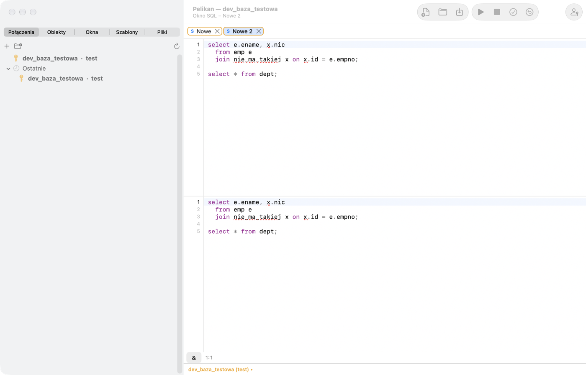

# Program Window y editor de código

## Program Window

La Program Window sirve para escribir y compilar unidades PL/SQL: paquetes, procedimientos, funciones, tipos y
disparadores, así como fuentes Java y módulos MLE (JavaScript). La abres con **Archivo › Nuevo › Program Window** (⇧⌘N)
o con **Editar** sobre un objeto en el Object Browser (el código se carga directamente de la base de datos).

- Cada unidad del archivo tiene su propia pestaña (p. ej., la especificación y el cuerpo de un paquete). El botón **+**
  junto a las pestañas o **Archivo › Program Window › Añadir unidad…** añade una unidad a partir de una plantilla
  (procedimiento, función, paquete, tipo, disparador, fuente Java, módulo MLE) con un formulario de nombres y
  parámetros. **Eliminar unidad** quita la pestaña del texto (el objeto de la base de datos se mantiene).
- **Editar** sobre un paquete o tipo — también sobre su cuerpo desde las carpetas «Cuerpos de paquete» y «Cuerpos de
  tipo» — abre la especificación y el cuerpo en una ventana con dos pestañas (abierto desde el cuerpo: la pestaña del
  cuerpo queda activa). Un objeto sin cuerpo tiene una sola pestaña.
- El editor muestra solo la unidad de la pestaña elegida; la pestaña activa aparece pulsada y en negrita. Cambie de
  pestaña con un clic, con **Archivo › Program Window › Mostrar unidad…**, **Unidad siguiente** (⌥⌘], en el perfil
  PL/SQL Developer también ⌃⇟) y **Unidad anterior** (⌥⌘[, ⌃⇞): el cursor vuelve a donde estaba en esa pestaña. Todo
  salto a un lugar de otra unidad (error de compilación, Contenido del código, Buscar siguiente, Ir a la declaración,
  marcador, depurador, Atrás/Adelante, Deshacer) cambia la pestaña solo. Las flechas y ⌘A no salen de la pestaña. Los
  números de línea de la pestaña, la lista de errores e **Ir a la línea** cuentan las líneas de la unidad como Oracle
  (ALL_SOURCE, ALL_ERRORS): la línea 1 es la de `PACKAGE BODY …`. **Reemplazar todo** reemplaza en toda la ventana
  (todas las unidades).
- Las unidades se reconocen por las cabeceras `CREATE … PACKAGE`, `PACKAGE BODY`, `TYPE`, `PROCEDURE`, `FUNCTION`,
  `TRIGGER` al principio de una línea: el archivo no necesita «/» tras las unidades. Pelikan no añade «/» al guardar,
  y el código cargado de la base de datos y las unidades nuevas llegan sin «/» (salvo que active **Preferencias ›
  Oracle › Terminar las unidades de la ventana de programa con «/»**). Un archivo con «/» se guarda sin cambios.
- **F8** (⌘↩) compila todas las unidades una tras otra y se detiene en la primera con un error. La compilación se hace
  en una sesión aparte en segundo plano, así que no bloquea las SQL Windows.
- Los errores y advertencias del compilador aparecen bajo el editor. Un clic lleva a la línea; un doble clic abre la
  descripción del error en la documentación de Oracle.
- La barra de estado muestra si el texto se ha modificado y no se ha guardado, y si está sin compilar.
- **Archivo › Guardar** (⌘S) guarda el texto de la ventana sin cambios (sin añadir `/`), con el nombre y la extensión
  según la unidad (p. ej., `.prc`, `.fnc`, `.trg`).
- **Especificación y cuerpo en archivos separados.** Una ventana con la especificación y el cuerpo de un paquete se
  guarda en un par de archivos `nombre.pks` (especificación) y `nombre.pkb` (cuerpo); un tipo, en `nombre.tps` y
  `nombre.tpb`, sin «/». **Guardar como…** (y el primer **Guardar** de una ventana nueva) pide el nombre y crea ambos
  archivos en la carpeta elegida; si el archivo del cuerpo ya existe, pregunta si reemplazarlo. Cada archivo conserva
  su codificación y sus finales de línea, y **Guardar** escribe solo el archivo cuya unidad ha cambiado. Un archivo
  contiene el texto de su pestaña (con los comentarios sobre `CREATE` y las sentencias `GRANT` tras la unidad). Una
  ventana de par de la que quite el cuerpo o a la que añada otra unidad no se guarda en esos archivos: **Archivo ›
  Guardar como un solo archivo…** guarda toda la ventana en un archivo (p. ej., `.pck`), como antes.
- Abrir `nombre.pks` o `nombre.pkb` cuando el archivo del par está al lado abre ambas unidades en una ventana, en la
  pestaña del archivo abierto; el título de la ventana es `nombre.pks + .pkb`. Funciona también desde el Finder, el
  explorador de archivos, los archivos recientes, los proyectos y los worksets. Los archivos que no son la
  especificación y el cuerpo de un mismo paquete o tipo se abren por separado, también un archivo `.pks` con un
  comentario tras el `END` de la especificación (al guardar pasaría al archivo del cuerpo). Si un archivo del par ha
  cambiado en el disco desde que se abrió (otro programa, `git checkout`), **Guardar** pregunta antes de
  sobrescribirlo. Las extensiones y la apertura del par se
  configuran en **Preferencias › General › Especificación y cuerpo en archivos separados**.

### Trabajar con seguridad con el código de la base de datos

- **Sesión › Compilación de prueba** compila las unidades con un nombre temporal y muestra los errores sin sustituir los
  objetos de la base de datos.
- **Sesión › Comprobar cambios de objetos en la base de datos** comprueba si otra persona ha cambiado el objeto desde
  que se cargó o compiló (Pelikan también lo comprueba periódicamente y avisa en la barra de estado). Ves las
  diferencias con **Archivo › Comparar › Comparar con el código fuente de la base de datos**, y cargas la versión de la
  base de datos con **Sesión › Volver a cargar desde la base de datos**.
- **Archivo › Restaurar** descarta los cambios y vuelve al texto del momento en que se abrió, cargó o guardó.
- **Archivo › Comparar › Comparar con archivo…** y **Comparar con objetos de otra base de datos…** (p. ej., con una base
  de datos de pruebas) abren el visor de diferencias.
- **Sesión › Ejecutar bloque en Test Window** ejecuta el bloque anónimo seleccionado en una Test Window nueva con
  DBMS_OUTPUT.

### Ajustes del compilador

En **Preferencias › Oracle › Compilador** configuras `PLSQL_WARNINGS`, `PLSQL_OPTIMIZE_LEVEL`, `PLSQL_CODE_TYPE`,
`PLSCOPE_SETTINGS` y `PLSQL_CCFLAGS`: Pelikan los establece en la sesión de compilación antes de cada compilación de una
Program Window. En la sección **Depurador** activas la adición automática de información de depuración, las
**Sugerencias del compilador** (inspecciones adicionales del código tras compilar) y la comprobación de las
**convenciones de nombres** (prefijos de parámetros, variables locales y globales, constantes, cursores y tipos). Un
comentario `-- Ignore` al final de una línea silencia la sugerencia para esa línea.

## Editor de código

El mismo editor funciona en las ventanas SQL, de programa, de prueba y de comandos. Edita sin retrasos incluso paquetes
de varias decenas de miles de líneas.

### Sugerencias y navegación

- La **Sugerencia de código** aparece sola tras un punto (p. ej., `paquete.`, `alias.`, `secuencia.`) o a petición: ⌥⎋
  (en el perfil PL/SQL Developer, ⌃Espacio). Sugiere objetos del esquema, columnas (también a través de alias de
  tablas), elementos de paquetes, parámetros en notación nombrada, campos de registros y `%ROWTYPE`, métodos de
  colecciones, `:new`/`:old`, enlaces de base de datos tras `@` y anotaciones y aserciones de utPLSQL. La entrada
  **(todos)** inserta todas las columnas o parámetros a la vez. **Edición › Actualizar sugerencias de código** actualiza
  la caché del diccionario.
- Al pasar el ratón sobre una variable se muestra su declaración.
- **⌘+clic** sobre un nombre o **Edición › Ir a la declaración** (⌃⌘J) lleva a la declaración: en el mismo código
  fuente, en otra ventana abierta o en un objeto de la base de datos (en una ventana nueva). **Edición › Navegación ›
  Atrás** (⌃⌘←) y **Adelante** (⌃⌘→) vuelven tras los saltos.
- **Vista › Contenido del código** muestra el árbol de estructura: la especificación y el cuerpo del paquete (tipo) por
  separado, con subprogramas con parámetros y tipo de retorno (la cabecera completa en la ayuda emergente), tipos
  (registro, tabla, REF CURSOR, subtipo), cursores, variables, constantes, excepciones, pragmas y subprogramas anidados.
  Los elementos privados del cuerpo (no declarados en la especificación) aparecen en cursiva. Un clic o Intro lleva el
  cursor al elemento (también en otra pestaña); las flechas en el árbol mueven el cursor sin salir del árbol. El campo
  sobre el árbol filtra nombres. El árbol sigue el cursor y tiene ordenación y menú (seleccionar, copiar, cortar,
  probar subprograma, expandir/contraer todo). Bajo el editor, la **jerarquía de código** muestra la ruta
  desde el cursor (paquete › procedimiento › bloque); un clic en un nivel lo selecciona o lleva a su nombre.
- El menú contextual sobre el nombre de un objeto de la base de datos en el editor ofrece las mismas acciones que el
  Object Browser.
- **F1** abre la documentación de Oracle de la palabra bajo el cursor.

### Escribir y seleccionar

| Acción | Atajo (macOS) | Menú |
|---|---|---|
| Comentario de línea | ⌘/ | Edición › Selección |
| Duplicar línea | ⇧⌘D | Edición › Selección |
| Mayúsculas / minúsculas | ⌥⌘U / ⌥⇧⌘U | Edición › Selección |
| Aumentar / reducir sangría | ⌘] / ⌘[ | Edición › Selección |
| Formatear código PL/SQL | ⇧⌘F | Edición |
| Buscar y reemplazar | ⌘F | Edición |
| Buscar siguiente / anterior | ⌘G / ⇧⌘G | Edición |
| Ir a la línea | ⌘L | Edición |
| Contraer / expandir bloque | ⌥⌘← / ⌥⌘→ | Edición |
| Contraer / expandir todo | ⌥⇧⌘← / ⌥⇧⌘→ | Edición |
| Alternar marcador | ⌘F3 | Edición › Marcadores |
| Añadir cursor encima / debajo | ⌃⇧↑ / ⌃⇧↓ | Edición › Varios cursores |
| Aumentar / reducir fuente | ⌘= / ⌘− | Vista |

- **Plegado de código**: la flecha del margen junto a los números de línea pliega y despliega un bloque (bloque
  plegado: flecha en el color de acento y «⋯» en el texto con el código plegado en la información emergente).
- **Varios cursores**: ⌥+clic añade un cursor y Esc deja uno. **Selección en columna**: arrastra con ⌥; escribir, borrar
  y pegar funcionan en todas las líneas a la vez.
- **Buscar y reemplazar** admite expresiones regulares (con `$1`), palabras completas, distinción de mayúsculas,
  conservación de mayúsculas y búsqueda solo en el código, en los comentarios o en los literales.
- **Marcadores** 0–9 (en el perfil PL/SQL Developer, ⌃K n establece y ⌃Q n salta), nombres de marcadores y una lista de
  los marcadores de todas las ventanas. Las **Marcas de color** resaltan fragmentos del texto con uno de seis colores.
- El editor resalta los pares de paréntesis y `BEGIN`/`IF`/`LOOP`/`CASE` ↔ `END`, las apariciones del nombre bajo el
  cursor, la columna de `INSERT` que corresponde a un valor de `VALUES` y las sentencias `COMMIT`, `ROLLBACK` y
  `SAVEPOINT`.
- **AutoReplace** (Preferencias › Editor) sustituye abreviaturas por texto mientras escribes; `|` en la sustitución
  marca la posición del cursor.
- **Vista › Dividir editor** muestra dos vistas del mismo texto. **Vista** tiene también **Ajustar líneas**,
  **Caracteres especiales** y **Estado de líneas** (marcas de las líneas modificadas y nuevas desde que se abrió o
  guardó).

### Formato

**Edición › Formatear código PL/SQL** (⇧⌘F) formatea la selección o todo el código fuente según las reglas de
**Preferencias › Formateador** (sangrías, listas, comas, líneas en blanco, mayúsculas de palabras clave e
identificadores, grafía especial). El formateador puede actuar automáticamente al abrir un código fuente de la base de
datos, antes de compilar y antes de guardar. Un fragmento entre los comentarios `-- NoFormat Start` y `-- NoFormat End`
se mantiene sin cambios. El formato nunca cambia el significado del código.

La pestaña **Preferencias › Formateador** tiene los grupos **Disposición**, **Listas y comas**, **Cláusulas SQL y condiciones**
(palabras de cláusula a la izquierda, a la derecha o en su propia línea; AND/OR al principio o al final de la línea; la
condición JOIN … ON; THEN en una línea nueva; CASE en varias líneas), **Alineación en columnas** (declaraciones,
parámetros con modo y tipo, parámetros con nombre `=>`, asignaciones `:=`, alias en SELECT y FROM, `=` en UPDATE … SET,
comentarios al final de línea), **Espaciado** y **Mayúsculas/minúsculas**, por separado para palabras clave,
identificadores, tipos de datos, funciones integradas y paquetes de Oracle. A la derecha hay una vista previa: un paquete
de ejemplo en el que se ve cada opción, con las líneas modificadas por el último cambio resaltadas, y encima un ejemplo
de la opción señalada o de la última cambiada: **Ahora** y **Tras cambiar esta opción**. Una región sin formato también
se puede marcar con los comentarios `-- @formatter:off` y `-- @formatter:on`.

### Plantillas, fragmentos y macros

- Las **Templates** (pestaña **Templates** de la columna izquierda o **Vista › Ventana de plantillas**) insertan
  fragmentos ya preparados: sentencias DML, bucles, tipos, funciones SQL, unidades de programa y plantillas utPLSQL. Un
  doble clic o arrastrar al editor inserta la plantilla; las variables de la plantilla se rellenan en un formulario
  (`$OSUSER`, `$DBUSER`, `$DATE`, `$TIME` se sustituyen solas). Creas plantillas propias con **Herramientas › Templates
  › Guardar selección como plantilla…**.
- **Vista › Fragmentos** es una biblioteca de fragmentos cortos para arrastrar (integrados y propios).
- **Macros**: F11 inicia y termina la grabación, F12 la reproduce y ⇧F12 la reproduce varias veces. Guardas una macro en
  la biblioteca con un atajo (**Edición › Macros › Guardar macro en la biblioteca…**).
- **Edición › Copiar como literal** copia el SQL seleccionado como literal de cadena de un lenguaje (Swift, Java, C#,
  JavaScript, Python, C/C++, PHP, Delphi, Visual Basic); **Pegar desde lenguaje de programación** hace lo contrario.
- El **Historial del portapapeles** (**Vista › Historial del portapapeles**) guarda en memoria los últimos textos
  copiados.

### Análisis de código y refactorización

- Mientras escribes, Pelikan subraya las tablas, vistas, columnas y alias desconocidos (según el diccionario de la
  conexión de la ventana) y los problemas: variables y parámetros sin usar, código tras `RETURN`/`RAISE`,
  `UPDATE`/`DELETE` sin `WHERE`, conversiones implícitas. F2 y ⇧F2 llevan al problema siguiente y al anterior, y
  **Edición › Análisis de código › Lista de problemas** los muestra todos. Desactivas el análisis en **Edición ›
  Análisis de código › Análisis de código al escribir**.
- **Edición › Refactorización › Buscar usos** (⌥F7) busca los usos de un objeto o una columna: objetos dependientes,
  líneas de su código, PL/Scope, ventanas abiertas y archivos del proyecto.
- **Edición › Refactorización › Cambiar nombre…** (⇧F6) cambia el nombre de una variable o un parámetro en su ámbito, o
  de un objeto o una columna en las ventanas y los archivos del proyecto. Antes de aplicarlo ves una vista previa de las
  diferencias; un cambio en la base de datos (DDL) va a una ventana nueva y no se ejecuta.
- **Extraer constante local…**, **Extraer constante global…**, **Extraer procedimiento…** y **Sustituir asignación por
  inicialización**, en el mismo submenú, transforman el código seleccionado; cada cambio se deshace con ⌘Z.

### Tareas To-Do

Los comentarios `TODO` y `DONE` (con responsable, prioridad y categoría) se recogen en la ventana **Vista › Tareas
To-Do**. **Edición › Insertar tarea To-Do** inserta un comentario, y **Cerrar o abrir tarea To-Do** cambia su estado.

## Archivos

- Pelikan abre desde el Finder y arrastrándolos los archivos `.sql`, `.pck`, `.pks`, `.pkb`, `.spc`, `.bdy`, `.prc`,
  `.fnc`, `.trg`, `.typ`, `.tps`, las pruebas `.tst` y los cuadernos `.sqlnb`. Puedes añadir más extensiones de
  programas y pruebas en **Preferencias › General**. Arrastrar un directorio abre todos sus scripts.
- Los archivos conservan su codificación (UTF-8, ISO-8859-2, Windows-1250) y sus finales de línea. Un carácter que no se
  puede guardar en la codificación del archivo bloquea el guardado e indica exactamente la línea y la columna; la
  codificación solo se cambia de forma consciente con **Archivo › Codificación del archivo…**.
- **Archivo › Solo lectura** bloquea la edición de la ventana.
- **Archivo › Abrir con conexión…** abre un archivo con la conexión ya fijada.
- **Edición › Abrir en un editor externo** pasa el texto al programa indicado en **Preferencias › Herramientas** (p.
  ej., Visual Studio Code); al volver a Pelikan se cargan los cambios.
- **Edición › Buscar en la web** abre una búsqueda de la palabra seleccionada (las direcciones de los buscadores están
  en Preferencias).
- Pelikan recuerda el estado de las ventanas de archivos (cursor, marcadores, marcas, contracciones, valores de
  variables).
- Tras un cierre inesperado de la aplicación, Pelikan propone recuperar las ventanas sin guardar (**Archivo › Recuperar
  ventanas…**).
