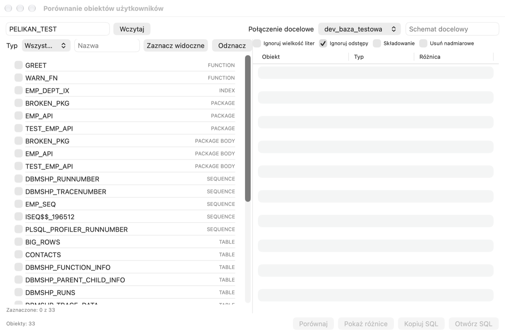
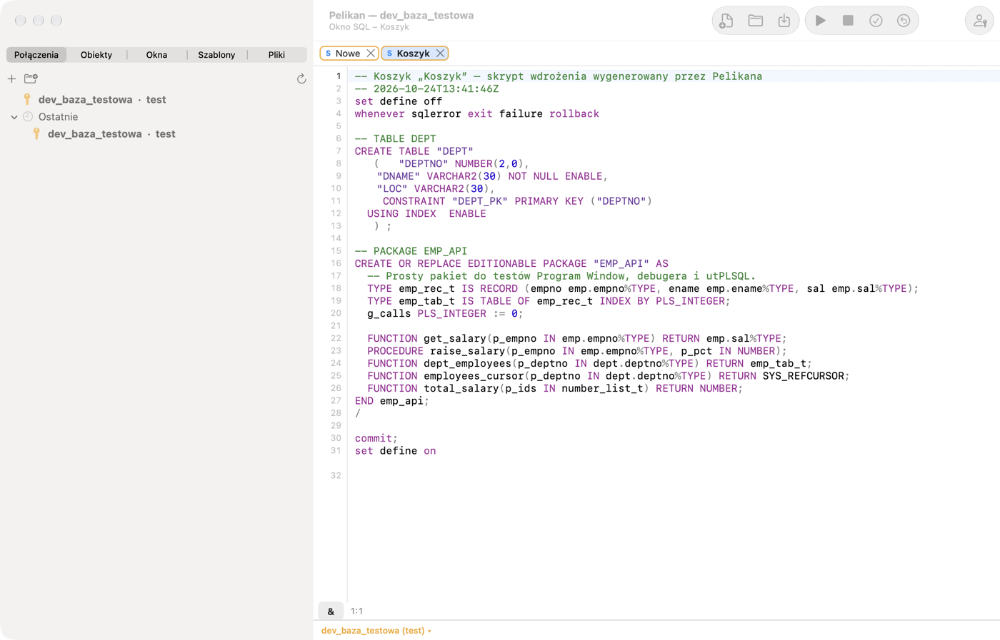
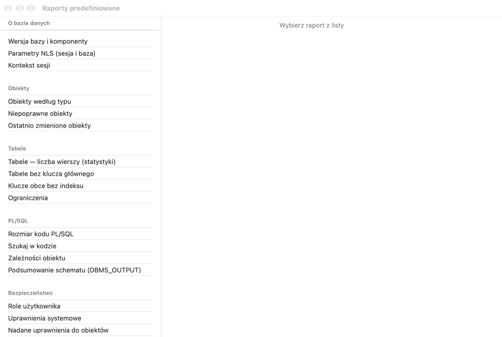
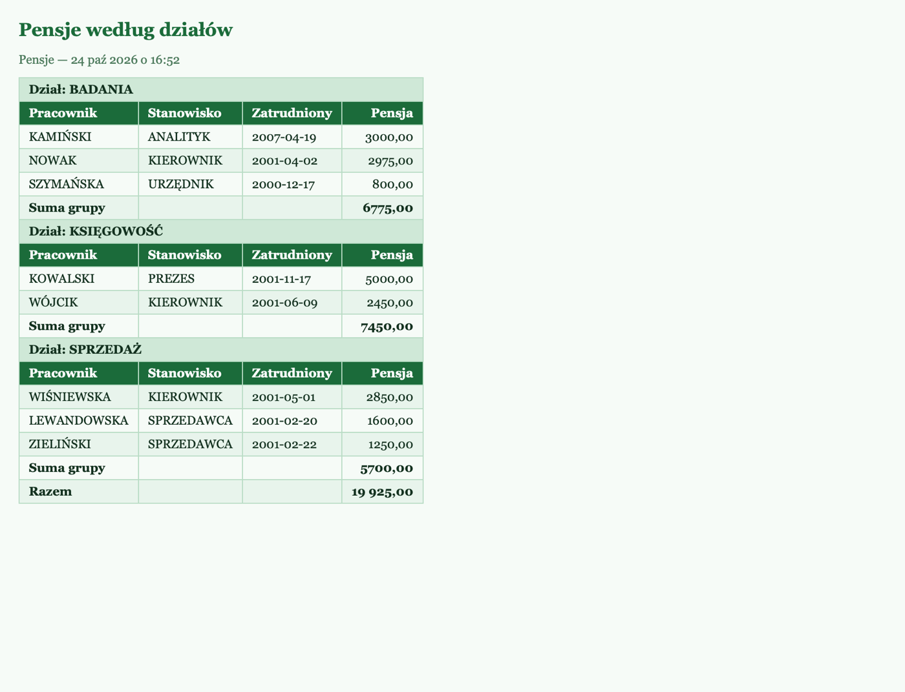
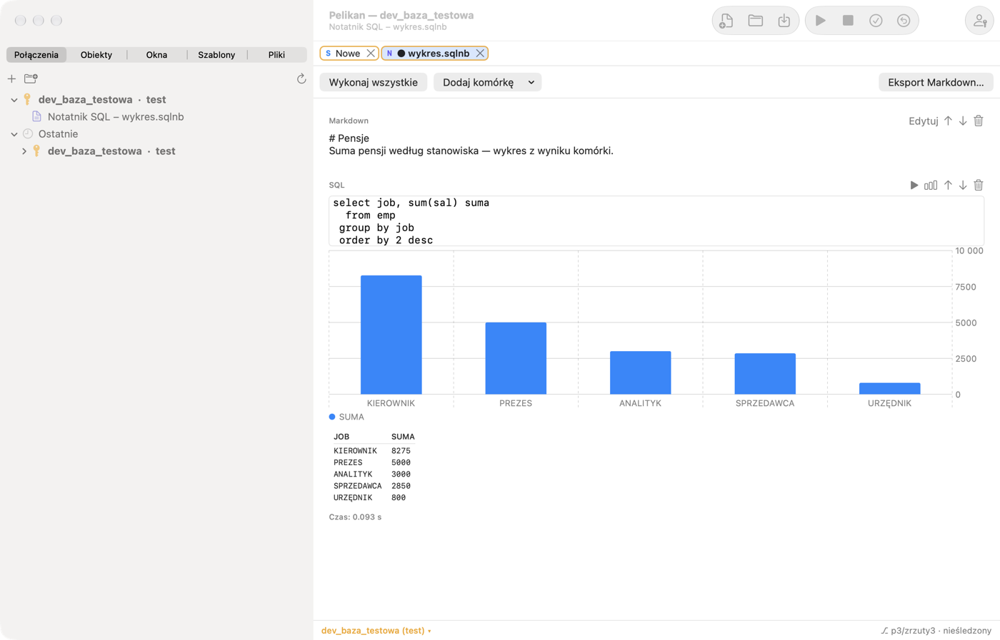
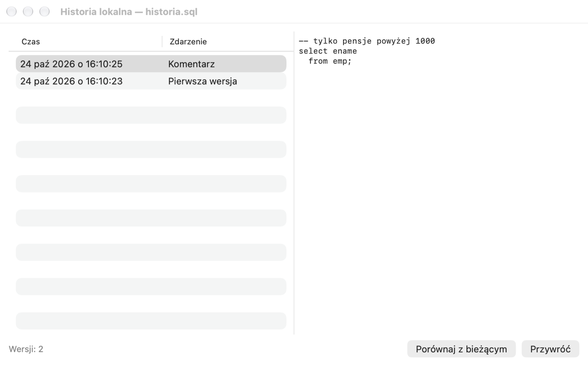

# Herramientas

Este capítulo describe las herramientas de los menús **Herramientas**, **Informes**, **Proyecto** y **Archivo**:
comparar y desplegar cambios, exportar e importar, informes, cuadernos, proyectos y archivos. Las herramientas de
rendimiento y administración se describen en el capítulo *Plan de ejecución, sesiones y administración*.

## Comparar esquemas y desplegar cambios

### Comparar objetos de usuarios

**Herramientas › Comparar objetos de usuarios…** compara el DDL de los objetos de un esquema con un esquema de destino,
en la misma conexión o en otra (p. ej., `dev_test` con la base de datos de pruebas de aceptación).

1. Escribe el esquema de origen y haz clic en **Cargar**. Selecciona los objetos (filtro por tipo y nombre,
   **Seleccionar visibles**).
2. Elige la **Conexión de destino** y, opcionalmente, el **Esquema de destino**. Ajusta las opciones: **Ignorar
   mayúsculas/minúsculas**, **Ignorar espacios**, **Almacenamiento** (comparar los parámetros de almacenamiento),
   **Eliminar redundantes** (el script elimina los objetos que no existen en el origen).
3. Haz clic en **Comparar**. La lista muestra los objetos que solo están en el origen, los distintos y los que solo
   están en el destino, en orden de dependencias.
4. **Mostrar diferencias** abre el visor de diferencias, y **Copiar SQL** y **Abrir SQL** dan un script que iguala el
   destino al origen. El script no se ejecuta automáticamente: revísalo y ejecútalo de forma consciente.

### Database Diff y cesta de despliegue

**Herramientas › Database Diff…** compara esquemas por tipos de objeto (también entre conexiones); para las tablas
genera `ALTER TABLE` que añaden, modifican y eliminan columnas. Las diferencias elegidas se añaden con el botón **A la
cesta**.

**Herramientas › Cesta de despliegue…** reúne objetos (DDL) y datos de tablas (con filtro WHERE) en un paquete de
cambios. El objeto seleccionado en el Object Browser se añade con **Herramientas › Cesta › Añadir objeto a la cesta**, y
**Cesta › Script de despliegue de la cesta** genera un script en orden de dependencias en una SQL Window nueva, con
`WHENEVER SQLERROR EXIT` y `COMMIT` al final.

### Comparar datos de tablas

**Herramientas › Comparar datos de tablas…** compara los datos por clave primaria (filas nuevas, distintas y sobrantes)
con una tabla de otro esquema o conexión. El resultado es un script o una actualización directa del destino con `COMMIT`
cada n filas.

### Visor de diferencias

Todas las comparaciones de texto (ventana con archivo, objeto con la base de datos, historial local, **Herramientas ›
Comparar archivos…**) usan el visor de diferencias integrado: dos columnas, mapa de cambios, salto a la diferencia
siguiente y anterior, diferencias dentro de la línea, omisión de mayúsculas, espacios y comentarios, intercambio de
lados y **Reload**. En su lugar puedes usar tu propio programa: **Ajustes › Herramientas › Visor de diferencias
externo** (argumentos `%1`, `%2`: archivos; `%3`, `%4`: títulos).

## Exportación e importación

| Herramienta | Para qué |
|---|---|
| Herramientas › Exportar objetos de usuario… | DDL de los objetos elegidos en un archivo o un archivo por objeto (especificación con cuerpo o por separado), con privilegios y almacenamiento, en orden ejecutable |
| Herramientas › Exportar tablas… | datos de tablas como script INSERT (con DROP/CREATE, TRUNCATE/DELETE, desactivación de disparadores y claves ajenas, COMMIT cada n, condición WHERE), en el formato propio de Pelikan (comprimido) o mediante Data Pump |
| Herramientas › Importar tablas… | importación de un script INSERT o del formato propio con elección de tablas; importación de Data Pump con REMAP_SCHEMA |
| Herramientas › Importar texto… | archivos CSV y de texto: detección del separador, el encabezado y la codificación, correspondencia de campos con columnas, funciones de transformación, filtro, tratamiento de duplicados, CREATE TABLE a partir del archivo |
| Herramientas › Importar desde Excel… | archivos .xlsx (sin Excel ni ODBC): hoja, línea de encabezado, rango, correspondencia |
| Herramientas › Asistente de importación de datos… | asistente paso a paso para CSV, archivos de ancho fijo y XLSX, a una tabla nueva o existente, con perfil guardado |
| Herramientas › Copia de esquema… | objetos y datos a otro esquema o conexión (tablas, datos, objetos, claves ajenas, disparadores) |
| Herramientas › Traslado de datos… | una tabla o una consulta a una tabla en la misma conexión o en otra, con correspondencia de columnas y modo añadir / TRUNCATE / DELETE; las definiciones se pueden guardar y ejecutar en segundo plano |
| Herramientas › Data Generator… | datos de prueba según patrones, listas, consultas y conjuntos (nombres, empresas, direcciones, correos), con relación maestro/detalle |
| Herramientas › Documentación del esquema… | documentación HTML: tablas con columnas y comentarios, claves, índices, vistas, programas con parámetros |

La exportación de Data Pump escribe los archivos en el lado del servidor (directorio `DATA_PUMP_DIR`), no en el Mac. Las
herramientas que escriben en la base de datos pasan por las mismas protecciones que la SQL Window: en una conexión de
producción piden confirmación y en una conexión de solo lectura están bloqueadas. Ninguna definición guardada (de
traslados, trabajos o importaciones) contiene contraseñas.

## Informes

### Informes predefinidos

**Informes › Informes predefinidos…** abre un conjunto de informes listos sobre la base de datos en las categorías
*Acerca de la base de datos*, *Objetos*, *Tablas*, *PL/SQL*, *Seguridad* y otras. Un informe puede mostrar una
cuadrícula, un gráfico o la salida de DBMS_OUTPUT, pedir variables y tener detalles de fila. **Abrir informe en SQL
Window** permite modificar la consulta, y el resultado se exporta a CSV, HTML o XLSX.

El menú **Informes** tiene también informes rápidos: **Errores de compilación**, **Objetos no válidos**, **Objetos
modificados recientemente**, **Tamaños de tablas**, **Columnas de tablas**, **Privilegios del usuario** y **Sesiones**.

### Informes propios

1. Abre **Archivo › Nuevo › Report Window** y escribe una consulta. Las variables (`&<name="…">`, `:nombre`, parámetros
   de JasperReports) funcionan como en la SQL Window.
2. Ejecuta el informe (F8). El resultado es un documento HTML.
3. En la pestaña **Disposición** ajusta para las columnas el título, la alineación, el formato de números (p. ej.,
   `#,##0.00`) y de fechas (p. ej., `yyyy-MM-dd`), la ocultación, **Grupo** (agrupación con encabezado de grupo,
   maestro/detalle) y **Suma** (sumas de grupo y suma total).
4. Elige un **Estilo** de la biblioteca (*Estándar*, *Verde*, *Compacto*) y, opcionalmente, **CSS adicional**; en las
   **Opciones**, un encabezado con variables (`#title`, `#date`, `#user`, `#connection`, `#variable`), la conexión del
   informe, disposición de formulario en lugar de tabla, una página nueva tras cada grupo y el fondo.
5. Guarda el informe como archivo `.rep`. **Informe › Añadir informe al menú Informes** lo coloca en **Informes › Mis
   informes**.

**Informe › Guardar informe como HTML…**, **Exportar datos del informe…** (CSV, TSV, XML, Excel) e **Imprimir informe…**
(también a PDF) comparten el resultado. **Bloquear definición del informe** oculta la consulta y la disposición: el
informe entonces solo se puede ejecutar (hasta desbloquearlo).

## Cuaderno SQL

Un cuaderno (**Archivo › Nuevo › Cuaderno SQL**) combina celdas SQL/PL/SQL con celdas Markdown: va bien para análisis e
instrucciones paso a paso.

- **Añadir celda** inserta una celda SQL o Markdown; las flechas mueven las celdas y la papelera las elimina.
- ▶ ejecuta una celda, **Ejecutar todo**, todas por orden (se detiene en un error).
- El botón de gráfico crea un gráfico a partir del resultado de la celda (Pelikan propone la categoría y las series).
- Los resultados y los gráficos se guardan en el archivo `.sqlnb`, así que al abrirlo se ven sin volver a ejecutar.
- **Exportar Markdown…** (**Archivo › Cuaderno › Exportar cuaderno como Markdown…**) guarda el cuaderno con sus
  resultados como documento Markdown.

## Query Builder

**Herramientas › Query Builder…** construye una consulta visualmente: arrastra tablas (también sinónimos y
subconsultas), Pelikan añade las combinaciones según las claves ajenas (puedes cambiar el tipo de combinación),
selecciona columnas, establece alias, condiciones WHERE y HAVING, GROUP BY, ORDER BY y DISTINCT. La consulta va al
editor. Un SELECT sencillo seleccionado se abre en el Query Builder para modificarlo.

## Pruebas de muchos casos y de carga

- **Herramientas › Test Manager**: conjuntos de pruebas (`.pts`): bloques con valores de entrada y esperados (`=`,
  `LIKE`, `IN`, `NULL`, `NOT NULL`), variables globales, DBMS_OUTPUT y límite de tiempo. Los cambios que hacen las
  pruebas se revierten. Una prueba con error se abre en una Test Window para depurarla.
- **Herramientas › Prueba de carga…** ejecuta pasos SQL/PL/SQL en muchas sesiones en paralelo (variables `:thread` e
  `:iteration`), con resultados en directo (tiempos, errores, rendimiento) y guardado en Excel.
- **Herramientas › Event Monitor…** recibe en una sesión aparte las alertas DBMS_ALERT y los mensajes DBMS_PIPE.

## Búsqueda

- **Edición › Buscar en editores y archivos…** (⌥⇧⌘F) busca en el editor actual, en todas las ventanas abiertas o en los
  archivos de script de directorios (por omisión, en las ubicaciones del explorador de archivos), con distinción de
  mayúsculas, palabras completas y expresiones regulares. Un clic en un resultado abre el archivo en la línea de la
  coincidencia.
- **Herramientas › Buscar objetos de la base de datos…** (⇧⌘O) busca en el código de la base de datos; consulta el
  capítulo *Object Browser*.
- **Proyecto › Buscar en el proyecto…** busca en los archivos, el código fuente de los objetos y las notas del proyecto.

## Historial local

Pelikan guarda una versión del archivo o del objeto en cada guardado, compilación, refactorización y restauración, con
independencia de Git y sin conexión a la base de datos. **Archivo › Historial local › Historial local** muestra las
versiones de la ventana activa; **Comparar con el actual** abre las diferencias, y **Restaurar** inserta la versión
antigua (el texto actual queda en el historial). **Guardar versión en el historial** añade una versión manualmente, con
una descripción. El historial guarda hasta 50 versiones de los últimos 30 días.

## Proyectos, worksets y archivos

- Un **proyecto** agrupa archivos y objetos de la base de datos (con notas y grupos) en un archivo `.prj`. **Proyecto ›
  Compilar proyecto** compila todo en el orden de los elementos, y **Make del proyecto**, solo los archivos modificados
  desde la última compilación y los objetos no válidos. Las opciones del proyecto incluyen la conexión, la detención
  tras el primer error y el formato. **Guardar escritorio del proyecto** recuerda las ventanas abiertas.
- Un **workset** (conjunto de trabajo) recuerda las ventanas abiertas, también con cambios sin guardar y valores de
  variables, y las restaura en el siguiente inicio (**Archivo › Workset**: nuevo, abrir, guardar, restaurar, cerrar,
  comparar, guardado automático). La disposición de la ventana principal se guarda con **Vista › Guardar disposición de
  la ventana**.
- Al salir con el **guardado automático del workset** activado (predeterminado; **Ajustes › General › Archivos ›
  Restaurar ventanas al reiniciar** o **Archivo › Workset › Guardar automáticamente el workset**) Pelikan no pregunta si
  guardar: todas las ventanas abiertas (SQL, programa, prueba, comandos, plan, diagrama, cuaderno, informe y consolas de
  conexión) vuelven en el siguiente inicio en el mismo orden y con la misma ventana activa. Una ventana sin archivo
  vuelve con su texto como ventana sin archivo, marcada como no guardada.
- El **Explorador de archivos** (pestaña **Archivos**) muestra los directorios elegidos (ubicaciones con filtro y color)
  con un menú: abrir como, cambiar nombre, archivo o directorio nuevo, mover a la Papelera, mostrar en el Finder. El
  filtro funciona por nombre, estado, estado de Git, tamaño y fecha.
- **Git**: la rama y el estado del archivo están en la barra de estado, en el explorador de archivos y en el proyecto.
  **Herramientas › Git** tiene el estado del archivo, la comparación con HEAD, `git add`, `git commit` y el historial
  del archivo.

## Otras

- **Herramientas › Herramientas de usuario…**: herramientas propias: programas externos con variables (`#file`,
  `#object`, `#selection`, `#connection`…) o bloques SQL para sesiones. Los programas se ejecutan sin shell, y las
  variables nunca contienen contraseñas.
- **Herramientas › Trabajos locales…**: scripts, exportaciones y traslados de datos que se ejecutan periódicamente (cada
  n minutos, a diario, en días elegidos) mientras Pelikan está en marcha. Las definiciones no contienen contraseñas; el
  registro muestra el resultado de cada ejecución.
- **Vista › Tareas en segundo plano**: lista de operaciones largas (Autotrace, exportaciones, documentación) con estado,
  tiempo y cancelación.
- **Herramientas › Documentos…**: tus documentos y direcciones http(s) de la lista de **Ajustes › Herramientas**.
- Servicios de macOS (menú **Servicios** en cualquier aplicación): **Pelikan: Formatear SQL** formatea el texto
  seleccionado en su lugar, y **Pelikan: Abrir en SQL Window** pasa el texto seleccionado a una SQL Window nueva de
  Pelikan.
