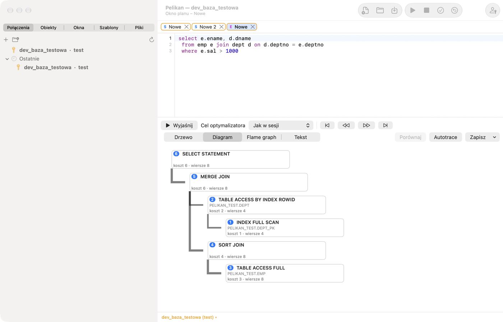
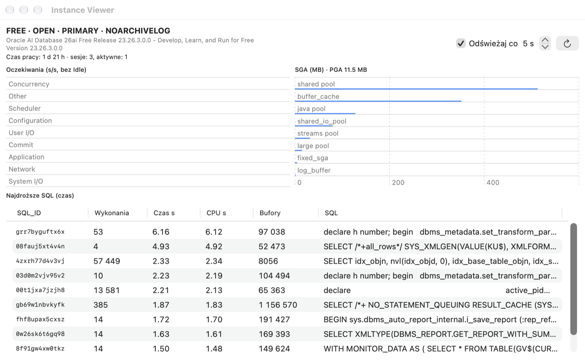

# Plan de ejecución, sesiones y administración

## Para qué sirve

Antes de que Oracle ejecute una consulta, el **optimizador** elige cómo ejecutarla: qué tabla leer primero, si usar un
índice, cómo unir las tablas. Esa forma es el **plan de ejecución**. Dos consultas que devuelven el mismo resultado pueden
tener planes cuyo tiempo se diferencia mil veces. Las herramientas de este capítulo muestran el plan (Explain Plan), miden
la ejecución real (Autotrace) y permiten ver qué pasa en la base (Sesiones, Instance Viewer).

**Cuándo usarlas:** cuando una consulta va lenta, antes de añadir un índice y cuando algo «se cuelga», para ver quién
bloquea filas o qué hace la base.

## Plan de ejecución (Explain Plan)

Coloca el cursor en una sentencia (o selecciónala) y pulsa F5 (**Herramientas › Explain Plan**). Pelikan abre una
ventana de plan con el plan de PLAN_TABLE. En el código PL/SQL, las variables se sustituyen por variables de enlace y se
omite `INTO`, así que obtienes el plan de una consulta de un procedimiento sin reescribirla. Abres una ventana de plan
vacía con **Archivo › Nuevo › Explain Plan Window**; Pelikan puede crear la tabla PLAN_TABLE si falta.

- **Actualizar plan** recalcula el plan del texto del editor de la ventana de plan, y **Objetivo del optimizador** (*Como en la
  sesión*, ALL_ROWS o FIRST_ROWS_n) añade una sugerencia (hint).
- Un plan nuevo aparece totalmente expandido. Las flechas **Expandir todas las ramas** y **Contraer todas las ramas**
  junto al selector de vista sobre el árbol del plan (también en la pestaña **Plan** de la cinta) expanden a la vez
  todas las ramas o contraen el árbol hasta la raíz.
- Vistas: **Árbol** (operaciones con coste, número de filas, bytes, tiempo, orden de ejecución y predicados de acceso y
  de filtro), **Diagrama** (un nodo por operación con coste, cardinalidad y número de paso), **Flame graph** (el coste
  de las operaciones en proporción al padre) y **Texto** (DBMS_XPLAN).
- Los botones de navegación recorren las operaciones en orden de ejecución: primer paso, anterior, siguiente y último.
- **Comparar** compara el plan con el plan anterior de la ventana o con el plan de una segunda ventana de plan: empareja
  las operaciones y muestra las diferencias de coste, cardinalidad, orden y predicados.
- **Guardar** guarda el plan como texto, HTML o XML (DBMS_XPLAN).

El plan se calcula en una sesión de herramientas aparte, así que no afecta a la transacción de la ventana.

**Cómo leer un plan (para principiantes):**

- Se lee **desde la operación con más sangría** hacia arriba: lo más profundo se ejecuta primero.
- `TABLE ACCESS FULL`: Oracle lee la tabla entera. En una tabla pequeña está bien; en una tabla con millones de filas de
  la que necesitas unas pocas, suele indicar que falta un índice o que la condición no lo usa.
- `INDEX RANGE SCAN` / `INDEX UNIQUE SCAN`: Oracle busca mediante un índice, como en el índice de un libro.
- El **coste** (Cost) es una estimación del optimizador: un número relativo, útil para comparar dos planes de la misma
  consulta, no un tiempo en segundos.
- La **cardinalidad** (Rows) es el número estimado de filas. Cuando es muy distinta de la real (lo compruebas en
  Autotrace), el optimizador tiene malas estadísticas y puede elegir un mal plan.

> **Ejercicio: un índice en el plan.**
> 1. En una SQL Window escribe `SELECT * FROM pel_employees WHERE emp_id = 3;`, pon el cursor en ella y pulsa **F5**.
>    *Resultado:* la ventana del plan; en el árbol una operación `INDEX UNIQUE SCAN` sobre `PEL_EMPLOYEES_PK`: una
>    búsqueda por la clave primaria.
> 2. Cambia la consulta a `SELECT * FROM pel_employees WHERE last_name = 'Nowak';` y pulsa **Actualizar plan**.
>    *Resultado:* `TABLE ACCESS FULL`: la columna `LAST_NAME` no tiene índice.
> 3. Cambia la vista a **Diagrama** y después a **Texto**.
>    *Resultado:* el mismo plan como dibujo y como texto DBMS_XPLAN (tal como lo verá el administrador).
> 4. Selecciona la consulta en la SQL Window y elige **Herramientas › Autotrace**.
>    *Resultado:* el plan real con las columnas **E-Rows** (estimadas) y **A-Rows** (filas reales): aquí coinciden.
>
> ⚠️ **Atención.** En una tabla tan pequeña la lectura completa es lo más rápido y el optimizador la elige con razón: un
> índice ayuda en tablas grandes. No añadas índices «por si acaso»: cada índice ralentiza INSERT, UPDATE y DELETE.
> Autotrace **ejecuta** de verdad la sentencia (el DML se revierte después): no ejecutes en él consultas largas en
> producción en horario laboral.

## Autotrace

**Herramientas › Autotrace** (o el botón **Autotrace** de la ventana de plan) ejecuta la sentencia con medición y
muestra el plan real: Starts, el número de filas estimado (E-Rows) y real (A-Rows) con las grandes discrepancias
resaltadas, tiempos, búferes y lecturas, así como la variación de las estadísticas de la sesión antes y después de la
ejecución. Las sentencias DML se revierten tras la medición. Autotrace no requiere el Tuning Pack.

Autotrace pregunta por las variables de la sentencia como la ventana SQL: las variables de enlace (`:nombre`) reciben
valores de la ventana **Variables** (recordados en la ventana) y las variables de sustitución (`&nombre`), solo con la
sustitución de la ventana activada; si está desactivada, `&` se queda en el texto sin preguntar.

## Paquetes Oracle Diagnostics y Tuning

El menú **Herramientas › Rendimiento (paquetes de Oracle)** contiene herramientas que usan paquetes de pago de Oracle:

| Comando | Paquete | Qué hace |
|---|---|---|
| Informe AWR | Diagnostics | informe HTML a partir de instantáneas AWR |
| Informe ASH | Diagnostics | informe HTML de las sesiones activas de los últimos minutos |
| Informe ADDM | Diagnostics | recomendaciones de ADDM |
| SQL Monitor | Tuning | lista de consultas monitorizadas (V$SQL_MONITOR) con informe de la elegida |
| Informe de SQL Monitor | Tuning | informe HTML de una consulta monitorizada |
| SQL Tuning Advisor | Tuning | recomendaciones para la sentencia bajo el cursor; la tarea del asesor se elimina después |

**Importante: licencias.** Usa estas funciones solo si la base de datos tiene licencia del paquete correspondiente (el
Tuning Pack requiere también el Diagnostics Pack). En el primer uso, Pelikan pregunta qué licencia tiene la base de
datos y recuerda la respuesta en la definición de la conexión (pestaña **Avanzado** › **Licencia de Diagnostics/Tuning
Pack**). Sin una licencia declarada, o si el parámetro de la base de datos `CONTROL_MANAGEMENT_PACK_ACCESS` vale `NONE`
(o `DIAGNOSTIC` para las funciones del Tuning Pack), la función no se inicia. Los agentes de IA no tienen acceso a estas
herramientas. Los informes se guardan como HTML.

## Informes de rendimiento

**Para qué sirve:** cuando la base o una consulta va lenta, el administrador suele pedir un informe AWR, ASH o SQL
Monitor. La ventana **Informes de rendimiento de la base de datos** reúne todos esos informes en un solo lugar, con
elección de periodo y formato.

- **Rendimiento › Todos los informes de rendimiento…** abre una ventana con la lista de informes (**Elige un informe**):
  AWR, ASH, ADDM, Performance Hub, SQL Monitor, planes y estadísticas. Para el informe elegido ajustas el **Periodo** (p. ej.
  **Última hora**, un intervalo **Desde** – **Hasta** en hora de la base, o **Instantáneas AWR**), la **Instancia** (en RAC
  también **Todas las instancias RAC**) y el **Formato del resultado**, y haces clic en **Ejecutar informe**.
- **Rendimiento › Informes para SQL_ID…** hace lo mismo para una consulta: desde la fila seleccionada de una tabla (p. ej.
  la lista de sesiones o de las consultas más caras), una celda con un SQL_ID o la sentencia bajo el cursor. El botón
  **Comprobar** muestra dónde está disponible la consulta: en la caché de cursores, en ASH, en AWR y en SQL Monitor; los
  informes sin datos de la consulta quedan bloqueados con una explicación.
- Un informe al que le falta un privilegio (p. ej. EXECUTE sobre el paquete `DBMS_WORKLOAD_REPOSITORY`) o una licencia
  aparece bloqueado en la lista con el motivo y una sentencia GRANT lista para pasársela al administrador.

> **Ejercicio: encuentra el SQL_ID de tu consulta.**
> 1. En una SQL Window ejecuta `SELECT /* mi_ejercicio */ COUNT(*) FROM pel_emp_details;`.
> 2. Pon el cursor en esa sentencia y elige **Rendimiento › Informes para SQL_ID…**.
>    *Resultado:* la ventana de informes con el SQL_ID de la consulta, encontrado en la caché de cursores por su texto
>    («sentencia bajo el cursor»).
> 3. Haz clic en **Comprobar**, elige el informe de plan de la caché de cursores y **Ejecutar informe**.
>    *Resultado:* el plan con el que la base ejecutó realmente la consulta, con el número de ejecuciones.

## Sesiones de la base de datos

**Herramientas › Sesiones** muestra las sesiones de la base de datos (V$SESSION):

- **Filtro** elige la consulta de la lista (p. ej., *Sesiones de usuarios*); **Actualizar cada** n segundos activa la
  actualización automática.
- Pestañas de detalle de la sesión seleccionada: **SQL actual**, **Cursores abiertos**, **Bloqueos**, **Estadísticas**,
  **Espera**.
- **Finalizar sesión** y **Finalizar inmediatamente** terminan la sesión (`ALTER SYSTEM KILL SESSION`) tras confirmación.
- **Acciones**: entre otras, activar SQL Trace para la sesión (DBMS_MONITOR).
- **Consultas…** permite definir filtros propios (condición WHERE), pestañas de detalle (con `:sid`, `:serial#`) y
  acciones.

Las sesiones de Pelikan tienen en la columna MODULE el valor «Pelikan», y las de los agentes de IA, «Pelikan agent».

> **Ejercicio: ¿quién bloquea una fila?**
>
> Requiere privilegios de lectura sobre V$SESSION y V$LOCK (normalmente el rol SELECT_CATALOG_ROLE).
>
> 1. En la SQL Window A ejecuta `UPDATE pel_employees SET salary = salary WHERE emp_id = 1;` y **no** confirmes.
> 2. En la SQL Window B ejecuta la misma sentencia.
>    *Resultado:* la ventana B «se cuelga»: espera a que la sesión de la ventana A libere el bloqueo de la fila.
> 3. Abre **Herramientas › Sesiones**, busca las sesiones con MODULE «Pelikan» y selecciona la que espera.
>    *Resultado:* la pestaña **Espera** muestra el evento de bloqueo (`enq: TX - row lock contention`) y la pestaña
>    **Bloqueos**, la sesión que bloquea.
> 4. Vuelve a la ventana A y pulsa **⇧F10** (ROLLBACK).
>    *Resultado:* la ventana B termina el UPDATE al instante. Revierte también la ventana B (**⇧F10**).
>
> ⚠️ **Atención.** **Finalizar sesión** interrumpe el trabajo de otra persona y revierte su transacción. En una base
> compartida finaliza solo tus sesiones o con el acuerdo del administrador.

## Panel DBA e Instance Viewer

**Vista › Panel DBA** reúne información de administración: tablespaces con su ocupación, archivos de datos, parámetros
de la instancia, usuarios, roles, sesiones y bloqueos. En la lista de parámetros, **Cambiar valor…** ejecuta `ALTER
SYSTEM SET … SCOPE=BOTH`, y en la lista de usuarios, **Bloquear** y **Desbloquear** cambian el estado de la cuenta,
siempre tras confirmación y con las mismas protecciones que la SQL Window. Las partes para las que no tienes privilegios
muestran un mensaje en lugar de datos.

**Herramientas › Instance Viewer** es un panel de la instancia: versión y estado de la base de datos, tiempo en
funcionamiento, número de sesiones, clases de espera (incremento por segundo), las consultas más costosas (V$SQL) y SGA
y PGA, con actualización automática.

## DBMS Scheduler

**Herramientas › DBMS Scheduler** muestra los objetos del planificador en un árbol: ventanas y grupos de ventanas,
clases de trabajos, programaciones, programas, cadenas, trabajos, observadores de archivos y credenciales, con una vista
previa del SQL (View SQL) del objeto seleccionado.

- **Trabajo nuevo…** crea un trabajo con una programación integrada (p. ej., `FREQ=DAILY;BYHOUR=3`) o con nombre, con
  clase, comentario y notificaciones por correo. Un trabajo existente se modifica con **Editar…** y se elimina tras
  confirmación.
- **Ejecuciones** muestra el historial de ejecuciones con informes (todas, fallidas, condiciones propias) y reglas de
  color.
- **En ejecución** muestra los trabajos en curso; **Detener** y **Detener (Force)** los interrumpen.
