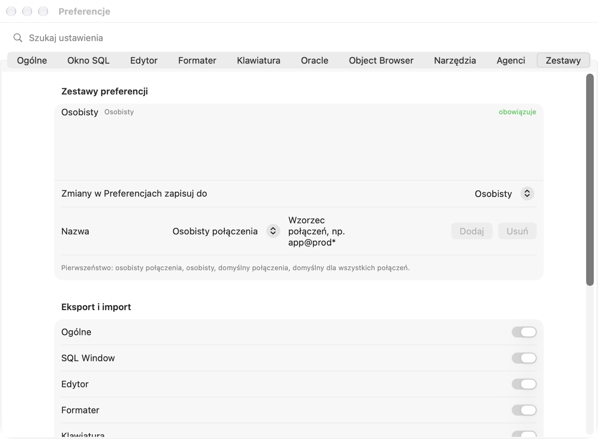

# Ajustes y atajos de teclado

Este capítulo describe **cada opción** de la ventana Ajustes: qué hace, cuál es su valor predeterminado, qué ocurre al
activarla o desactivarla (o al elegir otro elemento de una lista), cuándo empieza a funcionar el cambio y a qué debes
prestar atención. No hace falta leerlo de principio a fin: los valores predeterminados están elegidos para que puedas
empezar a trabajar con seguridad. Vuelve aquí cuando algo se comporte de forma distinta a la que quieres.

## Ventana Ajustes

### Para qué sirve

Los ajustes deciden cómo se conecta Pelikan a la base de datos, cómo ejecuta las sentencias, qué aspecto tiene el editor
y cómo se formatea el código. Cada desarrollador tiene costumbres algo distintas: aquí adaptas el programa a las tuyas.

### Cómo abrirla y encontrar una opción

1. Elige **Pelikan › Ajustes…** o pulsa **⌘,** (Comando y coma).
   *Resultado:* se abre una ventana con pestañas arriba: General, SQL Window, Editor, Formateador, Teclado, Oracle,
   Object Browser, Herramientas, Agentes, Conjuntos.
2. ¿No sabes en qué pestaña está la opción? Escribe parte de su nombre en el campo **Buscar ajustes** encima de las
   pestañas, p. ej. `commit`.
   *Resultado:* en lugar de las pestañas aparece una lista de ajustes coincidentes con el nombre de la pestaña a la
   derecha.
3. Haz clic en un elemento de la lista.
   *Resultado:* el campo de búsqueda se vacía y se abre la pestaña correcta.

### Cuándo empieza a funcionar un cambio

- **Los cambios se guardan al instante**: no hay botón «Aplicar» ni «OK», como en los ajustes de macOS. Cerrar la
  ventana no deshace nada.
- La mayoría de las opciones funcionan enseguida en todas las ventanas.
- Las opciones que afectan a las **sesiones de la base de datos** (p. ej. los ajustes NLS o el modo de sesión) se
  aplican a las **sesiones nuevas**: desconéctate y vuelve a conectarte para que afecten a las ventanas ya abiertas.
- Tres opciones requieren **reiniciar Pelikan**: el directorio de Oracle Instant Client, los directorios de Oracle Net y
  Oracle Wallet y el idioma de la interfaz. Pelikan lo indica debajo de cada una.

> **Consejo.** ¿Quieres ajustes distintos para una base de datos (p. ej. más estrictos para producción)? No los cambies a
> mano en cada cambio de conexión: usa los **conjuntos de ajustes** (pestaña **Conjuntos**, descrita al final del
> capítulo).

La descripción de cada opción tiene siempre la misma estructura: el nombre de la opción tal como aparece en la ventana,
el valor predeterminado, el efecto de cada posibilidad y, cuando hace falta, una advertencia ⚠️.

## Pestaña General

### Sesiones

Una **sesión** es una conexión con la base de datos Oracle en el lado del servidor. En una sesión viven tu
**transacción** (cambios de datos aún no confirmados con COMMIT), las variables de paquete y los ajustes establecidos con
ALTER SESSION. Cuántas sesiones abre Pelikan tiene consecuencias reales.

**Modo de sesión** — *predeterminado: Multi*.

| Opción | Qué ocurre | Consecuencias |
|---|---|---|
| **Multi: sesión independiente para cada ventana** | Cada ventana SQL, de prueba y de consola tiene su propia sesión; la compilación tiene otra más. | Una consulta larga en una ventana no bloquea las demás. Las transacciones de las ventanas son independientes: un cambio en la ventana A es invisible en la ventana B hasta el COMMIT. Más sesiones en el servidor (el administrador puede tener un límite). **Recomendado.** |
| **Dual: sesión compartida y sesión de compilación** | Las ventanas de una conexión comparten una sesión; la compilación tiene la suya. | Menos sesiones. Las ventanas ven los cambios no confirmados de las otras y comparten la transacción: un COMMIT en una ventana confirma los cambios de todas. Mientras una ventana ejecuta una consulta, las demás esperan. |
| **Single: una sola sesión** | Todo, también la compilación, en una sola sesión (el depurador sigue teniendo su propia sesión de supervisión). | Menos sesiones aún. ⚠️ En Oracle la compilación (CREATE OR REPLACE) **confirma la transacción abierta**: compilar un paquete en la Program Window confirma los cambios no confirmados de la SQL Window. Úsalo solo si la base de datos permite una sola sesión. |

*Funciona:* en las sesiones nuevas; tras el cambio, desconéctate y vuelve a conectarte.

**Cierre de sesión con una transacción abierta** — *predeterminado: Preguntar*. Qué hacer cuando cierras una ventana, la
cambias a otra conexión o cierras la sesión mientras la sesión tiene cambios sin confirmar.

- **Preguntar**: Pelikan muestra una ventana con COMMIT, ROLLBACK o Cancelar. **Recomendado**: siempre sabes qué pasa
  con tus cambios.
- **Confirmar (COMMIT)**: los cambios se confirman sin preguntar. ⚠️ Es fácil hacer permanente un cambio hecho «para
  probar».
- **Revertir (ROLLBACK)**: los cambios se revierten sin preguntar. ⚠️ Un COMMIT olvidado significa trabajo perdido.

**Comprobar la conexión cada … s (0: desactivado)** — *predeterminado: 60 s*, paso de 30 s. Cada tantos segundos Pelikan
envía a la base de datos una consulta muy ligera para comprobar si siguen vivas las sesiones principales y las de las
ventanas con una transacción abierta (p. ej. si se cayó la red o la VPN). Cuando se pierde una sesión, Pelikan lo avisa
enseguida y quita la marca de transacción abierta de las ventanas afectadas: **los cambios no confirmados de una sesión
perdida quedan revertidos en la base de datos**.

- Un valor menor (al menos 15 s): te enteras antes de una conexión caída, a costa de consultas más frecuentes.
- **0**: Pelikan no comprueba la conexión; te enteras de la caída solo con la siguiente sentencia.
- El cambio funciona enseguida.

**Fijar la conexión de las ventanas nuevas** — *predeterminado: desactivado*. La conexión **principal** es la que eliges
en la barra de herramientas; las ventanas nuevas la reciben.

- Desactivado: cuando cambias la conexión principal, las ventanas sin fijar cambian con ella (antes preguntan por una
  transacción abierta).
- Activado: cada ventana nueva SQL, de programa, de prueba y de consola recibe una conexión **fijada** (📌 en la barra
  de estado) y la conserva aunque cambies la conexión principal. Útil cuando trabajas en paralelo en varias bases de
  datos y no quieres que una ventana «salte» a otra.

### Indicadores de conexión

El color de una conexión ayuda a no confundir una base de datos de prueba con una de producción. El color lo estableces
en la definición de la conexión (pestaña **Entorno**); aquí decides dónde se ve.

**Fondo del editor con el color de la conexión** — *predeterminado: desactivado*. Activado: el fondo del editor se tiñe
ligeramente con el color de la conexión de la ventana. Así se ve muy claro que estás escribiendo «en producción».
Desactivado: el color está solo en las pestañas de las ventanas y en la lista de ventanas.

**Reglas usuario@base** — una lista de reglas con patrón y color, vacía por defecto. El botón **Añadir regla** añade una
regla `*@*` en rojo; cambia el patrón y el color. El patrón tiene la forma `usuario@base`, `*` significa cualquier
cadena y `?` un carácter. Ejemplos: `sys@*`: cualquier inicio de sesión como SYS; `*@prod*`: cualquier usuario en bases
cuyo nombre empieza por «prod». Una regla **tiene prioridad** sobre el color de la conexión y del entorno y se aplica a
las pestañas, la lista de ventanas y el fondo. El botón ⊖ elimina una regla.

> **Ejercicio: marcar en rojo los inicios de sesión como SYS.**
> 1. En la pestaña **General** haz clic en **Añadir regla**. *Resultado:* aparece una fila `*@*` de color rojo.
> 2. Escribe `sys@*` en el campo del patrón. Deja el color rojo.
> 3. Activa **Fondo del editor con el color de la conexión**.
> 4. Conéctate como SYS a una base de datos de prueba y abre una SQL Window. *Resultado:* la pestaña de la ventana y el
>    fondo del editor son rojos.

### Apariencia

**Modo** — *predeterminado: Como el sistema*. **Como el sistema**: Pelikan es claro u oscuro junto con macOS (también
cuando macOS cambia al anochecer). **Claro** / **Oscuro**: siempre así, sin depender del sistema. El cambio funciona
enseguida.

### Fuente de la interfaz

Se aplica a etiquetas, listas, la cinta, las pestañas de ventanas, la barra de estado, las ventanas de herramientas y los
Ajustes. Los menús y los títulos de las ventanas los dibuja macOS: Pelikan no los cambia. Debajo de las opciones ves un
texto de ejemplo con la fuente elegida.

- **Tipo de letra** — *predeterminado: Del sistema (SF Pro)*. La lista contiene las fuentes instaladas en el Mac.
- **Estilo** — *predeterminado: normal*. De fina a negrita.
- **Tamaño** — *predeterminado: 13 pt*, de 10 a 20 pt. El texto auxiliar (rótulos, descripciones) es siempre 2 pt más
  pequeño. Una fuente mayor da legibilidad a costa de espacio: a partir de 16 pt, en una pantalla pequeña algunas barras
  se estrechan.

Las fuentes del editor de código y de la cuadrícula de resultados se ajustan por separado, en la pestaña **Editor**.

### Cinta

La **cinta** es la franja de pestañas de acciones (Iniciar, SQL, Programa, Herramientas…) bajo la barra de herramientas,
como en los programas de ofimática.

- **Mostrar la cinta con pestañas de acciones** — *predeterminado: activado*. Desactivado: la cinta desaparece y el
  editor gana espacio; los comandos siguen en los menús, en la paleta de comandos (⇧⌘P) y en sus atajos.
- **Contraer la cinta solo a pestañas** — *predeterminado: desactivado*, disponible solo con la cinta visible. Activado:
  solo se ven los nombres de las pestañas. Un clic en una pestaña despliega la cinta y un doble clic la contrae o la
  despliega de forma permanente. Un buen compromiso en una pantalla pequeña.

El campo **Buscar acciones** de la cinta encuentra cualquier comando por su nombre, también sin acentos y por su nombre
en inglés de PL/SQL Developer.

### Paneles de herramientas

Las herramientas (p. ej. el Object Browser, Sesiones, los resultados de pruebas) se abren en el panel derecho, en el
panel inferior o en una ventana independiente.

- **Abrir las herramientas nuevas en** — *predeterminado: Panel derecho*. **Panel derecho**, **Panel inferior** o
  **Ventana independiente**. Se aplica a las herramientas que aún no has movido: Pelikan recuerda por separado la
  ubicación de cada tipo de herramienta.
- **Ocultar los paneles automáticamente cuando el trabajo vuelve al editor** — *predeterminado: desactivado*. Activado:
  al hacer clic en el editor, los paneles de herramientas se ocultan y el editor ocupa todo el ancho; un panel vuelve
  cuando abres o eliges una herramienta. Desactivado: los paneles se quedan en su sitio.
- **Restaurar ubicaciones predeterminadas**: olvida las ubicaciones a las que moviste herramientas (el contador de al
  lado muestra cuántas hay). Las herramientas volverán a abrirse según **Abrir las herramientas nuevas en**.

Mueves una herramienta arrastrando su pestaña al otro panel o fuera de los paneles (ventana independiente), desde el
menú de la pestaña o con el botón de la barra de título de la herramienta.

### Idioma de la interfaz

**Idioma** — *predeterminado: Como el sistema*. Polski, English, Deutsch, Español o Українська. **Como el sistema**: el
idioma de los ajustes de macOS. El cambio funciona **tras reiniciar Pelikan**. El idioma no cambia los mensajes de Oracle
(p. ej. `ORA-00942`): estos dependen de NLS_LANGUAGE en la pestaña **Oracle**.

### Carpetas iniciales y extensiones

**Scripts SQL**, **Programas**, **Pruebas**, **Informes**: la carpeta que muestra el cuadro de abrir y guardar para un
archivo de ese tipo. *Vacío por defecto:* la carpeta del proyecto o, sin proyecto, la última usada. Escribe una ruta,
elige de la lista (carpeta del proyecto, carpetas de archivos recientes, Documentos, carpeta de inicio) o haz clic en el
botón de explorar.

**Extensiones adicionales de programas** y **Extensiones adicionales de pruebas** — *vacío por defecto*. Pelikan reconoce
el tipo de archivo por su extensión: `.sql` se abre en una SQL Window; `.pck`, `.pks`, `.pkb`, `.prc`, `.fnc`… en una
Program Window; `.tst` en una Test Window. Si en tu equipo los programas tienen otra extensión (p. ej. `.plsql`), añádela
aquí (varias separadas por comas): esos archivos se abrirán en una Program o Test Window en lugar de una SQL Window.

### Especificación y cuerpo en archivos separados

Un paquete PL/SQL consta de la **especificación** (lo que ofrece el paquete) y el **cuerpo** (cómo lo hace). Muchos
equipos los guardan en dos archivos, p. ej. `emp_api.pks` y `emp_api.pkb`.

- **Abrir el par especificación/cuerpo en una sola ventana** — *predeterminado: activado*. Activado: abrir `emp_api.pks`
  abre también `emp_api.pkb` de la misma carpeta en la misma Program Window (dos pestañas). Desactivado: solo se abre el
  archivo elegido.
- **Extensión de la especificación del paquete** (*pks*), del cuerpo del paquete (*pkb*), de la especificación del tipo
  (*tps*) y del cuerpo del tipo (*tpb*). Una Program Window con especificación y cuerpo guarda cada unidad en su archivo;
  **Guardar como** crea un par de archivos; la exportación de objetos «un archivo por objeto» usa estas extensiones. La
  extensión de la especificación debe ser distinta de la del cuerpo y no puede ser una reservada (`sql`, `tst`, `pck`,
  `typ`, `rep`, `pdd`, `sqlnb`, `txt`). Con un valor no válido Pelikan muestra una nota en rojo y usa las predeterminadas
  hasta que lo corrijas.

### Archivos

- **Restaurar ventanas al reiniciar (también sin guardar)** — *predeterminado: activado*. Activado: al salir, Pelikan
  recuerda las ventanas abiertas con el texto sin guardar y las vuelve a abrir al iniciar. Desactivado: Pelikan arranca
  con el área de ventanas vacía.
- **Guardar automáticamente la disposición de la ventana** — *predeterminado: activado*. Pelikan recuerda el tamaño de la
  ventana principal, la posición de los paneles y sus anchos. Desactivado: tras iniciar, la disposición vuelve a la
  predeterminada.
- **Preguntar si guardar los cambios al cerrar ventanas nuevas** — *predeterminado: activado*. Se aplica a ventanas que
  aún no tienen archivo (p. ej. una SQL Window nueva con una consulta escrita). Desactivado: esa ventana se cierra sin
  preguntar y el texto se pierde. ⚠️ Desactívalo solo si usas las ventanas nuevas como borrador.
- **Detectar cambios de archivos en el disco** — *predeterminado: activado*. Cuando otro programa (git, otro editor, un
  agente de IA) modifica un archivo abierto en Pelikan, Pelikan lo nota al volver a la ventana y ofrece cargar la nueva
  versión. Desactivado: Pelikan no lo comprueba y guardar desde Pelikan sobrescribe los cambios ajenos. ⚠️ Déjalo activado
  si usas git.
- **Volver a cargar sin preguntar los archivos modificados fuera cuando la ventana no tiene cambios** — *predeterminado:
  desactivado*, disponible con la detección activada. Activado: si la ventana no tiene cambios sin guardar, la nueva
  versión se carga sin preguntar (cómodo tras `git pull`). Si la ventana tiene cambios sin guardar, Pelikan siempre
  pregunta.

### Estándar de archivos

Determina en qué formato guarda Pelikan los archivos de código **nuevos**.

- **Codificación** — *predeterminado: UTF-8*. La forma de guardar los caracteres (p. ej. letras con tilde). UTF-8 es el
  estándar de las herramientas modernas y de git. Elige otra codificación (p. ej. Windows-1252) solo si tu proyecto lo
  exige.
- **Marca de orden de bytes (BOM) al inicio del archivo (UTF-8)** — *predeterminado: desactivado*. La BOM son bytes
  invisibles al inicio del archivo que necesitan algunos programas antiguos de Windows. La mayoría de las herramientas
  (git, SQL*Plus en Linux) funcionan mejor sin ella.
- **Archivos de programa sin líneas «/» (ni al final ni en medio)** — *predeterminado: activado*. Una línea con solo `/`
  le dice a SQL*Plus «ejecuta lo de arriba». En los archivos con código de paquetes (desplegados por herramientas) esa
  línea suele estorbar. Activado: la Program Window guarda las unidades sin `/`. Desactivado: puedes terminar las
  unidades con `/` (opción en la pestaña **Oracle › Depurador**). Los scripts SQL conservan siempre `/`, porque los
  ejecuta la ventana de comandos.
- **Preguntar por la conversión al abrir un archivo en otro formato** — *predeterminado: activado*. Al abrir un archivo
  en otra codificación, con BOM o con `/`, Pelikan ofrece convertirlo al estándar. La conversión cambia solo la ventana:
  el archivo en el disco cambia solo al guardar. Desactivado: el archivo se abre tal cual.
- **Restaurar valores predeterminados (UTF-8, sin BOM, sin «/»)**: devuelve esta sección a sus valores predeterminados.

### Registro de la aplicación

El registro anota lo que hace Pelikan; es útil al informar de un error. **El registro nunca contiene contraseñas, el
texto de las sentencias SQL ni datos de la base de datos.**

- **Registrar** — *predeterminado: Eventos (recomendado)*. **Advertencias y errores**: solo problemas (el menor número de
  entradas). **Eventos**: también acciones normales (conectar, ejecutar, compilar). **Detalles — diagnóstico**: muchas
  entradas; actívalo un rato cuando busques la causa de un error y desactívalo después.
- **Mostrar nombres de conexiones y objetos, y rutas de archivos** — *predeterminado: desactivado*. Desactivado: los
  nombres de conexiones y servidores se sustituyen en el registro por un hash, así que puede enviarse sin riesgo.
  Activado: se ven los nombres reales (el registro es más fácil de entender, pero piénsalo antes de enviárselo a
  alguien).
- **Mostrar registro** y **Exportar registro…**: abren el registro o lo guardan en un archivo.

## Pestaña SQL Window

### Ejecución

**AutoSelect: sin selección, ejecutar la sentencia bajo el cursor** — *predeterminado: activado*. Una SQL Window suele
contener varias consultas una debajo de otra.

- Activado: **F8** (o ⌘↩) ejecuta **una** sentencia, aquella en la que está el cursor. Para ejecutar todo el script,
  selecciónalo (⌘A) o usa **Ejecutar al contrario de AutoSelect** (⌃F8, ⇧⌘↩).
- Desactivado: F8 ejecuta **todas** las sentencias de la ventana una tras otra, y una sola solo si está seleccionada.
- Cuando seleccionas algo, siempre se ejecuta la selección.

**AutoCommit de sentencias SQL** — *predeterminado: desactivado*.

- Desactivado: tras INSERT, UPDATE o DELETE los cambios existen solo en tu sesión. Los haces permanentes con **COMMIT**
  (F10) o los deshaces con **ROLLBACK** (⇧F10). La barra de estado muestra la transacción abierta. **Recomendado.**
- Activado: cada sentencia que modifica datos se confirma enseguida. ⚠️ Un error (p. ej. un UPDATE sin WHERE) no se puede
  deshacer con ROLLBACK.

**Estadísticas tras la ejecución** — *vacío por defecto (todas las distintas de cero)*. Lista de nombres de estadísticas
de sesión que se muestran en la pestaña **Estadísticas** (p. ej. `consistent gets`, `physical reads`), varias separadas
por comas. Vacío: todas las que han cambiado. Funciona con la pestaña Estadísticas activada (sección de abajo).

**AutoCommit tras ejecutar la ventana de prueba** — *predeterminado: desactivado*. Como AutoCommit, pero para la Test
Window: activado, tras ejecutar el script de prueba los cambios se confirman. Desactivado: decides tú (útil: probar,
revisar los datos, ROLLBACK).

**Confirmar COMMIT y ROLLBACK** — *predeterminado: desactivado*. Activado: antes de confirmar o revertir, Pelikan pregunta
«¿seguro?». Protege contra pulsar F10 por error; la pregunta tiene la casilla **No volver a preguntar**.

**Confirmar sentencias que modifican en conexiones de producción** — *predeterminado: activado*. Se aplica a conexiones con
el entorno **Producción** (definido en la conexión). Antes de cada sentencia que modifica datos u objetos (INSERT,
UPDATE, DELETE, MERGE, DDL…) Pelikan pregunta si de verdad quieres ejecutarla. ⚠️ Esta pregunta no se desactiva con «No
volver a preguntar», solo con esta opción. Déjala activada.

### Resultados

**Filas por página** — *predeterminado: Automático (página)*. Cuántas filas del resultado obtiene Pelikan de inmediato.
Una consulta puede devolver millones de filas: obtenerlas todas llevaría mucho tiempo y ocuparía memoria.

- **Automático (página)**: 100 filas; las siguientes se obtienen al desplazarte.
- **100**, **500**, **1000**: esa cantidad de filas cada vez.
- **Todos**: todo el resultado de una vez. ⚠️ En tablas grandes puede tardar mucho y ocupar mucha memoria.

«(más…)» junto al número de filas significa que el resultado aún no está completo.

**Tamaño máximo del resultado** — *predeterminado: 512 MB*, de 16 a 8192 MB. Cuando el resultado obtenido supera este
tamaño, Pelikan detiene la obtención y pregunta: **Seguir recuperando** o **Detener**. Protege al Mac de que una consulta
ocupe toda la memoria.

**Formato de números** — *predeterminado: A la derecha*. Cómo muestra la cuadrícula los números: **A la derecha** (como en
una hoja de cálculo, con las unidades alineadas), **A la izquierda**, **Con formato (separador regional)** (separador
decimal según los ajustes de macOS), **Con separador de miles** (p. ej. 1.234.567). Solo afecta a la visualización: copiar
y exportar conservan el valor exacto.

**Número de fila al copiar y exportar** — *predeterminado: desactivado*. Activado: el resultado copiado y exportado tiene
una primera columna con el número de fila.

**Obtener LOB bajo demanda (vista previa de los primeros 4000 bytes)** — *predeterminado: activado*. Un LOB (CLOB, BLOB)
es una columna con texto grande o un archivo. Activado: la cuadrícula muestra el comienzo del valor y el resto se obtiene
solo cuando lo abres (Large Data Editor). Las consultas son más rápidas. Desactivado: los valores completos se obtienen de
inmediato.

**Alinear columnas según la plantilla guardada de la consulta** — *predeterminado: activado*. Cuando guardas anchos y
alineación de columnas para una consulta (menú de la cuadrícula), al volver a ejecutar la misma consulta Pelikan coloca
las columnas igual. Desactivado: las plantillas se ignoran.

**Avisar al terminar una ejecución de más de … s** — *predeterminado: 10 s*, paso de 5 s; 0: sin aviso. Cuando una
sentencia dura más, al terminar Pelikan reproduce un sonido (otro distinto si hay error) y, si estás trabajando en otro
programa, el icono de Pelikan rebota en el Dock.

**Large Data Editor: Auto Format (JSON, XML)** — *predeterminado: desactivado*. Activado: al abrir un valor JSON o XML en
el Large Data Editor, el texto se formatea bien enseguida (sangrías, líneas). Solo cambia la vista, salvo que guardes el
valor.

### Query By Example

**Query By Example** (QBE) es una fila sobre la cuadrícula donde escribes valores y Pelikan añade una condición WHERE a la
consulta. Estas opciones deciden cómo se compara el valor escrito.

- **Sin distinguir mayúsculas y minúsculas** — *predeterminado: activado*. Activado: `kowalski` también encuentra
  `KOWALSKI`. Desactivado: las mayúsculas deben coincidir.
- **Texto sin comodines como «contiene»** — *predeterminado: desactivado*. Activado: `kow` busca valores que contienen
  «kow» (como `LIKE '%kow%'`). Desactivado: `kow` busca valores iguales a «kow»; «contiene» lo consigues escribiendo
  `%kow%`.
- **Fechas sin hora (comparar el día)** — *predeterminado: activado*. Activado: `2026-11-05` encuentra todas las filas de
  ese día, a cualquier hora. Desactivado: solo la medianoche de ese día.

### Estadísticas

**Pestaña Estadísticas: estadísticas de sesión de cada ejecución (requiere acceso a V$MYSTAT)** — *predeterminado:
desactivado*. Activado: tras cada ejecución la SQL Window tiene una pestaña **Estadísticas** con el número de lecturas,
ordenaciones, llamadas recursivas, etc. Útil al ajustar consultas. Requiere acceso de lectura a las vistas `V$MYSTAT` y
`V$STATNAME` (pídeselo al administrador).

### DBMS_OUTPUT

`DBMS_OUTPUT.PUT_LINE` es la forma en que el código PL/SQL «imprime» texto: el equivalente de `print`.

- **Activado** — *predeterminado: activado*. Pelikan activa el búfer DBMS_OUTPUT en la sesión y tras la ejecución muestra
  el texto en la pestaña **Output** de la SQL Window (en la Test Window, **Salida**). Desactivado: el texto de PUT_LINE
  se pierde.
- **Limpiar antes de ejecutar** — *predeterminado: activado*. Activado: la pestaña se vacía antes de cada ejecución.
  Desactivado: las líneas nuevas se añaden a las anteriores.
- **Tamaño del búfer** — *predeterminado: sin límite (0)*, paso de 10.000 bytes. Límite de la cantidad de texto en el
  búfer. Al superarlo, Oracle da el error `ORU-10027`. Sin límite: el error no se produce.

### Formatos de fecha

**DATE** — *predeterminado: `YYYY-MM-DD HH24:MI:SS`*, **TIMESTAMP** — *predeterminado: `YYYY-MM-DD HH24:MI:SS.FF6`*. Cómo
muestra la cuadrícula las fechas y marcas de tiempo. Escribe tu propio formato en notación de Oracle o elige uno de la
lista. Afecta a la visualización en la cuadrícula; cómo convierte la **base de datos** el texto en fecha en las consultas
se ajusta en NLS_DATE_FORMAT (pestaña **Oracle**).

## Pestaña Editor

### Fuente

- **Fuente** — *predeterminado: SF Mono*. La lista contiene fuentes de ancho fijo (el código se lee mejor cuando las
  columnas coinciden).
- **Estilo** — *predeterminado: normal*.
- **Tamaño** — *predeterminado: 13 pt*, de 8 a 40 pt.
- **Ligaduras (p. ej., Fira Code, JetBrains Mono)** — *predeterminado: activado*. Algunas fuentes unen los caracteres
  `<>`, `>=`, `=>` en un solo símbolo. Solo funciona con esas fuentes; con SF Mono no cambia nada. Desactívalo si prefieres
  ver cada carácter por separado.

### Cuadrícula de resultados y Object Browser

Una fuente propia para la cuadrícula de resultados (*predeterminado: del sistema de ancho fijo, 12 pt*, de 8 a 24 pt) y
para el Object Browser (*predeterminado: como la interfaz*; el valor 0 pt: como la interfaz).

### Colores de fuente

Para el **Editor**, la **cuadrícula de resultados** y el **Object Browser** puedes elegir el color del **Texto** y del
**Fondo**. *Predeterminado:* los colores del sistema, que cambian con el modo claro y oscuro. Un color propio se aplica en
ambos modos: elige uno que sea legible en claro y en oscuro. **Del sistema** restaura los colores del sistema. El
resaltado de sintaxis (palabras clave, textos, comentarios) se mantiene.

### Code Assistant (sugerencias de código)

Code Assistant es la lista de sugerencias que aparece al escribir: nombres de tablas, columnas, paquetes, procedimientos.

- **Automáticamente tras un punto** — *predeterminado: activado*. Tras escribir `emp.` aparece sola la lista de columnas
  de la tabla EMP. Desactivado: abres la lista a mano con **⌃Espacio**.
- **Retardo** — *predeterminado: 400 ms*, de 0 a 2000 ms. Cuánto espera Code Assistant tras el punto. Más corto: más
  rápido, pero la lista puede aparecer cuando no la quieres.
- **Coincidencia** — *predeterminado: Empieza por*. **Empieza por**: `sal` sugiere `SALARY`. **Contiene**: `sal` sugiere
  también `BASE_SALARY` (más elementos en la lista).
- **Mayúsculas/minúsculas** — *predeterminado: Como se escribe*. En qué forma entra la sugerencia en el código: **Como se
  escribe** (escribes en minúsculas, inserta en minúsculas), **MAYÚSCULAS**, **minúsculas**, **Primera en mayúscula**,
  **Original** (como en el diccionario de la base, normalmente en mayúsculas).
- **Mínimo de caracteres para objetos y palabras clave** — *predeterminado: 1*, de 1 a 5. Tras cuántas letras escritas
  (sin punto) aparecen las sugerencias de nombres de objetos y palabras clave. Más: molesta menos, pero ayuda más tarde.
- **Funciones SQL estándar** — *predeterminado: activado*. Activado: la lista contiene también las funciones integradas
  (`NVL`, `TO_CHAR`, `SUBSTR`…).
- **«(todos)»: cada elemento en su propia línea** — *predeterminado: desactivado*. El elemento «(todos)» de la lista de
  columnas inserta todas las columnas a la vez. Desactivado: en una línea separadas por comas. Activado: cada columna en
  su propia línea.
- **«(todos)»: coma al inicio de la línea** — *predeterminado: desactivado*, disponible con la opción anterior. Activado:
  `, columna` en lugar de `columna,`.

### AutoReplace (abreviaturas de texto)

Escribes una abreviatura corta y un espacio (u otro carácter de fin), y Pelikan la sustituye por un texto más largo. *Por
defecto hay dos:* `sf` → `SELECT * FROM ` y `dbo` → `dbms_output.put_line(|);`. El carácter `|` en la sustitución marca
dónde queda el cursor tras sustituir. **Añadir abreviatura** añade una fila vacía; ⊖ elimina una.

> **Ejercicio: tu propia abreviatura.**
> 1. Haz clic en **Añadir abreviatura**, escribe `cnt` en el campo **Atajo** y `SELECT COUNT(*) FROM |;` en el campo
>    **Sustitución (| = cursor)**.
> 2. Abre una SQL Window nueva (⌘N), escribe `cnt` y un espacio. *Resultado:* aparece `SELECT COUNT(*) FROM ;` y el cursor
>    queda antes del punto y coma: escribe el nombre de la tabla.

### Análisis y ventanas

- **Análisis de código al escribir** — *predeterminado: activado*. Pelikan subraya continuamente los nombres desconocidos
  (consultando el diccionario de la base) y los puntos sospechosos del código. Desactivado: los subrayados desaparecen;
  verás los errores solo al compilar o ejecutar.
- **Advertir de identificadores de más de … bytes** — *predeterminado: 30*; 0: desactivado. Las versiones antiguas de
  Oracle (hasta 12.1) permiten nombres de hasta 30 bytes; una letra con tilde ocupa 2 bytes. Pon 128 si trabajas solo con
  Oracle 12.2 o posterior.
- **Recordar el estado de las ventanas de archivo (cursor, marcadores, marcas, variables)** — *predeterminado: activado*.
  Al volver a abrir un archivo vuelves al mismo sitio, con marcadores y valores de variables. Desactivado: el archivo se
  abre desde el principio.

### Escritura

- **Mayúsculas/minúsculas de las palabras clave** — *predeterminado: Sin cambios*. **MAYÚSCULAS** / **minúsculas** /
  **Primera en mayúscula**: al escribir, Pelikan cambia las palabras clave (SELECT, FROM, BEGIN…) a la forma elegida. No
  cambia nombres, texto entre apóstrofos ni comentarios.
- **Resaltar la línea actual** — *predeterminado: activado*. La línea con el cursor tiene un fondo algo distinto.
- **Resaltar las apariciones del nombre bajo el cursor y de la palabra seleccionada** — *predeterminado: activado*. El
  cursor sobre la variable `l_total` resalta todos sus usos: es fácil ver dónde se modifica.
- **Resaltar las instrucciones COMMIT, ROLLBACK y SAVEPOINT** — *predeterminado: activado*. Las sentencias que terminan
  una transacción tienen un color llamativo: es más difícil pasarlas por alto en el código.
- **Estado de líneas (modificadas y nuevas desde la apertura o el guardado)** — *predeterminado: activado*. En el margen,
  junto a los números de línea, una barra de color muestra las líneas modificadas y añadidas desde la apertura o el último
  guardado.
- **Ajustar líneas** — *predeterminado: desactivado*. Activado: una línea larga se parte en pantalla (sin cambiar el
  texto). Desactivado: una línea larga se desplaza en horizontal.
- **Número en cada línea / Número cada … líneas** — *predeterminado: cada línea*, hasta cada 10.
- **Margen vertical en la columna …** — *predeterminado: ninguno*, paso de 10. Una línea vertical en la columna indicada
  (p. ej. 100) ayuda a escribir líneas cortas.
- **Mostrar caracteres especiales (espacios, tabulaciones, finales de línea)** — *predeterminado: desactivado*. Activado:
  los espacios son puntos y las tabulaciones flechas. Útil cuando buscas la causa de una sangría extraña.
- **Contenido del código visible por defecto** — *predeterminado: activado*. El panel **Contenido del código** junto al
  editor muestra la estructura del código (procedimientos, funciones, sentencias). La opción se aplica a las ventanas en
  las que no has cambiado el panel a mano (**Vista › Contenido del código**).
- **Estructuras de control en Contenido del código** — *predeterminado: activado*. Activado: el árbol muestra también IF,
  bucles, CASE y el manejo de excepciones (contraídos por defecto). Desactivado: solo subprogramas y bloques.
- **Orden en Contenido del código** — *predeterminado: Como en el código fuente*. O **Alfabéticamente**, o **Por tipo**.

### Sangrías

- **Sangría de nueva línea** — *predeterminado: Automática (como la línea anterior)*. **Ninguno**: Intro empieza la línea
  en la columna 1. **Automática**: la línea nueva tiene la sangría de la anterior. **Inteligente (estructura PL/SQL)**:
  tras `BEGIN`, `LOOP`, `THEN` la sangría aumenta y `END` vuelve al nivel del bloque.
- **Retroceso quita la sangría** — *predeterminado: activado*. Retroceso al inicio de una línea con sangría retrocede un
  nivel de sangría en lugar de un espacio.
- **Ancho de tabulación** — *predeterminado: 2*, de 1 a 8. Cuántos espacios dan Tab y un nivel de sangría.
- **Insertar un tabulador en lugar de espacios** — *predeterminado: desactivado*. Activado: Tab inserta un carácter de
  tabulación. Ojo: en otros programas una tabulación puede tener otro ancho y el código «se descuadra». La mayoría de los
  equipos usa espacios.

## Pestaña Colores

El **tema de colores** decide cómo colorea el código el editor. Fija los colores de las palabras clave, cadenas,
comentarios y nombres de funciones, además del fondo, la selección, el cursor, la línea actual y los números de línea.
Pelikan tiene 98 temas integrados. El predeterminado es **Pelikan**, en versión clara y oscura. También está
**Clásico**, al estilo de las antiguas herramientas de Oracle: fondo blanco, palabras clave azul marino, cadenas rojas y
comentarios verdes. Los otros 95 son temas de editor conocidos, entre ellos Solarized, Gruvbox, Dracula, Monokai, Nord,
One Dark, GitHub, Catppuccin y Tokyo Night. Sus paletas proceden del proyecto tinted-theming (licencia MIT).

Los mismos colores se aplican en la ventana SQL, la ventana de programa, la ventana de prueba y la consola, y en las
vistas previas de código de las ventanas de herramientas (sesiones, informes, Query Builder). La impresión y la vista
previa Quick Look del Finder mantienen los colores claros de Pelikan, porque el papel y el Finder tienen fondo blanco.

### Lista de temas

A la izquierda hay dos grupos: **Claros** (fondo claro) y **Oscuros** (fondo oscuro). El rectángulo de color junto al
nombre muestra el fondo del tema y tres de sus colores: palabra clave, cadena y comentario. Una ✓ marca el tema en uso.
**propio** marca un tema que guardó usted. El campo **Filtrar temas** limita la lista a los nombres o autores que
coinciden con lo escrito.

### Usar en modo claro / Usar en modo oscuro

macOS tiene un modo claro y uno oscuro (Ajustes del Sistema › Apariencia, o **General › Aspecto** en Pelikan). Pelikan
recuerda **un tema distinto para cada modo**. **Al hacer clic en un tema de la lista, se activa al instante en el modo en
que está ahora el sistema** (la línea bajo los botones indica cuál), así que al recorrer la lista ve los colores enseguida
en las ventanas abiertas. **Usar en modo claro** y **Usar en modo oscuro** asignan el tema seleccionado a un modo, también
al que no se ve ahora. *Por defecto:* Pelikan claro y Pelikan oscuro. Cuando el sistema cambia de
modo (por ejemplo, por la tarde con el modo automático), el editor pasa solo al otro tema. Los colores cambian al
instante en todas las ventanas abiertas, sin volver a abrir los archivos.

También puede elegir un tema oscuro para el modo claro, y al revés. El editor tiene entonces su propio fondo,
independiente del resto de la ventana. La línea bajo los botones muestra qué tema está en uso en cada modo.

### Vista previa

El selector **SQL / PL/SQL / Pro*C** muestra código de ejemplo con los colores del tema seleccionado, también código Pro*C
que no tenga abierto.

### Categorías de colores

Un tema asigna un color (y, si se quiere, negrita o cursiva) a cada categoría:

- **Texto normal** — nombres de tablas, columnas y variables.
- **Palabras clave** — `SELECT`, `BEGIN`, `IF`, `create or replace`; en Pro*C también `EXEC SQL`, `END-EXEC` y palabras
  clave de C (`if`, `return`).
- **Tipos de datos** — `VARCHAR2`, `NUMBER`, `DATE`, `BOOLEAN`; en Pro*C `int`, `char`, `VARCHAR`.
- **Funciones integradas** — `NVL`, `TO_CHAR`, `COUNT` y otras funciones de Oracle cuando al nombre le sigue un
  paréntesis; en Pro*C toda llamada a función (`printf(`).
- **Paquetes suministrados con la base de datos** — `DBMS_OUTPUT`, `UTL_FILE`, `APEX_…` cuando al nombre le sigue un
  punto.
- **Cadenas** — `'texto'`, `q'[…]'`; en Pro*C también `"texto"`.
- **Números** — `100`, `2.5`, `1e6`.
- **Comentarios** — `-- …` y `/* … */`.
- **Sugerencias del optimizador** — `/*+ INDEX(e) */`.
- **Variables de enlace y sustituciones** — `:x`, `&nombre`; en Pro*C variables host `:ename`.
- **Identificadores entre comillas** — `"Nombre del departamento"`.
- **Operadores y puntuación** — `:=`, `||`, `(`, `;`.
- **Directivas de compilación y del preprocesador** — `$IF … $END` en PL/SQL y `#include`, `#define` en Pro*C.

Los temas integrados tienen colores elegidos para que el texto sea legible: el texto normal tiene un contraste con el
fondo de al menos 4,5:1 y cada categoría de al menos 3:1. Pelikan no usa los colores demasiado pálidos de las paletas
originales (casi siempre los comentarios): los acerca al color del texto.

### Guardar como propio…

Los temas integrados no se pueden cambiar, para que siempre pueda volver a ellos. ¿Quiere otros colores? Seleccione el
tema más parecido a lo que busca y haga clic en **Guardar como propio…**. Escriba un nombre (*por defecto:* «nombre
(copia)»). La copia aparece en la lista marcada como **propio** y se puede editar enseguida. El original no cambia.

### Edición de un tema propio

Bajo la vista previa de un tema propio hay una tabla:

- **Nombre** y **Tema oscuro** — el nombre en la lista y el grupo (**Claros** u **Oscuros**). El grupo no limita la
  elección: puede usar el tema en cualquier modo.
- **Categoría** — para cada categoría de la lista anterior: **Color**, **Negrita** y **Cursiva**. Haga clic en el campo
  de color para abrir el selector de colores del sistema. El cambio se ve al instante en la vista previa, y en los
  editores si el tema está en uso. La flecha ↺ junto a un color restablece el color predeterminado: el del texto normal
  para las categorías y el del sistema para los elementos del editor.
- **Fondo**, **Texto**, **Selección**, **Línea actual**, **Números de línea**, **Cursor** — colores del propio editor.
  **Línea actual** es la franja bajo la línea con el cursor (si en la pestaña **Editor** está activado el resaltado de la
  línea actual).

Los cambios se guardan al instante, sin botón **Guardar**. **Eliminar** borra un tema propio. Si estaba en uso, ese modo
vuelve al tema Pelikan.

> **Nota.** Los colores de **texto** y **fondo** fijados en **Editor › Colores de fuente** tienen prioridad sobre el
> tema. Si el fondo no cambia al elegir un tema, compruebe si allí hay un color propio (el botón **Del sistema** lo
> quita).

### Importar… y Exportar…

**Importar…** carga un tema desde un archivo como tema propio. Formatos compatibles:

- un tema de Pelikan (`.json` de **Exportar…**),
- base16 y base24 (`.yaml`) — cientos de paletas del proyecto tinted-theming,
- Xcode (`.xccolortheme`; los temas del usuario están en `~/Library/Developer/Xcode/UserData/FontAndColorThemes`),
- TextMate y Sublime Text (`.tmTheme`),
- Visual Studio Code (`.json` de una extensión de tema, el archivo de su carpeta `themes`).

Al importar desde Xcode, TextMate y VS Code, Pelikan asigna las categorías de SQL a los colores del tema. El resultado no
siempre coincide con el editor original, porque esos temas describen otros lenguajes. Ajuste entonces los colores en la
tabla de edición.

**Exportar…** guarda el tema seleccionado (también uno integrado) en un archivo `.json`, por ejemplo para llevarlo a otro
equipo o dárselo a un compañero. Los temas propios también viajan con la exportación de ajustes
(**Herramientas › Ajustes › Exportar ajustes…**, sección **Editor**).

> **Ejercicio: un tema propio con comentarios bien visibles.**
> 1. Abra **Pelikan › Ajustes…** (⌘,) y la pestaña **Colores**.
> 2. En el grupo **Claros**, seleccione **Solarized Light**. *Resultado:* la vista previa muestra código sobre fondo
>    crema.
> 3. Haga clic en **Usar en modo claro**. *Resultado:* aparece una ✓ junto al nombre y la ventana SQL abierta cambia de
>    colores.
> 4. Haga clic en **Guardar como propio…**, escriba `Mi Solarized` y haga clic en **Guardar**. *Resultado:* la lista
>    contiene **Mi Solarized** marcado como **propio** y bajo la vista previa aparece una tabla de colores.
> 5. En la fila **Comentarios**, haga clic en el campo de color y elija un verde oscuro. Desactive **Cursiva**.
>    *Resultado:* los comentarios de la vista previa son verdes y rectos.
> 6. Haga clic en **Usar en modo claro**. *Resultado:* la ventana SQL usa ahora su tema y **Solarized Light** no ha
>    cambiado.
> 7. Para volver al aspecto predeterminado, seleccione **Pelikan** en el grupo **Claros** y haga clic en **Usar en modo
>    claro**.

## Pestaña Formateador

El **formateador** (⇧⌘F) ordena el código PL/SQL y SQL según reglas: sangrías, partición de listas, mayúsculas y
minúsculas. Gracias a él todo el equipo tiene el código con el mismo estilo. La pestaña tiene dos partes: a la izquierda
las reglas y a la derecha una **vista previa** con ejemplos (**PL/SQL**, **Consultas**, **DML**, **DDL**). Tras cada
cambio, las líneas afectadas se resaltan durante 5 segundos, una raya roja marca las líneas eliminadas y una línea
vertical el margen derecho. Si un cambio no se ve en el ejemplo actual, la vista previa cambia sola a uno donde se vea.

> **La forma más fácil de conocer el formateador:** cambia una opción cada vez y observa las líneas resaltadas de la
> vista previa.

### Disposición

- **Sangría** — *predeterminado: 2*, de 1 a 8 espacios por nivel.
- **Sangría con tabuladores** — *predeterminado: desactivado*.
- **Margen derecho** — *predeterminado: 100*, de 40 a 250. Hasta esta columna el formateador coloca elementos en una
  línea; los más largos los parte.
- **Conservar líneas vacías** — *predeterminado: activado*. Activado: las líneas vacías con las que separas partes del
  código se mantienen (como máximo **Máximo de líneas vacías seguidas**, *predeterminado 1*, hasta 5). Desactivado: el
  formateador elimina las líneas vacías.
- **Línea vacía antes de cada subprograma** — *predeterminado: desactivado*. Activado: los procedimientos y funciones del
  paquete quedan separados por una línea vacía.

### Listas y comas

Cada lista puede tener una de estas disposiciones: **Elemento en la línea** (cada elemento en su propia línea), **Hasta el
margen** / **En una línea si cabe** (elementos en una línea, partidos solo en el margen).

- **Listas SELECT, INTO, FROM** — *predeterminado: Elemento en la línea*.
- **UPDATE … SET** y **GROUP BY, ORDER BY** — *predeterminado: Como las listas SELECT*.
- **Declaraciones de parámetros**, **Parámetros de llamadas**, **Listas INSERT (columnas, VALUES)**, **Listas entre
  paréntesis (IN, argumentos de funciones)** — *predeterminado: En una línea si cabe*.
- **Columnas de tablas, campos de registros y tipos** — *predeterminado: Elemento en la línea*.
- **Coma al principio de la línea** — *predeterminado: desactivado*. Activado: `, columna` en lugar de `columna,`; así es
  más fácil comentar el último elemento.

### Cláusulas SQL y condiciones

- **Palabras de cláusula (FROM, WHERE…)** — *predeterminado: A la derecha (río)*. **A la izquierda, elementos en
  columna**: las palabras de cláusula empiezan en una columna. **A la derecha (río)**: las palabras de cláusula se alinean
  a la derecha, de modo que entre ellas y los elementos se forma un «río» vertical de espacio. **En su propia línea,
  elementos sangrados**: la palabra en su línea y los elementos debajo, con sangría.
- **AND / OR** — *predeterminado: Al principio de la línea*. Dónde queda AND/OR cuando se parte una condición.
- **JOIN … ON: condición en una línea nueva** — *predeterminado: activado*.
- **IF … THEN: THEN en una línea nueva** — *predeterminado: desactivado*.
- **Expresión CASE** — *predeterminado: En líneas separadas, las cortas en una*. O **En una línea**, o **WHEN, ELSE, END
  en líneas separadas**. Con la elección automática, un CASE con una rama WHEN cabe en una línea hasta **… caracteres**
  (*predeterminado 50*, de 20 a 120).
- **Subconsultas y CTE** — *predeterminado: Con sangría, «)» en su propia línea*. O **Tras el paréntesis**.
- **Expresiones largas: operador (||, +, -)** — *predeterminado: Al principio de la línea*. Dónde queda el operador al
  partir una expresión larga.

### Condiciones AND / OR

Reglas de partición de condiciones por separado para cada lugar. Primero elige el **Lugar de la condición**: WHERE,
HAVING, JOIN … ON, MERGE … ON, START WITH / CONNECT BY, CASE … WHEN, IF / ELSIF, WHILE, EXIT / CONTINUE WHEN, WHEN de un
disparador, CHECK o paréntesis anidados. Después ajusta:

- **Salto antes de AND / OR**: **Cada uno en su propia línea**, **Solo cuando la condición no cabe** o **No dividir**.
- **Posición de AND / OR**: **Como AND / OR en general**, **Al principio de la línea** o **Al final de la línea**.
- **Alineación de AND / OR**: **A la palabra clave (río)**, **Bajo la primera condición** o **Bajo la primera condición,
  con sangría**.

*Predeterminado:* cada AND/OR en su propia línea, alineado a la palabra clave; CHECK y paréntesis anidados, partidos solo
cuando no caben, bajo la primera condición. El AND de `BETWEEN … AND` nunca se parte.

### Alineación en columnas

La alineación hace que los elementos parecidos queden uno debajo de otro:

```sql
l_name     VARCHAR2(100);
l_salary   NUMBER := 0;
```

- **Declaraciones: tipos y := / DEFAULT** — *predeterminado: activado*.
- **Parámetros: modo (IN/OUT), tipo, DEFAULT** — *predeterminado: desactivado*.
- **Parámetros con nombre: =>** — *predeterminado: desactivado*.
- **Asignaciones consecutivas: :=** — *predeterminado: activado*.
- **Alias en SELECT y FROM** — *predeterminado: desactivado*.
- **UPDATE … SET: =** — *predeterminado: desactivado*.
- **Columnas de tablas y campos de registros: tipo, DEFAULT, NOT NULL** — *predeterminado: activado*.
- **Comentarios al final de líneas consecutivas** — *predeterminado: desactivado*.

El inconveniente de la alineación es que cambiar un nombre desplaza las líneas vecinas: git muestra entonces más líneas
modificadas.

### Espaciado

- **Espacios alrededor de los operadores (=, <>, +, ||…)** — *predeterminado: activado*. `a = b` en lugar de `a=b`.
- **Espacio tras la coma** — *predeterminado: activado*.
- **Espacios dentro de los paréntesis** — *predeterminado: desactivado*. `f( x )` en lugar de `f(x)`.

### Mayúsculas y minúsculas

Cada opción: **Sin cambios**, **MAYÚSCULAS**, **minúsculas**, **Primera en mayúscula**.

- **Palabras clave** — *predeterminado: MAYÚSCULAS*.
- **Identificadores** (nombres de tablas, columnas, variables) — *predeterminado: Sin cambios*.
- **Tipos de datos (NUMBER, VARCHAR2…)** — *predeterminado: Como las palabras clave*.
- **Funciones integradas (NVL, TO_CHAR…)** y **Paquetes de Oracle (DBMS_…, UTL_…)** — *predeterminado: Como los
  identificadores*.
- **Grafía especial (separada por comas)** — *vacío por defecto*. Palabras que se escriben siempre exactamente como las
  pongas aquí, p. ej. `DBMS_Output, UTL_File`.

Los literales entre apóstrofos, los identificadores entre comillas y los comentarios nunca se cambian.

### Al escribir y formateo automático

- **Formatear la línea al pulsar Intro** — *predeterminado: activado*. Intro en la SQL, Program y Test Window formatea la
  línea que dejas (si la cambiaste desde la apertura o el guardado): mayúsculas, espacios, alineación de cláusulas, y
  sangra la línea nueva según las reglas del formateador. El código que no has editado no se toca. El primer **⌘Z** deshace
  solo el formateo. El interruptor está también en la barra de herramientas y en el menú **Edición**.
- **Tras abrir el código fuente desde la base de datos** — *predeterminado: desactivado*. Activado: el código abierto
  desde la base se formatea enseguida. ⚠️ Tras compilar, en la base quedará el código formateado, es decir distinto del
  anterior: las comparaciones de versiones mostrarán muchos cambios.
- **Antes de compilar** — *predeterminado: desactivado*. Activado: el código se formatea antes de cada compilación.
- **Antes de guardar en archivo** — *predeterminado: desactivado*. Activado: el código se formatea antes de cada
  guardado.
- **Restaurar valores predeterminados**: vuelve a las reglas predeterminadas. Pelikan pregunta si conservar la grafía
  especial; las opciones de formateo automático no cambian.

## Pestaña Teclado

**Perfil de atajos** — *predeterminado: PL/SQL Developer*.

- **PL/SQL Developer**: atajos como en PL/SQL Developer para Windows: teclas de función (F8: ejecutar, F10: COMMIT) y ⌃ en
  lugar de Ctrl. Bueno si conoces ese programa o trabajas en un equipo que lo usa.
- **macOS**: atajos típicos del Mac, con ⌘ (p. ej. ⌘↩: ejecutar). Los atajos con teclas de función siguen funcionando
  como adicionales.

Debajo del perfil está la lista de todos los comandos con sus atajos y el campo **Buscar comando**.

- **Añadir atajo…**: elige un comando, haz clic y pulsa el atajo nuevo (Esc cancela). Si el atajo pertenecía a otro
  comando, Pelikan lo mueve y te dice de cuál.
- **Eliminar atajos del comando**: el comando queda sin atajo (sigue funcionando desde el menú y la paleta).
- **Predeterminado del comando**: restaura los atajos del comando elegido.
- **Restaurar todos los valores predeterminados**: deshace todos tus cambios de atajos.

El menú muestra un atajo del comando, pero funcionan todos sus atajos.

> **Ejercicio: un atajo para formatear.**
> 1. Escribe `format` en el campo **Buscar comando**. *Resultado:* en la lista quedan los comandos con «format» en el
>    nombre.
> 2. Elige **Formatear código PL/SQL** y haz clic en **Añadir atajo…**. *Resultado:* el botón muestra «Pulse un atajo…
>    (Esc: cancelar)».
> 3. Pulsa ⌃⌥F. *Resultado:* en la columna **Atajos** aparece ⌃⌥F junto a ⇧⌘F: funcionan los dos.

## Pestaña Oracle

### Oracle Instant Client

Instant Client es la biblioteca de Oracle con la que Pelikan habla con la base de datos (el controlador predeterminado).
*Predeterminado:* detectado automáticamente (Homebrew, `/opt/oracle`, la carpeta Descargas). **Elegir…**: indica la
carpeta con el archivo `libclntsh.dylib`; **Automático**: vuelve a la detección. El cambio funciona **tras reiniciar**.
Pelikan no incluye Instant Client (licencia de Oracle): lo descargas del sitio de Oracle (capítulo 1).

### Ajustes NLS de la sesión

NLS (National Language Support) son los ajustes con los que la **base de datos** convierte fechas y números en texto,
ordena y compara textos y elige el idioma de los mensajes. Pelikan ejecuta `ALTER SESSION SET …` en cada sesión nueva. Un
campo vacío: rige el ajuste del servidor.

| Parámetro | Sobre qué influye | Ejemplo |
|---|---|---|
| NLS_DATE_FORMAT | cómo tratan las fechas `TO_CHAR(fecha)` y la conversión implícita de texto a fecha | `YYYY-MM-DD` |
| NLS_TIMESTAMP_FORMAT | lo mismo para TIMESTAMP | `YYYY-MM-DD HH24:MI:SS.FF` |
| NLS_NUMERIC_CHARACTERS | separador decimal y de miles | `,.` o `.,` |
| NLS_LANGUAGE | idioma de los mensajes de Oracle y de los nombres de días y meses | `SPANISH`, `AMERICAN` |
| NLS_TERRITORY | formatos regionales predeterminados, primer día de la semana | `SPAIN` |
| NLS_SORT | cómo se ordenan los textos (ORDER BY) | `SPANISH`, `BINARY` |
| NLS_COMP | cómo se comparan los textos (=, LIKE) | `BINARY`, `LINGUISTIC` |

⚠️ Cambiar NLS puede cambiar el resultado del código que depende de la conversión implícita (p. ej.
`WHERE fecha = '2026-11-05'`). Funciona en **sesiones nuevas**.

**Cerrar las sesiones de ventanas inactivas más de … min (sin transacción abierta)** — *predeterminado: no cerrar (0)*,
paso de 15 min. Pelikan cierra las sesiones de las ventanas que no has usado durante más del tiempo indicado, siempre que
no tengan una transacción abierta ni estén ejecutando nada. En la siguiente ejecución la ventana se vuelve a conectar.
Útil cuando el administrador limita el número de sesiones. ⚠️ Una sesión nueva no tiene el estado de la anterior: las
variables de paquete, los datos temporales de sesión y los ajustes de ALTER SESSION se pierden.

### Documentación de Oracle (F1)

- **Versión de la documentación** — *predeterminado: la más reciente admitida*. 19c, 21c, 23ai o 26ai. **F1** sobre una
  palabra en el editor abre la documentación de esa versión. Elige la versión de tu base de datos.
- **Documentación local desde un servidor MCP** — *predeterminado: desactivado*. Si tienes en el Mac un servidor de
  documentación de Oracle (p. ej. `oracle-docs`), F1 y **Ayuda › Documentación de Oracle…** buscan primero en él: más
  rápido y sin internet. Al activarlo: **Dirección del servidor MCP** (solo HTTPS, o HTTP en este equipo: `127.0.0.1`,
  `localhost`), **Versión de la documentación local** y el botón **Comprobar conexión**. Pelikan envía al servidor solo
  las palabras buscadas.

### Contraseñas de conexiones

**Requerir Touch ID o la contraseña del Mac antes de usar una contraseña guardada** — *predeterminado: desactivado*. Las
contraseñas guardadas con **Recordar** están en el Llavero de macOS. Activado: antes del primer uso de una contraseña
guardada mientras Pelikan está abierto, macOS pide Touch ID o la contraseña del Mac (una vez por conexión, también cuando
un agente de IA usa la conexión). Protege las bases de datos si alguien se sienta ante tu Mac desbloqueado. No disponible
si el Mac no tiene Touch ID ni contraseña de inicio de sesión.

### Oracle Net y Oracle Wallet

- **Configuración de Oracle Net (tnsnames.ora, sqlnet.ora)** — *predeterminado: TNS_ADMIN o las ubicaciones
  predeterminadas*. La carpeta con el archivo `tnsnames.ora`, que contiene los **alias** de las bases de datos (nombres
  cortos en lugar de direcciones completas). Indícala si el administrador te ha dado este archivo.
- **Oracle Wallet (almacén de contraseñas)** — *predeterminado: ninguno, inicio de sesión con contraseña*. Una cartera es
  un archivo cifrado con contraseñas que te permite conectarte sin escribir la contraseña (conexión en modo «Oracle
  Wallet», `/@alias`). Debajo de la ruta Pelikan muestra su estado: verde, cartera con inicio de sesión automático
  (`cwallet.sso`); naranja, solo `ewallet.p12` (hay que crear `cwallet.sso` con `orapki` o `mkstore`); rojo, sin cartera.

Ambos cambios funcionan **tras reiniciar**. Las contraseñas de la cartera nunca llegan a Pelikan.

### Compilador

Pelikan establece estos parámetros en la sesión de compilación antes de compilar. Un campo vacío o **Como el servidor**:
el parámetro no se cambia.

- **Advertencias PLSQL_WARNINGS** — *predeterminado: `ENABLE:ALL`*. El compilador informa también de advertencias (p. ej.
  una variable sin usar, código inalcanzable), no solo de errores. Muy útil para un principiante: déjalo así.
  `DISABLE:ALL` desactiva las advertencias.
- **Nivel de optimización PLSQL_OPTIMIZE_LEVEL** — *predeterminado: Como el servidor*. 0–3; más alto, código más rápido.
  Los niveles 0–1 se usan a veces para depurar.
- **Tipo de código PLSQL_CODE_TYPE** — *predeterminado: Como el servidor*. **INTERPRETED** o **NATIVE** (compilación a
  código máquina, más rápida en cálculos).
- **PL/Scope PLSCOPE_SETTINGS** — *vacío por defecto*. `IDENTIFIERS:ALL` recoge en la base información sobre los
  identificadores (quién usa una variable y dónde): útil para herramientas de análisis de código.
- **Indicadores de compilación condicional PLSQL_CCFLAGS** — *vacío por defecto*. P. ej. `debug:TRUE`: se compila el código
  dentro de `$IF $$debug $THEN`.

Los valores con apóstrofo o punto y coma se omiten (protección contra la inyección de sentencias).

### Depurador

- **Añadir información de depuración al compilar la Program Window** — *predeterminado: desactivado*. El depurador
  (capítulo 7) necesita información de depuración en el código compilado. Activado: cada compilación desde la Program
  Window la añade. Desactivado: la añades a mano con **Herramientas › Objeto › Añadir información de depuración**.
- **Siempre con información de depuración** / **Nunca con información de depuración** — *vacío por defecto*. Patrones de
  conexiones (`scott@dev*`) u objetos (`HR.PKG_*`), varios separados por comas. «Nunca» es útil para producción
  (`*@prod*`): la información de depuración ralentiza algo el código.
- **Compilar archivos de solo lectura** — *predeterminado: desactivado*. Desactivado: el código de un archivo de solo
  lectura (p. ej. de un repositorio bloqueado para edición) no se puede compilar. Activado: sí se puede.
- **Terminar las unidades de la ventana de programa con «/» (texto de la base de datos, unidades nuevas)** —
  *predeterminado: desactivado*; bloqueado cuando en **General › Estándar de archivos** está activado «sin líneas /».
- **Sugerencias del compilador (inspecciones de código tras compilar; «-- Ignore» silencia una línea)** —
  *predeterminado: activado*. Tras compilar, Pelikan muestra observaciones adicionales (p. ej. una variable sin usar, WHEN
  OTHERS sin RAISE). El comentario `-- Ignore` al final de una línea silencia la observación de esa línea.
- **Comprobar convenciones de nombres** — *predeterminado: desactivado*. Activado: las sugerencias del compilador
  comprueban también los prefijos de los nombres. Aparecen campos: **Parámetros IN**, OUT, IN OUT, **Variables locales**,
  **Variables de paquete (cuerpo)**, (especificación), **Constantes**, **Cursores**, **Tipos**; en cada uno varios
  prefijos separados por comas (p. ej. `p_, i_`); vacío: sin comprobación. El botón **Convención RMS** rellena la
  convención de los paquetes RMS (`I_`, `O_`, `IO_`, `L_`, `LP_`/`GP_`, `C_`).
- **Omitir la inicialización de paquetes al ejecutar paso a paso** — *predeterminado: activado*. Al entrar paso a paso en
  un paquete, el depurador no se detiene en su sección de inicialización.
- **Omitir objetos SYS al ejecutar paso a paso** — *predeterminado: activado*. El depurador no entra en los paquetes de
  Oracle (DBMS_…).

### Diccionario de datos

**Usar las vistas DBA_ si están disponibles** — *predeterminado: activado*. El diccionario de datos son las vistas que
describen los objetos de la base: `USER_` (los tuyos), `ALL_` (los accesibles para ti) y `DBA_` (todos, para
administradores). Activado: si tienes acceso a `DBA_`, Pelikan las usa (información más completa, a veces más rápida).
Desactivado: siempre `ALL_`.

## Pestaña Object Browser

### Carpetas

Una lista de tipos de objetos (Tablas, Vistas, Paquetes…). Marca los que quieres ver y ordénalos con las flechas. *Nada
marcado por defecto*: se ven todos en el orden predeterminado. Menos carpetas: encuentras antes tus objetos.

### Comportamiento

- **Objetos recientes** — *predeterminado: 20*, de 5 a 100. Cuántos objetos recuerda la carpeta de recientes.
- **Confirmar recompilación** — *predeterminado: desactivado*. Activado: Pelikan pregunta antes de **Recompilar**.
- **Al conectar, mostrar** — *predeterminado: Objetos del usuario actual (con enlaces y sinónimos públicos)*. O **Objetos
  accesibles (también de otros esquemas)**: todo aquello sobre lo que tienes privilegios (listas más largas).
- **Filtro de nombres sin %** — *predeterminado: contiene el texto (%nombre%)*. Escribir `emp` en el filtro muestra también
  `DEPT_EMP`. O **empieza por el texto (nombre%)**: solo los nombres que empiezan por `EMP`.
- **Doble clic: Tablas / Vistas / Paquetes / Procedimientos / Funciones**: qué hace un doble clic en un objeto de ese
  tipo: **Editar**, **Mostrar datos**, **Descripción** o **DDL**.

### Arrastrar y soltar

- **Soltar en el editor** — *predeterminado: Nombre*. Qué llega al editor al arrastrar un objeto desde el explorador:
  **Preguntar (menú)**, **Nombre**, **Nombre con propietario**, **Lista de columnas**, un **SELECT** / **INSERT** /
  **UPDATE** / **DELETE** listo, **Llamada a programa** o **DDL / código fuente**.
- **Soltar en el área de ventanas** — *predeterminado: Editar*. Qué ocurre al soltar un objeto fuera de un editor:
  **Editar**, **Mostrar datos**, **DDL**, **Descripción** o **Propiedades**.

### Filtros con nombre y carpetas de usuario

Un **filtro con nombre** es una condición WHERE guardada que restringe la lista de objetos (alias `o`; `:browser_user`:
el usuario actual; `&browser_filter`: el texto del campo de filtro), con ORDER BY y usuario de base opcionales. El filtro
**Predeterminado** se aplica al conectar. Una **carpeta de usuario** es una carpeta propia con objetos añadidos con
**Añadir a carpeta** en el menú del objeto o desde una consulta (OWNER, OBJECT_NAME, OBJECT_TYPE), con color, patrón de
conexiones y carpeta superior. Los cambios de esta parte los guarda solo el botón **Guardar filtros y carpetas**, a
diferencia del resto de los Ajustes.

## Pestaña Herramientas

### Buscar en la web

La lista de buscadores del menú **Buscar en la web** del editor. *Predeterminado:* Google, Documentación de Oracle, Stack
Overflow. En la dirección, `%s` se sustituye por el texto seleccionado o la palabra bajo el cursor; solo se permiten
direcciones `http` y `https`. **Añadir búsqueda**, ⊖ y **Restaurar valores predeterminados** cambian la lista.

### Editor externo

**Aplicación** — *vacío por defecto: la aplicación asociada al archivo*. El comando **Abrir en un editor externo** abre el
archivo de la ventana en esa aplicación (p. ej. Visual Studio Code). Al volver a Pelikan, los cambios se cargan en la
ventana. Una ventana sin archivo va a un archivo temporal.

### Visor de diferencias externo

**Programa** — *vacío por defecto: el visor integrado*. P. ej. `/usr/bin/opendiff` (FileMerge de Xcode). **Argumentos**:
`%1` y `%2` son los archivos izquierdo y derecho, `%3` y `%4` sus títulos. El programa se inicia sin shell.

### Documentos

Tus documentos (archivos o direcciones http/https) en el menú **Herramientas › Documentos**, p. ej. el estándar de
codificación de tu equipo. **Añadir dirección**, **Añadir archivo…**, ⊖.

### Copias de seguridad y recuperación

- **Copia de la versión anterior al guardar (archivo.~ext)** — *predeterminado: desactivado*. Activado: antes de
  sobrescribir un archivo, Pelikan conserva la versión anterior al lado, p. ej. `emp_api.~pkb`. Útil sin git.
- **Conservar las ventanas sin guardar para recuperarlas tras un cierre inesperado** — *predeterminado: activado*. Cada
  **… s** (*predeterminado 60*, de 15 a 600) Pelikan guarda una instantánea de las ventanas sin guardar. Tras un fallo o
  un corte de luz ofrece recuperarlas (también más tarde: **Archivo › Recuperar ventanas…**). ⚠️ Desactivarlo significa
  perder el trabajo sin guardar tras un fallo.
- **Instantánea también antes de cada ejecución (F8, compilación, prueba)** — *predeterminado: desactivado*. Activado:
  una instantánea extra antes de cada ejecución (por si la ejecución cuelga el programa).

### Preguntas «No volver a preguntar»

Algunas preguntas (p. ej. confirmar COMMIT, mover a la Papelera) tienen la casilla **No volver a preguntar**: Pelikan
recuerda entonces la respuesta. Aquí ves la lista de respuestas recordadas; **Volver a mostrar** recupera una pregunta y
**Mostrar todas**, todas. Las confirmaciones de cambios en producción y las aprobaciones para agentes de IA no se pueden
desactivar así.

## Pestaña Agentes

El trabajo con agentes de IA se describe en el capítulo 11. Aquí ajustas:

- **Agentes (CLI)**: los programas de agentes del menú **Agentes**. *Predeterminado:* Claude Code (`claude`), Codex CLI
  (`codex`), Grok CLI (`grok`), Antigravity (`agy`). Para cada uno: **Nombre**, el **Comando** (buscado en el PATH del
  shell de inicio de sesión) y **Configuración MCP como**: cómo se pasa al agente el servidor de herramientas de Pelikan
  (solo para una sesión). **Añadir CLI**, ⊖, **Restaurar valores predeterminados**.
- **Modo estricto: CLI sin shell propio ni edición de archivos, solo herramientas de Pelikan** — *predeterminado:
  activado*. Activado: el agente no puede ejecutar por sí mismo comandos del sistema ni modificar archivos en el disco
  (cuando el programa del agente lo permite); trabaja solo mediante las herramientas de Pelikan, que piden aprobación.
  **Recomendado.** Desactivado: el agente tiene también sus propias herramientas.
- **Límite de llamadas a herramientas** — *predeterminado: 120 por minuto*. Un freno para un agente que «ha entrado en un
  bucle».
- **Consultas del agente (run_query)**: **Máximo de filas** (*500*), **Tiempo límite** (*30 s*), **Resultado máximo**
  (*1000 kB*). Limitan cuántos datos puede obtener el agente con una consulta y cuánto puede durar.

## Pestaña Conjuntos

### Conjuntos de ajustes

Los conjuntos permiten tener ajustes distintos para distintas conexiones: p. ej. otro formato de fecha para una base o
reglas más estrictas para producción. Pelikan aplica los conjuntos en este orden (el más importante primero): **Personal
de conexión**, **Personal**, **Predeterminado de conexión**, **Predeterminado para todas las conexiones**. Los conjuntos
de conexión tienen un patrón `usuario@base` o un nombre de conexión con `*` y `%` (p. ej. `app@prod*`) y se aplican
cuando la conexión principal coincide con ellos. El conjunto vigente está marcado en verde.



1. Añade un conjunto: elige el tipo, escribe un nombre y un patrón de conexiones y haz clic en **Añadir**.
2. En el campo **Guardar los cambios de Ajustes en** elige el conjunto que quieres editar. Desde ese momento los cambios
   de las otras pestañas van a él. ⚠️ No olvides volver al conjunto **personal** cuando termines; si no, los cambios
   siguientes también irán al conjunto de conexión.
3. Junto a los valores del conjunto ves si se aplican (✓) o los anula un conjunto con más prioridad (↓); **Heredar**
   quita el valor del conjunto.

> **Ejercicio: ajustes más estrictos para producción.**
> 1. En la pestaña **Conjuntos** elige el tipo **Predeterminado de conexión**, el nombre `Producción` y el patrón
>    `*@prod*`. Haz clic en **Añadir**.
> 2. En el campo **Guardar los cambios de Ajustes en** elige `Producción`.
> 3. Ve a la pestaña **SQL Window** y activa **Confirmar COMMIT y ROLLBACK**.
> 4. Vuelve a la pestaña **Conjuntos** y en **Guardar los cambios de Ajustes en** elige el conjunto personal.
>    *Resultado:* los valores del conjunto `Producción` muestran un elemento; la confirmación de COMMIT funciona solo en
>    las bases `prod*`.

### Exportación e importación

Marca las secciones de ajustes y haz clic en **Exportar…**: se guardan en un archivo JSON (p. ej. para llevarlas a otro
Mac o dárselas a un compañero). **Importar…** carga un archivo en el conjunto elegido en **Guardar los cambios de Ajustes
en**. El archivo no contiene contraseñas (están en el Llavero) ni el historial de archivos.

### Barra de acceso rápido

El grupo **Acceso rápido** de la barra de herramientas contiene los comandos elegidos (hasta 20). Escribe un nombre en el
campo de búsqueda de comandos y elige el comando; ⊖ lo quita. **Personalizar barra de herramientas…** abre la ventana
estándar de macOS de disposición de la barra.

## Atajos más importantes

| Acción | Perfil PL/SQL Developer | Perfil macOS |
|---|---|---|
| Nueva SQL Window / Program Window | ⌘N / ⇧⌘N | ⌘N / ⇧⌘N |
| Ejecutar | F8, ⌘↩ | ⌘↩, F8 |
| Ejecutar al contrario que AutoSelect | ⌃F8, ⇧⌘↩ | ⇧⌘↩, ⌃F8 |
| Interrumpir | ⇧⎋, ⌘. | ⌘. |
| Confirmar (COMMIT) / Revertir (ROLLBACK) | F10 / ⇧F10 (también ⌥⌘↩ / ⌥⌘⌫) | ⌥⌘↩ / ⌥⌘⌫ (también F10 / ⇧F10) |
| Explain Plan | F5 | F5 |
| Iniciar sesión… | ⇧⌘L | ⇧⌘L |
| Sugerencia de código | ⌃Espacio | ⌥⎋, ⌃Espacio |
| Ir a la declaración | ⌃⌥D, ⌃⌘J | ⌃⌘J |
| Historial de comandos | ⌃E, ⇧⌘H | ⇧⌘H |
| Buscar y reemplazar / ir a la línea | ⌃F, ⌘F / ⌃G, ⌘L | ⌘F / ⌘L |
| Comentario de línea | ⌃−, ⌘/ | ⌘/ |
| Formatear código PL/SQL | ⇧⌘F | ⇧⌘F |
| Buscar en editores y archivos | ⌥⇧⌘F | ⌥⇧⌘F |
| Buscar objetos de la base de datos | ⌃⇧O, ⇧⌘O | ⇧⌘O |
| Depurador: iniciar / detener | F9 / ⇧F9 | F9 / ⇧F9 |
| Depurador: continuar, entrar, pasar por encima, salir | ⌃R, ⌃N, ⌃O, ⌃T | ⌃R, ⌃N, ⌃O, ⌃T |
| Punto de interrupción | ⌃B | ⌃B |
| utPLSQL: todas las pruebas / prueba bajo el cursor | ⌃⇧U, ⇧⌘U / ⌃⌥U, ⌃⌘U | ⇧⌘U / ⌃⌘U |
| Macro: grabar / reproducir | F11 / F12 | F11 / F12 |
| Ventana siguiente / anterior | ⌃⇥ / ⌃⇧⇥ | ⇧⌘] / ⇧⌘[ |
| Paleta de comandos | ⇧⌘P | ⇧⌘P |
| Ayuda contextual de Oracle / manual | F1 / ⇧⌘/ | F1 / ⇧⌘/ |

La lista completa de comandos con sus atajos actuales (con tus cambios incluidos) está en el último capítulo del manual,
**Atajos de teclado**. Las teclas F1–F12 funcionan como teclas de función tras activar esa opción en los Ajustes del
Sistema de macOS, o junto con la tecla fn; algunos atajos con ⌃ (p. ej., ⌃F8, ⌃F2, ⌃F3) los intercepta macOS: usa el
equivalente con ⌘ o desactiva el atajo del sistema.

## Iniciar con parámetros

Pelikan se puede iniciar con parámetros, p. ej., desde el Terminal:

```
open -a Pelikan --args connection=dev_test editobject=APP.EMP_API
```

Entre los parámetros admitidos están `connection` (nombre de la conexión o `usuario@base`), `viewobject`, `editobject`,
`commandfile`, `project`, `workset`, `readonly` (patrones de las conexiones que se abren en solo lectura en este
inicio), `noloaddesktop` y rutas de archivos. También funciona la dirección `pelikan://open?connection=…`. No se admite
una contraseña en los parámetros: `userid=u/contraseña@base` se acepta sin la contraseña y con una advertencia, y la
contraseña procede del Llavero o de una pregunta.

Cualquier página web o mensaje puede abrir una dirección `pelikan://`, por eso solo acepta abrir (conexión, objeto,
archivo, workset, proyecto, `readonly`); Pelikan nunca ejecuta un script `commandfile` desde esa dirección.
