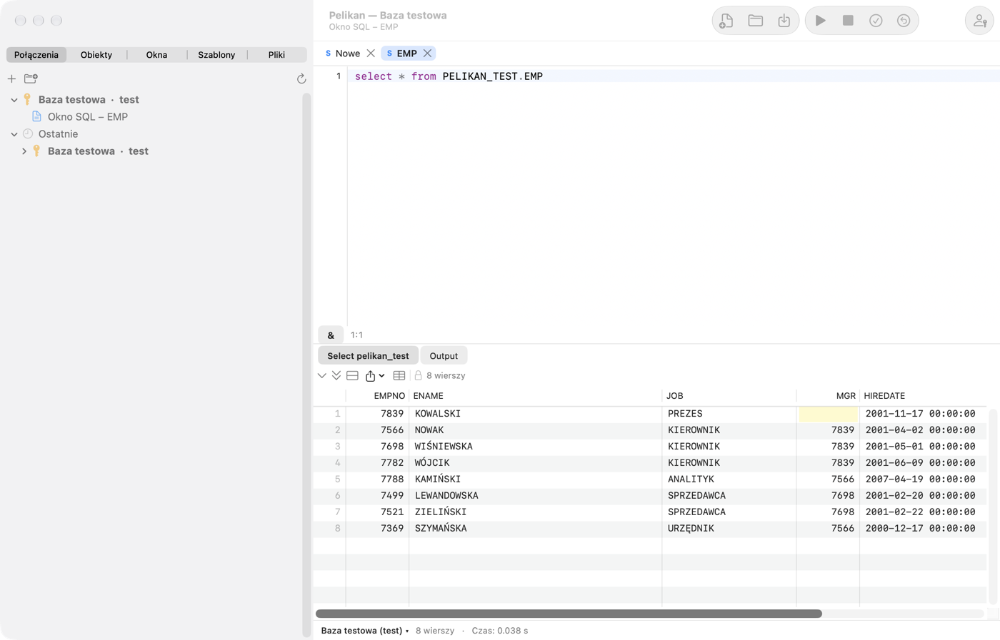

# Wprowadzenie i pierwsze uruchomienie

Pelikan to natywne środowisko macOS do pracy z bazą Oracle: pisania i wykonywania SQL, tworzenia, testowania i
debugowania kodu PL/SQL, przeglądania i edycji obiektów bazy, testów utPLSQL oraz narzędzi porównywania, eksportu i
administracji. Układ okien i skróty klawiszowe odpowiadają programowi PL/SQL Developer, więc jego użytkownicy odnajdą
znajome okna — w Pelikanie noszą polskie nazwy: **Okno SQL**, **Konsola SQL*Plus**, **Okno programu**, **Okno testu**,
**Okno planu** i **Przeglądarka obiektów** (karta **Obiekty**).

Pełna lista komend z bieżącymi skrótami jest w ostatnim rozdziale, **Skróty klawiszowe**, generowanym z aplikacji.

## Jak korzystać z tej instrukcji

Instrukcja jest napisana tak, żeby poradził sobie z nią także ktoś, kto dopiero zaczyna pracę z Oracle. Każda funkcja
jest opisana w tym samym układzie:

- **Do czego to służy** — jakie zadanie rozwiązuje i jakie pojęcia trzeba znać;
- **Kiedy użyć** — typowe sytuacje z codziennej pracy;
- **Ćwiczenie krok po kroku** — numerowane kroki; po każdym kroku *Wynik:* mówi, co powinieneś zobaczyć. Jeśli widzisz
  coś innego, zatrzymaj się i wróć do poprzedniego kroku;
- **Na co uważać** — typowe pomyłki i ich skutki (oznaczone ⚠️).

Ćwiczenia korzystają z **schematu ćwiczeniowego** — kilku tabel i pakietu, które utworzysz skryptem z sekcji
**Schemat ćwiczeniowy** niżej. Najlepiej czytać rozdziały po kolei: 1 (ten), 2 (połączenia), 3 (okno
SQL), potem według potrzeb. Nieznane słowo sprawdzisz w sekcji **Podstawowe pojęcia** albo w słowniku na końcu rozdziału
15.

## Podstawowe pojęcia

Kilka słów, które pojawiają się w całej instrukcji:

| Pojęcie | Co znaczy |
|---|---|
| **Baza danych** (instancja Oracle) | Serwer, który przechowuje dane i wykonuje polecenia. Łączysz się z nim przez sieć. |
| **Użytkownik** i **schemat** | Konto w bazie (np. `SCOTT`). Obiekty tworzone przez użytkownika należą do jego schematu o tej samej nazwie. |
| **Obiekt** | Coś, co żyje w schemacie: tabela, widok, indeks, sekwencja, pakiet, procedura, funkcja, wyzwalacz, typ… |
| **Tabela** | Dane w wierszach i kolumnach, np. `PEL_EMPLOYEES`. |
| **Widok** | Zapisane zapytanie, które można czytać jak tabelę. |
| **SQL** | Język poleceń bazy: `SELECT` (czytanie), `INSERT`, `UPDATE`, `DELETE`, `MERGE` (zmiana danych), `CREATE`, `ALTER`, `DROP` (zmiana obiektów — DDL). |
| **PL/SQL** | Język programowania Oracle: bloki `BEGIN … END`, zmienne, pętle, wyjątki. Kod PL/SQL zapisany w bazie to **program** (pakiet, procedura, funkcja, wyzwalacz). |
| **Pakiet** | Zestaw powiązanych procedur i funkcji: **specyfikacja** (co udostępnia) i **ciało** (jak to robi). |
| **Sesja** | Jedno połączenie z bazą. Pelikan może mieć kilka sesji naraz (rozdział 13, *Tryb sesji*). |
| **Transakcja** | Zmiany danych w sesji, które jeszcze nie są trwałe. **COMMIT** je utrwala (widzą je inni), **ROLLBACK** cofa. Polecenia DDL (`CREATE`, `ALTER`, `DROP`) same zatwierdzają otwartą transakcję. |
| **Kompilacja** | Zapisanie programu PL/SQL w bazie i sprawdzenie go przez Oracle. Program z błędem ma stan *INVALID*. |
| **Połączenie** (w Pelikanie) | Zapisany zestaw danych do logowania: użytkownik, baza, środowisko. |
| **Środowisko** | Oznaczenie bazy: deweloperska, testowa, produkcyjna. Od niego zależą kolory i ostrzeżenia. |

> ⚠️ **Najważniejsza zasada:** ćwicz i eksperymentuj tylko na bazie **deweloperskiej** albo **testowej**. Na
> produkcji (prawdziwe dane firmy) wykonuj tylko to, co rozumiesz i co masz uzgodnione.

## Wymagania

- Mac z procesorem Apple (M1 lub nowszym) i macOS 27 albo nowszy.
- Oracle Instant Client dla macOS (ARM64) — pakiet Basic albo Basic Light. Pelikan go nie zawiera (nie pozwala na to
  licencja Oracle), więc pobierasz go sam ze strony Oracle. Bez Instant Client działa sterownik *Thin* z
  ograniczeniami (zobacz niżej).
- Baza Oracle. Pelikan jest rozwijany i testowany na Oracle Database 26ai Free; zapytania słownika danych mają
  warianty dla wersji 19c, 21c i 23ai. Na starszych wersjach część folderów i funkcji może być niedostępna.

## Instalacja

1. Pobierz najnowsze wydanie ze strony projektu:
   [github.com/andrzejoles/Pelikan/releases](https://github.com/andrzejoles/Pelikan/releases) — plik `.dmg` albo
   instalator `.pkg`.
2. Z obrazu `.dmg` przeciągnij **Pelikan** na skrót **Aplikacje (Applications)**. Instalator `.pkg` zrobi to sam.
3. Uruchom Pelikana z folderu Aplikacje.

### Ostrzeżenie Gatekeepera przy pierwszym uruchomieniu

Pelikan jest podpisany własnym certyfikatem autora („Pelikan Self-Signed”), ale nie jest notaryzowany przez Apple
(wymagałoby to płatnego konta dewelopera). Dlatego przy pierwszym uruchomieniu macOS zablokuje aplikację i pokaże
ostrzeżenie. Aby ją otworzyć:

1. Zamknij okno ostrzeżenia.
2. Otwórz **Ustawienia systemowe › Prywatność i ochrona**, przewiń do sekcji **Ochrona** i kliknij **Otwórz mimo to**
   przy komunikacie o Pelikanie.
3. Potwierdź hasłem albo Touch ID.

Robisz to tylko raz. Stały podpis sprawia też, że po aktualizacji macOS nie pyta ponownie o dostęp Pelikana do haseł w
Pęku kluczy.

## Oracle Instant Client

Pobierz „Instant Client for macOS (ARM64)”, pakiet **Basic** albo **Basic Light**, ze strony
[oracle.com](https://www.oracle.com/database/technologies/instant-client/macos-arm64-downloads.html) i zainstaluj go
według instrukcji Oracle. Pelikan szuka biblioteki `libclntsh.dylib` w tej kolejności:

1. katalog wskazany w **Ustawienia › Oracle › Oracle Instant Client**;
2. `/opt/homebrew/lib`, `/usr/local/lib`, `/usr/local/oracle/instantclient` i katalogi `/opt/oracle/instantclient*`;
3. katalogi `instantclient_*` w Twoich folderach **Pobrane** i **Aplikacje** (najnowsza wersja pierwsza).

Przy przeszukiwaniu folderu Pobrane macOS może zapytać, czy pozwolić Pelikanowi na dostęp do niego — to zwykłe pytanie
systemu o prywatność. Jeśli wolisz go uniknąć, wskaż katalog klienta ręcznie: **Pelikan › Ustawienia…** (⌘,), karta
**Oracle**, przycisk **Wybierz…**. Zmiana katalogu działa po ponownym uruchomieniu Pelikana.

Bez Instant Client możesz łączyć się sterownikiem *Thin* (wybór w definicji połączenia, zobacz rozdział *Połączenia*).
Thin nie obsługuje połączeń TCPS i portfeli Oracle Wallet, uwierzytelniania zewnętrznego, zmiany wygasłego hasła ani
przerywania wykonania (**Przerwij**).

## Pierwsze kroki

### Do czego to służy

Zanim zaczniesz pracę, Pelikan musi wiedzieć, z jaką bazą się łączyć. Ten krótki samouczek prowadzi od pustego programu
do pierwszego wyniku zapytania. Potrzebujesz od administratora albo kolegi z zespołu: **nazwy użytkownika**, **hasła**
i **adresu bazy** — w postaci `host:port/usługa` (np. `dbdev.firma.local:1521/DEVPDB`) albo **aliasu** z pliku
`tnsnames.ora` (np. `DEV`).

### Ćwiczenie: pierwsze połączenie i pierwsze zapytanie

1. Kliknij kartę **Połączenia** w lewej kolumnie okna, a potem przycisk **+** (albo wybierz **Sesja › Połączenia ›
   Nowe połączenie…**).
   *Wynik:* otwiera się okno **Nowe połączenie**.
2. W polu **Nazwa** wpisz nazwę, po której rozpoznasz bazę, np. `dev_moja_baza`. Wpisz **Użytkownika**, **Hasło**
   i **Bazę** (adres albo alias). Jako **Środowisko** wybierz **Deweloperskie**.
3. Kliknij **Testuj**.
   *Wynik:* komunikat „Połączono:” z opisem wersji bazy. Jeśli widzisz błąd, sprawdź dane — najczęstsze przyczyny
   i rozwiązania są w rozdziale 15 (`ORA-01017` — złe hasło lub użytkownik, `ORA-12154` — nieznany alias,
   `ORA-12541` — zły host albo port).
4. Zaznacz **Zapamiętaj hasło w Pęku kluczy**, jeśli nie chcesz wpisywać hasła przy każdym połączeniu — trafi do
   Pęku kluczy macOS, nie do pliku. Kliknij **Zapisz**.
   *Wynik:* połączenie jest na liście.
5. Kliknij dwukrotnie połączenie na liście.
   *Wynik:* nazwa połączenia jest pogrubiona — to teraz **połączenie główne**. Nowe okna będą z niego korzystać. Jego
   nazwę widać też w tytule okna Pelikana.
6. Otwórz nowe okno SQL: **Plik › Nowy › Okno SQL** albo **⌘N**.
   *Wynik:* nowa karta z literą **S** i pustym edytorem. Na pasku stanu pod edytorem widać nazwę połączenia.
7. Wpisz zapytanie:

   ```sql
   SELECT sysdate, user FROM dual;
   ```

8. Naciśnij **F8** (albo **⌘↩**).
   *Wynik:* pod edytorem pojawia się karta wyniku z jednym wierszem: bieżąca data i godzina serwera oraz Twoja nazwa
   użytkownika. Na pasku stanu — liczba wierszy i czas wykonania.

Gotowe — umiesz się połączyć i wykonać zapytanie. Następny krok: utwórz schemat ćwiczeniowy.



## Schemat ćwiczeniowy

### Do czego to służy

Ćwiczenia w instrukcji działają na kilku małych obiektach: tabeli działów `PEL_DEPARTMENTS`, tabeli pracowników
`PEL_EMPLOYEES`, widoku `PEL_EMP_DETAILS` i pakiecie `PEL_EMP_API` (pensja, podwyżka, zatrudnienie, lista pracowników
działu). Przedrostek `PEL_` sprawia, że łatwo je odróżnić od Twoich obiektów i usunąć po nauce.

> ⚠️ Skrypt tworzy obiekty w schemacie użytkownika, na którym jesteś zalogowany. Uruchom go na **własnym schemacie
> deweloperskim albo testowym** — nigdy na produkcji ani na schemacie wspólnym z innymi, bez zgody zespołu. Do
> utworzenia obiektów potrzebujesz uprawnień `CREATE TABLE`, `CREATE VIEW` i `CREATE PROCEDURE` oraz miejsca
> w przestrzeni tabel (zwykle masz je na schemacie deweloperskim).

### Ćwiczenie: utworzenie schematu ćwiczeniowego

1. Połącz się z bazą deweloperską (poprzednie ćwiczenie) i otwórz nowe okno SQL (**⌘N**).
2. Skopiuj do okna cały skrypt poniżej.
3. Zaznacz cały tekst (**⌘A**) i naciśnij **F8**.
   *Wynik:* Pelikan wykonuje polecenia po kolei, a na karcie **Output** pod edytorem widać komunikat o każdym z nich.
   Polecenia rozdziela średnik, a pakiety — ukośnik `/` w osobnej linii.
4. Sprawdź wynik zapytaniem:

   ```sql
   SELECT * FROM pel_emp_details;
   ```

   *Wynik:* 9 wierszy — pracownicy z nazwą działu i miastem. Ewa Woźniak nie ma działu, więc te kolumny są puste.
5. Otwórz kartę **Obiekty** w lewej kolumnie i rozwiń folder **Tabele**.
   *Wynik:* widać `PEL_DEPARTMENTS` i `PEL_EMPLOYEES`.

Skrypt sam zatwierdza dane (COMMIT po INSERT), więc są widoczne także w innych oknach.

```sql
-- Schemat ćwiczeniowy instrukcji Pelikana.
-- Uruchom na WŁASNYM schemacie deweloperskim albo testowym — nigdy na produkcji.
CREATE TABLE pel_departments (
  dept_id  NUMBER(4)    CONSTRAINT pel_departments_pk PRIMARY KEY,
  name     VARCHAR2(50) NOT NULL,
  city     VARCHAR2(50)
);

CREATE TABLE pel_employees (
  emp_id      NUMBER(6) GENERATED BY DEFAULT AS IDENTITY (START WITH 100)
              CONSTRAINT pel_employees_pk PRIMARY KEY,
  first_name  VARCHAR2(30) NOT NULL,
  last_name   VARCHAR2(30) NOT NULL,
  email       VARCHAR2(60) CONSTRAINT pel_employees_email_uk UNIQUE,
  hire_date   DATE DEFAULT SYSDATE NOT NULL,
  salary      NUMBER(8,2) CONSTRAINT pel_employees_salary_ck CHECK (salary > 0),
  dept_id     NUMBER(4) CONSTRAINT pel_employees_dept_fk REFERENCES pel_departments,
  manager_id  NUMBER(6) CONSTRAINT pel_employees_mgr_fk REFERENCES pel_employees
);

CREATE INDEX pel_employees_dept_ix ON pel_employees (dept_id);

CREATE OR REPLACE VIEW pel_emp_details AS
  SELECT e.emp_id, e.first_name || ' ' || e.last_name AS full_name, e.salary,
         d.name AS department, d.city
    FROM pel_employees e
    LEFT JOIN pel_departments d ON d.dept_id = e.dept_id;

INSERT INTO pel_departments VALUES (10, 'Księgowość', 'Warszawa');
INSERT INTO pel_departments VALUES (20, 'Informatyka', 'Kraków');
INSERT INTO pel_departments VALUES (30, 'Sprzedaż', 'Gdańsk');
INSERT INTO pel_departments VALUES (40, 'Kadry', NULL);

INSERT INTO pel_employees VALUES (1, 'Anna', 'Nowak', 'anna.nowak@example.com', DATE '2019-03-01', 12000, 20, NULL);
INSERT INTO pel_employees VALUES (2, 'Piotr', 'Kowalski', 'piotr.kowalski@example.com', DATE '2020-06-15', 9500, 20, 1);
INSERT INTO pel_employees VALUES (3, 'Maria', 'Wiśniewska', 'maria.wisniewska@example.com', DATE '2021-01-10', 8700, 20, 1);
INSERT INTO pel_employees VALUES (4, 'Tomasz', 'Wójcik', 'tomasz.wojcik@example.com', DATE '2018-09-03', 11000, 10, NULL);
INSERT INTO pel_employees VALUES (5, 'Katarzyna', 'Kamińska', 'katarzyna.kaminska@example.com', DATE '2022-02-14', 7200, 10, 4);
INSERT INTO pel_employees VALUES (6, 'Michał', 'Lewandowski', 'michal.lewandowski@example.com', DATE '2017-11-20', 13500, 30, NULL);
INSERT INTO pel_employees VALUES (7, 'Agnieszka', 'Zielińska', 'agnieszka.zielinska@example.com', DATE '2023-04-01', 6800, 30, 6);
INSERT INTO pel_employees VALUES (8, 'Paweł', 'Szymański', NULL, DATE '2024-07-08', 6500, 30, 6);
INSERT INTO pel_employees VALUES (9, 'Ewa', 'Woźniak', 'ewa.wozniak@example.com', DATE '2025-01-02', 7000, NULL, NULL);
COMMIT;

CREATE OR REPLACE PACKAGE pel_emp_api AS
  -- Pensja pracownika; brak pracownika — NO_DATA_FOUND.
  FUNCTION get_salary(p_emp_id IN NUMBER) RETURN NUMBER;
  -- Podwyżka o p_percent procent; ujemny procent — błąd -20001. Bez COMMIT.
  PROCEDURE raise_salary(p_emp_id IN NUMBER, p_percent IN NUMBER);
  -- Nowy pracownik; zwraca jego identyfikator. Bez COMMIT.
  FUNCTION hire(p_first_name IN VARCHAR2, p_last_name IN VARCHAR2, p_salary IN NUMBER,
                p_dept_id IN NUMBER) RETURN NUMBER;
  -- Lista pracowników działu przez DBMS_OUTPUT.
  PROCEDURE print_department(p_dept_id IN NUMBER);
END pel_emp_api;
/

CREATE OR REPLACE PACKAGE BODY pel_emp_api AS
  FUNCTION get_salary(p_emp_id IN NUMBER) RETURN NUMBER IS
    l_salary pel_employees.salary%TYPE;
  BEGIN
    SELECT salary INTO l_salary FROM pel_employees WHERE emp_id = p_emp_id;
    RETURN l_salary;
  END get_salary;

  PROCEDURE raise_salary(p_emp_id IN NUMBER, p_percent IN NUMBER) IS
  BEGIN
    IF p_percent < 0 THEN
      raise_application_error(-20001, 'Podwyżka nie może być ujemna');
    END IF;
    UPDATE pel_employees
       SET salary = ROUND(salary * (1 + p_percent / 100), 2)
     WHERE emp_id = p_emp_id;
    IF SQL%ROWCOUNT = 0 THEN
      RAISE NO_DATA_FOUND;
    END IF;
  END raise_salary;

  FUNCTION hire(p_first_name IN VARCHAR2, p_last_name IN VARCHAR2, p_salary IN NUMBER,
                p_dept_id IN NUMBER) RETURN NUMBER IS
    l_emp_id pel_employees.emp_id%TYPE;
  BEGIN
    INSERT INTO pel_employees (first_name, last_name, salary, dept_id)
    VALUES (p_first_name, p_last_name, p_salary, p_dept_id)
    RETURNING emp_id INTO l_emp_id;
    RETURN l_emp_id;
  END hire;

  PROCEDURE print_department(p_dept_id IN NUMBER) IS
    l_total NUMBER := 0;
  BEGIN
    FOR r IN (SELECT first_name, last_name, salary
                FROM pel_employees
               WHERE dept_id = p_dept_id
               ORDER BY last_name) LOOP
      dbms_output.put_line(r.last_name || ' ' || r.first_name || ': ' || r.salary);
      l_total := l_total + r.salary;
    END LOOP;
    dbms_output.put_line('Razem: ' || l_total);
  END print_department;
END pel_emp_api;
/
```

Do ćwiczeń z testami (rozdział 8) potrzebny jest też pakiet testów utPLSQL. Utwórz go dopiero wtedy, gdy w bazie jest
zainstalowany framework utPLSQL (rozdział 8, *Instalacja utPLSQL w bazie*):

```sql
CREATE OR REPLACE PACKAGE pel_emp_api_test AS
  --%suite(Testy pakietu pel_emp_api)

  --%test(get_salary zwraca pensję pracownika)
  PROCEDURE get_salary_returns_salary;

  --%test(raise_salary podnosi pensję o 10%)
  PROCEDURE raise_salary_ten_percent;

  --%test(Ujemna podwyżka zgłasza błąd -20001)
  --%throws(-20001)
  PROCEDURE raise_salary_negative;
END pel_emp_api_test;
/

CREATE OR REPLACE PACKAGE BODY pel_emp_api_test AS
  PROCEDURE get_salary_returns_salary IS
  BEGIN
    ut.expect(pel_emp_api.get_salary(1)).to_equal(12000);
  END get_salary_returns_salary;

  PROCEDURE raise_salary_ten_percent IS
  BEGIN
    pel_emp_api.raise_salary(2, 10);
    ut.expect(pel_emp_api.get_salary(2)).to_equal(10450);
  END raise_salary_ten_percent;

  PROCEDURE raise_salary_negative IS
  BEGIN
    pel_emp_api.raise_salary(2, -5);
  END raise_salary_negative;
END pel_emp_api_test;
/
```

### Usunięcie schematu ćwiczeniowego

Gdy skończysz naukę, usuń obiekty ćwiczeniowe (pierwsze polecenie zgłosi błąd, jeśli nie tworzyłeś pakietu testów —
to nic nie szkodzi):

```sql
DROP PACKAGE pel_emp_api_test;
DROP PACKAGE pel_emp_api;
DROP VIEW pel_emp_details;
DROP TABLE pel_employees PURGE;
DROP TABLE pel_departments PURGE;
```

## Okno główne

Pelikan ma jedno okno główne:

- **Lewa kolumna** z kartami: **Połączenia** (lista połączeń z folderami i ostatnio używanymi), **Obiekty**
  (Przeglądarka obiektów), **Okna** (lista otwartych okien), **Szablony** i **Pliki** (przeglądarka plików).
  Kolumnę (panel po lewej) poszerzasz, przeciągając jej krawędź, a chowasz i pokazujesz przyciskiem z symbolem paska
  bocznego na lewym końcu paska tytułu (tuż za przyciskami okna), poleceniem **Widok › Pokaż lub ukryj panel po
  lewej** albo skrótem **⌃⌘S**. Stan i szerokość kolumny zostają w układzie okna (**Widok › Zapisz układ okna**, autozapis układu).
- **Karty dokumentów** w środku — każde okno SQL, programu, testu czy planu ma własną kartę z kolorową literą typu: S
  — okno SQL, P — okno programu, T — okno testu, C — konsola SQL*Plus, E — okno planu, R — okno raportu, D — okno
  diagramu, N — notatnik SQL. Środkowy klik na karcie zamyka okno; menu karty zamyka pozostałe okna albo okna z lewej
  i prawej.
- **Pasek narzędzi** z najczęstszymi czynnościami (nowe okno, otwórz, zapisz, wykonaj, przerwij, COMMIT, ROLLBACK,
  logowanie) i grupą **Szybki dostęp**. Układ zmienisz przez **Widok › Dostosuj pasek narzędzi…**.
- **Pasek stanu** okna: połączenie okna (z kolorem środowiska, przypięciem 📌 i oznaczeniem „tylko odczyt”), stan
  transakcji („● transakcja otwarta”), liczba wierszy i czas wykonania, pozycja kursora oraz gałąź Git pliku.
  Kliknięcie nazwy połączenia pozwala zmienić połączenie okna.
- **Panele narzędzi** po prawej i na dole — narzędzia (Sesje, Znajdź obiekty, Zadania To-Do, Historia schowka,
  instrukcja, edytory tabel, eksport i import, raporty i inne) otwierają się domyślnie w panelu po prawej, każde we
  własnej karcie. Kartę przeciągasz do drugiego panelu albo poza panele — wtedy narzędzie dostaje osobne okno
  w miejscu upuszczenia; to samo robi menu karty i przyciski w nagłówku panelu. Okno narzędzia wraca do panelu
  przyciskiem na pasku tytułu. Pelikan zapamiętuje miejsce każdego rodzaju narzędzia. Zwinięty panel z narzędziami
  pokazuje na pasku stanu przycisk z ich liczbą. Polecenia są w **Widok › Panele narzędzi**, a w **Ustawienia ›
  Ogólne › Panele narzędzi** wybierasz miejsce nowych narzędzi (także osobne okna) i autoukrywanie paneli.
  Skróty narzędzia w panelu (Enter, Esc) działają tylko wtedy, gdy kursor jest w tym narzędziu.
- **Panel agenta** po prawej (domyślnie zwinięty) — terminal agenta AI z listą jego działań. Pokazuje go **Widok ›
  Panel agenta** (zobacz rozdział *Agenci AI*).

Tytuł okna pokazuje połączenie główne i aktywny zestaw roboczy (workset), a podtytuł — bieżące okno.

**Gałąź na pasku stanu:** kliknięcie gałęzi Git (prawy dolny róg) otwiera menu **Otwórz pozostałe pliki zmienione
w gałęzi** (także **Narzędzia › Git** i wstążka **Narzędzia › Git**). Pelikan otwiera pliki kodu zmienione w gałęzi
repozytorium pliku aktywnego okna: zatwierdzone od rozgałęzienia z gałęzią domyślną zdalnego repozytorium (`origin/HEAD`,
bez niej `origin/main` albo `master`; bez zdalnego — od gałęzi śledzonej), niezatwierdzone i nieśledzone. Pomija pliki
usunięte, binarne, ignorowane i już otwarte; para `.pks`/`.pkb` otwiera się jednym oknem. Przy ponad 30 plikach pyta
o zgodę; bieżące okno zostaje aktywne.

## Grupy kart

Przy wielu otwartych oknach Pelikan dzieli karty na **grupy**, a pasek kart pokazuje tylko karty bieżącej grupy.
Grupy widać jako **kapsułki** na pasku tytułu, między tytułem okna a przyciskami: w pierwszym wierszu nazwa grupy,
w drugim szczegół i liczba okien (np. „main · 7”, „5 okien”). Kliknięcie kapsułki pokazuje karty grupy i aktywuje jej
ostatnio używane okno; bieżąca grupa jest wyróżniona obwódką. Gdy kapsułki się nie mieszczą, ostatnia — **»** —
rozwija listę wszystkich grup. Przy jednej grupie kapsułek nie ma. Gdy pasek narzędzi jest ukryty albo okno jest na
pełnym ekranie, mała kapsułka bieżącej grupy jest na początku paska kart.

Okno trafia do grupy według kolejnych reguł:

1. **Grupa ręczna** — jeśli przeniosłeś do niej okno (ma pierwszeństwo przed pozostałymi regułami).
2. **Projekt** — okno z plikiem otwartego projektu Pelikana.
3. **Repozytorium · gałąź** — plik w repozytorium gita, które ma zdalne repozytorium; worktree z inną gałęzią to
   osobna grupa, a po zmianie gałęzi (np. `git checkout`) okna przechodzą do grupy nowej gałęzi, gdy wrócisz do
   Pelikana. Repozytoria bez zdalnego — dalej według połączenia.
4. **Połączenie** okna; okna bez połączenia — grupa **Bez połączenia** na końcu.
5. Gdy wszystkie pozostałe okna używają **jednej bazy**, zamiast grup połączeń są grupy według rodzaju okna: **Okna
   SQL**, **Programy**, **Testy**, **Konsole SQL*Plus** i **Inne okna**. Na grupy połączeń Pelikan przechodzi dopiero,
   gdy druga baza ma więcej niż jedno okno — jedno okno na innej bazie nie przestawia całego paska.

Kolejność kapsułek jest stała: grupy ręczne (w kolejności utworzenia), projekt, repozytoria i połączenia alfabetycznie
(albo rodzaje okien), „Bez połączenia” na końcu. Karty w grupie są w kolejności otwierania.

Okno aktywowane skądkolwiek (Przeglądarka obiektów, lista błędów, Lista okien, debuger, otwarcie pliku, agent)
przełącza grupę samo. **⌃Tab** i **⌃⇧Tab** (Następne / Poprzednie okno) przechodzą po oknach bieżącej grupy, a za
ostatnim — do pierwszego okna następnej grupy (każde okno jest osiągalne),
**⌃⌘]** i **⌃⌘[** — **Następna grupa kart** / **Poprzednia grupa kart**, a **Okno › Pokaż grupę kart…** wybiera
grupę z listy. **Okno › Karty wszystkich grup** (także w menu kapsułki i listy **»**) pokazuje na pasku karty
wszystkich grup. Lista okien (karta **Okna** w lewej kolumnie, **Widok › Lista okien**) pokazuje okna w drzewie
według grup; kliknięcie grupy ją pokazuje.

**Grupy ręczne:** menu karty › **Przenieś do grupy › Nowa grupa…** albo istniejąca grupa; **Usuń z grupy ręcznej**
zwraca okno do grup automatycznych. Menu kapsułki grupy ręcznej ma **Zmień nazwę…** i **Rozgrupuj**. Grupy ręczne
i kolory połączeń zapisują się w worksecie. Karty nie przeciąga się na kapsułkę — służy do tego menu karty.

**Karty** mają dwa wiersze: kropkę koloru środowiska, literę typu, tytuł i przycisk zamknięcia (kropka — niezapisane
zmiany), a pod nimi zawsze połączenie okna (okno bez połączenia — szare „Brak połączenia”); pełna nazwa jest
w podpowiedzi. Tło karty ma kolor połączenia z palety (zobacz *Połączenia › Środowiska i ochrona przed pomyłkami*):
aktywna karta ma mocniejsze tło, grube podkreślenie w kolorze połączenia i pogrubiony tytuł. Gdy karty nie mieszczą
się w jednym wierszu, po bokach paska pojawiają się przyciski **‹** i **›**; pasek przewijasz też kółkiem myszy albo
gestem na gładziku, a aktywna karta jest zawsze widoczna.

## Wstążka i „Szukaj czynności”

Pod paskiem narzędzi jest **wstążka** — każda czynność jednym kliknięciem, bez szukania w menu i bez pamiętania skrótów.
Karty stałe to **Start** (nowe okna, pliki, wykonanie, COMMIT i ROLLBACK, połączenie, wyszukiwanie), **Edycja**,
**Obiekty**, **Debugowanie i testy**, **Narzędzia**, **Raporty** i **Widok**. Przy oknie programu, wyniku zapytania,
diagramu, raportu, notatnika, planu albo poleceń pojawia się kolorowa **karta kontekstowa** (np. **Program** z
kompilacją, jednostkami, porównaniem ze źródłem w bazie i testami). Wstążka pamięta, którą kartę wybrałeś przy oknie
danego rodzaju — po przełączeniu okna wraca do niej sama.

Częste czynności mają duże przyciski, pozostałe — małe; rzadsze są w listach rozwijanych grup (oznaczonych ▾). Podpowiedź
przycisku pokazuje opis i skrót, więc skrótów uczysz się przy okazji. Prawy klik na przycisku dodaje komendę do paska
szybkiego dostępu. Dwukrotne kliknięcie karty albo strzałka po prawej zwija wstążkę do samych kart; **Widok › Wstążka** ją ukrywa
(także w **Ustawienia › Ogólne › Wstążka**). Gdy okno jest wąskie, a karta wstążki się nie mieści, po bokach pojawiają
się przyciski **‹ ›** — przewijają ją do granicy kolejnej grupy; przewija też kółko myszy i gest gładzika. Tak samo
przewija się pasek kart wstążki, gdy nie mieści się obok pola wyszukiwania.

Pole **Szukaj czynności…** po prawej stronie kart znajduje każdą komendę — wpisz kilka liter: „plan”, „eksport tabel”,
„zrodlo” (bez polskich znaków) albo angielską nazwę znaną z PL/SQL Developera, np. „beautifier”, „compile invalid”.
Wyniki pokazują, gdzie komenda leży na wstążce, skrót i to, czy jest teraz dostępna; Enter albo kliknięcie ją wykonuje.

## Paleta komend

Każda czynność Pelikana jest komendą: ma pozycję w menu, opcjonalny skrót i opis skutków. **Paleta komend** (**Widok ›
Paleta komend…**, ⇧⌘P) wyszukuje komendy po nazwie i pokazuje, w którym menu są i jaki mają skrót. To najszybszy
sposób, żeby znaleźć funkcję, której położenia w menu nie pamiętasz.

## Profile klawiatury

Pelikan ma dwa profile skrótów: **PL/SQL Developer** (klawisze F, Ctrl — np. F8 wykonuje, F9 rozpoczyna debugowanie) i
**macOS** (skróty z ⌘). W obu profilach działają odpowiedniki z ⌘, np. ⌘↩ wykonuje polecenie. Profil wybierasz w
**Ustawienia › Klawiatura**. Jeśli klawisze F1–F12 sterują jasnością czy głośnością, włącz w Ustawieniach systemowych
opcję używania ich jako standardowych klawiszy funkcyjnych albo naciskaj je z klawiszem fn.

## Aktualizacje

Pelikan raz dziennie sprawdza, czy jest nowe wydanie, i proponuje jego instalację. Możesz też sprawdzić ręcznie:
**Pelikan › Sprawdź uaktualnienia…**. Każde wydanie jest podpisane kluczem autora — aplikacja nie przyjmie pliku z
innego źródła. Ustawienia, połączenia i hasła zostają bez zmian.

## Języki

Interfejs jest dostępny po polsku, angielsku, niemiecku, hiszpańsku i ukraińsku. Język wybierasz w **Ustawienia ›
Ogólne › Język interfejsu**; zmiana działa po ponownym uruchomieniu. Nazwy niektórych okien i narzędzi (np. Explain
Plan, Large Data Editor, Query Builder) pozostają w oryginalnym brzmieniu.

## Gdzie Pelikan trzyma dane

Definicje połączeń (bez haseł), ustawienia, historia, worksety, historia lokalna plików, dziennik agentów i inne dane
aplikacji są w katalogu `~/Library/Application Support/Pelikan`. Hasła są wyłącznie w Pęku kluczy macOS — zobacz
rozdział *Bezpieczeństwo i prywatność*.

## Pomoc

- **Pomoc › Instrukcja Pelikana** (⇧⌘/) otwiera tę instrukcję.
- **F1** w edytorze otwiera dokumentację Oracle dla słowa pod kursorem (kod błędu, pakiet, widok słownika, polecenie
  SQL).
- **Pomoc › Dokumentacja Oracle…** wyszukuje w podręcznikach Oracle wybranej wersji.

## O programie

Pelikan jest projektem otwartym na licencji MIT:
[github.com/andrzejoles/Pelikan](https://github.com/andrzejoles/Pelikan). Autor: Andrzej Oleś w kooperacji z Claude
AI. Licencje użytych bibliotek są w pliku „Licencje zewnętrzne” dołączonym do aplikacji.
