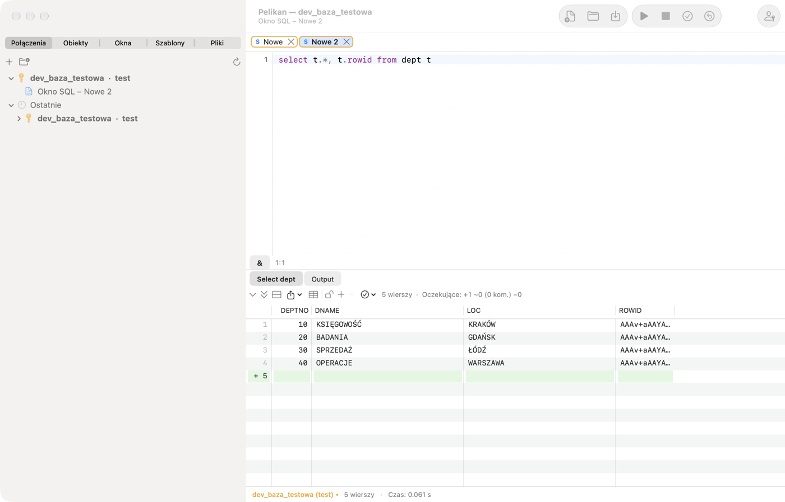
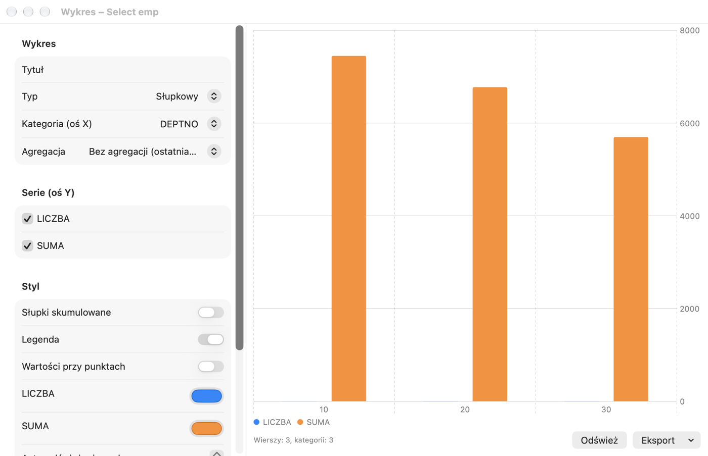

# Okno SQL i siatka wyników

Okno SQL służy do wykonywania zapytań i skryptów. Wynik każdego zapytania pojawia się na osobnej karcie pod edytorem,
komunikaty bazy i wyjście DBMS_OUTPUT — na karcie **Output**. Nowe okno otworzysz przez **Plik › Nowy › Okno SQL**
(⌘N); okno działa na połączeniu głównym albo na połączeniu wybranym na pasku stanu.

## Wykonywanie poleceń

| Czynność | Skrót | Menu |
|---|---|---|
| Wykonaj zaznaczenie albo polecenie pod kursorem | F8, ⌘↩ | Sesja › Wykonaj |
| Wykonaj odwrotnie do AutoSelect (np. cały skrypt) | ⌃F8, ⇧⌘↩ | Sesja › Wykonaj (odwrotnie do AutoSelect) |
| Przerwij wykonanie albo pobieranie | ⇧⎋, ⌘. | Sesja › Przerwij |
| Zatwierdź transakcję | F10, ⌥⌘↩ | Sesja › Zatwierdź (COMMIT) |
| Wycofaj transakcję | ⇧F10, ⌥⌘⌫ | Sesja › Wycofaj (ROLLBACK) |
| Poprzednie / następne polecenie okna | ⌥⌘↑, ⌥⌘↓ | Sesja › Historia okna |

Domyślnie włączone jest **AutoSelect**: bez zaznaczenia F8 wykonuje tylko polecenie, w którym stoi kursor, więc nie
uruchomisz przypadkiem całego skryptu. Zaznaczony tekst jest wykonywany w całości. Polecenia dzielone są tak jak w
SQL*Plus: średnik kończy polecenie SQL, a blok PL/SQL i `CREATE` z ciałem kończy ukośnik `/` w osobnej linii. Każde
zapytanie skryptu dostaje własną kartę wyników.

Uwaga: w macOS skrót ⌃F8 jest domyślnie zajęty przez system (przeniesienie fokusu do menu statusu) — używaj ⇧⌘↩ albo
wyłącz skrót systemowy w **Ustawienia systemowe › Klawiatura › Skróty klawiszowe**.

W trakcie wykonania okno jest zablokowane do edycji, a pasek stanu pokazuje „Wykonywanie…”. Po zakończeniu widać
liczbę wierszy i czas; czas dłuższy niż 100 sekund ma format gg:mm:ss. Po długim zapytaniu Pelikan może odegrać dźwięk
i podskoczyć ikoną w Docku. Gdy **Przerwij** nie działa (niektóre operacje bazy nie reagują na przerwanie), użyj
**Sesja › Zakończ sesję okna (Kill)**.

Pelikan nigdy nie zatwierdza zmian automatycznie (opcja **AutoCommit poleceń SQL** w **Ustawienia › Okno SQL** jest
domyślnie wyłączona). Otwartą transakcję sygnalizuje pasek stanu („● transakcja otwarta”).

## Zawartość kodu

Po lewej stronie edytora **Zawartość kodu** pokazuje strukturę całego skryptu: polecenia SQL (pierwsze słowo i
początek polecenia, w podpowiedzi do ok. 1000 znaków z podziałem na linie), procedury, funkcje, pakiety i wyzwalacze z `CREATE` oraz bloki
anonimowe z ich deklaracjami. Klik albo Enter przenosi kursor do polecenia, drzewo śledzi kursor, pole nad drzewem
filtruje także po treści polecenia (np. nazwie tabeli). Panel pokażesz albo ukryjesz w tym oknie przez **Widok ›
Zawartość kodu** albo przycisk z symbolem paska bocznego na lewym końcu paska okna; wybór zostaje w oknie, a
domyślny stan nowych okien ustawisz w **Ustawienia › Edytor › Zawartość kodu domyślnie widoczna**. Konsola SQL*Plus nie
ma tego panelu. W skrypcie z ponad 5000 poleceń SQL panel pokazuje tylko jednostki i bloki PL/SQL (z dopiskiem o
liczbie poleceń).

W blokach anonimowych i jednostkach skryptu panel pokazuje też **struktury sterujące** (IF, pętle, CASE,
obsługę wyjątków — opis w rozdziale o oknie programu); przycisk z symbolem rozgałęzienia obok filtra je ukrywa.

## Zmienne

- **Zmienne podstawiania** `&nazwa` i `&&nazwa` — przed wykonaniem Pelikan pokazuje okno **Zmienne** z polami na
  wartości. W oknie SQL `&&` w tekście oznacza zwykły znak `&` (np. `'R&&D'`); w konsoli SQL*Plus `&&` działa jak w
  SQL*Plus (zmienna zapamiętywana).
- **Zmienne wiązane** `:nazwa` — także trafiają do okna zmiennych (`:new` i `:old` w wyzwalaczach są pomijane).
- **Parametry raportów JasperReports** `$P{…}`, `$P!{…}` i `$X{IN, kolumna, parametr}` — Pelikan rozpoznaje je i pyta
  o wartości, więc zapytanie z raportu wykonasz bez przepisywania.
- Rozszerzona składnia `&<name="…" type="…" list="…" default="…" required="…">` pozwala opisać zmienną: typ, listę
  wartości (także z zapytania zależnego od innych zmiennych), wartość domyślną, wymagalność i inne opcje.

Wartości zmiennych są pamiętane w oknie. Przycisk **&** na pasku pod edytorem (**Sesja › Podstawianie zmiennych**)
wyłącza podstawianie, gdy tekst zawiera znaki `&` i `:` w innym znaczeniu.

## Dyrektywy w komentarzach

Komentarz bezpośrednio przed poleceniem może sterować wynikiem:

| Dyrektywa | Działanie |
|---|---|
| `-- Tab=Pracownicy` | tytuł karty wyniku; `&Count` wstawia liczbę wierszy |
| `-- Records=all` | ile wierszy pobrać od razu: liczba, `page` albo `all` |
| `-- Totals=sum:SAL;count:EMPNO` | sumy i inne funkcje pod siatką |
| `-- AltRowColor=…` | kolor naprzemiennych wierszy |
| `-- Excel=raport_%date%.xlsx` | zapis całego wyniku do pliku Excel |
| `-- CSV=%dbuser%_%time%.csv` | zapis całego wyniku do pliku CSV |

W nazwach plików działają `%dbuser%`, `%dbname%`, `%date%`, `%time%` i `%&zmienna%`. Ścieżka względna liczy się od
katalogu pliku okna.

## Siatka wyników



Siatka pobiera wiersze porcjami (liczbę ustawisz w **Ustawienia › Okno SQL › Wierszy na stronę**) i dociąga kolejne
przy przewijaniu. Opis „(więcej…)” przy liczbie wierszy oznacza, że wynik nie jest kompletny. **Następna strona** (⌘⇟)
i **Ostatnia strona (pobierz wszystkie)** (⇧⌘⇟) są w menu **Sesja › Wynik** i na pasku nad siatką. Przy bardzo dużych
wynikach Pelikan pyta przed przekroczeniem limitu rozmiaru z Ustawień.

- **Sortowanie** — klik w nagłówek kolumny (rosnąco, malejąco, bez sortowania) na pobranych wierszach.
- **Zaznaczanie** — wiersze, kolumny i bloki komórek (klik, a potem ⇧+klik).
- **NULL** ma kolorowe tło; liczby są pokazywane z pełną precyzją Oracle.
- **CLOB, BLOB, XML, długie teksty** — przycisk w komórce albo **Edycja › Wynik › Large Data Editor…** (⌥⌘L) otwiera
  edytor dużych danych z widokami tekst, XML, JSON, HTML, obraz, PDF i hex, formatowaniem JSON/XML i zapisem do pliku.
- **Panel wartości** (**Widok › Panel wartości**, ⌥⌘V) pokazuje obok siatki bieżącą komórkę jako tekst, JSON, XML,
  HTML, obraz albo hex.
- **Widok pojedynczego rekordu** pokazuje bieżący wiersz w pionie z typami i komentarzami kolumn. Włącza go i wyłącza
  przycisk w pasku nad siatką albo **Rekord** na karcie wstążki **Wynik**; stan zapamiętuje każda karta wyniku osobno.
- **Kursor zagnieżdżony** (`CURSOR(…)` w zapytaniu) otwiera się w nowej karcie wyniku.
- **Filtruj kolumny…** ukrywa kolumny według nazwy, typu, obowiązkowości i kluczy; ukryte kolumny są pomijane przy
  kopiowaniu i eksporcie.
- **Filtruj według wartości komórki**, **Filtruj wyrażeniem…** (`=`, `<>`, `<`, `>`, `LIKE`, `IS NULL`, `AND`, `OR`) i
  **Grupuj według kolumny** (z licznikami; dwukrotne kliknięcie filtruje) działają lokalnie, na pobranych wierszach.
- **Sumy kolumny…** liczą sumę, liczbę, średnią, minimum i maksimum pod siatką i pamiętają je po ponownym wykonaniu.
- **Porównaj rekordy** zestawia zaznaczone wiersze kolumna po kolumnie, a **Porównaj wyniki** — dwie karty wyników.
- **Zapytania powiązane…** otwierają tabele nadrzędne i podrzędne bieżącego wiersza (z kluczy obcych) w nowym oknie.
- **Odśwież wynik** (⇧⌘R) wykonuje ponownie polecenie karty, a **Automatyczne odświeżanie…** — co zadaną liczbę
  sekund.
- **Przypnij wynik** zachowuje kartę przy kolejnym wykonaniu (także ⇧+klik na karcie).
- Rozmiar czcionki siatki zmienisz w **Widok › Siatka**.

Większość tych czynności jest w menu kontekstowym siatki i w **Edycja › Wynik** albo **Sesja › Wynik**.

## Edycja danych w siatce

Żeby edytować wynik, zapytanie musi zwracać kolumnę `ROWID`, np.:

```
select t.*, t.rowid from dept t
```

Najprościej użyć **Edytuj dane** z menu tabeli w Przeglądarce obiektów — Pelikan sam przygotuje takie zapytanie.

1. Kliknij kłódkę nad siatką albo wybierz **Sesja › Wynik › Edytuj dane** (⌥⌘E).
2. Zmieniaj komórki, dodawaj wiersze (**Wstaw rekord**, ⌥⌘I) i usuwaj je (**Usuń rekord**, ⇧⌘⌫). Zmiany oczekujące są
   oznaczone w nagłówku wiersza (+, ~, −) i kolorem; licznik nad siatką pokazuje ich liczbę. Kolumny z aliasem i
   wyrażenia są tylko do odczytu. Dla kolumn DATE dostępny jest **Kalendarz…**, a dla kolumn z ograniczeniem `CHECK …
   IN` albo kluczem obcym do małej tabeli — **Lista wartości…**.
3. **Kopiuj SQL zmian** pokaże polecenia, które zostaną wykonane.
4. **Zapisz zmiany w bazie (Post)** (⌥⌘S) wysyła zmiany do bazy — bez COMMIT. Po błędzie kursor przechodzi do komórki,
   której dotyczy. **Anuluj zmiany** porzuca wszystkie zmiany oczekujące.
5. Zatwierdź transakcję (F10, ⌥⌘↩) albo ją wycofaj.

Na połączeniu produkcyjnym zapis wymaga potwierdzenia, a na połączeniu tylko do odczytu jest zablokowany.

## Kopiowanie i eksport

- **Edycja › Wynik › Kopiuj z nagłówkiem** (⇧⌘C), **Kopiuj nagłówek**, **Kopiuj jako listę wyrażeń** (do `IN (…)`),
  **Kopiuj do Excela**, a w menu kontekstowym siatki także **Kopiuj jako** (wybrany format).
- **Plik › Eksportuj wynik…** zapisuje zaznaczenie albo cały pobrany wynik jako CSV, TSV, HTML, XML, SQL (INSERT),
  listę wyrażeń albo Excel (xlsx).
- **Sesja › Wynik › Eksportuj zapytanie do pliku…** wykonuje polecenie pod kursorem i zapisuje wynik prosto do pliku,
  bez wyświetlania — wygodne przy dużych wynikach.
- **Plik › Eksport wyniku › Kolumna do plików…** zapisuje wartość kolumny (np. BLOB) do osobnego pliku dla każdego
  wiersza.
- **Generuj SQL z wierszy…** tworzy polecenia INSERT, UPDATE, DELETE albo MERGE dla zaznaczonych wierszy w nowym oknie
  SQL, bez wykonywania.
- **Plik › Drukuj…** (⌘P) drukuje kod okna z kolorami składni i siatkę (zaznaczone albo wszystkie pobrane wiersze).

## Wykresy

**Sesja › Wynik › Wykres…** otwiera okno wykresu z bieżącej karty wyników. Wybierz typ (słupkowy, liniowy, warstwowy,
punktowy albo kołowy), kolumnę kategorii (oś X), serie (oś Y) i ewentualną agregację; ustaw kolory, legendę i wartości
przy punktach. Szablon wykresu możesz zapisać, a wykres wyeksportować do PNG, PDF albo schowka. **Odśwież** wykonuje
ponownie zapytanie okna SQL.



## Query By Example

**Sesja › Wynik › Query By Example…** (⇧⌘E) pozwala zawęzić wynik bez pisania WHERE: wpisz kryteria pod nazwami kolumn
— wartość, wzorzec z `%`, operator (`>`, `<>`…), `in (…)`, `between … and …` albo `null` — a Pelikan wykona zapytanie
ponownie z warunkami. Porównanie tekstu nie rozróżnia wielkości liter, a daty są porównywane bez czasu. **Wyczyść
Query By Example** przywraca pierwotne zapytanie.

## Statystyki i plan

Po włączeniu w **Ustawienia › Okno SQL › Statystyki** karta **Statystyki** pokazuje zmianę statystyk sesji (V$MYSTAT)
z każdego wykonania. **Narzędzia › Explain Plan** (F5) pokazuje plan polecenia pod kursorem, a **Narzędzia ›
Autotrace** wykonuje je i pokazuje plan rzeczywisty — zobacz rozdział *Plan wykonania, sesje i administracja*.

## Pliki i historia

- **Plik › Zapisz** (⌘S) zapisuje okno do pliku `.sql`; pliki zachowują kodowanie i końce linii.
- **Edycja › Historia poleceń…** (⇧⌘H, w profilu PL/SQL Developer ⌃E) pokazuje wszystkie wykonane polecenia ze
  wszystkich okien (bez poleceń zawierających hasła) z filtrem; wybrane wstawisz do edytora.
- **Plik › Wklej jako nowe okno SQL** tworzy okno z zawartością schowka.
- Historia lokalna pliku (**Plik › Historia lokalna**) jest opisana w rozdziale *Narzędzia*.
