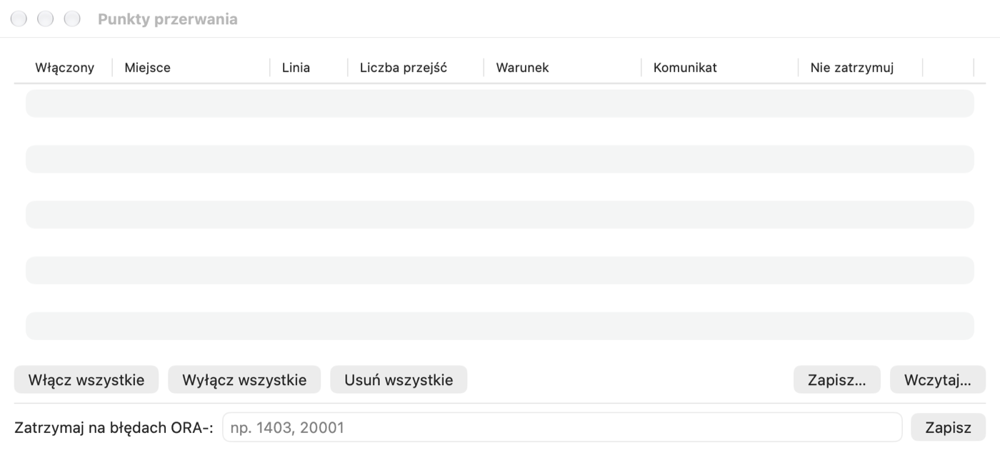

# Okno testu, debuger i profiler

## Do czego to służy

Napisanie programu to połowa pracy — trzeba jeszcze sprawdzić, czy działa. **Okno testu** wywołuje procedurę albo
funkcję z wybranymi parametrami i pokazuje, co zwróciła. **Debuger** pozwala wykonywać program linia po linii
i podglądać wartości zmiennych — to najlepszy sposób, żeby zrozumieć cudzy kod albo znaleźć przyczynę błędu.
**Profiler** mierzy, ile czasu zajmuje każda linia — pokazuje, gdzie program jest wolny.

**Kiedy użyć:** okno testu — po każdej zmianie programu; debuger — gdy program daje zły wynik i nie wiesz dlaczego;
profiler — gdy program działa poprawnie, ale za wolno.

## Okno testu

Okno testu uruchamia blok PL/SQL ze zmiennymi wiązanymi i pozwala go debugować i profilować. Najprościej otworzyć je z
Przeglądarki obiektów: menu procedury albo funkcji › **Testuj**. Pelikan przygotuje blok z wywołaniem w notacji
nazwanej (dla podprogramu pakietu — z właściwym przeciążeniem) i zmienne dla parametrów i wyniku funkcji. Puste okno
otworzysz przez **Plik › Nowy › Okno testu**.

1. W karcie **Zmienne** pod blokiem wpisz wartości parametrów wejściowych. Zmienne `:nazwa` z bloku są wykrywane
   automatycznie; typ możesz zmienić (Integer, Float, String, Date, Timestamp, Boolean, CLOB, BLOB, Cursor i inne).
2. Naciśnij F8 (⌘↩). Po wykonaniu wartości wyjściowe pojawią się w tabeli, a te, które się zmieniły, są wyróżnione na
   żółto. Pasek stanu pokazuje czas wykonania.
3. Zatwierdź albo wycofaj zmiany: F10 / ⇧F10 (opcja **AutoCommit po wykonaniu okna testu** w **Ustawienia › Okno
   SQL** zatwierdza automatycznie).

> **Ćwiczenie: przetestuj funkcję i procedurę.**
> 1. W Przeglądarce obiektów rozwiń pakiet **PEL_EMP_API**, prawym klikiem na funkcji **GET_SALARY** wybierz **Testuj**.
>    *Wynik:* okno testu (litera **T**) z blokiem `begin :result := ….pel_emp_api.get_salary(p_emp_id => :p_emp_id);
>    end;` i tabelą zmiennych `result` i `p_emp_id`.
> 2. W tabeli zmiennych wpisz `1` jako wartość `p_emp_id` i naciśnij **F8**.
>    *Wynik:* `result` = 12000, wyróżnione na żółto (wartość się zmieniła).
> 3. Wpisz `999` i naciśnij **F8** jeszcze raz.
>    *Wynik:* błąd `ORA-01403` — nie znaleziono danych (wyjątek NO_DATA_FOUND), a karta **Stos błędu** pokazuje linię w pakiecie,
>    w której wystąpił.
> 4. Otwórz w ten sam sposób **Testuj** dla procedury **RAISE_SALARY**, wpisz `p_emp_id` = 2, `p_percent` = 10 i
>    naciśnij **F8**.
>    *Wynik:* bez błędu; pasek stanu pokazuje otwartą transakcję. Okno SQL (osobna sesja) nadal widzi starą pensję
>    pracownika 2 — nową zobaczy dopiero po COMMIT w oknie testu.
> 5. Naciśnij **⇧F10** (ROLLBACK), żeby nie zostawiać zmiany w bazie.

Pozostałe karty:

- **Wyjście** — DBMS_OUTPUT; przełącznik **HTP Output** pokazuje stronę wygenerowaną pakietami HTP/OWA (po zaznaczeniu
  **Zbieraj HTP przy wykonaniu**).
- **Stos błędu** — przy błędzie wykonania: stos wywołań z liniami; kliknięcie otwiera jednostkę w linii błędu.
- **Wyniki** — zbiory zwrócone przez `DBMS_SQL.RETURN_RESULT`.
- **Profiler**, **Statystyki** i **Ślad** — opisane niżej.

Gdy po rekompilacji pakietu jego stan zostanie wyczyszczony (ORA-04068 i pokrewne), pasek stanu pokaże ostrzeżenie;
ponowne wykonanie działa normalnie.

Test zapiszesz jako plik `.tst` (blok, zmienne i obserwowane wyrażenia debugera). **Plik › Zapisz test jako skrypt
SQL*Plus** tworzy skrypt do uruchomienia poza Pelikanem. **Debugowanie › Zapisz jako test standardowy…** zapisuje okno
jako szablon (ze znacznikiem `%CALL%` w miejscu wywołania), który potem wybierzesz dla dowolnej procedury przez **Test
standardowy…** w menu obiektu.

Do uruchamiania wielu testów z oczekiwanymi wynikami służy **Narzędzia › Test Manager** (rozdział *Narzędzia*), a do
testów jednostkowych — utPLSQL (rozdział *Testy utPLSQL*).

Obok bloku, jak w oknie programu, jest **Zawartość kodu** (deklaracje, podprogramy lokalne, bloki) — pokażesz albo
ukryjesz ją w tym oknie przez **Widok › Zawartość kodu** albo przycisk na lewym końcu paska pod blokiem.

## Debuger

Debuger używa pakietu Oracle DBMS_DEBUG i działa na bazach 19c–26ai.

### Przygotowanie

- Użytkownik potrzebuje uprawnień `DEBUG CONNECT SESSION` oraz `DEBUG ANY PROCEDURE` albo `DEBUG` na konkretnych
  obiektach. **Debugowanie › Uprawnienia debugera…** otwiera okno SQL z gotowymi poleceniami GRANT do wykonania przez
  administratora.
- Kod, który chcesz krokować, musi być skompilowany z informacją debugowania: **Narzędzia › Obiekt › Dodaj informację
  debugowania** albo automatycznie przy kompilacji okna programu (**Ustawienia › Oracle › Debuger**; tam też listy
  obiektów i połączeń, dla których informację dodawać zawsze albo nigdy, np. `*@prod*`).

### Krokowanie

1. Ustaw punkty przerwania: kliknij margines z numerami linii w oknie programu albo testu, albo naciśnij ⌃B
   (**Debugowanie › Przełącz punkt przerwania**).
2. W oknie testu wybierz **Debugowanie › Rozpocznij debugowanie** (F9). Otworzy się okno **Debuger** ze stosem
   wywołań, zmiennymi i obserwowanymi wyrażeniami, a kursor zatrzyma się na pierwszej linii.
3. Krokuj:

| Czynność | Skrót |
|---|---|
| Kontynuuj (do następnego punktu przerwania) | ⌃R |
| Krok do (wejście do podprogramu, także do wyzwalacza) | ⌃N |
| Krok przez (następna linia bez wchodzenia do wywołań) | ⌃O |
| Wyjdź z podprogramu | ⌃T |
| Wykonaj do kursora / do wyjątku | menu Debugowanie |
| Zatrzymaj debugowanie | ⇧F9 |

Fokus zostaje w oknie głównym, więc możesz krokować skrótami, patrząc na kod.

> **Ćwiczenie: prześledź pętlę w debugerze.**
>
> Wymaga uprawnienia `DEBUG CONNECT SESSION` (sprawdź **Debugowanie › Uprawnienia debugera…**).
>
> 1. W Przeglądarce obiektów zaznacz pakiet **PEL_EMP_API** i wybierz **Narzędzia › Obiekt › Dodaj informację
>    debugowania**.
>    *Wynik:* pakiet jest skompilowany ponownie z informacją debugowania.
> 2. Prawym klikiem na **PRINT_DEPARTMENT** wybierz **Testuj** i wpisz `p_dept_id` = 20.
> 3. Wybierz **Debugowanie › Rozpocznij debugowanie** (F9).
>    *Wynik:* otwiera się okno **Debuger**, a wykonanie zatrzymuje się na pierwszej linii bloku.
> 4. Naciśnij **⌃N** (krok do).
>    *Wynik:* debuger wchodzi do ciała pakietu, do procedury `print_department`.
> 5. Naciskaj **⌃O** (krok przez) i patrz na kartę **Zmienne**.
>    *Wynik:* przy każdym obrocie pętli rośnie `l_total`, a rekord `r` pokazuje kolejnego pracownika. Najedź myszą na
>    `l_total` w kodzie — dymek pokaże wartość.
> 6. Kliknij margines przy linii `dbms_output.put_line('Razem: ' || l_total);` (punkt przerwania) i naciśnij **⌃R**
>    (kontynuuj).
>    *Wynik:* debuger zatrzymuje się na tej linii; `l_total` = 30200.
> 7. Naciśnij **⌃R** jeszcze raz.
>    *Wynik:* program kończy się, a karta **Wyjście** okna testu pokazuje listę pracowników i sumę.
>
> ⚠️ **Na co uważać.** Debugowana sesja jest zatrzymana — trzyma blokady i otwartą transakcję. Nie zostawiaj debugera
> zatrzymanego na długo na bazie współdzielonej; kończ go **⇧F9**. Nie debuguj na produkcji.

### Zmienne, obserwowane wyrażenia, stos

- **Zmienne** — lokalne, parametry, globalne pakietu (prywatne i publiczne), rekordy, kolekcje i obiekty jako drzewo,
  `SELF` w metodach typów. Najechanie myszą na zmienną w edytorze pokazuje jej wartość.
- **Ustaw wartość…** zmienia wartość zmiennej skalarnej (literał PL/SQL albo tekst; `NULL` — wartość pusta), **Kopiuj
  wartość** kopiuje ją do schowka.
- **Obserwowane** — wpisz wyrażenie (np. `v`, `r.pole`, `t(3)`) i kliknij **Obserwuj**.
- **Stos wywołań** — kliknięcie ramki pokazuje jej zmienne i miejsce w kodzie.
- **Wykonaj SQL w sesji debugowanej…** wykonuje zapytanie (pierwsze 100 wierszy) albo blok PL/SQL w sesji, którą
  debugujesz — widzi jej niezatwierdzone zmiany.
- DBMS_OUTPUT jest odczytywany przy każdym zatrzymaniu.

W wyzwalaczach wartości `:new` i `:old` nie są dostępne (ograniczenie DBMS_DEBUG) — debuger pokazuje wtedy informację
zamiast wartości. Domyślnie krokowanie pomija inicjalizację pakietów i obiekty SYS (**Ustawienia › Oracle ›
Debuger**).

### Punkty przerwania, warunki i punkty logowania

**Debugowanie › Punkty przerwania…** otwiera listę wszystkich punktów:

- **Włączony** — punkt można wyłączyć bez usuwania.
- **Liczba przejść** — zatrzymanie dopiero przy n-tym przejściu.
- **Warunek** — wyrażenie, np. `l_sal > 1000`; debuger zatrzymuje się tylko, gdy jest prawdziwe.
- **Komunikat** — tekst wypisywany przy przejściu; `{zmienna}` wstawia wartość zmiennej.
- **Nie zatrzymuj** — razem z komunikatem tworzy **punkt logowania** (logpoint): debuger wypisze komunikat i pójdzie
  dalej.
- **Zatrzymaj na błędach ORA-** — kody błędów, przy których debuger ma się zatrzymać (np. `1403, 20001`).
- **Włącz wszystkie**, **Wyłącz wszystkie**, **Usuń wszystkie**, **Zapisz…** i **Wczytaj…** (plik JSON).

Punkt, którego baza nie przyjęła (np. w linii bez kodu), ma na marginesie pusty znacznik. W jednej linii może być
jeden punkt.

Testy utPLSQL też można debugować: **Debugowanie › utPLSQL: debuguj test pod kursorem**.

> **Ćwiczenie: punkt warunkowy.**
> 1. W oknie **Debugowanie › Punkty przerwania…** wybierz punkt z poprzedniego ćwiczenia (albo ustaw nowy na linii
>    `l_total := l_total + r.salary;`) i w kolumnie **Warunek** wpisz `r.salary > 10000`.
> 2. Uruchom debugowanie (F9) i naciśnij **⌃R**.
>    *Wynik:* debuger zatrzymuje się tylko dla Anny Nowak (12000) — pozostałych pracowników pomija.

## Profiler

1. W karcie **Profiler** okna testu wybierz w polu **Profiler przy wykonaniu** rodzaj: **Liniowy (DBMS_PROFILER)**
   albo **Hierarchiczny (DBMS_HPROF)**. Komenda **Debugowanie › Profiler przy wykonaniu** włącza i wyłącza profiler
   liniowy.
2. Wykonaj blok (F8).
3. Karta **Profiler** pokaże raport: dla profilera liniowego — czas, liczbę wykonań i udział każdej linii z wykresem
   słupkowym; dla hierarchicznego — funkcje z czasem własnym i z wywołaniami oraz drzewo wywołań. Jednostkę czasu i
   próg udziału ustawisz w tej karcie.

**Jak czytać raport:** linie z największym udziałem czasu to te, które warto przyspieszyć. Często są to zapytania SQL
wykonywane w pętli — zamiast tysiąca pojedynczych zapytań lepiej jedno zapytanie dla wszystkich wierszy.

Menu **Przebiegi** w karcie (oraz **Debugowanie › Przebiegi profilera**) otwiera raporty wcześniejszych przebiegów.
Brakujące tabele profilera Pelikan tworzy w Twoim schemacie (na połączeniu produkcyjnym po potwierdzeniu, na
połączeniu tylko do odczytu — wcale). Dane przebiegu profilera liniowego zostają w transakcji okna — zatwierdź ją,
jeśli chcesz je zachować.

## Statystyki, ślad i SQL Trace

- Karta **Statystyki** pokazuje zmianę statystyk sesji (V$MYSTAT) z ostatniego wykonania i sumę dla okna, z filtrem i
  eksportem do CSV. Wybór statystyk jest w **Ustawienia › Okno SQL**. Wymaga dostępu do V$MYSTAT.
- **Debugowanie › Ślad DBMS_TRACE przy wykonaniu** zapisuje przebieg (wywołania, wyjątki, SQL, linie) do karty
  **Ślad**; historia przebiegów jest w **Historia przebiegów DBMS_TRACE**. Wymaga tabel śladu instalowanych przez
  administratora skryptem `tracetab.sql`.
- **Sesja › SQL Trace** włącza i wyłącza SQL Trace sesji okna; Pelikan pokazuje nazwę pliku śladu.
