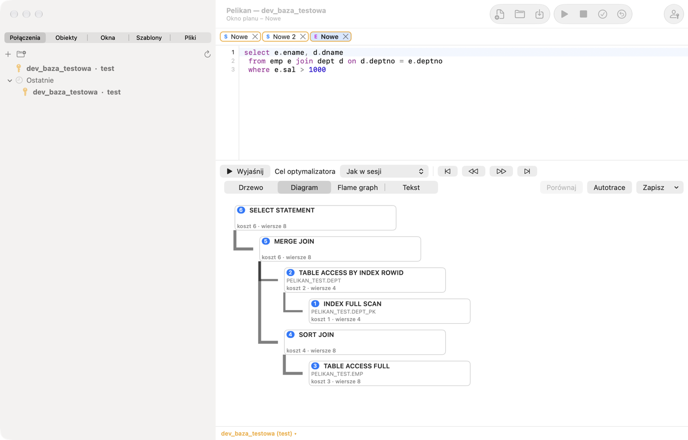
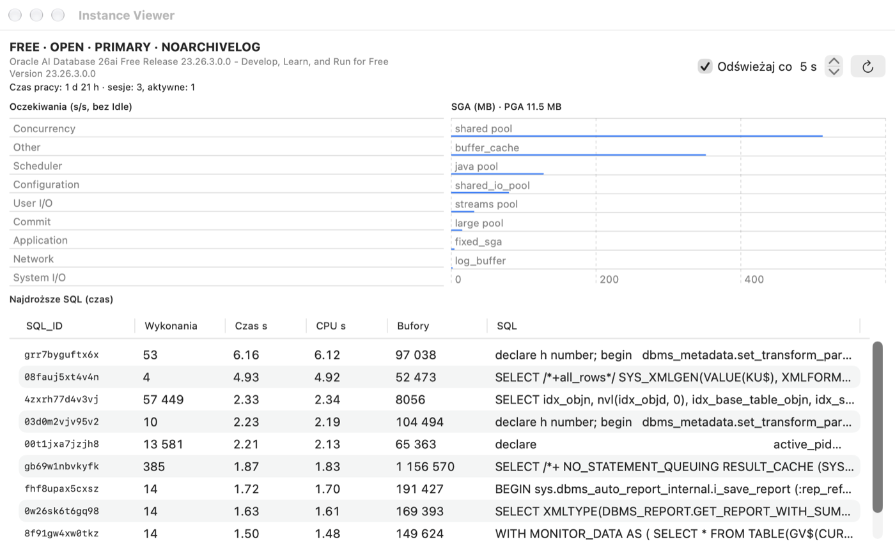

# Plan wykonania, sesje i administracja

## Do czego to służy

Zanim Oracle wykona zapytanie, **optymalizator** wybiera sposób jego wykonania: którą tabelę czytać najpierw, czy
użyć indeksu, jak łączyć tabele. Ten sposób to **plan wykonania**. Dwa zapytania zwracające ten sam wynik mogą mieć
plany różniące się czasem tysiące razy. Narzędzia z tego rozdziału pokazują plan (Explain Plan), mierzą rzeczywiste
wykonanie (Autotrace) i pozwalają zobaczyć, co dzieje się w bazie (Sesje, Instance Viewer).

**Kiedy użyć:** gdy zapytanie działa wolno, zanim dodasz indeks, i gdy coś „wisi” — żeby sprawdzić, kto blokuje
wiersze albo co robi baza.

## Plan wykonania (Explain Plan)

Ustaw kursor na poleceniu (albo je zaznacz) i naciśnij F5 (**Narzędzia › Explain Plan**). Pelikan otworzy okno planu z
planem z PLAN_TABLE. W kodzie PL/SQL zmienne są zamieniane na zmienne wiązane, a `INTO` jest pomijane, więc plan
zapytania z procedury dostaniesz bez przepisywania. Puste okno planu otworzysz przez **Plik › Nowy › Okno planu
(Explain Plan)**; brakującą tabelę PLAN_TABLE Pelikan może utworzyć.

- **Odśwież plan** wylicza plan ponownie dla tekstu w edytorze okna planu, a **Cel optymalizatora** (*Jak w sesji*, ALL_ROWS albo
  FIRST_ROWS_n) dodaje wskazówkę.
- Nowy plan pojawia się rozwinięty w całości. Strzałki **Rozwiń wszystkie gałęzie** i **Zwiń wszystkie gałęzie** obok
  wyboru widoku nad drzewem planu (także na karcie **Plan** wstążki) rozwijają naraz wszystkie gałęzie albo zwijają
  drzewo do korzenia.
- Widoki: **Drzewo** (operacje z kosztem, liczbą wierszy, bajtami, czasem, kolejnością wykonania i predykatami dostępu
  i filtrowania), **Diagram** (węzeł na operację z kosztem, kardynalnością i numerem kroku), **Flame graph** (koszt
  operacji proporcjonalnie do rodzica) i **Tekst** (DBMS_XPLAN).
- Przyciski nawigacji przechodzą po operacjach w kolejności wykonania: pierwszy, poprzedni, następny i ostatni krok.
- **Porównaj** zestawia plan z poprzednim planem okna albo z planem w drugim oknie planu: dopasowuje operacje i
  pokazuje różnice kosztu, kardynalności, kolejności i predykatów.
- **Zapisz** zapisuje plan jako tekst, HTML albo XML (DBMS_XPLAN).

Plan jest liczony w osobnej sesji narzędziowej, więc nie wpływa na transakcję okna.

**Jak czytać plan (dla początkujących):**

- Czyta się go **od najbardziej wciętej operacji** w górę — najpierw wykonuje się to, co jest najgłębiej.
- `TABLE ACCESS FULL` — Oracle czyta całą tabelę. Dla małej tabeli to dobrze; dla tabeli z milionami wierszy, z której
  potrzebujesz kilku — zwykle znak, że brakuje indeksu albo warunek go nie używa.
- `INDEX RANGE SCAN` / `INDEX UNIQUE SCAN` — Oracle szuka przez indeks, jak w skorowidzu książki.
- **Koszt** (Cost) to szacunek optymalizatora — liczba względna, przydatna do porównania dwóch planów tego samego
  zapytania, a nie czas w sekundach.
- **Kardynalność** (Rows) to szacowana liczba wierszy. Gdy jest bardzo różna od rzeczywistej (sprawdzisz w Autotrace),
  optymalizator ma złe statystyki i może wybrać zły plan.

> **Ćwiczenie: indeks w planie.**
> 1. W oknie SQL wpisz `SELECT * FROM pel_employees WHERE emp_id = 3;`, postaw na nim kursor i naciśnij **F5**.
>    *Wynik:* okno planu; w drzewie operacja `INDEX UNIQUE SCAN` na `PEL_EMPLOYEES_PK` — wyszukanie po kluczu głównym.
> 2. Zmień zapytanie na `SELECT * FROM pel_employees WHERE last_name = 'Nowak';` i naciśnij **Odśwież plan**.
>    *Wynik:* `TABLE ACCESS FULL` — na kolumnie `LAST_NAME` nie ma indeksu.
> 3. Przełącz widok na **Diagram**, a potem na **Tekst**.
>    *Wynik:* ten sam plan jako rysunek i jako tekst DBMS_XPLAN (taki, jaki zobaczy administrator).
> 4. Zaznacz zapytanie w oknie SQL i wybierz **Narzędzia › Autotrace**.
>    *Wynik:* plan rzeczywisty z kolumnami **E-Rows** (szacowane) i **A-Rows** (rzeczywiste wiersze) — tu zgodne.
>
> ⚠️ **Na co uważać.** Na tak małej tabeli pełny odczyt jest najszybszy i optymalizator słusznie go wybiera — indeks
> przydaje się przy dużych tabelach. Nie dodawaj indeksów „na zapas”: każdy indeks spowalnia INSERT, UPDATE
> i DELETE. Autotrace naprawdę **wykonuje** polecenie (DML jest potem wycofywany) — nie uruchamiaj w nim długich
> zapytań na produkcji w godzinach pracy.

## Autotrace

**Narzędzia › Autotrace** (albo przycisk **Autotrace** w oknie planu) wykonuje polecenie z pomiarem i pokazuje plan
rzeczywisty: Starts, szacowane (E-Rows) i rzeczywiste (A-Rows) liczby wierszy z wyróżnieniem dużych rozbieżności,
czasy, bufory i odczyty, a także zmianę statystyk sesji przed i po wykonaniu. Polecenia DML są po pomiarze wycofywane.
Autotrace nie wymaga Tuning Pack.

O zmienne w poleceniu Autotrace pyta jak okno SQL: zmienne wiązane (`:nazwa`) dostają wartości
z okna **Zmienne** (zapamiętane w oknie), a zmienne podstawiania (`&nazwa`) — tylko przy włączonym podstawianiu okna;
przy wyłączonym `&` zostaje w tekście bez pytania.

## Pakiety Oracle Diagnostics i Tuning

Menu **Narzędzia › Wydajność (pakiety Oracle)** zawiera narzędzia korzystające z płatnych pakietów Oracle:

| Komenda | Pakiet | Co robi |
|---|---|---|
| Raport AWR | Diagnostics | raport HTML z migawek AWR |
| Raport ASH | Diagnostics | raport HTML aktywnych sesji z ostatnich minut |
| Raport ADDM | Diagnostics | zalecenia ADDM |
| SQL Monitor | Tuning | lista monitorowanych zapytań (V$SQL_MONITOR) z raportem dla wybranego |
| Raport SQL Monitor | Tuning | raport HTML monitorowanego zapytania |
| SQL Tuning Advisor | Tuning | zalecenia dla polecenia pod kursorem; zadanie doradcy jest potem usuwane |

**Ważne — licencje.** Używaj tych funkcji tylko wtedy, gdy baza ma licencję odpowiedniego pakietu (Tuning Pack wymaga
też Diagnostics Pack). Przy pierwszym użyciu Pelikan pyta, jaką licencję ma baza, i zapamiętuje odpowiedź w definicji
połączenia (karta **Zaawansowane** › **Licencja Diagnostics/Tuning Pack**). Bez zadeklarowanej licencji albo gdy
parametr bazy `CONTROL_MANAGEMENT_PACK_ACCESS` ma wartość `NONE` (albo `DIAGNOSTIC` dla funkcji Tuning Pack), funkcja
się nie uruchomi. Agenci AI nie mają dostępu do tych narzędzi. Raporty zapiszesz jako HTML.

## Raporty wydajności

**Do czego to służy:** gdy baza albo jedno zapytanie działa wolno, administrator zwykle prosi o raport AWR, ASH albo
SQL Monitor. Okno **Raporty wydajności bazy** zbiera wszystkie te raporty w jednym miejscu, z wyborem okresu
i formatu.

- **Wydajność › Wszystkie raporty wydajności…** otwiera okno z listą raportów (**Wybierz raport**): AWR, ASH, ADDM,
  Performance Hub, SQL Monitor, plany i statystyki. Dla wybranego raportu ustawiasz **Okres** (np. **Ostatnia
  godzina**, zakres **Od** – **Do** w czasie bazy albo **Migawki AWR**), **Instancję** (w RAC także **Wszystkie
  instancje RAC**) i **Format wyniku**, a potem klikasz **Uruchom raport**.
- **Wydajność › Raporty dla SQL_ID…** robi to samo dla jednego zapytania — z zaznaczonego wiersza tabeli (np. listy
  sesji albo najdroższych zapytań), komórki z SQL_ID albo polecenia pod kursorem. Przycisk **Sprawdź** pokazuje, gdzie
  zapytanie jest dostępne: w **pamięci kursorów**, w ASH, w AWR i w SQL Monitor — raporty bez danych o zapytaniu są
  zablokowane z wyjaśnieniem.
- Raport, do którego brakuje uprawnienia (np. EXECUTE na pakiecie `DBMS_WORKLOAD_REPOSITORY`) albo licencji, jest na
  liście zablokowany z powodem i gotowym poleceniem GRANT do przekazania administratorowi.

> **Ćwiczenie: znajdź SQL_ID swojego zapytania.**
> 1. W oknie SQL wykonaj `SELECT /* moje_cwiczenie */ COUNT(*) FROM pel_emp_details;`.
> 2. Postaw kursor na tym poleceniu i wybierz **Wydajność › Raporty dla SQL_ID…**.
>    *Wynik:* okno raportów z SQL_ID zapytania znalezionym w pamięci kursorów po tekście („polecenie pod kursorem”).
> 3. Kliknij **Sprawdź**, wybierz raport planu z pamięci kursorów i **Uruchom raport**.
>    *Wynik:* plan, według którego baza naprawdę wykonała zapytanie, z liczbą wykonań.

## Sesje bazy

**Narzędzia › Sesje** pokazuje sesje bazy (V$SESSION):

- **Filtr** wybiera zapytanie listy (np. *Sesje użytkowników*); **Odświeżaj co** n sekund włącza automatyczne
  odświeżanie.
- Karty szczegółów zaznaczonej sesji: **Bieżące SQL**, **Otwarte kursory**, **Blokady**, **Statystyki**,
  **Oczekiwanie**.
- **Zakończ sesję** i **Zakończ natychmiast** kończą sesję (`ALTER SYSTEM KILL SESSION`) po potwierdzeniu.
- **Akcje** — m.in. włączenie SQL Trace dla sesji (DBMS_MONITOR).
- **Zapytania…** pozwala zdefiniować własne filtry (warunek WHERE), karty szczegółów (z `:sid`, `:serial#`) i akcje.

Sesje Pelikana mają w kolumnie MODULE wartość „Pelikan”, a sesje agentów AI — „Pelikan agent”.

> **Ćwiczenie: kto blokuje wiersz?**
>
> Wymaga uprawnień do odczytu V$SESSION i V$LOCK (zwykle rola SELECT_CATALOG_ROLE).
>
> 1. W oknie SQL A wykonaj `UPDATE pel_employees SET salary = salary WHERE emp_id = 1;` i **nie** zatwierdzaj.
> 2. W oknie SQL B wykonaj to samo polecenie.
>    *Wynik:* okno B „wisi” — czeka, aż sesja okna A zwolni blokadę wiersza.
> 3. Otwórz **Narzędzia › Sesje**, znajdź sesje z MODULE „Pelikan” i zaznacz tę, która czeka.
>    *Wynik:* karta **Oczekiwanie** pokazuje zdarzenie blokady (`enq: TX - row lock contention`), a karta
>    **Blokady** — sesję blokującą.
> 4. Wróć do okna A i naciśnij **⇧F10** (ROLLBACK).
>    *Wynik:* okno B od razu kończy UPDATE. Wycofaj też okno B (**⇧F10**).
>
> ⚠️ **Na co uważać.** **Zakończ sesję** przerywa cudzą pracę i cofa jej transakcję. Na bazie współdzielonej kończ
> tylko własne sesje albo za zgodą administratora.

## Panel DBA i Instance Viewer

**Widok › Panel DBA** zbiera informacje administracyjne: przestrzenie tabel z zajętością, pliki danych, parametry
instancji, użytkowników, role, sesje i blokady. Na liście parametrów **Zmień wartość…** wykonuje `ALTER SYSTEM SET …
SCOPE=BOTH`, a na liście użytkowników **Zablokuj** i **Odblokuj** zmieniają stan konta — zawsze po potwierdzeniu i z
tymi samymi zabezpieczeniami co okno SQL. Części, do których nie masz uprawnień, pokazują komunikat zamiast danych.

**Narzędzia › Instance Viewer** to pulpit instancji: wersja i stan bazy, czas pracy, liczba sesji, klasy oczekiwań
(przyrost na sekundę), najdroższe zapytania (V$SQL) oraz SGA i PGA, z automatycznym odświeżaniem.

## DBMS Scheduler

**Narzędzia › DBMS Scheduler** pokazuje obiekty harmonogramu w drzewie: okna i grupy okien, klasy zadań, harmonogramy,
programy, łańcuchy, zadania, obserwatory plików i poświadczenia, z podglądem SQL (View SQL) zaznaczonego obiektu.

- **Nowe zadanie…** tworzy zadanie z harmonogramem wbudowanym (np. `FREQ=DAILY;BYHOUR=3`) albo nazwanym, z klasą,
  komentarzem i powiadomieniami e-mail. Istniejące zadanie zmienisz przez **Edytuj…**, a usuniesz po potwierdzeniu.
- **Przebiegi** pokazuje historię wykonań z raportami (wszystkie, nieudane, własne warunki) i regułami kolorów.
- **Uruchomione** pokazuje trwające zadania; **Zatrzymaj** i **Zatrzymaj (Force)** je przerywają.
