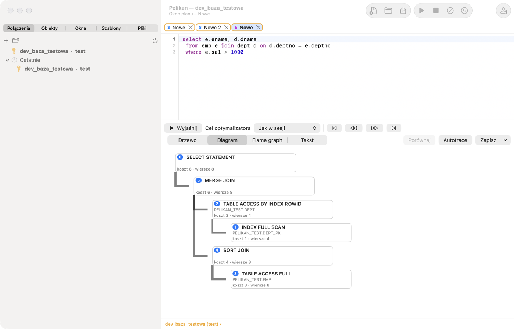
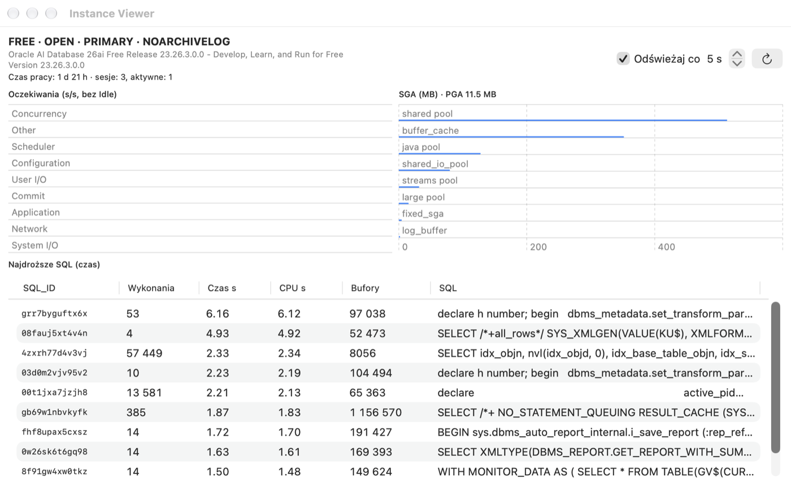

# Plan wykonania, sesje i administracja

## Plan wykonania (Explain Plan)

Ustaw kursor na poleceniu (albo je zaznacz) i naciśnij F5 (**Narzędzia › Explain Plan**). Pelikan otworzy okno planu z
planem z PLAN_TABLE. W kodzie PL/SQL zmienne są zamieniane na zmienne wiązane, a `INTO` jest pomijane, więc plan
zapytania z procedury dostaniesz bez przepisywania. Puste okno planu otworzysz przez **Plik › Nowy › Okno planu
(Explain Plan)**; brakującą tabelę PLAN_TABLE Pelikan może utworzyć.

- **Wyjaśnij** odświeża plan dla tekstu w edytorze okna planu, a **Cel optymalizatora** (*Jak w sesji*, ALL_ROWS albo
  FIRST_ROWS_n) dodaje wskazówkę.
- Nowy plan pojawia się rozwinięty w całości. Strzałki **Rozwiń wszystkie gałęzie** i **Zwiń wszystkie gałęzie** obok
  wyboru widoku nad drzewem planu (także na karcie **Plan** wstążki) rozwijają naraz wszystkie gałęzie albo zwijają
  drzewo do korzenia.
- Widoki: **Drzewo** (operacje z kosztem, liczbą wierszy, bajtami, czasem, kolejnością wykonania i predykatami dostępu
  i filtrowania), **Diagram** (węzeł na operację z kosztem, kardynalnością i numerem kroku), **Flame graph** (koszt
  operacji proporcjonalnie do rodzica) i **Tekst** (DBMS_XPLAN).
- Przyciski nawigacji przechodzą po operacjach w kolejności wykonania: pierwszy, poprzedni, następny i ostatni krok.
- **Porównaj** zestawia plan z poprzednim planem okna albo z planem w drugim oknie planu: dopasowuje operacje i
  pokazuje różnice kosztu, kardynalności, kolejności i predykatów.
- **Zapisz** zapisuje plan jako tekst, HTML albo XML (DBMS_XPLAN).

Plan jest liczony w osobnej sesji narzędziowej, więc nie wpływa na transakcję okna.

## Autotrace

**Narzędzia › Autotrace** (albo przycisk **Autotrace** w oknie planu) wykonuje polecenie z pomiarem i pokazuje plan
rzeczywisty: Starts, szacowane (E-Rows) i rzeczywiste (A-Rows) liczby wierszy z wyróżnieniem dużych rozbieżności,
czasy, bufory i odczyty, a także zmianę statystyk sesji przed i po wykonaniu. Polecenia DML są po pomiarze wycofywane.
Autotrace nie wymaga Tuning Pack.

O zmienne w poleceniu Autotrace pyta jak okno SQL: zmienne wiązane (`:nazwa`) dostają wartości
z okna **Zmienne** (zapamiętane w oknie), a zmienne podstawiania (`&nazwa`) — tylko przy włączonym podstawianiu okna;
przy wyłączonym `&` zostaje w tekście bez pytania.

## Pakiety Oracle Diagnostics i Tuning

Menu **Narzędzia › Wydajność (pakiety Oracle)** zawiera narzędzia korzystające z płatnych pakietów Oracle:

| Komenda | Pakiet | Co robi |
|---|---|---|
| Raport AWR | Diagnostics | raport HTML z migawek AWR |
| Raport ASH | Diagnostics | raport HTML aktywnych sesji z ostatnich minut |
| Raport ADDM | Diagnostics | zalecenia ADDM |
| SQL Monitor | Tuning | lista monitorowanych zapytań (V$SQL_MONITOR) z raportem dla wybranego |
| Raport SQL Monitor | Tuning | raport HTML monitorowanego zapytania |
| SQL Tuning Advisor | Tuning | zalecenia dla polecenia pod kursorem; zadanie doradcy jest potem usuwane |

**Ważne — licencje.** Używaj tych funkcji tylko wtedy, gdy baza ma licencję odpowiedniego pakietu (Tuning Pack wymaga
też Diagnostics Pack). Przy pierwszym użyciu Pelikan pyta, jaką licencję ma baza, i zapamiętuje odpowiedź w definicji
połączenia (karta **Zaawansowane** › **Licencja Diagnostics/Tuning Pack**). Bez zadeklarowanej licencji albo gdy
parametr bazy `CONTROL_MANAGEMENT_PACK_ACCESS` ma wartość `NONE` (albo `DIAGNOSTIC` dla funkcji Tuning Pack), funkcja
się nie uruchomi. Agenci AI nie mają dostępu do tych narzędzi. Raporty zapiszesz jako HTML.

## Sesje bazy

**Narzędzia › Sesje** pokazuje sesje bazy (V$SESSION):

- **Filtr** wybiera zapytanie listy (np. *Sesje użytkowników*); **Odświeżaj co** n sekund włącza automatyczne
  odświeżanie.
- Karty szczegółów zaznaczonej sesji: **Bieżące SQL**, **Otwarte kursory**, **Blokady**, **Statystyki**,
  **Oczekiwanie**.
- **Zabij** i **Zabij natychmiast** kończą sesję (`ALTER SYSTEM KILL SESSION`) po potwierdzeniu.
- **Akcje** — m.in. włączenie SQL Trace dla sesji (DBMS_MONITOR).
- **Zapytania…** pozwala zdefiniować własne filtry (warunek WHERE), karty szczegółów (z `:sid`, `:serial#`) i akcje.

Sesje Pelikana mają w kolumnie MODULE wartość „Pelikan”, a sesje agentów AI — „Pelikan agent”.

## Panel DBA i Instance Viewer

**Widok › Panel DBA** zbiera informacje administracyjne: przestrzenie tabel z zajętością, pliki danych, parametry
instancji, użytkowników, role, sesje i blokady. Na liście parametrów **Zmień wartość…** wykonuje `ALTER SYSTEM SET …
SCOPE=BOTH`, a na liście użytkowników **Zablokuj** i **Odblokuj** zmieniają stan konta — zawsze po potwierdzeniu i z
tymi samymi zabezpieczeniami co okno SQL. Części, do których nie masz uprawnień, pokazują komunikat zamiast danych.

**Narzędzia › Instance Viewer** to pulpit instancji: wersja i stan bazy, czas pracy, liczba sesji, klasy oczekiwań
(przyrost na sekundę), najdroższe zapytania (V$SQL) oraz SGA i PGA, z automatycznym odświeżaniem.

## DBMS Scheduler

**Narzędzia › DBMS Scheduler** pokazuje obiekty harmonogramu w drzewie: okna i grupy okien, klasy zadań, harmonogramy,
programy, łańcuchy, zadania, obserwatory plików i poświadczenia, z podglądem SQL (View SQL) zaznaczonego obiektu.

- **Nowe zadanie…** tworzy zadanie z harmonogramem wbudowanym (np. `FREQ=DAILY;BYHOUR=3`) albo nazwanym, z klasą,
  komentarzem i powiadomieniami e-mail. Istniejące zadanie zmienisz przez **Edytuj…**, a usuniesz po potwierdzeniu.
- **Przebiegi** pokazuje historię wykonań z raportami (wszystkie, nieudane, własne warunki) i regułami kolorów.
- **Uruchomione** pokazuje trwające zadania; **Zatrzymaj** i **Zatrzymaj (Force)** je przerywają.
