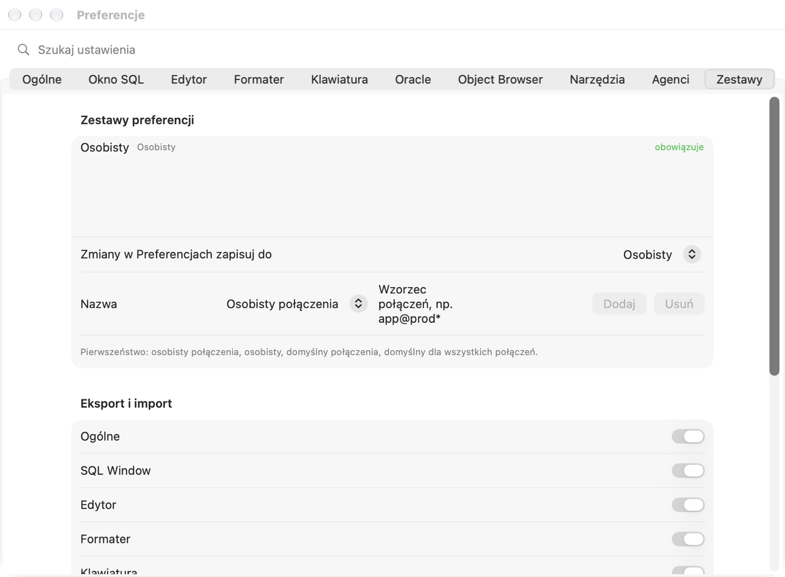

# Ustawienia i skróty klawiszowe

## Okno Ustawienia

Otworzysz je przez **Pelikan › Ustawienia…** (⌘,). Zmiany zapisują się od razu — nie ma przycisku Zastosuj. Pole
**Szukaj ustawienia** u góry znajduje ustawienie po nazwie (w języku interfejsu) i przenosi do właściwej karty.

| Karta | Co ustawisz |
|---|---|
| Ogólne | tryb sesji (Multi, Dual, Single), zachowanie przy wylogowaniu z otwartą transakcją, sprawdzanie połączenia, przypinanie połączenia nowych okien, kolory połączeń i reguły `użytkownik@baza`, wygląd (jak system, jasny, ciemny), czcionka interfejsu (krój, styl, wielkość), język interfejsu, katalogi startowe i dodatkowe rozszerzenia plików, pytanie o zapis nowych okien; specyfikacja i ciało w osobnych plikach (rozszerzenia, otwieranie pary); pliki zmienione na dysku przez inny program (wykrywanie, wczytywanie bez pytania) |
| Okno SQL | AutoSelect, AutoCommit, potwierdzanie COMMIT i ROLLBACK, AutoCommit okna testu, liczba wierszy na stronę, układ liczb, Auto Format w Large Data Editor, statystyki, DBMS_OUTPUT (włączony, czyszczenie przed wykonaniem), formaty DATE i TIMESTAMP |
| Edytor | czcionki edytora, siatki wyników i Przeglądarki obiektów (krój, styl, wielkość; ligatury) i kolory, podpowiedź kodu (automatycznie po kropce, dopasowanie, wielkość liter, funkcje standardowe, układ „(all)”), AutoReplace, zapamiętywanie stanu okien, wielkość liter słów kluczowych, podświetlenia, status linii, zawijanie, znaki specjalne, wcięcia i tabulacje, Zawartość kodu w nowych oknach i kolejność jej elementów |
| Formater | reguły formatowania PL/SQL i automatyczne formatowanie (po otwarciu z bazy, przed kompilacją, przed zapisem) |
| Klawiatura | profil skrótów i własne skróty komend |
| Oracle | Instant Client, ustawienia NLS sesji, zamykanie bezczynnych sesji, wersja dokumentacji Oracle dla F1, Touch ID dla zapisanych haseł, Oracle Net i Oracle Wallet, kompilator, debuger, podpowiedzi kompilatora i konwencje nazw, widoki DBA_ |
| Przeglądarka obiektów | widoczne foldery i kolejność, potwierdzanie rekompilacji, akcje przeciągania, filtry nazwane, foldery użytkownika |
| Narzędzia | wyszukiwania w sieci, edytor zewnętrzny, zewnętrzna przeglądarka różnic, dokumenty, kopie zapasowe i odzyskiwanie okien, pytania „Nie pytaj więcej” |
| Agenci | programy agentów, tryb ścisły, limity wywołań i zapytań agenta |
| Zestawy | zestawy ustawień, eksport i import, pasek szybkiego dostępu |

Kilka ustawień działa dopiero po ponownym uruchomieniu Pelikana: katalog Instant Client, Oracle Net i Oracle Wallet
oraz język interfejsu.

### Kopie zapasowe i odzyskiwanie

W karcie **Narzędzia** włączysz kopię poprzedniej wersji pliku przy zapisie (`plik.~ext`) oraz zachowywanie
niezapisanych okien do odzyskania po nieoczekiwanym zamknięciu (migawka co zadany czas, opcjonalnie także przed każdym
wykonaniem). Po awarii Pelikan zaproponuje odzyskanie okien; możesz to zrobić też później przez **Plik › Odzyskaj
okna…**.

### Pytania „Nie pytaj więcej”

Część pytań (np. potwierdzenie COMMIT, przeniesienie do Kosza) ma pole **Nie pytaj więcej** — Pelikan zapamiętuje
wtedy Twoją odpowiedź. Listę zapamiętanych odpowiedzi i przycisk **Pokazuj znowu** znajdziesz w karcie **Narzędzia**.
Potwierdzeń zmian na produkcji i zgód dla agentów AI nie da się wyłączyć w ten sposób.

## Zestawy ustawień

Zestawy pozwalają mieć inne ustawienia dla różnych połączeń — np. inny format dat dla jednej bazy albo ostrzejsze
reguły dla produkcji. Pelikan nakłada zestawy w kolejności (od najważniejszego): **osobisty połączenia**,
**osobisty**, **domyślny połączenia**, **domyślny dla wszystkich połączeń**. Zestawy połączeniowe mają wzorzec
`użytkownik@baza` albo nazwę połączenia z `*` i `%` (np. `app@prod*`) i działają, gdy pasuje do nich połączenie
główne.



W karcie **Zestawy** (albo **Narzędzia › Ustawienia › Zestawy ustawień…**):

1. Dodaj zestaw: wybierz rodzaj, wpisz nazwę i wzorzec połączeń, kliknij **Dodaj**.
2. W polu **Zmiany w Ustawieniach zapisuj do** wybierz zestaw, który chcesz edytować. Od tej chwili zmiany w innych
   kartach trafiają do niego.
3. Przy ustawieniach widać, z którego zestawu pochodzi wartość; **Dziedzicz** usuwa wartość z edytowanego zestawu.

**Eksport i import** zapisuje do pliku JSON wybrane sekcje obowiązujących ustawień (**Narzędzia › Ustawienia ›
Eksportuj ustawienia…**) i wczytuje je do edytowanego zestawu (**Importuj ustawienia…**). Eksport nie zawiera haseł
ani historii plików.

## Pasek narzędzi i szybki dostęp

**Widok › Dostosuj pasek narzędzi…** zmienia układ paska standardowym oknem macOS. Grupa **Szybki dostęp** na pasku
zawiera dowolne komendy (do 20) — dodasz je w karcie **Zestawy** (**Pasek szybkiego dostępu**) albo z palety komend.

## Klawiatura

W karcie **Klawiatura** wybierz profil: **PL/SQL Developer (F-klawisze, Ctrl)** albo **macOS (Cmd)**. Wyszukaj komendę
i nagraj własny skrót — Pelikan ostrzeże o konflikcie z innym skrótem. **Usuń skróty komendy**, **Domyślne dla
komendy** i **Przywróć wszystkie domyślne** cofają zmiany. Menu pokazuje jeden skrót komendy, ale działają wszystkie
jej skróty.

## Najważniejsze skróty

| Czynność | Profil PL/SQL Developer | Profil macOS |
|---|---|---|
| Nowe okno SQL / okno programu | ⌘N / ⇧⌘N | ⌘N / ⇧⌘N |
| Wykonaj | F8, ⌘↩ | ⌘↩, F8 |
| Wykonaj odwrotnie do AutoSelect | ⌃F8, ⇧⌘↩ | ⇧⌘↩, ⌃F8 |
| Przerwij | ⇧⎋, ⌘. | ⌘. |
| Zatwierdź (COMMIT) / Wycofaj (ROLLBACK) | F10 / ⇧F10 (także ⌥⌘↩ / ⌥⌘⌫) | ⌥⌘↩ / ⌥⌘⌫ (także F10 / ⇧F10) |
| Explain Plan | F5 | F5 |
| Zaloguj… | ⇧⌘L | ⇧⌘L |
| Pokaż podpowiedzi kodu | ⌃Spacja | ⌥⎋, ⌃Spacja |
| Przejdź do deklaracji | ⌃⌥D, ⌃⌘J | ⌃⌘J |
| Historia poleceń | ⌃E, ⇧⌘H | ⇧⌘H |
| Znajdź i zamień / przejdź do linii | ⌃F, ⌘F / ⌃G, ⌘L | ⌘F / ⌘L |
| Przełącz komentarz linii | ⌃−, ⌘/ | ⌘/ |
| Formatuj kod PL/SQL | ⇧⌘F | ⇧⌘F |
| Szukaj w edytorach i plikach | ⌥⇧⌘F | ⌥⇧⌘F |
| Znajdź obiekty bazy | ⌃⇧O, ⇧⌘O | ⇧⌘O |
| Debuger: start / stop | F9 / ⇧F9 | F9 / ⇧F9 |
| Debuger: kontynuuj, wejdź, przejdź, wyjdź | ⌃R, ⌃N, ⌃O, ⌃T | ⌃R, ⌃N, ⌃O, ⌃T |
| Punkt przerwania | ⌃B | ⌃B |
| utPLSQL: wszystkie testy / test pod kursorem | ⌃⇧U, ⇧⌘U / ⌃⌥U, ⌃⌘U | ⇧⌘U / ⌃⌘U |
| Makro: nagrywaj / odtwórz | F11 / F12 | F11 / F12 |
| Następne / poprzednie okno | ⌃⇥ / ⌃⇧⇥ | ⇧⌘] / ⇧⌘[ |
| Paleta komend | ⇧⌘P | ⇧⌘P |
| Pomoc kontekstowa Oracle / instrukcja | F1 / ⇧⌘/ | F1 / ⇧⌘/ |

Pełną listę komend z bieżącymi skrótami (z uwzględnieniem Twoich zmian) zawiera ostatni rozdział instrukcji, **Skróty
klawiszowe**. Klawisze F1–F12 działają jako klawisze funkcyjne po włączeniu tej opcji w Ustawieniach systemowych macOS
albo z klawiszem fn; niektóre skróty z ⌃ (np. ⌃F8, ⌃F2, ⌃F3) macOS przechwytuje — użyj odpowiednika z ⌘ albo wyłącz
skrót systemowy.

## Uruchamianie z parametrami

Pelikana można uruchomić z parametrami, np. z Terminala:

```
open -a Pelikan --args connection=dev_test editobject=APP.EMP_API
```

Obsługiwane parametry to m.in. `connection` (nazwa połączenia albo `użytkownik@baza`), `viewobject`, `editobject`,
`commandfile`, `project`, `workset`, `readonly` (wzorce połączeń otwieranych w tym uruchomieniu tylko do odczytu),
`noloaddesktop` oraz ścieżki plików. Działa też adres `pelikan://open?connection=…`. Hasło w parametrach nie jest
obsługiwane — `userid=u/hasło@baza` zostanie przyjęte bez hasła z ostrzeżeniem, a hasło pochodzi z Pęku kluczy albo z
pytania.

Adres `pelikan://` może otworzyć dowolna strona albo wiadomość, dlatego przyjmuje tylko otwieranie (połączenie,
obiekt, plik, workset, projekt, `readonly`); skryptu z `commandfile` z takiego adresu Pelikan nie wykona.
