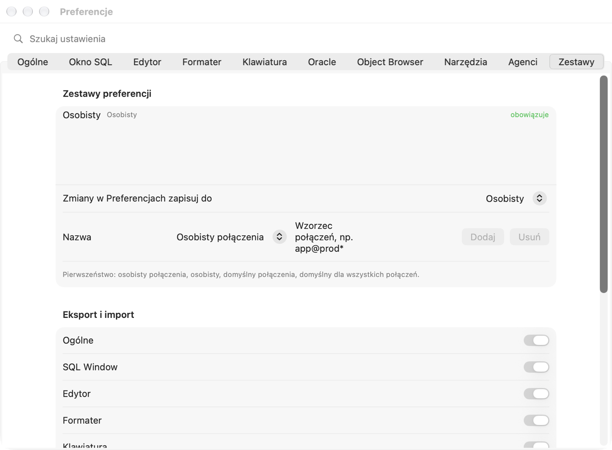

# Ustawienia i skróty klawiszowe

Ten rozdział opisuje **każdą opcję** okna Ustawienia: co robi, jaka jest wartość domyślna, co się stanie, gdy ją
włączysz albo wyłączysz (albo wybierzesz inną pozycję z listy), kiedy zmiana zaczyna działać i na co uważać. Nie musisz
czytać go od deski do deski — wartości domyślne są dobrane tak, żeby bezpiecznie zacząć pracę. Wróć tutaj, gdy coś
działa inaczej, niż chcesz.

## Okno Ustawienia

### Do czego to służy

Ustawienia decydują o tym, jak Pelikan łączy się z bazą, jak wykonuje polecenia, jak wygląda edytor i jak formatuje
kod. Każdy programista ma trochę inne przyzwyczajenia — tu dopasujesz program do siebie.

### Jak otworzyć i znaleźć opcję

1. Wybierz **Pelikan › Ustawienia…** albo naciśnij **⌘,** (Command i przecinek).
   *Wynik:* otwiera się okno z kartami u góry: Ogólne, Okno SQL, Edytor, Formater, Klawiatura, Oracle, Przeglądarka
   obiektów, Narzędzia, Agenci, Zestawy.
2. Nie wiesz, w której karcie jest opcja? Wpisz fragment jej nazwy w pole **Szukaj ustawienia** nad kartami, np.
   `commit`.
   *Wynik:* zamiast kart pojawia się lista pasujących ustawień, a po prawej nazwa karty.
3. Kliknij pozycję na liście.
   *Wynik:* pole wyszukiwania się czyści i otwiera się właściwa karta.

### Kiedy zmiana zaczyna działać

- **Zmiany zapisują się od razu** — nie ma przycisku „Zastosuj” ani „OK”, jak w ustawieniach macOS. Zamknięcie okna
  niczego nie cofa.
- Większość opcji działa natychmiast we wszystkich oknach.
- Opcje dotyczące **sesji bazy** (np. ustawienia NLS, tryb sesji) działają w **nowych sesjach** — rozłącz się
  i połącz ponownie, żeby objęły okna już otwarte.
- Trzy opcje wymagają **ponownego uruchomienia Pelikana**: katalog Oracle Instant Client, katalogi Oracle Net
  i Oracle Wallet oraz język interfejsu. Pelikan pisze to pod każdą z nich.

> **Wskazówka.** Chcesz mieć inne ustawienia dla jednej bazy (np. ostrzejsze dla produkcji)? Nie zmieniaj ich ręcznie
> przy każdym przełączeniu — użyj **zestawów ustawień** (karta **Zestawy**, opis na końcu rozdziału).

Opis opcji w kolejnych sekcjach ma stały układ: nazwa opcji tak, jak widać ją w oknie, wartość domyślna, skutek każdej
możliwości i — gdy trzeba — ostrzeżenie ⚠️.

## Karta Ogólne

### Sesje

**Sesja** to jedno połączenie z bazą Oracle po stronie serwera. W sesji żyje Twoja **transakcja** (zmiany danych,
których jeszcze nie zatwierdziłeś poleceniem COMMIT), zmienne pakietów i ustawienia wydane poleceniem ALTER SESSION.
To, ile sesji otwiera Pelikan, ma realne skutki.

**Tryb sesji** — *domyślnie: Multi*.

| Wybór | Co się dzieje | Skutki |
|---|---|---|
| **Multi — osobna sesja dla każdego okna** | Każde okno SQL, testu i konsoli ma własną sesję; kompilacja ma jeszcze jedną. | Długie zapytanie w jednym oknie nie blokuje pozostałych. Transakcje okien są niezależne: zmiana w oknie A jest niewidoczna w oknie B do COMMIT. Więcej sesji na serwerze (administrator może mieć limit). **Zalecane.** |
| **Dual — sesja wspólna i sesja kompilacji** | Okna jednego połączenia dzielą jedną sesję, kompilacja ma osobną. | Mniej sesji. Okna widzą wzajemnie swoje niezatwierdzone zmiany i wspólną transakcję — COMMIT w jednym oknie zatwierdza zmiany ze wszystkich. Gdy jedno okno wykonuje zapytanie, pozostałe czekają. |
| **Single — jedna sesja** | Wszystko, także kompilacja, w jednej sesji (debuger i tak ma swoją sesję nadzorującą). | Najmniej sesji. ⚠️ Kompilacja (CREATE OR REPLACE) w Oracle **zatwierdza otwartą transakcję** — skompilowanie pakietu w oknie programu zatwierdzi niezatwierdzone zmiany z okna SQL. Używaj tylko, gdy baza pozwala na jedną sesję. |

*Kiedy działa:* dla nowych sesji — po zmianie rozłącz się i połącz ponownie.

**Wylogowanie z otwartą transakcją** — *domyślnie: Pytaj*. Co zrobić, gdy zamykasz okno, przełączasz je na inne
połączenie albo się wylogowujesz, a w sesji są niezatwierdzone zmiany.

- **Pytaj** — Pelikan pokaże okno z wyborem COMMIT, ROLLBACK albo Anuluj. **Zalecane** — zawsze wiesz, co się dzieje
  z Twoimi zmianami.
- **Zatwierdź (COMMIT)** — zmiany zostaną zatwierdzone bez pytania. ⚠️ Łatwo utrwalić w bazie zmianę zrobioną „na
  próbę”.
- **Wycofaj (ROLLBACK)** — zmiany zostaną cofnięte bez pytania. ⚠️ Zapomniany COMMIT oznacza utratę pracy.

**Sprawdzanie połączenia co … s (0 — wyłączone)** — *domyślnie: 60 s*, krok 30 s. Co tyle sekund Pelikan wysyła do
bazy bardzo lekkie zapytanie, żeby sprawdzić, czy sesje główne i sesje okien z otwartą transakcją jeszcze żyją (np. czy
nie zerwała się sieć albo VPN). Gdy sesja przepadła, Pelikan od razu o tym informuje i zdejmuje znacznik otwartej
transakcji z okien, których to dotyczy — **zmiany niezatwierdzone w zerwanej sesji są w bazie cofnięte**.

- Mniejsza wartość (najmniej 15 s) — szybciej dowiesz się o zerwanym połączeniu, kosztem częstszych zapytań.
- **0** — Pelikan nie sprawdza połączenia; o zerwaniu dowiesz się dopiero przy następnym poleceniu.
- Zmiana działa od razu.

**Przypinaj połączenie nowych okien** — *domyślnie: wyłączone*. Połączenie **główne** to to, które wybierasz na pasku
narzędzi; nowe okna je dostają.

- Wyłączone — gdy zmienisz połączenie główne, okna bez przypięcia przełączą się razem z nim (najpierw zapytają
  o otwartą transakcję).
- Włączone — każde nowe okno SQL, programu, testu i konsoli dostaje **przypięte** połączenie (📌 na pasku stanu)
  i zostaje przy nim, nawet gdy zmienisz połączenie główne. Przydaje się, gdy pracujesz równolegle na kilku bazach
  i nie chcesz, żeby okno „przeskoczyło” na inną.

### Wskaźniki połączeń

Kolor połączenia pomaga nie pomylić bazy testowej z produkcyjną. Kolor nadajesz w definicji połączenia (karta
**Środowisko**), a tu decydujesz, gdzie go widać.

**Tło edytora w kolorze połączenia** — *domyślnie: wyłączone*. Włączone — tło edytora jest lekko zabarwione kolorem
połączenia okna. Bardzo dobrze widać, że piszesz „na produkcji”. Wyłączone — kolor jest tylko na kartach okien i na
liście okien.

**Reguły użytkownik@baza** — lista reguł z wzorcem i kolorem, domyślnie pusta. Przycisk **Dodaj regułę** dodaje regułę
`*@*` w kolorze czerwonym; zmień wzorzec i kolor. Wzorzec ma postać `użytkownik@baza`, `*` oznacza dowolny ciąg, `?`
jeden znak. Przykłady: `sys@*` — każde logowanie jako SYS, `*@prod*` — każdy użytkownik na bazach, których nazwa
zaczyna się od „prod”. Reguła ma **pierwszeństwo** przed kolorem połączenia i środowiska i dotyczy kart, listy okien
i tła. Przycisk ⊖ usuwa regułę.

> **Ćwiczenie: oznacz logowanie jako SYS na czerwono.**
> 1. W karcie **Ogólne** kliknij **Dodaj regułę**. *Wynik:* pojawia się wiersz `*@*` z czerwonym kolorem.
> 2. W polu wzorca wpisz `sys@*`. Kolor zostaw czerwony.
> 3. Włącz **Tło edytora w kolorze połączenia**.
> 4. Połącz się jako SYS z bazą testową i otwórz okno SQL. *Wynik:* karta okna i tło edytora są czerwone.

### Wygląd

**Tryb** — *domyślnie: Jak system*. **Jak system** — Pelikan jest jasny albo ciemny razem z macOS (także gdy macOS
zmienia tryb o zmierzchu). **Jasny** / **Ciemny** — zawsze taki, niezależnie od systemu. Zmiana działa od razu.

### Czcionka interfejsu

Dotyczy etykiet, list, wstążki, kart okien, paska stanu, okien narzędzi i Ustawień. Menu i tytuły okien rysuje macOS —
tych Pelikan nie zmienia. Pod opcjami widać przykładowy tekst w wybranej czcionce.

- **Krój** — *domyślnie: Systemowa (SF Pro)*. Lista zawiera czcionki zainstalowane na Macu.
- **Styl** — *domyślnie: zwykły*. Od lekkiego do pogrubionego.
- **Wielkość** — *domyślnie: 13 pt*, od 10 do 20 pt. Tekst pomocniczy (podpisy, opisy) jest zawsze o 2 pt mniejszy.
  Większa czcionka to czytelność kosztem miejsca — przy 16 pt i więcej na małym ekranie część pasków się zawęża.

Czcionkę edytora kodu i siatki wyników ustawiasz osobno, w karcie **Edytor**.

### Wstążka

**Wstążka** to pas z kartami czynności (Start, SQL, Program, Narzędzia…) pod paskiem narzędzi — jak w programach
biurowych.

- **Pokaż wstążkę z kartami czynności** — *domyślnie: włączone*. Wyłączone — wstążka znika, zostaje więcej miejsca na
  edytor; komendy nadal są w menu, w palecie komend (⇧⌘P) i pod skrótami.
- **Zwiń wstążkę do samych kart** — *domyślnie: wyłączone*, dostępne tylko przy widocznej wstążce. Włączone — widać same
  nazwy kart. Kliknięcie karty rozwija wstążkę, a dwukrotne kliknięcie karty zwija ją albo rozwija na stałe. Dobry
  kompromis na małym ekranie.

Pole **Szukaj czynności** na wstążce znajduje każdą komendę po nazwie, także bez polskich znaków i po angielskiej
nazwie z PL/SQL Developera.

### Panele narzędzi

Narzędzia (np. Przeglądarka obiektów, Sesje, Wyniki testów) otwierają się w panelu po prawej, w panelu na dole albo
w osobnym oknie.

- **Nowe narzędzia otwieraj** — *domyślnie: Panel po prawej*. **Panel po prawej**, **Panel na dole** albo **Osobne
  okno**. Dotyczy narzędzi, których jeszcze nie przenosiłeś — Pelikan pamięta miejsce każdego rodzaju narzędzia
  osobno.
- **Autoukrywanie paneli, gdy praca wraca do edytora** — *domyślnie: wyłączone*. Włączone — gdy klikniesz w edytor,
  panele narzędzi chowają się i edytor dostaje całą szerokość; panel wraca, gdy otworzysz albo wybierzesz narzędzie.
  Wyłączone — panele zostają na miejscu.
- **Przywróć miejsca domyślne** — zapomina miejsca, do których przeniosłeś narzędzia (licznik obok pokazuje, ile ich
  jest). Narzędzia otworzą się znów zgodnie z opcją **Nowe narzędzia otwieraj**.

Narzędzie przeniesiesz, przeciągając jego kartę do drugiego panelu albo poza panele (osobne okno), z menu karty albo
przyciskiem na pasku tytułu narzędzia.

### Język interfejsu

**Język** — *domyślnie: Jak system*. Polski, English, Deutsch, Español albo Українська. **Jak system** — język
z ustawień macOS. Zmiana działa **po ponownym uruchomieniu Pelikana**. Język nie
zmienia komunikatów Oracle (np. `ORA-00942`) — te zależą od ustawienia NLS_LANGUAGE w karcie **Oracle**.

### Katalogi startowe i rozszerzenia

**Skrypty SQL**, **Programy**, **Testy**, **Raporty** — katalog, który pokazuje okno otwierania i zapisu pliku danego
rodzaju. *Domyślnie puste:* katalog projektu, a bez projektu — ostatnio używany. Wpisz ścieżkę, wybierz z listy (katalog
projektu, katalogi ostatnich plików, Dokumenty, katalog domowy) albo kliknij przycisk przeglądania.

**Dodatkowe rozszerzenia programów** i **Dodatkowe rozszerzenia testów** — *domyślnie puste*. Pelikan rozpoznaje
rodzaj pliku po rozszerzeniu: `.sql` otwiera w oknie SQL, `.pck`, `.pks`, `.pkb`, `.prc`, `.fnc`… w oknie programu,
`.tst` w oknie testu. Jeśli w Twoim zespole programy mają inne rozszerzenie (np. `.plsql`), dopisz je tutaj (kilka po
przecinku) — takie pliki będą otwierać się w oknie programu albo testu zamiast w oknie SQL.

### Specyfikacja i ciało w osobnych plikach

Pakiet PL/SQL składa się ze **specyfikacji** (co pakiet udostępnia) i **ciała** (jak to robi). Wiele zespołów trzyma je
w dwóch plikach, np. `emp_api.pks` i `emp_api.pkb`.

- **Otwieraj parę specyfikacja/ciało w jednym oknie** — *domyślnie: włączone*. Włączone — otwarcie `emp_api.pks`
  otworzy w tym samym oknie programu także `emp_api.pkb` z tego samego katalogu (dwie karty). Wyłączone — otwiera się
  tylko wskazany plik.
- **Rozszerzenie specyfikacji pakietu** (*pks*), **ciała pakietu** (*pkb*), **specyfikacji typu** (*tps*), **ciała
  typu** (*tpb*). Okno programu ze specyfikacją i ciałem zapisuje każdą jednostkę do jej pliku; **Zapisz jako** tworzy
  parę plików; eksport obiektów „plik na obiekt” używa tych rozszerzeń. Rozszerzenie specyfikacji musi różnić się od
  rozszerzenia ciała i nie może być jednym z zarezerwowanych (`sql`, `tst`, `pck`, `typ`, `rep`, `pdd`, `sqlnb`,
  `txt`). Przy błędnym wpisie Pelikan pokaże czerwony opis i do czasu poprawki użyje domyślnych.

### Pliki

- **Przywracaj okna po ponownym uruchomieniu (także niezapisane)** — *domyślnie: włączone*. Włączone — przy zamknięciu
  Pelikan zapamiętuje otwarte okna razem z niezapisanym tekstem i po uruchomieniu otwiera je z powrotem. Wyłączone —
  Pelikan startuje z pustym obszarem okien.
- **Autozapis układu okna** — *domyślnie: włączone*. Pelikan pamięta rozmiar okna głównego, położenie paneli i ich
  szerokości. Wyłączone — po uruchomieniu układ wraca do domyślnego.
- **Pytaj o zapis zmian przy zamykaniu nowych okien** — *domyślnie: włączone*. Dotyczy okien, które nie mają jeszcze
  pliku (np. nowe okno SQL z wpisanym zapytaniem). Wyłączone — takie okno zamyka się bez pytania, a tekst przepada.
  ⚠️ Wyłączaj tylko, gdy nowe okna traktujesz jak brudnopis.
- **Wykrywaj zmiany plików na dysku** — *domyślnie: włączone*. Gdy plik otwarty w Pelikanie zmieni inny program (git,
  inny edytor, agent AI), Pelikan zauważy to po powrocie do okna i zaproponuje wczytanie nowej wersji. Wyłączone —
  Pelikan tego nie sprawdza, a zapis z Pelikana nadpisze cudze zmiany. ⚠️ Zostaw włączone, jeśli korzystasz z gita.
- **Wczytuj bez pytania pliki zmienione na zewnątrz, gdy okno nie ma zmian** — *domyślnie: wyłączone*, dostępne przy
  włączonym wykrywaniu. Włączone — jeśli w oknie nie masz niezapisanych zmian, nowa wersja wczytuje się bez pytania
  (wygodne po `git pull`). Gdy okno ma niezapisane zmiany, Pelikan zawsze zapyta.

### Standard plików

Ustala, w jakim formacie Pelikan zapisuje **nowe** pliki z kodem.

- **Kodowanie** — *domyślnie: UTF-8*. Sposób zapisu znaków (np. polskich liter). UTF-8 to standard współczesnych
  narzędzi i gita. Inne kodowanie (np. Windows-1250) wybierz tylko, jeśli tego wymaga Twój projekt.
- **Znacznik BOM na początku pliku (UTF-8)** — *domyślnie: wyłączone*. BOM to niewidoczne bajty na początku pliku,
  których potrzebują niektóre stare programy Windows. Większość narzędzi (git, SQL*Plus na Linuksie) działa lepiej bez
  niego.
- **Pliki programów bez linii „/” (na końcu ani w środku)** — *domyślnie: włączone*. Linia z samym `/` mówi SQL*Plus
  „wykonaj to, co powyżej”. W plikach z kodem pakietu (wdrażanych narzędziami) taka linia często przeszkadza.
  Włączone — okno programu zapisuje jednostki bez `/`. Wyłączone — możesz kończyć jednostki znakiem `/` (opcja w karcie
  **Oracle › Debuger**). Skrypty SQL zawsze zachowują `/`, bo wykonuje je okno poleceń.
- **Pytaj o konwersję przy otwarciu pliku w innym formacie** — *domyślnie: włączone*. Przy otwarciu pliku w innym
  kodowaniu, z BOM albo z `/` Pelikan zaproponuje konwersję do standardu. Konwersja zmienia tylko okno — plik na dysku
  zmienia się dopiero przy zapisie. Wyłączone — plik otwiera się tak, jak jest.
- **Przywróć domyślne (UTF-8, bez BOM, bez „/”)** — wraca do wartości domyślnych tej sekcji.

### Dziennik aplikacji

Dziennik to zapis tego, co robi Pelikan — przydaje się przy zgłaszaniu błędu. **Dziennik nigdy nie zawiera haseł,
treści poleceń SQL ani danych z bazy.**

- **Zapisuj w dzienniku** — *domyślnie: Zdarzenia (zalecane)*. **Ostrzeżenia i błędy** — tylko problemy (najmniej
  wpisów). **Zdarzenia** — także zwykłe czynności (połączenie, wykonanie, kompilacja). **Szczegóły — diagnostyka** — dużo
  wpisów; włącz na chwilę, gdy szukasz przyczyny błędu, i wyłącz potem.
- **Nazwy połączeń, obiektów i ścieżki plików jawnie** — *domyślnie: wyłączone*. Wyłączone — nazwy połączeń i serwerów
  są w dzienniku zastąpione skrótem, więc dziennik można bezpiecznie wysłać. Włączone — widać prawdziwe nazwy (łatwiej
  zrozumieć dziennik, ale zastanów się, zanim go komuś wyślesz).
- **Pokaż dziennik** i **Eksportuj dziennik…** — otwierają dziennik albo zapisują go do pliku.

## Karta Okno SQL

### Wykonywanie

**AutoSelect — bez zaznaczenia wykonuj polecenie pod kursorem** — *domyślnie: włączone*. W oknie SQL masz zwykle kilka
zapytań jedno pod drugim.

- Włączone — **F8** (albo ⌘↩) wykonuje **jedno** polecenie, w którym stoi kursor. Żeby wykonać cały skrypt, zaznacz go
  (⌘A) albo użyj **Wykonaj odwrotnie do AutoSelect** (⌃F8, ⇧⌘↩).
- Wyłączone — F8 wykonuje **wszystkie** polecenia w oknie po kolei, a jedno — po zaznaczeniu.
- Gdy coś zaznaczysz, zawsze wykonuje się zaznaczenie.

**AutoCommit poleceń SQL** — *domyślnie: wyłączone*.

- Wyłączone — po INSERT, UPDATE albo DELETE zmiany są tylko w Twojej sesji. Zatwierdzasz je **COMMIT** (F10) albo
  cofasz **ROLLBACK** (⇧F10). Pasek stanu pokazuje otwartą transakcję. **Zalecane.**
- Włączone — każde polecenie zmieniające dane jest od razu zatwierdzane. ⚠️ Pomyłki (np. UPDATE bez WHERE) nie da się
  cofnąć ROLLBACKiem.

**Statystyki po wykonaniu** — *domyślnie puste (wszystkie niezerowe)*. Lista nazw statystyk sesji pokazywanych na
karcie **Statystyki** (np. `consistent gets`, `physical reads`); kilka po przecinku. Puste — wszystkie, które się
zmieniły. Działa przy włączonej karcie Statystyki (sekcja niżej).

**AutoCommit po wykonaniu okna testu** — *domyślnie: wyłączone*. Jak AutoCommit, ale dla okna testu: włączone —
po wykonaniu skryptu testu zmiany są zatwierdzane. Wyłączone — decydujesz sam (przydatne: test, sprawdzenie danych,
ROLLBACK).

**Potwierdzaj COMMIT i ROLLBACK** — *domyślnie: wyłączone*. Włączone — przed zatwierdzeniem albo wycofaniem Pelikan
zapyta „czy na pewno”. Chroni przed przypadkowym naciśnięciem F10; pytanie ma pole **Nie pytaj więcej**.

**Potwierdzaj polecenia zmieniające na połączeniach produkcyjnych** — *domyślnie: włączone*. Dotyczy połączeń ze
środowiskiem **Produkcja** (ustawianym w definicji połączenia). Przed każdym poleceniem zmieniającym dane albo obiekty
(INSERT, UPDATE, DELETE, MERGE, DDL…) Pelikan zapyta, czy na pewno je wykonać. ⚠️ Tego pytania nie wyłączysz polem
„Nie pytaj więcej” — tylko tą opcją. Zostaw włączone.

### Wyniki

**Wierszy na stronę** — *domyślnie: Automatycznie (strona)*. Ile wierszy wyniku Pelikan pobiera od razu. Zapytanie
może zwrócić miliony wierszy — pobieranie wszystkich trwałoby długo i zajęło pamięć.

- **Automatycznie (strona)** — 100 wierszy, kolejne dociągają się przy przewijaniu.
- **100**, **500**, **1000** — tyle wierszy naraz.
- **Wszystkie** — cały wynik od razu. ⚠️ Przy dużych tabelach może to trwać długo i zająć dużo pamięci.

Opis „(więcej…)” przy liczbie wierszy znaczy, że wynik nie jest jeszcze kompletny.

**Maksymalny rozmiar wyniku** — *domyślnie: 512 MB*, od 16 do 8192 MB. Gdy pobrany wynik przekroczy ten rozmiar,
Pelikan zatrzyma pobieranie i zapyta: **Pobieraj dalej** albo **Zatrzymaj**. Chroni Maca przed zajęciem całej pamięci
przez jedno zapytanie.

**Układ liczb** — *domyślnie: Do prawej*. Jak siatka pokazuje liczby: **Do prawej** (jak w arkuszu — cyfry jedności pod
sobą), **Do lewej**, **Formatowane (separator regionalny)** (przecinek dziesiętny według ustawień macOS), **Z separatorem
tysięcy** (np. 1 234 567). Dotyczy tylko wyświetlania — kopiowanie i eksport zachowują dokładną wartość.

**Numer wiersza w kopiowaniu i eksporcie** — *domyślnie: wyłączone*. Włączone — kopiowany i eksportowany wynik ma
pierwszą kolumnę z numerem wiersza.

**Pobieraj LOB-y na żądanie (podgląd pierwszych 4000 bajtów)** — *domyślnie: włączone*. LOB (CLOB, BLOB) to kolumna
z dużym tekstem albo plikiem. Włączone — siatka pokazuje początek wartości, a całość pobiera się dopiero, gdy ją
otworzysz (Large Data Editor). Zapytania są szybsze. Wyłączone — całe wartości pobierają się od razu.

**Wyrównuj kolumny wg zapisanego szablonu zapytania** — *domyślnie: włączone*. Gdy dla zapytania zapiszesz szerokości
i wyrównanie kolumn (menu siatki), po ponownym wykonaniu tego samego zapytania Pelikan ułoży kolumny tak samo.
Wyłączone — szablony są ignorowane.

**Powiadamiaj o końcu wykonania dłuższego niż … s** — *domyślnie: 10 s*, krok 5 s, 0 — bez powiadomienia. Gdy
polecenie trwa dłużej, po jego zakończeniu Pelikan odegra dźwięk (inny przy błędzie), a gdy pracujesz w innym
programie — ikona Pelikana podskoczy w Docku.

**Large Data Editor: Auto Format (JSON, XML)** — *domyślnie: wyłączone*. Włączone — po otwarciu wartości z JSON albo
XML w Large Data Editorze tekst jest od razu ładnie sformatowany (wcięcia, linie). Zmienia tylko widok, chyba że
zapiszesz wartość.

### Query By Example

**Query By Example** (QBE) to wiersz nad siatką, w którym wpisujesz wartości, a Pelikan dopisuje do zapytania warunek
WHERE. Te opcje decydują, jak wpisana wartość jest porównywana.

- **Bez rozróżniania wielkości liter** — *domyślnie: włączone*. Włączone — `kowalski` znajdzie też `KOWALSKI`.
  Wyłączone — wielkość liter musi się zgadzać.
- **Tekst bez symboli wieloznacznych jako „zawiera”** — *domyślnie: wyłączone*. Włączone — `kow` szuka wartości
  zawierających „kow” (jak `LIKE '%kow%'`). Wyłączone — `kow` szuka wartości równej „kow”; „zawiera” uzyskasz, wpisując
  `%kow%`.
- **Daty bez czasu (porównanie dnia)** — *domyślnie: włączone*. Włączone — `2026-11-05` znajdzie wszystkie wiersze
  z tego dnia, o dowolnej godzinie. Wyłączone — tylko północ tego dnia.

### Statystyki

**Karta Statystyki: statystyki sesji z każdego wykonania (wymaga dostępu do V$MYSTAT)** — *domyślnie: wyłączone*.
Włączone — po każdym wykonaniu okno SQL ma kartę **Statystyki** z liczbą odczytów, sortowań, rekurencyjnych wywołań
itp. Przydatne przy strojeniu zapytań. Wymaga prawa odczytu widoków `V$MYSTAT` i `V$STATNAME` (poproś administratora).

### DBMS_OUTPUT

`DBMS_OUTPUT.PUT_LINE` to sposób, w jaki kod PL/SQL „wypisuje” tekst — odpowiednik `print`.

- **Włączone** — *domyślnie: włączone*. Pelikan włącza bufor DBMS_OUTPUT w sesji i po wykonaniu pokazuje tekst na karcie
  **Output** okna SQL (w oknie testu — **Wyjście**). Wyłączone — tekst z PUT_LINE przepada.
- **Czyść przed wykonaniem** — *domyślnie: włączone*. Włączone — przed każdym wykonaniem karta jest czyszczona.
  Wyłączone — nowe wiersze dopisują się do starych.
- **Rozmiar bufora** — *domyślnie: bez limitu (0)*, krok 10 000 bajtów. Limit ilości tekstu w buforze. Po przekroczeniu
  Oracle zgłosi błąd `ORU-10027`. Bez limitu — błąd nie wystąpi.

### Formaty dat

**DATE** — *domyślnie: `YYYY-MM-DD HH24:MI:SS`*, **TIMESTAMP** — *domyślnie: `YYYY-MM-DD HH24:MI:SS.FF6`*. Jak siatka
pokazuje daty i znaczniki czasu. Wpisz własny format w notacji Oracle albo wybierz z listy. Dotyczy wyświetlania
w siatce; sposób, w jaki **baza** zamienia tekst na datę w zapytaniach, ustawiasz w NLS_DATE_FORMAT (karta **Oracle**).

## Karta Edytor

### Czcionka

- **Czcionka** — *domyślnie: SF Mono*. Lista zawiera czcionki o stałej szerokości znaków (kod łatwiej czytać, gdy
  kolumny są równe).
- **Styl** — *domyślnie: zwykły*.
- **Rozmiar** — *domyślnie: 13 pt*, od 8 do 40 pt.
- **Ligatury (np. Fira Code, JetBrains Mono)** — *domyślnie: włączone*. Niektóre czcionki łączą znaki `<>`, `>=`, `=>`
  w jeden symbol. Działa tylko z takimi czcionkami; przy SF Mono nic nie zmienia. Wyłącz, jeśli wolisz widzieć każdy
  znak osobno.

### Siatka wyników i Przeglądarka obiektów

Osobna czcionka dla siatki wyników (*domyślnie: systemowa o stałej szerokości, 12 pt*, od 8 do 24 pt) i dla
Przeglądarki obiektów (*domyślnie: jak interfejs*; wartość 0 pt — jak interfejs).

### Kolory czcionek

Dla **Edytora**, **Siatki wyników** i **Przeglądarki obiektów** możesz wybrać kolor **tekstu** i **tła**. *Domyślnie:*
kolory systemu, które zmieniają się z trybem jasnym i ciemnym. Własny kolor obowiązuje w obu trybach — wybierz taki,
który jest czytelny i w jasnym, i w ciemnym. **Systemowe** przywraca kolory systemu albo motywu. Kolorowanie składni (słowa
kluczowe, teksty, komentarze) zostaje. Kolory tekstu i tła edytora ustawione tutaj mają pierwszeństwo przed motywem
z karty **Kolory**.

### Code Assistant (podpowiedzi kodu)

Code Assistant to lista podpowiedzi, która pojawia się w trakcie pisania: nazwy tabel, kolumn, pakietów, procedur.

- **Automatycznie po kropce** — *domyślnie: włączone*. Po wpisaniu `emp.` lista kolumn tabeli EMP pojawi się sama.
  Wyłączone — listę otwierasz ręcznie: **⌃Spacja**.
- **Opóźnienie** — *domyślnie: 400 ms*, od 0 do 2000 ms. Ile Code Assistant czeka po kropce. Krótsze — szybciej, ale
  lista może pojawiać się, gdy jej nie chcesz.
- **Dopasowanie** — *domyślnie: Zaczyna się od*. **Zaczyna się od** — `sal` podpowie `SALARY`. **Zawiera** — `sal`
  podpowie też `BASE_SALARY` (więcej pozycji na liście).
- **Wielkość liter** — *domyślnie: Jak we wpisanym tekście*. W jakiej formie podpowiedź trafia do kodu: **Jak we
  wpisanym tekście** (piszesz małymi — wstawi małymi), **WIELKIE**, **małe**, **Pierwsza wielka**, **Oryginalna** (jak
  w słowniku bazy, zwykle wielkimi).
- **Minimum znaków dla obiektów i słów kluczowych** — *domyślnie: 1*, od 1 do 5. Po ilu wpisanych literach (bez kropki)
  pojawiają się podpowiedzi nazw obiektów i słów kluczowych. Więcej — mniej przeszkadza, ale później pomaga.
- **Funkcje standardowe SQL** — *domyślnie: włączone*. Włączone — lista zawiera też funkcje wbudowane (`NVL`,
  `TO_CHAR`, `SUBSTR`…).
- **„(all)”: każdy element w osobnej linii** — *domyślnie: wyłączone*. Pozycja „(all)” na liście kolumn wstawia
  wszystkie kolumny naraz. Wyłączone — w jednej linii po przecinku. Włączone — każda kolumna w osobnej linii.
- **„(all)”: przecinek na początku linii** — *domyślnie: wyłączone*, dostępne przy poprzedniej opcji. Włączone —
  `, kolumna` zamiast `kolumna,`.

### AutoReplace (skróty tekstu)

Wpisujesz krótki skrót i spację (albo inny znak kończący), a Pelikan zamienia go na dłuższy tekst. *Domyślnie są dwa:*
`sf` → `SELECT * FROM ` i `dbo` → `dbms_output.put_line(|);`. Znak `|` w zamianie oznacza miejsce kursora po zamianie.
**Dodaj skrót** dodaje pusty wiersz, ⊖ usuwa skrót.

> **Ćwiczenie: własny skrót.**
> 1. Kliknij **Dodaj skrót**, w polu **Skrót** wpisz `cnt`, w polu **Zamiana** — `SELECT COUNT(*) FROM |;`.
> 2. Otwórz nowe okno SQL (⌘N), wpisz `cnt` i spację. *Wynik:* pojawia się `SELECT COUNT(*) FROM ;`, a kursor stoi
>    przed średnikiem — dopisz nazwę tabeli.

### Analiza i okna

- **Analiza kodu w czasie pisania** — *domyślnie: włączone*. Pelikan na bieżąco podkreśla nieznane nazwy (sprawdzając
  słownik bazy) i podejrzane miejsca w kodzie. Wyłączone — podkreślenia znikają; błędy zobaczysz dopiero przy
  kompilacji albo wykonaniu.
- **Ostrzegaj o identyfikatorach dłuższych niż … bajtów** — *domyślnie: 30*, 0 — wyłączone. Starsze wersje Oracle
  (do 12.1) dopuszczają nazwy do 30 bajtów; polska litera zajmuje 2 bajty. Ustaw 128, jeśli pracujesz tylko na Oracle
  12.2 i nowszym.
- **Zapamiętuj stan okien plików (kursor, zakładki, znaczniki, zmienne)** — *domyślnie: włączone*. Po ponownym otwarciu
  pliku wracasz w to samo miejsce, z zakładkami i wartościami zmiennych. Wyłączone — plik otwiera się od początku.

### Pisanie

- **Wielkość liter słów kluczowych** — *domyślnie: Bez zmian*. **WIELKIE** / **małe** / **Pierwsza wielka** — w trakcie
  pisania Pelikan zmienia słowa kluczowe (SELECT, FROM, BEGIN…) na wybraną postać. Nie zmienia nazw, tekstów
  w apostrofach ani komentarzy.
- **Podświetlaj bieżącą linię** — *domyślnie: włączone*. Linia z kursorem ma lekko inne tło.
- **Podświetlaj wystąpienia nazwy pod kursorem i zaznaczonego słowa** — *domyślnie: włączone*. Kursor na zmiennej
  `l_total` podświetla wszystkie jej użycia — łatwo zobaczyć, gdzie jest zmieniana.
- **Wyróżniaj polecenia COMMIT, ROLLBACK i SAVEPOINT** — *domyślnie: włączone*. Polecenia kończące transakcję mają
  wyraźny kolor — trudniej je przeoczyć w kodzie.
- **Status linii (zmienione i nowe od otwarcia lub zapisu)** — *domyślnie: włączone*. Na marginesie przy numerach linii
  kolorowy pasek pokazuje linie zmienione i dodane od otwarcia albo ostatniego zapisu.
- **Zawijaj wiersze** — *domyślnie: wyłączone*. Włączone — długa linia łamie się na ekranie (bez zmiany tekstu).
  Wyłączone — długą linię przewijasz w poziomie.
- **Numer każdej linii / Numer co … linii** — *domyślnie: każdej*, do co 10.
- **Pionowy margines w kolumnie …** — *domyślnie: bez*, krok 10. Pionowa linia w podanej kolumnie (np. 100) pomaga
  pisać krótkie linie.
- **Pokazuj znaki specjalne (spacje, tabulacje, końce linii)** — *domyślnie: wyłączone*. Włączone — spacje są kropkami,
  tabulacje strzałkami. Przydatne, gdy szukasz przyczyny dziwnego wcięcia.
- **Zawartość kodu domyślnie widoczna** — *domyślnie: włączone*. Panel **Zawartość kodu** obok edytora pokazuje
  strukturę kodu (procedury, funkcje, polecenia). Opcja dotyczy okien, w których nie przełączałeś panelu ręcznie
  (**Widok › Zawartość kodu**).
- **Struktury sterujące w Zawartości kodu** — *domyślnie: włączone*. Włączone — w drzewie widać także IF, pętle, CASE
  i obsługę wyjątków (domyślnie zwinięte). Wyłączone — tylko podprogramy i bloki.
- **Kolejność w Zawartości kodu** — *domyślnie: Jak w źródle*. Albo **Alfabetycznie**, albo **Według rodzaju**.

### Wcięcia

- **Wcięcie nowej linii** — *domyślnie: Automatyczne (jak poprzednia linia)*. **Brak** — Enter zaczyna linię od
  kolumny 1. **Automatyczne** — nowa linia ma wcięcie poprzedniej. **Inteligentne (struktura PL/SQL)** — po `BEGIN`,
  `LOOP`, `THEN` wcięcie się zwiększa, a `END` wraca do poziomu bloku.
- **Backspace usuwa wcięcie** — *domyślnie: włączone*. Backspace na początku wciętej linii cofa o jeden poziom wcięcia
  zamiast o jedną spację.
- **Szerokość tabulacji** — *domyślnie: 2*, od 1 do 8. Ile spacji daje Tab i jeden poziom wcięcia.
- **Wstawiaj znak tabulacji zamiast spacji** — *domyślnie: wyłączone*. Włączone — Tab wstawia znak tabulacji. Uwaga:
  w innych programach tabulacja może mieć inną szerokość, przez co kod „rozjedzie się”. Większość zespołów używa spacji.

## Karta Kolory

**Motyw kolorów** decyduje, jak edytor koloruje kod. Ustala kolory słów kluczowych, napisów, komentarzy i nazw
funkcji, a także tło, zaznaczenie, kursor, linię bieżącą i numery linii. Pelikan ma 98 motywów wbudowanych.
Domyślny jest **Pelikan**, w wersji jasnej i ciemnej. Jest też **Klasyczny** w stylu dawnych narzędzi Oracle: białe
tło, granatowe słowa kluczowe, czerwone napisy i zielone komentarze. Pozostałe 95 to znane motywy edytorów, m.in.
Solarized, Gruvbox, Dracula, Monokai, Nord, One Dark, GitHub, Catppuccin i Tokyo Night. Ich palety pochodzą
z projektu tinted-theming (licencja MIT).

Te same kolory obowiązują w oknie SQL, oknie programu, oknie testu i konsoli, a także w podglądach kodu w oknach
narzędzi (sesje, raporty, Query Builder). Wydruk i podgląd Quick Look w Finderze zostają przy jasnych kolorach
Pelikana, bo papier i Finder mają białe tło.

### Lista motywów

Po lewej są dwie grupy: **Jasne** (jasne tło) i **Ciemne** (ciemne tło). Kolorowy prostokąt przy nazwie pokazuje tło
motywu i trzy jego kolory: słowa kluczowego, napisu i komentarza. Znacznik ✓ oznacza motyw w użyciu. Napis **własny**
oznacza motyw, który zapisałeś sam. Pole **Filtruj motywy** zawęża listę do nazw albo autorów pasujących do wpisanego
tekstu.

### Użyj w trybie jasnym / Użyj w trybie ciemnym

macOS ma tryb jasny i ciemny (Ustawienia systemowe › Wygląd albo karta **Ogólne › Wygląd** w Pelikanie). Pelikan
pamięta **osobny motyw dla każdego trybu**. **Kliknięcie motywu na liście od razu włącza go w trybie, w którym
jest teraz system** (napis pod przyciskami podpowiada, w którym), więc przeglądając listę, widzisz kolory od razu
w otwartych oknach. Przyciski **Użyj w trybie jasnym** i **Użyj w trybie ciemnym** przypisują zaznaczony motyw
wybranemu trybowi — także temu, którego teraz nie widać. *Domyślnie:* Pelikan jasny i Pelikan ciemny. Gdy system zmienia tryb
(np. wieczorem przy trybie automatycznym), edytor sam przełącza się na drugi motyw. Kolory zmieniają się od razu we
wszystkich otwartych oknach, bez ponownego otwierania plików.

Motyw ciemny możesz wybrać także dla trybu jasnego, i odwrotnie. Edytor ma wtedy własne tło niezależne od reszty
okna. Wiersz pod przyciskami pokazuje, który motyw jest teraz w użyciu w każdym trybie.

### Podgląd

Przełącznik **SQL / PL/SQL / Pro*C** pokazuje przykład kodu w kolorach zaznaczonego motywu, także kodu Pro*C,
którego nie masz akurat otwartego.

### Kategorie kolorów

Motyw przypisuje kolor (i ewentualnie pogrubienie albo kursywę) każdej kategorii:

- **Zwykły tekst** — nazwy tabel, kolumn i zmiennych.
- **Słowa kluczowe** — `SELECT`, `BEGIN`, `IF`, `create or replace`; w Pro*C także `EXEC SQL`, `END-EXEC` i słowa C
  (`if`, `return`).
- **Typy danych** — `VARCHAR2`, `NUMBER`, `DATE`, `BOOLEAN`; w Pro*C `int`, `char`, `VARCHAR`.
- **Funkcje wbudowane** — `NVL`, `TO_CHAR`, `COUNT` i inne funkcje Oracle, gdy za nazwą jest nawias; w Pro*C każde
  wywołanie funkcji (`printf(`).
- **Pakiety dostarczane z bazą** — `DBMS_OUTPUT`, `UTL_FILE`, `APEX_…`, gdy za nazwą jest kropka.
- **Napisy** — `'tekst'`, `q'[…]'`; w Pro*C także `"tekst"`.
- **Liczby** — `100`, `2.5`, `1e6`.
- **Komentarze** — `-- …` i `/* … */`.
- **Wskazówki optymalizatora** — `/*+ INDEX(e) */`.
- **Zmienne wiązane i podstawienia** — `:x`, `&nazwa`; w Pro*C zmienne hosta `:ename`.
- **Nazwy w cudzysłowie** — `"Nazwa działu"`.
- **Operatory i interpunkcja** — `:=`, `||`, `(`, `;`.
- **Dyrektywy kompilacji i preprocesora** — `$IF … $END` w PL/SQL i `#include`, `#define` w Pro*C.

Motywy wbudowane mają kolory dobrane tak, aby tekst był czytelny: kontrast zwykłego tekstu z tłem co najmniej 4,5:1,
a każdej kategorii co najmniej 3:1. Zbyt bladych kolorów oryginalnych palet (najczęściej komentarzy) Pelikan nie
używa — przesuwa je w stronę koloru tekstu.

### Zapisz jako własny…

Motywów wbudowanych nie można zmieniać, aby zawsze dało się do nich wrócić. Chcesz inne kolory? Zaznacz motyw
najbliższy temu, czego szukasz, i kliknij **Zapisz jako własny…**. Podaj nazwę (*domyślnie:* „nazwa (kopia)”).
Kopia pojawia się na liście z napisem **własny** i od razu można ją edytować. Oryginał zostaje bez zmian.

### Edycja motywu własnego

Pod podglądem motywu własnego jest tabela:

- **Nazwa** i **Motyw ciemny** — nazwa na liście i grupa (**Jasne** albo **Ciemne**). Grupa nie ogranicza wyboru: motywu
  możesz użyć w dowolnym trybie.
- **Kategoria** — dla każdej kategorii z listy wyżej: **Kolor**, **Pogrubienie** i **Kursywa**. Kliknij pole koloru,
  aby otworzyć systemowy wybór koloru. Zmianę od razu widać w podglądzie i w edytorach, jeśli motyw jest w użyciu.
  Strzałka ↺ obok koloru przywraca kolor domyślny: kolor zwykłego tekstu dla kategorii, kolor systemu dla elementów
  edytora.
- **Tło**, **Tekst**, **Zaznaczenie**, **Linia bieżąca**, **Numery linii**, **Kursor** — kolory samego edytora.
  **Linia bieżąca** to pasek pod linią z kursorem (o ile w karcie **Edytor** jest włączone podświetlanie bieżącej linii).

Zmiany zapisują się od razu, bez przycisku **Zapisz**. Przycisk **Usuń** usuwa motyw własny. Jeśli był w użyciu,
tryb wraca do motywu Pelikan.

> **Uwaga.** Kolory **tekstu** i **tła** ustawione w karcie **Edytor › Kolory czcionek** mają pierwszeństwo przed
> motywem. Jeśli po wybraniu motywu tło się nie zmienia, sprawdź, czy tam nie ma własnego koloru (przycisk
> **Systemowe** go usuwa).

### Importuj… i Eksportuj…

**Importuj…** wczytuje motyw z pliku jako motyw własny. Obsługiwane formaty:

- motyw Pelikana (`.json` z **Eksportuj…**),
- base16 i base24 (`.yaml`) — setki palet z projektu tinted-theming,
- Xcode (`.xccolortheme`, motywy użytkownika są w `~/Library/Developer/Xcode/UserData/FontAndColorThemes`),
- TextMate i Sublime Text (`.tmTheme`),
- Visual Studio Code (`.json` z rozszerzenia motywu, plik z katalogu `themes`).

Przy imporcie z Xcode, TextMate i VS Code Pelikan dobiera kategorie SQL do kolorów motywu. Nie zawsze trafia tak, jak
w oryginalnym edytorze, bo te motywy opisują inne języki. Popraw wtedy kolory w tabeli edycji.

**Eksportuj…** zapisuje zaznaczony motyw (także wbudowany) do pliku `.json`, np. aby przenieść go na inny komputer albo
dać koledze. Motywy własne przenosi też eksport ustawień (**Narzędzia › Ustawienia › Eksportuj ustawienia…**, sekcja
**Edytor**).

> **Ćwiczenie: własny motyw z wyraźnymi komentarzami.**
> 1. Otwórz **Pelikan › Ustawienia…** (⌘,) i kartę **Kolory**.
> 2. W grupie **Jasne** zaznacz **Solarized Light**. *Wynik:* podgląd pokazuje kod na kremowym tle.
> 3. Kliknij **Użyj w trybie jasnym**. *Wynik:* przy nazwie pojawia się ✓, a otwarte okno SQL zmienia kolory.
> 4. Kliknij **Zapisz jako własny…**, wpisz `Mój Solarized` i kliknij **Zapisz**. *Wynik:* na liście jest
>    **Mój Solarized** z napisem **własny**, a pod podglądem tabela kolorów.
> 5. W wierszu **Komentarze** kliknij pole koloru i wybierz ciemnozielony. Wyłącz **Kursywa**. *Wynik:* komentarze
>    w podglądzie są zielone i proste.
> 6. Kliknij **Użyj w trybie jasnym**. *Wynik:* okno SQL używa teraz Twojego motywu, a **Solarized Light** jest bez
>    zmian.
> 7. Aby wrócić do wyglądu domyślnego, zaznacz **Pelikan** w grupie **Jasne** i kliknij **Użyj w trybie jasnym**.

## Karta Formater

**Formater** (⇧⌘F) układa kod PL/SQL i SQL według reguł: wcięcia, łamanie list, wielkość liter. Dzięki temu cały
zespół ma kod w tym samym stylu. Karta ma dwie części: po lewej reguły, po prawej **podgląd** z przykładami
(**PL/SQL**, **Zapytania**, **DML**, **DDL**). Po każdej zmianie linie, których dotyczy, są podświetlone przez 5 sekund,
czerwona kreska oznacza usunięte linie, a pionowa linia — prawy margines. Jeśli zmiana nie jest widoczna w bieżącym
przykładzie, podgląd sam przełącza się na taki, w którym ją widać.

> **Najprostszy sposób na poznanie formatera:** zmieniaj po jednej opcji i patrz na podświetlone linie podglądu.

### Układ

- **Wcięcie** — *domyślnie: 2*, od 1 do 8 spacji na poziom.
- **Wcięcie znakami tabulacji** — *domyślnie: wyłączone*.
- **Prawy margines** — *domyślnie: 100*, od 40 do 250. Do tej kolumny formater mieści elementy w linii; dłuższe łamie.
- **Zachowuj puste linie** — *domyślnie: włączone*. Włączone — puste linie, którymi oddzielasz fragmenty kodu, zostają
  (najwyżej tyle, ile **Najwięcej pustych linii z rzędu**, *domyślnie 1*, do 5). Wyłączone — formater usuwa puste linie.
- **Pusta linia przed każdym podprogramem** — *domyślnie: wyłączone*. Włączone — procedury i funkcje w pakiecie są
  oddzielone pustą linią.

### Listy i przecinki

Każda lista może mieć jeden z układów: **Element w linii** (każdy element w osobnej linii), **Do marginesu** / **W
jednej linii, jeśli się mieści** (elementy w jednej linii, łamane dopiero przy marginesie).

- **Listy SELECT, INTO, FROM** — *domyślnie: Element w linii*.
- **UPDATE … SET** i **GROUP BY, ORDER BY** — *domyślnie: Jak listy SELECT*.
- **Deklaracje parametrów**, **Parametry wywołań**, **Listy INSERT (kolumny, VALUES)**, **Listy w nawiasach (IN,
  argumenty funkcji)** — *domyślnie: W jednej linii, jeśli się mieści*.
- **Kolumny tabel, pola rekordów i typów** — *domyślnie: Element w linii*.
- **Przecinek na początku linii** — *domyślnie: wyłączone*. Włączone — `, kolumna` zamiast `kolumna,`; łatwiej wtedy
  zakomentować ostatni element.

### Klauzule SQL i warunki

- **Słowa klauzul (FROM, WHERE…)** — *domyślnie: Do prawej (rzeka)*. **Do lewej, elementy w kolumnie** — słowa klauzul
  zaczynają się w jednej kolumnie. **Do prawej (rzeka)** — słowa klauzul są wyrównane do prawej, tak że między nimi
  a elementami powstaje pionowa „rzeka” odstępu. **W osobnej linii, elementy wcięte** — słowo w swojej linii, elementy
  pod nim z wcięciem.
- **AND / OR** — *domyślnie: Na początku linii*. Gdzie stoi AND/OR, gdy warunek jest łamany.
- **JOIN … ON: warunek w nowej linii** — *domyślnie: włączone*.
- **IF … THEN: THEN w nowej linii** — *domyślnie: wyłączone*.
- **Wyrażenie CASE** — *domyślnie: W osobnych liniach, krótkie w jednej*. Albo **W jednej linii**, albo **WHEN, ELSE,
  END w osobnych liniach**. Przy wyborze automatycznym CASE z jedną gałęzią WHEN mieści się w jednej linii do
  **… znaków** (*domyślnie 50*, od 20 do 120).
- **Podzapytania i CTE** — *domyślnie: Wcięte, „)” w osobnej linii*. Albo **Za nawiasem**.
- **Długie wyrażenia: operator (||, +, -)** — *domyślnie: Na początku linii*. Gdzie stoi operator przy łamaniu
  długiego wyrażenia.

### Warunki AND / OR

Reguły łamania warunków osobno dla każdego miejsca. Najpierw wybierz **Miejsce warunku**: WHERE, HAVING, JOIN … ON,
MERGE … ON, START WITH / CONNECT BY, CASE … WHEN, IF / ELSIF, WHILE, EXIT / CONTINUE WHEN, WHEN wyzwalacza, CHECK albo
Nawiasy zagnieżdżone. Potem ustaw:

- **Łamanie przed AND / OR** — **Każdy w osobnej linii**, **Tylko gdy warunek się nie mieści** albo **Nie łam**.
- **Położenie AND / OR** — **Jak AND / OR ogólnie**, **Na początku linii** albo **Na końcu linii**.
- **Wyrównanie AND / OR** — **Do słowa kluczowego (rzeka)**, **Pod pierwszym warunkiem** albo **Pod pierwszym
  warunkiem, z wcięciem**.

*Domyślnie:* każdy AND/OR w osobnej linii, wyrównany do słowa kluczowego; CHECK i nawiasy zagnieżdżone — łamane tylko,
gdy się nie mieszczą, pod pierwszym warunkiem. AND w `BETWEEN … AND` nigdy nie jest łamany.

### Wyrównanie w kolumnach

Wyrównanie sprawia, że podobne elementy stoją jeden pod drugim:

```sql
l_name     VARCHAR2(100);
l_salary   NUMBER := 0;
```

- **Deklaracje: typy i := / DEFAULT** — *domyślnie: włączone*.
- **Parametry: tryb (IN/OUT), typ, DEFAULT** — *domyślnie: wyłączone*.
- **Parametry nazwane: =>** — *domyślnie: wyłączone*.
- **Kolejne przypisania: :=** — *domyślnie: włączone*.
- **Aliasy w SELECT i FROM** — *domyślnie: wyłączone*.
- **UPDATE … SET: =** — *domyślnie: wyłączone*.
- **Kolumny tabel i pola rekordów: typ, DEFAULT, NOT NULL** — *domyślnie: włączone*.
- **Komentarze na końcu kolejnych linii** — *domyślnie: wyłączone*.

Wadą wyrównania jest to, że zmiana jednej nazwy przesuwa sąsiednie linie — w gicie widać wtedy więcej zmienionych linii.

### Odstępy

- **Spacje wokół operatorów (=, <>, +, ||…)** — *domyślnie: włączone*. `a = b` zamiast `a=b`.
- **Spacja po przecinku** — *domyślnie: włączone*.
- **Spacje wewnątrz nawiasów** — *domyślnie: wyłączone*. `f( x )` zamiast `f(x)`.

### Wielkość liter

Każda z opcji: **Bez zmian**, **WIELKIE**, **małe**, **Pierwsza wielka**.

- **Słowa kluczowe** — *domyślnie: WIELKIE*.
- **Identyfikatory** (nazwy tabel, kolumn, zmiennych) — *domyślnie: Bez zmian*.
- **Typy danych (NUMBER, VARCHAR2…)** — *domyślnie: Jak słowa kluczowe*.
- **Funkcje wbudowane (NVL, TO_CHAR…)** i **Pakiety Oracle (DBMS_…, UTL_…)** — *domyślnie: Jak identyfikatory*.
- **Pisownia specjalna (po przecinku)** — *domyślnie pusta*. Słowa zapisywane zawsze dokładnie tak, jak tu wpiszesz,
  np. `DBMS_Output, UTL_File`.

Literały w apostrofach, identyfikatory w cudzysłowie i komentarze nigdy nie są zmieniane.

### Podczas pisania i formatowanie automatyczne

- **Formatuj linię przy Enter** — *domyślnie: włączone*. Enter w oknie SQL, programu i testu formatuje linię, którą
  opuszczasz (jeśli ją zmieniłeś od otwarcia albo zapisu): wielkość liter, odstępy, wyrównanie klauzul — i wcina nową
  linię według reguł formatera. Kodu, którego nie edytowałeś, nie rusza. Pierwsze **⌘Z** cofa samo formatowanie.
  Przełącznik jest też na pasku narzędzi i w menu **Edycja**.
- **Po otwarciu źródła z bazy** — *domyślnie: wyłączone*. Włączone — kod otwarty z bazy jest od razu formatowany.
  ⚠️ Po kompilacji w bazie zostanie kod sformatowany, czyli inny niż wcześniej — w porównaniach wersji zobaczysz wiele
  zmian.
- **Przed kompilacją** — *domyślnie: wyłączone*. Włączone — kod jest formatowany przed każdą kompilacją.
- **Przed zapisem do pliku** — *domyślnie: wyłączone*. Włączone — kod jest formatowany przed każdym zapisem.
- **Przywróć domyślne** — wraca do domyślnych reguł. Pelikan zapyta, czy zachować pisownię specjalną; opcje
  formatowania automatycznego zostają bez zmian.

## Karta Klawiatura

**Profil skrótów** — *domyślnie: PL/SQL Developer*.

- **PL/SQL Developer** — skróty jak w PL/SQL Developerze z Windows: klawisze funkcyjne (F8 — wykonaj, F10 — COMMIT)
  i ⌃ w miejscu Ctrl. Dobre, jeśli znasz tamten program albo pracujesz w zespole, który go używa.
- **macOS** — skróty typowe dla Maca, z ⌘ (np. ⌘↩ — wykonaj). Skróty F-klawiszowe nadal działają jako dodatkowe.

Pod profilem jest lista wszystkich komend z ich skrótami i pole **Szukaj komendy**.

- **Dodaj skrót…** — zaznacz komendę, kliknij i naciśnij nowy skrót (Esc anuluje). Jeśli skrót należał do innej
  komendy, Pelikan go przeniesie i napisze, z której.
- **Usuń skróty komendy** — komenda zostaje bez skrótu (dalej działa z menu i palety).
- **Domyślne dla komendy** — przywraca skróty zaznaczonej komendy.
- **Przywróć wszystkie domyślne** — cofa wszystkie Twoje zmiany skrótów.

Menu pokazuje jeden skrót komendy, ale działają wszystkie jej skróty.

> **Ćwiczenie: skrót do formatowania.**
> 1. W polu **Szukaj komendy** wpisz `format`. *Wynik:* na liście zostają komendy z „format” w nazwie.
> 2. Zaznacz **Formatuj kod PL/SQL** i kliknij **Dodaj skrót…**. *Wynik:* przycisk zmienia napis na „Naciśnij skrót…”.
> 3. Naciśnij ⌃⌥F. *Wynik:* w kolumnie **Skróty** pojawia się ⌃⌥F obok ⇧⌘F — działają oba.

## Karta Oracle

### Oracle Instant Client

Instant Client to biblioteka firmy Oracle, przez którą Pelikan rozmawia z bazą (sterownik domyślny). *Domyślnie:*
wykrywany automatycznie (Homebrew, `/opt/oracle`, katalog Pobrane). **Wybierz…** — wskaż katalog z plikiem
`libclntsh.dylib`; **Automatycznie** — wróć do wykrywania. Zmiana działa **po ponownym uruchomieniu**. Pelikan nie
dołącza Instant Clienta (licencja Oracle) — pobierasz go ze strony Oracle (rozdział 1).

### Ustawienia NLS sesji

NLS (National Language Support) to ustawienia, według których **baza** zamienia daty i liczby na tekst, sortuje
i porównuje teksty oraz wybiera język komunikatów. Pelikan wydaje polecenie `ALTER SESSION SET …` w każdej nowej sesji.
Puste pole — obowiązuje ustawienie serwera.

| Parametr | Na co wpływa | Przykład |
|---|---|---|
| NLS_DATE_FORMAT | jak `TO_CHAR(data)` i niejawna konwersja tekstu na datę traktują daty | `YYYY-MM-DD` |
| NLS_TIMESTAMP_FORMAT | to samo dla TIMESTAMP | `YYYY-MM-DD HH24:MI:SS.FF` |
| NLS_NUMERIC_CHARACTERS | znak dziesiętny i separator tysięcy | `,.` lub `.,` |
| NLS_LANGUAGE | język komunikatów Oracle i nazw dni/miesięcy | `POLISH`, `AMERICAN` |
| NLS_TERRITORY | domyślne formaty regionalne, pierwszy dzień tygodnia | `POLAND` |
| NLS_SORT | sposób sortowania tekstów (ORDER BY) | `POLISH`, `BINARY` |
| NLS_COMP | sposób porównywania tekstów (=, LIKE) | `BINARY`, `LINGUISTIC` |

⚠️ Zmiana NLS może zmienić wynik kodu, który polega na niejawnej konwersji (np. `WHERE data = '2026-11-05'`).
Działa w **nowych sesjach**.

**Zamykaj sesje okien bezczynne ponad … min (bez otwartej transakcji)** — *domyślnie: nie zamykaj (0)*, krok 15 min.
Pelikan zamyka sesje okien, których nie używałeś dłużej niż zadany czas — pod warunkiem, że nie mają otwartej transakcji
i niczego nie wykonują. Przy następnym wykonaniu okno połączy się ponownie. Przydatne, gdy administrator ogranicza
liczbę sesji. ⚠️ Nowa sesja nie ma stanu starej: zmienne pakietów, dane tymczasowe sesji i ustawienia z ALTER SESSION
przepadają.

### Dokumentacja Oracle (F1)

- **Wersja dokumentacji** — *domyślnie: najnowsza obsługiwana*. 19c, 21c, 23ai albo 26ai. **F1** na słowie w edytorze
  otwiera dokumentację tej wersji. Wybierz wersję swojej bazy.
- **Dokumentacja lokalna z serwera MCP** — *domyślnie: wyłączone*. Jeśli masz na Macu serwer dokumentacji Oracle
  (np. `oracle-docs`), F1 i **Pomoc › Dokumentacja Oracle…** najpierw szukają w nim — szybciej i bez internetu. Po
  włączeniu: **Adres serwera MCP** (tylko HTTPS albo HTTP na tym komputerze: `127.0.0.1`, `localhost`), **Wersja
  dokumentacji lokalnej** i przycisk **Sprawdź połączenie**. Pelikan wysyła do serwera tylko szukane słowa.

### Hasła połączeń

**Wymagaj Touch ID albo hasła Maca przed użyciem zapisanego hasła** — *domyślnie: wyłączone*. Hasła zapisane przy
**Zapamiętaj** są w Pęku kluczy macOS. Włączone — przed pierwszym użyciem zapisanego hasła w trakcie działania Pelikana
macOS poprosi o Touch ID albo hasło Maca (raz na połączenie, także gdy połączenia użyje agent AI). Chroni bazy, gdy ktoś
usiądzie przy Twoim odblokowanym Macu. Niedostępne, gdy Mac nie ma Touch ID ani hasła logowania.

### Oracle Net i Oracle Wallet

- **Konfiguracja Oracle Net (tnsnames.ora, sqlnet.ora)** — *domyślnie: TNS_ADMIN albo domyślne miejsca*. Katalog
  z plikiem `tnsnames.ora`, w którym są **aliasy** baz (krótkie nazwy zamiast pełnych adresów). Wskaż go, jeśli dostałeś
  ten plik od administratora.
- **Oracle Wallet (magazyn haseł)** — *domyślnie: brak — logowanie hasłem*. Portfel to zaszyfrowany plik z hasłami,
  dzięki któremu łączysz się bez wpisywania hasła (połączenie w trybie „Oracle Wallet”, `/@alias`). Pod ścieżką Pelikan
  pokazuje stan: zielony — portfel z automatycznym logowaniem (`cwallet.sso`), pomarańczowy — tylko `ewallet.p12`
  (trzeba utworzyć `cwallet.sso` narzędziem `orapki` albo `mkstore`), czerwony — brak portfela.

Obie zmiany działają **po ponownym uruchomieniu**. Hasła z portfela nie trafiają do Pelikana.

### Kompilator

Te parametry Pelikan ustawia w sesji kompilacji przed skompilowaniem kodu. Puste pole albo **Jak serwer** — parametr
nie jest zmieniany.

- **Ostrzeżenia PLSQL_WARNINGS** — *domyślnie: `ENABLE:ALL`*. Kompilator zgłasza też ostrzeżenia (np. nieużywana
  zmienna, kod nieosiągalny), a nie tylko błędy. Dla juniora bardzo pomocne — zostaw. `DISABLE:ALL` wyłącza ostrzeżenia.
- **Poziom optymalizacji PLSQL_OPTIMIZE_LEVEL** — *domyślnie: Jak serwer*. 0–3; wyższy — szybszy kod. Poziom 0–1 bywa
  używany przy debugowaniu.
- **Typ kodu PLSQL_CODE_TYPE** — *domyślnie: Jak serwer*. **INTERPRETED** albo **NATIVE** (kompilacja do kodu
  maszynowego — szybsza przy obliczeniach).
- **PL/Scope PLSCOPE_SETTINGS** — *domyślnie puste*. `IDENTIFIERS:ALL` zbiera w bazie informacje o identyfikatorach
  (kto gdzie używa zmiennej) — przydatne dla narzędzi analizy kodu.
- **Flagi kompilacji warunkowej PLSQL_CCFLAGS** — *domyślnie puste*. Np. `debug:TRUE` — kod w `$IF $$debug $THEN`
  zostanie wkompilowany.

Wartości z apostrofem albo średnikiem są pomijane (ochrona przed wstrzyknięciem polecenia).

### Debuger

- **Dodawaj informację debugowania przy kompilacji okna programu** — *domyślnie: wyłączone*. Debuger (rozdział 7)
  potrzebuje informacji debugowania w skompilowanym kodzie. Włączone — każda kompilacja z okna programu ją dodaje.
  Wyłączone — dodajesz ją ręcznie: **Narzędzia › Obiekt › Dodaj informację debugowania**.
- **Zawsze z informacją debugowania** / **Nigdy z informacją debugowania** — *domyślnie puste*. Wzorce połączeń
  (`scott@dev*`) albo obiektów (`HR.PKG_*`), kilka po przecinku. „Nigdy” przydaje się dla produkcji (`*@prod*`) —
  informacja debugowania trochę spowalnia kod.
- **Kompilacja tylko do odczytu plików** — *domyślnie: wyłączone*. Wyłączone — kodu z pliku tylko do odczytu (np. z
  repozytorium zablokowanego do edycji) nie skompilujesz. Włączone — możesz.
- **Kończ jednostki okna programu znakiem „/” (tekst z bazy, nowe jednostki)** — *domyślnie: wyłączone*; zablokowane,
  gdy w **Ogólne › Standard plików** włączone jest „bez linii /”.
- **Podpowiedzi kompilatora (inspekcje kodu po kompilacji; „-- Ignore” wycisza linię)** — *domyślnie: włączone*. Po
  kompilacji Pelikan pokazuje dodatkowe uwagi (np. zmienna bez użycia, WHEN OTHERS bez RAISE). Komentarz `-- Ignore`
  na końcu linii wycisza uwagę w tej linii.
- **Sprawdzaj konwencje nazw** — *domyślnie: wyłączone*. Włączone — podpowiedzi kompilatora sprawdzają też przedrostki
  nazw. Pojawiają się pola: **Parametry IN**, **OUT**, **IN OUT**, **Zmienne lokalne**, **Zmienne pakietu (ciało)**,
  **(specyfikacja)**, **Stałe**, **Kursory**, **Typy** — w każdym kilka przedrostków po przecinku (np. `p_, i_`); puste
  — bez sprawdzania. Przycisk **Konwencja RMS** wpisuje konwencję z pakietów RMS (`I_`, `O_`, `IO_`, `L_`, `LP_`/`GP_`,
  `C_`).
- **Pomijaj inicjalizację pakietów przy krokowaniu** — *domyślnie: włączone*. Przy wchodzeniu krok po kroku do pakietu
  debuger nie zatrzymuje się w jego sekcji inicjalizacji.
- **Pomijaj obiekty SYS przy krokowaniu** — *domyślnie: włączone*. Debuger nie wchodzi do pakietów Oracle (DBMS_…).

### Słownik danych

**Używaj widoków DBA_, jeśli dostępne** — *domyślnie: włączone*. Słownik danych to widoki opisujące obiekty bazy:
`USER_` (Twoje), `ALL_` (dostępne dla Ciebie) i `DBA_` (wszystkie — dla administratorów). Włączone — gdy masz prawo
do `DBA_`, Pelikan z nich korzysta (pełniejsze informacje, czasem szybsze). Wyłączone — zawsze `ALL_`.

## Karta Przeglądarka obiektów

### Foldery

Lista rodzajów obiektów (Tabele, Widoki, Pakiety…). Zaznacz te, które chcesz widzieć, i ustaw kolejność strzałkami.
*Domyślnie nic nie zaznaczone* — widać wszystkie w kolejności domyślnej. Mniej folderów — szybciej znajdziesz swoje
obiekty.

### Zachowanie

- **Ostatnie obiekty** — *domyślnie: 20*, od 5 do 100. Ile obiektów pamięta folder ostatnio używanych.
- **Potwierdzaj rekompilację** — *domyślnie: wyłączone*. Włączone — przed **Rekompiluj** Pelikan zapyta.
- **Po połączeniu pokazuj** — *domyślnie: Obiekty bieżącego użytkownika (z publicznymi łączami i synonimami)*. Albo
  **Obiekty dostępne (także z innych schematów)** — wszystko, do czego masz uprawnienia (dłuższe listy).
- **Filtr nazw bez %** — *domyślnie: Zawiera tekst (%nazwa%)*. Wpisanie `emp` w filtr pokaże też `DEPT_EMP`. Albo
  **Zaczyna się od tekstu (nazwa%)** — tylko nazwy zaczynające się od `EMP`.
- **Dwukrotne kliknięcie: Tabele / Widoki / Pakiety / Procedury / Funkcje** — co robi dwuklik na obiekcie danego
  rodzaju: **Edytuj**, **Pokaż dane**, **Opis** albo **DDL**.

### Przeciąganie

- **Upuszczenie w edytorze** — *domyślnie: Nazwa*. Co trafi do edytora, gdy przeciągniesz obiekt z przeglądarki:
  **Pytaj (menu)**, **Nazwa**, **Nazwa z właścicielem**, **Lista kolumn**, gotowe **SELECT** / **INSERT** / **UPDATE** /
  **DELETE**, **Wywołanie programu** albo **DDL / źródło**.
- **Upuszczenie na obszarze okien** — *domyślnie: Edytuj*. Co się stanie po upuszczeniu obiektu poza edytorem:
  **Edytuj**, **Pokaż dane**, **DDL**, **Opis** albo **Właściwości**.

### Filtry nazwane i foldery użytkownika

**Filtr nazwany** to zapisany warunek WHERE, który zawęża listę obiektów (alias `o`; `:browser_user` — bieżący
użytkownik, `&browser_filter` — tekst z pola filtra), z opcjonalnym ORDER BY i użytkownikiem bazy. **Domyślny** filtr
włącza się po połączeniu. **Folder użytkownika** to własny folder z obiektami dodanymi przez **Dodaj do folderu** w menu
obiektu albo z zapytania (OWNER, OBJECT_NAME, OBJECT_TYPE), z kolorem, wzorcem połączeń i folderem nadrzędnym.
Zmiany w tej części zapisuje dopiero przycisk **Zapisz filtry i foldery** — inaczej niż reszta Ustawień.

## Karta Narzędzia

### Szukaj w sieci

Lista wyszukiwarek w menu edytora **Szukaj w sieci**. *Domyślnie:* Google, Dokumentacja Oracle, Stack Overflow.
W adresie `%s` zastępuje zaznaczony tekst albo słowo pod kursorem; dozwolone tylko adresy `http` i `https`.
**Dodaj wyszukiwanie**, ⊖ i **Przywróć domyślne** zmieniają listę.

### Edytor zewnętrzny

**Aplikacja** — *domyślnie puste: program skojarzony z plikiem*. Komenda **Otwórz w edytorze zewnętrznym** otwiera plik
okna w tej aplikacji (np. Visual Studio Code). Po powrocie do Pelikana zmiany są wczytywane do okna. Okno bez pliku
trafia do pliku tymczasowego.

### Zewnętrzna przeglądarka różnic

**Program** — *domyślnie puste: wbudowana przeglądarka*. Np. `/usr/bin/opendiff` (FileMerge z Xcode). **Argumenty** —
`%1` i `%2` to pliki lewy i prawy, `%3` i `%4` — ich tytuły. Program jest uruchamiany bez powłoki.

### Dokumenty

Twoje dokumenty (pliki albo adresy http/https) w menu **Narzędzia › Dokumenty** — np. standard kodowania zespołu.
**Dodaj adres**, **Dodaj plik…**, ⊖.

### Kopie zapasowe i odzyskiwanie

- **Kopia poprzedniej wersji przy zapisie (plik.~ext)** — *domyślnie: wyłączone*. Włączone — przed nadpisaniem pliku
  Pelikan zachowuje poprzednią wersję obok, np. `emp_api.~pkb`. Przydatne bez gita.
- **Zachowuj niezapisane okna do odzyskania po nieoczekiwanym zamknięciu** — *domyślnie: włączone*. Co **…  s**
  (*domyślnie 60*, od 15 do 600) Pelikan zapisuje migawkę niezapisanych okien. Po awarii albo wyłączeniu prądu
  zaproponuje ich odzyskanie (także później: **Plik › Odzyskaj okna…**). ⚠️ Wyłączenie oznacza utratę niezapisanej pracy
  po awarii.
- **Migawka także przed każdym wykonaniem (F8, kompilacja, test)** — *domyślnie: wyłączone*. Włączone — dodatkowa
  migawka przed każdym wykonaniem (gdyby wykonanie zawiesiło program).

### Pytania „Nie pytaj więcej”

Część pytań (np. potwierdzenie COMMIT, przeniesienie do Kosza) ma pole **Nie pytaj więcej** — Pelikan zapamiętuje
wtedy odpowiedź. Tu widzisz listę zapamiętanych odpowiedzi; **Pokazuj znowu** przywraca jedno pytanie, **Pokazuj
wszystkie** — wszystkie. Potwierdzeń zmian na produkcji i zgód dla agentów AI nie da się wyłączyć w ten sposób.

## Karta Agenci

Opis pracy z agentami AI jest w rozdziale 11. Tu ustawiasz:

- **Agenci (CLI)** — programy agentów w menu **Agenci**. *Domyślnie:* Claude Code (`claude`), Codex CLI (`codex`),
  Grok CLI (`grok`), Antigravity (`agy`). Dla każdego: **Nazwa**, **Polecenie** (szukane w PATH powłoki logowania)
  i **Konfiguracja MCP jak** — sposób przekazania agentowi serwera narzędzi Pelikana (tylko na jedną sesję). **Dodaj
  CLI**, ⊖, **Przywróć domyślne**.
- **Tryb ścisły — CLI bez własnej powłoki i edycji plików, tylko narzędzia Pelikana** — *domyślnie: włączone*.
  Włączone — agent nie może sam uruchamiać poleceń systemu ani zmieniać plików na dysku (tam, gdzie program agenta na
  to pozwala); działa tylko przez narzędzia Pelikana, które pytają o zgodę. **Zalecane.** Wyłączone — agent ma także
  własne narzędzia.
- **Limit wywołań narzędzi** — *domyślnie: 120 na minutę*. Hamulec na agenta, który „wpadł w pętlę”.
- **Zapytania agenta (run_query)** — **Najwięcej wierszy** (*500*), **Limit czasu** (*30 s*), **Największy wynik**
  (*1000 kB*). Ograniczają, ile danych agent może pobrać jednym zapytaniem i jak długo może ono trwać.

## Karta Zestawy

### Zestawy ustawień

Zestawy pozwalają mieć inne ustawienia dla różnych połączeń — np. inny format dat dla jednej bazy albo ostrzejsze
reguły dla produkcji. Pelikan nakłada zestawy w kolejności (od najważniejszego): **osobisty połączenia**,
**osobisty**, **domyślny połączenia**, **domyślny dla wszystkich połączeń**. Zestawy połączeniowe mają wzorzec
`użytkownik@baza` albo nazwę połączenia z `*` i `%` (np. `app@prod*`) i działają, gdy pasuje do nich połączenie
główne. Zestaw obowiązujący teraz jest oznaczony na zielono.



1. Dodaj zestaw: wybierz rodzaj, wpisz nazwę i wzorzec połączeń, kliknij **Dodaj**.
2. W polu **Zmiany w Ustawieniach zapisuj do** wybierz zestaw, który chcesz edytować. Od tej chwili zmiany w innych
   kartach trafiają do niego. ⚠️ Nie zapomnij wrócić do zestawu **osobistego**, gdy skończysz — inaczej kolejne zmiany
   też trafią do zestawu połączeniowego.
3. Przy wartościach zestawu widać, czy obowiązują (✓) czy przesłania je zestaw o wyższym pierwszeństwie (↓);
   **Dziedzicz** usuwa wartość z zestawu.

> **Ćwiczenie: ostrzejsze ustawienia dla produkcji.**
> 1. W karcie **Zestawy** wybierz rodzaj **domyślny połączenia**, nazwę `Produkcja` i wzorzec `*@prod*`. Kliknij
>    **Dodaj**.
> 2. W polu **Zmiany w Ustawieniach zapisuj do** wybierz `Produkcja`.
> 3. Przejdź do karty **Okno SQL** i włącz **Potwierdzaj COMMIT i ROLLBACK**.
> 4. Wróć do karty **Zestawy** i w polu **Zmiany w Ustawieniach zapisuj do** wybierz zestaw osobisty. *Wynik:*
>    w wartościach zestawu `Produkcja` widać jedną pozycję; potwierdzanie COMMIT działa tylko na bazach `prod*`.

### Eksport i import

Zaznacz sekcje ustawień i kliknij **Eksportuj…** — zapisze je do pliku JSON (np. żeby przenieść na inny Mac albo dać
koledze). **Importuj…** wczytuje plik do zestawu wybranego w polu **Zmiany w Ustawieniach zapisuj do**. Plik nie zawiera
haseł (są w Pęku kluczy) ani historii plików.

### Pasek szybkiego dostępu

Grupa **Szybki dostęp** na pasku narzędzi zawiera wybrane komendy (do 20). Wpisz nazwę w pole **Dodaj komendę —
szukaj** i wybierz komendę; ⊖ usuwa ją. **Dostosuj pasek narzędzi…** otwiera standardowe okno macOS układu paska.

## Najważniejsze skróty

| Czynność | Profil PL/SQL Developer | Profil macOS |
|---|---|---|
| Nowe okno SQL / okno programu | ⌘N / ⇧⌘N | ⌘N / ⇧⌘N |
| Wykonaj | F8, ⌘↩ | ⌘↩, F8 |
| Wykonaj odwrotnie do AutoSelect | ⌃F8, ⇧⌘↩ | ⇧⌘↩, ⌃F8 |
| Przerwij | ⇧⎋, ⌘. | ⌘. |
| Zatwierdź (COMMIT) / Wycofaj (ROLLBACK) | F10 / ⇧F10 (także ⌥⌘↩ / ⌥⌘⌫) | ⌥⌘↩ / ⌥⌘⌫ (także F10 / ⇧F10) |
| Explain Plan | F5 | F5 |
| Zaloguj… | ⇧⌘L | ⇧⌘L |
| Pokaż podpowiedzi kodu | ⌃Spacja | ⌥⎋, ⌃Spacja |
| Przejdź do deklaracji | ⌃⌥D, ⌃⌘J | ⌃⌘J |
| Historia poleceń | ⌃E, ⇧⌘H | ⇧⌘H |
| Znajdź i zamień / przejdź do linii | ⌃F, ⌘F / ⌃G, ⌘L | ⌘F / ⌘L |
| Przełącz komentarz linii | ⌃−, ⌘/ | ⌘/ |
| Formatuj kod PL/SQL | ⇧⌘F | ⇧⌘F |
| Szukaj w edytorach i plikach | ⌥⇧⌘F | ⌥⇧⌘F |
| Znajdź obiekty bazy | ⌃⇧O, ⇧⌘O | ⇧⌘O |
| Debuger: start / stop | F9 / ⇧F9 | F9 / ⇧F9 |
| Debuger: kontynuuj, wejdź, przejdź, wyjdź | ⌃R, ⌃N, ⌃O, ⌃T | ⌃R, ⌃N, ⌃O, ⌃T |
| Punkt przerwania | ⌃B | ⌃B |
| utPLSQL: wszystkie testy / test pod kursorem | ⌃⇧U, ⇧⌘U / ⌃⌥U, ⌃⌘U | ⇧⌘U / ⌃⌘U |
| Makro: nagrywaj / odtwórz | F11 / F12 | F11 / F12 |
| Następne / poprzednie okno | ⌃⇥ / ⌃⇧⇥ | ⇧⌘] / ⇧⌘[ |
| Paleta komend | ⇧⌘P | ⇧⌘P |
| Pomoc kontekstowa Oracle / instrukcja | F1 / ⇧⌘/ | F1 / ⇧⌘/ |

Pełną listę komend z bieżącymi skrótami (z uwzględnieniem Twoich zmian) zawiera ostatni rozdział instrukcji, **Skróty
klawiszowe**. Klawisze F1–F12 działają jako klawisze funkcyjne po włączeniu tej opcji w Ustawieniach systemowych macOS
(**Klawiatura › Skróty klawiszowe › Klawisze funkcyjne**) albo z klawiszem fn; niektóre skróty z ⌃ (np. ⌃F8, ⌃F2, ⌃F3)
macOS przechwytuje — użyj odpowiednika z ⌘ albo wyłącz skrót systemowy.

## Uruchamianie z parametrami

Pelikana można uruchomić z parametrami, np. z Terminala:

```
open -a Pelikan --args connection=dev_test editobject=APP.EMP_API
```

Obsługiwane parametry to m.in. `connection` (nazwa połączenia albo `użytkownik@baza`), `viewobject`, `editobject`,
`commandfile`, `project`, `workset`, `readonly` (wzorce połączeń otwieranych w tym uruchomieniu tylko do odczytu),
`noloaddesktop` oraz ścieżki plików. Działa też adres `pelikan://open?connection=…`. Hasło w parametrach nie jest
obsługiwane — `userid=u/hasło@baza` zostanie przyjęte bez hasła z ostrzeżeniem, a hasło pochodzi z Pęku kluczy albo z
pytania.

Adres `pelikan://` może otworzyć dowolna strona albo wiadomość, dlatego przyjmuje tylko otwieranie (połączenie,
obiekt, plik, workset, projekt, `readonly`); skryptu z `commandfile` z takiego adresu Pelikan nie wykona.
