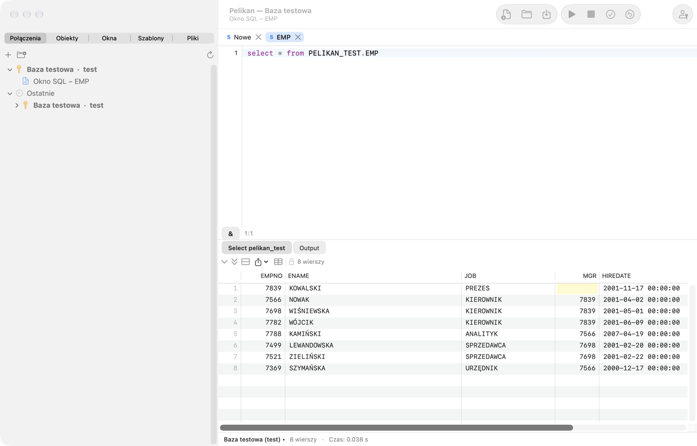

# Вступ і перший запуск

Pelikan — це нативне середовище macOS для роботи з базою даних Oracle: написання й виконання SQL, створення, тестування
й налагодження коду PL/SQL, перегляду й редагування об'єктів бази, тестів utPLSQL, а також інструментів порівняння,
експорту й адміністрування. Розташування вікон і клавіатурні скорочення відповідають програмі PL/SQL Developer, тож її
користувачі знайдуть знайомі вікна: **SQL Window**, **Консоль SQL*Plus**, **Program Window**, **Test Window**, **Explain
Plan Window** і **Object Browser** (вкладка **Об'єкти**).

Ця довідка описує, як виконувати типові завдання. Повний список команд із поточними скороченнями наведено в останньому
розділі, **Клавіатурні скорочення**, який генерує сама програма.

## Вимоги

- Mac із процесором Apple (M1 або новішим) і macOS 27 або новішою.
- Oracle Instant Client для macOS (ARM64) — пакет Basic або Basic Light. Pelikan його не містить (цього не дозволяє
  ліцензія Oracle), тож ви завантажуєте його самостійно із сайту Oracle. Без Instant Client працює драйвер *Thin* з
  обмеженнями (див. нижче).
- База даних Oracle. Pelikan розробляється й тестується на Oracle Database 26ai Free; запити до словника даних мають
  варіанти для версій 19c, 21c і 23ai. На старіших версіях деякі папки й функції можуть бути недоступні.

## Встановлення

1. Завантажте найновіший випуск зі сторінки проєкту:
   [github.com/andrzejoles/Pelikan/releases](https://github.com/andrzejoles/Pelikan/releases) — файл `.dmg` або
   інсталятор `.pkg`.
2. З образу `.dmg` перетягніть **Pelikan** на ярлик **Програми (Applications)**. Інсталятор `.pkg` зробить це сам.
3. Запустіть Pelikan із папки «Програми».

### Попередження Gatekeeper під час першого запуску

Pelikan підписано власним сертифікатом автора («Pelikan Self-Signed»), але його не нотаризовано Apple (для цього
потрібен платний обліковий запис розробника). Тому під час першого запуску macOS заблокує програму й покаже
попередження. Щоб її відкрити:

1. Закрийте вікно попередження.
2. Відкрийте **Системні параметри › Приватність і безпека**, прокрутіть до розділу **Безпека** й натисніть **Усе одно
   відкрити** біля повідомлення про Pelikan.
3. Підтвердьте паролем або Touch ID.

Це потрібно зробити лише раз. Сталий підпис також означає, що після оновлення macOS не питатиме знову про доступ Pelikan
до паролів у В'язці ключів.

## Oracle Instant Client

Завантажте «Instant Client for macOS (ARM64)», пакет **Basic** або **Basic Light**, із сайту
[oracle.com](https://www.oracle.com/database/technologies/instant-client/macos-arm64-downloads.html) і встановіть його
згідно з інструкцією Oracle. Pelikan шукає бібліотеку `libclntsh.dylib` у такому порядку:

1. каталог, указаний у **Налаштування › Oracle › Oracle Instant Client**;
2. `/opt/homebrew/lib`, `/usr/local/lib`, `/usr/local/oracle/instantclient` і каталоги `/opt/oracle/instantclient*`;
3. каталоги `instantclient_*` у ваших папках **Завантаження** і **Програми** (спочатку найновіша версія).

Під час пошуку в папці «Завантаження» macOS може запитати, чи дозволити Pelikan доступ до неї, — це звичайний запит
системи щодо приватності. Якщо хочете його уникнути, укажіть каталог клієнта вручну: **Pelikan › Налаштування…** (⌘,),
вкладка **Oracle**, кнопка **Вибрати…**. Зміна каталогу набирає чинності після перезапуску Pelikan.

Без Instant Client можна з'єднуватися драйвером *Thin* (вибирається у визначенні з'єднання, див. розділ *З'єднання*).
Thin не підтримує з'єднань TCPS і Oracle Wallet, зовнішньої автентифікації, зміни пароля, термін дії якого минув, і
переривання виконання (**Перервати**).

## Перші кроки

1. Клацніть вкладку **З'єднання** в лівій колонці, а потім кнопку **+** (або виберіть **Сеанс › З'єднання › Нове
   з'єднання…**).
2. Введіть назву, користувача, пароль і базу (`хост:порт/служба` або псевдонім із `tnsnames.ora`), виберіть середовище й
   натисніть **Тестувати**, а потім **Зберегти**.
3. Двічі клацніть з'єднання в списку — воно стане **головним з'єднанням** (виділяється жирним).
4. Відкрийте нове SQL Window (**Файл › Новий › SQL Window**, ⌘N), введіть запит і виконайте його клавішею F8 або ⌘↩.

## Головне вікно

Pelikan має одне головне вікно:

- **Ліва колонка** з вкладками: **З'єднання** (список з'єднань із папками й нещодавно використаними), **Об'єкти**
  (Object Browser), **Вікна** (список відкритих вікон), **Templates** і **Файли** (переглядач файлів).
- **Вкладки документів** посередині — кожне вікно SQL, програми, тесту чи плану має власну вкладку з кольоровою літерою
  типу: S — SQL Window, P — Program Window, T — Test Window, C — консоль SQL*Plus, E — Explain Plan Window, R — Report
  Window, D — вікно діаграми, N — блокнот SQL. Клацання середньою кнопкою на вкладці закриває вікно; меню вкладки
  закриває інші вікна або вікна ліворуч і праворуч.
- **Панель інструментів** із найчастішими діями (нове вікно, відкрити, зберегти, виконати, перервати, COMMIT, ROLLBACK,
  вхід) і групою **Швидкий доступ**. Розташування змінюється через **Подання › Налаштувати панель інструментів…**.
- **Рядок стану** вікна: з'єднання вікна (з кольором середовища, закріпленням 📌 і позначкою «лише читання»), стан
  транзакції («● транзакція відкрита»), кількість рядків і час виконання, позиція курсора та гілка Git файлу. Клацання
  назви з'єднання дає змогу змінити з'єднання вікна.
- **Панелі інструментів** праворуч і внизу — інструменти (Сеанси, Пошук об'єктів бази, Завдання To-Do, Історія
  буфера обміну, ця довідка, редактори таблиць, експорт та імпорт, звіти тощо) типово відкриваються на правій
  панелі, кожен у власній вкладці. Перетягніть вкладку на іншу панель або за межі панелей — тоді інструмент
  отримає окреме вікно в місці, де ви її відпустите; те саме роблять меню вкладки й кнопки в заголовку панелі. Вікно
  інструмента повертається на панель кнопкою на його рядку заголовка. Pelikan запам'ятовує місце кожного виду
  інструментів. Згорнута панель з інструментами показує в рядку стану кнопку з їх кількістю. Команди — у **Подання ›
  Панелі інструментів**, а в **Налаштування › Загальні › Панелі інструментів** ви вибираєте місце нових інструментів
  (також окремі вікна) і автоприховування панелей. Скорочення інструмента на панелі (Return, Esc) діють лише тоді,
  коли курсор у цьому інструменті.
- **Панель агента** праворуч (типово згорнута) — термінал агента ШІ зі списком його дій. Її показує **Подання › Панель
  агента** (див. розділ *Агенти ШІ*).

Заголовок вікна показує головне з'єднання й активний робочий набір (workset), а підзаголовок — поточне вікно.

**Гілка на панелі стану:** клацання гілки Git (правий нижній кут) відкриває меню з пунктом **Відкрити інші файли,
змінені в гілці** (також **Інструменти › Git** і стрічка **Інструменти › Git**). Pelikan відкриває файли коду, змінені
в гілці репозиторію файлу активного вікна: зафіксовані від розгалуження з типовою гілкою віддаленого репозиторію
(`origin/HEAD`, без неї `origin/main` або `master`; без віддаленого — від відстежуваної гілки), незафіксовані
й невідстежувані. Пропускає видалені, двійкові, ігноровані й уже відкриті файли; пара `.pks`/`.pkb` відкривається одним
вікном. Понад 30 файлів — спершу запитання; поточне вікно лишається активним.

## Групи вкладок

Коли відкрито багато вікон, Pelikan поділяє вкладки на **групи**, а панель вкладок показує лише вкладки поточної групи.
Групи видно як **капсули** на панелі заголовка, між заголовком вікна та кнопками: у першому рядку назва групи, у другому
— деталь і кількість вікон (напр. «main · 7», «5 вікон»). Клацання капсули показує вкладки групи й активує її останнє
використане вікно; поточна група має обведення. Коли капсули не вміщаються, остання — **»** — розгортає список усіх
груп. Якщо група одна, капсул немає. Коли панель інструментів приховано або вікно на весь екран, мала капсула поточної
групи стоїть на початку панелі вкладок.

Вікно потрапляє до групи за такими правилами, по черзі:

1. **Ручна група** — якщо ви перемістили до неї вікно (має перевагу над іншими правилами).
2. **Проєкт** — вікно з файлом відкритого проєкту Pelikan.
3. **Репозиторій · гілка** — файл у репозиторії git, який має віддалений репозиторій; worktree з іншою гілкою — окрема
   група, а після зміни гілки (напр. `git checkout`) вікна переходять до групи нової гілки, коли ви повертаєтеся до
   Pelikan. Репозиторії без віддаленого — далі за з'єднанням.
4. **З'єднання** вікна; вікна без з'єднання — група **Без з'єднання** наприкінці.
5. Коли всі інші вікна використовують **одну базу**, замість груп з'єднань є групи за типом вікна: **Вікна SQL**,
   **Програми**, **Тести**, **Консолі SQL*Plus** та **Інші вікна**. На групи з'єднань Pelikan переходить лише тоді, коли
   друга база має більше ніж одне вікно — одне вікно на іншій базі не перебудовує всю панель.

Порядок капсул сталий: ручні групи (у порядку створення), проєкт, репозиторії та з'єднання за абеткою (або типи вікон),
«Без з'єднання» наприкінці. Вкладки в групі — у порядку відкриття.

Вікно, активоване будь-звідки (Object Browser, список помилок, Список вікон, налагоджувач, відкриття файлу, агент),
саме перемикає групу. **⌃Tab** і **⌃⇧Tab** (Наступне / Попереднє вікно) переходять вікнами поточної групи, а після
останнього — до першого вікна наступної групи (досяжне кожне вікно), **⌃⌘]**
і **⌃⌘[** — **Наступна група вкладок** / **Попередня група вкладок**, а **Вікно › Показати групу вкладок…** вибирає групу
зі списку. **Вікно › Вкладки всіх груп** (також у меню капсули та списку **»**) показує на панелі вкладки всіх груп.
Список вікон (вкладка **Вікна** лівої колонки, **Подання › Список вікон**) показує вікна в дереві за групами; клацання
групи показує її.

**Ручні групи:** меню вкладки › **Перемістити до групи › Нова група…** або наявна група; **Вилучити з ручної групи**
повертає вікно до автоматичних груп. Меню капсули ручної групи має **Перейменувати…** і **Розгрупувати**. Ручні групи
й кольори з'єднань зберігаються у Workset. Вкладку не перетягують на капсулу — для цього є меню вкладки.

**Вкладки** мають два рядки: крапку кольору середовища, літеру типу, заголовок і кнопку закриття (крапка — незбережені
зміни), а під ними завжди з'єднання вікна (вікно без з'єднання — сіре «Немає з'єднання»); повна назва — у підказці.
Тло вкладки має колір з'єднання з палітри (див. *З'єднання › Середовища й захист від помилок*): активна вкладка має
насиченіше тло, товсте підкреслення кольором з'єднання та жирний заголовок. Коли вкладки не вміщаються в один рядок,
з боків панелі з'являються кнопки **‹** і **›**; панель також прокручується коліщатком миші або жестом на трекпеді,
а активна вкладка завжди видима.

## Стрічка й «Пошук дій»

Під панеллю інструментів розташована **стрічка** — кожна дія одним клацанням, без пошуку в меню й без запам'ятовування
скорочень. Постійні вкладки: **Пуск** (нові вікна, файли, виконання, COMMIT і ROLLBACK, з'єднання, пошук),
**Редагування**, **Об'єкти**, **Налагодження й тести**, **Інструменти**, **Звіти** та **Подання**. З вікном програми,
результату запиту, діаграми, звіту, нотатника, плану або команд з'являється кольорова **контекстна вкладка** (напр.
**Програма** з компіляцією, одиницями, порівнянням із джерелом у базі та тестами). Стрічка пам'ятає, яку вкладку ви
обрали для кожного типу вікна, і повертається до неї після перемикання вікон.

Часті дії мають великі кнопки, інші — малі; рідші — у розкривних списках груп (позначені ▾). Підказка кнопки показує
опис і скорочення, тож скорочень ви вчитеся мимохідь. Клацання правою кнопкою додає команду до швидкого доступу.
Подвійне клацання вкладки або стрілка праворуч згортає стрічку до вкладок; **Подання › Стрічка** приховує її (також у
**Налаштування › Загальні › Стрічка**).

Поле **Пошук дій…** праворуч від вкладок знаходить будь-яку команду — введіть кілька літер: «plan», «eksport tabel»,
слово без польської діакритики або англійську назву з PL/SQL Developer, напр. «beautifier», «compile invalid».
Результати показують, де команда на стрічці, її скорочення й чи доступна вона зараз; Enter або клацання виконує її.

## Палітра команд

Кожна дія Pelikan — це команда: вона має пункт меню, необов'язкове скорочення й опис наслідків. **Палітра команд**
(**Подання › Палітра команд…**, ⇧⌘P) шукає команди за назвою й показує, у якому меню вони розташовані та яке мають
скорочення. Це найшвидший спосіб знайти функцію, розташування якої в меню ви не пам'ятаєте.

## Профілі клавіатури

Pelikan має два профілі скорочень: **PL/SQL Developer** (клавіші F, Ctrl — напр. F8 виконує, F9 починає налагодження) і
**macOS** (скорочення з ⌘). В обох профілях працюють відповідники з ⌘, напр. ⌘↩ виконує команду. Профіль вибирається в
**Налаштування › Клавіатура**. Якщо клавіші F1–F12 керують яскравістю чи гучністю, увімкніть у Системних параметрах
використання їх як стандартних функціональних клавіш або натискайте їх разом із клавішею fn.

## Оновлення

Раз на день Pelikan перевіряє, чи є новий випуск, і пропонує його встановити. Можна також перевірити вручну: **Pelikan ›
Перевірити оновлення…**. Кожен випуск підписано ключем автора — програма не прийме файл з іншого джерела. Налаштування,
з'єднання й паролі залишаються без змін.

## Мови

Інтерфейс доступний польською, англійською, німецькою, іспанською та українською. Мова вибирається в **Налаштування ›
Загальні › Мова інтерфейсу**; зміна набирає чинності після перезапуску. Назви деяких вікон та інструментів (напр.
Explain Plan, Large Data Editor, Query Builder) залишаються в оригінальному звучанні.

## Де Pelikan зберігає дані

Визначення з'єднань (без паролів), параметри, історія, worksets, локальна історія файлів, журнал агентів та інші дані
програми зберігаються в каталозі `~/Library/Application Support/Pelikan`. Паролі зберігаються виключно у В'язці ключів
macOS — див. розділ *Безпека і приватність*.

## Довідка

- **Довідка › Довідка Pelikan** (⇧⌘/) відкриває цю довідку.
- **F1** в редакторі відкриває документацію Oracle для слова під курсором (код помилки, пакет, подання словника, команда
  SQL).
- **Довідка › Документація Oracle…** шукає в посібниках Oracle вибраної версії.

## Про програму

Pelikan — відкритий проєкт за ліцензією MIT: [github.com/andrzejoles/Pelikan](https://github.com/andrzejoles/Pelikan).
Автор: Andrzej Oleś w kooperacji z Claude AI. Ліцензії використаних бібліотек наведено у файлі «Licencje zewnętrzne»
(ліцензії сторонніх компонентів), що постачається разом із програмою.
