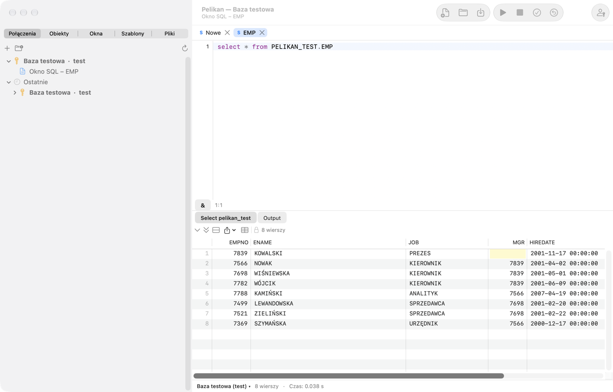

# Вступ і перший запуск

Pelikan — це нативне середовище macOS для роботи з базою даних Oracle: написання й виконання SQL, створення, тестування
й налагодження коду PL/SQL, перегляду й редагування об'єктів бази, тестів utPLSQL, а також інструментів порівняння,
експорту й адміністрування. Розташування вікон і клавіатурні скорочення відповідають програмі PL/SQL Developer, тож її
користувачі знайдуть знайомі вікна: **SQL Window**, **Консоль SQL*Plus**, **Program Window**, **Test Window**, **Explain
Plan Window** і **Object Browser** (вкладка **Об'єкти**).

Повний список команд із поточними скороченнями наведено в останньому розділі, **Клавіатурні скорочення**, який генерує
сама програма.

## Як користуватися цією довідкою

Довідку написано так, щоб нею міг скористатися навіть той, хто лише починає працювати з Oracle. Кожну функцію описано
за однаковою схемою:

- **Для чого це** — яке завдання розв'язує і які поняття треба знати;
- **Коли використовувати** — типові ситуації з щоденної роботи;
- **Вправа крок за кроком** — пронумеровані кроки; після кожного кроку *Результат:* каже, що ви маєте побачити. Якщо
  бачите щось інше, зупиніться й поверніться до попереднього кроку;
- **На що зважати** — типові помилки та їхні наслідки (позначено ⚠️).

Вправи використовують **навчальну схему** — кілька таблиць і пакет, які ви створите скриптом із розділу **Навчальна
схема** нижче. Найкраще читати розділи по черзі: 1 (цей), 2 (з'єднання), 3 (SQL Window), далі — за потребою. Невідоме
слово шукайте в **Основних поняттях** або в словнику наприкінці розділу 15.

## Основні поняття

Кілька слів, що трапляються в усій довідці:

| Поняття | Що означає |
|---|---|
| **База даних** (екземпляр Oracle) | Сервер, що зберігає дані й виконує команди. Ви з'єднуєтеся з ним через мережу. |
| **Користувач** і **схема** | Обліковий запис у базі (наприклад, `SCOTT`). Об'єкти, створені користувачем, належать до однойменної схеми. |
| **Об'єкт** | Те, що живе в схемі: таблиця, подання, індекс, послідовність, пакет, процедура, функція, тригер, тип… |
| **Таблиця** | Дані в рядках і стовпцях, наприклад `PEL_EMPLOYEES`. |
| **Подання** (view) | Збережений запит, який можна читати як таблицю. |
| **SQL** | Мова команд бази: `SELECT` (читання), `INSERT`, `UPDATE`, `DELETE`, `MERGE` (зміна даних), `CREATE`, `ALTER`, `DROP` (зміна об'єктів — DDL). |
| **PL/SQL** | Мова програмування Oracle: блоки `BEGIN … END`, змінні, цикли, винятки. Код PL/SQL, збережений у базі, — це **програма** (пакет, процедура, функція, тригер). |
| **Пакет** | Набір пов'язаних процедур і функцій: **специфікація** (що надає) і **тіло** (як це робить). |
| **Сеанс** | Одне з'єднання з базою. Pelikan може мати кілька сеансів одночасно (розділ 13, *Режим сеансу*). |
| **Транзакція** | Зміни даних у сеансі, які ще не є постійними. **COMMIT** робить їх постійними (їх бачать інші), **ROLLBACK** скасовує. Команди DDL (`CREATE`, `ALTER`, `DROP`) самі фіксують відкриту транзакцію. |
| **Компіляція** | Збереження програми PL/SQL у базі та її перевірка Oracle. Програма з помилкою має стан *INVALID*. |
| **З'єднання** (у Pelikan) | Збережений набір даних для входу: користувач, база, середовище. |
| **Середовище** | Позначка бази: для розробки, тестова, продуктивна (робоча). Від нього залежать кольори й попередження. |

> ⚠️ **Найважливіше правило:** вправляйтеся й експериментуйте лише на базі **для розробки** або **тестовій**. На робочій
> базі (справжні дані компанії) виконуйте лише те, що розумієте і що погоджено.

## Вимоги

- Mac із процесором Apple (M1 або новішим) і macOS 27 або новішою.
- Oracle Instant Client для macOS (ARM64) — пакет Basic або Basic Light. Pelikan його не містить (цього не дозволяє
  ліцензія Oracle), тож ви завантажуєте його самостійно із сайту Oracle. Без Instant Client працює драйвер *Thin* з
  обмеженнями (див. нижче).
- База даних Oracle. Pelikan розробляється й тестується на Oracle Database 26ai Free; запити до словника даних мають
  варіанти для версій 19c, 21c і 23ai. На старіших версіях деякі папки й функції можуть бути недоступні.

## Встановлення

1. Завантажте найновіший випуск зі сторінки проєкту:
   [github.com/andrzejoles/Pelikan/releases](https://github.com/andrzejoles/Pelikan/releases) — файл `.dmg` або
   інсталятор `.pkg`.
2. З образу `.dmg` перетягніть **Pelikan** на ярлик **Програми (Applications)**. Інсталятор `.pkg` зробить це сам.
3. Запустіть Pelikan із папки «Програми».

### Попередження Gatekeeper під час першого запуску

Pelikan підписано власним сертифікатом автора («Pelikan Self-Signed»), але його не нотаризовано Apple (для цього
потрібен платний обліковий запис розробника). Тому під час першого запуску macOS заблокує програму й покаже
попередження. Щоб її відкрити:

1. Закрийте вікно попередження.
2. Відкрийте **Системні параметри › Приватність і безпека**, прокрутіть до розділу **Безпека** й натисніть **Усе одно
   відкрити** біля повідомлення про Pelikan.
3. Підтвердьте паролем або Touch ID.

Це потрібно зробити лише раз. Сталий підпис також означає, що після оновлення macOS не питатиме знову про доступ Pelikan
до паролів у В'язці ключів.

## Oracle Instant Client

Завантажте «Instant Client for macOS (ARM64)», пакет **Basic** або **Basic Light**, із сайту
[oracle.com](https://www.oracle.com/database/technologies/instant-client/macos-arm64-downloads.html) і встановіть його
згідно з інструкцією Oracle. Pelikan шукає бібліотеку `libclntsh.dylib` у такому порядку:

1. каталог, указаний у **Налаштування › Oracle › Oracle Instant Client**;
2. `/opt/homebrew/lib`, `/usr/local/lib`, `/usr/local/oracle/instantclient` і каталоги `/opt/oracle/instantclient*`;
3. каталоги `instantclient_*` у ваших папках **Завантаження** і **Програми** (спочатку найновіша версія).

Під час пошуку в папці «Завантаження» macOS може запитати, чи дозволити Pelikan доступ до неї, — це звичайний запит
системи щодо приватності. Якщо хочете його уникнути, укажіть каталог клієнта вручну: **Pelikan › Налаштування…** (⌘,),
вкладка **Oracle**, кнопка **Вибрати…**. Зміна каталогу набирає чинності після перезапуску Pelikan.

Без Instant Client можна з'єднуватися драйвером *Thin* (вибирається у визначенні з'єднання, див. розділ *З'єднання*).
Thin не підтримує з'єднань TCPS і Oracle Wallet, зовнішньої автентифікації, зміни пароля, термін дії якого минув, і
переривання виконання (**Перервати**).

## Перші кроки

### Для чого це

Перш ніж почати роботу, Pelikan має знати, з якою базою з'єднуватися. Цей короткий посібник проведе вас від порожньої
програми до першого результату запиту. Від адміністратора або колеги вам потрібні: **ім'я користувача**, **пароль** і
**адреса бази** — у вигляді `host:port/служба` (наприклад, `dbdev.firma.local:1521/DEVPDB`) або **псевдонім** із файлу
`tnsnames.ora` (наприклад, `DEV`).

### Вправа: перше з'єднання й перший запит

1. Клацніть вкладку **З'єднання** в лівому стовпці вікна, а потім кнопку **+** (або виберіть **Сеанс › З'єднання › Нове
   з'єднання…**).
   *Результат:* відкривається вікно **Нове з'єднання**.
2. У полі **Назва** введіть назву, за якою впізнаєте базу, наприклад `dev_moya_baza`. Введіть **Користувача**, **Пароль**
   і **Базу** (адресу або псевдонім). Як **Середовище** виберіть **Для розробників**.
3. Клацніть **Тестувати**.
   *Результат:* повідомлення «З'єднано:» з описом версії бази. Якщо бачите помилку, перевірте дані — найчастіші причини й
   розв'язання наведено в розділі 15 (`ORA-01017` — хибний пароль або користувач, `ORA-12154` — невідомий псевдонім,
   `ORA-12541` — хибний хост або порт).
4. Позначте **Запам'ятати пароль у В'язці ключів**, якщо не хочете вводити пароль під час кожного з'єднання, — він
   потрапить до В'язки ключів macOS, а не до файлу. Клацніть **Зберегти**.
   *Результат:* з'єднання є в списку.
5. Двічі клацніть з'єднання в списку.
   *Результат:* назва з'єднання жирна — тепер це **головне з'єднання**. Нові вікна використовуватимуть його. Його назву
   видно також у заголовку вікна Pelikan.
6. Відкрийте нове SQL Window: **Файл › Новий › SQL Window** або **⌘N**.
   *Результат:* нова вкладка з літерою **S** і порожнім редактором. Рядок стану під редактором показує назву з'єднання.
7. Введіть запит:

   ```sql
   SELECT sysdate, user FROM dual;
   ```

8. Натисніть **F8** (або **⌘↩**).
   *Результат:* під редактором з'являється вкладка результату з одним рядком: поточні дата й час сервера та ваше ім'я
   користувача. Рядок стану показує кількість рядків і час виконання.

Готово — ви вмієте з'єднуватися й виконувати запит. Наступний крок: створіть навчальну схему.



## Навчальна схема

### Для чого це

Вправи довідки працюють із кількома невеликими об'єктами: таблицею відділів `PEL_DEPARTMENTS`, таблицею працівників
`PEL_EMPLOYEES`, поданням `PEL_EMP_DETAILS` і пакетом `PEL_EMP_API` (зарплата, підвищення, прийняття на роботу, список
працівників відділу). Префікс `PEL_` дає змогу легко відрізнити їх від ваших об'єктів і видалити після навчання. Приклади
даних (назви відділів і працівників) — польською; вправи посилаються на них саме так.

> ⚠️ Скрипт створює об'єкти в схемі користувача, під яким ви ввійшли. Запускайте його на **власній схемі для розробки
> або тестування** — ніколи на робочій базі чи на схемі, спільній з іншими, без згоди команди. Щоб створити об'єкти,
> потрібні привілеї `CREATE TABLE`, `CREATE VIEW` і `CREATE PROCEDURE` та місце в табличному просторі (на схемі для
> розробки вони зазвичай є).

### Вправа: створення навчальної схеми

1. З'єднайтеся з базою для розробки (попередня вправа) і відкрийте нове SQL Window (**⌘N**).
2. Скопіюйте у вікно весь скрипт нижче.
3. Виділіть увесь текст (**⌘A**) і натисніть **F8**.
   *Результат:* Pelikan виконує команди по черзі, а вкладка **Output** під редактором показує повідомлення про кожну.
   Команди розділяє крапка з комою, пакети — скісна риска `/` в окремому рядку.
4. Перевірте результат запитом:

   ```sql
   SELECT * FROM pel_emp_details;
   ```

   *Результат:* 9 рядків — працівники з назвою відділу й містом. Ewa Woźniak не має відділу, тому ці стовпці порожні.
5. Відкрийте вкладку **Об'єкти** в лівому стовпці й розгорніть теку **Таблиці**.
   *Результат:* видно `PEL_DEPARTMENTS` і `PEL_EMPLOYEES`.

Скрипт сам фіксує дані (COMMIT після INSERT), тож їх видно й в інших вікнах.

```sql
-- Навчальна схема довідки Pelikan.
-- Запускайте на ВЛАСНІЙ схемі для розробки або тестування — ніколи на робочій базі.
CREATE TABLE pel_departments (
  dept_id  NUMBER(4)    CONSTRAINT pel_departments_pk PRIMARY KEY,
  name     VARCHAR2(50) NOT NULL,
  city     VARCHAR2(50)
);

CREATE TABLE pel_employees (
  emp_id      NUMBER(6) GENERATED BY DEFAULT AS IDENTITY (START WITH 100)
              CONSTRAINT pel_employees_pk PRIMARY KEY,
  first_name  VARCHAR2(30) NOT NULL,
  last_name   VARCHAR2(30) NOT NULL,
  email       VARCHAR2(60) CONSTRAINT pel_employees_email_uk UNIQUE,
  hire_date   DATE DEFAULT SYSDATE NOT NULL,
  salary      NUMBER(8,2) CONSTRAINT pel_employees_salary_ck CHECK (salary > 0),
  dept_id     NUMBER(4) CONSTRAINT pel_employees_dept_fk REFERENCES pel_departments,
  manager_id  NUMBER(6) CONSTRAINT pel_employees_mgr_fk REFERENCES pel_employees
);

CREATE INDEX pel_employees_dept_ix ON pel_employees (dept_id);

CREATE OR REPLACE VIEW pel_emp_details AS
  SELECT e.emp_id, e.first_name || ' ' || e.last_name AS full_name, e.salary,
         d.name AS department, d.city
    FROM pel_employees e
    LEFT JOIN pel_departments d ON d.dept_id = e.dept_id;

INSERT INTO pel_departments VALUES (10, 'Księgowość', 'Warszawa');
INSERT INTO pel_departments VALUES (20, 'Informatyka', 'Kraków');
INSERT INTO pel_departments VALUES (30, 'Sprzedaż', 'Gdańsk');
INSERT INTO pel_departments VALUES (40, 'Kadry', NULL);

INSERT INTO pel_employees VALUES (1, 'Anna', 'Nowak', 'anna.nowak@example.com', DATE '2019-03-01', 12000, 20, NULL);
INSERT INTO pel_employees VALUES (2, 'Piotr', 'Kowalski', 'piotr.kowalski@example.com', DATE '2020-06-15', 9500, 20, 1);
INSERT INTO pel_employees VALUES (3, 'Maria', 'Wiśniewska', 'maria.wisniewska@example.com', DATE '2021-01-10', 8700, 20, 1);
INSERT INTO pel_employees VALUES (4, 'Tomasz', 'Wójcik', 'tomasz.wojcik@example.com', DATE '2018-09-03', 11000, 10, NULL);
INSERT INTO pel_employees VALUES (5, 'Katarzyna', 'Kamińska', 'katarzyna.kaminska@example.com', DATE '2022-02-14', 7200, 10, 4);
INSERT INTO pel_employees VALUES (6, 'Michał', 'Lewandowski', 'michal.lewandowski@example.com', DATE '2017-11-20', 13500, 30, NULL);
INSERT INTO pel_employees VALUES (7, 'Agnieszka', 'Zielińska', 'agnieszka.zielinska@example.com', DATE '2023-04-01', 6800, 30, 6);
INSERT INTO pel_employees VALUES (8, 'Paweł', 'Szymański', NULL, DATE '2024-07-08', 6500, 30, 6);
INSERT INTO pel_employees VALUES (9, 'Ewa', 'Woźniak', 'ewa.wozniak@example.com', DATE '2025-01-02', 7000, NULL, NULL);
COMMIT;

CREATE OR REPLACE PACKAGE pel_emp_api AS
  -- Зарплата працівника; немає працівника — NO_DATA_FOUND.
  FUNCTION get_salary(p_emp_id IN NUMBER) RETURN NUMBER;
  -- Підвищення на p_percent відсотків; від’ємний відсоток — помилка -20001. Без COMMIT.
  PROCEDURE raise_salary(p_emp_id IN NUMBER, p_percent IN NUMBER);
  -- Новий працівник; повертає його ідентифікатор. Без COMMIT.
  FUNCTION hire(p_first_name IN VARCHAR2, p_last_name IN VARCHAR2, p_salary IN NUMBER,
                p_dept_id IN NUMBER) RETURN NUMBER;
  -- Список працівників відділу через DBMS_OUTPUT.
  PROCEDURE print_department(p_dept_id IN NUMBER);
END pel_emp_api;
/

CREATE OR REPLACE PACKAGE BODY pel_emp_api AS
  FUNCTION get_salary(p_emp_id IN NUMBER) RETURN NUMBER IS
    l_salary pel_employees.salary%TYPE;
  BEGIN
    SELECT salary INTO l_salary FROM pel_employees WHERE emp_id = p_emp_id;
    RETURN l_salary;
  END get_salary;

  PROCEDURE raise_salary(p_emp_id IN NUMBER, p_percent IN NUMBER) IS
  BEGIN
    IF p_percent < 0 THEN
      raise_application_error(-20001, 'Podwyżka nie może być ujemna');
    END IF;
    UPDATE pel_employees
       SET salary = ROUND(salary * (1 + p_percent / 100), 2)
     WHERE emp_id = p_emp_id;
    IF SQL%ROWCOUNT = 0 THEN
      RAISE NO_DATA_FOUND;
    END IF;
  END raise_salary;

  FUNCTION hire(p_first_name IN VARCHAR2, p_last_name IN VARCHAR2, p_salary IN NUMBER,
                p_dept_id IN NUMBER) RETURN NUMBER IS
    l_emp_id pel_employees.emp_id%TYPE;
  BEGIN
    INSERT INTO pel_employees (first_name, last_name, salary, dept_id)
    VALUES (p_first_name, p_last_name, p_salary, p_dept_id)
    RETURNING emp_id INTO l_emp_id;
    RETURN l_emp_id;
  END hire;

  PROCEDURE print_department(p_dept_id IN NUMBER) IS
    l_total NUMBER := 0;
  BEGIN
    FOR r IN (SELECT first_name, last_name, salary
                FROM pel_employees
               WHERE dept_id = p_dept_id
               ORDER BY last_name) LOOP
      dbms_output.put_line(r.last_name || ' ' || r.first_name || ': ' || r.salary);
      l_total := l_total + r.salary;
    END LOOP;
    dbms_output.put_line('Razem: ' || l_total);
  END print_department;
END pel_emp_api;
/
```

Для вправ із тестами (розділ 8) потрібен також тестовий пакет utPLSQL. Створюйте його лише тоді, коли в базі встановлено
фреймворк utPLSQL (розділ 8, *Встановлення utPLSQL у базі*):

```sql
CREATE OR REPLACE PACKAGE pel_emp_api_test AS
  --%suite(Testy pakietu pel_emp_api)

  --%test(get_salary zwraca pensję pracownika)
  PROCEDURE get_salary_returns_salary;

  --%test(raise_salary podnosi pensję o 10%)
  PROCEDURE raise_salary_ten_percent;

  --%test(Ujemna podwyżka zgłasza błąd -20001)
  --%throws(-20001)
  PROCEDURE raise_salary_negative;
END pel_emp_api_test;
/

CREATE OR REPLACE PACKAGE BODY pel_emp_api_test AS
  PROCEDURE get_salary_returns_salary IS
  BEGIN
    ut.expect(pel_emp_api.get_salary(1)).to_equal(12000);
  END get_salary_returns_salary;

  PROCEDURE raise_salary_ten_percent IS
  BEGIN
    pel_emp_api.raise_salary(2, 10);
    ut.expect(pel_emp_api.get_salary(2)).to_equal(10450);
  END raise_salary_ten_percent;

  PROCEDURE raise_salary_negative IS
  BEGIN
    pel_emp_api.raise_salary(2, -5);
  END raise_salary_negative;
END pel_emp_api_test;
/
```

### Видалення навчальної схеми

Коли закінчите навчання, видаліть навчальні об'єкти (перша команда повідомить про помилку, якщо ви не створювали тестовий
пакет, — це не страшно):

```sql
DROP PACKAGE pel_emp_api_test;
DROP PACKAGE pel_emp_api;
DROP VIEW pel_emp_details;
DROP TABLE pel_employees PURGE;
DROP TABLE pel_departments PURGE;
```

## Головне вікно

Pelikan має одне головне вікно:

- **Ліва колонка** з вкладками: **З'єднання** (список з'єднань із папками й нещодавно використаними), **Об'єкти**
  (Object Browser), **Вікна** (список відкритих вікон), **Templates** і **Файли** (переглядач файлів).
  Колонку (ліву панель) розширюють, перетягуючи її край, а ховають і показують кнопкою бічної панелі на лівому кінці
  смуги заголовка (одразу за кнопками вікна), командою **Подання › Показати або приховати ліву панель** або
  клавішами **⌃⌘S**. Стан і ширина колонки зберігаються в макеті вікна (збереження макета вікна, автозбереження макета).
- **Вкладки документів** посередині — кожне вікно SQL, програми, тесту чи плану має власну вкладку з кольоровою літерою
  типу: S — SQL Window, P — Program Window, T — Test Window, C — консоль SQL*Plus, E — Explain Plan Window, R — Report
  Window, D — вікно діаграми, N — блокнот SQL. Клацання середньою кнопкою на вкладці закриває вікно; меню вкладки
  закриває інші вікна або вікна ліворуч і праворуч.
- **Панель інструментів** із найчастішими діями (нове вікно, відкрити, зберегти, виконати, перервати, COMMIT, ROLLBACK,
  вхід) і групою **Швидкий доступ**. Розташування змінюється через **Подання › Налаштувати панель інструментів…**.
- **Рядок стану** вікна: з'єднання вікна (з кольором середовища, закріпленням 📌 і позначкою «лише читання»), стан
  транзакції («● транзакція відкрита»), кількість рядків і час виконання, позиція курсора та гілка Git файлу. Клацання
  назви з'єднання дає змогу змінити з'єднання вікна.
- **Панелі інструментів** праворуч і внизу — інструменти (Сеанси, Пошук об'єктів бази, Завдання To-Do, Історія
  буфера обміну, ця довідка, редактори таблиць, експорт та імпорт, звіти тощо) типово відкриваються на правій
  панелі, кожен у власній вкладці. Перетягніть вкладку на іншу панель або за межі панелей — тоді інструмент
  отримає окреме вікно в місці, де ви її відпустите; те саме роблять меню вкладки й кнопки в заголовку панелі. Вікно
  інструмента повертається на панель кнопкою на його рядку заголовка. Pelikan запам'ятовує місце кожного виду
  інструментів. Згорнута панель з інструментами показує в рядку стану кнопку з їх кількістю. Команди — у **Подання ›
  Панелі інструментів**, а в **Налаштування › Загальні › Панелі інструментів** ви вибираєте місце нових інструментів
  (також окремі вікна) і автоприховування панелей. Скорочення інструмента на панелі (Return, Esc) діють лише тоді,
  коли курсор у цьому інструменті.
- **Панель агента** праворуч (типово згорнута) — термінал агента ШІ зі списком його дій. Її показує **Подання › Панель
  агента** (див. розділ *Агенти ШІ*).

Заголовок вікна показує головне з'єднання й активний робочий набір (workset), а підзаголовок — поточне вікно.

**Гілка на панелі стану:** клацання гілки Git (правий нижній кут) відкриває меню з пунктом **Відкрити інші файли,
змінені в гілці** (також **Інструменти › Git** і стрічка **Інструменти › Git**). Pelikan відкриває файли коду, змінені
в гілці репозиторію файлу активного вікна: зафіксовані від розгалуження з типовою гілкою віддаленого репозиторію
(`origin/HEAD`, без неї `origin/main` або `master`; без віддаленого — від відстежуваної гілки), незафіксовані
й невідстежувані. Пропускає видалені, двійкові, ігноровані й уже відкриті файли; пара `.pks`/`.pkb` відкривається одним
вікном. Понад 30 файлів — спершу запитання; поточне вікно лишається активним.

## Групи вкладок

Коли відкрито багато вікон, Pelikan поділяє вкладки на **групи**, а панель вкладок показує лише вкладки поточної групи.
Групи видно як **капсули** на панелі заголовка, між заголовком вікна та кнопками: у першому рядку назва групи, у другому
— деталь і кількість вікон (напр. «main · 7», «5 вікон»). Клацання капсули показує вкладки групи й активує її останнє
використане вікно; поточна група має обведення. Коли капсули не вміщаються, остання — **»** — розгортає список усіх
груп. Якщо група одна, капсул немає. Коли панель інструментів приховано або вікно на весь екран, мала капсула поточної
групи стоїть на початку панелі вкладок.

Вікно потрапляє до групи за такими правилами, по черзі:

1. **Ручна група** — якщо ви перемістили до неї вікно (має перевагу над іншими правилами).
2. **Проєкт** — вікно з файлом відкритого проєкту Pelikan.
3. **Репозиторій · гілка** — файл у репозиторії git, який має віддалений репозиторій; worktree з іншою гілкою — окрема
   група, а після зміни гілки (напр. `git checkout`) вікна переходять до групи нової гілки, коли ви повертаєтеся до
   Pelikan. Репозиторії без віддаленого — далі за з'єднанням.
4. **З'єднання** вікна; вікна без з'єднання — група **Без з'єднання** наприкінці.
5. Коли всі інші вікна використовують **одну базу**, замість груп з'єднань є групи за типом вікна: **Вікна SQL**,
   **Програми**, **Тести**, **Консолі SQL*Plus** та **Інші вікна**. На групи з'єднань Pelikan переходить лише тоді, коли
   друга база має більше ніж одне вікно — одне вікно на іншій базі не перебудовує всю панель.

Порядок капсул сталий: ручні групи (у порядку створення), проєкт, репозиторії та з'єднання за абеткою (або типи вікон),
«Без з'єднання» наприкінці. Вкладки в групі — у порядку відкриття.

Вікно, активоване будь-звідки (Object Browser, список помилок, Список вікон, налагоджувач, відкриття файлу, агент),
саме перемикає групу. **⌃Tab** і **⌃⇧Tab** (Наступне / Попереднє вікно) переходять вікнами поточної групи, а після
останнього — до першого вікна наступної групи (досяжне кожне вікно), **⌃⌘]**
і **⌃⌘[** — **Наступна група вкладок** / **Попередня група вкладок**, а **Вікно › Показати групу вкладок…** вибирає групу
зі списку. **Вікно › Вкладки всіх груп** (також у меню капсули та списку **»**) показує на панелі вкладки всіх груп.
Список вікон (вкладка **Вікна** лівої колонки, **Подання › Список вікон**) показує вікна в дереві за групами; клацання
групи показує її.

**Ручні групи:** меню вкладки › **Перемістити до групи › Нова група…** або наявна група; **Вилучити з ручної групи**
повертає вікно до автоматичних груп. Меню капсули ручної групи має **Перейменувати…** і **Розгрупувати**. Ручні групи
й кольори з'єднань зберігаються у Workset. Вкладку не перетягують на капсулу — для цього є меню вкладки.

**Вкладки** мають два рядки: крапку кольору середовища, літеру типу, заголовок і кнопку закриття (крапка — незбережені
зміни), а під ними завжди з'єднання вікна (вікно без з'єднання — сіре «Немає з'єднання»); повна назва — у підказці.
Тло вкладки має колір з'єднання з палітри (див. *З'єднання › Середовища й захист від помилок*): активна вкладка має
насиченіше тло, товсте підкреслення кольором з'єднання та жирний заголовок. Коли вкладки не вміщаються в один рядок,
з боків панелі з'являються кнопки **‹** і **›**; панель також прокручується коліщатком миші або жестом на трекпеді,
а активна вкладка завжди видима.

## Стрічка й «Пошук дій»

Під панеллю інструментів розташована **стрічка** — кожна дія одним клацанням, без пошуку в меню й без запам'ятовування
скорочень. Постійні вкладки: **Пуск** (нові вікна, файли, виконання, COMMIT і ROLLBACK, з'єднання, пошук),
**Редагування**, **Об'єкти**, **Налагодження й тести**, **Інструменти**, **Звіти** та **Подання**. З вікном програми,
результату запиту, діаграми, звіту, нотатника, плану або команд з'являється кольорова **контекстна вкладка** (напр.
**Програма** з компіляцією, одиницями, порівнянням із джерелом у базі та тестами). Стрічка пам'ятає, яку вкладку ви
обрали для кожного типу вікна, і повертається до неї після перемикання вікон.

Часті дії мають великі кнопки, інші — малі; рідші — у розкривних списках груп (позначені ▾). Підказка кнопки показує
опис і скорочення, тож скорочень ви вчитеся мимохідь. Клацання правою кнопкою додає команду до швидкого доступу.
Подвійне клацання вкладки або стрілка праворуч згортає стрічку до вкладок; **Подання › Стрічка** приховує її (також у
**Налаштування › Загальні › Стрічка**). Якщо вікно вузьке й вкладка стрічки не вміщується, з боків з'являються кнопки
**‹ ›** — вони прокручують її до межі наступної групи; прокручують також коліщатко миші й жест трекпада. Так само
прокручується ряд вкладок стрічки, коли він не вміщується поруч із полем пошуку.

Поле **Пошук дій…** праворуч від вкладок знаходить будь-яку команду — введіть кілька літер: «plan», «eksport tabel»,
слово без польської діакритики або англійську назву з PL/SQL Developer, напр. «beautifier», «compile invalid».
Результати показують, де команда на стрічці, її скорочення й чи доступна вона зараз; Enter або клацання виконує її.

## Палітра команд

Кожна дія Pelikan — це команда: вона має пункт меню, необов'язкове скорочення й опис наслідків. **Палітра команд**
(**Подання › Палітра команд…**, ⇧⌘P) шукає команди за назвою й показує, у якому меню вони розташовані та яке мають
скорочення. Це найшвидший спосіб знайти функцію, розташування якої в меню ви не пам'ятаєте.

## Профілі клавіатури

Pelikan має два профілі скорочень: **PL/SQL Developer** (клавіші F, Ctrl — напр. F8 виконує, F9 починає налагодження) і
**macOS** (скорочення з ⌘). В обох профілях працюють відповідники з ⌘, напр. ⌘↩ виконує команду. Профіль вибирається в
**Налаштування › Клавіатура**. Якщо клавіші F1–F12 керують яскравістю чи гучністю, увімкніть у Системних параметрах
використання їх як стандартних функціональних клавіш або натискайте їх разом із клавішею fn.

## Оновлення

Раз на день Pelikan перевіряє, чи є новий випуск, і пропонує його встановити. Можна також перевірити вручну: **Pelikan ›
Перевірити оновлення…**. Кожен випуск підписано ключем автора — програма не прийме файл з іншого джерела. Налаштування,
з'єднання й паролі залишаються без змін.

## Мови

Інтерфейс доступний польською, англійською, німецькою, іспанською та українською. Мова вибирається в **Налаштування ›
Загальні › Мова інтерфейсу**; зміна набирає чинності після перезапуску. Назви деяких вікон та інструментів (напр.
Explain Plan, Large Data Editor, Query Builder) залишаються в оригінальному звучанні.

## Де Pelikan зберігає дані

Визначення з'єднань (без паролів), параметри, історія, worksets, локальна історія файлів, журнал агентів та інші дані
програми зберігаються в каталозі `~/Library/Application Support/Pelikan`. Паролі зберігаються виключно у В'язці ключів
macOS — див. розділ *Безпека і приватність*.

## Довідка

- **Довідка › Довідка Pelikan** (⇧⌘/) відкриває цю довідку.
- **F1** в редакторі відкриває документацію Oracle для слова під курсором (код помилки, пакет, подання словника, команда
  SQL).
- **Довідка › Документація Oracle…** шукає в посібниках Oracle вибраної версії.

## Про програму

Pelikan — відкритий проєкт за ліцензією MIT: [github.com/andrzejoles/Pelikan](https://github.com/andrzejoles/Pelikan).
Автор: Andrzej Oleś w kooperacji z Claude AI. Ліцензії використаних бібліотек наведено у файлі «Licencje zewnętrzne»
(ліцензії сторонніх компонентів), що постачається разом із програмою.
