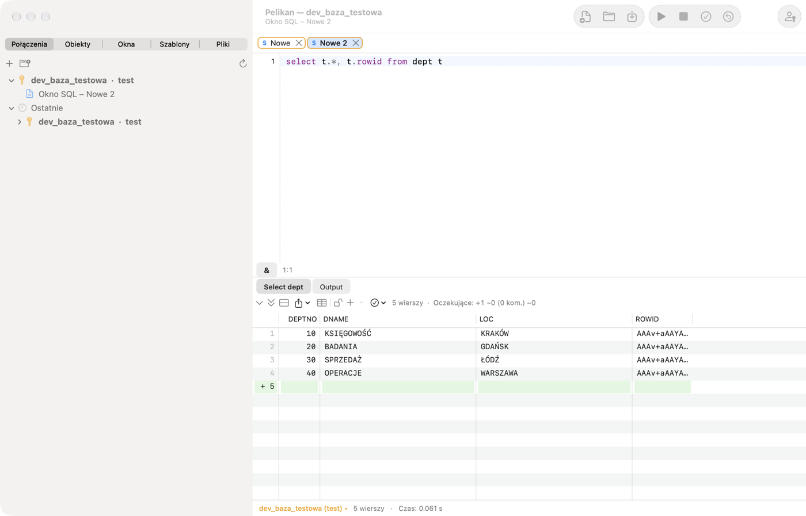
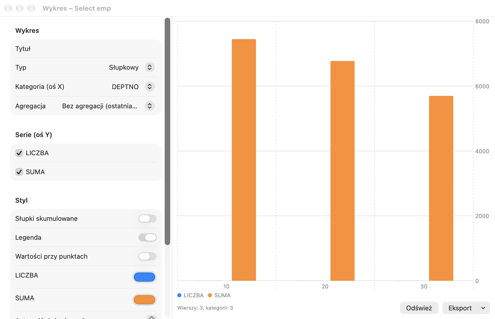

# SQL Window і сітка результатів

## Для чого це

У **SQL Window** ви розмовляєте з базою: вводите команду SQL (наприклад, запит `SELECT`), виконуєте її й дивитеся на
результат. Це найуживаніше вікно Pelikan — у ньому ви перевіряєте дані, виправляєте рядок, готуєте звіт або виконуєте
скрипт розгортання.

**Коли використовувати:** щоразу, коли треба виконати SQL або короткий блок PL/SQL. Для написання пакетів і процедур
призначене Program Window (розділ 6), для тестування програм із параметрами — Test Window (розділ 7), а для скриптів
SQL*Plus із командами `SET`, `SPOOL`, `PROMPT` — консоль SQL*Plus (розділ 4).

Вправи цього розділу використовують навчальну схему з розділу 1.

SQL Window призначене для виконання запитів і скриптів. Результат кожного запиту з'являється на окремій вкладці під
редактором, повідомлення бази й вивід DBMS_OUTPUT — на вкладці **Output**. Нове вікно відкривається через **Файл › Новий
› SQL Window** (⌘N); вікно працює на головному з'єднанні або на з'єднанні, вибраному в рядку стану.

## Виконання команд

| Дія | Скорочення | Меню |
|---|---|---|
| Виконати виділення або команду під курсором | F8, ⌘↩ | Сеанс › Виконати |
| Виконати навпаки до AutoSelect (напр. увесь скрипт) | ⌃F8, ⇧⌘↩ | Сеанс › Виконати (навпаки до AutoSelect) |
| Перервати виконання або отримання рядків | ⇧⎋, ⌘. | Сеанс › Перервати |
| Зафіксувати транзакцію | F10, ⌥⌘↩ | Сеанс › Зафіксувати (COMMIT) |
| Відкотити транзакцію | ⇧F10, ⌥⌘⌫ | Сеанс › Відкотити (ROLLBACK) |
| Попередня / наступна команда вікна | ⌥⌘↑, ⌥⌘↓ | Сеанс › Історія вікна |

Типово ввімкнено **AutoSelect**: без виділення F8 виконує лише команду, у якій стоїть курсор, тож ви випадково не
запустите весь скрипт. Виділений текст виконується повністю. Команди розділяються так само, як у SQL*Plus: крапка з
комою завершує команду SQL, а блок PL/SQL і `CREATE` з тілом завершує скісна риска `/` в окремому рядку. Кожен запит
скрипту отримує власну вкладку результатів.

Увага: у macOS скорочення ⌃F8 типово зайняте системою (переведення фокуса на меню стану) — використовуйте ⇧⌘↩ або
вимкніть системне скорочення в **Системні параметри › Клавіатура › Клавіатурні скорочення**.

Під час виконання вікно заблоковане для редагування, а рядок стану показує «Виконання…». Після завершення видно
кількість рядків і час; час понад 100 секунд має формат гг:хх:сс. Після довгого запиту Pelikan може відтворити звук і
підстрибнути значком у Dock. Коли **Перервати** не діє (деякі операції бази не реагують на переривання), скористайтеся
**Сеанс › Завершити сеанс вікна (Kill)**.

Pelikan ніколи не фіксує змін автоматично (параметр **AutoCommit команд SQL** у **Налаштування › SQL Window** типово
вимкнено). Відкриту транзакцію сигналізує рядок стану («● транзакція відкрита»).

> **Вправа: одна команда чи весь скрипт.**
> 1. Відкрийте нове SQL Window (⌘N) і введіть три запити, кожен в окремому рядку:
>
>    ```sql
>    SELECT * FROM pel_departments;
>    SELECT * FROM pel_employees WHERE dept_id = 20;
>    SELECT COUNT(*) FROM pel_employees;
>    ```
>
> 2. Клацніть у другому рядку й натисніть **F8**.
>    *Результат:* виконується лише другий запит — одна вкладка результату з трьома працівниками відділу 20 (AutoSelect).
> 3. Натисніть **⇧⌘↩** (виконати навпаки до AutoSelect).
>    *Результат:* виконуються всі три запити; під редактором три вкладки результатів.
> 4. Виділіть мишею перші два рядки й натисніть **F8**.
>    *Результат:* виконуються два виділені запити — виділення завжди має пріоритет над AutoSelect.
>
> ⚠️ **На що зважати.** З вимкненим AutoSelect F8 без виділення виконує весь скрипт — також команди `DELETE` чи `DROP`,
> залишені у вікні «на потім». Тримайте у вікні лише те, що хочете виконувати.

## Вміст коду

Ліворуч від редактора **Вміст коду** показує структуру всього скрипту: команди SQL (перше слово й початок команди,
до ~1000 символів із розривами рядків у підказці), процедури, функції, пакети й тригери з `CREATE`, а також анонімні блоки з їхніми
оголошеннями. Клацання або Enter переносить курсор до команди, дерево відстежує курсор, а поле над деревом фільтрує
також за текстом команди (напр. назвою таблиці). Панель показуєте або приховуєте в цьому вікні через **Подання ›
Вміст коду** або кнопку списку з відступами на лівому кінці панелі вікна; вибір залишається у вікні, а типовий стан нових
вікон задає **Налаштування › Редактор › Вміст коду типово видимий**. Консоль SQL*Plus такої панелі не має. У скрипті з понад 5000 команд SQL панель показує лише одиниці й блоки PL/SQL
(з приміткою про кількість команд).

В анонімних блоках і одиницях скрипту панель показує також **керувальні структури** (IF, цикли, CASE,
обробники винятків — див. розділ про вікно програми); кнопка з символом розгалуження біля фільтра їх приховує.

## Змінні

- **Змінні підставлення** `&назва` і `&&назва` — перед виконанням Pelikan показує вікно **Змінні** з полями для значень.
  У SQL Window `&&` у тексті означає звичайний символ `&` (напр. `'R&&D'`); у консолі SQL*Plus `&&` діє як у SQL*Plus
  (змінна запам'ятовується).
- **Змінні прив'язки** `:назва` — також потрапляють до вікна змінних (`:new` і `:old` у тригерах пропускаються).
- **Параметри звітів JasperReports** `$P{…}`, `$P!{…}` і `$X{IN, стовпець, параметр}` — Pelikan розпізнає їх і запитує
  значення, тож запит зі звіту можна виконати без переписування.
- Розширений синтаксис `&<name="…" type="…" list="…" default="…" required="…">` дає змогу описати змінну: тип, список
  значень (також із запиту, що залежить від інших змінних), типове значення, обов'язковість та інші параметри.

Значення змінних запам'ятовуються у вікні. Кнопка **&** на панелі під редактором (**Сеанс › Підставлення змінних**)
вимикає підставлення, коли текст містить символи `&` і `:` в іншому значенні.

**Для чого це:** змінна дає змогу написати запит один раз і виконувати його з різними значеннями — без переписування
умови. **Зв'язані змінні** (`:назва`) до того ж безпечніші й швидші для бази, ніж вставлення значень у текст.

> **Вправа: запит із параметром.**
> 1. У SQL Window введіть і виконайте (F8):
>
>    ```sql
>    SELECT first_name, last_name, salary FROM pel_employees WHERE dept_id = :dzial;
>    ```
>
>    *Результат:* з'являється вікно **Змінні** з полем `dzial`.
> 2. Введіть `30` і підтвердьте.
>    *Результат:* три рядки — працівники відділу Sprzedaż (продажі).
> 3. Виконайте запит ще раз.
>    *Результат:* вікно «Змінні» пам'ятає значення `30`; змініть його на `10` — побачите відділ Księgowość (бухгалтерія).

## Директиви в коментарях

Коментар безпосередньо перед командою може керувати результатом:

| Директива | Дія |
|---|---|
| `-- Tab=Працівники` | заголовок вкладки результату; `&Count` вставляє кількість рядків |
| `-- Records=all` | скільки рядків отримати одразу: число, `page` або `all` |
| `-- Totals=sum:SAL;count:EMPNO` | суми й інші функції під сіткою |
| `-- AltRowColor=…` | колір чергування рядків |
| `-- Excel=zvit_%date%.xlsx` | збереження всього результату у файл Excel |
| `-- CSV=%dbuser%_%time%.csv` | збереження всього результату у файл CSV |

У назвах файлів працюють `%dbuser%`, `%dbname%`, `%date%`, `%time%` і `%&змінна%`. Відносний шлях відлічується від
каталогу файлу вікна.

Приклад — вкладка результату з назвою й сумою зарплат під сіткою:

```sql
-- Tab=Працівники (&Count)
-- Totals=sum:SALARY
SELECT first_name, last_name, salary FROM pel_employees;
```

## Сітка результатів



Безпосередньо над результатом розташована **панель дій з результатом** — значки всіх дій з результатом, згруповані
як на вкладці стрічки **Результат**: отримання, редагування даних, фільтр і QBE, копіювання й експорт, аналіз
(діаграма, підсумки, запис, панель значення) і вкладки результатів; розкривні списки мають стрілку ▾. Підказка значка
показує назву, опис і скорочення. Якщо панель не вміщується, решта дій — у меню **»**; праворуч видно кількість рядків.

Сітка отримує рядки порціями (кількість задається в **Налаштування › SQL Window › Рядків на сторінку**) і довантажує
наступні під час прокручування. Позначка «(більше…)» біля кількості рядків означає, що результат неповний. **Наступна
сторінка** (⌘⇟) і **Остання сторінка (отримати всі)** (⇧⌘⇟) є в меню **Сеанс › Результат** і на панелі над сіткою. Для
дуже великих результатів Pelikan запитує, перш ніж перевищити ліміт розміру з Налаштувань.

- **Сортування** — клацання заголовка стовпця (за зростанням, за спаданням, без сортування) на отриманих рядках.
- **Виділення** — рядки, стовпці й блоки клітинок (клацання, а потім ⇧+клацання).
- **NULL** має кольорове тло; числа показуються з повною точністю Oracle.
- **CLOB, BLOB, XML, довгі тексти** — кнопка в клітинці або **Редагування › Результат › Large Data Editor…** (⌥⌘L)
  відкриває редактор великих даних із поданнями текст, XML, JSON, HTML, зображення, PDF і hex, форматуванням JSON/XML і
  збереженням у файл.
- **Панель значень** (**Подання › Панель значень**, ⌥⌘V) показує поруч із сіткою поточну клітинку як текст, JSON, XML,
  HTML, зображення або hex. CLOB отримується повністю (також із запитів без ROWID: подання, з’єднання, функції);
  двійкове значення (BLOB) — лише на вимогу: **Отримати все** або збереження у файл. Кнопки панелі й контекстне меню
  сітки: **Зберегти значення комірки у файл…** (повне значення, частинами з бази) і **Відкрити значення комірки в
  зовнішній програмі** (текст у зовнішньому редакторі з налаштувань, напр. BBEdit; зміни не повертаються в базу).
- **Перегляд окремого запису** показує поточний рядок вертикально з типами й коментарями стовпців. Його вмикає й
  вимикає кнопка на панелі над сіткою або **Запис** на вкладці стрічки **Результат**; кожна вкладка результату
  пам'ятає свій стан.
- **Вкладений курсор** (`CURSOR(…)` у запиті) відкривається в новій вкладці результату.
- **Фільтр стовпців…** приховує стовпці за назвою, типом, обов'язковістю й ключами; приховані стовпці пропускаються під
  час копіювання й експорту.
- **Фільтрувати за значенням клітинки**, **Фільтр виразом…** (`=`, `<>`, `<`, `>`, `LIKE`, `IS NULL`, `AND`, `OR`) і
  **Групувати за стовпцем** (з лічильниками; подвійне клацання фільтрує) працюють локально, на отриманих рядках.
- **Підсумки стовпця…** обчислюють під сіткою суму, кількість, середнє, мінімум і максимум і запам'ятовують їх після
  повторного виконання.
- **Порівняти записи** зіставляє виділені рядки стовпець за стовпцем, а **Порівняти результати** — дві вкладки
  результатів.
- **Пов'язані запити…** відкривають батьківські й дочірні таблиці поточного рядка (за зовнішніми ключами) в новому
  вікні.
- **Оновити результат** (⇧⌘R) знову виконує команду вкладки, а **Автоматичне оновлення…** — кожні задані секунди.
- **Закріпити результат** зберігає вкладку під час наступного виконання (також ⇧+клацання на вкладці).
- Розмір шрифту сітки змінюється в **Подання › Сітка**.

Більшість цих дій є в контекстному меню сітки та в **Редагування › Результат** або **Сеанс › Результат**.

> **Вправа: робота з результатом.**
> 1. Виконайте `SELECT * FROM pel_emp_details;`.
>    *Результат:* 9 рядків.
> 2. Двічі клацніть заголовок стовпця **SALARY**.
>    *Результат:* перше клацання сортує за зростанням, друге — за спаданням; угорі Michał Lewandowski (13500).
> 3. Клацніть правою кнопкою клітинку `Informatyka` у стовпці **DEPARTMENT** і виберіть **Фільтрувати за значенням
>    клітинки**.
>    *Результат:* лишаються три рядки відділу Informatyka (ІТ). Фільтр діє на отримані рядки, без повторного запиту до
>    бази; прибирають його на панелі над сіткою.
> 4. Клацніть правою кнопкою стовпець **SALARY**, виберіть **Підсумки стовпця…** і позначте суму й середнє.
>    *Результат:* під сіткою видно суму й середню зарплату видимих рядків.
> 5. Виділіть кілька рядків, натисніть **⇧⌘C** (копіювати із заголовком) і вставте в Numbers або Excel.
>    *Результат:* дані в стовпцях, із заголовками.
>
> ⚠️ **На що зважати.** Сортування, фільтр і підсумки діють на **отримані** рядки. Якщо результат має «(більше…)», частину
> рядків ще не отримано — отримайте всі (⇧⌘⇟) або допишіть умову до запиту.

## Редагування даних у сітці

Щоб редагувати результат, запит має повертати стовпець `ROWID`, напр.:

```
select t.*, t.rowid from dept t
```

Найпростіше скористатися командою **Редагувати дані** з меню таблиці в Object Browser — Pelikan сам підготує такий
запит.

1. Клацніть замок над сіткою або виберіть **Сеанс › Результат › Редагувати дані** (⌥⌘E).
2. Змінюйте клітинки, додавайте рядки (**Вставити запис**, ⌥⌘I) і видаляйте їх (**Видалити запис**, ⇧⌘⌫). Зміни, що
   очікують, позначено в заголовку рядка (+, ~, −) і кольором; лічильник над сіткою показує їхню кількість. Стовпці з
   псевдонімом і вирази доступні лише для читання. Для стовпців DATE доступний **Календар…**, а для стовпців з
   обмеженням `CHECK … IN` або зовнішнім ключем до невеликої таблиці — **Список значень…**.
3. **Копіювати SQL змін** покаже команди, які буде виконано.
4. **Зафіксувати зміни (Post)** (⌥⌘S) надсилає зміни до бази — без COMMIT. Після помилки курсор переходить до клітинки,
   якої вона стосується. **Скасувати зміни** відкидає всі зміни, що очікують.
5. Зафіксуйте транзакцію (F10, ⌥⌘↩) або відкотіть її.

На продуктивному з'єднанні збереження потребує підтвердження, а на з'єднанні лише для читання — заблоковане.

> **Вправа: додайте відділ через сітку.**
> 1. Виконайте `SELECT t.*, t.rowid FROM pel_departments t;`.
>    *Результат:* 4 відділи.
> 2. Клацніть замок над сіткою (або ⌥⌘E).
>    *Результат:* замок відкритий, клітинки можна редагувати.
> 3. Виберіть **Вставити запис** (⌥⌘I) і введіть `50`, `Logistyka`, `Poznań`.
>    *Результат:* новий рядок має **+** у заголовку, а лічильник над сіткою показує 1 очікувану зміну.
> 4. Виберіть **Копіювати SQL змін**.
>    *Результат:* у буфері обміну команда `INSERT INTO … PEL_DEPARTMENTS …` — саме так Pelikan збереже зміну.
> 5. Натисніть **⌥⌘S** (Зафіксувати зміни).
>    *Результат:* **+** зникає, а рядок стану показує «● транзакція відкрита» — зміна в базі, але ще не зафіксована.
> 6. Натисніть **⇧F10** (ROLLBACK), а потім **⇧⌘R** (оновити результат).
>    *Результат:* відділу 50 немає — зміну відкочено. Щоб її зберегти, натисніть F10 (COMMIT) замість ROLLBACK.

## Копіювання й експорт

- **Редагування › Результат › Копіювати із заголовком** (⇧⌘C), **Копіювати заголовок**, **Копіювати як список виразів**
  (для `IN (…)`), **Копіювати в Excel**, а в контекстному меню сітки також **Копіювати як** (вибраний формат).
- **Файл › Експортувати результат…** зберігає виділення або весь отриманий результат як CSV, TSV, HTML, XML, SQL
  (INSERT), список виразів або Excel (xlsx).
- **Сеанс › Результат › Експортувати запит у файл…** виконує команду під курсором і зберігає результат безпосередньо у
  файл, не показуючи його, — зручно для великих результатів.
- **Файл › Експорт результату › Стовпець у файли…** зберігає значення стовпця (напр. BLOB) в окремий файл для кожного
  рядка.
- **Згенерувати SQL з рядків…** створює команди INSERT, UPDATE, DELETE або MERGE для виділених рядків у новому SQL
  Window, не виконуючи їх.
- **Файл › Друкувати…** (⌘P) друкує код вікна з кольорами синтаксису й сітку (виділені або всі отримані рядки).

> **Вправа: експорт до Excel.**
> 1. Виконайте `SELECT * FROM pel_emp_details;`.
> 2. Виберіть **Файл › Експортувати результат…**, формат Excel (xlsx) і збережіть файл на робочому столі.
>    *Результат:* файл відкривається в Excel або Numbers; зарплати — числа (їх можна підсумовувати), а заголовки — назви
>    стовпців.

## Діаграми

**Сеанс › Результат › Діаграма…** відкриває вікно діаграми з поточної вкладки результатів. Виберіть тип (стовпчикова,
лінійна, з областями, точкова або кругова), стовпець категорій (вісь X), ряди (вісь Y) і за потреби агрегування;
налаштуйте кольори, легенду й значення біля точок. Шаблон діаграми можна зберегти, а діаграму — експортувати в PNG, PDF
або буфер обміну. **Оновити** знову виконує запит SQL Window.



> **Вправа: зарплати за відділами на діаграмі.**
> 1. Виконайте:
>
>    ```sql
>    SELECT department, SUM(salary) AS total FROM pel_emp_details GROUP BY department;
>    ```
>
> 2. Виберіть **Сеанс › Результат › Діаграма…**, тип стовпчиковий, категорія **DEPARTMENT**, серія **TOTAL**.
>    *Результат:* стовпчик для кожного відділу; найвищий — Informatyka.

## Query By Example

**Сеанс › Результат › Query By Example…** (⇧⌘E) дає змогу звузити результат без написання WHERE: введіть критерії під
назвами стовпців — значення, шаблон із `%`, оператор (`>`, `<>`…), `in (…)`, `between … and …` або `null` — і Pelikan
знову виконає запит з умовами. Порівняння тексту не враховує регістр, а дати порівнюються без часу. **Очистити Query By
Example** відновлює початковий запит.

> **Вправа: QBE.**
> 1. Виконайте `SELECT * FROM pel_employees;` і натисніть **⇧⌘E**.
> 2. Під стовпцем **SALARY** введіть `> 10000`, під **LAST_NAME** — `%ski`.
>    *Результат:* після підтвердження лишається один рядок — Michał Lewandowski (13500). Piotr Kowalski теж закінчується
>    на «ski», але заробляє 9500. QBE додав до запиту обидві умови разом (через AND).
> 3. Виберіть **Очистити Query By Example**.
>    *Результат:* знову всі рядки.

Як QBE порівнює тексти й дати, змінюється в **Налаштування › SQL Window › Query By Example** (розділ 13).

## Статистика й план

Після ввімкнення в **Налаштування › SQL Window › Статистика** вкладка **Статистика** показує зміну статистики сеансу
(V$MYSTAT) для кожного виконання. **Інструменти › Explain Plan** (F5) показує план команди під курсором, а **Інструменти
› Autotrace** виконує її й показує фактичний план — див. розділ *План виконання, сеанси й адміністрування*.

## Файли й історія

- **Файл › Зберегти** (⌘S) зберігає вікно у файл `.sql`; файли зберігають своє кодування й кінці рядків.
- **Редагування › Історія команд…** (⇧⌘H, у профілі PL/SQL Developer ⌃E) показує всі виконані команди з усіх вікон (без
  команд, що містять паролі) з фільтром; вибрані можна вставити в редактор.
- **Файл › Вставити як нове SQL Window** створює вікно із вмістом буфера обміну.
- Локальну історію файлу (**Файл › Локальна історія**) описано в розділі *Інструменти*.
