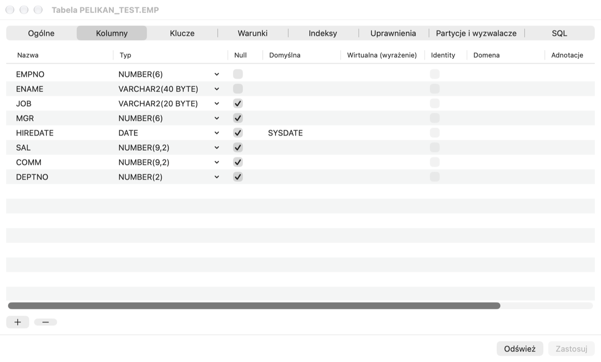
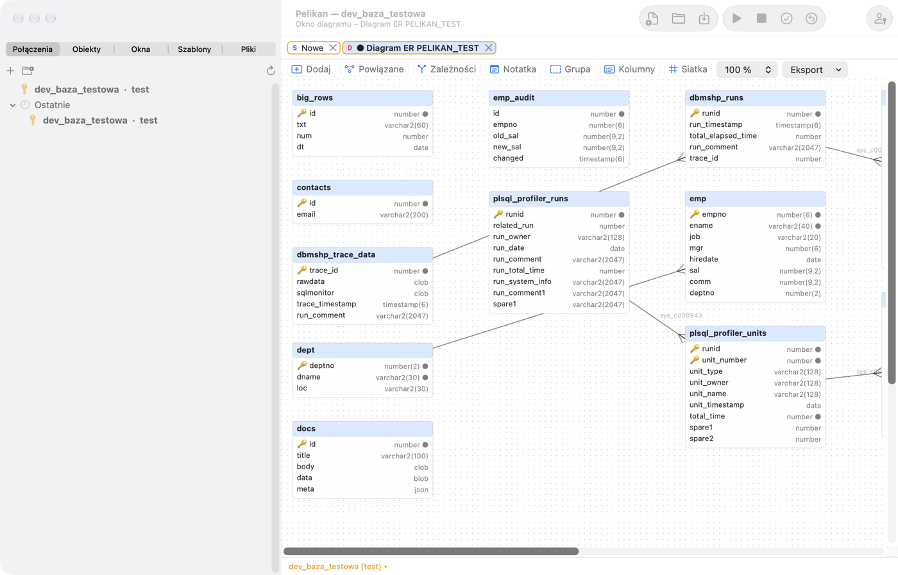

# Object Browser і редактори об'єктів

## Object Browser

Вкладка **Об'єкти** в лівій колонці показує об'єкти бази головного з'єднання в папках за типом: **Функції**,
**Процедури**, **Пакети**, **Тіла пакетів**, **Типи**, **Тригери**, **Джерела Java**, **Бібліотеки**, **Таблиці**,
**Подання**, **Матеріалізовані подання**, **Послідовності**, **Синоніми**, **Індекси**, **Зв'язки баз даних**,
**Черги**, **Завдання (Scheduler)**, **Користувачі**, **Ролі**, **Профілі**, **Каталоги** та інші. На базах 23ai і 26ai
додаються **Модулі MLE**, **Середовища MLE**, **Домени**, **Графи властивостей**, **Анотації** і **Твердження
(assertions)**. Папки з'являються лише тоді, коли це дозволяють версія бази й ваші привілеї.

- **Вибір користувача** над деревом: *Поточний користувач*, *Усі користувачі* або конкретна схема (Pelikan запам'ятовує
  вибір для з'єднання).
- **Фільтр** під вибором користувача: фрагмент назви з `%`, кілька шаблонів через кому, `status=invalid` (лише недійсні
  об'єкти) або `source=текст` (об'єкти, джерело яких містить текст).
- Розгортання об'єкта показує його елементи: стовпці з типами, обмеження, індекси, тригери, розділи, підпрограми,
  атрибути, а також залежності (**Залежить від**, **Використовується в**).
- Папка **Останні** містить нещодавно відкриті об'єкти.
- Недійсні об'єкти мають червону позначку.
- **Оновити** в меню (або **Інструменти › Об'єкт › Оновити Object Browser**) очищає кеш словника й перезавантажує
  дерево.

Дерево працює плавно навіть у схемах із десятками тисяч об'єктів — словник читається у фоні.

### Меню об'єкта

Клацніть об'єкт правою кнопкою миші (або з ⌃). Залежно від типу об'єкта меню містить:

- **Показати дані** — SQL Window із запитом до даних таблиці чи подання; **Стандартні запити** — ваші збережені шаблони
  запитів для таблиць;
- **Редагувати дані** — дані таблиці з `ROWID` у режимі редагування;
- **Редагувати** — вихідний код програми в Program Window, подання в SQL Window, а таблицю, послідовність, синонім,
  індекс, користувача чи роль — у редакторі об'єкта;
- **DDL** (скрипт із DBMS_METADATA в новому вікні), **Опис** (стовпці, параметри, елементи пакета), **Властивості**;
- **Тестувати** — Test Window з викликом процедури чи функції (див. розділ *Test Window, налагоджувач і профайлер*) і
  **Стандартний тест…**;
- **Додати вихідний код до редактора** — вставляє джерело або DDL у місце курсора активного вікна;
- **Перекомпілювати**, **Увімкнути** / **Вимкнути** (тригери, обмеження), **Прапорці умовної компіляції…**,
  **Перейменувати…**, **Дублювати…** (скрипт копії в новому вікні, без виконання), **Видалити об'єкт…** (після
  підтвердження);
- **Згенерувати код** — SELECT, INSERT, UPDATE, DELETE зі стовпцями або виклик процедури, також як фрагмент Java JDBC
  або Python;
- **Копіювати назву**.

На стовпці чи обмеженні таблиці меню має **Перейменувати елемент…**. Коли ви виділите кілька об'єктів (⌘+клацання або
⇧+клацання), меню пропонує спільні дії: **Копіювати назви через кому** (також ⌘C), **DDL вибраних**, **Перекомпілювати
вибрані** і **Вилучити вибрані…**.

Інші операції з виділеним об'єктом є в меню **Інструменти › Об'єкт**: зокрема **Додати налагоджувальну інформацію**,
**Редагувати визначення таблиці**, **Редактор подання**, **Порівняти з активним вікном**, **Порівняти з об’єктом в іншій
базі…**, **Оновити матеріалізоване подання**, **Перевірити зв’язок бази даних**, **Запустити завдання**, **Запустити
чергу** / **Зупинити чергу**, **Додати до теки…** і **Запустити тести utPLSQL**.

### Перетягування

Перетягніть об'єкт у редактор, щоб вставити його назву. З клавішею ⌃ (або коли в Параметрах вибрано «Питати») після
відпускання з'явиться меню: назва, назва з власником, список стовпців, SELECT, INSERT, UPDATE, DELETE, виклик або DDL.
Відпускання об'єкта на порожній області вікон виконує дію з **Параметри › Object Browser** (напр. «Редагувати» або
«Показати дані»). Перетягування папки вставляє назви її об'єктів через кому.

### Фільтри й власні папки

У **Параметри › Object Browser** можна налаштувати:

- видимі папки та їхній порядок, а також дію подвійного клацання для кожного типу;
- **Іменовані фільтри** — умову `WHERE` і `ORDER BY` для подання об'єктів (псевдонім `o`, змінні `:browser_user` і
  `&browser_filter`), за потреби для вибраного користувача й як типовий фільтр. Фільтр застосовується через
  **Інструменти › Object Browser › Іменований фільтр…**;
- **Теки користувача** — власні групи об'єктів зі списку або із запиту (стовпці `OWNER`, `OBJECT_NAME`, `OBJECT_TYPE`),
  з кольором, батьківською папкою й шаблоном з'єднань, на яких вони мають бути видимі.

## Пошук об'єктів і компіляція

- **Інструменти › Знайти об'єкти бази…** (⇧⌘O) шукає в джерелах PL/SQL (також у модулях MLE), запитах подань,
  визначеннях таблиць і назвах об'єктів. Підтримує регулярні вирази, цілі слова й регістр, працює у фоні, і його можна
  перервати. Подвійне клацання результату відкриває об'єкт у рядку зі збігом. Критерії можна зберегти, а результат —
  експортувати в CSV.
- **Інструменти › Скомпілювати недійсні об'єкти…** показує недійсні об'єкти схеми й компілює їх у порядку залежностей,
  доки це щось змінює; помилки компіляції наведено в списку.

## Редактор таблиці

Нову таблицю можна створити через **Файл › Новий › Таблиця…**, а наявну відкрити командою **Редагувати** з меню таблиці
(або **Інструменти › Об'єкт › Редагувати визначення таблиці**).

Вкладки редактора:

- **Загальні** — назва, табличний простір (зміна переносить таблицю з перебудовою індексів), параметри зберігання,
  стиснення, журналювання, кластер, тимчасова таблиця, індексна організація (IOT) або зовнішня таблиця, Row Archival,
  коментар. Зміни, що потребують перебудови, виконує **Recreate table** з перенесенням даних, тригерів і зовнішніх
  ключів інших таблиць.
- **Стовпці** — назва, тип (з підказкою), NULL, типове значення (також `ON NULL`), віртуальний стовпець, identity,
  невидимий стовпець, коментар; на 23ai також домен і анотації. Кнопка додає стовпці зовнішнього ключа на основі
  первинного ключа вказаної таблиці.
- **Ключі** (первинний, унікальні, зовнішні з `ON DELETE`), **Умови** (CHECK) та **Індекси** (звичайні, унікальні,
  бітові, функціональні, спадні, зі стисненням, обернені, невидимі, локальні).
- **Привілеї** — отримувач, привілей і право надання; Pelikan обчислює з різниць команди GRANT і REVOKE.
- **Розділи й тригери** — під час створення секціонування RANGE (також з INTERVAL), LIST і HASH та підрозділи HASH; в
  наявній таблиці додавання, перейменування й видалення розділів. Зміна методу секціонування потребує Recreate. Тригери
  таблиці тут можна вмикати й вимикати.
- **SQL** — команди DDL, що випливають зі змін. Їх можна скопіювати або відкрити в SQL Window.

**Застосувати** виконує зміни як `ALTER` і зупиняється на першій помилці; **Оновити** знову зчитує визначення з бази. На
продуктивному з'єднанні потрібне підтвердження.

## Інші редактори об'єктів

У **Файл › Новий** є редактори: **Послідовність…**, **Синонім…**, **Індекс…**, **Подання (редактор)…** (запит, FORCE,
READ ONLY, CHECK OPTION, коментар), **Подання…** (шаблон у SQL Window), **Користувач…**, **Роль…**, **Профіль…**,
**Зв’язок бази даних…**, **Бібліотека…**, **Каталог…**, **Завдання…**, **Черга…**, а на новіших базах **Домен…** і
**Асерція…**. Кожен редактор показує попередній перегляд DDL перед виконанням; наявні об'єкти відкриваються командою
**Редагувати** з Object Browser.

- **Користувач** — пароль (замаскований), табличні простори, профіль, блокування облікового запису, ролі, системні й
  об'єктні привілеї, квоти в табличних просторах. **Роль** — привілеї; **Профіль** — ліміти.
- **Зв'язок бази даних** — пароль зв'язку замасковано, і він не з'являється в попередньому перегляді DDL.
- **Завдання** створює завдання DBMS_SCHEDULER (старіший DBMS_JOB замінив планувальник).
- **Черга** створює чергу Advanced Queuing разом із таблицею черги; чергу можна запускати й зупиняти.

Паролі, введені в редакторах користувачів і зв'язків, зберігаються лише в пам'яті вікна — вони не потрапляють до файлів
чи історії.

## Кошик

**Інструменти › Кошик** показує видалені таблиці (USER_RECYCLEBIN). **Кошик › Відновити з кошика…** відновлює об'єкт під
старою або новою назвою, а **Кошик › Очистити кошик…** видаляє об'єкти остаточно (після підтвердження).

## Діаграми

- **Інструменти › Діаграма › ER-діаграма зі схеми…** малює таблиці схеми (або ті, що відповідають масці) із зовнішніми
  ключами й автоматичним шаруватим розташуванням.
- **Файл › Новий › Вікно діаграми** створює порожню діаграму; об'єкти можна додати, перетягуючи їх з Object Browser, або
  командою **Інструменти › Діаграма › Додати до діаграми**.

У вікні діаграми: **Пов'язані** додає таблиці, пов'язані зовнішніми ключами, **Залежності** — лінії залежностей,
**Нотатка** і **Група** упорядковують малюнок, **Стовпці** показує або приховує стовпці, **Сітка** вмикає прив'язку до
сітки 8 px, а масштаб змінюється від 10 до 200%. Подвійне клацання лінії додає точку зламу, ⌥+клацання її видаляє.
Діаграму можна зберегти як файл `.pdd`, оновити з бази (**Оновити з бази**), надрукувати або експортувати в PNG чи PDF.

## Oracle 23ai і 26ai

- **Інструменти › Подання дуальності JSON** — список подань дуальності JSON-реляційних даних із документами й структурою
  (Data Guide); **Нове подання дуальності…** генерує DDL з головної таблиці й дочірніх таблиць.
- **Інструменти › Модулі й середовища MLE** — модулі JavaScript і середовища; **Імпортувати модуль JavaScript…** створює
  модуль із файлу `.js`. Модуль редагується в Program Window (з підсвічуванням JavaScript і помилками компіляції).
- **Інструменти › REST (ORDS)** — модулі REST і скрипти, що вмикають REST для схеми чи об'єкта (потребує ORDS у базі).
- Домени й анотації стовпців редагуються в редакторі таблиці, а папка **Анотації** показує, де анотацію використано.
