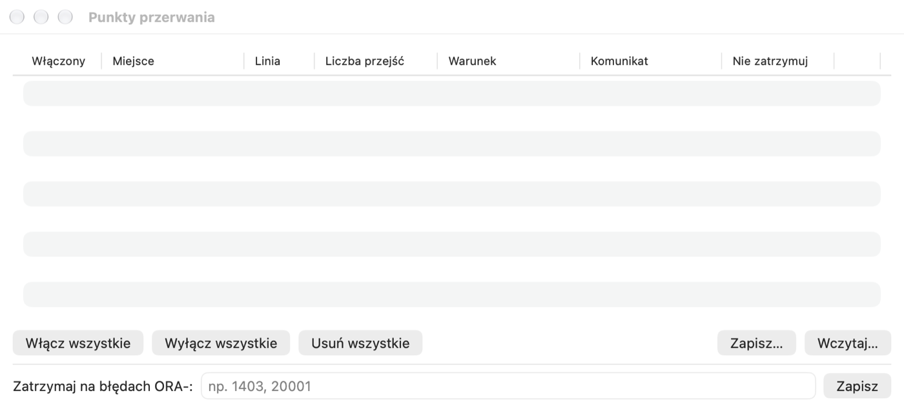

# Test Window, налагоджувач і профайлер

## Test Window

Test Window запускає блок PL/SQL зі змінними прив'язки й дає змогу налагоджувати та профілювати його. Найпростіше
відкрити його з Object Browser: меню процедури чи функції › **Тестувати**. Pelikan підготує блок із викликом в
іменованій нотації (для підпрограми пакета — з правильним перевантаженням) і змінні для параметрів і результату функції.
Порожнє вікно відкривається через **Файл › Новий › Test Window**.

1. На вкладці **Змінні** під блоком введіть значення вхідних параметрів. Змінні `:назва` з блоку виявляються
   автоматично; тип можна змінити (Integer, Float, String, Date, Timestamp, Boolean, CLOB, BLOB, Cursor та інші).
2. Натисніть F8 (⌘↩). Після виконання вихідні значення з'являться в таблиці, а ті, що змінилися, виділено жовтим. Рядок
   стану показує час виконання.
3. Зафіксуйте або відкотіть зміни: F10 / ⇧F10 (параметр **AutoCommit після виконання вікна тесту** в **Налаштування › SQL
   Window** фіксує автоматично).

Інші вкладки:

- **Вивід** — DBMS_OUTPUT; перемикач **Вивід HTP** показує сторінку, згенеровану пакетами HTP/OWA (після позначення
  **Збирати HTP під час виконання**).
- **Стек помилки** — у разі помилки виконання: стек викликів із рядками; клацання відкриває одиницю в рядку помилки.
- **Результати** — набори, повернуті `DBMS_SQL.RETURN_RESULT`.
- **Профайлер**, **Статистика** і **Трасування** — описано нижче.

Коли після перекомпіляції пакета його стан буде скинуто (ORA-04068 і подібні), рядок стану покаже попередження; повторне
виконання працює звичайно.

Тест можна зберегти як файл `.tst` (блок, змінні й відстежувані вирази налагоджувача). **Файл › Зберегти тест як скрипт
SQL*Plus** створює скрипт для запуску поза Pelikan. **Налагодження › Зберегти як стандартний тест…** зберігає вікно як
шаблон (з позначкою `%CALL%` на місці виклику), який потім можна вибрати для будь-якої процедури через **Стандартний
тест…** у меню об'єкта.

Для запуску багатьох тестів з очікуваними результатами призначено **Інструменти › Test Manager** (розділ *Інструменти*),
а для модульних тестів — utPLSQL (розділ *Тести utPLSQL*).

Поруч із блоком, як у Program Window, є **Вміст коду** (оголошення, локальні підпрограми, блоки) — показуєте або
приховуєте його в цьому вікні через **Подання › Вміст коду** або кнопку на лівому кінці панелі під блоком.

## Налагоджувач

Налагоджувач використовує пакет Oracle DBMS_DEBUG і працює на базах 19c–26ai.

### Підготовка

- Користувачеві потрібні привілеї `DEBUG CONNECT SESSION`, а також `DEBUG ANY PROCEDURE` або `DEBUG` на конкретних
  об'єктах. **Налагодження › Привілеї налагоджувача…** відкриває SQL Window з готовими командами GRANT, які має виконати
  адміністратор.
- Код, який ви хочете виконувати покроково, має бути скомпільований із налагоджувальною інформацією: **Інструменти ›
  Об'єкт › Додати налагоджувальну інформацію** або автоматично під час компіляції в Program Window (**Налаштування › Oracle
  › Налагоджувач**; там також списки об'єктів і з'єднань, для яких інформацію додавати завжди або ніколи, напр.
  `*@prod*`).

### Покрокове виконання

1. Установіть точки зупину: клацніть поле з номерами рядків у вікні програми чи тесту або натисніть ⌃B (**Налагодження ›
   Перемкнути точку зупину**).
2. У Test Window виберіть **Налагодження › Почати налагодження** (F9). Відкриється вікно **Налагоджувач** зі стеком
   викликів, змінними й відстежуваними виразами, а курсор зупиниться на першому рядку.
3. Виконуйте покроково:

| Дія | Скорочення |
|---|---|
| Продовжити (до наступної точки зупину) | ⌃R |
| Увійти (до підпрограми, також до тригера) | ⌃N |
| Крок з обходом (наступний рядок) | ⌃O |
| Вийти (з підпрограми) | ⌃T |
| Виконати до курсора / до винятку | меню «Налагодження» |
| Зупинити налагодження | ⇧F9 |

Фокус залишається в головному вікні, тож можна виконувати кроки скороченнями, дивлячись на код.

### Змінні, відстежувані вирази, стек

- **Змінні** — локальні, параметри, глобальні змінні пакета (приватні й публічні), записи, колекції й об'єкти у вигляді
  дерева, `SELF` у методах типів. Наведення миші на змінну в редакторі показує її значення.
- **Встановити значення…** змінює значення скалярної змінної (літерал PL/SQL або текст; `NULL` — порожнє значення),
  **Копіювати значення** копіює його в буфер обміну.
- **Відстежувані** — введіть вираз (напр. `v`, `r.поле`, `t(3)`) і натисніть **Відстежувати**.
- **Стек викликів** — клацання кадру показує його змінні й місце в коді.
- **Виконати SQL у сеансі, що налагоджується…** виконує запит (перші 100 рядків) або блок PL/SQL у сеансі, який ви
  налагоджуєте, — він бачить його незафіксовані зміни.
- DBMS_OUTPUT зчитується під час кожної зупинки.

У тригерах значення `:new` і `:old` недоступні (обмеження DBMS_DEBUG) — налагоджувач тоді показує повідомлення замість
значення. Типово покрокове виконання пропускає ініціалізацію пакетів і об'єкти SYS (**Налаштування › Oracle ›
Налагоджувач**).

### Точки зупину, умови й точки журналювання

**Налагодження › Точки зупину…** відкриває список усіх точок:

- **Увімкнений** — точку можна вимкнути, не видаляючи.
- **Кількість проходжень** — зупинка лише на n-му проходженні.
- **Умова** — вираз, напр. `l_sal > 1000`; налагоджувач зупиняється лише тоді, коли він істинний.
- **Повідомлення** — текст, що виводиться під час проходження; `{змінна}` вставляє значення змінної.
- **Не зупинятися** — разом із повідомленням створює **точку журналювання** (logpoint): налагоджувач виведе повідомлення
  й піде далі.
- **Зупинятися на помилках ORA-** — коди помилок, на яких налагоджувач має зупинитися (напр. `1403, 20001`).
- **Увімкнути всі**, **Вимкнути всі**, **Видалити всі**, **Зберегти…** і **Завантажити…** (файл JSON).

Точка, яку база не прийняла (напр. у рядку без коду), має на полі порожню позначку. В одному рядку може бути одна точка.

Тести utPLSQL теж можна налагоджувати: **Налагодження › utPLSQL: налагодити тест під курсором**.

## Профайлер

1. На вкладці **Профайлер** вікна тесту виберіть у полі **Профайлер під час виконання** вид: **Лінійний
   (DBMS_PROFILER)** або **Ієрархічний (DBMS_HPROF)**. Команда **Налагодження › Профайлер під час виконання** вмикає й
   вимикає лінійний профайлер.
2. Виконайте блок (F8).
3. Вкладка **Профайлер** покаже звіт: для лінійного профайлера — час, кількість виконань і частку кожного рядка зі
   стовпчиковою діаграмою; для ієрархічного — функції з власним часом і часом із викликами, а також дерево викликів.
   Одиницю часу й поріг частки можна задати на цій вкладці.

Меню **Запуски** на вкладці (а також **Налагодження › Запуски профайлера**) відкриває звіти попередніх запусків.
Відсутні таблиці профайлера Pelikan створює у вашій схемі (на продуктивному з'єднанні — після підтвердження, на
з'єднанні лише для читання — зовсім ні). Дані запуску лінійного профайлера залишаються в транзакції вікна — зафіксуйте
її, якщо хочете їх зберегти.

## Статистика, трасування й SQL Trace

- Вкладка **Статистика** показує зміну статистики сеансу (V$MYSTAT) за останнє виконання й суму для вікна, з фільтром і
  експортом у CSV. Вибір статистики — у **Налаштування › SQL Window**. Потрібен доступ до V$MYSTAT.
- **Налагодження › DBMS_TRACE під час виконання** записує перебіг (виклики, винятки, SQL, рядки) на вкладку
  **Трасування**; історія запусків є в **Історія запусків DBMS_TRACE**. Потрібні таблиці трасування, які адміністратор
  встановлює скриптом `tracetab.sql`.
- **Сеанс › SQL Trace** вмикає й вимикає SQL Trace сеансу вікна; Pelikan показує назву файлу трасування.
