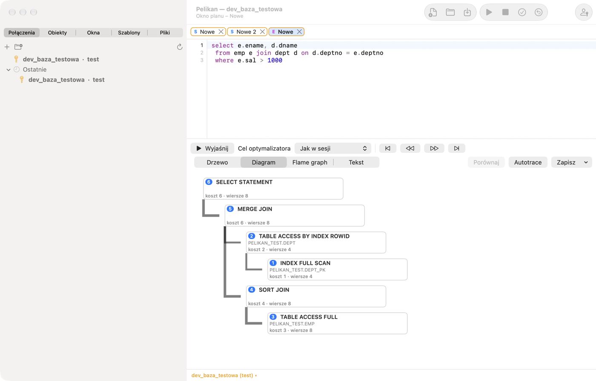
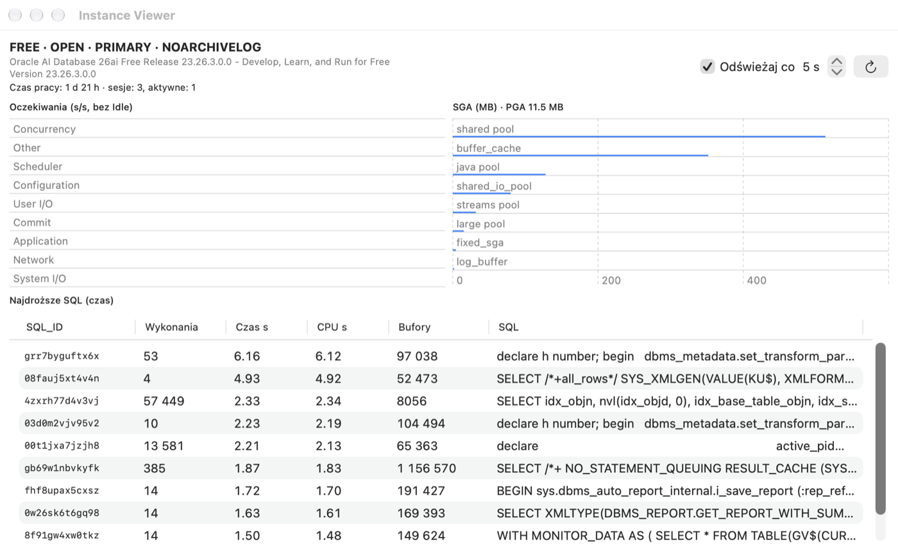

# План виконання, сеанси й адміністрування

## Для чого це

Перш ніж Oracle виконає запит, **оптимізатор** вибирає спосіб виконання: яку таблицю читати першою, чи використати
індекс, як з'єднувати таблиці. Цей спосіб — **план виконання**. Два запити з однаковим результатом можуть мати плани, час
яких відрізняється в тисячу разів. Інструменти цього розділу показують план (Explain Plan), вимірюють справжнє виконання
(Autotrace) і дають побачити, що відбувається в базі (Сеанси, Instance Viewer).

**Коли використовувати:** коли запит працює повільно, перш ніж додати індекс, і коли щось «зависло» — щоб перевірити, хто
блокує рядки або що робить база.

## План виконання (Explain Plan)

Установіть курсор на команді (або виділіть її) і натисніть F5 (**Інструменти › Explain Plan**). Pelikan відкриє вікно
плану з планом із PLAN_TABLE. У коді PL/SQL змінні замінюються на змінні прив'язки, а `INTO` пропускається, тож план
запиту з процедури можна отримати без переписування. Порожнє вікно плану відкривається через **Файл › Новий › Explain
Plan Window (Explain Plan)**; відсутню таблицю PLAN_TABLE Pelikan може створити.

- **Оновити план** заново обчислює план для тексту в редакторі вікна плану, а **Мета оптимізатора** (*Як у сеансі*, ALL_ROWS або
  FIRST_ROWS_n) додає підказку (hint).
- Новий план з'являється повністю розгорнутим. Стрілки **Розгорнути всі гілки** і **Згорнути всі гілки** поруч
  із вибором подання над деревом плану (також на вкладці стрічки **План**) одразу розгортають усі гілки або
  згортають дерево до кореня.
- Подання: **Дерево** (операції з вартістю, кількістю рядків, байтами, часом, порядком виконання та предикатами доступу
  й фільтрації), **Діаграма** (вузол на операцію з вартістю, кардинальністю й номером кроку), **Flame graph** (вартість
  операцій пропорційно до батьківської) і **Текст** (DBMS_XPLAN).
- Кнопки навігації переходять операціями в порядку виконання: перший, попередній, наступний і останній крок.
- **Порівняти** зіставляє план із попереднім планом вікна або з планом у другому вікні плану: зіставляє операції й
  показує відмінності вартості, кардинальності, порядку й предикатів.
- **Зберегти** зберігає план як текст, HTML або XML (DBMS_XPLAN).

План обчислюється в окремому службовому сеансі, тож не впливає на транзакцію вікна.

**Як читати план (для початківців):**

- Читайте його **від операції з найбільшим відступом** угору — найглибша виконується першою.
- `TABLE ACCESS FULL` — Oracle читає всю таблицю. Для малої таблиці це добре; для таблиці з мільйонами рядків, з якої
  потрібно кілька, — зазвичай ознака, що бракує індексу або умова його не використовує.
- `INDEX RANGE SCAN` / `INDEX UNIQUE SCAN` — Oracle шукає через індекс, як через предметний покажчик книжки.
- **Вартість** (Cost) — оцінка оптимізатора: відносне число, корисне для порівняння двох планів того самого запиту, а не
  час у секундах.
- **Кардинальність** (Rows) — оцінена кількість рядків. Коли вона дуже відрізняється від справжньої (перевірите в
  Autotrace), оптимізатор має погану статистику й може вибрати поганий план.

> **Вправа: індекс у плані.**
> 1. У SQL Window введіть `SELECT * FROM pel_employees WHERE emp_id = 3;`, поставте на нього курсор і натисніть **F5**.
>    *Результат:* вікно плану; у дереві операція `INDEX UNIQUE SCAN` на `PEL_EMPLOYEES_PK` — пошук за первинним ключем.
> 2. Змініть запит на `SELECT * FROM pel_employees WHERE last_name = 'Nowak';` і натисніть **Оновити план**.
>    *Результат:* `TABLE ACCESS FULL` — на стовпці `LAST_NAME` немає індексу.
> 3. Перемкніть вигляд на **Діаграма**, а потім на **Текст**.
>    *Результат:* той самий план як малюнок і як текст DBMS_XPLAN (так його побачить адміністратор).
> 4. Виділіть запит у SQL Window і виберіть **Інструменти › Autotrace**.
>    *Результат:* справжній план зі стовпцями **E-Rows** (оцінка) і **A-Rows** (справжні рядки) — тут вони збігаються.
>
> ⚠️ **На що зважати.** На такій малій таблиці повне читання найшвидше, і оптимізатор слушно його вибирає — індекс
> допомагає на великих таблицях. Не додавайте індекси «про запас»: кожен індекс сповільнює INSERT, UPDATE і DELETE.
> Autotrace справді **виконує** команду (DML потім відкочується) — не запускайте в ньому довгих запитів на робочій базі в
> робочий час.

## Autotrace

**Інструменти › Autotrace** (або кнопка **Autotrace** у вікні плану) виконує команду з вимірюванням і показує фактичний
план: Starts, оцінена (E-Rows) і фактична (A-Rows) кількість рядків із виділенням великих розбіжностей, час, буфери й
читання, а також зміну статистики сеансу до й після виконання. Команди DML після вимірювання відкочуються. Autotrace не
потребує Tuning Pack.

Про змінні в команді Autotrace питає так само, як вікно SQL: змінні зв'язування (`:назва`) отримують значення з вікна
**Змінні** (запам'ятовані у вікні), а змінні підстановки (`&назва`) — лише за ввімкненої підстановки вікна; за
вимкненої `&` лишається в тексті без запитання.

## Пакети Oracle Diagnostics і Tuning

Меню **Інструменти › Продуктивність (пакети Oracle)** містить інструменти, що використовують платні пакети Oracle:

| Команда | Пакет | Що робить |
|---|---|---|
| Звіт AWR | Diagnostics | HTML-звіт зі знімків AWR |
| Звіт ASH | Diagnostics | HTML-звіт активних сеансів за останні хвилини |
| Звіт ADDM | Diagnostics | рекомендації ADDM |
| SQL Monitor | Tuning | список відстежуваних запитів (V$SQL_MONITOR) зі звітом для вибраного |
| Звіт SQL Monitor | Tuning | HTML-звіт відстежуваного запиту |
| SQL Tuning Advisor | Tuning | рекомендації для команди під курсором; завдання радника потім видаляється |

**Важливо — ліцензії.** Використовуйте ці функції лише тоді, коли база має ліцензію відповідного пакета (Tuning Pack
потребує також Diagnostics Pack). Під час першого використання Pelikan запитує, яку ліцензію має база, і запам'ятовує
відповідь у визначенні з'єднання (вкладка **Додатково** › **Ліцензія Diagnostics/Tuning Pack**). Без заявленої ліцензії
або коли параметр бази `CONTROL_MANAGEMENT_PACK_ACCESS` має значення `NONE` (або `DIAGNOSTIC` для функцій Tuning Pack),
функція не запуститься. Агенти ШІ не мають доступу до цих інструментів. Звіти можна зберегти як HTML.

## Звіти продуктивності

**Для чого це:** коли база або один запит працює повільно, адміністратор зазвичай просить звіт AWR, ASH або SQL Monitor.
Вікно **Звіти продуктивності бази** збирає всі ці звіти в одному місці, з вибором періоду й формату.

- **Продуктивність › Усі звіти продуктивності…** відкриває вікно зі списком звітів (**Виберіть звіт**): AWR, ASH, ADDM,
  Performance Hub, SQL Monitor, плани й статистика. Для вибраного звіту задаєте **Період** (наприклад, **Остання година**,
  проміжок **Від** – **До** за часом бази або **Знімки AWR**), **Екземпляр** (у RAC також **Усі екземпляри RAC**) і
  **Формат результату**, а потім клацаєте **Запустити звіт**.
- **Продуктивність › Звіти для SQL_ID…** робить те саме для одного запиту — з виділеного рядка таблиці (наприклад, списку
  сеансів або найдорожчих запитів), клітинки з SQL_ID або команди під курсором. Кнопка **Перевірити** показує, де запит
  доступний: у кеші курсорів, в ASH, в AWR і в SQL Monitor — звіти без даних про запит заблоковано з поясненням.
- Звіт, для якого бракує привілею (наприклад, EXECUTE на пакет `DBMS_WORKLOAD_REPOSITORY`) або ліцензії, заблоковано в
  списку з причиною й готовою командою GRANT для адміністратора.

> **Вправа: знайдіть SQL_ID свого запиту.**
> 1. У SQL Window виконайте `SELECT /* moya_vprava */ COUNT(*) FROM pel_emp_details;`.
> 2. Поставте курсор на цю команду й виберіть **Продуктивність › Звіти для SQL_ID…**.
>    *Результат:* вікно звітів із SQL_ID запиту, знайденим у кеші курсорів за текстом («команда під курсором»).
> 3. Клацніть **Перевірити**, виберіть звіт плану з кешу курсорів і **Запустити звіт**.
>    *Результат:* план, за яким база справді виконала запит, із кількістю виконань.

## Сеанси бази

**Інструменти › Сеанси** показує сеанси бази (V$SESSION):

- **Фільтр** вибирає запит списку (напр. *Сеанси користувачів*); **Оновлювати кожні** n секунд вмикає автоматичне
  оновлення.
- Вкладки подробиць виділеного сеансу: **Поточний SQL**, **Відкриті курсори**, **Блокування**, **Статистика**,
  **Очікування**.
- **Завершити сеанс** і **Завершити негайно** завершують сеанс (`ALTER SYSTEM KILL SESSION`) після підтвердження.
- **Дії** — зокрема ввімкнення SQL Trace для сеансу (DBMS_MONITOR).
- **Запити…** дає змогу визначити власні фільтри (умова WHERE), вкладки подробиць (з `:sid`, `:serial#`) і дії.

Сеанси Pelikan мають у стовпці MODULE значення «Pelikan», а сеанси агентів ШІ — «Pelikan agent».

> **Вправа: хто блокує рядок?**
>
> Потрібні права читання V$SESSION і V$LOCK (зазвичай роль SELECT_CATALOG_ROLE).
>
> 1. У SQL Window A виконайте `UPDATE pel_employees SET salary = salary WHERE emp_id = 1;` і **не** фіксуйте.
> 2. У SQL Window B виконайте ту саму команду.
>    *Результат:* вікно B «зависає» — чекає, доки сеанс вікна A звільнить блокування рядка.
> 3. Відкрийте **Інструменти › Сеанси**, знайдіть сеанси з MODULE «Pelikan» і виберіть той, що чекає.
>    *Результат:* вкладка **Очікування** показує подію блокування (`enq: TX - row lock contention`), а вкладка
>    **Блокування** — сеанс, що блокує.
> 4. Поверніться до вікна A і натисніть **⇧F10** (ROLLBACK).
>    *Результат:* вікно B одразу завершує UPDATE. Відкотіть і вікно B (**⇧F10**).
>
> ⚠️ **На що зважати.** **Завершити сеанс** перериває чужу роботу й відкочує чужу транзакцію. На спільній базі завершуйте
> лише власні сеанси або за згодою адміністратора.

## Панель DBA та Instance Viewer

**Подання › Панель DBA** збирає адміністративну інформацію: табличні простори із заповненістю, файли даних, параметри
екземпляра, користувачів, ролі, сеанси й блокування. У списку параметрів **Змінити значення…** виконує `ALTER SYSTEM SET
… SCOPE=BOTH`, а в списку користувачів **Заблокувати** і **Розблокувати** змінюють стан облікового запису — завжди після
підтвердження й з тими самими захисними механізмами, що й SQL Window. Частини, до яких у вас немає привілеїв, показують
повідомлення замість даних.

**Інструменти › Instance Viewer** — це панель екземпляра: версія й стан бази, час роботи, кількість сеансів, класи
очікувань (приріст за секунду), найдорожчі запити (V$SQL), а також SGA і PGA, з автоматичним оновленням.

## DBMS Scheduler

**Інструменти › DBMS Scheduler** показує об'єкти планувальника в дереві: вікна й групи вікон, класи завдань, розклади,
програми, ланцюжки, завдання, спостерігачі файлів і облікові дані, з переглядом SQL (View SQL) виділеного об'єкта.

- **Нове завдання…** створює завдання з вбудованим розкладом (напр. `FREQ=DAILY;BYHOUR=3`) або з іменованим, із класом,
  коментарем і сповіщеннями e-mail. Наявне завдання змінюється через **Редагувати…**, а видаляється після підтвердження.
- **Запуски** показує історію виконань зі звітами (усі, невдалі, власні умови) і правилами кольорів.
- **Запущені** показує завдання, що виконуються; **Зупинити** і **Зупинити (Force)** їх переривають.
