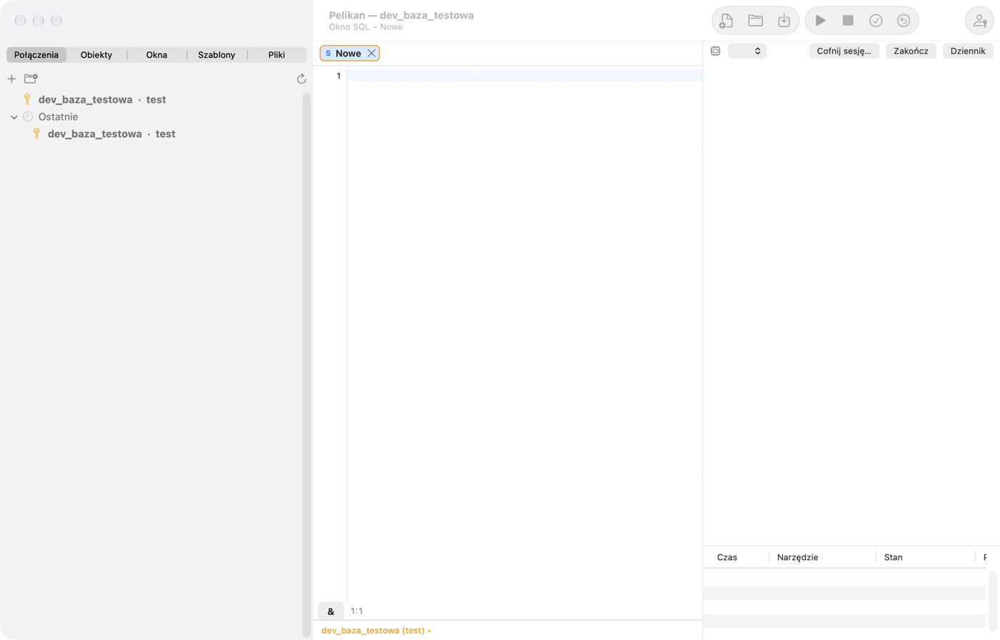

# Агенти ШІ

Pelikan дає змогу працювати з агентом ШІ, запущеним у терміналі, вбудованому у вікно, — напр. Claude Code, — який бачить
ваші вікна й базу виключно через інструменти Pelikan і за правилами, які ви контролюєте. Агент може читати код і дані,
аналізувати плани, писати й форматувати код у вікнах, а зміни в базі виконує лише після вашої згоди.

## Підтримувані програми

| Агент | Команда | Як отримує сервер MCP Pelikan |
|---|---|---|
| Claude Code | `claude` | `--mcp-config` лише для цього сеансу |
| Codex CLI | `codex` | `-c mcp_servers…` лише для цього сеансу |
| Grok CLI | `grok` | змінна `GROK_CONFIG` лише для цього сеансу |
| Antigravity | `agy` | одноразова реєстрація сервера «pelikan» — лише з вашої згоди |

Програму агента ви встановлюєте самостійно й входите в неї зі своїм обліковим записом постачальника. Pelikan шукає
команду в `PATH` вашої оболонки входу. Список програм змінюється в **Параметри › Агенти** (**Додати CLI**, **Відновити
типові**).

Сервер MCP Pelikan доступний лише для сеансу, запущеного з Pelikan: обмін іде через сокет Unix, доступний виключно
вашому обліковому запису (без мережевих портів), а кожен сеанс має власний одноразовий токен, що передається програмі в
середовищі й анулюється після завершення сеансу. Antigravity не дозволяє вказати сервер для одного сеансу, тому Pelikan
запитує згоду на постійну реєстрацію; поза сеансами, запущеними з Pelikan, зареєстрований сервер відхиляє будь-яке
з'єднання.

## Запуск агента

1. Виберіть **Інструменти › Агент ШІ › Запустити Claude Code** (або іншу програму).
2. З'явиться **матриця дозволів сеансу**: список інструментів із рівнем доступу. Можна знизити рівень вибраних
   інструментів або натиснути **Усе лише для читання**. Підвищити рівень неможливо. Натисніть **Запустити**.
3. Праворуч у вікні відкриється **панель агента** з терміналом програми. З агентом ви працюєте як у звичайному
   терміналі.

Робочим каталогом агента є папка файлу активного вікна (напр. проєкту), а коли вікно не має файлу — тимчасовий каталог
сеансу. Панель показується й приховується через **Подання › Панель агента**.

Під терміналом панель показує **активність агента**: кожен виклик інструмента з часом, станом (виконується, схвалено,
відхилено, помилка), параметрами й результатом, а також лічильник запитів, що очікують згоди. Кнопки: **Скасувати
сеанс…**, **Завершити** і **Журнал**.

## Рівні доступу

Кожна команда Pelikan має рівень доступу агента:

- **Немає** — агент не бачить цієї функції;
- **Читання** — агент бачить стан або результат і нічого не змінює;
- **Зі згоди** — агент подає операцію, а ви схвалюєте її після перегляду;
- **Повний** — агент виконує операцію без запиту, але лише таку, яку можна скасувати (напр. зміну тексту у вікні), і все
  потрапляє до журналу.

Діє найнижчий із рівнів: команди, матриці сеансу й з'єднання. На з'єднанні **лише для читання** або без згоди на зміни
(вкладка **Агент ШІ** визначення з'єднання) агент має щонайбільше **Читання**. На продуктивних з'єднаннях згоду на зміни
типово вимкнено.

Інструменти агента коротко:

- **Читання**: список з'єднань (лише псевдоніми), стан вікон і вміст редактора, пошук і опис об'єктів, джерела, DDL,
  залежності й використання, запити, план виконання, помилки компіляції, DBMS_OUTPUT, тести utPLSQL та їхні результати,
  покриття, список сеансів;
- **Повний** (скасовуваний): відкриття об'єкта або нового вікна, вставлення й заміна тексту, форматування, перехід до
  рядка;
- **Зі згоди**: компіляція, виконання команди й скрипту, COMMIT, ROLLBACK, створення й генерування тестового пакета,
  запуск тестів utPLSQL, встановлення utPLSQL.

Агент **не має** доступу до Command Window і команди HOST, системної оболонки через Pelikan, налагоджувача, вікна
«Сеанси» (крім читання списку сеансів) і завершення сеансів, SQL Trace, звітів AWR/ASH/ADDM, SQL Monitor і SQL Tuning
Advisor, віддаленої збірки Pro*C, інструментів користувача, а також до паролів, хостів, портів і імен користувачів
з'єднань.

## Вікно згоди

Коли агент хоче змінити базу, Pelikan показує вікно **Згода на операцію агента** з повним попереднім переглядом:
команди, об'єкти, на які вони впливають (з таблицями, тригерами й залежними об'єктами), оцінена кількість рядків, план
виконання й аргументи. Коли зміну неможливо скасувати (COMMIT, DDL на таблиці), вікно прямо про це повідомляє червоним
попередженням.

Вікно спроєктовано так, щоб нічого не схвалити випадково:

- немає типової кнопки — ↩ (напр. натиснута під час введення в терміналі агента) нічого не схвалює;
- **Дозволити** стає активною лише через 0,8 секунди;
- Esc відхиляє запит (**Відмовити**);
- наступні запити чекають у черзі, доки ви не розглянете поточний.

## Транзакції й скасування

- Агент має **власні сеанси бази** — він не бачить вашої незафіксованої транзакції й не може її зафіксувати. У V$SESSION
  його сеанси мають MODULE «Pelikan agent», а ACTION — назву інструмента.
- Запити агента виконуються в транзакції лише для читання, з лімітами кількості рядків, часу й розміру результату
  (**Параметри › Агенти › Запити агента**; типово 500 рядків, 30 с і 1 МБ) і лімітом викликів на хвилину. Запит має бути
  однією командою SELECT/WITH, без `FOR UPDATE` і без функцій, визначених у реченні WITH.
- **DML агента залишається незафіксованим**, доки ви окремо не погодитеся на COMMIT. Закриття сеансу агента відкочує
  незафіксовані зміни (ROLLBACK). DDL агента відхиляється, коли агент має незафіксований DML (DDL неявно зафіксував би
  його).
- Перед зміною коду об'єкта (пакет, процедура, подання…) Pelikan зберігає попередню версію. **Інструменти › Агент ШІ ›
  Скасувати сеанс агента…** (або **Скасувати сеанс…** на панелі) відновлює код об'єктів до стану перед сеансом, видаляє
  об'єкти, створені агентом, скасовує зміни тексту у вікнах і закриває вікна, відкриті агентом. Об'єкт, пізніше змінений
  кимось іншим, — це конфлікт: його пропускають, якщо ви не виберете **Скасувати примусово**. Зафіксовані зміни (COMMIT)
  і DDL на таблицях скасувати неможливо.
- **Інструменти › Агент ШІ › Завершити сеанс агента** завершує програму агента, анулює токен, відкочує незафіксовані
  зміни агента й закриває його сеанси бази.

## Налаштування з'єднання для агента

Вкладка **Агент ШІ** у визначенні з'єднання:

- **Агент бачить це з'єднання (лише псевдонім і середовище)** — вимкніть, щоб приховати з'єднання від агента.
- **Агент може змінювати дані й об'єкти (зі згоди)** — типово вимкнено для продуктивного середовища.
- **Окремий користувач бази для агента** — агент з'єднується через проксі `main[agent]` як користувач з обмеженими
  привілеями (напр. лише SELECT). Адміністратор має надати `ALTER USER agent GRANT CONNECT THROUGH main`; другий пароль
  не потрібен. Рекомендовано для продуктивного середовища.
- **Стовпці, замасковані для агента** — назви стовпців (напр. `PESEL, EMAIL`) або `СХЕМА.ТАБЛИЦЯ.СТОВПЕЦЬ`. Значення
  маскуються в результатах, а запити, що звертаються до цих стовпців, відхиляються.

Пам'ятайте: усе, що агент прочитає (код, результати запитів), потрапляє до постачальника моделі ШІ. Маскування працює за
назвою стовпця й є полегшенням, а не межею безпеки — стовпець можна прочитати, напр., через подання з іншою назвою.
Справжньою межею є привілеї користувача бази, якого використовує агент. Функції, що викликаються в запитах, можуть мати
побічні ефекти (напр. автономні транзакції) — і від цього захищають лише привілеї.

## Суворий режим

**Параметри › Агенти › Суворий режим** (типово ввімкнено) запускає програму агента без її власної оболонки й редагування
файлів — лише з інструментами Pelikan, якщо програма це дозволяє. Коли не дозволяє, панель агента показує попередження.
Програма агента в повному режимі працює з правами вашого облікового запису macOS — Pelikan попереджає, але її не
обмежує.

## Журнал агентів

Кожен виклик інструмента — також відхилений — потрапляє до журналу (файли JSONL у каталозі даних Pelikan, без токена й
паролів). **Інструменти › Агент ШІ › Журнал агентів…** (або **Журнал** на панелі) відкриває переглядач журналу з часом,
інструментом, рішенням, аргументами й результатом.
