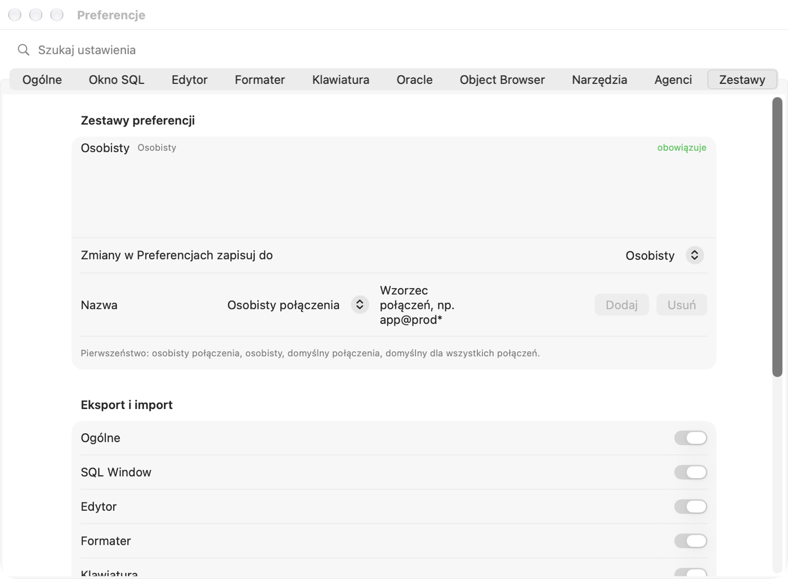

# Налаштування й клавіатурні скорочення

Цей розділ описує **кожен параметр** вікна «Налаштування»: що він робить, яке має типове значення, що станеться, коли ви
його ввімкнете чи вимкнете (або виберете інший пункт зі списку), коли зміна почне діяти і на що звернути увагу. Читати
його від початку до кінця не обов'язково — типові значення підібрано так, щоб можна було безпечно почати роботу.
Поверніться сюди, коли щось працює не так, як вам потрібно.

## Вікно «Налаштування»

### Для чого це

Налаштування визначають, як Pelikan з'єднується з базою, як виконує команди, як виглядає редактор і як форматується
код. Кожен розробник має трохи інші звички — тут ви підлаштовуєте програму під себе.

### Як відкрити й знайти параметр

1. Виберіть **Pelikan › Налаштування…** або натисніть **⌘,** (Command і кома).
   *Результат:* відкривається вікно з вкладками вгорі: Загальні, SQL Window, Редактор, Форматувальник, Клавіатура,
   Oracle, Object Browser, Інструменти, Агенти, Набори.
2. Не знаєте, на якій вкладці параметр? Введіть частину його назви в поле **Шукати налаштування** над вкладками,
   наприклад `commit`.
   *Результат:* замість вкладок з'являється список відповідних налаштувань, праворуч — назва вкладки.
3. Клацніть пункт у списку.
   *Результат:* поле пошуку очищається і відкривається потрібна вкладка.

### Коли зміна починає діяти

- **Зміни зберігаються одразу** — кнопок «Застосувати» чи «OK» немає, як у налаштуваннях macOS. Закриття вікна нічого не
  скасовує.
- Більшість параметрів діє одразу в усіх вікнах.
- Параметри, що стосуються **сеансів бази** (наприклад, налаштування NLS, режим сеансу), діють у **нових сеансах** —
  від'єднайтеся й з'єднайтеся знову, щоб вони охопили вже відкриті вікна.
- Три параметри потребують **перезапуску Pelikan**: каталог Oracle Instant Client, каталоги Oracle Net та Oracle Wallet
  і мова інтерфейсу. Pelikan пише про це під кожним із них.

> **Порада.** Потрібні інші налаштування для однієї бази (наприклад, суворіші для робочої)? Не змінюйте їх вручну під час
> кожного перемикання — скористайтеся **наборами налаштувань** (вкладка **Набори**, опис наприкінці розділу).

Опис кожного параметра має однакову будову: назва параметра, як у вікні, типове значення, наслідок кожного варіанта і —
за потреби — попередження ⚠️.

## Вкладка «Загальні»

### Сеанси

**Сеанс** — це одне з'єднання з базою Oracle на боці сервера. У сеансі живуть ваша **транзакція** (зміни даних, ще не
зафіксовані командою COMMIT), змінні пакетів і налаштування, задані через ALTER SESSION. Скільки сеансів відкриває
Pelikan — це має реальні наслідки.

**Режим сеансу** — *типово: Multi*.

| Вибір | Що відбувається | Наслідки |
|---|---|---|
| **Multi — окремий сеанс для кожного вікна** | Кожне вікно SQL, тесту й консолі має власний сеанс; компіляція — ще один. | Довгий запит в одному вікні не блокує інших. Транзакції вікон незалежні: зміну у вікні A не видно у вікні B до COMMIT. Більше сеансів на сервері (адміністратор може мати обмеження). **Рекомендовано.** |
| **Dual — спільний сеанс і сеанс компіляції** | Вікна одного з'єднання ділять один сеанс; компіляція має власний. | Менше сеансів. Вікна бачать незафіксовані зміни одне одного й мають спільну транзакцію — COMMIT в одному вікні фіксує зміни всіх. Поки одне вікно виконує запит, інші чекають. |
| **Single — один сеанс** | Усе, включно з компіляцією, в одному сеансі (налагоджувач однаково має власний сеанс нагляду). | Найменше сеансів. ⚠️ В Oracle компіляція (CREATE OR REPLACE) **фіксує відкриту транзакцію** — компіляція пакета в Program Window зафіксує незафіксовані зміни з SQL Window. Використовуйте лише тоді, коли база дозволяє один сеанс. |

*Діє:* для нових сеансів — після зміни від'єднайтеся й з'єднайтеся знову.

**Вихід із відкритою транзакцією** — *типово: Питати*. Що робити, коли ви закриваєте вікно, перемикаєте його на інше
з'єднання або виходите, а в сеансі є незафіксовані зміни.

- **Питати** — Pelikan покаже вікно з вибором COMMIT, ROLLBACK або «Скасувати». **Рекомендовано** — ви завжди знаєте, що
  відбувається з вашими змінами.
- **Зафіксувати (COMMIT)** — зміни фіксуються без запитання. ⚠️ Легко зробити постійною зміну, зроблену «на пробу».
- **Відкотити (ROLLBACK)** — зміни відкочуються без запитання. ⚠️ Забутий COMMIT означає втрачену роботу.

**Перевіряти з'єднання кожні … с (0 — вимкнено)** — *типово: 60 с*, крок 30 с. Кожні стільки секунд Pelikan надсилає
до бази дуже легкий запит, щоб перевірити, чи ще живі головні сеанси та сеанси вікон із відкритою транзакцією
(наприклад, чи не обірвалася мережа або VPN). Коли сеанс втрачено, Pelikan одразу повідомляє про це і знімає позначку
відкритої транзакції з відповідних вікон — **незафіксовані зміни втраченого сеансу в базі відкочено**.

- Менше значення (щонайменше 15 с) — ви раніше дізнаєтеся про обрив, ціною частіших запитів.
- **0** — Pelikan не перевіряє з'єднання; про обрив ви дізнаєтеся лише під час наступної команди.
- Зміна діє одразу.

**Закріплювати з'єднання нових вікон** — *типово: вимкнено*. **Головне** з'єднання — те, що ви вибираєте на панелі
інструментів; нові вікна отримують його.

- Вимкнено — коли ви змінюєте головне з'єднання, незакріплені вікна перемикаються разом із ним (спершу питаючи про
  відкриту транзакцію).
- Увімкнено — кожне нове вікно SQL, програми, тесту й консолі отримує **закріплене** з'єднання (📌 у рядку стану) і
  зберігає його, навіть якщо ви зміните головне з'єднання. Зручно, коли ви паралельно працюєте з кількома базами й не
  хочете, щоб вікно «перескочило» на іншу.

### Індикатори підключень

Колір з'єднання допомагає не сплутати тестову базу з робочою. Колір ви задаєте у визначенні з'єднання (вкладка
**Середовище**), а тут вирішуєте, де його видно.

**Тло редактора в кольорі підключення** — *типово: вимкнено*. Увімкнено — тло редактора злегка забарвлене кольором
з'єднання вікна. Дуже добре видно, що ви пишете «на робочій базі». Вимкнено — колір лише на вкладках вікон і в списку
вікон.

**Правила користувач@база** — список правил із шаблоном і кольором, типово порожній. Кнопка **Додати правило** додає
правило `*@*` червоного кольору; змініть шаблон і колір. Шаблон має вигляд `користувач@база`, `*` означає будь-який
рядок, `?` — один символ. Приклади: `sys@*` — кожен вхід як SYS, `*@prod*` — кожен користувач на базах, назва яких
починається з «prod». Правило **має пріоритет** над кольором з'єднання й середовища і стосується вкладок, списку вікон і
тла. Кнопка ⊖ видаляє правило.

> **Вправа: позначте вхід як SYS червоним.**
> 1. На вкладці **Загальні** клацніть **Додати правило**. *Результат:* з'являється рядок `*@*` червоного кольору.
> 2. У полі шаблону введіть `sys@*`. Колір залиште червоним.
> 3. Увімкніть **Тло редактора в кольорі підключення**.
> 4. З'єднайтеся як SYS із тестовою базою й відкрийте SQL Window. *Результат:* вкладка вікна і тло редактора червоні.

### Вигляд

**Режим** — *типово: Як у системі*. **Як у системі** — Pelikan світлий або темний разом із macOS (також коли macOS
перемикається ввечері). **Світлий** / **Темний** — завжди так, незалежно від системи. Зміна діє одразу.

### Шрифт інтерфейсу

Стосується підписів, списків, стрічки, вкладок вікон, рядка стану, вікон інструментів і Налаштувань. Меню й заголовки
вікон малює macOS — їх Pelikan не змінює. Під параметрами видно приклад тексту вибраним шрифтом.

- **Гарнітура** — *типово: Системний (SF Pro)*. У списку — шрифти, встановлені на Mac.
- **Стиль** — *типово: звичайний*. Від тонкого до жирного.
- **Розмір** — *типово: 13 pt*, від 10 до 20 pt. Допоміжний текст (підписи, описи) завжди на 2 pt менший. Більший шрифт —
  це читабельність коштом місця: від 16 pt на малому екрані деякі панелі стають вужчими.

Шрифти редактора коду й сітки результатів налаштовуються окремо, на вкладці **Редактор**.

### Стрічка

**Стрічка** — це смуга з вкладками дій (Пуск, SQL, Програма, Інструменти…) під панеллю інструментів — як в офісних
програмах.

- **Показувати стрічку з вкладками дій** — *типово: увімкнено*. Вимкнено — стрічка зникає, редактор отримує більше
  місця; команди лишаються в меню, у палітрі команд (⇧⌘P) і під своїми скороченнями.
- **Згорнути стрічку лише до вкладок** — *типово: вимкнено*, доступно лише з видимою стрічкою. Увімкнено — видно лише
  назви вкладок. Клацання вкладки розгортає стрічку, а подвійне клацання вкладки згортає або розгортає її назавжди.
  Добрий компроміс на малому екрані.

Поле **Пошук дій** на стрічці знаходить будь-яку команду за назвою, зокрема за англійською назвою з PL/SQL Developer.

### Панелі інструментів

Інструменти (наприклад, Object Browser, Сеанси, результати тестів) відкриваються в правій панелі, нижній панелі або в
окремому вікні.

- **Відкривати нові інструменти** — *типово: Права панель*. **Права панель**, **Нижня панель** або **Окреме вікно**.
  Стосується інструментів, яких ви ще не переміщали — Pelikan запам'ятовує місце кожного виду інструмента окремо.
- **Автоматично приховувати панелі, коли робота повертається до редактора** — *типово: вимкнено*. Увімкнено — коли ви
  клацаєте в редакторі, панелі інструментів ховаються і редактор отримує всю ширину; панель повертається, коли ви
  відкриваєте або вибираєте інструмент. Вимкнено — панелі лишаються на місці.
- **Відновити типові місця** — забуває місця, куди ви перемістили інструменти (лічильник поруч показує їхню кількість).
  Інструменти знову відкриватимуться відповідно до параметра **Відкривати нові інструменти**.

Інструмент переміщують, перетягуючи його вкладку на іншу панель або за межі панелей (окреме вікно), через меню вкладки
або кнопкою в заголовку інструмента.

### Мова інтерфейсу

**Мова** — *типово: Як у системі*. Polski, English, Deutsch, Español або Українська. **Як у системі** — мова з
налаштувань macOS. Зміна діє **після перезапуску Pelikan**. Мова не змінює повідомлень Oracle (наприклад, `ORA-00942`) —
вони залежать від NLS_LANGUAGE на вкладці **Oracle**.

### Початкові теки й розширення

**Скрипти SQL**, **Програми**, **Тести**, **Звіти** — тека, яку показує вікно відкриття й збереження файлу цього виду.
*Типово порожньо:* тека проєкту, а без проєкту — остання використана. Введіть шлях, виберіть зі списку (тека проєкту,
теки останніх файлів, Документи, домашня тека) або клацніть кнопку огляду.

**Додаткові розширення програм** і **Додаткові розширення тестів** — *типово порожньо*. Pelikan розпізнає вид файлу за
розширенням: `.sql` відкривається в SQL Window; `.pck`, `.pks`, `.pkb`, `.prc`, `.fnc`… — у Program Window; `.tst` — у
Test Window. Якщо у вашій команді програми мають інше розширення (наприклад, `.plsql`), допишіть його тут (кілька через
кому) — такі файли відкриватимуться в Program або Test Window замість SQL Window.

### Специфікація й тіло в окремих файлах

Пакет PL/SQL складається зі **специфікації** (що пакет надає) і **тіла** (як він це робить). Багато команд тримають їх у
двох файлах, наприклад `emp_api.pks` і `emp_api.pkb`.

- **Відкривати пару специфікація/тіло в одному вікні** — *типово: увімкнено*. Увімкнено — відкриття `emp_api.pks` відкриє
  в тому самому Program Window також `emp_api.pkb` з тієї самої теки (дві вкладки). Вимкнено — відкривається лише
  вибраний файл.
- **Розширення специфікації пакета** (*pks*), тіла пакета (*pkb*), специфікації типу (*tps*), тіла типу (*tpb*). Program
  Window зі специфікацією й тілом зберігає кожну одиницю в її файл; **Зберегти як** створює пару файлів; експорт об'єктів
  «файл на об'єкт» використовує ці розширення. Розширення специфікації має відрізнятися від розширення тіла й не може
  бути зарезервованим (`sql`, `tst`, `pck`, `typ`, `rep`, `pdd`, `sqlnb`, `txt`). За хибного значення Pelikan покаже
  червону примітку й до виправлення використовуватиме типові.

### Файли

- **Відновлювати вікна після перезапуску (також незбережені)** — *типово: увімкнено*. Увімкнено — під час закриття
  Pelikan запам'ятовує відкриті вікна разом із незбереженим текстом і після запуску відкриває їх знову. Вимкнено — Pelikan
  стартує з порожньою областю вікон.
- **Автозбереження макета вікна** — *типово: увімкнено*. Pelikan запам'ятовує розмір головного вікна, розташування панелей
  та їхню ширину. Вимкнено — після запуску макет повертається до типового.
- **Питати про збереження змін під час закриття нових вікон** — *типово: увімкнено*. Стосується вікон, які ще не мають
  файлу (наприклад, нове SQL Window з уведеним запитом). Вимкнено — таке вікно закривається без запитання, а текст
  пропадає. ⚠️ Вимикайте, лише якщо нові вікна для вас — чернетка.
- **Виявляти зміни файлів на диску** — *типово: увімкнено*. Коли файл, відкритий у Pelikan, змінює інша програма (git,
  інший редактор, агент ШІ), Pelikan помітить це після повернення до вікна й запропонує завантажити нову версію. Вимкнено —
  Pelikan цього не перевіряє, і збереження з Pelikan перезапише чужі зміни. ⚠️ Залиште ввімкненим, якщо користуєтеся git.
- **Завантажувати без запиту файли, змінені ззовні, коли вікно не має змін** — *типово: вимкнено*, доступно з увімкненим
  виявленням. Увімкнено — якщо у вікні немає незбережених змін, нова версія завантажується без запитання (зручно після
  `git pull`). Коли у вікні є незбережені зміни, Pelikan завжди питає.

### Стандарт файлів

Визначає, у якому форматі Pelikan зберігає **нові** файли з кодом.

- **Кодування** — *типово: UTF-8*. Спосіб запису символів (наприклад, кирилиці). UTF-8 — стандарт сучасних інструментів і
  git. Інше кодування (наприклад, Windows-1251) вибирайте лише тоді, коли цього вимагає проєкт.
- **Мітка порядку байтів (BOM) на початку файлу (UTF-8)** — *типово: вимкнено*. BOM — невидимі байти на початку файлу,
  потрібні деяким старим програмам Windows. Більшість інструментів (git, SQL*Plus у Linux) краще працюють без неї.
- **Файли програм без рядків «/» (ні в кінці, ні всередині)** — *типово: увімкнено*. Рядок лише з `/` каже SQL*Plus
  «виконай те, що вище». У файлах із кодом пакетів (які розгортають інструменти) такий рядок часто заважає. Увімкнено —
  Program Window зберігає одиниці без `/`. Вимкнено — можна завершувати одиниці знаком `/` (параметр на вкладці
  **Oracle › Налагоджувач**). Скрипти SQL завжди зберігають `/`, бо їх виконує вікно команд.
- **Питати про перетворення під час відкриття файлу в іншому форматі** — *типово: увімкнено*. Під час відкриття файлу в
  іншому кодуванні, з BOM або з `/` Pelikan запропонує перетворення до стандарту. Перетворення змінює лише вікно — файл на
  диску змінюється лише під час збереження. Вимкнено — файл відкривається як є.
- **Відновити типові (UTF-8, без BOM, без «/»)** — повертає типові значення цього розділу.

### Журнал програми

Журнал записує, що робить Pelikan, — це стане в пригоді під час повідомлення про помилку. **Журнал ніколи не містить
паролів, тексту команд SQL і даних із бази.**

- **Записувати в журнал** — *типово: Події (рекомендовано)*. **Попередження та помилки** — лише проблеми (найменше
  записів). **Події** — також звичайні дії (з'єднання, виконання, компіляція). **Подробиці — діагностика** — багато
  записів; увімкніть на деякий час, коли шукаєте причину помилки, а потім вимкніть.
- **Показувати назви з'єднань, об'єктів і шляхи до файлів** — *типово: вимкнено*. Вимкнено — назви з'єднань і серверів
  замінено в журналі хешем, тож журнал можна безпечно надіслати. Увімкнено — видно справжні назви (журнал легше
  зрозуміти, але подумайте, перш ніж комусь його надсилати).
- **Показати журнал** і **Експортувати журнал…** — відкривають журнал або зберігають його у файл.

## Вкладка «SQL Window»

### Виконання

**AutoSelect — без виділення виконувати команду під курсором** — *типово: увімкнено*. У SQL Window зазвичай кілька
запитів один під одним.

- Увімкнено — **F8** (або ⌘↩) виконує **одну** команду, ту, в якій стоїть курсор. Щоб виконати весь скрипт, виділіть його
  (⌘A) або скористайтеся **Виконати навпаки до AutoSelect** (⌃F8, ⇧⌘↩).
- Вимкнено — F8 виконує **усі** команди вікна по черзі, а одну — лише виділену.
- Коли щось виділено, завжди виконується виділення.

**AutoCommit команд SQL** — *типово: вимкнено*.

- Вимкнено — після INSERT, UPDATE або DELETE зміни є лише у вашому сеансі. Ви фіксуєте їх **COMMIT** (F10) або
  скасовуєте **ROLLBACK** (⇧F10). Рядок стану показує відкриту транзакцію. **Рекомендовано.**
- Увімкнено — кожна команда, що змінює дані, фіксується одразу. ⚠️ Помилку (наприклад, UPDATE без WHERE) не скасувати
  ROLLBACK.

**Статистика після виконання** — *типово порожньо (усі ненульові)*. Список назв статистик сеансу, що показуються на
вкладці **Статистика** (наприклад, `consistent gets`, `physical reads`), кілька через кому. Порожньо — усі, що
змінилися. Діє з увімкненою вкладкою «Статистика» (розділ нижче).

**AutoCommit після виконання вікна тесту** — *типово: вимкнено*. Як AutoCommit, але для Test Window: увімкнено — після
виконання скрипту тесту зміни фіксуються. Вимкнено — вирішуєте самі (зручно: тест, перевірка даних, ROLLBACK).

**Підтверджувати COMMIT і ROLLBACK** — *типово: вимкнено*. Увімкнено — перед фіксацією або відкотом Pelikan спитає «ви
впевнені». Захищає від випадкового натискання F10; запитання має позначку **Більше не питати**.

**Підтверджувати змінні команди на робочих (production) з'єднаннях** — *типово: увімкнено*. Стосується з'єднань із
середовищем **Продуктивне** (задається у визначенні з'єднання). Перед кожною командою, що змінює дані або об'єкти
(INSERT, UPDATE, DELETE, MERGE, DDL…), Pelikan спитає, чи справді її виконати. ⚠️ Це запитання не вимкнути позначкою
«Більше не питати» — лише цим параметром. Залиште ввімкненим.

### Результати

**Рядків на сторінку** — *типово: Автоматично (сторінка)*. Скільки рядків результату Pelikan отримує одразу. Запит може
повернути мільйони рядків — отримання всіх тривало б довго й займало пам'ять.

- **Автоматично (сторінка)** — 100 рядків, наступні довантажуються під час прокручування.
- **100**, **500**, **1000** — стільки рядків за раз.
- **Усі** — увесь результат одразу. ⚠️ На великих таблицях це може тривати довго й займати багато пам'яті.

«(більше…)» біля кількості рядків означає, що результат ще неповний.

**Максимальний розмір результату** — *типово: 512 МБ*, від 16 до 8192 МБ. Коли отриманий результат перевищить цей розмір,
Pelikan зупинить отримання й спитає: **Продовжити отримання** чи **Зупинити**. Захищає Mac від того, щоб один запит
зайняв усю пам'ять.

**Вигляд чисел** — *типово: Праворуч*. Як сітка показує числа: **Праворуч** (як в електронній таблиці — одиниці одна під
одною), **Ліворуч**, **Форматовано (регіональний роздільник)** (десятковий роздільник за налаштуваннями macOS), **З
роздільником тисяч** (наприклад, 1 234 567). Стосується лише показу — копіювання й експорт зберігають точне значення.

**Номер рядка під час копіювання й експорту** — *типово: вимкнено*. Увімкнено — скопійований і експортований результат
має перший стовпець із номером рядка.

**Завантажувати LOB на вимогу (перегляд перших 4000 байтів)** — *типово: увімкнено*. LOB (CLOB, BLOB) — стовпець із
великим текстом або файлом. Увімкнено — сітка показує початок значення, а ціле отримується лише тоді, коли ви його
відкриєте (Large Data Editor). Запити швидші. Вимкнено — цілі значення отримуються одразу.

**Вирівнювати стовпці за збереженим шаблоном запиту** — *типово: увімкнено*. Коли ви зберігаєте для запиту ширину й
вирівнювання стовпців (меню сітки), після повторного виконання того самого запиту Pelikan розкладе стовпці так само.
Вимкнено — шаблони ігноруються.

**Сповіщати про завершення виконання, довшого за … с** — *типово: 10 с*, крок 5 с, 0 — без сповіщення. Коли команда
триває довше, після її завершення Pelikan програє звук (інший у разі помилки), а якщо ви працюєте в іншій програмі —
значок Pelikan підстрибне в Dock.

**Large Data Editor: Auto Format (JSON, XML)** — *типово: вимкнено*. Увімкнено — після відкриття значення JSON або XML у
Large Data Editor текст одразу гарно форматується (відступи, рядки). Змінює лише вигляд, якщо ви не збережете значення.

### Query By Example

**Query By Example** (QBE) — рядок над сіткою, де ви вводите значення, а Pelikan дописує до запиту умову WHERE. Ці
параметри визначають, як порівнюється введене значення.

- **Без урахування регістру** — *типово: увімкнено*. Увімкнено — `kowalski` знайде також `KOWALSKI`. Вимкнено — регістр
  має збігатися.
- **Текст без символів підстановки як «містить»** — *типово: вимкнено*. Увімкнено — `kow` шукає значення, що містять
  «kow» (як `LIKE '%kow%'`). Вимкнено — `kow` шукає значення, що дорівнюють «kow»; «містить» отримаєте, ввівши `%kow%`.
- **Дати без часу (порівняння дня)** — *типово: увімкнено*. Увімкнено — `2026-11-05` знайде всі рядки цього дня, у будь-
  яку годину. Вимкнено — лише північ цього дня.

### Статистика

**Вкладка Статистика: статистика сеансу кожного виконання (потрібен доступ до V$MYSTAT)** — *типово: вимкнено*.
Увімкнено — після кожного виконання SQL Window має вкладку **Статистика** з кількістю читань, сортувань, рекурсивних
викликів тощо. Корисно під час налаштування запитів. Потрібне право читання подань `V$MYSTAT` і `V$STATNAME`
(попросіть адміністратора).

### DBMS_OUTPUT

`DBMS_OUTPUT.PUT_LINE` — це спосіб, у який код PL/SQL «друкує» текст, — відповідник `print`.

- **Увімкнено** — *типово: увімкнено*. Pelikan вмикає буфер DBMS_OUTPUT у сеансі й після виконання показує текст на
  вкладці **Output** SQL Window (у Test Window — **Вивід**). Вимкнено — текст із PUT_LINE пропадає.
- **Очищати перед виконанням** — *типово: увімкнено*. Увімкнено — вкладка очищається перед кожним виконанням. Вимкнено —
  нові рядки дописуються до старих.
- **Розмір буфера** — *типово: без обмеження (0)*, крок 10 000 байтів. Обмеження кількості тексту в буфері. Після
  перевищення Oracle повідомить про помилку `ORU-10027`. Без обмеження — помилки не буде.

### Формати дат

**DATE** — *типово: `YYYY-MM-DD HH24:MI:SS`*, **TIMESTAMP** — *типово: `YYYY-MM-DD HH24:MI:SS.FF6`*. Як сітка показує дати
й мітки часу. Введіть власний формат у нотації Oracle або виберіть зі списку. Стосується показу в сітці; як **база**
перетворює текст на дату в запитах, задається в NLS_DATE_FORMAT (вкладка **Oracle**).

## Вкладка «Редактор»

### Шрифт

- **Шрифт** — *типово: SF Mono*. У списку — моноширинні шрифти (код легше читати, коли стовпці рівні).
- **Стиль** — *типово: звичайний*.
- **Розмір** — *типово: 13 pt*, від 8 до 40 pt.
- **Лігатури (напр. Fira Code, JetBrains Mono)** — *типово: увімкнено*. Деякі шрифти поєднують символи `<>`, `>=`, `=>` в
  один знак. Діє лише з такими шрифтами; із SF Mono нічого не змінює. Вимкніть, якщо хочете бачити кожен символ окремо.

### Сітка результатів і Object Browser

Окремий шрифт для сітки результатів (*типово: системний моноширинний, 12 pt*, від 8 до 24 pt) і для Object Browser
(*типово: як інтерфейс*; значення 0 pt — як інтерфейс).

### Кольори шрифтів

Для **Редактора**, **Сітки результатів** і **Object Browser** можна вибрати колір **Тексту** й **Тла**. *Типово:* системні
кольори, що змінюються зі світлим і темним режимом. Власний колір діє в обох режимах — виберіть такий, що читабельний і в
світлому, і в темному. **Системні** повертає кольори системи. Підсвічування синтаксису (ключові слова, тексти,
коментарі) лишається.

### Code Assistant (підказки коду)

Code Assistant — список підказок, що з'являється під час введення: назви таблиць, стовпців, пакетів, процедур.

- **Автоматично після крапки** — *типово: увімкнено*. Після введення `emp.` список стовпців таблиці EMP з'явиться сам.
  Вимкнено — список відкриваєте вручну: **⌃Пробіл**.
- **Затримка** — *типово: 400 мс*, від 0 до 2000 мс. Скільки Code Assistant чекає після крапки. Коротше — швидше, але
  список може з'являтися, коли він вам не потрібен.
- **Зіставлення** — *типово: Починається з*. **Починається з** — `sal` підкаже `SALARY`. **Містить** — `sal` підкаже
  також `BASE_SALARY` (більше пунктів у списку).
- **Регістр літер** — *типово: Як у введеному тексті*. У якій формі підказка потрапляє в код: **Як у введеному тексті**
  (пишете малими — вставить малими), **ВЕЛИКІ**, **малі**, **Перша велика**, **Оригінальна** (як у словнику бази,
  зазвичай великими).
- **Мінімум символів для об'єктів і ключових слів** — *типово: 1*, від 1 до 5. Після скількох введених літер (без крапки)
  з'являються підказки назв об'єктів і ключових слів. Більше — менше заважає, але допомагає пізніше.
- **Стандартні функції SQL** — *типово: увімкнено*. Увімкнено — список містить і вбудовані функції (`NVL`, `TO_CHAR`,
  `SUBSTR`…).
- **«(усі)»: кожен елемент в окремому рядку** — *типово: вимкнено*. Пункт «(усі)» у списку стовпців вставляє всі стовпці
  разом. Вимкнено — в одному рядку через кому. Увімкнено — кожен стовпець в окремому рядку.
- **«(усі)»: кома на початку рядка** — *типово: вимкнено*, доступно з попереднім параметром. Увімкнено — `, стовпець`
  замість `стовпець,`.

### AutoReplace (текстові скорочення)

Ви вводите коротке скорочення й пробіл (або інший завершальний символ), а Pelikan замінює його на довший текст.
*Типово є два:* `sf` → `SELECT * FROM ` і `dbo` → `dbms_output.put_line(|);`. Символ `|` у заміні позначає місце курсора
після заміни. **Додати скорочення** додає порожній рядок, ⊖ видаляє скорочення.

> **Вправа: власне скорочення.**
> 1. Клацніть **Додати скорочення**, у полі скорочення введіть `cnt`, у полі **Заміна (| — курсор)** — `SELECT COUNT(*)
>    FROM |;`.
> 2. Відкрийте нове SQL Window (⌘N), введіть `cnt` і пробіл. *Результат:* з'являється `SELECT COUNT(*) FROM ;`, а курсор
>    стоїть перед крапкою з комою — допишіть назву таблиці.

### Аналіз і вікна

- **Аналіз коду під час введення** — *типово: увімкнено*. Pelikan безперервно підкреслює невідомі назви (перевіряючи
  словник бази) і підозрілі місця в коді. Вимкнено — підкреслення зникають; помилки ви побачите лише під час компіляції
  чи виконання.
- **Попереджати про ідентифікатори, довші за … байтів** — *типово: 30*, 0 — вимкнено. Старіші версії Oracle (до 12.1)
  дозволяють назви до 30 байтів; кирилична літера займає 2 байти. Поставте 128, якщо працюєте лише з Oracle 12.2 і новіше.
- **Запам'ятовувати стан вікон файлів (курсор, закладки, позначки, змінні)** — *типово: увімкнено*. Після повторного
  відкриття файлу ви повертаєтеся в те саме місце, із закладками й значеннями змінних. Вимкнено — файл відкривається з
  початку.

### Запис

- **Регістр ключових слів** — *типово: Без змін*. **ВЕЛИКІ** / **малі** / **Перша велика** — під час введення Pelikan
  змінює ключові слова (SELECT, FROM, BEGIN…) на вибрану форму. Не змінює назв, тексту в апострофах і коментарів.
- **Підсвічувати поточний рядок** — *типово: увімкнено*. Рядок із курсором має трохи інше тло.
- **Підсвічувати входження назви під курсором і виділеного слова** — *типово: увімкнено*. Курсор на змінній `l_total`
  підсвічує всі її використання — легко побачити, де її змінюють.
- **Виділяти команди COMMIT, ROLLBACK і SAVEPOINT** — *типово: увімкнено*. Команди, що завершують транзакцію, мають
  помітний колір — їх важче пропустити в коді.
- **Стан рядків (змінені й нові від відкриття або збереження)** — *типово: увімкнено*. На полі біля номерів рядків
  кольорова смужка показує рядки, змінені й додані після відкриття або останнього збереження.
- **Переносити рядки** — *типово: вимкнено*. Увімкнено — довгий рядок переноситься на екрані (без зміни тексту).
  Вимкнено — довгий рядок прокручується по горизонталі.
- **Номер кожного рядка / Номер кожні … рядків** — *типово: кожного*, до кожного 10-го.
- **Вертикальне поле в стовпці …** — *типово: немає*, крок 10. Вертикальна лінія у вказаному стовпці (наприклад, 100)
  допомагає писати короткі рядки.
- **Показувати спеціальні символи (пробіли, табуляції, кінці рядків)** — *типово: вимкнено*. Увімкнено — пробіли —
  крапки, табуляції — стрілки. Корисно, коли шукаєте причину дивного відступу.
- **Вміст коду типово видимий** — *типово: увімкнено*. Панель **Вміст коду** біля редактора показує структуру коду
  (процедури, функції, команди). Параметр стосується вікон, у яких ви не перемикали панель вручну (**Подання › Вміст
  коду**).
- **Керувальні структури у вмісті коду** — *типово: увімкнено*. Увімкнено — у дереві видно також IF, цикли, CASE й
  обробку винятків (типово згорнуті). Вимкнено — лише підпрограми й блоки.
- **Порядок у вмісті коду** — *типово: Як у джерелі*. Або **За абеткою**, або **За видом**.

### Відступи

- **Відступ нового рядка** — *типово: Автоматичний (як попередній рядок)*. **Немає** — Enter починає рядок зі стовпця 1.
  **Автоматичний** — новий рядок має відступ попереднього. **Розумний (структура PL/SQL)** — після `BEGIN`, `LOOP`,
  `THEN` відступ збільшується, а `END` повертається до рівня блоку.
- **Backspace зменшує відступ** — *типово: увімкнено*. Backspace на початку рядка з відступом повертає на один рівень
  відступу замість одного пробілу.
- **Ширина табуляції** — *типово: 2*, від 1 до 8. Скільки пробілів дає Tab і один рівень відступу.
- **Вставляти символ табуляції замість пробілів** — *типово: вимкнено*. Увімкнено — Tab вставляє символ табуляції. Увага:
  в інших програмах табуляція може мати іншу ширину, і код «розповзеться». Більшість команд використовує пробіли.

## Вкладка «Кольори»

**Колірна тема** визначає, як редактор розфарбовує код. Вона задає кольори ключових слів, рядків, коментарів і назв
функцій, а також тло, виділення, курсор, поточний рядок і номери рядків. Pelikan має 98 вбудованих тем. Типова —
**Pelikan**, у світлій і темній версії. Є також **Класичний** у стилі давніх інструментів Oracle: біле тло, темно-сині
ключові слова, червоні рядки й зелені коментарі. Решта 95 — відомі теми редакторів, зокрема Solarized, Gruvbox,
Dracula, Monokai, Nord, One Dark, GitHub, Catppuccin і Tokyo Night. Їхні палітри походять із проєкту tinted-theming
(ліцензія MIT).

Ті самі кольори діють у вікні SQL, вікні програми, вікні тесту й консолі, а також у переглядах коду у вікнах
інструментів (сеанси, звіти, Query Builder). Друк і перегляд Quick Look у Finder залишаються зі світлими кольорами
Pelikan, бо папір і Finder мають біле тло.

### Список тем

Ліворуч є дві групи: **Світлі** (світле тло) і **Темні** (темне тло). Кольоровий прямокутник біля назви показує тло
теми й три її кольори: ключового слова, рядка й коментаря. Позначка ✓ означає тему, що використовується. Напис
**власна** означає тему, яку ви зберегли самі. Поле **Фільтрувати теми** звужує список до назв або авторів, що
відповідають введеному тексту.

### Використати у світлому режимі / Використати в темному режимі

macOS має світлий і темний режим (Параметри системи › Вигляд або **Загальні › Вигляд** у Pelikan). Pelikan пам'ятає
**окрему тему для кожного режиму**. *Типово:* Pelikan світла й Pelikan темна. Коли система змінює режим (наприклад,
увечері в автоматичному режимі), редактор сам перемикається на іншу тему. Кольори змінюються одразу в усіх відкритих
вікнах, без повторного відкриття файлів.

Для світлого режиму можна вибрати й темну тему, і навпаки. Редактор тоді має власне тло, незалежне від решти вікна.
Рядок під кнопками показує, яка тема використовується в кожному режимі.

### Попередній перегляд

Перемикач **SQL / PL/SQL / Pro*C** показує приклад коду в кольорах вибраної теми. Тема не мусить використовуватися.
Так можна порівняти теми, перш ніж вибрати одну з них.

### Категорії кольорів

Тема призначає колір (а за потреби жирний шрифт або курсив) кожній категорії:

- **Звичайний текст** — назви таблиць, стовпців і змінних.
- **Ключові слова** — `SELECT`, `BEGIN`, `IF`, `create or replace`; у Pro*C також `EXEC SQL`, `END-EXEC` і ключові
  слова C (`if`, `return`).
- **Типи даних** — `VARCHAR2`, `NUMBER`, `DATE`, `BOOLEAN`; у Pro*C `int`, `char`, `VARCHAR`.
- **Вбудовані функції** — `NVL`, `TO_CHAR`, `COUNT` та інші функції Oracle, коли після назви стоїть дужка; у Pro*C
  кожен виклик функції (`printf(`).
- **Пакети, що постачаються з базою** — `DBMS_OUTPUT`, `UTL_FILE`, `APEX_…`, коли після назви стоїть крапка.
- **Рядки** — `'текст'`, `q'[…]'`; у Pro*C також `"текст"`.
- **Числа** — `100`, `2.5`, `1e6`.
- **Коментарі** — `-- …` і `/* … */`.
- **Підказки оптимізатора** — `/*+ INDEX(e) */`.
- **Змінні прив'язки та підстановки** — `:x`, `&назва`; у Pro*C змінні хоста `:ename`.
- **Імена в лапках** — `"Назва відділу"`.
- **Оператори та розділові знаки** — `:=`, `||`, `(`, `;`.
- **Директиви компіляції та препроцесора** — `$IF … $END` у PL/SQL і `#include`, `#define` у Pro*C.

Кольори вбудованих тем дібрано так, щоб текст було добре видно: контраст звичайного тексту з тлом щонайменше 4,5:1,
а кожної категорії — щонайменше 3:1. Надто бліді кольори оригінальних палітр (найчастіше коментарі) Pelikan не
використовує — зсуває їх у бік кольору тексту.

### Зберегти як власну…

Вбудовані теми змінити не можна, щоб до них завжди можна було повернутися. Хочете інші кольори? Виділіть тему, найближчу
до того, що шукаєте, і натисніть **Зберегти як власну…**. Введіть назву (*типово:* «назва (копія)»). Копія з'являється
у списку з написом **власна**, і її одразу можна редагувати. Оригінал не змінюється.

### Редагування власної теми

Під попереднім переглядом власної теми є таблиця:

- **Назва** і **Темна тема** — назва у списку та група (**Світлі** або **Темні**). Група не обмежує вибору: тему можна
  використати в будь-якому режимі.
- **Категорія** — для кожної категорії зі списку вище: **Колір**, **Жирний** і **Курсив**. Клацніть поле кольору, щоб
  відкрити системний вибір кольору. Зміну одразу видно в попередньому перегляді, а також у редакторах, якщо тема
  використовується. Стрілка ↺ біля кольору повертає типовий колір: колір звичайного тексту для категорій і колір
  системи для елементів редактора.
- **Тло**, **Текст**, **Виділення**, **Поточний рядок**, **Номери рядків**, **Курсор** — кольори самого редактора.
  **Поточний рядок** — смуга під рядком із курсором (якщо на вкладці **Редактор** увімкнено підсвічування поточного
  рядка).

Зміни зберігаються одразу, без кнопки **Зберегти**. **Видалити** вилучає власну тему. Якщо вона використовувалася,
режим повертається до теми Pelikan.

> **Увага.** Кольори **тексту** й **тла**, задані в **Редактор › Кольори шрифтів**, мають перевагу над темою. Якщо після
> вибору теми тло не змінюється, перевірте, чи там не задано власний колір (кнопка **Системні** його прибирає).

### Імпортувати… та Експортувати…

**Імпортувати…** завантажує тему з файлу як власну. Підтримувані формати:

- тема Pelikan (`.json` з **Експортувати…**),
- base16 і base24 (`.yaml`) — сотні палітр із проєкту tinted-theming,
- Xcode (`.xccolortheme`; теми користувача лежать у `~/Library/Developer/Xcode/UserData/FontAndColorThemes`),
- TextMate і Sublime Text (`.tmTheme`),
- Visual Studio Code (`.json` з розширення теми, файл із його теки `themes`).

Під час імпорту з Xcode, TextMate і VS Code Pelikan зіставляє категорії SQL із кольорами теми. Результат не завжди
такий, як в оригінальному редакторі, бо ці теми описують інші мови. Тоді виправте кольори в таблиці редагування.

**Експортувати…** зберігає вибрану тему (також вбудовану) у файл `.json`, наприклад щоб перенести її на інший комп'ютер
або передати колезі. Власні теми переносить також експорт налаштувань (**Інструменти › Налаштування › Експортувати
налаштування…**, розділ **Редактор**).

> **Вправа: власна тема з помітними коментарями.**
> 1. Відкрийте **Pelikan › Налаштування…** (⌘,) і вкладку **Кольори**.
> 2. У групі **Світлі** виділіть **Solarized Light**. *Результат:* попередній перегляд показує код на кремовому тлі.
> 3. Натисніть **Використати у світлому режимі**. *Результат:* біля назви з'являється ✓, а відкрите вікно SQL змінює
>    кольори.
> 4. Натисніть **Зберегти як власну…**, введіть `Мій Solarized` і натисніть **Зберегти**. *Результат:* у списку є
>    **Мій Solarized** з написом **власна**, а під попереднім переглядом — таблиця кольорів.
> 5. У рядку **Коментарі** клацніть поле кольору й виберіть темно-зелений. Вимкніть **Курсив**. *Результат:* коментарі
>    в попередньому перегляді зелені й прямі.
> 6. Натисніть **Використати у світлому режимі**. *Результат:* вікно SQL тепер використовує вашу тему, а **Solarized
>    Light** не змінилася.
> 7. Щоб повернутися до типового вигляду, виділіть **Pelikan** у групі **Світлі** й натисніть **Використати у світлому
>    режимі**.

## Вкладка «Форматувальник»

**Форматувальник** (⇧⌘F) розкладає код PL/SQL і SQL за правилами: відступи, перенесення списків, регістр літер. Завдяки
йому вся команда має код в одному стилі. Вкладка має дві частини: ліворуч правила, праворуч **попередній перегляд** із
прикладами (**PL/SQL**, **Запити**, **DML**, **DDL**). Після кожної зміни рядки, яких вона стосується, підсвічуються на
5 секунд, червона риска позначає видалені рядки, а вертикальна лінія — праве поле. Якщо зміни не видно в поточному
прикладі, перегляд сам перемикається на той, де її видно.

> **Найпростіший спосіб пізнати форматувальник:** змінюйте по одному параметру й дивіться на підсвічені рядки перегляду.

### Макет

- **Відступ** — *типово: 2*, від 1 до 8 пробілів на рівень.
- **Відступ символами табуляції** — *типово: вимкнено*.
- **Праве поле** — *типово: 100*, від 40 до 250. До цього стовпця форматувальник вміщує елементи в рядок; довші
  переносить.
- **Зберігати порожні рядки** — *типово: увімкнено*. Увімкнено — порожні рядки, якими ви розділяєте фрагменти коду,
  лишаються (щонайбільше **Максимум порожніх рядків поспіль**, *типово 1*, до 5). Вимкнено — форматувальник видаляє
  порожні рядки.
- **Порожній рядок перед кожною підпрограмою** — *типово: вимкнено*. Увімкнено — процедури й функції в пакеті розділені
  порожнім рядком.

### Списки й коми

Кожен список може мати один із макетів: **Елемент у рядку** (кожен елемент в окремому рядку), **До поля** / **В одному
рядку, якщо вміщується** (елементи в одному рядку, переносяться лише біля поля).

- **Списки SELECT, INTO, FROM** — *типово: Елемент у рядку*.
- **UPDATE … SET** і **GROUP BY, ORDER BY** — *типово: Як списки SELECT*.
- **Оголошення параметрів**, **Параметри викликів**, **Списки INSERT (стовпці, VALUES)**, **Списки в дужках (IN,
  аргументи функцій)** — *типово: В одному рядку, якщо вміщується*.
- **Стовпці таблиць, поля записів і типів** — *типово: Елемент у рядку*.
- **Кома на початку рядка** — *типово: вимкнено*. Увімкнено — `, стовпець` замість `стовпець,`; тоді легше закоментувати
  останній елемент.

### Речення SQL та умови

- **Слова речень (FROM, WHERE…)** — *типово: Праворуч («річка»)*. **Ліворуч, елементи в стовпці** — слова речень
  починаються в одному стовпці. **Праворуч («річка»)** — слова речень вирівняні праворуч, тож між ними й елементами
  утворюється вертикальна «річка» проміжку. **В окремому рядку, елементи з відступом** — слово у своєму рядку, елементи під
  ним із відступом.
- **AND / OR** — *типово: На початку рядка*. Де стоїть AND/OR, коли умова переноситься.
- **JOIN … ON: умова в новому рядку** — *типово: увімкнено*.
- **IF … THEN: THEN у новому рядку** — *типово: вимкнено*.
- **Вираз CASE** — *типово: В окремих рядках, короткі в одному*. Або **В одному рядку**, або **WHEN, ELSE, END в окремих
  рядках**. За автоматичного вибору CASE з однією гілкою WHEN вміщується в один рядок до **… символів** (*типово 50*, від
  20 до 120).
- **Підзапити та CTE** — *типово: З відступом, «)» в окремому рядку*. Або **Після дужки**.
- **Довгі вирази: оператор (||, +, -)** — *типово: На початку рядка*. Де стоїть оператор під час перенесення довгого
  виразу.

### Умови AND / OR

Правила перенесення умов окремо для кожного місця. Спершу виберіть **Місце умови**: WHERE, HAVING, JOIN … ON, MERGE …
ON, START WITH / CONNECT BY, CASE … WHEN, IF / ELSIF, WHILE, EXIT / CONTINUE WHEN, WHEN тригера, CHECK або вкладені
дужки. Потім задайте:

- **Перенесення перед AND / OR** — **Кожен в окремому рядку**, **Лише коли умова не вміщується** або **Не переносити**.
- **Положення AND / OR** — **Як AND / OR загалом**, **На початку рядка** або **У кінці рядка**.
- **Вирівнювання AND / OR** — **До ключового слова («річка»)**, **Під першою умовою** або **Під першою умовою, з
  відступом**.

*Типово:* кожен AND/OR в окремому рядку, вирівняний до ключового слова; CHECK і вкладені дужки — переносяться лише тоді,
коли не вміщуються, під першою умовою. AND у `BETWEEN … AND` ніколи не переноситься.

### Вирівнювання в стовпцях

Вирівнювання робить так, що схожі елементи стоять один під одним:

```sql
l_name     VARCHAR2(100);
l_salary   NUMBER := 0;
```

- **Оголошення: типи та := / DEFAULT** — *типово: увімкнено*.
- **Параметри: режим (IN/OUT), тип, DEFAULT** — *типово: вимкнено*.
- **Іменовані параметри: =>** — *типово: вимкнено*.
- **Послідовні присвоєння: :=** — *типово: увімкнено*.
- **Псевдоніми в SELECT і FROM** — *типово: вимкнено*.
- **UPDATE … SET: =** — *типово: вимкнено*.
- **Стовпці таблиць і поля записів: тип, DEFAULT, NOT NULL** — *типово: увімкнено*.
- **Коментарі в кінці послідовних рядків** — *типово: вимкнено*.

Вада вирівнювання: зміна однієї назви зсуває сусідні рядки — у git тоді видно більше змінених рядків.

### Пробіли

- **Пробіли навколо операторів (=, <>, +, ||…)** — *типово: увімкнено*. `a = b` замість `a=b`.
- **Пробіл після коми** — *типово: увімкнено*.
- **Пробіли всередині дужок** — *типово: вимкнено*. `f( x )` замість `f(x)`.

### Регістр літер

Кожен параметр: **Без змін**, **ВЕЛИКІ**, **малі**, **Перша велика**.

- **Ключові слова** — *типово: ВЕЛИКІ*.
- **Ідентифікатори** (назви таблиць, стовпців, змінних) — *типово: Без змін*.
- **Типи даних (NUMBER, VARCHAR2…)** — *типово: Як ключові слова*.
- **Вбудовані функції (NVL, TO_CHAR…)** і **Пакети Oracle (DBMS_…, UTL_…)** — *типово: Як ідентифікатори*.
- **Особливе написання (через кому)** — *типово порожньо*. Слова, що завжди пишуться точно так, як ви їх тут введете,
  наприклад `DBMS_Output, UTL_File`.

Літерали в апострофах, ідентифікатори в лапках і коментарі ніколи не змінюються.

### Під час введення й автоматичне форматування

- **Форматувати рядок за Enter** — *типово: увімкнено*. Enter у SQL, Program і Test Window форматує рядок, який ви
  залишаєте (якщо змінили його після відкриття або збереження): регістр, пробіли, вирівнювання речень — і робить відступ
  нового рядка за правилами форматувальника. Код, який ви не редагували, лишається без змін. Перше **⌘Z** скасовує лише
  форматування. Перемикач є також на панелі інструментів і в меню **Редагування**.
- **Після відкриття джерела з бази** — *типово: вимкнено*. Увімкнено — код, відкритий із бази, одразу форматується.
  ⚠️ Після компіляції в базі буде відформатований, тобто інший, ніж раніше, код — у порівняннях версій ви побачите багато
  змін.
- **Перед компіляцією** — *типово: вимкнено*. Увімкнено — код форматується перед кожною компіляцією.
- **Перед записом у файл** — *типово: вимкнено*. Увімкнено — код форматується перед кожним збереженням.
- **Відновити типові** — повертає типові правила. Pelikan спитає, чи зберегти особливе написання; параметри
  автоматичного форматування лишаються без змін.

## Вкладка «Клавіатура»

**Профіль комбінацій клавіш** — *типово: PL/SQL Developer*.

- **PL/SQL Developer** — скорочення як у PL/SQL Developer для Windows: функціональні клавіші (F8 — виконати, F10 — COMMIT)
  і ⌃ замість Ctrl. Добре, якщо ви знаєте ту програму або працюєте в команді, що нею користується.
- **macOS** — типові для Mac скорочення з ⌘ (наприклад, ⌘↩ — виконати). Скорочення з функціональними клавішами далі
  працюють як додаткові.

Під профілем — список усіх команд із їхніми скороченнями і поле **Шукати команду**.

- **Додати скорочення…** — виберіть команду, клацніть і натисніть нове скорочення (Esc скасовує). Якщо скорочення
  належало іншій команді, Pelikan перенесе його й скаже, з якої.
- **Видалити комбінації клавіш команди** — команда лишається без скорочення (далі працює з меню й палітри).
- **Типові для команди** — відновлює скорочення вибраної команди.
- **Відновити всі типові** — скасовує всі ваші зміни скорочень.

Меню показує одне скорочення команди, але працюють усі її скорочення.

> **Вправа: скорочення для форматування.**
> 1. У полі **Шукати команду** введіть `format`. *Результат:* у списку лишаються команди з «format» у назві.
> 2. Виберіть **Форматувати код PL/SQL** і клацніть **Додати скорочення…**. *Результат:* кнопка показує «Натисніть
>    комбінацію клавіш… (Esc — скасувати)».
> 3. Натисніть ⌃⌥F. *Результат:* у стовпці **Комбінації клавіш** з'являється ⌃⌥F поруч із ⇧⌘F — працюють обидва.

## Вкладка «Oracle»

### Oracle Instant Client

Instant Client — бібліотека Oracle, через яку Pelikan розмовляє з базою (типовий драйвер). *Типово:* виявляється
автоматично (Homebrew, `/opt/oracle`, тека Завантаження). **Вибрати…** — вкажіть теку з файлом `libclntsh.dylib`;
**Автоматично** — повернутися до виявлення. Зміна діє **після перезапуску**. Pelikan не містить Instant Client (ліцензія
Oracle) — ви завантажуєте його із сайту Oracle (розділ 1).

### Налаштування NLS сеансу

NLS (National Language Support) — налаштування, за якими **база** перетворює дати й числа на текст, сортує й порівнює
тексти і вибирає мову повідомлень. Pelikan виконує `ALTER SESSION SET …` у кожному новому сеансі. Порожнє поле — діє
налаштування сервера.

| Параметр | На що впливає | Приклад |
|---|---|---|
| NLS_DATE_FORMAT | як `TO_CHAR(дата)` і неявне перетворення тексту на дату трактують дати | `YYYY-MM-DD` |
| NLS_TIMESTAMP_FORMAT | те саме для TIMESTAMP | `YYYY-MM-DD HH24:MI:SS.FF` |
| NLS_NUMERIC_CHARACTERS | десятковий роздільник і роздільник тисяч | `,.` або `.,` |
| NLS_LANGUAGE | мова повідомлень Oracle і назв днів/місяців | `UKRAINIAN`, `AMERICAN` |
| NLS_TERRITORY | типові регіональні формати, перший день тижня | `UKRAINE` |
| NLS_SORT | як сортуються тексти (ORDER BY) | `UKRAINIAN`, `BINARY` |
| NLS_COMP | як порівнюються тексти (=, LIKE) | `BINARY`, `LINGUISTIC` |

⚠️ Зміна NLS може змінити результат коду, що покладається на неявне перетворення (наприклад, `WHERE дата =
'2026-11-05'`). Діє в **нових сеансах**.

**Закривати сеанси вікон, неактивні понад … хв (без відкритої транзакції)** — *типово: не закривати (0)*, крок 15 хв.
Pelikan закриває сеанси вікон, якими ви не користувалися довше за вказаний час, — за умови, що вони не мають відкритої
транзакції й нічого не виконують. Під час наступного виконання вікно з'єднається знову. Корисно, коли адміністратор
обмежує кількість сеансів. ⚠️ Новий сеанс не має стану старого: змінні пакетів, тимчасові дані сеансу й налаштування з
ALTER SESSION пропадають.

### Документація Oracle (F1)

- **Версія документації** — *типово: найновіша підтримувана*. 19c, 21c, 23ai або 26ai. **F1** на слові в редакторі
  відкриває документацію цієї версії. Виберіть версію своєї бази.
- **Локальна документація із сервера MCP** — *типово: вимкнено*. Якщо на Mac є сервер документації Oracle (наприклад,
  `oracle-docs`), F1 і **Довідка › Документація Oracle…** спершу шукають у ньому — швидше й без інтернету. Після
  ввімкнення: **Адреса сервера MCP** (лише HTTPS або HTTP на цьому комп'ютері: `127.0.0.1`, `localhost`), версія
  локальної документації і кнопка **Перевірити з'єднання**. Pelikan надсилає серверу лише шукані слова.

### Паролі з'єднань

**Вимагати Touch ID або пароль Mac перед використанням збереженого пароля** — *типово: вимкнено*. Паролі, збережені з
**Запам'ятати**, лежать у В'язці ключів macOS. Увімкнено — перед першим використанням збереженого пароля під час роботи
Pelikan macOS попросить Touch ID або пароль Mac (раз на з'єднання, також коли з'єднанням користується агент ШІ).
Захищає бази, коли хтось сяде за ваш розблокований Mac. Недоступно, якщо Mac не має ні Touch ID, ні пароля входу.

### Oracle Net і Oracle Wallet

- **Конфігурація Oracle Net (tnsnames.ora, sqlnet.ora)** — *типово: TNS_ADMIN або типові місця*. Тека з файлом
  `tnsnames.ora`, де записано **псевдоніми** баз (короткі назви замість повних адрес). Вкажіть її, якщо отримали цей файл
  від адміністратора.
- **Oracle Wallet (сховище паролів)** — *типово: немає — вхід за паролем*. Гаманець — зашифрований файл із паролями, що
  дає змогу з'єднуватися без введення пароля (з'єднання в режимі «Oracle Wallet», `/@alias`). Під шляхом Pelikan показує
  стан: зелений — гаманець з автоматичним входом (`cwallet.sso`), помаранчевий — лише `ewallet.p12` (треба створити
  `cwallet.sso` інструментом `orapki` або `mkstore`), червоний — гаманця немає.

Обидві зміни діють **після перезапуску**. Паролі з гаманця ніколи не потрапляють до Pelikan.

### Компілятор

Ці параметри Pelikan задає в сеансі компіляції перед компіляцією коду. Порожнє поле або **Як на сервері** — параметр не
змінюється.

- **Попередження PLSQL_WARNINGS** — *типово: `ENABLE:ALL`*. Компілятор повідомляє також про попередження (наприклад,
  невикористана змінна, недосяжний код), а не лише про помилки. Дуже корисно для початківця — залиште. `DISABLE:ALL`
  вимикає попередження.
- **Рівень оптимізації PLSQL_OPTIMIZE_LEVEL** — *типово: Як на сервері*. 0–3; вищий — швидший код. Рівні 0–1 інколи
  використовують для налагодження.
- **Тип коду PLSQL_CODE_TYPE** — *типово: Як на сервері*. **INTERPRETED** або **NATIVE** (компіляція в машинний код —
  швидше в обчисленнях).
- **PL/Scope PLSCOPE_SETTINGS** — *типово порожньо*. `IDENTIFIERS:ALL` збирає в базі відомості про ідентифікатори (хто де
  використовує змінну) — корисно для інструментів аналізу коду.
- **Прапорці умовної компіляції PLSQL_CCFLAGS** — *типово порожньо*. Наприклад, `debug:TRUE` — код у `$IF $$debug $THEN`
  буде скомпільовано.

Значення з апострофом або крапкою з комою пропускаються (захист від вставлення команд).

### Налагоджувач

- **Додавати налагоджувальну інформацію під час компіляції Program Window** — *типово: вимкнено*. Налагоджувачу
  (розділ 7) потрібна налагоджувальна інформація в скомпільованому коді. Увімкнено — кожна компіляція з Program Window
  додає її. Вимкнено — додаєте вручну: **Інструменти › Об'єкт › Додати налагоджувальну інформацію**.
- **Завжди з налагоджувальною інформацією** / **Ніколи з налагоджувальною інформацією** — *типово порожньо*. Шаблони
  з'єднань (`scott@dev*`) або об'єктів (`HR.PKG_*`), кілька через кому. «Ніколи» корисне для робочої бази (`*@prod*`) —
  налагоджувальна інформація трохи сповільнює код.
- **Компілювати файли лише для читання** — *типово: вимкнено*. Вимкнено — код із файлу лише для читання (наприклад, із
  заблокованого для редагування репозиторію) не скомпілювати. Увімкнено — можна.
- **Завершувати одиниці вікна програми знаком «/» (текст із бази, нові одиниці)** — *типово: вимкнено*; заблоковано,
  коли в **Загальні › Стандарт файлів** увімкнено «без рядків /».
- **Підказки компілятора (перевірки коду після компіляції; «-- Ignore» вимикає рядок)** — *типово: увімкнено*. Після
  компіляції Pelikan показує додаткові зауваження (наприклад, невикористана змінна, WHEN OTHERS без RAISE). Коментар
  `-- Ignore` у кінці рядка вимикає зауваження в цьому рядку.
- **Перевіряти правила іменування** — *типово: вимкнено*. Увімкнено — підказки компілятора перевіряють також префікси
  назв. З'являються поля: **Параметри IN**, OUT, IN OUT, **Локальні змінні**, **Змінні пакета (тіло)**, (специфікація),
  **Константи**, **Курсори**, **Типи** — у кожному кілька префіксів через кому (наприклад, `p_, i_`); порожньо — без
  перевірки. Кнопка **Конвенція RMS** вписує конвенцію з пакетів RMS (`I_`, `O_`, `IO_`, `L_`, `LP_`/`GP_`, `C_`).
- **Пропускати ініціалізацію пакетів під час покрокового виконання** — *типово: увімкнено*. Під час входу в пакет
  налагоджувач не зупиняється в розділі його ініціалізації.
- **Пропускати об'єкти SYS під час покрокового виконання** — *типово: увімкнено*. Налагоджувач не заходить у пакети Oracle
  (DBMS_…).

### Словник даних

**Використовувати подання DBA_, якщо доступні** — *типово: увімкнено*. Словник даних — подання, що описують об'єкти
бази: `USER_` (ваші), `ALL_` (доступні вам) і `DBA_` (усі — для адміністраторів). Увімкнено — коли маєте доступ до
`DBA_`, Pelikan використовує їх (повніші відомості, інколи швидше). Вимкнено — завжди `ALL_`.

## Вкладка «Object Browser»

### Теки

Список видів об'єктів (Таблиці, Подання, Пакети…). Позначте ті, які хочете бачити, і задайте порядок стрілками. *Типово
нічого не позначено* — видно всі в типовому порядку. Менше тек — швидше знайдете свої об'єкти.

### Поведінка

- **Останні об'єкти** — *типово: 20*, від 5 до 100. Скільки об'єктів пам'ятає тека останніх.
- **Підтверджувати перекомпіляцію** — *типово: вимкнено*. Увімкнено — Pelikan спитає перед **Перекомпілювати**.
- **Після з'єднання показувати** — *типово: Об'єкти поточного користувача (з публічними посиланнями й синонімами)*. Або
  **Доступні об'єкти (також з інших схем)** — усе, на що у вас є права (довші списки).
- **Фільтр назв без %** — *типово: містить текст (%назва%)*. Введення `emp` у фільтр покаже також `DEPT_EMP`. Або
  **починається з тексту (назва%)** — лише назви, що починаються з `EMP`.
- **Подвійне клацання: Таблиці / Подання / Пакети / Процедури / Функції** — що робить подвійне клацання на об'єкті цього
  виду: **Редагувати**, **Показати дані**, **Опис** або **DDL**.

### Перетягування

- **Перетягування в редактор** — *типово: Назва*. Що потрапить у редактор, коли ви перетягнете об'єкт із переглядача:
  **Питати (меню)**, **Назва**, **Назва з власником**, **Список стовпців**, готові **SELECT** / **INSERT** / **UPDATE** /
  **DELETE**, **Виклик програми** або **DDL / джерело**.
- **Перетягування на область вікон** — *типово: Редагувати*. Що станеться, коли ви відпустите об'єкт поза редактором:
  **Редагувати**, **Показати дані**, **DDL**, **Опис** або **Властивості**.

### Іменовані фільтри й теки користувача

**Іменований фільтр** — збережена умова WHERE, що звужує список об'єктів (псевдонім `o`; `:browser_user` — поточний
користувач, `&browser_filter` — текст із поля фільтра), з необов'язковим ORDER BY і користувачем бази. **Типовий** фільтр
вмикається після з'єднання. **Тека користувача** — власна тека з об'єктами, доданими через **Додати до теки** в меню
об'єкта або із запиту (OWNER, OBJECT_NAME, OBJECT_TYPE), з кольором, шаблоном з'єднань і батьківською текою. Зміни в цій
частині зберігає лише кнопка **Зберегти фільтри й теки** — на відміну від решти Налаштувань.

## Вкладка «Інструменти»

### Шукати в інтернеті

Список пошукових систем у меню редактора **Шукати в інтернеті**. *Типово:* Google, Документація Oracle, Stack Overflow.
В адресі `%s` замінюється виділеним текстом або словом під курсором; дозволено лише адреси `http` і `https`. **Додати
пошук**, ⊖ і **Відновити типові** змінюють список.

### Зовнішній редактор

**Програма** — *типово порожньо: програма, пов'язана з файлом*. Команда **Відкрити в зовнішньому редакторі** відкриває
файл вікна в цій програмі (наприклад, Visual Studio Code). Після повернення до Pelikan зміни завантажуються у вікно.
Вікно без файлу потрапляє в тимчасовий файл.

### Зовнішній переглядач відмінностей

**Програма** — *типово порожньо: вбудований переглядач*. Наприклад, `/usr/bin/opendiff` (FileMerge з Xcode).
**Аргументи** — `%1` і `%2` — лівий і правий файли, `%3` і `%4` — їхні заголовки. Програма запускається без оболонки.

### Документи

Ваші документи (файли або адреси http/https) у меню **Інструменти › Документи** — наприклад, стандарт кодування команди.
**Додати адресу**, **Додати файл…**, ⊖.

### Резервні копії та відновлення

- **Копія попередньої версії під час збереження (файл.~ext)** — *типово: вимкнено*. Увімкнено — перед перезаписом файлу
  Pelikan зберігає попередню версію поруч, наприклад `emp_api.~pkb`. Корисно без git.
- **Зберігати незбережені вікна для відновлення після неочікуваного завершення** — *типово: увімкнено*. Кожні **… с**
  (*типово 60*, від 15 до 600) Pelikan зберігає знімок незбережених вікон. Після збою або вимкнення живлення запропонує
  їх відновити (також пізніше: **Файл › Відновити вікна…**). ⚠️ Вимкнення означає втрату незбереженої роботи після збою.
- **Знімок також перед кожним виконанням (F8, компіляція, тест)** — *типово: вимкнено*. Увімкнено — додатковий знімок
  перед кожним виконанням (на випадок, якщо виконання завісить програму).

### Запитання «Більше не питати»

Частина запитань (наприклад, підтвердження COMMIT, переміщення до Кошика) має позначку **Більше не питати** — тоді Pelikan
запам'ятовує відповідь. Тут видно список запам'ятованих відповідей; **Показувати знову** повертає одне запитання,
**Показати всі** — усі. Підтвердження змін на робочій базі й згоди для агентів ШІ так вимкнути не можна.

## Вкладка «Агенти»

Роботу з агентами ШІ описано в розділі 11. Тут ви налаштовуєте:

- **Агенти (CLI)** — програми агентів у меню **Агенти**. *Типово:* Claude Code (`claude`), Codex CLI (`codex`), Grok CLI
  (`grok`), Antigravity (`agy`). Для кожної: **Назва**, **Команда** (шукається в PATH оболонки входу) і **Конфігурація MCP
  як** — спосіб передати агенту сервер інструментів Pelikan (лише на один сеанс). **Додати CLI**, ⊖, **Відновити
  типові**.
- **Суворий режим — CLI без власної оболонки й редагування файлів, лише інструменти Pelikan** — *типово: увімкнено*.
  Увімкнено — агент не може сам виконувати команди системи чи змінювати файли на диску (там, де програма агента це
  дозволяє); він працює лише через інструменти Pelikan, які питають згоди. **Рекомендовано.** Вимкнено — агент має також
  власні інструменти.
- **Ліміт викликів інструментів** — *типово: 120 на хвилину*. Гальмо для агента, що «зациклився».
- **Запити агента (run_query)** — **Найбільше рядків** (*500*), **Ліміт часу** (*30 с*), **Найбільший результат**
  (*1000 кБ*). Обмежують, скільки даних агент може отримати одним запитом і скільки той може тривати.

## Вкладка «Набори»

### Набори налаштувань

Набори дають змогу мати різні налаштування для різних з'єднань — наприклад, інший формат дат для однієї бази або суворіші
правила для робочої. Pelikan накладає набори в такому порядку (від найважливішого): **Особистий з'єднання**,
**Особистий**, **Типовий з'єднання**, **Типовий для всіх з'єднань**. З'єднувальні набори мають шаблон `користувач@база`
або назву з'єднання з `*` і `%` (наприклад, `app@prod*`) і діють, коли їм відповідає головне з'єднання. Чинний зараз набір
позначено зеленим.



1. Додайте набір: виберіть вид, введіть назву й шаблон з'єднань, клацніть **Додати**.
2. У полі **Зберігати зміни в Налаштуваннях до** виберіть набір, який хочете редагувати. Відтепер зміни на інших вкладках
   потрапляють до нього. ⚠️ Не забудьте повернутися до **особистого** набору, коли закінчите, — інакше наступні зміни
   також потраплять до з'єднувального набору.
3. Біля значень набору видно, чи вони діють (✓), чи їх перекриває набір із вищим пріоритетом (↓); **Успадкувати**
   видаляє значення з набору.

> **Вправа: суворіші налаштування для робочої бази.**
> 1. На вкладці **Набори** виберіть вид **Типовий з'єднання**, назву `Робоча` і шаблон `*@prod*`. Клацніть **Додати**.
> 2. У полі **Зберігати зміни в Налаштуваннях до** виберіть `Робоча`.
> 3. Перейдіть на вкладку **SQL Window** і ввімкніть **Підтверджувати COMMIT і ROLLBACK**.
> 4. Поверніться на вкладку **Набори** і в полі **Зберігати зміни в Налаштуваннях до** виберіть особистий набір.
>    *Результат:* у значеннях набору `Робоча` видно один пункт; підтвердження COMMIT діє лише на базах `prod*`.

### Експорт та імпорт

Позначте розділи налаштувань і клацніть **Експортувати…** — їх буде збережено у файл JSON (наприклад, щоб перенести на
інший Mac або передати колезі). **Імпортувати…** завантажує файл до набору, вибраного в полі **Зберігати зміни в
Налаштуваннях до**. Файл не містить паролів (вони у В'язці ключів) та історії файлів.

### Панель швидкого доступу

Група **Швидкий доступ** на панелі інструментів містить вибрані команди (до 20). Введіть назву в поле пошуку команди й
виберіть команду; ⊖ видаляє її. **Налаштувати панель інструментів…** відкриває стандартне вікно macOS для макета панелі.

## Найважливіші скорочення

| Дія | Профіль PL/SQL Developer | Профіль macOS |
|---|---|---|
| Нове SQL Window / Program Window | ⌘N / ⇧⌘N | ⌘N / ⇧⌘N |
| Виконати | F8, ⌘↩ | ⌘↩, F8 |
| Виконати навпаки до AutoSelect | ⌃F8, ⇧⌘↩ | ⇧⌘↩, ⌃F8 |
| Перервати | ⇧⎋, ⌘. | ⌘. |
| Зафіксувати (COMMIT) / Відкотити (ROLLBACK) | F10 / ⇧F10 (також ⌥⌘↩ / ⌥⌘⌫) | ⌥⌘↩ / ⌥⌘⌫ (також F10 / ⇧F10) |
| Explain Plan | F5 | F5 |
| Увійти… | ⇧⌘L | ⇧⌘L |
| Підказка коду | ⌃Пробіл | ⌥⎋, ⌃Пробіл |
| Перейти до оголошення | ⌃⌥D, ⌃⌘J | ⌃⌘J |
| Історія команд | ⌃E, ⇧⌘H | ⇧⌘H |
| Знайти й замінити / перейти до рядка | ⌃F, ⌘F / ⌃G, ⌘L | ⌘F / ⌘L |
| Коментар рядка | ⌃−, ⌘/ | ⌘/ |
| Форматувати код PL/SQL | ⇧⌘F | ⇧⌘F |
| Пошук у редакторах і файлах | ⌥⇧⌘F | ⌥⇧⌘F |
| Знайти об'єкти бази | ⌃⇧O, ⇧⌘O | ⇧⌘O |
| Налагоджувач: почати / зупинити | F9 / ⇧F9 | F9 / ⇧F9 |
| Налагоджувач: продовжити, увійти, крок з обходом, вийти | ⌃R, ⌃N, ⌃O, ⌃T | ⌃R, ⌃N, ⌃O, ⌃T |
| Точка зупину | ⌃B | ⌃B |
| utPLSQL: усі тести / тест під курсором | ⌃⇧U, ⇧⌘U / ⌃⌥U, ⌃⌘U | ⇧⌘U / ⌃⌘U |
| Макрос: записати / відтворити | F11 / F12 | F11 / F12 |
| Наступне / попереднє вікно | ⌃⇥ / ⌃⇧⇥ | ⇧⌘] / ⇧⌘[ |
| Палітра команд | ⇧⌘P | ⇧⌘P |
| Контекстна довідка Oracle / довідка Pelikan | F1 / ⇧⌘/ | F1 / ⇧⌘/ |

Повний список команд із поточними скороченнями (з урахуванням ваших змін) наведено в останньому розділі довідки,
**Клавіатурні скорочення**. Клавіші F1–F12 працюють як функціональні після ввімкнення цього параметра в Системних
параметрах macOS або разом із клавішею fn; деякі скорочення з ⌃ (напр. ⌃F8, ⌃F2, ⌃F3) перехоплює macOS — використовуйте
відповідник із ⌘ або вимкніть системне скорочення.

## Запуск із параметрами

Pelikan можна запустити з параметрами, напр. із Термінала:

```
open -a Pelikan --args connection=dev_test editobject=APP.EMP_API
```

Підтримувані параметри — зокрема `connection` (назва з'єднання або `користувач@база`), `viewobject`, `editobject`,
`commandfile`, `project`, `workset`, `readonly` (шаблони з'єднань, що відкриваються в цьому запуску лише для читання),
`noloaddesktop`, а також шляхи до файлів. Працює також адреса `pelikan://open?connection=…`. Пароль у параметрах не
підтримується — `userid=u/пароль@база` буде прийнято без пароля з попередженням, а пароль береться з В'язки ключів або
із запиту.

Адресу `pelikan://` може відкрити будь-яка вебсторінка чи повідомлення, тому вона приймає лише відкриття (з'єднання,
об'єкт, файл, workset, проєкт, `readonly`); скрипт `commandfile` з такої адреси Pelikan ніколи не виконає.
